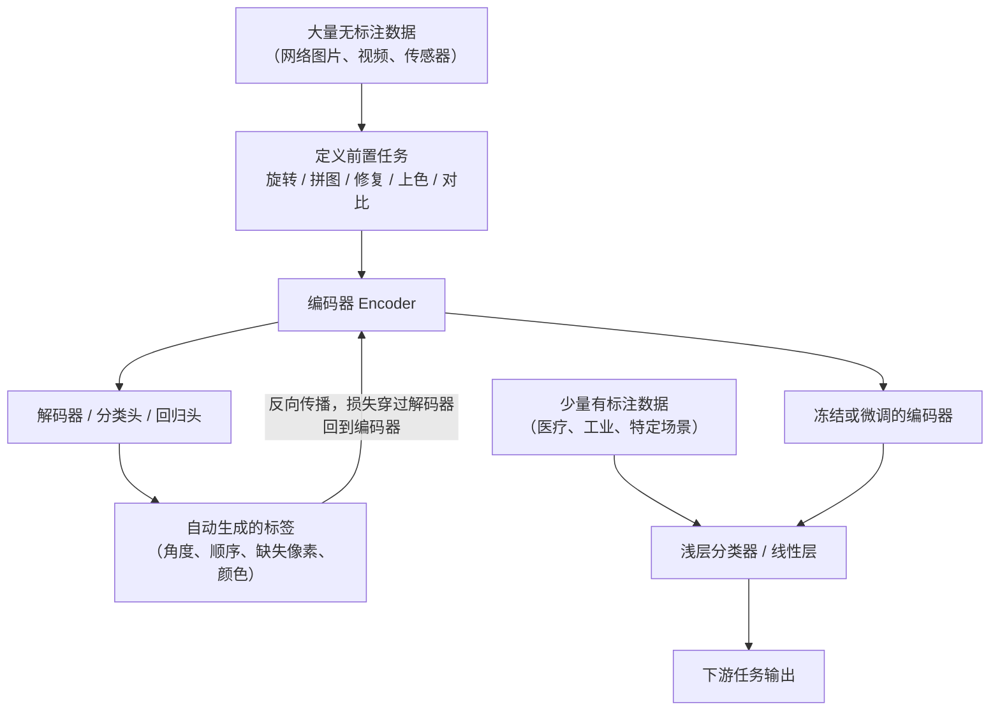

> **课程信息**
>
> - **课程名称**：Stanford CS231n: Deep Learning for Computer Vision（Spring 2025）
> - **本讲主题**：Lecture 12. Self-Supervised Learning
> - **主讲教师**：Ehsan Adeli
> - **授课日期**：2025-05-08
> - **课程主页**：[cs231n.stanford.edu/2025](https://cs231n.stanford.edu/2025/schedule.html)
> - **官方课件**：[lecture_12.pdf](</attachments/cs231n-bc6e07e06fc46098aa1b2a27.pdf>)（115 页，正文按页链接本地课件）
> - **字幕来源**：[cs231n_sp25_kor_sub · eng](https://github.com/lpaiu-cs/cs231n_sp25_kor_sub/tree/main/eng)（公开英文转写，中文由本书重写）
> - **版权说明**：幻灯片与课程材料版权归 Stanford University 及授课教师所有；本书为非官方学习笔记，仅用于学习与研究。

> **课件索引**：点击下方链接打开本地 PDF 的对应页；全部课件见 [课件索引](/notes/cs231n/slides)。页码按 PDF 文件页序定位，第 1 讲分为 Part 1 / Part 2。

[📄 L12 · 第 1 页｜第 12 讲标题页：Self-Supervised Learning](</attachments/cs231n-bc6e07e06fc46098aa1b2a27.pdf#page=1>)

第 11 讲把机器那头的问题解决了：GPU 怎么用、多卡怎么并行、训练怎么扩到更大规模。这一讲要处理的是同一件事的另一半——数据。算力可以买、可以堆，标注不能；当模型从百万参数涨到十亿参数时，唯一按同一速度涨不上去的生产资料就是人工标签。

Ehsan Adeli 把这一讲组织成两条技术路线。前半场是「从图像变换里造标签」：转一张图、遮一块区域、打乱 patch 的顺序、把颜色抽掉，然后用重建或分类去预测被自己动过的那部分，代表工作是 MAE。后半场是「从样本之间的关系里造标签」：把同一张图的两个视图拉近、把不同图的视图推远，把无监督问题写成一个 N 路分类问题，代表工作是 InfoNCE、SimCLR、MoCo、CPC 与 DINO。两条路线的共同假设只有一句：**只要预测任务足够难，编码器就被迫学会关于视觉世界的通用结构**。

## 1. 标签是瓶颈：算力可以堆，人工标注堆不动

*(参考时间: 00:00:05 – 00:08:20｜Lecture 12)*

[📄 L12 · 第 2 页｜课程事务页：期中考试、复习课与项目提案反馈](</attachments/cs231n-bc6e07e06fc46098aa1b2a27.pdf#page=2>)

开课前的事务页只有三行：期中考试在下周二（5/13）的上课时间进行，别迟到，后勤细节见 Ed 帖子；期中复习课在明天（周五 5/9）中午 12:30；项目提案的反馈已经发到 Gradescope。这一页与后面的技术内容无关，但它给了本讲一个时间坐标——这是期中前的最后一讲，下一次上课就是考试。

[📄 L12 · 第 3 页｜上一讲回顾页：GPU 硬件与多卡训练](</attachments/cs231n-bc6e07e06fc46098aa1b2a27.pdf#page=3>)

上一讲是新加进课程的内容，讲师自己的评价是「timely and very important」——模型规模和应用的膨胀让「怎么把训练摊到很多张卡上」从工程细节变成了必修课。但这页只停留了几秒，因为它解决的是「算得动」，而今天要解决的是「喂得起」。

[📄 L12 · 第 4 页｜四类视觉任务与它们的标注粒度](</attachments/cs231n-bc6e07e06fc46098aa1b2a27.pdf#page=4>)

这张图是全讲的动机图，只是它把动机藏在了排版里。四个格子是分类、语义分割、目标检测、实例分割，下面三行小字分别标注了它们的监督粒度：分类「No spatial extent」——一张图一个标签；语义分割「No objects, just pixels」——每个像素一个类别（草地、猫、树、狗、天空）；实例分割「Multiple objects」——还要把同类物体逐个分开。标注成本正是沿着这条粒度梯度爆炸的。一张 224×224 的图有 50,176 个像素，分类只需要 1 个标签，语义分割理论上要 5 万个；即便用多边形或涂鸦去近似，人工时间也差着三四个数量级。讲师没有给具体的标注价格，但这个数量级差足以解释后面的所有设计：**任何能绕开人工标签的方法，只要能保住精度，就值得一试**。

[📄 L12 · 第 5 页｜上周可视化内容的章节页](</attachments/cs231n-bc6e07e06fc46098aa1b2a27.pdf#page=5>)

回到上周的可视化与理解。那一讲讲的是怎么「看进去」：梯度的显著性、类激活图、把中间层的响应投射回像素。今天要借用的不是这些工具，而是它们暴露出来的一个事实——网络中间那些数字不是乱码，它们有结构。

[📄 L12 · 第 6 页｜像素空间的近邻与特征空间的近邻](</attachments/cs231n-bc6e07e06fc46098aa1b2a27.pdf#page=6>)

AlexNet 那张经典对比图：左列是查询图，中左是像素空间的 L2 最近邻，中右是特征空间的 L2 最近邻，最右那张网络剖面图标红了 fc7 那一层。像素空间的近邻全是同色块、同纹理的糊图——大象的近邻是一团灰褐色的东西；特征空间的近邻里，每张查询图后面跟着的都是同类物体：紫花、大象、军舰、南瓜灯、狗。差别来自那个被框住的红条：fc7 输出的 4096 维向量。两张图在像素上可以差得很远，在这个 4096 维空间里却可以很近。这就是「学到的表示」这个说法在工程上的含义：它不是解释，而是一个可以拿来做距离度量的坐标。

[📄 L12 · 第 7 页｜同一张图换成 Learned Representations 的标题](</attachments/cs231n-bc6e07e06fc46098aa1b2a27.pdf#page=7>)

同一张幻灯片再出现一次，标题从「上周：可视化与理解」换成了「学到的表示」。这个换名是本讲的转折：上一讲用它说明「模型学到了东西」，这一讲要问的是「这个东西能不能直接拿来用」——如果把 fc7 的 4096 维当特征，接一个线性分类器就能出类别，那我们其实已经有一个与标签无关的、可复用的中间产物了。

[📄 L12 · 第 8 页｜4096 维向量接类别标签，以及大规模训练的难题](</attachments/cs231n-bc6e07e06fc46098aa1b2a27.pdf#page=8>)

箭头继续往右延伸：4096 维向量 → Class Labels。到这里，问题才被摆上桌：**大规模训练的困难在哪？** 讲师自己给出了答案并重复了一遍——我们需要大量标注数据。这个网络从图像出发、到类别结束，中间那 4096 维之所以「有用」，恰恰是因为整个网络是被标签拽着训出来的；标签没了，这条链路就断了。于是本讲的核心提问变成一句可以写在白板上的话：有没有办法在没有海量人工标注的前提下训练神经网络，并且仍然拿到好的特征？

[📄 L12 · 第 9 页｜自监督学习的两个任务：pretext 与 downstream](</attachments/cs231n-bc6e07e06fc46098aa1b2a27.pdf#page=9>)

自监督学习（self-supervised learning）的回答是把这个链路拆成两段。左边是前置任务（pretext task）：用数据本身定义任务，不需要人工标注，形式上它是无监督的，但训练时用的是监督学习的目标函数——分类或回归。右边是下游任务（downstream task）：你真正在意的应用，手上没有大数据集，但那批数据是有标签的。两个任务之间共享的只有一样东西：编码器。图上那个 Trained Encoder 就是全部的交付物。



这张图就是本讲的骨架：上面那条循环是自监督训练，下面那条短链是迁移。注意它没有说「前置任务的表现要好」——恰恰相反，后面会反复出现同一句话：我们不在乎模型在旋转预测或拼图上有多少准确率，只在乎它顺手学出来的编码器在下游有多好用。

[📄 L12 · 第 10 页｜前置任务的编码器-解码器结构](</attachments/cs231n-bc6e07e06fc46098aa1b2a27.pdf#page=10>)

拆开第一段看。输入是图像，编码器把它压成学到的表示（learned representation），后面的模块把表示映射到输出空间——那里的标签不是人标的，是数据自动生成的。这个后置模块可以叫解码器、分类器或回归器，取决于前置任务被定义成什么形状：要重建像素就是解码器，要预测四类角度就是分类器，要回归一个连续角度就是回归器。讲师在这里补了一句容易被忽略的话：当后置模块是解码器时，整个东西更接近自编码器（autoencoder）的框架。这句话在后面 MAE 那一节会变成主线，因为 MAE 正是把自编码器做成了非对称的形状。

[📄 L12 · 第 11 页｜下游任务：换掉后置模块，标签变成真实标签](</attachments/cs231n-bc6e07e06fc46098aa1b2a27.pdf#page=11>)

下游阶段做的是替换：编码器保留，后面的解码器换成分类器（图上写的是 FC），标签的来源换成真实标注。此时要训练的只有这最后一段，编码器可以是冻结的，也可以跟着微调——这个选择在 MAE 那一节会被正式命名为 linear probing 与 fine-tuning。这样一套流程要成立，只需要两个条件，而它们互相拉扯：前置任务必须**难到值得学**，否则编码器学不到东西；前置任务又必须**不需要人工标注**，否则等于什么都没省。整讲剩下的部分，本质上就是在不同任务上反复检查这两个条件满足得怎么样。

## 2. 前置任务怎么验收：任务表现、表示质量、鲁棒性、效率、下游

*(参考时间: 00:08:37 – 00:14:57｜Lecture 12)*

[📄 L12 · 第 12 页｜四种经典前置任务：补全、旋转、拼图、上色](</attachments/cs231n-bc6e07e06fc46098aa1b2a27.pdf#page=12>)

定义前置任务并不简单，讲师的原话是「not that straightforward」。这页给了四个已经跑通过的样例：图像补全（遮住一部分，预测被遮的部分）、旋转预测（输入图，输出它被转过的角度 θ）、拼图（打乱 patch，输出正确顺序）、上色（给灰度图，预测每个像素的颜色）。四个任务共享同一套合法性论证，写在页面底部：解这些任务的过程会逼模型学到好特征；这些任务的标签可以完全自动生成。第一条决定了方法的**上限**——如果任务不需要理解物体就能做对，那学到的特征也不会理解物体；第二条决定了方法的**成本**——只要标签能自动生成，数据量就可以无限扩。

[📄 L12 · 第 13 页｜自监督学习的评估清单](</attachments/cs231n-bc6e07e06fc46098aa1b2a27.pdf#page=13>)

接下来是评估。这页列了五项，讲师按重要性重排过：

- **前置任务表现**：模型在无标签任务本身上做得多好。它是最容易测的，也是最能骗人的——任务简单时准确率可以很高而特征一无是处。
- **表示质量**：不看任何微调，直接考察表示本身。三条常用手段是线性评估协议（linear evaluation protocol，在冻结的表示上训一个线性分类器）、聚类（看表示能不能自然分群）、t-SNE（把高维表示降到 2D/3D 目视可分性）。讲师特意说明 t-SNE 之前没怎么讲过，它的作用只是降维可视化。
- **鲁棒性与泛化**：换数据集、换扰动之后还剩多少。
- **计算效率**：训练时间和资源开销。
- **迁移与下游表现**：把表示搬到有监督的下游任务上，看它值多少。

讲师明确点了名：五项里最重要的是最后一项。这个判断有工程上的理由——前置任务的准确率是一个代理指标（proxy），只有下游指标才是我们付钱买的东西；代理指标与真实目标之间的相关性，恰恰是自监督研究里最不可控的一环。

[📄 L12 · 第 14 页｜评估流程第一步：用旋转任务训特征提取器](</attachments/cs231n-bc6e07e06fc46098aa1b2a27.pdf#page=14>)

这就是所有自监督论文里那张「评估流程图」的第一帧。左边是一大堆无标签数据，中间是自监督学习加特征提取器（一个卷积网络），右上角是旋转任务的输出：图像被转 0/90/180/270，网络输出四类之一。这一步的产物不是那个四分类器，而是编码器。

[📄 L12 · 第 15 页｜评估流程第二步：接浅层网络，用少量标签训练](</attachments/cs231n-bc6e07e06fc46098aa1b2a27.pdf#page=15>)

第二帧把下游接了上去：特征提取器后面挂一个线性分类器（图上写 conv + linear classifier），用目标任务的少量标注数据训练，最后在目标任务上评估（分类、检测等）。注意第一帧里的 fc 和四分类头被整段拿掉了——它们只在前置阶段有用，下游一点都不需要。讲师强调这里要的是**浅层**网络。理由很直接：如果特征真的好，把类别读出来不需要很复杂的映射；如果必须靠一个深网络才能读出类别，那说明信息没在特征里，而是在你新加的那几层里被重新学了一遍，这时候「特征好不好」这个问题就失去了意义。这也是线性评估协议的全部逻辑。

[📄 L12 · 第 16 页｜更大图景：语言、语音、机器人、视觉里的自监督](</attachments/cs231n-bc6e07e06fc46098aa1b2a27.pdf#page=16>)

这一页把视野拉出计算机视觉。图上四个格子对应四个领域：视觉（Doersch 等，2015）、语言建模（GPT-4，OpenAI 2023）、语音合成（Wavenet，van den Oord 等，2016）、机器人/强化学习（Dense Object Net，Florence 与 Manuelli 等，2018），中间标着「Today's lecture」的那一格是本讲覆盖的范围。讲师在这里说了一句本讲最重的判断：让今天这些大语言模型成为可能的那套范式，正是自监督。GPT-4 这类框架的训练语料绝大部分是原始文本，没有人逐句标注；同样的逻辑正在语音、机器人、强化学习里复制。他还给了一个很具体的例子：湾区路上那么多在跑数据的自动驾驶车，商业逻辑的一部分就是「数据可以自己采、不必自己标」。

[📄 L12 · 第 17 页｜今日议程：上半场图像变换，下半场对比学习](</attachments/cs231n-bc6e07e06fc46098aa1b2a27.pdf#page=17>)

议程分两块。上半场是图像变换类前置任务：旋转、修复、重排、上色，再加上重建路线的最新形态 MAE。下半场是对比表示学习：先讲直觉与形式化，再讲实例级方法 SimCLR 与 MoCo、序列级方法 CPC，最后是 DINO。

[📄 L12 · 第 18 页｜议程第二帧：对比学习那一块变灰](</attachments/cs231n-bc6e07e06fc46098aa1b2a27.pdf#page=18>)

同一页的第二帧只改了一件事：下半场整块变灰。这是讲师的进度条用法——先把上半场点亮，讲完再回来点亮下半场。后面第 67 页这张议程会以同样的形态再出现一次，届时灰掉的是上半场。

## 3. 旋转、相对位置、拼图：把几何变换变成分类标签

*(参考时间: 00:15:26 – 00:26:25｜Lecture 12)*

### 3.1 旋转预测的全部赌注押在「视觉常识」上

[📄 L12 · 第 19 页｜旋转前置任务的假设页：只有见过物体正立的样子，才能认出它被转过](</attachments/cs231n-bc6e07e06fc46098aa1b2a27.pdf#page=19>)

这是本讲第一个前置任务，也是全讲最干净的一个假设：**一个模型只有在具备「这个物体正立时该长什么样」的视觉常识时，才能认出它被转过的角度**。这句话把任务难度和特征质量绑在了一起——模型要做对，就必须知道鸟的喙朝前、人的头朝上、车的轮子朝下。

[📄 L12 · 第 20 页｜旋转任务的四个分支：同一张图转 0/90/180/270 度](</attachments/cs231n-bc6e07e06fc46098aa1b2a27.pdf#page=20>)

实现方式很直接。一张原图 $X$，用四个确定性函数 $g(X, y)$ 分别转 0、90、180、270 度，得到 $X^0, X^1, X^2, X^3$ 四个版本，标签就是 $y \in \{0,1,2,3\}$。讲师特意点明这不是回归：不需要预测精确角度，只要在四类里选一个。四分类的好处是任务稳定、类别平衡——每张图必然且只生成四个样本，每个类别各占 25%，不会出现某类角度特别多的问题。

[📄 L12 · 第 21 页｜旋转任务第二帧：加上共享的 ConvNet 与四个「最大化 F^y(X^y)」的目标框](</attachments/cs231n-bc6e07e06fc46098aa1b2a27.pdf#page=21>)

第二帧补上了训练那半边：四个旋转版本进入**同一个** ConvNet $F(\cdot)$，后面四个目标框写着「Maximize prob. $F^y(X^y)$」，即对每个 $y$ 最大化把它判成第 $y$ 类的概率。共享权重是这里唯一的精巧之处——如果四个角度各训一个网络，学到的会是四份互不相干的特征，也就没有「通用表示」可言了。数据量的账也很好算：原本 $N$ 张图，做一次旋转就变成 $4N$ 个训练样本，标签零成本。这是所有图像变换类前置任务的共同红利——**数据增强从正则化手段升级成了标签工厂**。

[📄 L12 · 第 22 页｜半监督评估：冻结 conv1+conv2，只学 conv3 与线性层](</attachments/cs231n-bc6e07e06fc46098aa1b2a27.pdf#page=22>)

评估用 CIFAR-10。做法是：整个 CIFAR-10 训练集上做旋转自监督预训练，然后冻结 conv1 和 conv2，只用一小部分有标签的 CIFAR-10 数据去学 conv3 和线性层。横轴是标注样本数（20、100、400、1000、5000），纵轴是测试准确率。

曲线上有两件事值得记。第一，**低标注区间的差距是巨大的**：只有 20 个标注样本时，半监督版本（黄线）已经在 65% 左右，而从随机初始化开始的有监督版本（蓝线）还在 39% 附近——26 个百分点的差距，全部来自预训练。讲师的说法是「模型一开始就处在不错的状态，即便在最初几次迭代里也已经对物体有理解」。第二，**高标注区间两条线会合流**：到 5000 个标注样本时，两者都爬到 92% 上下（蓝线略高）。原因不神秘——CIFAR-10 本身是个简单任务，数据一多，监督信号自己就够用了。这正好划出了自监督的适用边界：**它买的是低标注区间的那段斜率，不是上限**。任务越简单，这段斜率越不值钱；任务越难、标注越贵，它越值钱。

[📄 L12 · 第 23 页｜迁移到 Pascal VOC 2007：旋转预训练与 ImageNet 全监督的对照](</attachments/cs231n-bc6e07e06fc46098aa1b2a27.pdf#page=23>)

这张表是本讲第一个硬数字，值得逐行读。任务列是 Pascal VOC 2007 的分类（%mAP）、检测（%mAP）与分割（%mIoU），行是不同的预训练来源：

| 预训练方式 | 分类 fc6-8 | 分类 all | 检测 | 分割 |
| --- | --- | --- | --- | --- |
| ImageNet 全监督（上限参照） | 78.9 | 79.9 | 56.8 | 48.0 |
| 随机初始化（无预训练） | — | 53.3 | 43.4 | 19.8 |
| 随机初始化 + 缩放 | 39.2 | 56.6 | 45.6 | 32.6 |
| 旋转自监督（RotNet） | 70.87 | 72.97 | 54.4 | 39.1 |

读法有三层。随机初始化那一行是地板：分类 53.3、分割 19.8。旋转自监督那一行把地板抬到了 72.97 和 39.1——分类涨了近 20 点，分割直接翻倍。但和 ImageNet 全监督那一行比，它仍然差 2–9 个点（检测上只差 2.4，分类上差 6.9），而这几个点是花 1000 类人工标签换来的。讲师的原话是：旋转预训练「不等于在全 ImageNet 上预训练，但已经很接近」。

注意表里还有一排其他自监督方法，RotNet 在三列上都排在最前面：分割 39.1，高于 ColorProxy 的 38.4、Jigsaw 的 37.6 与 Split-Brain 的 36.0。但表内部的排序并不稳定：分类列上 Jigsaw 的 67.6 压过 Split-Brain 的 67.1，检测列上 ColorProxy 的 65.9 又反超 Jigsaw 的 53.2，分割列上各家再换一次次序。**前置任务的选择会系统性地偏向某类下游任务**，这个观察是第 61 页那页总结的伏笔。

[📄 L12 · 第 24 页｜注意力图对比：自监督模型的覆盖范围更宽](</attachments/cs231n-bc6e07e06fc46098aa1b2a27.pdf#page=24>)

第三个评估角度是把特征投射回像素，看模型在「看哪里」。讲师给了一个很好用的对照：全监督模型的注意力图往往更集中——它只需要解决分类这一个任务，抓住眼睛和眼睛周围的形状就够了，其他区域与损失无关；自监督模型的覆盖范围明显更宽，因为它不知道下游任务是什么，只能对整张图建立一个更整体的理解。这不是「自监督更好」的证据，而是一个结构性的差异：**监督信号越窄，特征就越容易被压成只服务那一个任务的形状**。这句话在后面讲对比学习时还会以另一种形式出现——投影头之所以存在，就是为了不让对比损失把特征压得太窄。

### 3.2 从「哪一个 patch」到「哪一种排列」

[📄 L12 · 第 25 页｜3×3 网格与相对位置：8 路分类](</attachments/cs231n-bc6e07e06fc46098aa1b2a27.pdf#page=25>)

第二个任务是相对位置（Doersch 等，2015）。把图切成 3×3 网格，取中心 patch 作为参照，问模型：这个 patch 相对中心在哪个位置？八个非中心位置对应八类，所以它又是一个 8 路分类。这一页的插图是整讲的缩影：把「理解图像」拆成「理解部件之间的空间关系」。

[📄 L12 · 第 26 页｜拼图任务：打乱 9 个 patch，预测正确排列](</attachments/cs231n-bc6e07e06fc46098aa1b2a27.pdf#page=26>)

Noroozi 与 Favaro 在 2016 年把这个想法推到极端：同样 3×3 网格，9 个 patch 全部打乱，让网络预测正确的排列。讲师当场向课堂提了一个问题：这样的设置一共有多少种排列？答案被学生喊出来——$9! = 362{,}880$。

直接做 36 万路分类既没必要也不稳，因为很多排列只差一次相邻交换，视觉上几乎一样。作者的做法是建一张查找表，只保留 64 个置换，选取标准是彼此之间的差异最大（讲师的说法是「largest difference distance」）。这样任务就变成 64 路分类，输出是一个 64 维向量。讲师补了一句很实在的评语：64 这个数字近乎任意，选它不是理论推导的结果，而是为了让任务落在一个可控的分类规模上——$\log_2 64 = 6$ bit 的信息量，对一张图来说已经不算少了。

[📄 L12 · 第 27 页｜拼图特征的迁移结果：在分类、检测、分割上都超过相对位置方法](</attachments/cs231n-bc6e07e06fc46098aa1b2a27.pdf#page=27>)

迁移结果按同一套 VOC 协议评测。图上「Ours」是拼图特征，对照是 Doersch 等的相对位置方法。讲师没有逐个念数字，只给结论：拼图方法在这三类任务上都超过了之前的框架。这一点值得留意——两个任务用的是同一张 3×3 网格、同一批图像，区别只在「预测单个 patch 的位置」还是「预测整组 patch 的排列」，而后者把任务从「识别局部内容」推进到了「识别全局布局」，特征质量就上了一个台阶。讲师随后提醒了年份：这是 2016 年的工作，属于这一系列方法的早期。它的能力边界也很清楚——一个只会判断 90 度旋转的网络，并不理解物体是什么，只是理解了朝向。

## 4. 修复与上色：把像素和颜色本身当监督信号

*(参考时间: 00:26:30 – 00:37:04｜Lecture 12)*

### 4.1 遮住一块，让模型把缺失的像素写回来

[📄 L12 · 第 28 页｜图像修复前置任务：遮住一块，预测被遮的内容](</attachments/cs231n-bc6e07e06fc46098aa1b2a27.pdf#page=28>)

第三个任务是修复（inpainting），Pathak 等的 Context Encoders（2016）。掩码策略简单到不能再简单：在输入图上盖掉一块矩形区域，让模型把这块补回来。它的合法性来自一个事实——被盖掉的内容在原始数据里是存在的，所以**我们手上一直有标准答案**，只是这个答案从来不需要人标注。

[📄 L12 · 第 29 页｜修复用的自编码器：编码器压到特征，解码器还原缺失区域](</attachments/cs231n-bc6e07e06fc46098aa1b2a27.pdf#page=29>)

结构是编码器-解码器：编码器把被遮的图压进特征空间，中间接若干全连接层，解码器把特征还原成缺失区域的像素，损失函数比较输出与真实像素。讲师把它归到自编码器一类，但强调了一个限定语——这是个「用掩码目标训练的自编码器」，它重建的不是整张图，而是被遮住的那部分。这个限定很重要，因为它决定了编码器必须学到什么：如果目标是重建整张图，网络可以学会一条恒等映射（把输入抄到输出）而什么都不理解；目标只落在缺失区域时，恒等映射就失效了，网络必须从上下文里推断内容。

[📄 L12 · 第 30 页｜修复的评估困境：一张图可以有多种合理的补法](</attachments/cs231n-bc6e07e06fc46098aa1b2a27.pdf#page=30>)

但修复的评估有个天然的麻烦，讲师专门停下来讲：**同一个缺口有无数种合理的补法**。天空可以补成蓝的也可以补成灰的，草地可以补成绿的也可以补成黄的，没有哪一种算错。用 L2 去衡量时，模型会倾向于输出这些合理答案的「平均值」——于是早期的重建结果普遍发虚、发糊，边缘被抹平。这不是模型不够大，而是损失函数在鼓励平均。这个诊断直接引出了下一页。

[📄 L12 · 第 31 页｜损失函数：重建项 + 对抗项，掩码逐元素相乘](</attachments/cs231n-bc6e07e06fc46098aa1b2a27.pdf#page=31>)

解法是加一个对抗项，让「看起来真不真」也进入损失。整页的公式值得抄下来：


$$
L(x) = L_{recon}(x) + L_{adv}(x)
$$


$$
L_{recon}(x) = \left\| M * \left( x - F_\theta((1-M) * x) \right) \right\|_2^2
$$


$$
L_{adv} = \max_D \; \mathbb{E}\left[\log D(x)\right] + \log\left(1 - D\left(F((1-M)*x)\right)\right)
$$


三个符号各司其职。$M$ 是掩码，被遮处取 1、未遮处取 0；$*$ 是逐元素相乘；$F_\theta$ 是编码器加解码器。于是 $(1-M)*x$ 表示「只把可见部分喂进去」，$F_\theta((1-M)*x)$ 是补全结果，$x - F_\theta(\cdot)$ 是逐像素误差，再乘一次 $M$ 就只统计被遮区域的误差——**损失只在缺口上算，可见区域一个像素都不计**。这与后面 MAE 的做法完全一致，可以看作同一个配方在更大规模上的重演。对抗项是标准的 GAN 写法，$D$ 是判别器。讲师明确说这一块留到下一讲（生成模型）再展开，这里只需要知道它解决的是「糊」。

[📄 L12 · 第 32 页｜修复评估四列：输入、重建、对抗、重建+对抗](</attachments/cs231n-bc6e07e06fc46098aa1b2a27.pdf#page=32>)

四列并排就是这条论证的全部证据：输入（带缺口的上下文）、纯重建、纯对抗、重建加对抗。纯重建的结果平滑但没有细节；纯对抗能生成纹理，却可能跑偏；两者相加才既有结构又有质感。讲师在这一页只补了一句判断：加上对抗项之后，重建出来的部分「看起来好了一些」。

[📄 L12 · 第 33 页｜修复特征的迁移：分类、检测、分割三项都受益](</attachments/cs231n-bc6e07e06fc46098aa1b2a27.pdf#page=33>)

同一套 VOC 迁移协议下，修复特征也拿到了增益，而且增益分布在分类、检测、语义分割三列上。讲师在这里埋了一个回扣：「我待会儿会回到基于重建的框架和掩码，因为这是目前预训练最常用的模型或前置任务之一」——他指的就是第 52 页开始的 MAE。

### 4.2 上色：把亮度与颜色拆开，就有了一对免费的监督信号

[📄 L12 · 第 34 页｜上色前置任务：L 通道进，ab 两个通道出](</attachments/cs231n-bc6e07e06fc46098aa1b2a27.pdf#page=34>)

第四个任务是上色，思路比前三个更「物理」一点。彩色图存的通常是 RGB，但 RGB 三个通道混在一起，亮度和颜色纠缠不清。换成 LAB 色彩空间就可以拆开：$L$ 是亮度，$a$、$b$ 是两个色度通道。于是任务变成——输入 $X \in \mathbb{R}^{H \times W \times 1}$（只有 L），输出 $\hat{Y} \in \mathbb{R}^{H \times W \times 2}$（ab 两个通道）。讲师在这里插了一段旁白：色彩空间有很多种，计算机视觉里最常用 RGB，但如果要把亮度和颜色分开，就得换 LAB 这类空间；把 L、a、b 三个通道叠回去，就还原出彩色图。这段话解释了为什么上色是个合法的前置任务：**颜色在数据里，只是被拆到了另外两个通道上**。

[📄 L12 · 第 35 页｜上色的第二帧：把预测的 ab 与 L 拼回彩色照片](</attachments/cs231n-bc6e07e06fc46098aa1b2a27.pdf#page=35>)

第二帧把结果接了回去：灰色输入经 $F$ 输出 ab，再与 L 拼接成 $(\mathbf{X}, \hat{\mathbf{Y}})$，右图从伪彩色的通道可视化变成了一张真正的彩色照片——珊瑚礁里那条鱼被还原成深蓝身体配黄色尾鳍。这一帧的意义在于把「预测两个通道」翻译成了「生成一张彩图」，也顺手说明了这个任务的评估方式：颜色对不对，人眼一看就知道。

[📄 L12 · 第 36 页｜split-brain 自编码器：两个方向同时预测](</attachments/cs231n-bc6e07e06fc46098aa1b2a27.pdf#page=36>)

顺着「给定一部分通道，预测另一部分」往下推，自然会问：为什么只能 L → ab？反方向同样成立。这就是 split-brain 自编码器（Zhang 等）：输入图分成 L 通道与 ab 通道两路，网络 $\mathcal{F}_1$ 学 L → ab，网络 $\mathcal{F}_2$ 学 ab → L，两支的输出拼回原图，与输入算 L2 损失。讲师的描述是：训练时这两个函数一起训，最后把两支合并生成整张图再算损失，任何距离函数都能用。这里的精巧之处是**两支互为监督**：一支的输入是另一支的目标，所以不需要任何外部标签，也不需要设计两套任务。

[📄 L12 · 第 37 页｜split-brain 的通用形式：X1 预测 X2，X2 预测 X1](</attachments/cs231n-bc6e07e06fc46098aa1b2a27.pdf#page=37>)

第二帧把它抽象成了通用形式。输入图 $X$ 被切成两组通道 $X_1$（蓝）与 $X_2$（黄），两条路径分别用 $\mathcal{F}_1$、$\mathcal{F}_2$ 做跨通道预测：$X_1 \to \hat{X}_2$、$X_2 \to \hat{X}_1$，拼起来得到 $\hat{X}$。这个形式一旦成立，「颜色」就不再是必要条件——任何可以自然分组的数据都能套进来。

[📄 L12 · 第 38 页｜split-brain 用在 RGB-D：RGB 预测 HHA 深度，反之亦然](</attachments/cs231n-bc6e07e06fc46098aa1b2a27.pdf#page=38>)

讲师给的例子正是 RGB-D 传感器：一帧数据里既有 RGB 通道，也有深度通道（图上标的是 HHA 深度编码），于是可以让 RGB 预测深度、深度预测 RGB，两支拼成 predicted RGB-HHA image。他说这类跨模态预测在机器人应用里是很成功的下游任务。这也解释了 split-brain 这个名字的来历：一个自编码器被劈成两半，各自负责一半通道。

### 4.3 上色的两个副产品：一个能用的工具，一张能讲故事的图

[📄 L12 · 第 39 页｜上色特征迁移：拼接 F1 与 F2 的特征，在 Places 标签上评测](</attachments/cs231n-bc6e07e06fc46098aa1b2a27.pdf#page=39>)

回到评估。做法是在整个 ImageNet 训练集上做自监督预训练，下游用 **$F_1$ 与 $F_2$ 的拼接特征**，评测数据用 Places（Zhou，2016）的标签。讲师给的结论是：这些特征在预测类别上有相当不错的准确率，但**仍然不如全监督**——因为这里没有任何标签参与，只有拼接起来的两路特征。拼接这个动作值得注意：既然两路各自看过不同的通道，它们的特征就带有互补信息；把两路拼起来，等于把「亮度里学到的形状」和「颜色里学到的语义」合在一起用。这是 split-brain 相对单向上色的唯一结构性优势。

[📄 L12 · 第 40 页｜上色的现实用途：给历史黑白照片上色](</attachments/cs231n-bc6e07e06fc46098aa1b2a27.pdf#page=40>)

讲师在这里换了个角度谈上色的价值：它不只是预训练手段，本身就是一个能用的工具——可以把没有彩色版本的照片和视频上色。这一页的例子是一张老照片（动物园里的动物，黑白底片），模型给出的颜色是棕褐色的皮毛与灰绿色的背景。

[📄 L12 · 第 41 页｜上色的著名例子：Half Dome 与它在水中的倒影](</attachments/cs231n-bc6e07e06fc46098aa1b2a27.pdf#page=41>)

更能说明问题的是这张：约塞米蒂的半圆顶（Half Dome）、桥、树，以及水面上完整的倒影。讲师指出，模型上色的不只是物体本身，连倒影里的山、树、桥也被赋予了与实物一致的颜色。模型没有被显式告知「水会反射」，它是在海量数据里学到这一点的。讲师紧跟了一句限定，这句话值得记住：这些模型都出现在大语言模型、大视觉模型之前，它们是为特定任务训练的，不是为「解决一切」训练的。所以看到这种「理解物理世界」的迹象时，要把它当成一个有意思的副产品，而不是通用能力的证据。

## 5. 视频上色：时间一致性把跟踪能力逼了出来

*(参考时间: 00:37:09 – 00:44:46｜Lecture 12)*

### 5.1 从单帧到序列：多出来的一条约束

[📄 L12 · 第 42 页｜视频上色的设定：第 0 帧有颜色，后面几帧只有灰度](</attachments/cs231n-bc6e07e06fc46098aa1b2a27.pdf#page=42>)

把上色推到视频，任务描述里多了一个自由度，也多了一条约束。设定是：$t=0$ 的参考帧是彩色的，$t=1,2,3,\dots$ 的目标帧是灰度的，任务是为这些帧上色。页面中间那句问话是全部难点所在——「这些帧该怎么上色？」单帧上色时，每一帧都可以独立猜一个合理的颜色；视频里不行，因为同一个人在同一段视频里的衣服不会突然变色。

[📄 L12 · 第 43 页｜第二帧：同一物体在不同帧里必须是同一个颜色](</attachments/cs231n-bc6e07e06fc46098aa1b2a27.pdf#page=43>)

第二帧把答案写了出来：Should be the same color。由此得到本节的假设——**学会给视频帧上色，应该能让模型学会在没有标签的情况下跟踪区域或物体**。理由很直接：要给 $t=3$ 帧里的人配上正确的颜色，模型必须先在 $t=0$ 帧里找到「同一个人」，再把那个位置的颜色搬过来。跟踪不是被显式监督的，它是完成任务的必要中间步骤。

### 5.2 指针、注意力、加权求和：三步把颜色搬过去

[📄 L12 · 第 44 页｜学习目标：在特征空间里建立参考帧与目标帧的映射，当作「指针」复制 LAB 颜色](</attachments/cs231n-bc6e07e06fc46098aa1b2a27.pdf#page=44>)

Vondrick 等的做法是：在学习到的特征空间里，为参考帧和目标帧之间建立映射，把这些映射当作「指针」，用它们把参考帧上的颜色（LAB 空间）复制到目标帧。讲师强调这套机制和注意力是同一件事——为每个目标像素，计算它相对于参考帧所有像素的注意力权重。

[📄 L12 · 第 45 页｜第一步：在参考帧上算出注意力图](</attachments/cs231n-bc6e07e06fc46098aa1b2a27.pdf#page=45>)

第一步是注意力图：对目标帧里的一个像素，用 CNN 特征算出它与参考帧每个像素的相似度。这一步的输入是两帧的特征图，输出是一张与参考帧同尺寸的权重图。

[📄 L12 · 第 46 页｜第二步：预测颜色 = 参考帧颜色的加权和](</attachments/cs231n-bc6e07e06fc46098aa1b2a27.pdf#page=46>)

第二步是加权求和：把这个像素的预测颜色写成参考帧所有像素颜色的加权平均，权重就是上一步的注意力。讲师把它讲得很朴素——注意力就是相似度，相似度高表示「大概是同一个物体上的同一个位置」，那就多抄一点它的颜色。维度上这是一个很轻的操作：对一个 $H\times W$ 的目标帧，每个像素要对参考帧的 $H\times W$ 个位置算权重，代价是 $O(H^2W^2)$；实际实现会在低分辨率特征图上做，这也是它能跑起来的原因。

[📄 L12 · 第 47 页｜第三步：预测颜色与真实颜色算损失](</attachments/cs231n-bc6e07e06fc46098aa1b2a27.pdf#page=47>)

第三步才是训练信号：预测颜色与真实颜色之间算损失。注意这里监督的是**颜色**，不是「对应关系」——网络为了让颜色对，自己把对应关系逼了出来。这正是自监督的标准套路：监督一个便宜的、自动可得的目标，让真正想要的表示成为副产品。

### 5.3 定性结果：一致性是看出来的

[📄 L12 · 第 48 页｜视频上色结果一：健身房场景，三列分别是参考帧、灰度目标帧、预测彩色](</attachments/cs231n-bc6e07e06fc46098aa1b2a27.pdf#page=48>)

三列排布是这类论文的标准展示方式：左列参考帧（彩色）、中列目标帧（灰度）、右列预测。这一例是室内健身房，木色置物架、黑色杠铃片、蓝色垫子，人物坐在地上。讲师要观众看的不是「颜色准不准」，而是「前后帧是否一致」。他给了一个反例作为对照：如果每一帧独立上色，人物的衬衫颜色会跳变，因为没有约束要求它保持一致。视频上色的价值不在于单帧好看，而在于**跨帧稳定**——而这个稳定性只能来自「找到对应位置」这件事。

[📄 L12 · 第 49 页｜视频上色结果二：另一位人物的画面](</attachments/cs231n-bc6e07e06fc46098aa1b2a27.pdf#page=49>)

换一个场景，结论相同：黄色练功服的人物在多帧之间保持了同一个颜色。这里值得注意的细节是，人物的姿态在变、位置在动，颜色却跟着人走——这说明注意力确实锁在了「那个人」上，而不是锁在某个固定的图像坐标上。

### 5.4 副产品：分割掩码与关键点也能被「传播」

[📄 L12 · 第 50 页｜用学到的注意力传播分割掩码](</attachments/cs231n-bc6e07e06fc46098aa1b2a27.pdf#page=50>)

既然注意力给出的是「目标帧的这个像素对应参考帧的哪个像素」，那它就不只能传颜色。把参考帧上的分割掩码按同样的注意力权重映射过去，就得到了目标帧的分割——图上展示的正是这条传播链。

[📄 L12 · 第 51 页｜用学到的注意力传播人体关键点](</attachments/cs231n-bc6e07e06fc46098aa1b2a27.pdf#page=51>)

关键点同理：参考帧上标好的姿态关键点，按注意力搬到后续帧，就成了关键点跟踪。讲师的原话是，因为你在算对参考帧的注意力，你实际上能够跟踪物体、跟踪片段，甚至识别视频里的关键点。这条结果链是整讲最有说服力的一段：一个为了「上色」而设计的任务，最后交付的是跟踪、分割传播与关键点传播三种能力，而它们的训练标签只有视频本身。

### 5.5 三个被追问的问题，与讲师的边界声明

课堂在这里停下来问了三件事，讲师的回答构成了这一节的边界说明。

**编码器凭什么知道该学什么？** 答案是标签来自解码器，而不是来自人。前置任务的输出（角度、颜色、缺失像素）由数据自动生成，损失在这些输出上计算，梯度再穿过解码器回传到编码器。讲师用了一个反问来对齐直觉：训练一个分类器时，编码器怎么知道该抽什么特征？靠反传损失。这里完全一样，只是「标签」换成了「另一个通道」或「被遮住的像素」。

**编码器和解码器是一个网络还是两个？** 讲师说这在不同的论文里完全不一样。预测旋转角度时，解码器就是几层全连接，整个东西是一个网络，下游时把那几层换掉即可；重建图像时，通常是两个网络端到端训练，因为你要用的是中间那个表示空间；到了 MAE，两边干脆连对称性都没有。**这属于任务相关的设计选择，没有统一答案**。

**为什么拼图只取 64 个置换？** 因为 $9!$ 太大且大部分置换只差一次相邻交换，作者选了彼此差异最大的一批，把任务压成 64 路分类（详见 3.2）。

最后是讲师主动加的免责声明：这些是自监督学习最早的一批方法，不该被期待「解决一切」；旋转任务的假设也只是——如果模型能判断「这是转了 90 度的」，那它至少隐式地理解了正确的朝向，从而在拿到正立的图时能认出里面是什么。他承认这是有限的任务，但有限不等于没用。

## 6. MAE：遮掉 75% 的图像，让重建变成可扩展的预训练

*(参考时间: 00:45:41 – 00:54:16｜Lecture 12)*

### 6.1 一个缺口变成一百多个缺口

[📄 L12 · 第 52 页｜两种遮挡强度：50% 与 75% 的掩码比例](</attachments/cs231n-bc6e07e06fc46098aa1b2a27.pdf#page=52>)

讲师把 MAE（He 等，2021）放在这里，是因为它和前面的修复任务是同一族，但把规模推上去了。第 28 页的修复只遮一块矩形，MAE 遮的是一大批不规则的 patch，而且遮得更狠：页面上并排给出 50% 与 75% 两种掩码比例。为什么要遮这么多？讲师给了两条理由，后面会在消融页被数据坐实。第一条是**难度**：遮得越多，剩下的上下文越少，任务就越不可能靠纹理糊弄过去，模型必须真正理解物体结构。第二条更工程化——遮得越多，同一张图能变出的不同遮挡版本就越多，数据量凭空翻了好几倍。

[📄 L12 · 第 53 页｜MAE 的总体流水线：可见 patch 进编码器，掩码 token 在解码器端补齐](</attachments/cs231n-bc6e07e06fc46098aa1b2a27.pdf#page=53>)

整条流水线画在一页上：输入图被切成网格、大部分格子被盖掉；只有可见的 patch 被送进编码器（灰色大块）；编码器输出一串 token；到了解码器入口，被遮的位置用灰色 token 补上，组成一条与 patch 数等长的序列；解码器输出每个 patch 的重建；右边是重建结果与目标图的对照。注意这条链上有一处不对称：**编码器只看到一部分 token，解码器看到全部**。这一点是 MAE 与经典自编码器的分水岭，也是这一节反复要讲的地方。

### 6.2 遮挡方式是超参：均匀采样 75%，不要 mask token

[📄 L12 · 第 54 页｜遮挡方法：非重叠 patch、均匀采样 75%、高比例才使任务有意义](</attachments/cs231n-bc6e07e06fc46098aa1b2a27.pdf#page=54>)

页面上四条要点构成了 MAE 的设计说明。第一，切分方式沿用 ViT：图像分成互不重叠的 patch。第二，均匀随机采样 75% 的 patch 并把它们遮掉。第三，高遮挡比例是任务有意义的必要条件——遮得太少，模型可以靠邻近像素插值交差。第四，也是最技术的一条：**编码器端不放 mask token**，只把可见的 25% 喂进去，这正是编码器可以做得极大的原因。第三条值得展开一句。重建类任务有一个天然捷径：如果缺口很小，卷积的感受野就能把答案从邻居那里插值出来，模型根本不需要语义。遮挡比例本质上是在切断这条捷径——缺口越大，插值越不可行，语义就越成为唯一出路。

[📄 L12 · 第 55 页｜编码器：只处理 25% 的可见 patch，线性投影加位置编码，再进 Transformer](</attachments/cs231n-bc6e07e06fc46098aa1b2a27.pdf#page=55>)

编码器的工作可以拆成三步：把可见 patch 做线性投影映射到嵌入空间；加位置编码（与 ViT 完全一致，只是位置索引对应原始网格位置）；送进一串 Transformer block。因为输入只有 25% 的 token，编码器每个 token 的计算量可以远大于解码器——页面上给的数字是**编码器每 token 的计算量超过解码器的 9 倍**。这个 9 倍不是凭空来的。按 ViT 常见的 16×16 patch 切一张 224×224 的图，一共 14×14=196 个 patch（编者按：这是 ViT 的标准切分，幻灯片未给具体尺寸），75% 遮挡后编码器只处理 49 个 token，解码器却要处理 196 个。把编码器做深、解码器做浅，总的计算开销反而被压在可控范围内——这是 MAE 能「scale」的核心账。

[📄 L12 · 第 56 页｜解码器：补齐 mask token 与位置编码，输出重建像素](</attachments/cs231n-bc6e07e06fc46098aa1b2a27.pdf#page=56>)

解码器做的是相反方向的事：先把编码器的输出按原始顺序摆回网格，在被遮的位置插入一个**共享的可学习 mask token**，再给所有 token 加位置编码；然后过若干 Transformer block，最后一层线性投影把每个 token 映射成像素，完成重建。讲师对 mask token 的解释很老实：它是一个可学习参数，没法严格解释它编码了什么，只能说它大致相当于「一个平均 patch」的占位。关键在于它是**共享**的——所有被遮位置用同一个向量，而不是 147 个各不相同的向量，这让参数量与遮挡比例解耦。页面最后一句是这一节最重要的结构性判断：解码器只负责重建，**训练结束后就整段丢弃**，因此它与编码器的设计完全解耦——不像传统自编码器或 UNet 那样要求两边对称。这就是所谓的非对称自编码器（asymmetrical autoencoder）。

这个设计选择的含义值得说透：在经典自编码器里，编码器和解码器的容量必须一起权衡，因为解码器要跟着模型一起用；而 MAE 的解码器只是一根「脚手架」，可以做得又浅又窄——它唯一的任务是把特征翻译回像素，之后就没用了。

### 6.3 损失只在缺口上算，探针只在特征上做

[📄 L12 · 第 57 页｜损失：像素空间 MSE，只对被遮的 patch 计算](</attachments/cs231n-bc6e07e06fc46098aa1b2a27.pdf#page=57>)

损失函数是像素空间的均方误差（MSE），并且**只对被遮的 patch 计算**——可见区域的重建是恒等映射，算进去只会稀释梯度。这一条与第 31 页的修复损失是同一个思想，只不过那里用掩码 $M$ 做逐元素相乘，这里直接用 patch 集合来筛选。用 MSE 而不是感知损失或对抗损失，是一个明确的取舍：像素级 MSE 会带来偏平滑的重建，但它简单、稳定、可扩展；而 MAE 的目标本来就不是生成好看的图，是训出好编码器。讲师在前面评价修复任务时说过重建结果「发虚」，MAE 没有去修这个问题，因为它不在乎。

[📄 L12 · 第 58 页｜linear probing 与 full fine-tuning 的差别](</attachments/cs231n-bc6e07e06fc46098aa1b2a27.pdf#page=58>)

编码器训好之后有两条下游路线，页面把它们画成了上下两个框。**linear probing**：预训练模型冻结，只在末尾加一个线性层去预测标签，用来评估表示的质量。**fine-tuning**：预训练模型不冻结，连同新加的一层或多层（可以带非线性）一起训。讲师对两者的定位说得很清楚：linear probing 衡量的是「在受限条件下表示本身有多好」，fine-tuning 挖掘的是「模型接近真实潜力时能到什么水平」。这也解释了为什么论文里两个数字都要报——前者是表示质量的下界，后者是实用性能的上界。

### 6.4 消融：八个超参里，最重要的是遮挡比例和采样方式

[📄 L12 · 第 59 页｜消融研究的八个维度：遮挡比例、解码器深度与宽度、mask token、重建目标、数据增强、采样方式、训练计划](</attachments/cs231n-bc6e07e06fc46098aa1b2a27.pdf#page=59>)

这一页列了需要做的选择：遮挡比例、解码器深度、解码器宽度、编码器是否使用 mask token、重建目标、数据增强、掩码采样方法、训练计划。讲师的原话是「这么多建模与超参选择」，语气里带着一点无奈——这类方法的可调空间太大，论文的说服力必须靠消融堆出来。他挑了两个讲。**遮挡比例**：75% 给出了很高的准确率，这就是它被选中的原因，不是先验。**采样方式**：主要比较随机遮挡与网格/块状遮挡，结论是随机遮挡最好。这个结论有直觉支撑——块状遮挡会把整片区域抹掉，剩下的 patch 之间空间相关性太强；随机遮挡则让每个可见 patch 的邻居都被打散，模型必须靠全局语义拼凑。

[📄 L12 · 第 60 页｜MAE 与其他自监督方法的对比](</attachments/cs231n-bc6e07e06fc46098aa1b2a27.pdf#page=60>)

最后一页是对比。讲师说 MAE 在这套比较里明显更好，包括当时更强的对比学习方法 DINO 与 MoCo v3。他对这条重建路线的评价也很直接：如今要在原始数据集上做预训练，MAE 是最常被拿起来用的框架之一。这也照应了讲师在讲修复特征迁移时留下的那句话——「我待会儿会回到重建和掩码」：从 2016 年的 Context Encoder 到 2021 年的 MAE，同一条线索走了五年，中间变的是遮挡策略、编码器骨架和规模，不变的是那个损失：只算缺口。

## 7. 对比学习：把「是不是同一个物体」写成一个 N 路分类

*(参考时间: 00:54:22 – 01:14:27｜Lecture 12)*

### 7.1 前置任务的两个病：手工设计，且不通用

[📄 L12 · 第 61 页｜前置任务总结第一帧：视觉常识、被迫学特征、只看下游价值](</attachments/cs231n-bc6e07e06fc46098aa1b2a27.pdf#page=61>)

上半场的总结只有三条，讲师在这里把整段讲过的内容压成了一句判断链：前置任务关注的是「视觉常识」（预测旋转、修复、重排、上色）；为了解这些任务，模型被迫学到关于自然图像的好特征，比如物体类别的语义表示；而我们通常**不在乎这些前置任务本身的性能**，只在乎学到的特征对下游（分类、检测、分割）有多有用。

[📄 L12 · 第 62 页｜总结第二帧：加上两个问题——设计任务很繁琐，学到的表示可能不通用](</attachments/cs231n-bc6e07e06fc46098aa1b2a27.pdf#page=62>)

第二帧补上了两个问题，这是本讲的转折点。第一，为每个任务单独设计前置任务是繁琐的，而且每换一个领域就得重新设计一遍。第二，学到的表示可能并不通用——你在旋转任务上学到的特征，是为「判断朝向」服务的。这两个问题都不是效率问题，而是方法论问题：如果每个下游任务都需要一个专门设计的前置任务，那自监督就没有摆脱手工设计，只是把手工设计从标注环节挪到了任务设计环节。

[📄 L12 · 第 63 页｜四类前置任务并排，以及那句反问：表示可能被绑在特定任务上](</attachments/cs231n-bc6e07e06fc46098aa1b2a27.pdf#page=63>)

这一页把四个任务并排放在一起，底部两行字是全讲的第二个转折：学到的表示可能被绑在某个特定前置任务上；能不能设计一个更通用的前置任务？讲师没有立刻给答案，而是先把它变成一个可操作的问题：如果「通用」意味着什么任务都能用，那这个任务至少不能依赖某种特定变换（旋转、遮挡、颜色），它得直接来自数据里物体与物体之间的关系。

### 7.2 更通用的任务：同一物体的两个视角应该靠近

[📄 L12 · 第 64 页｜更通用的前置任务第一帧：两个视角来自同一个物体](</attachments/cs231n-bc6e07e06fc46098aa1b2a27.pdf#page=64>)

答案从这里开始成形。我们手上一直有两种关系：同一张图经过不同变换后仍然是同一个物体；数据集里其他的图是**不同的**物体。前者是免费的、无限的、不需要任何语义标注。

[📄 L12 · 第 65 页｜第二帧：补上「different object」这一侧](</attachments/cs231n-bc6e07e06fc46098aa1b2a27.pdf#page=65>)

第二帧把对照补上：除了「same object」，还有「different object」。于是任务从「预测某个变换的参数」变成了「判断两个视角是不是同一个物体」——这个任务不依赖具体是旋转还是裁剪，也不依赖颜色空间或 patch 顺序，它只依赖「物体同一性」这一个概念。

[📄 L12 · 第 66 页｜第三帧：attract 与 repel](</attachments/cs231n-bc6e07e06fc46098aa1b2a27.pdf#page=66>)

第三帧给出了动作：把同一物体的表示在特征空间里**拉近**（attract），把不同物体的表示**推远**（repel）。讲师的原话是——如果我能定义这样一个任务：属于同一物体、同一像素的，在表示空间里靠近；不属于同一物体的，在潜在空间里把距离最大化，那这就是对比学习（contrastive learning）。到这里，前置任务的设计从「发明一个变换」变成了「定义一种关系」。这一步的抽象层级提高了，也正是它后面能通用于图像、视频、音频、文本的原因。

### 7.3 三件套：reference、positive、negative

[📄 L12 · 第 67 页｜议程第二帧：上半场变灰，对比学习点亮](</attachments/cs231n-bc6e07e06fc46098aa1b2a27.pdf#page=67>)

回到议程，这次灰掉的是上半场。下半场四行：直觉与形式化、实例级对比（SimCLR 与 MoCo）、序列级对比（CPC）、无标签自蒸馏（DINO）。

[📄 L12 · 第 68 页｜重复出现的 attract/repel 示意图](</attachments/cs231n-bc6e07e06fc46098aa1b2a27.pdf#page=68>)

这一页与第 66 页是同一张图，讲师在进入形式化之前又放了一遍。它的作用是把「拉近/推远」这句口号固定成一个视觉锚点——后面所有的公式，本质上都是在给这两个箭头写代价函数。

[📄 L12 · 第 69 页｜对比学习三件套：reference、positive、negative](</attachments/cs231n-bc6e07e06fc46098aa1b2a27.pdf#page=69>)

形式上只需要三个角色。**reference** 是参照样本 $x$；**positive** 是它的一个变换版本 $x^+$；**negative** 是数据集（或当前 batch）里其他物体的样本 $x^-$。讲师强调这里用的是 batch 内学习：同一批里其他样本的变换版本自然就是负样本，不需要额外构造。

### 7.4 从评分函数到 InfoNCE：一个换了名字的 Softmax

[📄 L12 · 第 70 页｜形式化第一帧：想要什么——正样本得分高，负样本得分低](</attachments/cs231n-bc6e07e06fc46098aa1b2a27.pdf#page=70>)

形式化的起点是一个评分函数 $s$。给定编码器 $f$，我们希望 $s(f(x), f(x^+))$ 高，$s(f(x), f(x^-))$ 低。注意这里没有规定 $s$ 长什么样，也没有规定 $f$ 是什么网络——这是一个只约束**相对大小**的目标，所有具体的对比方法都是在填这两个空。

[📄 L12 · 第 71 页｜损失函数：1 个正样本 + N-1 个负样本](</attachments/cs231n-bc6e07e06fc46098aa1b2a27.pdf#page=71>)

把「相对大小」写成一个可优化的损失，只需要一步：把正样本的得分和所有负样本的得分放进同一个 softmax，然后取负对数。页面上的标题已经把设定说清楚了——1 个正样本，$N-1$ 个负样本。

[📄 L12 · 第 72 页｜同一公式的第二帧：分母里那串省略号就是负样本求和](</attachments/cs231n-bc6e07e06fc46098aa1b2a27.pdf#page=72>)

第二帧把公式里的求和展开成一个带省略号的长串。这一步在视觉上很不起眼，但它是理解 InfoNCE 的关键：分母里每一项都是一个负样本，负样本越多，分母越大，正样本要胜出就越难——难度会随负样本数量自动增加。

[📄 L12 · 第 73 页｜第三帧：给公式加上标注——正样本对的得分、N-1 个负样本对的得分](</attachments/cs231n-bc6e07e06fc46098aa1b2a27.pdf#page=73>)

第三帧给公式加了颜色标注：绿色横线是正样本对的得分，红色横线是 $N-1$ 个负样本对的得分。完整形式是


$$
L = -\mathbb{E}_x\left[\log \frac{\exp\left(s(f(x), f(x^+))\right)}{\exp\left(s(f(x), f(x^+))\right) + \sum_{j=1}^{N-1}\exp\left(s(f(x), f(x_j^-))\right)}\right]
$$


页面底部那句「This seems familiar...」是讲师留给课堂的提示。

[📄 L12 · 第 74 页｜第四帧：这就是 N 路 softmax 分类器的交叉熵](</attachments/cs231n-bc6e07e06fc46098aa1b2a27.pdf#page=74>)

答案揭晓：这就是 N 路 softmax 分类器的交叉熵损失。把 $N$ 个候选（1 个正样本 + $N-1$ 个负样本）看成 $N$ 个类别，正样本是正确类别，其余是错误类别，于是「对比学习」= 「在 $N$ 个样本里把正样本找出来」。讲师在课堂上把这段等价关系讲了两遍，因为它决定了后面所有的工程选择：既然是分类，就需要 softmax 的数值稳定性；既然类别是「其他样本」，类别数就等于 batch 里的样本数；既然要训得好，就得让 $N$ 大——这正是 SimCLR 疯狂堆 batch 的根本原因。

[📄 L12 · 第 75 页｜InfoNCE：它是互信息的下界，负样本越多界越紧](</attachments/cs231n-bc6e07e06fc46098aa1b2a27.pdf#page=75>)

这一页给了这个名字和它的理论身份。损失叫 InfoNCE（information noise contrastive estimation），出自 van den Oord 等 2018。两条性质加一条出处：它是 $f(x)$ 与 $f(x^+)$ 之间互信息的一个**下界**；负样本数量 $N$ 越大，这个界越紧；详细推导见 Poole 等 2019。讲师把「下界」这件事讲得很小心：负的 InfoNCE 是互信息的下界，所以最小化 InfoNCE 等价于最大化互信息。他也强调了互信息的含义——两张图之间的互信息衡量的是它们共享的信息量。所以这个损失在做的事，就是**最大化 $x$ 与 $x^+$ 的共享信息、最小化 $x$ 与 $x^-$ 的共享信息**。

理论上「界越紧」这句话，在工程上直接翻译成一条硬约束：要更大的 $N$。讲师说得很直白——用这种损失训练网络需要巨大的 batch size，负样本越多，收敛越好也越快。这句话是下一节 SimCLR 与 MoCo 全部分歧的源头。

### 7.5 SimCLR：一个 batch 就是一道 2N 路分类题

[📄 L12 · 第 76 页｜SimCLR 框架：数据增强造正样本、投影头、余弦相似度](</attachments/cs231n-bc6e07e06fc46098aa1b2a27.pdf#page=76>)

SimCLR（Chen 等，2020）把前面所有零件拼成了一个尽可能简单的框架。页面上那张图是一条横放的流水线：同一张图分成两路、各自采样一种增强，分别过同一个编码器 $f$，再过一个投影头 $g$，最后在 $z$ 空间里算两两相似度。三个部件正好对应三个设计决定：

- **正样本怎么来**：对同一张图做两种随机数据增强——随机裁剪、随机颜色失真、随机模糊。这是「same object」最便宜的实现方式。
- **相似度怎么算**：余弦相似度（cosine similarity）作为评分函数 $s$。
- **特征在哪个空间比**：不是直接比编码器的输出 $h$，而是先过一个投影网络 $g(\cdot)$，在 $z = g(h)$ 这个空间里做对比。

第三个决定是这一节后面要单独讲的投影头，前两个决定则解释了为什么 SimCLR 的增强策略被看得那么重——增强就是标签生成器，增强不够狠，正样本对太容易，任务就没有难度。

[📄 L12 · 第 77 页｜增强管线：一张图生成两个视图，构成正样本对](</attachments/cs231n-bc6e07e06fc46098aa1b2a27.pdf#page=77>)

一页图说明了数据流：一张原图进入增强管线，采样出两种不同的增强组合，得到两个视图。这两个视图就是一对正样本。讲师特意强调「所有种类的变换都说得通」——在 SimCLR 的设定里，增强的选择不是理论推导出来的，而是实验调出来的。

[📄 L12 · 第 78 页｜公式第一帧：采样增强函数，生成正样本对](</attachments/cs231n-bc6e07e06fc46098aa1b2a27.pdf#page=78>)

形式化的第一帧只写了「正样本对怎么生成」：从增强函数族里采样两个变换 $t_1, t_2$，作用在同一张图上得到 $\tilde{x}_i = t_1(x)$、$\tilde{x}_j = t_2(x)$，这一对就是正样本。页面右下角有一条红字提醒，讲师在课上也念了一遍：作业 3 里用的是略有不同的写法，请按作业说明做。这类「课堂版与作业版不一致」的提示在 CS231n 的幻灯片里反复出现，读者如果对着作业实现，务必以作业为准。

[📄 L12 · 第 79 页｜公式第二帧：加上 InfoNCE，batch 内所有非正样本都当负样本](</attachments/cs231n-bc6e07e06fc46098aa1b2a27.pdf#page=79>)

第二帧把损失接上：对每一个正样本对算 InfoNCE，负样本取 **batch 内所有非正样本**。这是 SimCLR 与 MoCo 的第一个分水岭——负样本完全来自当前 batch，没有队列、没有历史。

[📄 L12 · 第 80 页｜公式第三帧：遍历 2N 个样本，每个都当一次 reference](</attachments/cs231n-bc6e07e06fc46098aa1b2a27.pdf#page=80>)

第三帧补上遍历：batch 里有 $N$ 张原图，经过两种增强变成 $2N$ 个视图；每个视图轮流当一次 reference，各算一次损失，最后取平均。于是每个 batch 贡献 $2N$ 个损失项——这也是为什么后面要写成矩阵形式，逐个算太浪费。

[📄 L12 · 第 81 页｜mini-batch 训练：2N 个视图堆成矩阵，算 2N×2N 的亲和矩阵](</attachments/cs231n-bc6e07e06fc46098aa1b2a27.pdf#page=81>)

矩阵形式把整件事变得很干净。$2N$ 个视图过编码器加投影头，得到 $\mathbf{z} \in \mathbb{R}^{2N \times D}$；两两算余弦相似度，得到一张 $2N \times 2N$ 的「亲和矩阵」（affinity matrix）：


$$
s_{i,j} = \frac{z_i^\top z_j}{\|z_i\|\,\|z_j\|}
$$


配对规则是固定的：第 $2k$ 个与第 $2k+1$ 个元素是一对正样本。矩阵的对角线是自己跟自己（相似度恒为 1，必须屏蔽），每条正样本对在矩阵里对应两个对称位置。

[📄 L12 · 第 82 页｜第二帧：每一行就是一道 2N 路分类题，标签是配对下标](</attachments/cs231n-bc6e07e06fc46098aa1b2a27.pdf#page=82>)

第二帧加了一句话，把这张矩阵和分类彻底接上：每一行就是一个**分类标签**。第 $i$ 行的任务是「在 $2N$ 个候选里挑出我的配对视图」，正确答案是 $p(i)$，其余 $2N-2$ 个全是负类。于是


$$
\ell_i = -\log \frac{\exp\left(s_{i,p(i)}\right)}{\sum_{k \neq i}\exp\left(s_{i,k}\right)}
$$


整个 batch 的损失就是对 $i$ 取平均。这也解释了为什么 batch 越大越好：$2N$ 越大，每道题的候选就越多，题目越难，梯度里的信号越丰富。


这张图值得记住，因为 MoCo 后面只改了两处：把「2N 个视图」换成「一个 batch + 一个队列」，把「同一批算梯度」换成「只有 query 那一路算梯度」。

[📄 L12 · 第 83 页｜在冻结特征上训线性分类器：SimCLR 的线性评估](</attachments/cs231n-bc6e07e06fc46098aa1b2a27.pdf#page=83>)

评估沿用标准协议：在 ImageNet 全集上用 SimCLR 训编码器，冻结它，用有标签数据在特征上训一个线性分类器。讲师给的结论是：SimCLR 不用任何标签，只靠线性分类器就超过了之前所有自监督方法，甚至逼近全监督的结果。他补了一个限定，很重要：因为学的是更通用的特征，网络本身需要更大；而且在准确率上它仍然只是「可比」，不是「超过」。后面 MoCo v3 那页会给出这条限定的另一面：参数从 86M 加到 632M，线性探针也只从 76.7 走到 79.1。

[📄 L12 · 第 84 页｜半监督设定：用 1% / 10% 的标签微调编码器](</attachments/cs231n-bc6e07e06fc46098aa1b2a27.pdf#page=84>)

换一个评估角度：不再冻结，而是用 ImageNet 上 1% 或 10% 的标签微调整个编码器。这是半监督设定，比线性探针更接近实际用法——现实里你手上总有一点点标签，问题是用这一点点能撬动多少。讲师没有念具体数字，但这个设定本身说明了自监督的商业逻辑：**预训练买的是「少量标签也能用」**，而不是「完全不要标签」。

[📄 L12 · 第 85 页｜设计选择一：投影头。线性或非线性投影都能提升表示质量](</attachments/cs231n-bc6e07e06fc46098aa1b2a27.pdf#page=85>)

第一个设计选择是投影头。讲师在课上专门回答了一个问题：为什么不直接用编码器的输出 $h$，而要绕一层 $g$ 得到 $z$？幻灯片给的解释可以拆成三步：对比学习的目标会**丢弃**对下游有用但对比任务不需要的信息；表示空间 $z$ 是被训练成对数据变换不变的，所以变换相关的信息在 $z$ 里被压掉了；而通过投影头 $g$，这些信息可以保留在 $h$ 里。换句话说，$z$ 是「为任务牺牲掉的表示」，$h$ 是「留给下游的表示」，投影头的作用是在两者之间划一条隔离带。这个解释有点反直觉——通常我们以为多加一层只会引入更多非线性，这里它起的却是「丢弃的容器」的作用。也正因为如此，下游用的是 $h$ 而不是 $z$，这一点常被实现者搞错。

[📄 L12 · 第 86 页｜设计选择二：大 batch。显存是代价](</attachments/cs231n-bc6e07e06fc46098aa1b2a27.pdf#page=86>)

第二个设计选择是大 batch，而且讲师用了感叹号：large training batch size is crucial for SimCLR。理由前面已经推过——负样本数等于 $2N-2$，batch 不够大，InfoNCE 的界就松，学到的特征就糊。代价写在页面下半部分：大 batch 在反向传播时要保存大量中间激活，显存占用巨大，ImageNet 实验里必须在 TPU 上做分布式训练。这就把 SimCLR 推到了一个很尴尬的位置：方法极简，但复现门槛极高——不是每个人都有一个 TPU pod。

### 7.6 MoCo：用一个队列把负样本从 batch 里解耦

[📄 L12 · 第 87 页｜MoCo 的关键改动：负样本进队列，只有 query 那一路算梯度](</attachments/cs231n-bc6e07e06fc46098aa1b2a27.pdf#page=87>)

MoCo（He 等，2020）的出发点就是上面那个尴尬。图上左边是 query 分支：$x^{query}$ 过编码器得到 $q$，一路带着梯度箭头往上；右边是 key 分支：一串 $x_0^{key}, x_1^{key}, x_2^{key},\dots$ 过动量编码器，堆成队列 $k_0,k_1,k_2,\dots$，但那一路被一道红色斜线划掉，标着 no_grad；两支在顶部汇合到 similarity 与 contrastive loss。它的三条改动写在页面右侧：

- 维护一个**键队列**（queue of keys），里面存历史 batch 的负样本；
- 梯度只通过 query 那一路回传，key 那一路标着 no_grad；
- 把 min-batch 大小与键的数量**解耦**，于是可以用很小的 batch 支撑大量负样本。

第三条是全部价值所在。SimCLR 里负样本数 = 2N−2，两者绑死；MoCo 里负样本数 = 队列长度，想设多大设多大，与显存只通过队列本身线性相关，而队列存的只是 $D$ 维向量，不是激活。no_grad 这一笔也值得说清楚。队列里的键是过去若干个 batch 用**旧参数**算出来的，如果对它们求梯度，就等于在优化一个已经过时的目标，梯度方向会打架；干脆不回传，让它们只作为「常数负样本」参与分母。

[📄 L12 · 第 88 页｜第二帧：动量更新——键编码器不跟着梯度走，而是跟着 query 编码器慢慢走](</attachments/cs231n-bc6e07e06fc46098aa1b2a27.pdf#page=88>)

但键编码器不能永远不动，否则队列里的键会与当前编码器的表示空间脱节。MoCo 的解法是动量更新：


$$
\theta_k \leftarrow m\,\theta_k + (1-m)\,\theta_q
$$


其中 $\theta_q$ 是 query 编码器（正常 SGD 更新），$\theta_k$ 是 key 编码器（只做指数滑动平均），$m$ 取接近 1 的值。讲师的原话是：训练只影响 query 编码器，随时间用动量 $m$ 更新 key 编码器。这个式子的含义是**表示空间缓慢漂移**：key 编码器跟着 query 走，但走得很慢，于是队列里那些「老键」在当前空间里仍然大致有效。这是 MoCo 全部巧妙之处——它用一条一阶滞后替代了「重新计算所有键」。

[📄 L12 · 第 89 页｜MoCo 的完整数据流：增强、队列、InfoNCE、动量更新、FIFO](</attachments/cs231n-bc6e07e06fc46098aa1b2a27.pdf#page=89>)

整条流水线一页画完：采样增强生成正样本对；query 过 $f_q$，key 过 $f_k$（无梯度）；用队列里的键当负样本算 InfoNCE；$f_k$ 用动量更新；队列按先进先出（FIFO）替换最老的键。讲师的评价是这套框架在实现上非常成功，而且后续版本很多。所谓「实现上成功」，具体就落在 FIFO 这一笔：实现简单、几乎不增加代码复杂度，却把「负样本预算」变成了一个独立的超参。

[📄 L12 · 第 90 页｜MoCo v2：把 SimCLR 的两个零件搬过来](</attachments/cs231n-bc6e07e06fc46098aa1b2a27.pdf#page=90>)

MoCo v2 是一次纯粹的工程合并，页面写得很直白：从 SimCLR 拿来非线性投影头和更强的数据增强；从 MoCo 保留动量更新的队列，从而在大量负样本上训练而**不需要 TPU**。讲师在课上把这条逻辑讲成了「两条路线的杂交」：SimCLR 证明了投影头和强增强有用，MoCo 证明了队列可以替代大 batch，两者并不冲突，于是拼在一起。

[📄 L12 · 第 91 页｜三方对比第一帧：只看非线性投影头与强增强的作用](</attachments/cs231n-bc6e07e06fc46098aa1b2a27.pdf#page=91>)

这页的表格是 Ablation of MoCo baselines（ResNet-50 主干，ImageNet 线性分类 + VOC 检测）。先看表头和前几行：

| 配置 | MLP 头 | 强增强 | 余弦计划 | ImageNet acc. | VOC AP50 | VOC AP | VOC AP75 |
| --- | --- | --- | --- | --- | --- | --- | --- |
| 全监督（参照） | — | — | — | 76.5 | 81.3 | 53.5 | 58.8 |
| MoCo v1 | — | — | — | 60.6 | 81.5 | 55.9 | 62.6 |
| (a) + MLP 头 | ✓ | — | — | 66.2 | 82.0 | 56.4 | 62.6 |
| (b) + 强增强 | — | ✓ | — | 63.4 | 82.2 | 56.8 | 63.2 |
| (c) 两者都加 | ✓ | ✓ | — | 67.3 | 82.5 | 57.2 | 63.9 |

第一帧的结论只有一句：非线性投影头与强数据增强对对比学习至关重要。读数上，(a) 单加 MLP 头把线性探针从 60.6 拉到 66.2，涨了 5.6 点；(b) 单加强增强只涨 2.8 点；两者一起（c）到 67.3。

[📄 L12 · 第 92 页｜第二帧：解耦带来的收益——256 的 batch 打败 8192 的 batch](</attachments/cs231n-bc6e07e06fc46098aa1b2a27.pdf#page=92>)

第二帧加了第二条结论：把 batch 大小与负样本数解耦之后，MoCo v2 用更小的 batch（256 对 8192）超过了 SimCLR。表里 (d) 加余弦学习率计划到 67.5，(e) 训 800 个 epoch 到 71.1。256 与 8192 这两个数字放在一起，就是这一节的全部论点：SimCLR 要用 32 倍大的 batch 才能凑出同量级的负样本，而 MoCo 用队列把这份预算挪出了显存。

[📄 L12 · 第 93 页｜第三帧：还有更小的显存占用](</attachments/cs231n-bc6e07e06fc46098aa1b2a27.pdf#page=93>)

第三帧补上最后一句：这一切都是在小得多的显存占用下完成的，页面还特意解释「end-to-end」在这里指的就是 SimCLR。三帧叠加起来是一张完整的对照表：同一套骨干、同一套评测，MoCo v2 在精度和资源两条轴上都赢了 SimCLR。讲师对它的评价是「大幅提升了性能」，并把它列为实现上非常成功、后续版本很多的一条路线。

### 7.7 从实例到序列：CPC 把「下一个」变成负样本

[📄 L12 · 第 94 页｜实例级与序列级对比学习的区别](</attachments/cs231n-bc6e07e06fc46098aa1b2a27.pdf#page=94>)

到这里，对比学习的所有变体都在回答同一个问题：负样本从哪来。这一页给出了分类法。**实例级**（instance-level）对比学习基于正/负实例，代表是 SimCLR 与 MoCo；**序列级**（sequence-level）对比学习基于序列/时间顺序，代表是 CPC（Contrastive Predictive Coding）。差别在于「正样本」的定义：实例级说「同一张图的两个视图是正的」，序列级说「同一个序列里相邻/未来的片段是正的」。后者的适用面大得多——音频、文本、视频、甚至图像的 patch 行，只要有顺序就能用。讲师在课末明确说过，CPC 的细节留在幻灯片里，课堂没有逐页展开。下面几页按幻灯片的原始结构复述，不添加课堂之外的内容。

[📄 L12 · 第 95 页｜CPC 的名字拆解：对比、预测、编码](</attachments/cs231n-bc6e07e06fc46098aa1b2a27.pdf#page=95>)

CPC 的名字本身就把方法讲完了，页面上三行解释值得逐条读：

- **Contrastive**：用对比学习去对比「对的」序列与「错的」序列。
- **Predictive**：给定当前上下文，模型要预测未来的模式。
- **Coding**：模型学到有用的特征向量，也就是「编码」（code），供下游任务使用，这一点与其他自监督方法一致。

图上的结构是：一排输入 $x_{t-3},\dots,x_t,x_{t+1},\dots,x_{t+4}$，每个先过 $g_{enc}$ 得到 $z_t$，再由 $g_{ar}$ 沿时间汇总出一个上下文向量 $c_t$；$c_t$ 发出多条虚线箭头指向未来的 $z_{t+1}$ 到 $z_{t+4}$。下方两行图说明了正负样本的构造：正的未来片段（同一序列的后续数字）与负的未来片段（另一条序列的数字）。

[📄 L12 · 第 96 页｜第一步：把序列里每个片段编码成向量](</attachments/cs231n-bc6e07e06fc46098aa1b2a27.pdf#page=96>)

第一步只有一句话：把序列中所有样本编码成向量 $z_t = g_{enc}(x_t)$。这一步与 SimCLR 的编码器完全同构，区别只是输入不再是单张图，而是序列里的一个个片段。

[📄 L12 · 第 97 页｜第二步：用自回归模型把上下文压成一个 code](</attachments/cs231n-bc6e07e06fc46098aa1b2a27.pdf#page=97>)

第二步是 CPC 独有的：用自回归模型 $g_{ar}$ 把一段上下文（例如序列的前半段）汇总成一个上下文码 $c_t$。幻灯片脚注说明原论文这里用的是 GRU-RNN。这一步的物理含义是「记忆」：$c_t$ 要压缩足够多的历史信息，才能支撑后面预测多个时间步。这也是 CPC 与实例级方法最本质的不同——它的正样本不是同一时刻的另一个视图，而是**未来**。

[📄 L12 · 第 98 页｜第三步：上下文码与未来码之间算 InfoNCE，评分函数带时间下标](</attachments/cs231n-bc6e07e06fc46098aa1b2a27.pdf#page=98>)

第三步把损失接上：在上下文 $c_t$ 与未来的码 $z_{t+k}$ 之间算 InfoNCE，评分函数是时间相关的：


$$
f_k(x_{t+k}, c_t) = \exp\left(z_{t+k}^\top W_k\, c_t\right)
$$


其中 $W_k$ 是一个可训练矩阵。注意下标 $k$：预测一步之后与预测四步之后用的是**不同的** $W_k$，因为不同时间距离上的对应关系不一样。这个细节在实现时很容易漏掉，漏掉之后模型会退化成「只学好预测一步」。负样本从哪里来？同一 batch 里其他序列的 $z_{t+k}$ 就是负样本——所以 CPC 的负样本是「别的时间序列的未来」，而不是「别的图」。

[📄 L12 · 第 99 页｜CPC 用于音频：波形切帧、编码、上下文、预测未来帧](</attachments/cs231n-bc6e07e06fc46098aa1b2a27.pdf#page=99>)

论文的第一个实验是音频。原始波形被切成短帧，每帧编码成 $z_t$，上下文码去预测未来若干帧的编码。任务本身没有任何标签——语音信号自己就是监督。这个设定在直觉上很有说服力：要预测未来的声音片段，模型必须理解音素、语调、说话人的特征，这些都是语音识别真正需要的东西。

[📄 L12 · 第 100 页｜音频上的线性评估：LibriSpeech 上的分类结果](</attachments/cs231n-bc6e07e06fc46098aa1b2a27.pdf#page=100>)

评估还是线性分类：把训练好的表示冻结，在 LibriSpeech 数据集上训一个线性分类器。这是自监督文献的标准做法，好处是评测的是表示本身，而不是某个微调技巧。

[📄 L12 · 第 101 页｜CPC 用于视觉：把图像的行当成序列，从上往下预测](</attachments/cs231n-bc6e07e06fc46098aa1b2a27.pdf#page=101>)

CPC 也能用在图像上，做法很有意思：把图像切成 patch 网格，把**每一行 patch 当成序列里的一个时间步**，用上面几行作上下文，预测下面几行。这样一张静态图就被读成了一个序列，CPC 的机制原封不动地搬了过来。这条思路与前面 6.2 的 MAE 有一个共同的直觉——图像的二维结构可以被展平成一维顺序，然后让「预测未来」这个任务去逼模型理解空间布局。区别在于 CPC 预测的是表示（在特征空间里对比），MAE 重建的是像素。

### 7.8 MoCo v3 与 DINO：同一套骨架，换掉对比损失

[📄 L12 · 第 102 页｜MoCo v3：一篇「不提出新方法」的论文](</attachments/cs231n-bc6e07e06fc46098aa1b2a27.pdf#page=102>)

MoCo v3 出现在这里有点反常：它的摘要第一句就是「This paper does not describe a novel method」。它做的是实证研究——把自监督 ViT 的训练配方逐项拆开，发现不稳定性是主要问题，而且这种不稳定会被「看起来不错」的结果掩盖。

幻灯片上的表格给了几个关键数字（ImageNet 线性探针）：ViT-B（86M 参数）76.7，ViT-L（304M）77.6，ViT-H（632M）78.1，ViT-BN-H（632M）79.1，ViT-BN-L/7（304M）81.0；端到端微调下 ViT-B 79.9、ViT-L 84.1。注意最后一行：304M 参数的模型在线性探针上超过了 632M 的模型，说明**训练稳定性比参数量更能决定结果**。

[📄 L12 · 第 103 页｜DINO：无标签自蒸馏，论文首页与 \[CLS\] 注意力的可视化](</attachments/cs231n-bc6e07e06fc46098aa1b2a27.pdf#page=103>)

DINO（Caron 等，2021）换了一个完全不同的目标。论文首页那张 Figure 1 值得细看：它是一个无监督训练的 ViT 最后一层 [CLS] token 的自注意力图，8×8 个 patch，模型从未见过任何标签，注意力却精准地落在物体上——鸟、船、长颈鹿、飞机——并且能给出无监督的物体分割。讲师对 DINO 的定位只有一句：架构与 MoCo 类似，但它不是对比学习，因为它有学生网络与教师网络。

[📄 L12 · 第 104 页｜DINO 的结构：学生预测教师，教师靠 EMA 更新，输出做 centering 与 sharpening](</attachments/cs231n-bc6e07e06fc46098aa1b2a27.pdf#page=104>)

这页把 DINO 的机制画全了。同一张图 $x$ 生成两个视图 $x_1, x_2$；学生网络 $g_{\theta_s}$ 处理 $x_1$，教师网络 $g_{\theta_t}$ 处理 $x_2$；两边都过 softmax 得到分布 $p_1, p_2$；损失是交叉熵 $-p_2 \log p_1$。教师那一路有三处特殊处理：**centering**（减去一个中心向量）、**sharpening**（用较低的温度让分布更尖）、以及 stop-gradient（图上标着 sg）。教师参数不通过梯度更新，而是指数滑动平均：


$$
\theta_{\text{teacher}} \leftarrow \tau\,\theta_{\text{teacher}} + (1-\tau)\,\theta_{\text{student}}
$$


右半张图把这两个动作的目的说清楚了：centering 防止某一个维度 dominate（否则所有样本会塌到同一个输出），sharpening 防止塌成均匀分布，两者互相制衡，才让「学生追教师」不塌缩。这也是自蒸馏与对比学习的根本区别——**它不需要负样本**，塌缩是靠 centering 与 sharpening 挡住的。

[📄 L12 · 第 105 页｜DINO 的 PyTorch 伪代码：损失、停梯度、centering 与参数更新](</attachments/cs231n-bc6e07e06fc46098aa1b2a27.pdf#page=105>)

幻灯片直接把论文的 Algorithm 1 贴了出来，核心就是那个 $H(t, s)$ 函数：

```python
def H(t, s):
    t = t.detach()                      # 教师一侧：停梯度
    s = softmax(s / tps, dim=1)         # 学生：自己的温度
    t = softmax((t - C) / tpt, dim=1)   # 教师：先减中心 C，再用更低的温度
    return -(t * log(s)).sum(dim=1).mean()
```

配套的更新只有三行：`update(gs)` 用 SGD 更新学生；`gt.params = l*gt.params + (1-l)*gs.params` 按动量率 `l` 更新教师；`C = m*C + (1-m)*cat([t1, t2]).mean(dim=0)` 用两个教师输出的均值滑动更新中心。两个动量率（网络 `l`、中心 `m`）加两个温度（`tps`、`tpt`），就是 DINO 全部的可调旋钮。

[📄 L12 · 第 106 页｜DINO v2：patch 特征的前三个 PCA 主成分](</attachments/cs231n-bc6e07e06fc46098aa1b2a27.pdf#page=106>)

DINO v2 在这一页展示了另一种可视化：对同一列图像的所有 patch 做 PCA，把前三个主成分染成 RGB。结果是「相同部件在姿态、风格甚至物体类别变化时仍然匹配」——鹰的翅膀、大象的躯干、马的四肢、卡车的轮子都能对上，背景则被第一个主成分的阈值滤掉。这张图的说服力在于：它展示的不是分类准确率，而是**密集特征的语义对齐能力**——同一部件在不同姿态、风格甚至不同物体之间都能对上，这正是密集预测类下游任务所需要的东西。

### 7.9 四张总结页与下一讲

[📄 L12 · 第 107 页｜总结第一帧：InfoNCE 是 N 路分类，也是互信息下界](</attachments/cs231n-bc6e07e06fc46098aa1b2a27.pdf#page=107>)

四张总结页的第一张把对比学习收敛到一行公式：InfoNCE 就是在正负样本之间做 N 路分类，同时它是 $f(x)$ 与 $f(x^+)$ 之间互信息的下界。前半场的所有方法，本质上都是这一个损失的不同负样本构造方式。

[📄 L12 · 第 108 页｜总结第二帧：SimCLR 的三个判断](</attachments/cs231n-bc6e07e06fc46098aa1b2a27.pdf#page=108>)

第二张给 SimCLR 三条评价：非线性投影头让表示学习更灵活；实现简单、学视觉表示有效；但需要大 batch 才有效，显存开销大。三句话里前两句是优点，第三句是它被 MoCo 取代的直接原因。

[📄 L12 · 第 109 页｜总结第三帧：MoCo 家族的两条改进](</attachments/cs231n-bc6e07e06fc46098aa1b2a27.pdf#page=109>)

第三张给 MoCo：用动量编码器做对比学习；把负样本数与 minibatch 解耦，不用 TPU 也能大 batch；MoCo v2 把 SimCLR 的非线性投影头与强增强搬了过来。这三条正好对应 7.6 讲的三次改动。

[📄 L12 · 第 110 页｜总结第四帧：CPC 的定位](</attachments/cs231n-bc6e07e06fc46098aa1b2a27.pdf#page=110>)

第四张给 CPC：用「对的序列」对比「错的序列」；InfoNCE 配一个时间相关的评分函数；可以套用到很多学习问题上，但在图像特征学习上不如实例级方法有效。最后一句是这一节的诚实之处：序列级方法在音频、文本上很自然，到了图像上却要先造一个序列（比如按行切 patch），这个「造」的过程本身损失了信息。所以 CPC 在视觉上没成为主流。

[📄 L12 · 第 111 页｜下一讲预告：生成模型](</attachments/cs231n-bc6e07e06fc46098aa1b2a27.pdf#page=111>)

最后一页是过渡：下一讲讲生成模型（Generative Models）。本讲埋下的两条线在这里合流——第 31 页那个被明确留到下一讲的对抗损失，和第 57 页「只在缺口上算」的像素重建，正是生成模型里最基本的两类零件。

## 8. 小结

*(参考时间: 01:14:17 – 01:14:27｜Lecture 12)*

- 自监督省下的不是算力而是标注：它把「每张图一个人工标签」换成「每个任务一个自动标签」，代价转移到任务设计上。
- 前置任务的合法性只有两条：解它必须理解图像（难度），标签必须能自动生成（成本）。两条缺一，方法就退化成玩具或变成人工标注的另一种写法。
- 评估时别看前置任务的准确率：真正要报的是线性探针、少样本微调与下游迁移，而这三者对前置任务的选择极其敏感。
- 图像变换类任务的天花板由「视觉常识」决定：旋转、相对位置、拼图、修复、上色各自只逼出某一类结构，所以它们学到的表示不通用。
- MAE 的关键不是重建，而是非对称：编码器只看 25% 的 patch 所以可以做得极大，解码器只是训练期脚手架，训完即弃。
- 对比学习的全部工程都花在负样本上：SimCLR 用大 batch 换负样本，MoCo 用队列与动量把负样本搬出显存，DINO 干脆不要负样本、改用自蒸馏防塌缩。
- InfoNCE 的「负样本越多界越紧」是一条硬约束，它同时解释了 SimCLR 的显存痛点和 MoCo 的存在理由。
- 这一讲的多数方法都诞生在大视觉模型之前，它们证明了「无标签预训练可行」，但没有证明「一个任务能通吃」。

## 附录：课堂未展示的幻灯片

课堂在 CPC 之后直接跳到 MoCo v3 与 DINO 的定位说明，最后四页没有展开。按幻灯片原始顺序列在这里，每页一句说明。

[📄 L12 · 第 112 页｜CPC 的视觉版结论页：与前置任务方法比较，与实例级方法比较](</attachments/cs231n-bc6e07e06fc46098aa1b2a27.pdf#page=112>)

CPC 图像版的评估结论页：在 ResNet-V2 骨干上，CPC 的 ImageNet top-1 达到 48.7，是表里最高的自监督结果（同一张表里 AlexNet conv5 那一组的最高值是 Jigsaw 的 38.1，Colorization 为 35.2）；但右侧那张「准确率—参数量」散点图显示，SimCLR、MoCo、CPCv2 这些实例级方法已经整体排在它上方。

[📄 L12 · 第 113 页｜Dense Object Net 的四种增强与负样本构造方式](</attachments/cs231n-bc6e07e06fc46098aa1b2a27.pdf#page=113>)

Florence 等（2018）的 Dense Object Net 把对比学习从「整图」下移到「像素级特征描述子」：背景随机化、跨物体损失、直接多物体、合成多物体四种设定，用绿色箭头标同一物体上的对应像素（正样本）、红色箭头标不同物体上的对应像素（负样本）。

[📄 L12 · 第 114 页｜Dense Object Net 的定性特征可视化](</attachments/cs231n-bc6e07e06fc46098aa1b2a27.pdf#page=114>)

同一方法的定性结果：每两行一组，上排是原始帧，下排是把逐像素特征做 PCA 后染色的可视化——同一物体在不同帧、不同位置上的特征颜色保持一致，说明描述子确实学到了「这是同一个东西」。

[📄 L12 · 第 115 页｜空白洞洞板上的逐像素特征](</attachments/cs231n-bc6e07e06fc46098aa1b2a27.pdf#page=115>)

最后一页是一个反例式的检验：画面里只有一块空白的洞洞板，没有任何可辨认的物体，逐像素特征图仍然给出了平滑一致的颜色场。它想说明的是这种密集描述子并不依赖「检测到物体」，而是对每个像素都给一个稳定的嵌入。
