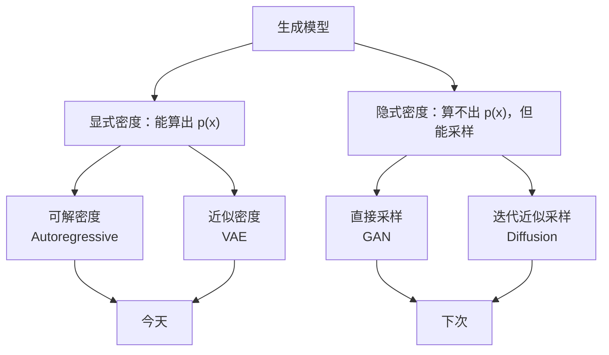
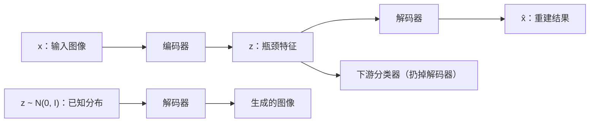

> **课程信息**
>
> - **课程名称**：Stanford CS231n: Deep Learning for Computer Vision（Spring 2025）
> - **本讲主题**：Lecture 13. Generative Models 1
> - **主讲教师**：Justin Johnson
> - **授课日期**：2025-05-15
> - **课程主页**：[cs231n.stanford.edu/2025](https://cs231n.stanford.edu/2025/schedule.html)
> - **官方课件**：[lecture_13.pdf](</attachments/cs231n-8bf0be30a71f351cc458177f.pdf>)（116 页，正文按页链接本地课件）
> - **字幕来源**：[cs231n_sp25_kor_sub · eng](https://github.com/lpaiu-cs/cs231n_sp25_kor_sub/tree/main/eng)（公开英文转写，中文由本书重写）
> - **版权说明**：幻灯片与课程材料版权归 Stanford University 及授课教师所有；本书为非官方学习笔记，仅用于学习与研究。

> **课件索引**：点击下方链接打开本地 PDF 的对应页；全部课件见 [课件索引](/notes/cs231n/slides)。页码按 PDF 文件页序定位，第 1 讲分为 Part 1 / Part 2。

[📄 L13 · 第 1 页｜第 13 讲标题页：Generative Models (part 1)，页脚标注 Stanford CS231n 十周年](</attachments/cs231n-8bf0be30a71f351cc458177f.pdf#page=1>)

上一讲把"没有标签也能学表示"讲成了三套配方：几何扰动式的前置任务、对比学习、以及无标签自蒸馏。它们的共同点是最终产物只有一个——一个能迁移到下游任务的特征向量。本讲换掉这个产物：要学的不再是 $z=f(x)$，而是一个概率分布 $p(x)$，让模型能回答"这张图有多可能出现"，并且能凭空造出新的图。

这是一条难度陡增的路。判别式模型只要求标签在给定图像下竞争；一旦把图像本身放到被建模的位置，宇宙中所有可能出现的图像就都要在同一个概率预算里分份额。本讲只走族谱的左半边——显式密度：自回归模型与变分自编码器（VAE）。右半边（生成对抗网络与扩散模型）留给下一讲。

## 1. 上一讲欠下的两笔账：SimCLR 的 batch 依赖，和无监督学习那句含糊的"学结构"

*(参考时间: 00:00:05 – 00:15:01｜Lecture 13)*

[📄 L13 · 第 2 页｜课程事务页：5/16 作业三发布、项目里程碑截止](</attachments/cs231n-8bf0be30a71f351cc458177f.pdf#page=2>)

第二页是事务页，只有两行：明天（5/16）Assignment 3 发布，项目里程碑同期截止。整段口播里没有任何一句提到这两行——讲师开口就是 "Welcome back to CS231N lecture 13"，随后直接进入自监督复习。把它记在这里，是因为它标出了课程的时间坐标：作业三与项目里程碑都落在 5 月 16 日，而生成模型这条线要到下一讲才收尾。

[📄 L13 · 第 3 页｜自监督学习的通用骨架：无标签数据 → 编码器 → 特征 → 解码器](</attachments/cs231n-8bf0be30a71f351cc458177f.pdf#page=3>)

复习的第一页只画了骨架：左边是一个没有标签的数据集，中间编码器抽出特征表示，右边分两路——一路是解码器，预测某种从数据自身自动生成的目标；另一路是分类器或回归器，等到下游任务出现时才接上。整页没有出现任何人工标注，因为在这个阶段标签还不存在。

[📄 L13 · 第 4 页｜同一张图加上 FC：第二阶段扔掉解码器，换一个小的全连接头](</attachments/cs231n-8bf0be30a71f351cc458177f.pdf#page=4>)

第二帧只在解码器旁补了一个 FC（全连接层），补出的却是整个两段式流程：先在全部无标签数据上训好编码器—解码器，然后**扔掉解码器**，把编码器接到一个可能很小的全连接网络上，在有标签的小任务上做微调或端到端训练。讲师给这个流程配的规模账很具体：十亿张从互联网上抓来的无标签图，换到只肯标几十、几百、几千个样本的下游任务上，让后者的表现被前者学到的通用知识抬起来。

[📄 L13 · 第 5 页｜三类前置任务：旋转、拼图重排、重建（MAE）](</attachments/cs231n-8bf0be30a71f351cc458177f.pdf#page=5>)

前置任务的共同点被一句话说破：先对输入像素做一次几何扰动，再让模型从这个被破坏的版本恢复扰动前的信息。旋转是预测转了多少度；重排（拼图）是把图切成 patch 让模型还原相对位置；重建是挖掉一块再补回去，MAE 走的就是这条路。幻灯片上还列了 inpainting 与 coloring 两个变体，本质都是同一件事的换皮。

[📄 L13 · 第 6 页｜上一讲对比学习那半场的提纲：直觉、SimCLR 与 MoCo、CPC、DINO](</attachments/cs231n-8bf0be30a71f351cc458177f.pdf#page=6>)

这一页是上一讲对比学习部分的目录：直觉与形式化、实例级对比（SimCLR 与 MoCo）、序列级对比（CPC）、无标签自蒸馏（DINO）。讲师说这部分上次没讲完，所以第 13 讲的前十分钟先把它补齐——本讲的开头因此看起来像是第 12 讲的尾巴。

[📄 L13 · 第 7 页｜SimCLR 的一轮：一个 batch 做两次随机变换，正对拉近、其余推远](</attachments/cs231n-8bf0be30a71f351cc458177f.pdf#page=7>)

对比学习的机制可以压成一句话：相似的对拉近，不相似的对推远。落到实现上，一张猫图裁出两个视角（脸、屁股），一只猴图裁一个视角再转成黑白；所有增强版本过同一个特征提取器，再算一个巨大的相似度矩阵。讲师在这里报了一个容易记错的数：$n$ 张图各做两次增强得到 $2n$ 个样本，矩阵是 $2n\times 2n$，也就是 $4n^2$ 个元素，全部两两比较。

[📄 L13 · 第 8 页｜SimCLR 的软肋：负样本不够多，任务就太简单](</attachments/cs231n-8bf0be30a71f351cc458177f.pdf#page=8>)

这一帧只加了一行字：Problem: Need large batch size with lots of negatives。原因不是显存不够，而是任务太容易——一个 batch 里只有寥寥几个负样本时，模型很容易靠颜色、纹理这类廉价线索把两个猫视角认成一对，学不到真正需要的东西。要让问题难到能提供有效学习信号，就得把 batch 开大；batch 一大，又回到第 11 讲那套大规模分布式训练。讲师的态度是：可行、能跑，只是代价高。

[📄 L13 · 第 9 页｜MoCo：把历史 batch 存成 key 队列，key 编码器用动量更新](</attachments/cs231n-8bf0be30a71f351cc458177f.pdf#page=9>)

MoCo 要切断的正是"负样本数 = batch size"这条绑带。它维护一个 key 队列，装着过去若干次迭代见过的样本；当前 batch 走正常的 query 编码器并照常反传，队列里的 key 走另一个"动量编码器"。因为 key 那边数据量太大、塞不进显存，所以**不对它反传**——动量编码器的权重不靠梯度下降，而是当前编码器权重的指数滑动平均：旧权重乘 0.99，再加 1% 的新权重。讲师原话说他也没有很好的直觉解释这个更新为什么一定成立，但经验证据非常强。副产品才是关键：负样本数量与 batch size 解耦，一个小 batch 也能对着成千上万个 key 做对比。

[📄 L13 · 第 10 页｜DINO：沿用动量编码器，但把点积换成 KL 散度，把 ResNet 换成 ViT](</attachments/cs231n-8bf0be30a71f351cc458177f.pdf#page=10>)

DINO 的骨架与 MoCo 同源：一个正常反传的编码器加一个动量编码器。差别在损失——不再用 softmax 后的点积，而是用 KL 散度去匹配两个分支的输出分布；骨干也从 ResNet 换成视觉 Transformer（ViT）。讲师把它的定位说得很直白：细节不必记，知道它存在就行，因为下一个模型在实践中更常用。

[📄 L13 · 第 11 页｜DINOv2：训练数据从 1M ImageNet 扩到 142M，右侧是特征的 PCA 可视化](</attachments/cs231n-8bf0be30a71f351cc458177f.pdf#page=11>)

DINOv2 的关键改动不是损失，而是数据规模：从 ImageNet 的 100 万张扩到约 1.42 亿张，并且找到了一套能在这个规模上稳定收敛的自监督配方。结果是特征质量足够好，今天很多人直接拿它当现成的视觉骨干，再微调到自己任务上。讲师顺带给了这个领域的进步公式：更大的网络、更多的数据、更多的 GPU、更多的 FLOPs——过去十年真正变的是这些，而不是那几行概率公式。

[📄 L13 · 第 12 页｜本讲的正式开场页：Today: Generative Models (part 1)](</attachments/cs231n-8bf0be30a71f351cc458177f.pdf#page=12>)

翻到这一页，讲师给了一个跨度很大的判断：生成模型十年前"完全不工作"——样本是低分辨率的一团糊，你得眯着眼才能看出一点希望；而如今语言模型、图像生成、视频生成都是它的下游。更值得记的是他紧接着的补充：基本思想这十年没怎么变，变的是算力、更稳的训练配方、更大的数据集和分布式训练；算法上的真正改动主要发生在下一讲的扩散模型里。

### 1.1 一条轴是标签，另一条轴才是概率

[📄 L13 · 第 13 页｜监督学习的定义页：数据是 (x, y)，目标是学一个 x→y 的映射](</attachments/cs231n-8bf0be30a71f351cc458177f.pdf#page=13>)

讲师先退一步把术语钉死。监督学习的数据集是成对的 $(x,y)$，$x$ 是数据、$y$ 是标签，目标是学一个从 $x$ 到 $y$ 的函数；分类、回归、目标检测、语义分割、图像描述都落在这个框里。

[📄 L13 · 第 14 页｜分类的例子：一张猫图，标签是 Cat](</attachments/cs231n-8bf0be30a71f351cc458177f.pdf#page=14>)

同一页右侧开始逐格补例子。第一格是分类：输入一张猫的照片，输出一个类别标签。

[📄 L13 · 第 15 页｜图像描述的例子：输出是 "A cat sitting on a suitcase on the floor"](</attachments/cs231n-8bf0be30a71f351cc458177f.pdf#page=15>)

第二格把标签换成一句话：输入还是那张图，输出是一段描述文字（页面注明这句由 neuraltalk2 生成）。监督信号从"一个类别"变成了"一串词"，但任务形状没变——仍然是给定 $x$ 预测某个 $y$。

[📄 L13 · 第 16 页｜目标检测的例子：图上有两个 DOG 框和一个 CAT 框](</attachments/cs231n-8bf0be30a71f351cc458177f.pdf#page=16>)

第三格是目标检测：输出不再是一个标签，而是一组框加类别（DOG、DOG、CAT）。被预测的对象从"整张图"细到了"图上的每个物体"。

[📄 L13 · 第 17 页｜语义分割的例子：每个像素被涂上 GRASS、CAT、TREE、SKY 之一](</attachments/cs231n-8bf0be30a71f351cc458177f.pdf#page=17>)

第四格是语义分割：给每个像素分配一个类别（GRASS、CAT、TREE、SKY）。四格连起来说明一件事——监督学习的"$y$"可以是标量、句子、框集合或逐像素图，形状差别很大，但都需要人把它标出来。

[📄 L13 · 第 18 页｜两栏对照：监督学习的数据是 (x, y)，无监督学习的数据只有 x](</attachments/cs231n-8bf0be30a71f351cc458177f.pdf#page=18>)

两栏并排之后差别只剩两行：数据从 $(x,y)$ 变成 $x$（"just data, no labels"），目标从"学一个映射"变成"从数据里挖隐藏结构"。讲师对无监督的描述带着明显的保留：它更含糊、更难定义，甚至没有明确任务——你只是希望在这个过程中撞上一些好东西，通常是能拿去迁移的表示。

[📄 L13 · 第 19 页｜K-means 聚类：把像素点按颜色分成几簇](</attachments/cs231n-8bf0be30a71f351cc458177f.pdf#page=19>)

第一类例子是 K-means 聚类：没有标签，只要求把数据分成若干簇，簇的结构是从原始像素里自己长出来的。

[📄 L13 · 第 20 页｜PCA 降维：三维点云被投到二维平面上](</attachments/cs231n-8bf0be30a71f351cc458177f.pdf#page=20>)

第二类是降维，页面用 PCA 演示 $3\to 2$：找一个人为指定的低维子空间或流形，让数据在里面还能保持原来的结构。讲师特意提醒，聚类和降维经常有概率解释，但**不必须**被当成概率模型——它们属于"无监督"这条轴，不等于"生成"这条轴。

[📄 L13 · 第 21 页｜密度估计：一维和二维的概率密度，目标是建模 p(x)](</attachments/cs231n-8bf0be30a71f351cc458177f.pdf#page=21>)

第三类才是本讲的正题：密度估计。上方是一维密度（散点加拟合曲线），下方是二维密度（左为曲面、右为热力图，两张是 CC0 素材），左上一维那张的版权归 Ian Goodfellow, 2016、经许可转载。问题在这里第一次变成"什么样的概率函数生成了我看到的这些样本"。这条轴和"生成 / 判别"是正交的：你可以做无监督但非概率的学习（聚类），也可以做有监督的概率建模（softmax 分类器）。

## 2. 概率质量只有一份：p(y|x) 让标签竞争，p(x) 让全宇宙的图像竞争

*(参考时间: 00:15:10 – 00:34:26｜Lecture 13)*

讲师把"生成 vs 判别"单独拎成一条轴，理由是这条轴天生是概率的：我们假设数据背后有一个概率结构，三种模型只是选了不同的变量去做条件。

### 2.1 三个写起来很像的式子，竞争关系完全不同

[📄 L13 · 第 22 页｜三种模型的并列定义：判别式 p(y|x)、生成式 p(x)、条件生成 p(x|y)](</attachments/cs231n-8bf0be30a71f351cc458177f.pdf#page=22>)

页面上并排写着三行：判别式模型学 $p(y|x)$（数据 $x$、标签 $y$）；生成模型学 $p(x)$；条件生成模型学 $p(x|y)$。三个式子的符号几乎一样，差别只在谁被放在竖线右边——而这个位置决定了谁在为概率质量打架。

[📄 L13 · 第 23 页｜加一页概率复习：密度函数给每个 x 一个正数，并且全域积分等于 1](</attachments/cs231n-8bf0be30a71f351cc458177f.pdf#page=23>)

第二帧补上了整讲最关键的约束：密度函数 $p(x)$ 给每个可能的 $x$ 分配一个正数，数值越大表示越可能出现；并且它是归一化的，

$$
\int_{X} p(x)\,dx = 1
$$

讲师把这条约束叫作概率模型的"力量来源"：总量固定为一个单位，写下一个分布就等于把这一份质量切开、抹到所有可能的 $x$ 上。于是任何一个 $x$ 的密度被抬高，其他 $x$ 的密度必然被压低——它们在同一张预算表上。

[📄 L13 · 第 24 页｜判别式的概率账：给猫图配上 P(cat| ) 与 P(dog| )](</attachments/cs231n-8bf0be30a71f351cc458177f.pdf#page=24>)

第三帧把这份预算落到判别式模型上：给定一张猫图，模型输出 $P(\text{cat}\mid\cdot)$ 与 $P(\text{dog}\mid\cdot)$，两者相加为 1。注意这里的"给定"意味着**每张图各有一套分布**，图与图之间没有共享的预算。

[📄 L13 · 第 25 页｜再叠一张图：每张图有自己的一套标签分布，图像之间不竞争](</attachments/cs231n-8bf0be30a71f351cc458177f.pdf#page=25>)

第四帧又叠了一张狗的照片，同时把左侧"生成模型"和"条件生成"两块定义框调成灰——视线只留判别式。两张图各自配一组柱子：猫图那组 $P(\text{cat})$ 高、$P(\text{dog})$ 低，狗图那组柱子的顺序整个翻过来，变成 $P(\text{dog})$ 在前且更高。页面右下角的结论是：可能的标签在为概率竞争，图像之间没有竞争。这句话是判别式模型的全部秘密——它为每个输入单独开一场小规模竞赛，赛场之间互不干扰。

[📄 L13 · 第 26 页｜抽象画进场：判别式模型没有拒绝不合理输入的机制](</attachments/cs231n-8bf0be30a71f351cc458177f.pdf#page=26>)

第五帧把一张抽象画塞进输入位，问题立刻暴露：标签空间在训练时就固定成 cat/dog 两个词，模型没有"这不是猫也不是狗"的出口，只能硬着头皮给出一个二选一的分布。讲师说这可以看作缺点，但更重要的是理解机制——判别式模型**必须**对每个可能的输入都给出一套标签分布，它没有弃权的语法。

### 2.2 生成模型必须回答"三腿狗比三臂猴更可能吗"

[📄 L13 · 第 27 页｜生成式的概率账：狗图、猴图、抽象画一起竞争同一份质量](</attachments/cs231n-8bf0be30a71f351cc458177f.pdf#page=27>)

换成 $p(x)$，竞赛的参赛者变了：所有可能存在的图像都在争夺同一份质量。页面把三张图（狗、猴、抽象画）并排放在 $P(\cdot)$ 下，标注是 All possible images compete for probability mass。

[📄 L13 · 第 28 页｜同一页补上追问：狗更可能站着还是坐着？三腿狗比三臂猴更可能吗](</attachments/cs231n-8bf0be30a71f351cc458177f.pdf#page=28>)

第二帧加的那段话是全讲最有哲学味的一处：既然所有图像都在同一张预算表上，模型就被迫回答"狗更可能站着还是坐着""三腿狗是不是比三臂猴更可能出现"。讲师的判断是三腿狗应该拿到更多质量——狗丢一条腿是现实中会发生的事；三臂猴则几乎只能出现在科幻图里。要给出这种判断，模型必须真的理解视觉世界的结构，而不是记住像素共现。

[📄 L13 · 第 29 页｜第三帧给出好处：模型可以用极低概率"拒绝"不合理的输入](</attachments/cs231n-8bf0be30a71f351cc458177f.pdf#page=29>)

第三帧把这件事翻成工程语言：既然质量是有限的，模型就可以把不合理的输入压到极低甚至零概率。假设你只想要一个"动物园动物"的生成模型，那么一张抽象画就该拿到零质量——这就是判别式模型缺的那个"拒绝"开关。

[📄 L13 · 第 30 页｜条件生成：每个标签各自引发一场所有图像之间的竞争](</attachments/cs231n-8bf0be30a71f351cc458177f.pdf#page=30>)

第四帧换成条件生成 $p(x|y)$：给定 cat 和给定 dog 各有一行 $P(\cdot\mid\cdot)$，每一行内部是全体图像在竞争。于是竞赛的组织方式变成了"按标签分组"。讲师顺势把 $y$ 推向更复杂的形态：如果 $y$ 是一段文字、一整段话，甚至另一张图加一段文字，那么模型要解决的就是一个相当病态的问题——它得对画面里的物体做很深的推理。

### 2.3 贝叶斯把三种模型缝在一起

[📄 L13 · 第 31 页｜贝叶斯公式第一次出现：三种模型之间可以互相换算](</attachments/cs231n-8bf0be30a71f351cc458177f.pdf#page=31>)

三种模型不是三个孤岛。贝叶斯公式给出换算关系：有了判别式 $p(y|x)$、数据边缘 $p(x)$ 与标签先验 $p(y)$，就能拼出条件生成

$$
p(x|y)=\frac{p(y|x)\,p(x)}{p(y)}
$$

讲师的说法更宽：把贝叶斯公式随便怎么移项，任意拿到其中两个就能得到第三个。

[📄 L13 · 第 32 页｜第二帧标注三项的角色：条件生成、无条件生成、标签先验](</attachments/cs231n-8bf0be30a71f351cc458177f.pdf#page=32>)

第二帧把公式里的三块分别贴了标签：条件生成模型、无条件生成模型、标签先验。页面同时给了一句限定：理论上可以从其他部件搭出条件生成模型，"but not common in practice"。实践中大家直接从零训练条件生成模型；例外是下一讲的扩散模型，那里有时会联合训练条件与无条件两个版本。

### 2.4 三种模型各自的用处，以及"无条件生成基本没用"

[📄 L13 · 第 33 页｜判别式模型的用途：给数据打标签、带标签地学特征](</attachments/cs231n-8bf0be30a71f351cc458177f.pdf#page=33>)

用途这页从判别式开始，因为最不需要创造力：训练完之后可以给数据分配标签；副产品是在预测标签的过程中，中间层往往长出了可迁移的特征表示——ImageNet 上训出来的骨干网络就是这么来的。

[📄 L13 · 第 34 页｜生成模型补上三行：检测离群点、无标签学特征、采样生成新数据](</attachments/cs231n-8bf0be30a71f351cc458177f.pdf#page=34>)

第二帧给生成模型补上三行：检测离群点（看某张图的密度是不是低得离谱）、无标签的特征学习、以及采样生成新数据。讲师对后两项的评价相当不客气：无条件密度估计在自监督学习上**一直不太成功**，实践里远不如上一讲的对比学习；而无条件采样"基本没用"，因为它对生成什么毫无控制。

[📄 L13 · 第 35 页｜条件生成补两行：一边打标签一边拒绝离群点，以及按标签采样](</attachments/cs231n-8bf0be30a71f351cc458177f.pdf#page=35>)

第三帧是条件生成的两行：一边给标签一边拒绝离群点（遍历所有 $y$ 看 $p(x|y)$ 是否都太低），以及按标签采样。前者讲师说实践中很少用；后者才是真正的主战场——$y$ 是一段文字时，你可以写下"一只穿着热狗口味 T 恤的猫站在月球上"，然后拿到一张全新的图。

[📄 L13 · 第 36 页｜第四帧的总结：文献里的"生成模型"两种都指，但常用的都是条件生成](</attachments/cs231n-8bf0be30a71f351cc458177f.pdf#page=36>)

第四帧收口：文献里说"生成模型"时，无条件与条件两种都算，但条件生成在实践中占绝对多数。讲师提醒读者注意一个写作习惯——很多论文为了让公式好看会把条件 $y$ 省掉，只写 $p(x)$；他自己在这一讲的幻灯片里也一直这么干，所以后面每见到一个 $p(x)$，脑子里都应该自动补上"given $y$"。

### 2.5 为什么需要生成模型：因为输出本来就不唯一

[📄 L13 · 第 37 页｜语言建模：ChatGPT 对"写首关于生成模型的押韵短诗"的回复](</attachments/cs231n-8bf0be30a71f351cc458177f.pdf#page=37>)

讲师的答案只有一条：输出有歧义。判别式任务里很多映射是确定的（图里有几只猫，答案就是一个数），但只要同一个输入对应一整个输出空间，就需要建模分布而不是建模函数。第一例是语言建模：输入"写一首关于生成模型的押韵短诗"，可能的诗有无数首，模型只能采样其中一首。幻灯片上那首短诗本身就在讲这件事——"They sample from a learned P, / A distribution—structured, free. / Each token comes conditionally, / On all the ones that used to be."

[📄 L13 · 第 38 页｜文生图：把"一个人在白板前讲生成模型"变成一张图](</attachments/cs231n-8bf0be30a71f351cc458177f.pdf#page=38>)

第二例是文生图：同一个提示词，讲师眼里看到的是一张，ChatGPT 给出的是另一张，两张都对。生成模型的价值不在于选出"唯一正确"的那张，而在于它原则上建模了整个空间，可以从里面按需要采样。

[📄 L13 · 第 39 页｜图生视频：手里拿着 AirPods 悬在纸箱上方，"接下来会发生什么"](</attachments/cs231n-8bf0be30a71f351cc458177f.pdf#page=39>)

第三例是图生视频：画面是他把 AirPods 举在一个纸箱上方，接下来可能松手、可能移开手、也可能 AirPods 变形。这三种未来都合理，模型要建模并采样的是"可能的未来"这个集合。

### 2.6 族谱：两个分支，四片叶子

[📄 L13 · 第 40 页｜族谱的第一帧：只有根节点 Generative models](</attachments/cs231n-8bf0be30a71f351cc458177f.pdf#page=40>)

族谱这张图是本讲的骨架（图改编自 Ian Goodfellow 2017 年的 GAN 教程）。第一帧只有根节点，因为分类的第一刀要问的是：这个模型能不能算出 $p(x)$ 的数值。

[📄 L13 · 第 41 页｜第二帧：左支是显式密度，模型能算出 P(x)](</attachments/cs231n-8bf0be30a71f351cc458177f.pdf#page=41>)

第二帧落下左支：显式密度（explicit density），标注是 Model can compute P(x)。这一支的全部工作就是写出 $p(x)$ 或 $p(x|y)$ 的解析形式，并且对任意样本都能把数值取出来。

[📄 L13 · 第 42 页｜第三帧：右支是隐式密度，算不出 p(x) 但能采样](</attachments/cs231n-8bf0be30a71f351cc458177f.pdf#page=42>)

第三帧补上右支：隐式密度（implicit density），标注是 Cannot compute p(x) but can sample from P(x)。模型内部并没有一个可以取值的密度函数，但你依然能从它里面抽样本——密度是被"隐式地"学到的。

[📄 L13 · 第 43 页｜第四帧：显式密度再分叉，真能算的叫可解密度，代表是自回归](</attachments/cs231n-8bf0be30a71f351cc458177f.pdf#page=43>)

第四帧在显式密度下面切第二刀：真能精确算出 $p(x)$ 的叫可解密度（tractable density），代表是自回归模型。

[📄 L13 · 第 44 页｜第五帧：只能给出近似值的叫近似密度，代表是 VAE](</attachments/cs231n-8bf0be30a71f351cc458177f.pdf#page=44>)

第五帧补上另一片叶子：只能给出近似 $p(x)$ 的叫近似密度（approximate density），代表是变分自编码器（VAE）。它给出的是一个下界，不是真值——这是第 6 章整整一章要算的账。

[📄 L13 · 第 45 页｜第六帧：隐式密度分叉，一次前向就能出样本的叫直接法，代表是 GAN](</attachments/cs231n-8bf0be30a71f351cc458177f.pdf#page=45>)

第六帧转到右支：一次网络评估就能直接吐出样本的叫直接法（direct），代表是生成对抗网络（GAN）。

[📄 L13 · 第 46 页｜第七帧：需要迭代过程逼近样本的叫间接法，代表是扩散模型](</attachments/cs231n-8bf0be30a71f351cc458177f.pdf#page=46>)

第七帧补上第四片叶子：需要跑一个迭代过程才能逼近样本的叫间接法（indirect），代表是扩散模型。讲师在这里特意交代，"indirect"这个词是他前一天临时造的，没有公认叫法——重要的不是名字，而是"没有一次前向就能出样本的解析函数"这个性质。

[📄 L13 · 第 47 页｜第八帧加上时间标签：左半棵树今天讲，右半棵树下次讲](</attachments/cs231n-8bf0be30a71f351cc458177f.pdf#page=47>)

最后一帧只加了两个标签：Today 落在自回归与 VAE 下面，Next Time 落在 GAN 与扩散下面。讲师对这个四分法相当得意——两个分支、四片叶子，正好一天讲一半。

课堂上有三个追问值得记下来。第一，为什么整页都写 $p(x)$ 而不写 $p(x|y)$？讲师承认这是他故意的，就是想让人问出来；后面所有 $p(x)$ 都应读作条件版本。第二，能不能把迭代过程当黑盒，假装它是直接采样？原则上可以，但样本只能是近似的——扩散模型要走无穷多步才能拿到真正的样本，实际只能走有限步，MCMC 一类方法过去也有同样的性质。第三，近似密度和隐式直接采样差在哪？差别在于前者**至少能取出一个数值**（哪怕是个界），后者在任何地方都找不到密度值，只能采样。

## 3. 自回归：链式法则不假设任何东西，代价是把一次生成拆成 T 次预测

*(参考时间: 00:34:59 – 00:45:16｜Lecture 13)*

[📄 L13 · 第 48 页｜章节分隔页：Autoregressive Models](</attachments/cs231n-8bf0be30a71f351cc458177f.pdf#page=48>)

族谱上的第一片叶子是自回归模型，它属于"可解密度"：$p(x)$ 不但写得出解析式，还能对任意样本算出确切数值。它的全部技术含量在于怎么把这件事写得可训。

### 3.1 最大似然：先把"像不像"写成一个能求导的数

[📄 L13 · 第 49 页｜目标：写出 p(x) = f(x, W) 的显式函数](</attachments/cs231n-8bf0be30a71f351cc458177f.pdf#page=49>)

第一步只有一行：目标是为密度写下一个显式函数 $p(x)=f(x,W)$，其中 $W$ 是神经网络的权重。也就是说，网络吃进一张图、吐出"这张图有多可能出现"这一个数。

[📄 L13 · 第 50 页｜给定数据集后写出目标：W* = argmax ∏ p(x_i)](</attachments/cs231n-8bf0be30a71f351cc458177f.pdf#page=50>)

第二步才有数据集：给定 $x^{(1)},\dots,x^{(N)}$，求让整份数据最可能出现的权重

$$
W^{*}=\arg\max_{W}\prod_{i=1}^{N}p(x^{(i)})
$$

页面上把这行注为"最大化训练数据的概率"，也就是最大似然估计（maximum likelihood estimation, MLE）。注意上标 $i$ 指的是第 $i$ 个样本——这个记号约定在第 3 章后半段会被反复强调。

[📄 L13 · 第 51 页｜加一行对数技巧：argmax 里换成求和](</attachments/cs231n-8bf0be30a71f351cc458177f.pdf#page=51>)

第三帧加上 log 技巧：取对数后最大化对象不变（log 单调），但连乘变成连加

$$
W^{*}=\arg\max_{W}\sum_{i=1}^{N}\log p(x^{(i)})
$$

讲师给了两条理由：连乘在数值上很快下溢，而求和好处理、好求导，也能拆到多个样本上并行。

[📄 L13 · 第 52 页｜再补一行：把 p 换成网络 f，得到可直接梯度下降的损失](</attachments/cs231n-8bf0be30a71f351cc458177f.pdf#page=52>)

第四帧把 $p$ 替换成网络输出，得到真正能跑的形式

$$
W^{*}=\arg\max_{W}\sum_{i=1}^{N}\log f(x^{(i)},W)
$$

页面右下角写着 This is our loss function，加一句"用梯度下降最大化它"。到这一步，生成建模就退化成一个普通的训练循环：前向算 $\log f$，反传，更新。

这里有两处容易被跳过的细节，讲师都专门停下来讲。第一是**似然与概率的区别**：谈概率时分布是固定的、你在挪 $x$；谈似然时样本是固定的、你在挪分布。MLE 固定的是训练集，动的是网络参数，问的是"哪套参数让这批已发生的样本最不意外"。第二是背后的假设：存在一个宇宙用来生成数据的真实分布 $p_{\text{data}}$，我们永远看不到它，只能拿到它吐出的有限样本，MLE 就是在有限样本上逼近它的办法；再叠加独立同分布（IID）假设，联合概率才能因式分解成逐样本概率之积。

### 3.2 从联合分布到条件分布：RNN 与掩码 Transformer 天生就是这个形状

[📄 L13 · 第 53 页｜假设 x 是一个序列：(x₁, x₂, …, x_T)](</attachments/cs231n-8bf0be30a71f351cc458177f.pdf#page=53>)

MLE 本身不假设任何数据结构的代价是它也给不出任何计算路径——$p(x)$ 仍是一个定义在整张图上的函数。自回归模型加的第一条假设很朴素：存在某种标准方式，把样本 $x$ 切成一个序列 $x_1,\dots,x_T$。讲师在这里提醒记号陷阱：上标是不同样本，下标是同一样本的不同片段，两者不能混。

[📄 L13 · 第 54 页｜加一行链式法则：联合概率拆成 T 个条件概率的乘积](</attachments/cs231n-8bf0be30a71f351cc458177f.pdf#page=54>)

第二帧套上概率的链式法则：

$$
p(x)=p(x_1)\,p(x_2\mid x_1)\,p(x_3\mid x_1,x_2)\cdots=\prod_{t=1}^{T}p(x_t\mid x_1,\dots,x_{t-1})
$$

这条等式对任何联合分布都成立，不需要任何假设——它只是把"一次预测整张图"换成了"预测 $T$ 个更小的条件分布"。真正的假设只有一个：序列的切法（比如按扫描线顺序）。

[📄 L13 · 第 55 页｜第三帧标注：这就是语言建模，用 RNN 做](</attachments/cs231n-8bf0be30a71f351cc458177f.pdf#page=55>)

第三帧只加了一个标注：Language modeling with RNN，外加一句"这个我们见过"。RNN 的结构天生匹配链式法则——隐状态沿时间前传，第 $t$ 步的隐状态只包含前 $t-1$ 个片段的信息，从它预测下一个片段的分布，正好是 $p(x_t\mid x_{<t})$。

[📄 L13 · 第 56 页｜第四帧把标注换成掩码 Transformer：LLM 就是自回归模型](</attachments/cs231n-8bf0be30a71f351cc458177f.pdf#page=56>)

第四帧把标注换成 Language modeling with masked Transformer，标题也变成结论：LLMs are Autoregressive Models。Transformer 靠掩码注意力实现同样的因果性——把注意力矩阵的右上三角遮掉，每个位置就只能看见前缀，于是整条序列的条件概率可以一次前向全部算出来。

为什么非要拆？讲师在随后的追问里给了一笔硬账：词表大小为 $V$、序列长度为 $T$ 时，要直接建模联合分布需要 $V^T$ 个条目，指数爆炸；拆成条件分布后，每一步只需要一个 $V$ 维的分布，参数从指数级降到线性级。代价是必须按顺序生成，$T$ 个片段就要 $T$ 次前向（训练时可以并行，因为每个位置的真值前缀都已知）。另一个追问是数值稳定性：实践里没人真的去乘出一串概率，模型输出的是对数概率，损失也在对数空间里算，连乘只在需要"取出某个确切密度值"时才发生。

### 3.3 图像不是一维、也不是离散的，但可以硬掰成三百万个 256 类问题

[📄 L13 · 第 57 页｜自回归建模图像：把图当成 8 bit 子像素序列，每个子像素做 256 类分类](</attachments/cs231n-8bf0be30a71f351cc458177f.pdf#page=57>)

文本天生适合自回归：它本来就是一维的，而且本来离散，正好套上用了整个学期的 softmax 交叉熵。图像两样都不占——不是一维，也常被当成连续值。讲师的"手里有锤子"方案是把图光栅化：常见格式每通道 8 bit，一个像素就是三个 0 到 255 的整数，于是整张图变成一条一维序列，每个元素是一个子像素值，预测它就是一个 256 类的分类问题。页面右下角用一张白板照片做了嵌套说明（正是"一个人在白板前讲生成模型"的那张），下方两排共六个 RGB 小立方体标出扫描线顺序：先沿通道走完一个像素，再走到右边一个像素。

[📄 L13 · 第 58 页｜加一行代价：1024×1024 的图就是三百万个子像素](</attachments/cs231n-8bf0be30a71f351cc458177f.pdf#page=58>)

第二帧加上问题：Too expensive。$1024\times1024$ 的图有 $3\times1024\times1024\approx 3.1\times10^6$ 个子像素，序列长度就是三百万。今天的模型确实能吃下百万级序列，但代价随长度增长得很快，而且高分辨率根本没法这样标度。幻灯片上引的两篇是这条路的代表作：PixelRNN 与 PixelCNN（van den Oord 等，2016）。

[📄 L13 · 第 59 页｜加一行解法预告：不要逐子像素，改成逐 tile](</attachments/cs231n-8bf0be30a71f351cc458177f.pdf#page=59>)

第三帧给了预告式的解法：不要按子像素建模，改成按"图块"建模——先用某种过程把图压成一串一维 token，再对 token 序列做自回归。讲师说这条路最近两年又回来了，下一讲会展开。这一帧的价值不在于答案，而在于它点出了自回归模型在图像上的真正瓶颈：**序列的定义方式**，而不是似然目标本身。

## 4. 自编码器：先逼模型学出一个 128 维瓶颈，再想办法从瓶颈里采样

*(参考时间: 00:45:21 – 00:52:51｜Lecture 13)*

[📄 L13 · 第 60 页｜章节分隔页：Variational Autoencoders (VAEs)](</attachments/cs231n-8bf0be30a71f351cc458177f.pdf#page=60>)

族谱的第二片叶子是 VAE，属于"近似密度"。它牺牲了密度的精确值，换来一件自回归模型给不了的东西。

### 4.1 为什么要放弃精确密度：为了拿到隐变量

[📄 L13 · 第 61 页｜自回归与 VAE 的对照：前者显式参数化密度，后者密度不可解但可优化下界](</attachments/cs231n-8bf0be30a71f351cc458177f.pdf#page=61>)

这页把取舍写在了一起。上半段是 PixelRNN / PixelCNN：用神经网络显式参数化密度，$p_W(x)=\prod_t p_W(x_t\mid x_1,\dots,x_{t-1})$，训练目标就是训练数据的似然。下面两行是 VAE：它定义一个**不可解**（intractable）的密度，既不能显式计算也不能直接优化，"but we will be able to directly optimize a lower bound on the density"。

讲师把动机说得毫不含糊：既然自回归已经能算精确密度，放弃它必然要换到别的东西——换来的是隐变量。VAE 在学的过程里会自然长出"能代表这张图的向量"，这些向量本身就有用（检索、编辑、下游任务），值得用精确密度去换。这是全讲唯一一次明确的等价交换。

[📄 L13 · 第 62 页｜分隔页第二帧：Variational 与 (VAEs) 变灰，Autoencoders 被下划线强调](</attachments/cs231n-8bf0be30a71f351cc458177f.pdf#page=62>)

同一张分隔页的第二帧做了个文字动画：Variational 和 (VAEs) 变成浅灰，Autoencoders 被划了下划线。讲师的解释是"我们把 V 去掉几页"，因为这门课还没正式讲过自编码器。

### 4.2 自编码器：损失函数是"重建自己"

[📄 L13 · 第 63 页｜自编码器的动机：无标签地从输入 x 中抽出特征 z](</attachments/cs231n-8bf0be30a71f351cc458177f.pdf#page=63>)

自编码器的目标和无监督学习一致：不用标签，从输入 $x$ 里抽出特征 $z$，希望 $z$ 里编码了物体身份、外观、场景类型这些对下游有用的信息。编码器可以是 MLP、CNN、Transformer，任选。

[📄 L13 · 第 64 页｜加一行问题：没有标签，怎么学？](</attachments/cs231n-8bf0be30a71f351cc458177f.pdf#page=64>)

第二帧只加了一句 Problem: How can we learn without labels? 这正是上一讲反复出现的问题，只是这次换了个更笨的答案。

[📄 L13 · 第 65 页｜加一行解法：用解码器把输入重建出来（Autoencoding = encoding yourself）](</attachments/cs231n-8bf0be30a71f351cc458177f.pdf#page=65>)

第三帧补上解码器：$z$ 再被映射回一个 $\hat{x}$，训练目标是让 $\hat{x}$ 尽量接近 $x$。页面给这个做法配了一句双关——"Autoencoding = Encoding yourself"。讲师自己吐了个槽：这大概是有史以来最傻的损失函数，我们花大量算力去学一个已知的恒等映射。

[📄 L13 · 第 66 页｜加损失函数：输入与重建之间的 L2 距离，不需要任何标签](</attachments/cs231n-8bf0be30a71f351cc458177f.pdf#page=66>)

第四帧把损失写死：

$$
\mathcal{L}=\lVert \hat{x}-x\rVert^{2}
$$

页面特意标了两句：这一项**不用任何标签**，只吃原始数据。这就是它算自监督的原因——监督信号来自输入自身。

[📄 L13 · 第 67 页｜训练完成后：扔掉解码器，用编码器特征接分类器做下游任务](</attachments/cs231n-8bf0be30a71f351cc458177f.pdf#page=67>)

第五帧是自监督那一套的老套路：训练完把解码器扔掉，把编码器特征接一个 softmax 分类器，输出预测标签。

[📄 L13 · 第 68 页｜换个方向：如果能量产新的 z，解码器就能生成图像](</attachments/cs231n-8bf0be30a71f351cc458177f.pdf#page=68>)

第六帧把箭头反过来：只留解码器，如果能造出新的 $z$，就能生成新图像。这正是生成模型想要的用法。

[📄 L13 · 第 69 页｜加一行问题：生成新的 z 并不比生成新的 x 容易](</attachments/cs231n-8bf0be30a71f351cc458177f.pdf#page=69>)

第七帧泼冷水：Problem: Generating new z is not any easier than generating new x。你只是把"在像素空间采样"换成了"在隐空间采样"，如果 $z$ 的分布同样未知、同样没有解析形式，问题只是被搬了个位置。

[📄 L13 · 第 70 页｜加一行解法：强制所有 z 来自一个已知分布](</attachments/cs231n-8bf0be30a71f351cc458177f.pdf#page=70>)

第八帧给出 VAE 的核心动作：强行规定所有 $z$ 都来自一个已知分布。只要这条约束成立，推理时直接从该分布抽一个 $z$、过解码器，就得到了一个新样本——采样问题被彻底消掉。

这张图把两条出路画在了一起：上一条是自监督（用 $z$ 做下游任务），下一条是生成（从已知分布采 $z$ 再解码）。传统自编码器只能走上面那条——下面那条路的入口 $p(z)$ 是空的。这也是为什么讲师说"生成新的 $z$ 不比生成新的 $x$ 容易"：括号里缺的正是这一项。

## 5. 把 z 变成随机变量：边际积分算不出来，就再训一个网络去猜后验

*(参考时间: 00:53:00 – 01:02:59｜Lecture 13)*

[📄 L13 · 第 71 页｜VAE 章节标题页：页脚标注 Kingma 与 Welling 的 Auto-Encoding Variational Bayes（ICLR 2014）](</attachments/cs231n-8bf0be30a71f351cc458177f.pdf#page=71>)

这一节的标题页只给了一个信息源：页脚写着 Kingma 与 Welling, Auto-Encoding Variational Bayes, ICLR 2014——后面的推导都是对这篇论文的通俗重述。讲师对"variational 这个词为什么叫这个"只说了一句"说来话长"，本讲不追词源，只追那三行公式怎么来的。

### 5.1 假设：每张图背后有一个看不见的 z

[📄 L13 · 第 72 页｜VAE 的两个目标：学出隐特征 z，并能从模型采样生成新数据](</attachments/cs231n-8bf0be30a71f351cc458177f.pdf#page=72>)

页面先给出两条目标：从原始数据里学出隐特征 $z$，以及能从模型里采样生成新数据。注意这两条在自编码器里只兑现了第一条，第二条才是 VAE 要补的。

[📄 L13 · 第 73 页｜加上生成假设：训练数据 x_i 由一个不可观测的隐表示 z 生成](</attachments/cs231n-8bf0be30a71f351cc458177f.pdf#page=73>)

第二帧补上概率假设：每个 $x^{(i)}$ 都由一个看不见的隐变量 $z$ 生成，数据是"先在隐空间抽一个 $z$，再由 $z$ 生成 $x$"这个两步过程的产物。讲师给的直觉是：$x$ 是图像，$z$ 是决定这张图的属性、朝向之类的因素——它包含生成这张图所需要的一切信息，但你永远观察不到它。

[📄 L13 · 第 74 页｜加上采样流程：先从先验采 z，再从条件分布采 x](</attachments/cs231n-8bf0be30a71f351cc458177f.pdf#page=74>)

第三帧画出训练后的采样流程：从先验里采一个 $z$，再从条件分布 $p(x\mid z)$ 里采一个 $x$。这条流程成立的唯一前提是 $z$ 的先验已知。

[📄 L13 · 第 75 页｜补上先验假设：p(z) 取简单分布，通常就是高斯](</attachments/cs231n-8bf0be30a71f351cc458177f.pdf#page=75>)

第四帧把先验钉死：假设 $p(z)$ 是一个简单分布，实践中几乎总是标准高斯 $\mathcal{N}(0,I)$。这一步是整个方法能落地的支点——它把"未知的隐空间分布"换成了一个可以随时抽样的解析对象。

### 5.2 训练：最大似然撞上一堵积分墙

[📄 L13 · 第 76 页｜提问怎么训练：基本思路仍是最大似然](</attachments/cs231n-8bf0be30a71f351cc458177f.pdf#page=76>)

第五帧回到熟悉的路：基本思路还是最大似然。如果数据集里除了 $x$ 还附带 $z$，那就可以直接训一个条件生成模型 $p_\theta(x\mid z)$，问题当场结束。但我们没有 $z$ 的标注。

[📄 L13 · 第 77 页｜改成边缘化：p(x) 等于对联合分布积分掉 z](</attachments/cs231n-8bf0be30a71f351cc458177f.pdf#page=77>)

第六帧把 $z$ 积分掉：

$$
p_\theta(x)=\int p_\theta(x,z)\,dz=\int p_\theta(x\mid z)\,p_\theta(z)\,dz
$$

这一步没有任何近似，只是把联合分布按链式法则拆开再边缘化。

[📄 L13 · 第 78 页｜第一次检查：积分里的两项分别是谁](</attachments/cs231n-8bf0be30a71f351cc458177f.pdf#page=78>)

第七帧开始逐项验收。$p_\theta(x\mid z)$ 是解码器——一个我们准备用最大似然去训的神经网络，这一项没问题。

[📄 L13 · 第 79 页｜第二次检查：先验是我们自己假设的高斯](</attachments/cs231n-8bf0be30a71f351cc458177f.pdf#page=79>)

第八帧验收第二项：$p_\theta(z)$ 就是我们刚假设的高斯先验，解析式已知，也没问题。

[📄 L13 · 第 80 页｜判定失败：对整个 z 空间积分做不到](</attachments/cs231n-8bf0be30a71f351cc458177f.pdf#page=80>)

第九帧判死刑：Problem, we can't integrate over all z。$p_\theta(x\mid z)$ 是被神经网络参数化的复杂函数，对整个隐空间做解析积分没有闭式解；用有限采样去近似一个高维积分、还把它塞进训练的内层循环，代价和方差都不可接受。讲师在这一页把生成模型的一般套路讲透了：写下若干概率项，希望其中一部分是能手算的简单分布，另一部分是待训的网络——而现在恰好有一项既不是前者也不是后者。

### 5.3 换条路：贝叶斯公式把难题挪到后验上

[📄 L13 · 第 81 页｜另一条路：用贝叶斯公式重写 p(x)](</attachments/cs231n-8bf0be30a71f351cc458177f.pdf#page=81>)

贝叶斯公式给出另一个写法：

$$
p_\theta(x)=\frac{p_\theta(x\mid z)\,p_\theta(z)}{p_\theta(z\mid x)}
$$

页面把这三块竖着排开，准备逐项再验收一次。

[📄 L13 · 第 82 页｜检查分子第一项：解码器，可算](</attachments/cs231n-8bf0be30a71f351cc458177f.pdf#page=82>)

分子第一项 $p_\theta(x\mid z)$ 还是解码器，可算。

[📄 L13 · 第 83 页｜检查分子第二项：高斯先验，可算](</attachments/cs231n-8bf0be30a71f351cc458177f.pdf#page=83>)

分子第二项 $p_\theta(z)$ 还是高斯先验，可算。整个式子里没有积分了——看起来问题解决了。

[📄 L13 · 第 84 页｜判定失败：分母上的后验 p(z|x) 无从计算](</attachments/cs231n-8bf0be30a71f351cc458177f.pdf#page=84>)

分母出问题：$p_\theta(z\mid x)$ 是给定图像后隐变量的后验，要算它就得再算一次 $p_\theta(x)=\int p_\theta(x\mid z)p_\theta(z)dz$——绕回原点。讲师说这正是当初引入贝叶斯的全部动机，也是它失败的地方。

[📄 L13 · 第 85 页｜解法：再训一个网络，让它学 q_φ(z|x) 去逼近后验](</attachments/cs231n-8bf0be30a71f351cc458177f.pdf#page=85>)

解法是 VAE 的真正招式：既然后验算不出来，就再训一个神经网络去逼近它。记这个近似网络为 $q_\phi(z\mid x)$，参数 $\phi$ 与解码器的 $\theta$ 相互独立。它输入一张图、输出隐空间上的一个分布。

[📄 L13 · 第 86 页｜把近似代回去：p(x) 用 q 近似表达](</attachments/cs231n-8bf0be30a71f351cc458177f.pdf#page=86>)

把 $q_\phi$ 代回贝叶斯式，得到可计算的近似：

$$
p_\theta(x)\approx\frac{p_\theta(x\mid z)\,p(z)}{q_\phi(z\mid x)}
$$

这一步只是"替换"，没有任何保证——$q_\phi$ 未必真的等于后验。整讲后面所有的推导，本质都在处理这个"未必"。

### 5.4 两个网络，一个输出分布的花招

[📄 L13 · 第 87 页｜定义两个网络：编码器输出 z 的分布，解码器输出 x 的分布，联合训练](</attachments/cs231n-8bf0be30a71f351cc458177f.pdf#page=87>)

页面把两个网络的职责写清楚：解码器输入隐码 $z$、输出数据 $x$ 上的分布；编码器输入数据 $x$、输出隐码 $z$ 上的分布。两者各有独立权重，联合训练。讲师提醒这一步并不平凡：$q_\phi(z\mid x)\approx p_\theta(z\mid x)$ 这个条件没法直接强制，只能靠训练去逼近。

[📄 L13 · 第 88 页｜加一个旁注：神经网络怎么输出一个分布？](</attachments/cs231n-8bf0be30a71f351cc458177f.pdf#page=88>)

第二帧加了个旁注，问的是初学者最常卡住的地方：神经网络的输出是向量，怎么会是"分布"？答案是让网络输出分布的**参数**，把分布的形状固定成人选好的族。

[📄 L13 · 第 89 页｜补上公式：两个网络都输出对角高斯，编码器还要输出协方差对角](</attachments/cs231n-8bf0be30a71f351cc458177f.pdf#page=89>)

第三帧给出具体形式：

$$
p_\theta(x\mid z)=\mathcal{N}\big(\mu_{x\mid z},\ \sigma^{2}\big),\qquad q_\phi(z\mid x)=\mathcal{N}\big(\mu_{z\mid x},\ \Sigma_{z\mid x}\big)
$$

解码器只输出均值 $\mu_{x\mid z}$，方差 $\sigma^2$ 固定；编码器输出两个向量，一个是均值 $\mu_{z\mid x}$，另一个是对角协方差 $\Sigma_{z\mid x}$。讲师专门解释了为什么必须是**对角**：$h\times w$ 的图像若要建模像素两两之间的协方差，需要 $(hw)^2$ 个元素，装不下也没数据支撑；对角化之后协方差退化成一个与 $z$ 同形状的向量，网络输出两个同形状向量即可。

[📄 L13 · 第 90 页｜再补一行：高斯对数似然展开后，最大化它就等于最小化 L2](</attachments/cs231n-8bf0be30a71f351cc458177f.pdf#page=90>)

第四帧把似然展开：

$$
\log p_\theta(x\mid z)=-\frac{\lVert x-\mu_{x\mid z}\rVert^{2}}{2\sigma^{2}}+C
$$

固定方差时，最大化它对 $z$ 的似然完全等价于最小化 $x$ 与网络输出均值之间的 L2 距离——自编码器那个"最傻的损失"在这里重新出现，只不过这次它是从概率假设里推出来的，而不是拍脑袋定的。

讲师在这里补了一个很实用的边界。解码器本可以也输出逐像素的方差，但那样没有意义：既然不建模像素间相关性，逐像素方差只是"每个像素允许抖一点点"，从这样的分布采样等于在均值图上加一层逐像素独立噪声，看起来像噪点而不像新图。所以实践中的做法是——把解码器**假装**成一个分布，但永远只用它的均值，从不真的从里面采样。这是一个明确的工程妥协，值得在复现代码时记住。

[📄 L13 · 第 91 页｜收尾提问：那我们的训练目标到底是什么？](</attachments/cs231n-8bf0be30a71f351cc458177f.pdf#page=91>)

最后一帧回到原点，把问题抛给下一页：有了编码器、解码器、近似的后验，训练目标到底是什么？

## 6. ELBO：把算不出的后验 KL 丢掉，剩下的两项正好是重建与先验

*(参考时间: 01:03:03 – 01:11:58｜Lecture 13)*

讲师说这是整讲唯一要认真做点数学的一页。推导只有五步，但每一步都在做同一件事：把不可计算的东西挪到一个可以丢掉的项里。

### 6.1 五步推导

[📄 L13 · 第 92 页｜推导第一帧：log p(x) 用贝叶斯写成三项之比](</attachments/cs231n-8bf0be30a71f351cc458177f.pdf#page=92>)

起点是最大似然本身，用贝叶斯公式展开：

$$
\log p_\theta(x)=\log\frac{p_\theta(x\mid z)\,p(z)}{p_\theta(z\mid x)}=\log\frac{p_\theta(x\mid z)\,p(z)\,q_\phi(z\mid x)}{p_\theta(z\mid x)\,q_\phi(z\mid x)}
$$

第二步是恒等变形：分子分母同乘 $q_\phi(z\mid x)$，值不变。

[📄 L13 · 第 93 页｜第二帧标注这一步：分子分母同乘 q_φ(z|x)](</attachments/cs231n-8bf0be30a71f351cc458177f.pdf#page=93>)

这一帧只是把上一步的动作标出来——上下同乘同一个量，为的是凑出后面能认出来的形状。讲师的原话是"现在我们做点傻事"，但这一步是整个推导的枢纽。

[📄 L13 · 第 94 页｜第三帧：取对数后拆成三项，按特定顺序排列](</attachments/cs231n-8bf0be30a71f351cc458177f.pdf#page=94>)

第三帧把对数拆开并重新排列：

$$
=\log p_\theta(x\mid z)-\log\frac{q_\phi(z\mid x)}{p(z)}+\log\frac{q_\phi(z\mid x)}{p_\theta(z\mid x)}
$$

三项的颜色在页面上是对应的，方便追踪谁是谁。排列顺序看起来随意，其实是为下一步"认出 KL"做准备。

[📄 L13 · 第 95 页｜第四帧：因为左边不依赖 z，可以套一层对 z 的期望](</attachments/cs231n-8bf0be30a71f351cc458177f.pdf#page=95>)

第四帧是关键的观察：$\log p_\theta(x)$ 本身与 $z$ 无关（所有 $z$ 都会约掉），所以可以给它套一层对任意分布的期望而不改变值：

$$
\log p_\theta(x)=\mathbb{E}_{z\sim q_\phi(z\mid x)}\big[\log p_\theta(x)\big]
$$

这里选 $q_\phi(z\mid x)$ 作为期望分布，正是为了配合右边三项。

[📄 L13 · 第 96 页｜第五帧：期望是线性的，逐项套上去](</attachments/cs231n-8bf0be30a71f351cc458177f.pdf#page=96>)

第五帧把期望分配到三项上：

$$
=\mathbb{E}_{z}\big[\log p_\theta(x\mid z)\big]-\mathbb{E}_{z}\Big[\log\frac{q_\phi(z\mid x)}{p(z)}\Big]+\mathbb{E}_{z}\Big[\log\frac{q_\phi(z\mid x)}{p_\theta(z\mid x)}\Big]
$$

到这一步仍然是精确等式，没有引入任何近似。

[📄 L13 · 第 97 页｜第六帧：认出后两项是 KL 散度](</attachments/cs231n-8bf0be30a71f351cc458177f.pdf#page=97>)

第六帧把后两项认出来——它们就是 KL 散度的定义：

$$
=\mathbb{E}_{z\sim q_\phi(z\mid x)}\big[\log p_\theta(x\mid z)\big]-D_{\mathrm{KL}}\big(q_\phi(z\mid x)\,\|\,p(z)\big)+D_{\mathrm{KL}}\big(q_\phi(z\mid x)\,\|\,p_\theta(z\mid x)\big)
$$

KL 散度衡量两个分布的差异，非负，且只在两分布相同时取 0。

### 6.2 三项各是什么

[📄 L13 · 第 98 页｜第一项解释：数据重建项](</attachments/cs231n-8bf0be30a71f351cc458177f.pdf#page=98>)

第一项 $\mathbb{E}_{z\sim q_\phi(z\mid x)}[\log p_\theta(x\mid z)]$ 是重建项，流程可以顺着读出来：把 $x$ 送进编码器得到 $q_\phi(z\mid x)$，从这个分布采一个 $z$，再送进解码器，要求它还原出 $x$。由于 $p_\theta(x\mid z)$ 是对角高斯，给定一个采样到的 $z$，这一项就是第 5 章那条 L2（只差常数因子）；期望本身用一次采样估计即可，幻灯片把这一项整体标为可闭式计算的。

[📄 L13 · 第 99 页｜第二项解释：先验项](</attachments/cs231n-8bf0be30a71f351cc458177f.pdf#page=99>)

第二项 $D_{\mathrm{KL}}(q_\phi(z\mid x)\|p(z))$ 是先验项：编码器对每张图预测的分布，应该靠近我们事先设定的先验（标准高斯）。两个高斯之间的 KL 同样有闭式解，不需要采样估计。

[📄 L13 · 第 100 页｜第三项解释：后验逼近项，算不出来](</attachments/cs231n-8bf0be30a71f351cc458177f.pdf#page=100>)

第三项 $D_{\mathrm{KL}}(q_\phi(z\mid x)\|p_\theta(z\mid x))$ 是后验逼近项：它要求近似后验真的贴住真后验。而真后验正是当初算不出的那个量，所以这一项对高斯也没有闭式解。

[📄 L13 · 第 101 页｜第四帧：KL 非负，直接丢掉这一项就得到下界](</attachments/cs231n-8bf0be30a71f351cc458177f.pdf#page=101>)

第四帧做了全讲最划算的一步：KL 永远 $\ge 0$，所以把第三项扔掉，剩下的两项一定是 $\log p_\theta(x)$ 的下界。这不是近似等式，而是**不等式**——丢掉的部分有多大，误差就有多大，但方向永远站在我们这边。

[📄 L13 · 第 102 页｜第五帧：得到 VAE 的训练目标](</attachments/cs231n-8bf0be30a71f351cc458177f.pdf#page=102>)

第五帧写下最终的训练目标：

$$
\log p_\theta(x)\ \ge\ \mathbb{E}_{z\sim q_\phi(z\mid x)}\big[\log p_\theta(x\mid z)\big]-D_{\mathrm{KL}}\big(q_\phi(z\mid x)\,\|\,p(z)\big)
$$

最大化右边，就是在最大化真实似然的一个下界。讲师提醒这里的心态：我们从来没有真正优化过 $\log p(x)$，优化的是它的下界；下界抬高不保证真值同步抬高，但这是唯一可算的东西。

[📄 L13 · 第 103 页｜总结页：联合训练编码器与解码器，最大化变分下界（ELBo）](</attachments/cs231n-8bf0be30a71f351cc458177f.pdf#page=103>)

这一页把符号收拢：联合训练编码器 $q_\phi(z\mid x)=\mathcal{N}(\mu_{z\mid x},\Sigma_{z\mid x})$ 与解码器 $p_\theta(x\mid z)=\mathcal{N}(\mu_{x\mid z},\sigma^2)$，最大化数据似然的变分下界；它还有个更常被叫的名字——证据下界（Evidence Lower BOund, ELBo）。"证据"指的是 $\log p(x)$ 本身，下界就是它的替代品。

### 6.3 训练循环的五步，和两个互相拉扯的损失

[📄 L13 · 第 104 页｜训练页第一帧：只给出"最大化变分下界"和公式](</attachments/cs231n-8bf0be30a71f351cc458177f.pdf#page=104>)

训练流程从一张只有公式的页面开始：屏幕上只有"最大化变分下界"那两行式子，右侧是空白。后面的六帧会把编码器—解码器框图和五个步骤一格一格填进去。

[📄 L13 · 第 105 页｜第二帧加第 1 步：输入过编码器，得到 z 上的分布](</attachments/cs231n-8bf0be30a71f351cc458177f.pdf#page=105>)

第一步：把输入 $x$ 送进编码器，得到 $q_\phi(z\mid x)=\mathcal{N}(\mu_{z\mid x},\Sigma_{z\mid x})$，也就是一对向量。

[📄 L13 · 第 106 页｜第三帧加第 2 步：先验损失要求编码器输出单位高斯](</attachments/cs231n-8bf0be30a71f351cc458177f.pdf#page=106>)

第二步是 KL 项落地：先验损失要求编码器输出接近标准高斯，即均值趋近 0、协方差趋近单位阵。这一项直接把隐空间"拽"成一个规整的球形分布，是后面能采样的根本原因。

[📄 L13 · 第 107 页｜第四帧加第 3 步：从编码器分布采样，用重参数化技巧保持可导](</attachments/cs231n-8bf0be30a71f351cc458177f.pdf#page=107>)

第三步是采样，也是整套方法在工程上最关键的一处。直接从 $\mathcal{N}(\mu_{z\mid x},\Sigma_{z\mid x})$ 采样这个动作本身不可导，梯度传不回编码器；重参数化技巧把它改写成

$$
z=\epsilon\odot\Sigma_{z\mid x}+\mu_{z\mid x},\qquad \epsilon\sim\mathcal{N}(0,I)
$$

随机性被挪到与参数无关的 $\epsilon$ 上，$z$ 对 $\mu$、$\Sigma$ 就是普通的可导运算，梯度可以一路回传到编码器。注意这里是逐元素乘（$\odot$），因为协方差被假设成对角。

[📄 L13 · 第 108 页｜第五帧加第 4 步：z 过解码器，得到预测的数据均值](</attachments/cs231n-8bf0be30a71f351cc458177f.pdf#page=108>)

第四步：把采到的 $z$ 送进解码器，得到 $p_\theta(x\mid z)=\mathcal{N}(\mu_{x\mid z},\sigma^2)$，实际只取均值 $\mu_{x\mid z}$。

[📄 L13 · 第 109 页｜第六帧加第 5 步：重建损失要求预测均值在 L2 意义下贴近 x](</attachments/cs231n-8bf0be30a71f351cc458177f.pdf#page=109>)

第五步：重建损失要求 $\mu_{x\mid z}$ 与 $x$ 的 L2 距离尽量小。到这里五步闭环，整页变成一份可以直接照着写代码的伪代码。

[📄 L13 · 第 110 页｜第七帧的批注：两个损失在互相拉扯](</attachments/cs231n-8bf0be30a71f351cc458177f.pdf#page=110>)

最后一帧在公式下方补了一段说明：The loss terms fight against each other。重建损失希望 $\Sigma_{z\mid x}=0$、且每个 $x$ 有自己独一无二的 $\mu_{z\mid x}$——那样解码器可以确定性地还原任何一张图，重建误差归零。先验损失希望 $\Sigma_{z\mid x}=I$、$\mu_{z\mid x}=0$——那样所有输入都映射到同一个标准高斯，隐空间规整但没有任何区分度。两个目标方向相反，训练过程就是在找一个平衡点：既要能重建，又要让隐空间保持"可采样"的形状。这也是 VAE 不可能把重建做到完美的原因——要让隐空间连续、可采样，模型必须容忍 $\Sigma_{z\mid x}>0$，也就是主动放弃一部分像素级的确定性。

### 6.4 采样与解耦

[📄 L13 · 第 111 页｜采样页：从先验采 z，过解码器得到一张图](</attachments/cs231n-8bf0be30a71f351cc458177f.pdf#page=111>)

训练结束后生成样本只需要两步：从 $\mathcal{N}(0,I)$ 采一个 $z$，过解码器取均值。不需要编码器，也不需要任何迭代过程——这就是"一次前向出样本"的含义。

[📄 L13 · 第 112 页｜解耦页：沿两个隐维度扫描，手写数字平滑变形](</attachments/cs231n-8bf0be30a71f351cc458177f.pdf#page=112>)

对角先验还有一个副作用：它让 $z$ 的各维在统计上独立，于是可以单独变动某一维看效果。页面上是一张扫描网格，横轴变动 $z_2$、纵轴变动 $z_1$，手写数字在网格里平滑地从一个类别过渡到另一个类别，而不是突变。讲师把这种现象叫"解耦变化因子"（disentangling factors of variation），他的说法是这些维度"经常"编码了某些有用的、可解释的、彼此正交的东西。需要说清楚的是，这是对角高斯的**副产品**，不是被显式优化的目标——所以它经常成立，但不保证每一维都那么干净。

## 7. 小结

*(参考时间: 01:12:01 – 01:12:15｜Lecture 13)*

[📄 L13 · 第 113 页｜复习页：监督学习与无监督学习的对照](</attachments/cs231n-8bf0be30a71f351cc458177f.pdf#page=113>)

结尾三页把全讲折回去。第一页重复第 1 章那张对照表：监督是 $(x,y)$ 上学映射，无监督是 $x$ 上找结构。

[📄 L13 · 第 114 页｜复习页：判别式、生成式、条件生成式的定义与密度归一化](</attachments/cs231n-8bf0be30a71f351cc458177f.pdf#page=114>)

第二页重复第 2 章的三种模型与密度归一化约束，提醒读者这三者的差别只在"谁在为概率质量竞争"。

[📄 L13 · 第 115 页｜复习页：完整的族谱，今天覆盖左半边](</attachments/cs231n-8bf0be30a71f351cc458177f.pdf#page=115>)

第三页是完整族谱，Today / Next Time 两个标签都还在原位。四片叶子今天只走了两片：可解密度的自回归、近似密度的 VAE。

[📄 L13 · 第 116 页｜下一页预告：生成模型（第二部分），GAN 与扩散模型](</attachments/cs231n-8bf0be30a71f351cc458177f.pdf#page=116>)

最后一页是预告：下一讲补右半边——生成对抗网络与扩散模型。

带得走的判断：

- **生成与判别的分水岭是"谁在竞争概率质量"**：判别式让每张图内部的标签互相竞争，生成式让全宇宙的图像互相竞争，条件生成则按标签各开一场竞赛；归一化约束 $\int p(x)dx=1$ 是这一切的来源。
- **无条件生成在实践中基本没有用**，因为无法控制生成什么；文献里省掉 $y$ 只是记号习惯，读到 $p(x)$ 时应默认它是 $p(x\mid y)$。
- **自回归的本质是把联合分布按链式法则拆成 $T$ 个条件分布**，这条等式不需要任何假设；代价是序列必须逐段生成，图像上还要额外解决"怎么把图变成序列"。
- **图像直接按子像素做自回归是可行的，但 $1024\times1024$ 就是三百万个 token**，真正的瓶颈是序列长度而不是似然目标，所以现代做法先压成图块再建模。
- **VAE 用精确密度换隐变量**：$p(x)=\int p(x\mid z)p(z)dz$ 积不出来，用贝叶斯改写又卡在后验，于是插入一个编码器 $q_\phi(z\mid x)$ 去逼近后验。
- **ELBO 的推导只做了一件事**：把不可算的后验 KL 留在不等式右边丢掉，剩下的重建项与先验项都可算、可导、有闭式解。
- **两个损失天生对立**：重建要 $\Sigma=0$ 且每个样本一个独立 $\mu$，先验要 $\Sigma=I$ 且 $\mu=0$；VAE 的模糊与解耦都从这个平衡点长出来。
- **重参数化技巧是 VAE 能训的前提**：把随机性搬到 $\epsilon$ 上，采样这一步才不切断梯度。
