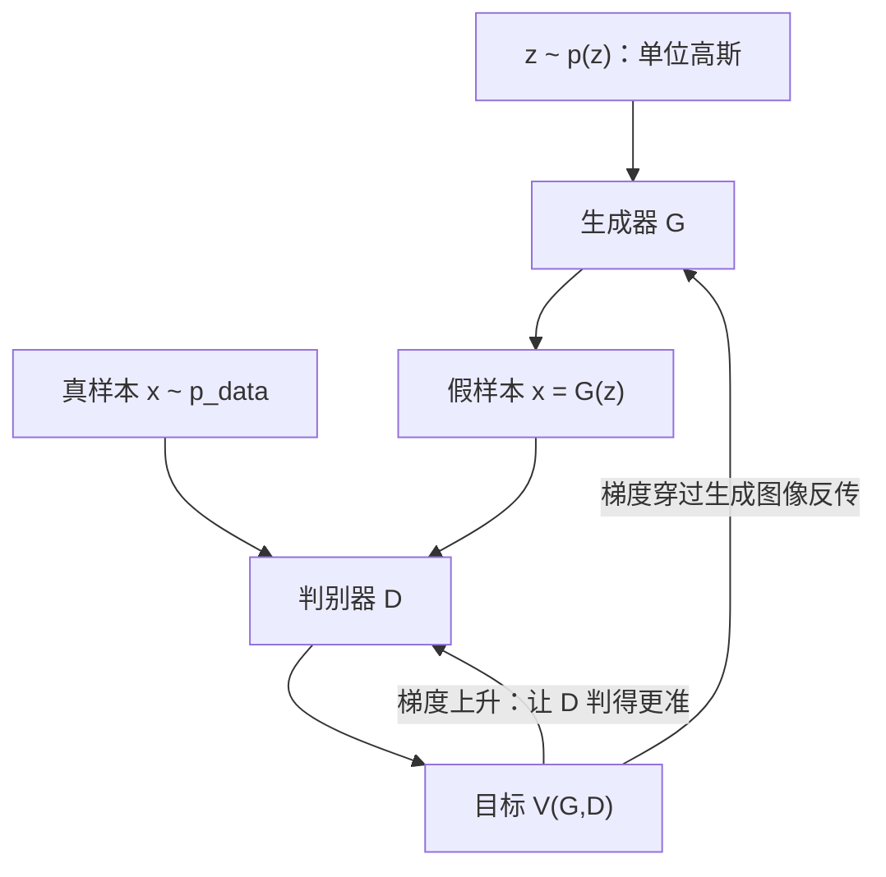
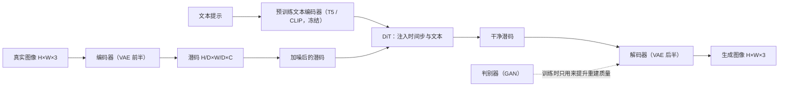

> **课程信息**
>
> - **课程名称**：Stanford CS231n: Deep Learning for Computer Vision（Spring 2025）
> - **本讲主题**：Lecture 14. Generative Models 2
> - **主讲教师**：Justin Johnson
> - **授课日期**：2025-05-20
> - **课程主页**：[cs231n.stanford.edu/2025](https://cs231n.stanford.edu/2025/schedule.html)
> - **官方课件**：[lecture_14.pdf](https://cs231n.stanford.edu/slides/2025/lecture_14.pdf)（123 页，书中逐页插图）
> - **字幕来源**：[cs231n_sp25_kor_sub · eng](https://github.com/lpaiu-cs/cs231n_sp25_kor_sub/tree/main/eng)（公开英文转写，中文由本书重写）
> - **版权说明**：幻灯片与课程材料版权归 Stanford University 及授课教师所有；本书为非官方学习笔记，仅用于学习与研究。


第 13 讲在生成模型的家族树上只走了半边：密度可算的自回归模型，和只能算下界的变分自编码器。两者共用一个前提——你能写出 $p_\theta(x)$ 的某种显式形式，然后对着它做最大似然。本讲把这条前提拆掉，走另外半边：隐式密度（implicit density）。这类模型不交出任何密度数值，只承诺一件事——能从学到的分布里采样。

于是问题变成两个。其一，如果连 $p(x)$ 都算不出来，"训练"到底在优化什么？GAN 的回答极端而漂亮：把这件事外包给第二个神经网络，让它当损失函数。其二，如果 GAN 这么好用，为什么 2021 年之后整个领域转向扩散模型，而最后大家又把 GAN、VAE、扩散塞进同一条流水线？前半场回答第一个问题，后半场回答第二个。

## 1. 先把 p(x) 放弃掉：GAN 用一个判别器代替似然

*(参考时间: 00:00:05 – 00:13:54｜Lecture 14)*


第二页只交代两件事：Assignment 3 在 5 月 30 日截止，项目报告在 6 月 4 日截止。它出现的位置说明了本讲的处境——学期进入收尾，而生成模型这条线只剩这一讲，所以节奏被迫压缩：GAN 占前半小时，扩散模型要在剩下不到一小时内从直觉一路讲到工业级管线。


复习只花了两句话，但落点很准：这三种模型都是概率模型，差别不在网络结构，而在**你要预测什么、以什么为条件、以及最关键的——对谁做归一化**。判别模型学 $p(y\mid x)$，标签空间很小，归一化只在几个类别之间分摊概率；生成模型学 $p(x)$，必须满足 $\int_X p(x)\,dx=1$，于是一张图里出现的每一种可能都在争夺同一份概率质量。讲师把这句话当成全讲的引子：生成模型难，难在它必须把质量铺满整个数据空间，而不只是把一条决策边界画对。


这张树状图值得先记住骨架。第一层分叉是显式密度（explicit density）与隐式密度（implicit density）：前者要真的输出一个 $p(x)$ 或它的近似，后者只要求能采样。显式密度再分两支——密度可算的（tractable density）对应自回归模型，密度只能近似的（approximate density）对应变分自编码器。隐式密度也分两支——直接采样的对应 GAN，通过一个迭代过程逼近样本的对应扩散模型。上一讲走完了左半边，本讲走右半边。


自回归模型的做法是把数据摊平成一个序列，然后对序列做链式分解：


$$
p(x)=\prod_{t=1}^{T} p\left(x_t \mid x_1,\dots,x_{t-1}\right)
$$


对图像来说，这个"序列"就是像素值——讲师特意强调通常取**离散**形式，把每个像素当成 0 到 255 的 8 位整数，于是整个模型是一个离散序列模型，骨干用 RNN 或 Transformer。这解释了它为什么似然可算、训练稳定，也解释了它为什么推理慢：生成一张图必须按顺序把序列走完一遍，没有任何并行余地。


VAE 换了一条路：不直接算 $p(x)$，而是引入潜变量 $z$，优化似然的一个下界——也就是证据下界（ELBO）：


$$
\log p_\theta(x)\ \ge\ \mathbb{E}_{z\sim q_\phi(z\mid x)}\left[\log p_\theta(x\mid z)\right]-D_{KL}\left(q_\phi(z\mid x)\,\|\,p(z)\right)
$$


编码器 $q_\phi(z\mid x)=\mathcal{N}(\mu_{z\mid x},\Sigma_{z\mid x})$ 把一张图压成一个高斯，解码器 $p_\theta(x\mid z)=\mathcal{N}(\mu_{x\mid z},\sigma^2)$ 再把潜码还原成图。两个网络联合训练，目标是让这个下界尽可能高。讲师在这里补了一句贯穿全场的话：**最大似然是这一切背后共同的执念**，无论形式怎么变，训练生成模型的目标总是让观测到的数据在模型下概率尽可能大。


同一张树上多了一组标注：左半边写 Last Time，右半边写 Today，并且把 GAN 与扩散模型分别挂在"直接"和"间接"两个叶子上。这一页实际上就是本讲的目录，只不过用的是分类学而不是标题列表——它同时预告了一件事：右边这两支的共同点是算不出密度，区别在于"用什么代价换到样本"。

### 1.1 隐式密度：交不出密度值，但交得出样本


幻灯片在这里插了一页纯标题页，把话题正式切到 GAN。讲师的原话是：这是我们会看到的第一种隐式密度模型。


回顾页把前两种模型的目标函数并排写出来：自回归直接最大化训练数据的似然，VAE 最大化似然的下界。两者的共同点是——**都有一个写下来的、可以对着它做梯度下降的目标**。这句话是后面所有麻烦的对照物。


这一帧在底部加了第三行：生成对抗网络放弃建模 $p(x)$，但允许我们从 $p(x)$ 中抽取样本。注意措辞——不是"近似 $p(x)$"，而是"不建模 $p(x)$"。模型内部不存在任何可以读出的密度值，只有一条从噪声到数据的通路。

### 1.2 设定：把 z 推过生成器，把"像不像"交给判别器


设定很朴素：手上有一批样本 $x_i$，假设它们抽自某个真实分布 $p_{data}$，而我们希望能从这个分布里采样。讲师对 $p_{data}$ 的描述是全场最像哲学的一段：它是"宇宙用来生成数据的那条分布"，里面掺着物理、历史，也许还有社会政治的约束。这句话的作用不是修辞，而是提醒你——**你永远拿不到 $p_{data}$ 的解析式**，能拿到的只有一个有限的数据集。顺带回答了一个课堂提问：想生成从来没见过的概念（比如独角兽）是不可能的，因为 $p_{data}$ 由你选的数据集定义；模型只能在你给过的相近事物之间做泛化。


第二帧引入潜变量 $z$，它服从一个我们自己指定、并且完全了解的简单先验 $p(z)$——通常是单位高斯，因为我们既会采样也知道它的解析性质。然后设想一个数据生成过程：采一个 $z$，过一个生成器网络 $x=G(z)$，得到的 $x$ 就服从所谓的生成器分布 $p_G$。改网络参数、改架构、改训练方式，都会诱导出不同的 $p_G$。**整个 GAN 训练的目标只有一句：让 $p_G$ 逼近 $p_{data}$。**


画面上补出了那条流水线：从 $p_z$ 采样得到具体的 $z$，喂进生成器 $G$，输出一张生成图像。讲师对它的定义是"把已知分布的样本转换成数据分布样本"的网络。


关键的一帧：右侧多出一个判别器网络 $D$，输入一张图，输出它是真还是假。生成器负责骗过它，判别器负责识破它。为什么需要这个网络？因为在前两种模型里，我们都是自己写下一个目标函数来逼 $p_G$ 靠近 $p_{data}$；GAN 的做法是**把这个任务交出去**，让另一个神经网络自己学出一个"像不像"的判据。


最后一帧把两个网络连成一个系统，标注"联合训练 $G$ 和 $D$，希望 $p_G$ 收敛到 $p_{data}$"。这里有课堂提问：生成器到底能不能从判别器那里得到反馈？答案是能，而且这正是整套机制成立的原因——反馈形式是梯度。$G$ 和 $D$ 都只是神经网络，复合起来仍是一个可微系统，梯度可以从判别器的输出一路反传，穿过那张生成图像，落回生成器的参数上。**生成器唯一的监督信号，就是穿过判别器的那条梯度链**；除了正则项，没有任何辅助损失在直接告诉它该生成什么。



这张图里有两条回路值得盯住：一条让判别器自己变强，另一条让生成器被迫跟着变强。两条回路共用同一个标量 $V$，这正是后面所有训练困难的根源。

### 1.3 minimax：一个标量，两个方向


目标函数写成一场极小极大博弈：


$$
\min_G \max_D\ \mathbb{E}_{x\sim p_{data}}\left[\log D(x)\right]+\mathbb{E}_{z\sim p(z)}\left[\log\left(1-D(G(z))\right)\right]
$$


讲师按颜色拆解：蓝色属于生成器，红色属于判别器。


先定义 $D$ 的输出含义：$D(x)=P(x\ \text{is real})$，取值 0 表示判为假，1 表示判为真；实际训练中它输出的是 0 到 1 之间的软概率。有了这个语义，对数里的两项才有意义。


固定 $G$，只看 $D$：左边一项要求对真数据 $D(x)=1$，右边一项要求对假数据 $D(G(z))=0$。因为 $\log$ 单调，最大化 $\log D(x)$ 等价于最大化 $D(x)$；而想让 $D(G(z))$ 接近 0，就要最大化 $\log(1-D(G(z)))$。于是整个 $\max_D$ 就是一个标准的真假二分类目标——**判别器在解的问题，和任何图像分类器没有本质区别**，只是数据集一半来自真实数据、一半来自生成器。


换到生成器视角，固定 $D$：左边那一项只涉及真数据，与 $G$ 完全无关，可以直接划掉。生成器只关心右边，而它的诉求与判别器相反——它希望假数据被判成真，也就是希望 $D(G(z))=1$。所以同一个 $\log(1-D(G(z)))$，判别器要最大化、生成器要最小化。这就是"对抗"两个字的全部含义。


把四项打包成一个标量 $V(G,D)$，博弈就可以写成 $\min_G \max_D V(G,D)$。优化方式是交替更新：判别器做梯度上升，生成器做梯度下降。


页面上给出了骨架代码：

```python
while True:
    D = D + alpha * dV_dD      # 判别器梯度上升，想把 V 做大
    G = G - alpha * dV_dG      # 生成器梯度下降，想把 V 做小
```

注意两行的符号相反：判别器是 `+`，生成器是 `-`。讲师把这个结构称为"GAN 训练的全部"——没有别的损失项，没有别的辅助目标，就是这两行在一个死循环里交替执行。也正因为只有这两行，后面关于"GAN 难训"的所有抱怨，都不是实现细节问题，而是这个博弈本身的性质。

## 2. V 不是损失：GAN 的理论最优很美，却既不保证收敛也不告诉你进度

*(参考时间: 00:14:05 – 00:30:44｜Lecture 14)*

### 2.1 没有损失曲线可看，这是目标函数的性质而不是实现问题


这一页只加了一句红字，但它是全讲最重要的一句话：**我们并没有在最小化任何一个总损失，所以没有训练曲线可看**。原因是 $V$ 的绝对值不带信息——它同时取决于生成器和判别器的水平。判别器弱，生成器随便骗骗就能拿到好看的数；判别器强，生成器必须更强才能拿到同样的数。不同的 $(G,D)$ 组合可以给出完全相同的 $V$，所以盯着 $V$ 无法判断 $p_G$ 是否在逼近 $p_{data}$。

讲师顺手回答了"那画两条曲线分别看 $G$ 和 $D$ 行不行"：可以画，但通常没什么用。他提到这背后有数百篇论文尝试过改目标、去掉 $\log$、换成 Wasserstein 之类的距离，五年、几千人的投入，最后大家训练时用的还是这个最朴素的写法。


把训练动力学摊开看。刚开始时生成器是随机初始化的，输出基本是噪声，判别器只要几轮迭代就能把真假分开，于是 $D(G(z))\approx 0$——判别器几乎确定地说"这是假的"。


麻烦就在这里。生成器要最小化的是 $\log(1-D(G(z)))$，而当 $D(G(z))\to 0$ 时，这条曲线在原点附近**几乎是平的**。梯度接近零，意味着训练初期生成器几乎学不到东西：它确实在做梯度下降，只是每一步都小到可以忽略。


补丁只有一行：把生成器的目标从最小化 $\log(1-D(G(z)))$ 换成最小化 $-\log D(G(z))$。两者在"希望 $D(G(z))$ 变大"这件事上方向一致，但后者在 $D(G(z))\to 0$ 时梯度很陡——判别器越自信地说假，生成器得到的推力越大。代价是此时生成器和判别器**优化的已经不是同一个 $V$** 了：判别器仍在最大化 $\log(1-D(G(z)))$，生成器最小化的是另一个量。讲师说，从零训练 GAN 时这个改动在实践中极其重要；他也顺带承认，这正是"没有统一损失"这件事的具体表现。

### 2.2 理论最优：$D^*$ 可以写出来，但永远算不出来


接下来的问题是：这个目标在数学上到底好不好？讲师说他以前有 slides 一步步走这个证明，今天没时间，只给结论。


把内层 $\max_D$ 解出来，对任意固定的 $p_G$，最优判别器是


$$
D^*(x)=\frac{p_{data}(x)}{p_{data}(x)+p_G(x)}
$$


这个式子的含义可以用一句话读出来：**在某个点上，判别器输出的"真"的概率，正比于该点上真实密度与生成密度的相对大小**。若 $p_G=p_{data}$，则 $D^*(x)=1/2$——判别器彻底分不出来，只能瞎猜。

讲师特意点破一个尴尬之处：这个式子写在纸上很漂亮，但你永远算不出来，因为它需要 $p_{data}$ 的密度；而如果你有 $p_{data}$ 的密度，这件事早就做完了。


把 $D^*$ 代回外层，可以证明外层目标在且仅在 $p_G=p_{data}$ 时取到最小值。也就是说，理论上存在一个唯一的平衡点：生成器完美复现数据分布，判别器退化到 1/2。这就是 GAN 让人觉得"这东西应该能成"的全部理论依据。


紧接着的两条 caveat 把上面的美好打了折。第一，推导假设 $G$ 和 $D$ 都有无限容量、能表示任意函数，而真实的网络是固定大小、固定容量的。第二，这个结论只说明"最优点在哪"，完全不说明"梯度下降加梯度上升能不能走到那里"，尤其是在有限数据上。讲师的原话是：这给了我们一点理论安慰，但在实践中既不强也不成立。

课堂上有两个追问值得记下来。问"判别器在训练初期学得太好要紧吗"——不要紧，因为这不是普通的分类问题：普通分类器的数据集是固定的，而这里的"数据集"是生成器现造的，会随着训练不断变化，所以整个优化是**非平稳**的。问"会不会卡在局部极小值、能不能踢出来"——同样是几百篇论文、一堆启发式，没有一个真正留下来。

### 2.3 潜空间平滑是 GAN 的意外礼物，但它不是必然


回到工程。$G$ 和 $D$ 都是神经网络，历史上基本都是 CNN——讲师补了一句：GAN 在 ViT 流行之前就已经失宠了，否则大概率也会用 ViT。真正让 GAN 在非玩具数据上跑通的是 DC-GAN（Radford et al., ICLR 2016），一个五层卷积网络，在那时给出了相当惊艳的样本。


这一帧在右侧贴了两张论文首页，是讲师的一个玩笑也是一个人物注脚：DC-GAN 的一作 Alec Radford 紧接着做了 GPT-1 和 GPT-2。讲师由此串起一条线索——做图像生成的人后来跳去做离散文本生成，并在那里做出了最重要的工作；**"给分布建模"这件事在像素和 token 上是同一件事**。


唯一被单独点名的另一篇是 StyleGAN。讲师没有展开细节，只给了一句建议：想学 GAN 的最佳实践就去读它。它的核心是把 $z$ 先经映射网络变成 $w$，再在每一层用 AdaIN 把 $w$ 变成一组缩放和平移：


$$
\mathrm{AdaIN}(x,w,b)_i=w_i\,\frac{x_i-\mu(x)}{\sigma(x)}+b_i
$$


注意这里的 $w_i$ 和 $b_i$ 与 $x$ 同形状——也就是说，每一层、每个通道都有自己的缩放和平移，全部由那个解耦出来的 $w$ 预测。噪声则从另一条支路以逐像素的形式注入，控制细节的随机性。


GAN 一个很讨喜的性质是潜空间通常是**平滑**的。取两个潜向量 $z_0,z_1$，在它们之间插值


$$
z_t=t\,z_0+(1-t)\,z_1,\qquad x_t=G(z_t)
$$


把整条路径上的每个点都过一遍生成器，得到的图像会平滑地互相演变，而不是跳变。


这页用的是 StyleGAN3（Alias-Free GAN）的示例：一路 $z$ 平滑变化，画面里的动物也随之平滑变形。讲师对它的解读是——模型在潜空间里自发地整理出了某种有用的结构。但他立刻补了一句反例，防止你把这当成必然：生成器完全可以无视 $z$、只记住训练集里的十张图，无论给什么 $z$ 都吐其中一张。这同样能骗过判别器（输出与真样本逐位相同），而且是这个目标函数下的合法解——它相当于在十几个样本附近堆了几个狄拉克尖峰，其余地方概率为零。**这种解不会有任何平滑的潜空间。**


总结页把账算清楚。优点：形式简单；调好了能出极好的图（StyleGAN 系列的分辨率和质感就是证据）。缺点：没有损失曲线可看；训练不稳定，说崩就崩——模式崩塌（mode collapse）、突然出现 NaN/Inf、判别器发疯、生成器开始输出纯噪声，而你没有曲线可以诊断；很难扩展到真正的大模型和大数据的规模。页脚那句是历史定位：**大约 2016 到 2021 年，GAN 是生成模型的首选**。

还有两个课堂问答值得留下。问"我们把什么换掉了"——VAE 换来了潜向量但样本糊，GAN 换来了清晰样本但丢掉了可控的潜向量。问"推理时判别器怎么办"——直接扔掉，采一个 $z$ 过一遍生成器就出图，**推理成本是一次前向**，这是 GAN 至今仍被惦记的唯一硬优势。

## 3. 扩散把生成改写成一条从噪声走回数据的路，核心代码只有六行

*(参考时间: 00:30:50 – 00:45:11｜Lecture 14)*


把 GAN 挤下神坛的是另一类模型。这一页列了五篇论文，本身就是一条时间线：Sohl-Dickstein et al. (2015) 提出用非平衡热力学做深度无监督学习；Song & Ermon (NeurIPS 2019) 用估计数据分布梯度来做生成；Ho et al. 的 DDPM (NeurIPS 2020) 让它真正好用；Song et al. 的 SDE 框架 (ICLR 2021) 与 DDIM (ICLR 2021) 分别给出连续时间视角和更快的确定性采样。


讲师先打预防针：**这个方向的术语和记号非常混乱**，不同论文用不同的符号指同一件事，有的论文要读五页数学才告诉你它在干什么。所以本讲不追求覆盖所有变体，只讲一种现代、干净的实现——Rectified Flow。他还预先声明了一个立场：有人认为 Rectified Flow 不算扩散模型，他不在意，"对我来说它就是扩散的一种"。

### 3.1 直觉：先加噪到全乱，再学着一点点擦掉


扩散模型的第一个硬约束藏在细节里：噪声分布 $z\sim p_{noise}$ 通常取单位高斯，而且**必须和数据同形状**。如果你的图是 $H\times W\times 3$，那么噪声也必须是 $H\times W\times 3$——这和 GAN 里那个维度低得多的 $z$ 完全不同，后面所有"慢"的根源都在这里。


引入噪声等级 $t\in[0,1]$：$t=0$ 表示干净数据，$t=1$ 表示纯噪声，中间是把噪声按比例混进数据得到的 $x_t$。于是同一条数据在这个视角下变成了一族样本，从清晰到全糊连续过渡。


训练目标：给网络一张带噪图 $x_t$ 和噪声等级 $t$，让它**只去掉一点点噪声**。注意是"一点点"，不是"还原成原图"——这一点是扩散与自编码器的分野。


推理是一个迭代过程：先从 $p_{noise}$ 采一张纯噪声 $x_1$，喂给网络，它被迫在这团纯噪声里"看出"一点点数据结构的影子；拿回稍微干净一点的图，再喂进去，再去一点……重复足够多次，就走到 $x_0$。讲师对这个设定的评价很坦诚："这是个很怪的设定，但这就是扩散的直觉。"

至于步数是不是固定超参、噪声具体怎么加、一步去多少——这一页故意含糊，因为不同形式化给出不同答案，下一节才把它钉死。

### 3.2 Rectified Flow：从数据指向噪声的那条直线


为了把上面那套含糊的说法变具体，讲师换成几何语言：画两个分布，蓝的是 $p_{noise}$，红的是 $p_{data}$。他同时提醒这个画法的危险——二维空间里成立的直觉，在一千维里往往完全失效，但没办法，幻灯片上只放得下二维。


每次训练迭代采三样东西：$z\sim p_{noise}$、$x\sim p_{data}$（就是从训练集里抽一张图）、$t\sim\mathrm{Uniform}(0,1)$。图上的蓝点是 $z$，红点是 $x$。


然后做两件事。第一，在 $x$ 到 $z$ 的连线上取一个插值点


$$
x_t=(1-t)\,x+t\,z
$$


第二，把这条连线的方向定义成速度 $v=z-x$。$t=0$ 时 $x_t=x$，$t=1$ 时 $x_t=z$，所以 $t$ 确实是从数据走到噪声的比例。


训练目标就是让网络看着 $x_t$ 和 $t$，把那个速度向量预测出来：


$$
L=\left\|f_\theta(x_t,t)-v\right\|_2^2
$$


讲师强调：**就这么多**。没有对抗、没有下界、没有重要性采样，就是一个回归问题。


页面上给了完整实现：

```python
for x in dataset:
    z = torch.randn_like(x)          # 与 x 同形状的单位高斯
    t = random.uniform(0, 1)         # 噪声等级
    xt = (1 - t) * x + t * z         # 直线插值
    v = model(xt, t)                 # 网络预测速度
    loss = (z - x - v).square().sum()  # 目标速度就是 z - x
```

讲师在这里吐槽了一句很有价值的话：论文里读到的晦涩，和真正跑起来需要的代码，中间隔着的距离大得惊人——**核心训练循环就是这六行**。他还对比了 GAN 的处境：训练扩散模型时你有一条能看的损失曲线，损失降下去模型一般就在变好；而对经历过"GAN 疯狂年代"的人来说，第一次看到这条平滑下降的曲线是会感动的那种体验。

### 3.3 采样：沿着预测速度走 50 小步


推理端比训练复杂，这也是扩散相对 GAN 唯一的明显劣势。第一件事是定步数 $T$，Rectified Flow 通常取 50；讲师说 30 也勉强能用。


从 $p_{noise}$ 采一个 $x_1$，这是全噪声。


循环从 $t=1$ 递减到 $0$，步长 $1/T$。每一步先用网络评估当前点的速度 $v_t=f_\theta(x_t,t)$。这里的关键理解是：**网络预测的 $v_t$ 不会直接把你送到干净样本**，它只指示方向。


于是做一步更新


$$
x \leftarrow x-\frac{v_t}{T}
$$


因为 $v$ 的方向是"从数据指向噪声"，所以要往反方向走。图上标出了第一步之后的位置 $x_{2/3}$（这里用 $T=3$ 演示）。


在新位置上再问一次网络，得到 $v_{2/3}$。注意这一步的 $v$ 与上一步不同——**速度场是位置和时间的函数，每走一步都要重新问**。


继续沿新方向走一小步，落到 $x_{1/3}$。到这里路径已经明显偏向红色那团云。


最后一步落到 $x_0$，它已经落在 $p_{data}$ 的云里。$x_0$ 就是模型的输出样本。


这一帧把整条轨迹合成一张图：$x_1\to x_{2/3}\to x_{1/3}\to x_0$，以及沿途两次评估出的 $v_{2/3}$、$v_{1/3}$。可以看到轨迹不是直线而是折线——每一步都用当前点的局部速度重新定向，这正是"数值积分"的样子。


算法补上最后一行 `Return x`。"50 步"这个数字现在有了具体含义：**50 次网络前向**，而不是 GAN 的 1 次。


这一帧补了两样东西：把 $x_0$ 用黄圈标出来（强调它才是交付物），以及完整采样代码：

```python
sample = torch.randn(x_shape)
for t in torch.linspace(1, 0, num_steps):
    v = model(sample, t)
    sample = sample - v / num_steps
```

和训练代码对照着看会发现一个漂亮的事实：**采样就是拿模型预测的速度做梯度下降**，只不过步长是 $1/T$、目标是走到 $t=0$。讲师说，把训练和采样放在一页上，"扩散模型就没那么吓人了"。


这一页把训练与采样并置：训练是从真实配对 $(x,z)$ 里学一个速度场，采样是从纯噪声出发沿这个速度场积分。两张图画在同一组分布上，是为了让你看清它们共享同一个几何对象。

### 3.4 生成模型的共同难点：z 与 x 从来没有配对

采样流程讲完之后，讲师停下来讲了一段本讲最抽象、也最值钱的话。

他说，真正难的问题在于：**你手上有一堆能采样的 $z$，也有一堆想要生成的 $x$，但你从来不知道哪个 $z$ 该对应哪个 $x$**。所有生成模型都是在绕着这个死结做文章——VAE 让模型自己预测一个 $z$ 再预测 $x$，然后强行把 $z$ 拉成能采样的分布（效果一般）；GAN 干脆不监督这层关系，让生成器在前馈过程中自己长出一个映射，判别器只在分布层面把关；扩散则把它变成对曲线的积分，用"每个点上的局部方向"绕过全局配对。如果一开始就知道配对，这件事早就结束了。

这段话解释了为什么后面每一节都在改细节而不是改框架：**框架层面的自由度，其实只有"怎么在没有配对的情况下逼近分布"这一件事**。

## 4. 条件信号太弱时，CFG 用两条速度向量之差把它放大

*(参考时间: 00:45:19 – 00:52:16｜Lecture 14)*

### 4.1 条件 Rectified Flow：把 y 当成多出来的一个输入


上一讲就说过，无条件生成基本没有意义，我们真正在意的是条件生成。这一页先摆出图景：$p_{data}$ 不是一个整体，它由若干子分布拼成，比如"方形"和"三角形"各是一团，图上分别标成 $p_{data}(x\mid y=\blacktriangle)$ 与 $p_{data}(x\mid y=\blacksquare)$。此时两段代码都压成灰色，意思是先看清楚问题长什么样。


改动只有两处，都被红框圈住了：数据集的迭代对象从 `x` 变成 `(x, y)`，模型调用从 `model(xt, t)` 变成 `model(xt, y, t)`。也就是说，**条件不过是一个额外的辅助输入**，训练目标（预测速度、L2 损失）一个字都没改。


采样端同样只加了一个东西：`y = user_input()`。这一行看起来是废话，其实是整段内容的重点——**$y$ 从训练时的数据标签，变成了推理时用户可以控制的信号**。它可以是文本提示、可以是一张输入图、可以是任何在推理时才拿到的东西。条件生成之所以有用，全靠这一行把控制权交出去。


但这里冒出一个新问题，用绿字写在页面中间：能不能控制模型**多听**条件 $y$？讲师说，如果就这么朴素地训，模型往往不够听话——生成的图与提示词对不上。这就引出了后面十一页的主角。

### 4.2 CFG：训练时随机把 y 丢掉，采样时把两条向量相减


无分类器引导（CFG）对训练循环的改动只有一行：

```python
if random.random() < 0.5:
    y = y_null      # 以 50% 概率抹掉条件信息
```

讲师说 50% 是个超参，但实践中大家基本都用 50。这一行的效果是：**同一个模型同时学会了条件与无条件两种模式**。给它真实的 $y$，它做条件生成；给它 `y_null`，它就退化成一个无条件的扩散模型。


为什么这样就能控制强调程度？先看图：取一个带噪的 $x_t$，它可能来自任何一个子分布，也可能是由噪声混出来的。


把 `y_null` 喂进去，模型给出 $v_\varnothing=f_\theta(x_t,y_\varnothing,t)$。这个向量指向**整个数据分布 $p(x)$ 的"重心"**——因为它没见过条件，只能往所有数据的平均方向走。


换成真正的条件 $y$，模型给出 $v_y=f_\theta(x_t,y,t)$。这个向量指向**那个条件对应的子分布**，也就是方块那一团。


现在有了两个方向，就可以做一点线性代数：


$$
v_{cfg}=(1+w)\,v_y-w\,v_\varnothing
$$


把 $v_\varnothing$ 从 $v_y$ 里减掉，等于**扣掉"所有数据的平均走向"这个公共分量**，剩下的部分全归条件；再乘上 $(1+w)$ 放大它。结果是一条比 $v_y$ 更偏、更"用力"地指向条件子分布的向量。


采样时就把这个 $v_{cfg}$ 当作速度来用。注意 $w=0$ 时公式退化成 $v_y$，也就是回到纯条件生成；$w$ 越大，条件被强调得越狠。


这一帧把强调换到采样一侧，准备展示改动后的采样代码。


代码变成：

```python
for t in torch.linspace(1, 0, num_steps):
    vy = model(sample, y, t)
    v0 = model(sample, y_null, t)
    v  = (1 + w) * vy - w * v0
    sample = sample - v / num_steps
```

这里有个必须记住的账：**每次迭代要多跑一次前向**。采样成本直接翻倍。


讲师专门解释了名字的由来，并且明确说这个命名很蠢。"无分类器"是相对于更早的 classifier guidance（Dhariwal & Nichol）而言的：那类方法额外训一个判别式的 $p(y\mid x)$，采样时把它对 $x$ 的梯度 $\partial\log p(y\mid x)/\partial x$ 加到速度上。CFG 做的事本质相同，但把那个分类器去掉了——用同一个生成模型在 `y_null` 下的输出来替代分类器的作用。两篇论文只隔了九个月，名字却一直留到了今天。


讲师对它的评价毫不含糊：这是实践中最重要的一招，几乎所有高质量扩散模型都在用。


代价也写在同一页上：采样成本翻倍。这解释了后面蒸馏为什么重要——CFG 让每一步变贵一倍，蒸馏让步数少一个数量级，两者正好互相抵消。

### 4.3 被跳过的一节：最优预测到底在预测什么


接下来是七页"Optimal Prediction"。讲师在这一页上只花了十几秒："最优预测这一节我跳过，不是没意思，是怕时间不够。"但紧接着讲噪声调度时，他又把这一节的结论完整说了一遍——因为不解释"为什么中间最难"，就说不清为什么要换 $t$ 的分布。所以这七页的内容并没有丢，只是被压进了下一节的开场白。


问题本身是：给定 $x_t$ 和 $t$，网络的**最优**输出是什么？页面上给出了答案的一半——由于 $x_t=(1-t)x+tz$ 是多对一的映射，同一个 $x_t$ 可能对应许多组 $(x,z)$，而网络只能看到 $x_t$。在平方损失下，最优预测就是这些可能性的条件期望，也就是**对它们取平均**。


极端情况很好分析。$t=1$ 时 $x_t=z$ 是纯噪声，里面不含任何关于 $x$ 的信息，此时最优预测就是 $p_{data}$ 的均值方向——所有答案的平均。


对称地，$t=0$ 时 $x_t=x$ 是干净数据，噪声完全未知，最优预测是 $p_{noise}$ 的均值方向。两端都只需要学两个常数向量。


真正难的是中间。$t$ 在 0.5 附近时，$x_t$ 里既有结构也有噪声，能解释它的 $(x,z)$ 组合非常多，条件期望要把这些全都平均掉，得到的方向往往是"模糊的折中"。


矛盾就在这里：均匀采样 $t$ 意味着**两端容易的样本和中间困难的样本权重一样**。训练算力被大量花在了"学两个常数向量"上。


解决方向也就顺理成章：把 $p(t)$ 换成非均匀的，往中间加权。这正好接上下一节。

### 4.4 噪声调度：中间最难，就该多练中间


这一页把上一节的结论变成一条曲线：横轴 $t$，纵轴 $p(t)$，形状是一个中间高、两端低的鼓包。


具体形式叫 logit-normal 采样——先对一个正态分布采样，再过 logit 变换压到 $(0,1)$，得到的密度正是这种两端低中间高的形状。


还有一类叫平移（shifted）调度，形状不对称，整体往噪声大的一侧偏。原因是分辨率：高分辨率图像相邻像素的相关性很强，要把信息真正破坏掉，需要更大的噪声；低分辨率图像相关性弱，同样的噪声就过头了。讲师由此得出一个相当重要的判断——**这套东西不会自动适配分辨率**。


这一页把 Rectified Flow 的完整设定收回一张图：训练侧的采样与回归、采样侧的迭代积分，加上右侧关于 $p(t)$ 的三条经验。讲师的评价是：这是一个简单、可扩展的设定，能套用到很多生成建模问题上。


紧接着补上的红字是它的软肋：直接在像素空间、高分辨率上跑，效果并不好。这个"不好"不是靠微调噪声调度就能抹平的，它直接催生了下一节——也是当今几乎所有图像生成系统的实际形态。

## 5. 现代管线不在像素上跑扩散：VAE 压、DiT 算、GAN 收尾

*(参考时间: 00:52:26 – 01:02:25｜Lecture 14)*

### 5.1 潜空间扩散：把 256×256×3 压成 32×32×16


讲师先纠正自己前面的一句话：他说扩散模型是最流行的生成模型，这"有点撒谎"——真正被到处使用的是**潜空间扩散模型（LDM）**。它是一个多阶段流程，第一阶段先训一对编码器/解码器，编码器把 $H\times W\times 3$ 的图像压成 $H/D\times W/D\times C$ 的潜码，解码器再把它还原。


具体数字：空间下采样 $D=8$，通道数 $C=16$。于是 $256\times256\times3$ 的图变成 $32\times32\times16$ 的潜码——**元素数从 196608 降到 16384，整整 12 倍**。这一对编解码器通常是带注意力的 CNN，近几年也有工作改用 ViT。


第二阶段：扩散模型不再看像素，而是看潜码。训练时把图像过编码器得到潜码，给潜码加噪，让模型学着去噪。讲师强调了一个容易被忽略的细节——**编码器是冻结的**，梯度不会回传到它身上，它只负责把图变成潜码。


训练结束，进入推理。


先采一个随机潜码，形状就是 $H/D\times W/D\times C$。


然后按前面那套 50 步的流程反复去噪。注意这里每一步的开销是按潜码尺寸算的，不是按像素——**这就是 LDM 省下来的东西**。


去噪完拿到干净潜码，最后过一遍解码器，得到 $H\times W\times 3$ 的图像。


页脚补了一句定位：这是当今最常见的形态。

### 5.2 那对编码器/解码器怎么训：VAE 打底，GAN 补救


讲师把问题抛给课堂：我们见过什么编解码器结构？答案在下一帧。


它就是一个 VAE——前面推过的那套编码器输出高斯、解码器输出高斯的架构。唯一的区别是 KL 项的权重取得非常小：我们不真的需要潜码服从标准高斯，只需要它可逆、信息损失小。


但 VAE 有个老毛病：**解码器输出偏糊**。而在 LDM 里这是致命的——解码器的重建质量是整条流水线的上限，如果它还原出来的图就是糊的，后面扩散模型生成得再好也没用。


解法是把 GAN 请回来：在解码器后面接一个判别器，判"重建图 vs 真图"。重建图要被推得像真图，糊的问题就被对抗损失顶掉了。


于是全讲的伏笔在这里收口。讲师的原话是："最先进的生成建模，是 VAE 吗？是 GAN 吗？是扩散吗？**全都是。**"现代管线同时训练一个 VAE、一个 GAN 判别器和一个扩散模型——VAE 负责压，GAN 负责让解码器不糊，扩散负责在潜空间里生成。他说："很抱歉，这就是一锅乱炖。"



这张图里，实线是推理时真正跑的通路，虚线只在训练阶段存在——**推理时判别器被丢弃**，这一点和 GAN 完全一致。

### 5.3 DiT：条件从哪儿进 Transformer


网络本体反而最近几年变清爽了：直接用标准的 Transformer 块，也就是所谓的 DiT。真正需要设计的只有一个问题——**怎么把条件注入进去**。这里有三样输入要进网络：带噪图像、时间步 $t$、条件信号（比如文本）。


第一种机制是让网络预测一组缩放和平移，去调制 Transformer 块内部的中间激活。这基本上就是时间步 $t$ 的标准注入方式——和 StyleGAN 的 AdaIN 是同一个思想：把标量条件变成逐通道的仿射变换。


第二种机制利用了 Transformer 的本性：它就是一个序列模型，那就**把什么都塞进序列**。文本 token 可以和图像 token 拼在一起做联合注意力（joint attention），也可以作为单独的键值做交叉注意力（cross-attention）。讲师总结的现代惯例是：时间步走 scale/shift，文本走序列拼接（通常是 cross-attention，有时 joint attention）。

### 5.4 文生图与文生视频：同一条流水线，序列长度差两个数量级


把上面所有零件拼起来就是文生图。提示词先过一个预训练文本编码器（T5、CLIP 之类，通常冻结），得到 $D\times L$ 的文本嵌入；它和 $h\times w\times c$ 的带噪潜码一起进 DiT，输出干净潜码，再经 VAE 解码器变成 $H\times W\times 3$ 的图像。页面上的示例提示词是讲师前一天写的：一只猴子在埃菲尔铁塔前和老虎握手，猴子戴着香蕉做的帽子，老虎两腿站立穿西装。

![文生图具体数字：FLUX.1 \[dev\] 的配置与序列长度](</attachments/cs231n-4d248ac67990381287688f0b.png>)

用一个真实模型把数字落地：FLUX.1 [dev] 用 T5 + CLIP 双文本编码器，编解码器做 8 倍下采样，扩散模型本身是 120 亿参数的 Transformer。潜码是 $128\times128\times16$，DiT 之前还额外做了一次 $2\times2$ 的 patchify，讲师给出的序列长度是 **1024 个图像 token**。**1024 这个数字记住它**，马上要拿来对比。


文生视频的管线长得一模一样，唯一的差别是潜码多了一个时间维：从 $h\times w\times c$ 变成 $t\times h\times w\times c$，解码器也从空间自编码器变成时空自编码器，在时间和空间上同时下采样。页面上的提示词换成了一段关于红脸白毛猴子泡温泉的描述。


这一帧在右下角贴了 Meta Movie Gen 的生成结果作为佐证。


数字对比很残酷。MovieGen 的文本编码器是 UL2 + ByT5 + MetaCLIP，编解码器做 $8\times8\times8$ 下采样，扩散模型是 **300 亿参数**的 DiT。带噪潜码 $32\times128\times72\times16$，干净潜码 $33\times128\times72\times16$，输出 $257\times1024\times576\times3$ 的视频。$1\times2\times2$ 的 patchify 之后，序列长度达到 **76000 个 token**——是文生图那 1024 个 token 的七十多倍。

讲师由此给出这条线的核心结论：视频扩散模型的贵，几乎全部贵在序列长度上，而不是参数或架构。想要高帧率、高分辨率、多帧数，token 数就按这三个维度同时膨胀。


这一页把过去一年半的模型排成时间轴，颜色区分三类：绿色是开源模型，橙色是有技术报告的，红色是完全不给技术信息的。从 2024 年初 Google 的 WALT（460M）到 2025 年 5 月的 Wan（14B）、Hunyuan（13B）、Cosmos（14B）、MovieGen（30B），参数量从 4.6 亿一路涨到 300 亿，跨了近两个数量级。讲师说这 18 个月几乎每周都有新模型，并且当天上午 11 点 Google 刚发布 Veo 3——他是在来学校的车上读完的博客。他特别提到 Veo 3 会联合建模声音，能同时输出音频和画面。

至于 Sora 的历史地位，他的说法是：它不是第一个视频扩散模型，但它是第一个效果好到让人震动的，采用了 DiT + Rectified Flow 这条现代路线（他不确定 Sora 是否真的用了 Rectified Flow），"那是视频扩散的一英里四分钟时刻"，之后所有大厂都在追。

## 6. 同一份流程换四个函数就是另一篇论文：广义扩散、蒸馏与三种数学视角

*(参考时间: 01:02:30 – 01:11:26｜Lecture 14)*

### 6.1 蒸馏：把 50 步压成 1 步，用质量换速度


扩散最大的工程问题是慢：采样要迭代 30 到 50 次，而模型本身可能是几百亿参数、序列长度几万。讲师把它称为"推理时的灾难"。


解法是一类叫蒸馏（distillation）的算法：拿一个需要 30–50 步的模型，用某种方式改造成只需很少步数、仍能出好样本的模型，有时甚至一步到位，还能把 CFG 一起"烤"进去。代价是样本质量会掉——所有蒸馏方法的技巧都在于**尽量少掉**。讲师列了六篇 2022–2025 年的文献（Progressive Distillation、Consistency Models、Adversarial Diffusion Distillation、LADD、sCM、Moment Matching），并说这是一个非常活跃的方向。

### 6.2 广义扩散：把 Rectified Flow 拆成四个函数槽


讲完工程，回到数学。这一页把 Rectified Flow 的目标重新写一遍，作为对照的基准：采样 $x\sim p_{data}$、$z\sim p_{noise}$、$t\sim p_t$，令 $x_t=(1-t)x+tz$、$v_{gt}=z-x$，预测 $v_{pred}=f_\theta(x_t,t)$，最小化 $\|v_{gt}-v_{pred}\|_2^2$。


右边这一列就是"广义扩散"：把两个线性组合的系数都换成 $t$ 的函数——


$$
x_t=a(t)\,x+b(t)\,z,\qquad y_{gt}=c(t)\,x+d(t)\,z
$$


网络输入 $x_t$ 与 $t$，输出 $y_{pred}$，损失仍是 L2。**所有扩散变体的差别，就是往这四个槽里塞什么函数。**


对照着填：Rectified Flow 是 $a(t)=1-t$、$b(t)=t$、$c(t)=-1$、$d(t)=1$，此时 $y_{gt}=z-x$，正是那个速度向量。


第二类叫方差保持（VP）：$a(t)=\sigma_t$、$b(t)=\sqrt{1-\sigma_t^2}$。选这种形式有一个明确的好处——如果 $x$ 与 $z$ 独立且方差都是 1，那么 $x_t$ 的方差也恒为 1，噪声不会把数值尺度吹爆。代价是把两个函数折叠成一个 $\sigma_t$，而这个 $\sigma_t$ 仍然要你自己定。


第三类叫方差爆炸（VE）：$a(t)=1$、$b(t)=\sigma_t$。此时信号原样保留、噪声越加越大，所以 $\sigma_1$ 必须大到足以淹没 $x$ 里的全部信号，否则 $t=1$ 时还有信息残留。


除了插值方式，回归目标也能换。页面列了三组 $(c,d)$：预测干净数据（$c=1,d=0$），就是 x-prediction；预测加进去的噪声（$c=0,d=1$），就是 ε-prediction，DDPM 用的是这个；预测两者的混合（$c=b,d=-a$），就是 v-prediction。三种目标在数学上等价（知道其中两个就能解出第三个），但在不同噪声区间上的数值条件数差别很大。


讲师承认这套参数化让人崩溃：本来选超参就够难了，现在要选的是**以 $t$ 为自变量的函数**，凭直觉根本设不出来，必须有数学指导。这就把他引到最后一节。

### 6.3 三种数学视角：同一个算法，三套解释


第一种形式化：扩散是一个潜变量模型。每个干净样本 $x_0$ 都对应一整条加噪轨迹 $x_1,\dots,x_T$，这些中间状态我们观察不到，是潜变量。于是可以照搬 VAE 的那套推导，优化似然的变分下界。这条线从 Sohl-Dickstein et al. (2015) 一直延伸到 DDPM。


第二种形式化完全换了一套语言。对任意分布 $p(x)$ 定义得分函数


$$
s(x)=\nabla_x \log p(x)
$$


它是一个向量场，指向概率密度高的方向。扩散模型可以被理解为"学习数据分布的得分函数"，而且是在多个噪声等级上各学一个——于是你得到的是一族得分函数，而不只是一个。


第三种形式化把加噪写成随机微分方程（SDE）：


$$
d\boldsymbol{x}=f(\boldsymbol{x},t)\,dt+g(t)\,d\boldsymbol{w}
$$


网络学的是这个 SDE 的数值积分器。讲师很坦诚地说这条他自己也没完全搞懂。但这个视角有个实际好处：一旦把采样看成解 SDE，就能借用数值分析里所有更高级的积分器，而 Rectified Flow 里那个"沿 $v$ 走一步"，本质上就是最朴素的前向欧拉法。


如果想继续往下读，讲师推荐了 Sander Dieleman 的博客文章，里面给了扩散模型的八种不同视角，并说这位作者写的所有关于扩散的文章都值得看。

### 6.4 自回归模型的反攻


最后半页是一个回马枪。第 13 讲讲的自回归模型在原始像素上太慢——序列就是逐像素铺开，长到没法按顺序采样。但如果把 token 换成**离散潜码**，序列长度立刻降一两个数量级，自回归就又行了。


具体做法：先训一对编解码器，把图像压成**整数**潜码（这一步对应 VQ-VAE 系列）；再在这个离散序列上训一个自回归模型；采样时从自回归模型里抽出潜码序列，过解码器得到图像。这条路线在 Taming Transformers、Parti 等工作里被推到过很高的质量。讲师把它放在结尾，是为了说明**现代生成建模不止扩散一条路**，而且这两条路共享同一个骨架：编码器、解码器、在潜空间上建模。

## 7. 小结

*(参考时间: 01:11:38 – 01:12:03｜Lecture 14)*


总结页只有三行：生成对抗网络、扩散模型、潜空间扩散模型。讲师对这堂课的定性是"旋风式的巡礼"——两个大类别，最后落到一个把两者都装进去的现代管线。


下一讲转向视觉与语言。

这堂课真正该带走的是下面几条判断：

- **归一化对象决定难度**：判别模型在几个类别之间分概率，生成模型要把概率质量铺满整个数据空间，这就是它必须借助近似或对抗的根本原因。
- **GAN 把目标函数外包给了判别器**，代价是失去了可读的损失：$V$ 的绝对值同时取决于两个网络的水平，训练曲线无法用来判断进展。
- **非饱和损失不是审美选择**：$\log(1-D(G(z)))$ 在 $D(G(z))\to 0$ 时梯度趋零，换成 $-\log D(G(z))$ 只是为了让开局有梯度，代价是 $G$ 与 $D$ 优化的不再是同一个 $V$。
- **理论最优只保证"最优点在哪"**：$D^*=p_{data}/(p_{data}+p_G)$ 与"$p_G=p_{data}$ 时最优"都假设无限容量，对能否用梯度走到那里一无所知。
- **扩散用"迭代"换回了损失曲线**：训练是一个 L2 回归，损失可读、可扩展；代价是采样要几十次前向，CFG 还会把这个数字再翻一倍。
- **CFG 的两条向量之差是在扣公共分量**：$v_{cfg}=(1+w)v_y-wv_\varnothing$ 减掉的是"所有数据的平均走向"，剩下的是纯条件方向，$w$ 就是强调强度。
- **分辨率不会自动适配**：噪声调度必须随数据分辨率平移，这正是像素空间扩散在高分辨率上失效、必须转到潜空间的直接原因。
- **现代管线是拼出来的**：VAE 负责压缩、GAN 负责让解码器不糊、DiT 负责在潜空间里去噪、文本编码器负责条件，缺一环都出不了今天的图。
