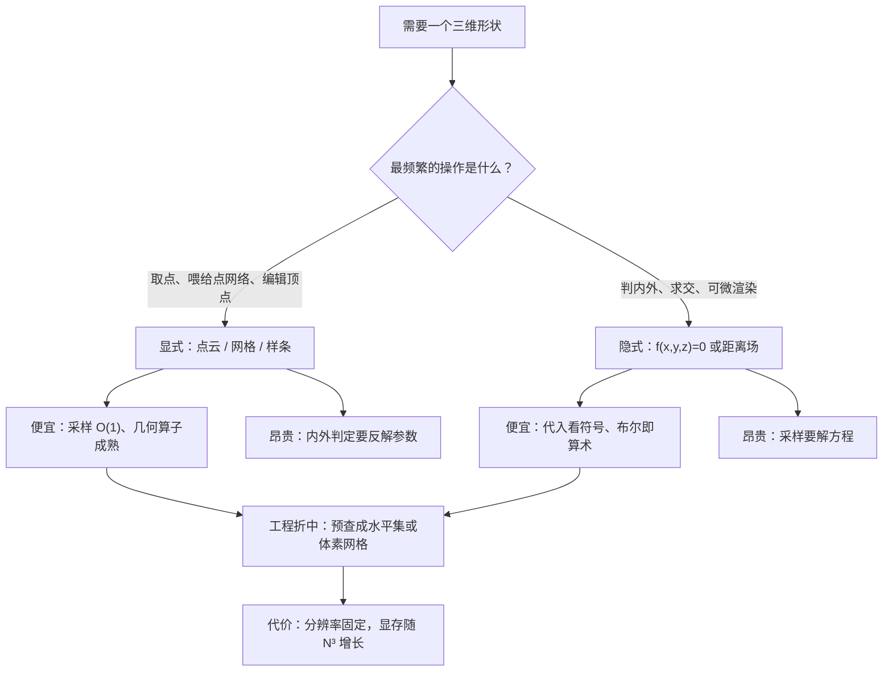

> **课程信息**
>
> - **课程名称**：Stanford CS231n: Deep Learning for Computer Vision（Spring 2025）
> - **本讲主题**：Lecture 15. 3D Vision
> - **主讲教师**：Jiajun Wu
> - **授课日期**：2025-05-22
> - **课程主页**：[cs231n.stanford.edu/2025](https://cs231n.stanford.edu/2025/schedule.html)
> - **官方课件**：[lecture_15.pdf](</attachments/cs231n-15848a12f2962dbe6aa3c0ad.pdf>)（105 页，正文按页链接本地课件）
> - **字幕来源**：[cs231n_sp25_kor_sub · eng](https://github.com/lpaiu-cs/cs231n_sp25_kor_sub/tree/main/eng)（公开英文转写，中文由本书重写）
> - **版权说明**：幻灯片与课程材料版权归 Stanford University 及授课教师所有；本书为非官方学习笔记，仅用于学习与研究。

> **课件索引**：点击下方链接打开本地 PDF 的对应页；全部课件见 [课件索引](/notes/cs231n/slides)。页码按 PDF 文件页序定位，第 1 讲分为 Part 1 / Part 2。

[📄 L15 · 第 1 页｜Lecture 15 标题页：3D Vision，Jiajun Wu，2025 年 5 月 22 日](</attachments/cs231n-15848a12f2962dbe6aa3c0ad.pdf#page=1>)

前十四讲里，绝大多数对象最终都落在一张二维网格上：像素有行列，行列就是地址，于是"相邻"这件事不需要定义。三维没有这样的地址系统。同一个杯子，可以由几百万个坐标点描述，也可以由几十万个三角面描述，也可以由一行方程 $x^2+y^2+z^2=r^2$ 描述——三种写法描述的是同一个物体，但让完全不同的操作变便宜。这一讲要回答的第一个问题因此不是"哪种表示最好"，而是"**每种表示把哪件事变便宜、把哪件事变贵**"。

第二个问题才是深度学习的部分。Jiajun Wu 把这条线索讲成了一条依赖链：2012 年之后人们先在体素上做 3D 卷积，因为体素与像素只差一维；随后被图形学界批评"又慢又丑"，于是转向点云原生的 PointNet；再往后发现深度网络本身就是一个隐函数，于是有了 Occupancy Networks、DeepSDF；最后把隐函数接到可微体渲染上，才有了 NeRF 与 3D Gaussian Splatting（3DGS）。**每一次换轨都不是因为网络更强，而是因为换了一种表示。**

## 1. 「3D 没有像素」：显式表示先把物体写成一份清单

*(参考时间: 00:00:05 – 00:11:12｜Lecture 15)*

二维视觉的接口便宜到不需要讨论：一个 $H\times W\times 3$ 的张量，第几行、第几列、第几个通道，全世界都一样。三维没有这个默认值。讲师开场没有给定义，而是先给了三张照片，把"三维物体"这个词的边界撑开。

[📄 L15 · 第 2 页｜一排玻璃器皿：细颈、薄壁与透明材质，几何的极端细节](</attachments/cs231n-15848a12f2962dbe6aa3c0ad.pdf#page=2>)

第一张是一排高脚杯与玻璃杯。细到几毫米的杯口、近乎透明的材质、彼此遮挡的轮廓——这类几何的难处不在外形轮廓，而在细节与材质。任何"按格子采样"的表示只要分辨率差一点，杯口就塌成一团。

[📄 L15 · 第 3 页｜曼哈顿中央公园航拍：城市级几何，树冠与楼群同框](</attachments/cs231n-15848a12f2962dbe6aa3c0ad.pdf#page=3>)

第二张反过来：曼哈顿中央公园的航拍。城市级的几何里，树冠、楼群、道路同时入画，尺度从米跨到公里。同一套表示要能同时装下树和楼，这是"尺度"给表示法出的题。

[📄 L15 · 第 4 页｜河流三角洲的俯拍：同一套分叉结构在不同尺度上重复](</attachments/cs231n-15848a12f2962dbe6aa3c0ad.pdf#page=4>)

第三张是河流三角洲的俯拍（国家地理读者投稿，Adriana Franco）。主河道分叉成支流，支流再分叉，形态与树、与血管同构——三维形状常常自带多尺度自相似，而任何固定分辨率的表示都会在某一端失真。这三张图合起来是本章的第一个论点：**三维表示的选择，本质上是"在哪个尺度上不丢信息"的选择**。

### 1.1 两大家族与六个考量

[📄 L15 · 第 5 页｜几何表示的两大家族：显式（点云、网格、细分、NURBS）与隐式（水平集、代数曲面、距离函数）](</attachments/cs231n-15848a12f2962dbe6aa3c0ad.pdf#page=5>)

幻灯片把选项摊成两族。**显式**（explicit）：点云、多边形网格、细分曲面（subdivision）、NURBS——共同点是"点被直接写出来"。**隐式**（implicit）：水平集（level set）、代数曲面、距离函数——共同点是"点由一个关系式筛选出来"，你拿不到一张点表，只能提问"这个点在不在里面"。幻灯片最后一行写着：每种选择都对应不同的任务与几何类型，没有全局最优。

[📄 L15 · 第 6 页｜选择表示时要回答的六个问题：存储、创建、输入接口、操作、渲染、动画](</attachments/cs231n-15848a12f2962dbe6aa3c0ad.pdf#page=6>)

真做工程时，选型要回答六件事：怎么存进计算机（像素是一个矩阵，点云是不规则表，隐函数连"存什么"都要想）；怎么创造新形状，输入是图片还是语言描述；支持哪些操作——编辑、简化、平滑、滤波、修补；怎么渲染，光栅化、光线追踪还是神经渲染；怎么动画，尤其是人体与动物；以及这六条能不能和深度学习接上。这张清单后面会被反复拿来给每种表示打分。

### 1.2 点云：$3\times N$ 的清单，缺一张连接表

[📄 L15 · 第 7 页｜点云：只有坐标没有连接，带方向的点叫 surfel](</attachments/cs231n-15848a12f2962dbe6aa3c0ad.pdf#page=7>)

点云是最省的写法：一个 $3\times N$ 的矩阵，三行是 $x,y,z$，$N$ 列是点数。图像是"每个位置存一个值"，点云是"每个点存一个位置"——存储的对象从值变成了坐标，连接关系被整个丢掉。要渲染还得再加一列：法向（normal）。光照从某个方向打来，表面每一点朝向哪边决定了它有多亮，缺了法向，点云只能画成一团没有明暗的雾。带方向的点在图形学里有专门名字——**surfel**（面元）。

[📄 L15 · 第 8 页｜三维扫描仪的原始输出：一堆彼此独立的部分扫描](</attachments/cs231n-15848a12f2962dbe6aa3c0ad.pdf#page=8>)

[📄 L15 · 第 9 页｜多张部分扫描要靠配准合并到同一坐标系，再融合成一张点云](</attachments/cs231n-15848a12f2962dbe6aa3c0ad.pdf#page=9>)

点云之所以重要，是因为它常常是传感器的**原始输出**：深度相机、结构光扫描仪、甚至 iPhone 上的 ARKit，吐出来的第一手数据都是点。但原始输出不能直接用：单次扫描只覆盖一个视角，噪声大，还有大片缺失，必须把多帧**配准**（registration）到同一坐标系再融合。算一笔账：一帧 640×480 的深度图约 30 万个点，绕物体拍 100 帧就是 3000 万点，每个点三个 float32 存下来约 360 MB——这还只是一次扫描的中间产物。

[📄 L15 · 第 10 页｜点云的边界情况：同一堆点既可能是环面，也可能是两个套在一起的环](</attachments/cs231n-15848a12f2962dbe6aa3c0ad.pdf#page=10>)

点云的优点是"什么几何都能塞进去"，把点挪一挪就能表示任何形状，也不受拓扑约束，天然适合大规模数据集。缺点同样清楚：欠采样区域画不出来（兔子头上密密麻麻、尾巴上稀疏，渲染出来就是破洞），没有简化与细分这类成熟算子，没有方向性的平滑渲染，最要命的是**没有拓扑信息**。幻灯片右下角那个问号就来自最后一条：同样一堆点，既可能是一个环面，也可能是两个套在一起的环——点集不告诉你它们怎么连。

### 1.3 三角网格：把连接补上，代价是不规则

[📄 L15 · 第 11 页｜多边形网格：物体的边界表示，点与点之间的连接一起存下来](</attachments/cs231n-15848a12f2962dbe6aa3c0ad.pdf#page=11>)

网格（polygonal mesh）把连接补上：不只存点，还存面（faces）。它是图形学引擎、游戏、影视管线里最通用的表示，实时渲染吃的几乎全是三角形。代价是不规则：一个面可以有 3、4、5 个顶点，这种变长结构与早期卷积网络"固定分辨率输入"的假设直接冲突。讲师把这一点说成本讲的一条暗线——**深度学习在三维上起步晚，很大程度上是因为表示不统一**。

[📄 L15 · 第 12 页｜Digital Michelangelo 的大卫像：2818 万个顶点、5623 万个三角面](</attachments/cs231n-15848a12f2962dbe6aa3c0ad.pdf#page=12>)

复杂网格能到很夸张的规模。这尊大卫像有 28,184,526 个顶点、56,230,343 个三角面。按 float32 存顶点坐标是 $2.82\times10^{7}\times3\times4$ 字节，约 338 MB；三角面按三个 4 字节索引存是 $5.62\times10^{7}\times3\times4$，约 675 MB。合计约 1 GB，还没算法向、UV 与贴图。这就是为什么网格处理的第一步常常是简化而不是渲染。

[📄 L15 · 第 13 页｜Google Earth 的全球网格：由卫星与航拍重建，三角形数量到万亿级](</attachments/cs231n-15848a12f2962dbe6aa3c0ad.pdf#page=13>)

再往上是 Google Earth：用卫星与航拍影像重建的全球网格，三角形数量以万亿计。按每个三角形 12 字节的索引算就是 12 TB，单机根本装不下，只能按视点流式取细节。**能否"简化而不塌"因此成了网格表示的核心竞争力**，而点云连这个操作都没有。

[📄 L15 · 第 14 页｜网格上采样（细分）：用插值把面片切细，分辨率上去而形状不变](</attachments/cs231n-15848a12f2962dbe6aa3c0ad.pdf#page=14>)

[📄 L15 · 第 15 页｜网格下采样（简化）：减少面数，同时尽量保住形状与外观](</attachments/cs231n-15848a12f2962dbe6aa3c0ad.pdf#page=15>)

三个基本操作构成了网格的工具箱。**细分**（subdivision）在边上插新点、按邻域加权决定新点位置，把一个面一分为四，分辨率上去了而形状不动；**简化**（simplification）反过来，在保住形状与外观的前提下去掉顶点，用来换帧率；**正则化**（regularization）不改形状只改采样分布——让每个面都是三角形、三个顶点、大小相近，后续的碰撞、参数化、平滑算法才好写。

[📄 L15 · 第 16 页｜网格正则化：重排采样分布，让三角面大小均匀](</attachments/cs231n-15848a12f2962dbe6aa3c0ad.pdf#page=16>)

正则化值得单独记一笔，因为它回答的是"为什么不能直接用扫描出来的网格"。扫描得到的网格往往一边密一边疏，长条三角形满地都是，数值算法在这种网格上不稳定。把采样分布改均匀，形状误差几乎不变，但后续每一步都变便宜——这是图形学里"表示的质量等于后续算法的质量"的典型例子。

到这里，显式表示的两个代表都摆完了：点云与网格的共同点是"点被直接写出来"。下一章换一条完全不同的路：不列点，写函数。

## 2. 把形状写成函数：参数化省自由度，隐式好判定

*(参考时间: 00:11:14 – 00:27:37｜Lecture 15)*

如果形状是被"设计"出来的——桌子有直边、椅子有对称面、车身是流水线曲面——用几百万个点去逼近它是浪费：一张圆桌只需要半径和高度。参数化表示（parametric representation）就是把这个先验写进表示里：**形状的自由度远小于 3**，一张曲面本质上是二维的，一条曲线是一维的，把它们"贴"进三维空间只需要一个映射。

### 2.1 参数化：把曲面写成两个变量的函数

[📄 L15 · 第 17 页｜表示法分类图的第一帧：先只摆出非参数的两种（点、网格）](</attachments/cs231n-15848a12f2962dbe6aa3c0ad.pdf#page=17>)

幻灯片先用一张 $2\times2$ 的分类图把坐标系搭起来：横轴是显式与隐式，纵轴是非参数与参数。这一帧只填了左上角两格（点、网格），后面每讲一类就补一格——整讲会把它填满一次，再拿它当路标反复引用。

[📄 L15 · 第 18 页｜参数化表示：曲面是函数的像，$f$ 把低维参数域映到三维空间](</attachments/cs231n-15848a12f2962dbe6aa3c0ad.pdf#page=18>)

参数化表示把曲面定义成函数的**像**（range）：$S=\{f(u,v)\mid (u,v)\in D\}$，其中 $f:D\subset\mathbb{R}^2\to\mathbb{R}^3$。注意自由度是 2 而不是 3——曲面本身是二维的，三维只是它被嵌入的空间。参数从哪来不重要，重要的是"用两个数就能定位曲面上的一个点"。

[📄 L15 · 第 19 页｜参数化曲线：一个自由度 $t$ 扫出整条圆](</attachments/cs231n-15848a12f2962dbe6aa3c0ad.pdf#page=19>)

[📄 L15 · 第 20 页｜参数化曲面：两个自由度 $(u,v)$ 扫出整个球面](</attachments/cs231n-15848a12f2962dbe6aa3c0ad.pdf#page=20>)

最朴素的例子是圆与球。圆写成 $f(t)=(\cos t,\ \sin t)$，$t\in[0,2\pi)$，一个自由度扫一圈；球写成 $f(u,v)=(\sin u\cos v,\ \sin u\sin v,\ \cos u)$，$u\in[0,\pi]$、$v\in[0,2\pi)$，两个自由度铺满整张球面。不需要存点，存这个函数就够了。

[📄 L15 · 第 21 页｜Bézier 曲线与分段 Bézier：少数控制点决定一条光滑曲线](</attachments/cs231n-15848a12f2962dbe6aa3c0ad.pdf#page=21>)

工程上更常用的是 **Bézier 曲线**：给若干个控制点 $P_i$ 和对应的基函数 $b_i(t)$，曲线是 $B(t)=\sum_i b_i(t)P_i$。控制点只给出"拉力方向"，曲线本身永远落在控制点凸包内，所以调形状非常直观——这正是工业设计软件里那根可以拖的曲线。一条 Bézier 表达力有限，实际做法是**分段 Bézier**：多段拼起来，段间共享端点保证连续。

[📄 L15 · 第 22 页｜Bézier 曲面：两条 Bézier 曲线的张量积得到一张 patch](</attachments/cs231n-15848a12f2962dbe6aa3c0ad.pdf#page=22>)

曲面是曲线的张量积：$S(u,v)=\sum_i\sum_j b_i(u)b_j(v)P_{ij}$，得到一张 **patch**（面片）；多张 patch 缝起来就是完整曲面。这个构造解释了为什么汽车与飞机的数字模型都是"曲面片拼图"——每张片只有几十个控制点，但可以拼出任意光滑的壳体。

[📄 L15 · 第 23 页｜细分曲线与细分曲面：反复切角得到极限曲面](</attachments/cs231n-15848a12f2962dbe6aa3c0ad.pdf#page=23>)

与 Bézier 并列的另一条路是**细分**（subdivision，幻灯片注明借用 Keenan Crane 与 Don Fussell 的材料）：不写公式，而是从一个粗糙的控制网格出发，反复执行"在边中点插点、按邻域加权移动旧点"的规则，迭代若干次后收敛到一张光滑的极限曲面。它比 NURBS 那类张量积曲面更容易处理任意拓扑，这也是它成为动画管线主力的原因。

[📄 L15 · 第 24 页｜分类图第二帧：参数化一列被填上，样条与细分曲面各就各位](</attachments/cs231n-15848a12f2962dbe6aa3c0ad.pdf#page=24>)

到这一帧，分类图下半部分的两格被填上了：样条（splines）与细分曲面（subdivision surfaces）都属于"参数化"——它们的共同点是不存点表，存一组控制量与一套生成规则。到这里为止，四种表示（点、网格、样条、细分）全部站在**显式**这一侧：无论怎么生成，最终都能给出曲面上的具体点。

### 2.2 显式：采样容易，内外难

[📄 L15 · 第 25 页｜显式表示的定义：所有点被直接给出](</attachments/cs231n-15848a12f2962dbe6aa3c0ad.pdf#page=25>)

显式表示的统一描述是：**所有点都被直接给出**。一般形式写成 $f:\mathbb{R}^2\to\mathbb{R}^3$——给它两个参数，它还你一个三维点。这个接口决定了它的强项与软肋。

[📄 L15 · 第 26 页｜显式表示的强项：随机采 $(u,v)$ 就能得到曲面上的点](</attachments/cs231n-15848a12f2962dbe6aa3c0ad.pdf#page=26>)

强项是采样。幻灯片给的环面是 $f(u,v)=((2+\cos u)\cos v,\ (2+\cos u)\sin v,\ \sin u)$。要在这张曲面上取点，随机抽若干个 $(u,v)$ 代进去就行，得到的点**保证在曲面上**。这一步是 $O(1)$ 的，而且不需要解任何方程——后面 PointNet 那类方法要求把形状转成点云时，靠的就是这个性质。

[📄 L15 · 第 27 页｜显式表示的软肋：判断 $(3/4,1/2,1/4)$ 在不在内部，要先反解 $(u,v)$](</attachments/cs231n-15848a12f2962dbe6aa3c0ad.pdf#page=27>)

软肋是内外判定。给定一个查询点 $(3/4,1/2,1/4)$，问它在不在物体内部——对显式表示来说，你得先找到一对 $(u,v)$ 使 $f(u,v)$ 等于这个点，也就是解一个**反问题**。环面上这类方程可能多解、可能无解，形状一复杂就没有解析解。讲师在这里停了一下说"我自己也不确定"——这个犹豫恰好说明了问题：对人都不直观，对渲染管线更不友好。

### 2.3 隐式：一个符号解决内外

[📄 L15 · 第 28 页｜隐式表示：点的集合由 $f(x,y,z)=0$ 这类关系定义](</attachments/cs231n-15848a12f2962dbe6aa3c0ad.pdf#page=28>)

隐式表示换了个方向：不去列点，而是给一个**分类规则**。球面就是所有满足 $x^2+y^2+z^2=1$ 的点；更一般地，曲面是 $f(x,y,z)=0$ 的零水平集（zero level set）。$f$ 的符号给出内外：负的在里，正的在外的。幻灯片用一条从 $-1$ 到 $+1$ 的色带画出了这件事——曲面是那条零线，两侧是两个域。

[📄 L15 · 第 29 页｜隐式表示的软肋：求 $f=0$ 上的点等于解方程](</attachments/cs231n-15848a12f2962dbe6aa3c0ad.pdf#page=29>)

代价立刻出现：**采样变难了**。幻灯片给的环面隐函数是 $f(x,y,z)=(2-\sqrt{x^2+y^2})^2+z^2-1$。要在这张曲面上取点，就得解 $f=0$——这个例子用高中数学还能凑，换成任意形状就没有闭式解，只能数值求根。隐式表示丢掉的正是显式表示最擅长的东西。

[📄 L15 · 第 30 页｜隐式表示的强项：代入求符号，$-1/8<0$ 就是内部](</attachments/cs231n-15848a12f2962dbe6aa3c0ad.pdf#page=30>)

但内外判定变成了代入。同一个查询点 $(3/4,1/2,1/4)$ 代进单位球：$9/16+1/4+1/16=7/8$，减去 1 得 $-1/8<0$，**在内部**，一次乘法加一次减法就完了。幻灯片特意让这个数字落在 $-1/8$ 上：精确、可验算，不用信任何近似。

同一个点在两个不同的隐函数上会给出不同的答案，这一点值得记住：把它代进上一页那个环面函数，$\rho=\sqrt{x^2+y^2}=\sqrt{13}/4\approx0.901$，$(2-\rho)^2+z^2-1\approx+0.27>0$，判为**外部**。符号本身没有意义，符号相对于"当前这个 $f$ 描述的形状"才有意义。

于是显式与隐式构成一组干净的对称：

| 任务 | 显式（点、网格、样条） | 隐式（$f=0$、距离场） |
| --- | --- | --- |
| 在曲面上取点 | 容易，代参数即可 | 难，要解方程 |
| 判断点在不在内部 | 难，要反解参数 | 容易，代入看符号 |
| 布尔运算（并/交/差） | 需要重新求交、重建拓扑 | 逐点算术即可 |
| 表示复杂拓扑 | 需要显式维护连接 | 天然支持合并与分裂 |

这张表解释了后面所有技术路线的动机：**渲染要的是"沿一条光线查询每点的密度"，也就是大量内外判定**，所以神经渲染最终站在隐式这一侧。

### 2.4 隐式的组合术：布尔、距离场与混合

[📄 L15 · 第 31 页｜代数曲面：多项式的零集，形状一复杂就写不出来](</attachments/cs231n-15848a12f2962dbe6aa3c0ad.pdf#page=31>)

隐式的第一层能力是**代数曲面**：曲面是多元多项式的零集。二次曲面（球、椭球、双曲面）都能写成闭式，可控性好。问题也很直接：想要一头牛的形状，你写不出那个多项式。闭式表达力与形状复杂度之间有一道过不去的墙。

[📄 L15 · 第 32 页｜构造实体几何（CSG）：并、交、差三种布尔运算拼出复杂零件](</attachments/cs231n-15848a12f2962dbe6aa3c0ad.pdf#page=32>)

绕过这堵墙的第一招是**构造实体几何**（constructive solid geometry, CSG）：不去写一个复杂函数，而是用并、交、差把简单形体拼起来。隐式表示在这里格外顺手——每个形体给一个函数值，布尔运算就是对值做逐点算术，不需要重新求交、不需要重建拓扑。这也是 CAD（计算机辅助设计）几十年来的标准做法：工业零件的模型本质上是一棵布尔表达式树。

[📄 L15 · 第 33 页｜距离函数：每点存到表面的最短距离，可带符号](</attachments/cs231n-15848a12f2962dbe6aa3c0ad.pdf#page=33>)

第二招是把"符号"升级成"数值"：**距离函数**（distance function）在每个点存的是到物体表面的最短距离，带符号的距离场（signed distance field）同时编码了内外与远近。信息量比二值内外大得多，代价是函数值不再只是 0/1。

[📄 L15 · 第 34 页｜距离函数的线性混合：两条边界相加，得到平滑过渡的新边界](</attachments/cs231n-15848a12f2962dbe6aa3c0ad.pdf#page=34>)

有了数值就可以做算术。幻灯片用一维举例：一条竖线是 $f_1(x)=0$，左边为负右边为正；另一条竖线是 $f_2(x)=0$；把两个函数加起来，零集就落在两条线之间，形成一条**平滑移动的边界**。这就是"混合"（blending）：不是布尔那种硬切，而是让两个形状像两块橡皮泥一样过渡。三维里同样的加法能把两个球粘成花生形，形状过渡的宽度由距离场的尺度控制。

[📄 L15 · 第 35 页｜纯距离函数搭出来的场景：能做，但很不容易](</attachments/cs231n-15848a12f2962dbe6aa3c0ad.pdf#page=35>)

这条路能走多远？幻灯片给了一张完全由距离函数拼出来的场景图——建筑、台阶、装饰都在，全部是若干距离函数的组合。讲师的说法是这"并不容易"，但"如果很擅长，表达力非常强"。它说明隐式表示的上限很高，同时也暗示了下限：**手工调这些函数是门手艺**，这也正是后来想用神经网络替代它的原因。

[📄 L15 · 第 36 页｜分类图第三帧：隐式一列出现名字（代数曲面、CSG），图还没填](</attachments/cs231n-15848a12f2962dbe6aa3c0ad.pdf#page=36>)

这一帧的分类图只补了名字，隐式那两格还是空的——代数曲面与 CSG 属于参数化隐式，它们的图（那个 $x^2+y^2+z^2=1$ 的球与布尔树）要到第 40 页、讲完水平集与体素之后才补上。幻灯片用这种"逐帧填空"的节奏强调：这张图不是目录，是这一讲的知识地图。

### 2.5 从函数到场：水平集与体素

[📄 L15 · 第 37 页｜水平集方法：把隐函数预查成网格值，表面在插值过零处](</attachments/cs231n-15848a12f2962dbe6aa3c0ad.pdf#page=37>)

隐式表示的优点是合并、分裂都容易，缺点是对复杂形状没有闭式、每次查询都要算一遍函数。工程上的折中是**水平集方法**（level set）：不再保留解析函数，而是在一个三维网格上**预查**每个格点的函数值，把结果存成一个矩阵。曲面在哪里？在相邻两个格点一正一负的地方，插值找到过零点即可。

这一步换来的是"显式控制"：一张三维标量场就像一张三维纹理，可以直接可视化、可以直接编辑，也可以直接跑 marching cubes 之类的等值面提取算法。付出的是分辨率——网格越粗，细结构越找不回来。

算一笔账：讲师举的例子是 $100\times100\times100$ 的网格，也就是 **100 万次函数求值**。换成常见的分辨率：$256^3$ 是 1680 万次，$512^3$ 是 1.34 亿次。存下来按每格 1 字节算是 1 MB、16.8 MB、134 MB；如果只要内外、每格压成 1 bit，则是 0.125 MB、2.1 MB、16.8 MB。这几个数量级的差别决定了后面"体素为什么走不远、八叉树为什么出现"。

[📄 L15 · 第 38 页｜医学数据（CT/MRI）的水平集：等密度面就是器官与组织的边界](</attachments/cs231n-15848a12f2962dbe6aa3c0ad.pdf#page=38>)

水平集最成熟的战场是医学影像。CT 与 MRI 给出的本来就是体数据，每个体素是一个密度值；取某个等值面（比如某个恒定组织密度）就得到器官边界。这里不需要解析函数，也不需要拓扑先验，网格上的等值面提取直接可用。

[📄 L15 · 第 39 页｜体素：对体网格做二值化，只保留"在里/在外"](</attachments/cs231n-15848a12f2962dbe6aa3c0ad.pdf#page=39>)

再退一步就是**体素**（voxels）：水平集只留符号，正的一律记 1、负的一律记 0，三维标量场就变成了一个三维二值矩阵。这个表示几乎和像素一一对应——像素是二维矩阵，体素是三维矩阵，只是多了一个深度轴。讲师说他是故意绕这么远来讲体素的：从隐函数一路推下来，才能看清体素其实是"隐函数 + 预查 + 二值化"三步的产物，而不是凭空冒出来的一个表示。

[📄 L15 · 第 40 页｜分类图第四帧：体素与水平集补上，六个格子齐了](</attachments/cs231n-15848a12f2962dbe6aa3c0ad.pdf#page=40>)

到这一帧，$2\times2$ 的图终于填满：非参数显式（点、网格）、参数显式（样条、细分曲面）、非参数隐式（体素、水平集）、参数隐式（代数曲面、CSG）。这张图会在后面反复出现，每换一种深度学习路线，讲师就把箭头从一格指向另一格。

用一张流程图把这一章的取舍收起来：

## 3. 数据比方法更稀缺：3D 的 ImageNet 缺口

*(参考时间: 00:29:28 – 00:35:45｜Lecture 15)*

AlexNet 之所以能在 2012 年跑出来，一半功劳在 ImageNet。三维这边也是同一个道理：表示法决定了"能做什么"，数据决定了"能不能学会"。讲师在这一段里没有讲任何网络结构，只算账——把 3D 数据集的历史从 2014 年前一直翻到 Objaverse，用每类模型数说明为什么三维深度学习长期只能做椅子。

[📄 L15 · 第 41 页｜数据集章节的扉页：AI + Geometry 的前一半是数据](</attachments/cs231n-15848a12f2962dbe6aa3c0ad.pdf#page=41>)

### 3.1 2014 年前的账本：每类十个模型

[📄 L15 · 第 42 页｜Princeton Shape Benchmark：1814 个模型、182 个类别](</attachments/cs231n-15848a12f2962dbe6aa3c0ad.pdf#page=42>)

深度学习之前最常用的基准是 **Princeton Shape Benchmark**（PSB）：1814 个模型、182 个类别，平均每类 10 个。今天看起来少得可怜，但当时这已经是"能凑出一篇论文"的规模——因为那时几乎没有机器学习方法真能用上这些数据，数据需求自然不高。

[📄 L15 · 第 43 页｜2014 年前的数据集账本：每类平均 9 到 53 个模型](</attachments/cs231n-15848a12f2962dbe6aa3c0ad.pdf#page=43>)

这一页表把"少"量化了。它统计了 2014 年之前的主要形状基准：

| 基准 | 类型 | 模型数 | 类别数 | 每类平均 |
| --- | --- | --- | --- | --- |
| SHREC14LSGTB | 通用 | 8,987 | 171 | 53 |
| PSB | 通用 | 907+907（训练+测试） | 90+92 | 10+10 |
| SHREC12GTB | 通用 | 1,200 | 60 | 20 |
| TSB | 通用 | 10,000 | 352 | 28 |
| CCCC | 通用 | 473 | 55 | 9 |
| WMB | 水密（可动） | 400 | 20 | 20 |
| BAB | 建筑 | 2,257 | 183+180 | 12+13 |
| ESB | CAD | 867 | 45 | 19 |

注意最大的一行：TSB 有一万个模型，但摊到 352 个类别只剩 28 个；CCCC 更极端，55 类只有 473 个模型，每类 9 个。讲师的说法是"每类十个模型，你什么都做不了"。这就是三维深度学习的起点——不是网络不行，是**没有足够多的样本让网络学到不变性**。

### 3.2 ShapeNet 与 Objaverse：合成数据的百万级

[📄 L15 · 第 44 页｜ShapeNet：300 万模型；ShapeNetCore 5.13 万模型、55 类](</attachments/cs231n-15848a12f2962dbe6aa3c0ad.pdf#page=44>)

转折点是 **ShapeNet**（Chang et al., arXiv 2015），一项由 Stanford 主导的工作（Leo Guibas 与 Silvio Savarese 参与）。全量 300 万模型，但日常用的是子集 **ShapeNetCore**：5.13 万个模型、55 个类别。平均下来每类 933 个——从 PSB 的 10 个涨了近百倍，这才是"能训练"的量级。代价是不均衡：椅子、汽车这两类特别大，于是有好几年论文的结果都只在椅子和车上报告。

[📄 L15 · 第 45 页｜Objaverse 80 万与 Objaverse-XL 1000 万](</attachments/cs231n-15848a12f2962dbe6aa3c0ad.pdf#page=45>)

再往上是大规模合成资产：AI2（Allen Institute for AI，西雅图）收集的 **Objaverse** 约 80 万、**Objaverse-XL** 约 1000 万。这类数据的特点是类别更杂、平均质量更高、普遍带贴图，而且全部是合成的——没有扫描噪声，但也就没有了真实世界的统计特性。

### 3.3 真实扫描：从 441 个模型到 1.9 万段视频

[📄 L15 · 第 46 页｜真实物体扫描：10,933 次 RGBD 扫描只覆盖 441 个模型](</attachments/cs231n-15848a12f2962dbe6aa3c0ad.pdf#page=46>)

合成数据好造，真实数据难造。2016 年前后的物体扫描数据集（讲师提到的是 Redwood 一系的采集）有 10,933 次 RGBD 扫描，但只覆盖 **441 个模型**——平均每个物体扫二十多次，用来做重建够，用来训练分类远远不够。

[📄 L15 · 第 47 页｜CO3D：1.9 万段环绕视频、50 个类别，靠众包拍摄](</attachments/cs231n-15848a12f2962dbe6aa3c0ad.pdf#page=47>)

**CO3D** 换了个思路：不雇人扫，众包。Meta 与 Oxford 合作，让普通人用 iPhone 绕物体拍一段 360 度视频上传，给一点报酬。第一版 1.9 万段视频、50 个类别；后续版本扩到约 9 万段。它的双重价值在于：真实物体的外观统计，以及"视频 ↔ 三维几何"的配对监督——有了配对，重建算法才有监督信号。

即便这样，缺口仍然巨大。讲师给的两个数量级是：**真实三维物体大约 $10^5$ 量级，二维图像数据是十亿级（他提到的 "5B"）**。差四个数量级。这不是靠再采一批数据能补上的，它解释了后面整整十年的技术路线：**想办法从 2D 图像里学 3D，而不是等 3D 数据变多**。

### 3.4 零件与场景：更细、更小

[📄 L15 · 第 48 页｜从物体到零件：WordNet 分类、对称面、零件层级与跨类对应](</attachments/cs231n-15848a12f2962dbe6aa3c0ad.pdf#page=48>)

物体级标注还不够，很多任务要零件级。ShapeNet 论文里那张著名的图把标注拆成四层：链接到 **WordNet** 分类（swivel chair 的上位词是 chair、seat、furniture）、对称面与对齐、零件层级（backrest / seat / base / leg / wheel）、以及不同物体之间同一功能零件的对应关系。连零件的尺寸、材质、质量、功能都标了：$50\times45\times5$ cm、foam 与 fabric、5 kg、function: support。

[📄 L15 · 第 49 页｜PartNet：零件级、实例级、带层级的标注，还标了可动性](</attachments/cs231n-15848a12f2962dbe6aa3c0ad.pdf#page=49>)

**PartNet** 把这件事做成体系：细粒度、实例级、层级化，还额外标注**可动性**（mobility）——比如笔记本能开合。可动性这个维度很关键，它把"静态几何"变成了"带关节的结构"，后面的机器人操作与仿真都要用它。

[📄 L15 · 第 50 页｜ScanNet：1500 次 RGBD 扫描、250 万视角，带相机位姿与实例分割](</attachments/cs231n-15848a12f2962dbe6aa3c0ad.pdf#page=50>)

场景比物体更难。**ScanNet** 的做法是扛着扫描仪进别人家里和办公室：1500 次 RGBD 扫描、250 万个视角，附相机位姿、表面重建与实例级语义分割。近年的 ARKitScenes 与 ScanNet++（后者加了单反图像）量级相近，房间数在千到几千。讲师点出了这个天花板：**只要还得靠人去扫，数据量就被工时锁死**——这也是"从 2D 监督学 3D"这条路线真正的动机。

## 4. 先把 3D 压成 2D：多视角 CNN、体素卷积与八叉树

*(参考时间: 00:35:52 – 00:45:34｜Lecture 15)*

有了数据，接下来是方法。2015 年前后的第一反应非常务实：既然 2D 网络在 ImageNet 上已经很强，而 3D 数据比它小好几个数量级，那么**把 3D 问题转化成 2D 问题**就是最省事的路径。这一章讲三次尝试：把物体渲染成多张视图、把体素当成三维像素、以及为了省显存而发明的八叉树。

### 4.1 任务清单：生成、判别与联合建模

[📄 L15 · 第 51 页｜任务清单：生成式（学 $p(x)$ 与 $p(x\mid z)$）与判别式（学 $p(z\mid x)$）](</attachments/cs231n-15848a12f2962dbe6aa3c0ad.pdf#page=51>)

幻灯片把三维任务分成两栏。**生成式**：学形状先验 $p(x)$，以及条件生成 $p(x\mid z)$（条件是语言、图像或类别），用于形状生成、补全、几何数据处理。**判别式**：学形状描述子 $p(z\mid x)$，用于分类、分割、视角估计。第三块是**联合建模 2D 与 3D**：2D 有海量数据和很强的预训练模型，3D 有几何，中间靠可微投影、可微反投影与神经渲染连接。讲师还提了两类非视觉模态——机器人的触觉、自动驾驶的 LiDAR 与深度——它们同样要在这里汇合。

[📄 L15 · 第 52 页｜选哪个表示：同一张分类图，这次隐式一列被标成 Eulerian](</attachments/cs231n-15848a12f2962dbe6aa3c0ad.pdf#page=52>)

在动手之前，讲师把分类图又摆了一次，并给隐式加了个括号：**Eulerian**（欧拉式）。这两个词借自流体力学——欧拉描述关心"空间里每个固定点的场值"，拉格朗日描述关心"每个粒子走到哪"。体素与水平集是欧拉式的（在固定网格上存值），点云是拉格朗日式的（跟着粒子走）。这张图会在第 69 页以"Eulerian → Lagrangian"的箭头再出现一次，那正是这条路线切换的时刻。

### 4.2 多视角 CNN：把三维识别外包给二维

[📄 L15 · 第 53 页｜多视角 CNN 的第一帧：只有一把待识别的转椅](</attachments/cs231n-15848a12f2962dbe6aa3c0ad.pdf#page=53>)

最早的方案简单到近乎偷懒：不去碰三维表示，把物体**渲染成一组二维图像**，然后当成图像分类做。幻灯片的 Su et al. ICCV 2015 这一页只有一把椅子——它就是待识别的输入。

[📄 L15 · 第 54 页｜把相机绕一圈：View 1 到 View N](</attachments/cs231n-15848a12f2962dbe6aa3c0ad.pdf#page=54>)

第一步是布相机：绕物体一圈取 $N$ 个视角，得到 $N$ 张渲染图。这一步把"三维形状"换成了"一组二维观测"，代价是必须有一次投影——而投影会丢信息，遮挡、背面、内部结构都看不见。

[📄 L15 · 第 55 页｜每个视角各过一个 CNN，得到 N 组图像特征](</attachments/cs231n-15848a12f2962dbe6aa3c0ad.pdf#page=55>)

第二步是每个视角各过一个卷积网络（记为 CNN$_1$）提特征。这一层完全复用 ImageNet 预训练的权重，是整条路线最大的红利：**三维数据不够，但二维特征管够**。

[📄 L15 · 第 56 页｜View pooling：在 N 个视角之间做逐元素最大池化](</attachments/cs231n-15848a12f2962dbe6aa3c0ad.pdf#page=56>)

第三步是融合。做法叫 **view pooling**：把 $N$ 个视角的特征图逐元素取最大，得到一张"最显著响应"的融合特征。取最大而不是取平均，是因为一个视角看到的判别性部件（比如椅背的弧度）不该被其他视角的平庸响应稀释。

[📄 L15 · 第 57 页｜第二个 CNN 接在池化特征后面，输出分类分数](</attachments/cs231n-15848a12f2962dbe6aa3c0ad.pdf#page=57>)

第四步再过一个卷积网络（CNN$_2$）把融合特征变成形状描述子，最后接 softmax 输出类别。整条链路是端到端可训练的，但只有 CNN$_2$ 是真正"为三维学的"，CNN$_1$ 基本是借来的。

[📄 L15 · 第 58 页｜ModelNet40 上的分类与检索：MVCNN 12 视角 89.9% / 70.1%](</attachments/cs231n-15848a12f2962dbe6aa3c0ad.pdf#page=58>)

结果说明这条路走得通。在 ModelNet40 上：

| 方法 | 视角数 | 分类准确率 | 检索 mAP |
| --- | --- | --- | --- |
| SPH | — | 68.2% | 33.3% |
| LFD | — | 75.5% | 40.9% |
| 3D ShapeNets | — | 77.3% | 49.2% |
| FV | 12 | 84.8% | 43.9% |
| CNN | 12 | 88.6% | 62.8% |
| MVCNN | 12 | 89.9% | 70.1% |
| MVCNN+metric | 12 | 89.5% | 80.2% |
| MVCNN | 80 | 90.1% | 70.4% |
| MVCNN+metric | 80 | 90.1% | 79.5% |

两个数字值得盯住。第一，**分类**从 3D ShapeNets 的 77.3% 跳到 88.6%，靠的只是把体素换成渲染图加 ImageNet 预训练——十二个点的差距几乎全部来自 2D 预训练。第二，**检索**对融合方式敏感得多：同样 12 个视角，普通 CNN 是 62.8%，加了 view pooling 到 70.1%，再加度量学习（metric）到 80.2%。分类只看"对不对"，检索要看"特征空间排得好不好"，后者更难糊弄。视角数从 12 加到 80 只涨 0.2 个点，说明 12 个视角已经基本覆盖了判别信息。

[📄 L15 · 第 59 页｜多视角路线的账：能吃 2D 预训练红利，但必须先有投影](</attachments/cs231n-15848a12f2962dbe6aa3c0ad.pdf#page=59>)

讲师对这一页的总结很平：它确实好用，能 leverage 整个图像分类的文献与预训练特征；但它必须要有投影，而且**如果输入本身是噪声大、不完整的点云，"渲染出来"这一步就已经毁了**。这句话埋下了后面 PointNet 的动机。

### 4.3 体素路线：3D 卷积、3D-GAN 与可微投影

[📄 L15 · 第 60 页｜像素到体素：3D 卷积深度信念网络直接生成体素](</attachments/cs231n-15848a12f2962dbe6aa3c0ad.pdf#page=60>)

另一条路是"原生三维"的，但起点仍然是照抄二维：把 $H\times W$ 的卷积核换成 $D\times H\times W$，二维卷积变成三维卷积，网络结构一行不用改。2015 年 Princeton 的 **3D 卷积深度信念网络**（3D Conv DBN）就是这么干的，能生成低分辨率的体素形状——放在今天很粗糙，放在当时相当惊艳。

[📄 L15 · 第 61 页｜体素生成模型（Wu et al. CVPR 2015）：逐类采样，并给出分类与检索对照](</attachments/cs231n-15848a12f2962dbe6aa3c0ad.pdf#page=61>)

这一页同时展示了两件事。左边是按类别采样的生成结果：沙发、浴缸、马桶、椅子、床、桌子、床头柜，每类七个样本，形状合理但边缘全是台阶。右边的表说明生成模型也能判别（同一套体素特征）：

| 类别数 | 指标 | SPH | LFD | 该工作 |
| --- | --- | --- | --- | --- |
| 10 类 | 分类 | 79.79% | 79.87% | 83.54% |
| 10 类 | 检索 MAP | 44.05% | 49.82% | 68.26% |
| 40 类 | 分类 | 68.23% | 75.47% | 77.32% |
| 40 类 | 检索 MAP | 33.26% | 40.91% | 49.23% |

十类任务上 3.7 个点的分类提升，四十类任务上 1.9 个点——涨得不算多，但它证明了"体素 + 深度网络"这条路本身成立，而这在当时是全新的。

[📄 L15 · 第 62 页｜3D-GAN：把 GAN 的生成器与判别器整体搬到体素上](</attachments/cs231n-15848a12f2962dbe6aa3c0ad.pdf#page=62>)

顺着这个思路，把 GAN 搬过来就是 **3D-GAN**：生成器从一个形状编码（shape code）生成三维体素形状，判别器判断"这是真模型还是生成的"。讲师的说法是"这非常简单，我们只是做了而已"——确实简单，但它把对抗训练这套成熟工具直接接到了三维上。

[📄 L15 · 第 63 页｜Visual Object Networks：形状网络 + 纹理网络 + 可微投影](</attachments/cs231n-15848a12f2962dbe6aa3c0ad.pdf#page=63>)

真正有意思的一步是 **Visual Object Networks**（VON）：把形状与外观拆成两个网络。**形状网络**从形状编码生成三维形状，接一个**可微投影**得到深度图与剪影；**纹理网络**从纹理编码与视角编码生成二维图像。于是对抗损失可以同时加在两处：三维形状要像真实形状，二维渲染图要像真实照片。这一步的意义在于**把 2D 图像当作 3D 的监督信号**，而不只是把它当作输入。

[📄 L15 · 第 64 页｜潜空间编辑：改视角、改形状、改纹理，还能跨物体迁移](</attachments/cs231n-15848a12f2962dbe6aa3c0ad.pdf#page=64>)

拆开编码之后，可控性自然就有了：改视角编码转相机，改形状编码换款式，改纹理编码换颜色；两个编码之间插值得到平滑过渡；把 A 车的纹理编码接到 B 车的形状编码上，就得到"B 的造型 + A 的涂装"。这是解耦表示最直接的红利，也是后来所有三维生成工作的标准演示。

### 4.4 八叉树：把空空间的采样省掉

[📄 L15 · 第 65 页｜八叉树：只存表面附近的稀疏信号](</attachments/cs231n-15848a12f2962dbe6aa3c0ad.pdf#page=65>)

体素路线被批评得最狠的一点是慢：必须预采样整个空间，而**绝大部分格点不是空的就是在物体内部**，算它们没有信息量。八叉树（octree）的思路是只在表面附近花算力。

[📄 L15 · 第 66 页｜八叉树递归划分空间：靠近表面细，空腔粗](</attachments/cs231n-15848a12f2962dbe6aa3c0ad.pdf#page=66>)

具体做法是把空间递归八分：一个立方体切成八个，判断哪个子块与表面相交，只对相交的子块继续切。于是同一场景里，表面附近是细格子，空腔里是粗格子，存储量从"体积"降到"面积"。幻灯片标注的是 OctNet（CVPR 2017）与 O-CNN（SIGGRAPH 2017）两条同期工作。

[📄 L15 · 第 67 页｜显存账：体素 CNN 到 64³ 就吃满，八叉树能到 256³](</attachments/cs231n-15848a12f2962dbe6aa3c0ad.pdf#page=67>)

这一页的曲线是这条路线最硬的证据：横轴是分辨率（$16^3$ 到 $256^3$），纵轴是 GPU 显存。体素 CNN 在 $64^3$ 附近就把显存吃满，而 O-CNN 能一路做到 $256^3$——分辨率提高四倍，体积提高六十四倍，省下来的正是空腔。

用数字复核一遍：$256^3$ 是 1680 万个格点，而曲面只占 $O(N^2)$ 量级——光是一块 $256\times256$ 的面就有 6.5 万个格点，一个封闭曲面的表面格点也就是十万量级，不到总量的 1%。**99% 以上的格子算的是空或实心**，这就是八叉树能省下两个数量级的原因。

[📄 L15 · 第 68 页｜Octree Generating Networks：逐层生成八叉树，避开 $O(N^3)$ 的重建](</attachments/cs231n-15848a12f2962dbe6aa3c0ad.pdf#page=68>)

生成任务上也有对应改造：**Octree Generating Networks** 不再一次性输出 $N^3$ 的体素，而是**逐层生成八叉树**——先生成粗糙层判断哪里需要细化，再在需要的子块里生成下一层。计算量从 $O(N^3)$ 降到与表面同阶，这也是后面所有稀疏三维生成方法的共同骨架。

## 5. 从点集到函数：PointNet 的对称函数与隐函数的登场

*(参考时间: 00:45:38 – 00:58:43｜Lecture 15)*

八叉树把体素路线优化到了极限，但图形学界仍然不满意：为什么要用一种"看起来就很丑"的表示？点云与网格明明更贴近几何本身。障碍只有一个：**点是无序的**，卷积要求邻域有固定顺序，点云没有。这一章讲三次突破：用一个对称函数解决无序、用 MLP 学参数化、最后干脆让网络自己当函数。

### 5.1 PointNet：一个对称函数解决置换

[📄 L15 · 第 69 页｜分类图上的箭头：从体素（Eulerian）指向点（Lagrangian）](</attachments/cs231n-15848a12f2962dbe6aa3c0ad.pdf#page=69>)

第 69 页把分类图又摆出来，这次加了一个从 Voxels 指向 Points 的粗箭头，标题是 **Eulerian → Lagrangian**：从"在固定网格上存场值"转向"跟着点走"。这就是 2017 年之后的路线切换。

[📄 L15 · 第 70 页｜PointNet：一个网络同时做分类、部件分割与场景语义分割](</attachments/cs231n-15848a12f2962dbe6aa3c0ad.pdf#page=70>)

**PointNet**（Qi、Su、Mo、Guibas，CVPR 2017）是这条路的开端。它的卖点是两个"统一"：对不规则点数据做端到端学习，以及用同一套框架做多种任务——物体分类（这团点是杯子、桌子还是车）、部件分割（哪些点属于椅背）、场景语义分割（哪些点属于墙、地板、椅子）。讲师强调它出自 Leo Guibas 的组，也就是做 ShapeNet 的那一批人——**数据与方法是同一拨人推的**。

[📄 L15 · 第 71 页｜点云要求的两条不变性：置换不变与采样不变](</attachments/cs231n-15848a12f2962dbe6aa3c0ad.pdf#page=71>)

点云对网络提了两个硬要求。**置换不变**（permutation invariance）：点云是一个集合，没有"第一个点"这种概念，你把点重新编号，输出必须一模一样。**采样不变**（sampling invariance）：输出应该只依赖底层几何，而不依赖你恰好采了哪些点——兔子头上采十个、尾巴上采五个，与反过来采，应该给出同样的答案。

[📄 L15 · 第 72 页｜对称函数：把 N 个输入压成一个与顺序无关的输出](</attachments/cs231n-15848a12f2962dbe6aa3c0ad.pdf#page=72>)

数学上的抓手是**对称函数**（symmetric function）：输入顺序任意打乱，输出不变。max、sum、average 都是。幻灯片中间那个问题才是关键——**怎么用神经网络构造出"全体对称函数"**，而不只是挑几个现成的聚合算子？

[📄 L15 · 第 73 页｜最简做法：直接对每点特征做 max 或 sum 聚合](</attachments/cs231n-15848a12f2962dbe6aa3c0ad.pdf#page=73>)

最直接的做法是：每个点先过同样的逐点变换，再对所有点的结果取 max 或 sum。这样做确实置换不变，但表达力有限——幻灯片上的说法是它"只能发现几何的极端与总量性质"（最靠前的点、最高的点、所有点之和），学不到点与点之间的关系。

[📄 L15 · 第 74 页｜把逐点变换换成可学习的 MLP，聚合保持对称，就得到 PointNet](</attachments/cs231n-15848a12f2962dbe6aa3c0ad.pdf#page=74>)

PointNet 的关键一步是把逐点变换换成可学习的 MLP $h$，聚合保持对称的 $g$：$f(\{x_1,\dots,x_N\})=g\big(h(x_1),\dots,h(x_N)\big)$。只要 $g$ 对称，$f$ 就对称；而 $h$ 是共享权重的 MLP，可以对每个点独立计算。既保住了置换不变，又把表达力交给了 $h$。这就是 vanilla PointNet。

算一笔参数量：设 $N=1024$ 个点，逐点 MLP 走 $3\to64\to128\to1024$，参数约 $(3\cdot64+64)+(64\cdot128+128)+(128\cdot1024+1024)\approx1.4\times10^{5}$，**与点数 $N$ 无关**。如果偷懒把 $3N=3072$ 维直接接一个 1024 维全连接层，参数量是 $3.1\times10^6$，涨二十倍，而且它根本不置换不变——输入换个顺序，权重对应的就不是同一个点了。

[📄 L15 · 第 75 页｜图神经网络视角：点当节点、近邻当边](</attachments/cs231n-15848a12f2962dbe6aa3c0ad.pdf#page=75>)

PointNet 之后的自然延伸是把点云看成图：点是节点，近邻关系是边，用图神经网络（GNN）在边上传递消息。这样局部结构就能被显式建模，PointNet++ 之类的后续工作走的正是这条路。

### 5.2 点云怎么算损失：Chamfer 与 EMD

[📄 L15 · 第 76 页｜点云之间的距离：Chamfer 距离与 Earth Mover 距离](</attachments/cs231n-15848a12f2962dbe6aa3c0ad.pdf#page=76>)

分类任务的损失不是问题——交叉熵就够了。但生成任务要比较"输出点云"与"真值点云"，而点云是无序集合，逐元素相减没有意义。幻灯片给了两个常用度量。

**Chamfer 距离**：对每个红点找蓝点里最近的一个，对每个蓝点找红点里最近的一个，两边距离求和。它不要求一一对应，计算是 $O(NM)$ 的两两比较——$1024\times1024$ 大约一百万次距离计算。

**Earth Mover 距离**（EMD）：在两个点集之间求一个**一一对应的最优匹配**，最小化所有配对的距离之和。它更符合"把一堆土搬成另一堆土"的直觉，但要求两边点数相同，求解是二分图匹配，朴素实现是 $O(N^3)$ 量级——一千个点就是十亿次操作，通常要加近似。

两个度量都可以做得可微，所以能直接反传去训练生成网络。这一点很关键：**没有可微的集合距离，就没有点云生成**。

### 5.3 AtlasNet：让网络学那张"纸"

[📄 L15 · 第 77 页｜分类图上的箭头：非参数（点）指向参数（样条）](</attachments/cs231n-15848a12f2962dbe6aa3c0ad.pdf#page=77>)

第 77 页的箭头换了个方向：从 Points 指向 Parametric 那一行的 Splines。意思是——点云虽然灵活，但生成出来的表面永远毛毛糙糙，因为它没有"面"的概念；要得到光滑曲面，得回到参数化。

[📄 L15 · 第 78 页｜AtlasNet：用 MLP 学 $(u,v)\mapsto(x,y,z)$ 这张"纸"](</attachments/cs231n-15848a12f2962dbe6aa3c0ad.pdf#page=78>)

问题在于参数化的解析式写不出来。球面可以写成正弦余弦，椅子写不出来。**AtlasNet** 的想法很干脆：既然没有闭式，那就用一个 MLP 来表示这个映射——输入是二维参数 $(u,v)$，输出是三维点，网络自己学会"怎么把一张平面弯成这个形状"。

一张网络弯不出整只椅子，所以用多张：讲师把它比作**折纸**——手里有几张纸，各自折成不同形状，拼起来就是完整物体。每个 patch 一个小网络，各自负责一块曲面，合起来覆盖整个几何。

[📄 L15 · 第 79 页｜同一张输入图的重建对比：体素、点云、AtlasNet](</attachments/cs231n-15848a12f2962dbe6aa3c0ad.pdf#page=79>)

三列对比把这条演进讲清楚了。**体素**重建被分辨率锁死，边缘全是台阶；**点云**不再受分辨率限制，细节更多，但没有面，渲染出来是一层散点；**AtlasNet** 给出的是真正的曲面，边缘光滑、法向连续，可以直接进渲染管线。同一张输入图，三种表示，三种"能用来干什么"。

### 5.4 深度隐函数：2019 年的四篇同一件事

[📄 L15 · 第 80 页｜分类图上的箭头：显式指向隐式](</attachments/cs231n-15848a12f2962dbe6aa3c0ad.pdf#page=80>)

第 80 页的箭头从显式一列指向隐式一列。这一步的动机，讲师讲得最透：**深度网络本身就是一个函数**。做 ImageNet 分类时，网络学的是一个从 25 万维像素到 1000 维类别的映射——输入空间巨大，输出空间极小，这个映射复杂到写不出闭式，所以才需要网络。反过来看三维：如果我要的是"每个三维点是不是在物体里"，那就是一个从 3 维到 1 维的映射，输出空间比分类还小。**那为什么不用网络直接当那个隐函数？**

[📄 L15 · 第 81 页｜深度隐函数：网络直接回答"这个点在不在里面"](</attachments/cs231n-15848a12f2962dbe6aa3c0ad.pdf#page=81>)

于是有了 2019 年那批工作：网络输入 $(x,y,z)$，输出一个标量——在内部还是外部，或者到表面的有符号距离。训练需要三维监督（已知形状里哪些点在内部），但推理时只是一次前向。幻灯片列了三篇：Liu 等人的 *Learning to Infer Implicit Surfaces without 3D Supervision*（NeurIPS 2019）、*Deep Level Sets*（2019）、**DeepSDF**（CVPR 2019）。

[📄 L15 · 第 82 页｜2019 年的同类工作：Occupancy Networks、Implicit Fields 等](</attachments/cs231n-15848a12f2962dbe6aa3c0ad.pdf#page=82>)

讲师特别指出这一年的巧合：**四篇论文几乎同时做了同一件事**。除上面三篇，还有 **Occupancy Networks**（CVPR 2019）与 *Implicit Fields*（CVPR 2019）。它们各自的切入角度不同（有的输出占据概率，有的输出 SDF，有的不需要三维监督），但共同判断是一致的：体素、点云、网格各有短板，**正确的接口是把查询点送进网络**。

[📄 L15 · 第 83 页｜一组隐函数：每个零件一个小网络，拼成整体](</attachments/cs231n-15848a12f2962dbe6aa3c0ad.pdf#page=83>)

单一大网络难以表达复杂形状，于是又把 AtlasNet 的"多张纸"思路搬到隐式上：**一组隐函数**，每个零件一个小网络，各自负责一块区域，拼起来构成整体。这样既保留了隐式的判定优势，又获得了分块建模的灵活性。

到这里，三维深度学习的"表示路线图"基本走完了一圈：体素（Eulerian）→ 点云（Lagrangian）→ 参数曲面（AtlasNet）→ 隐函数（DeepSDF）。下一章的最后一步，是给隐函数加上**颜色**，并把它接到渲染方程上——那就是 NeRF。

## 6. 神经场与渲染：NeRF 把三维学成可微的场，3DGS 把它变稀疏

*(参考时间: 00:59:06 – 01:07:11｜Lecture 15)*

深度隐函数解决了"这个点在不在物体里"，但渲染要回答的是另一个问题："沿着这条光线，我看到什么颜色"。这需要两样东西：每一点的**密度**（挡住多少光）与每一点的**颜色**（发出多少光），以及一个把沿光线的积分变可微的渲染方程。NeRF 做的就是这件事——它相对 DeepSDF 只改了两处，但两处都改在关键位置上。

### 6.1 NeRF：把 $(x,y,z,\theta,\phi)$ 映射到 $(\mathrm{RGB},\sigma)$

[📄 L15 · 第 84 页｜NeRF 的结构：坐标加视角方向进 MLP，出来颜色与密度](</attachments/cs231n-15848a12f2962dbe6aa3c0ad.pdf#page=84>)

网络的输入从三个数变成五个数：空间坐标 $(x,y,z)$ 加上**视角方向** $(\theta,\phi)$；输出从"内/外"或"距离"变成四元组 $(\mathrm{RGB},\sigma)$——颜色与密度。为什么要多给两个角度？因为同一个点从不同方向看颜色不同（镜面反射、透明材质），而密度与方向无关。幻灯片上半部分是这条映射 $F_\Theta$，下半部分是从相机打出光线、沿光线采样、再与真值像素比对的整条链路。

[📄 L15 · 第 85 页｜体渲染的离散求和：透射率、权重与颜色](</attachments/cs231n-15848a12f2962dbe6aa3c0ad.pdf#page=85>)

渲染模型是体渲染（volume rendering）。一条光线 $r(t)=o+td$ 上，像素颜色是

$$
C(r)=\int_{t_n}^{t_f} T(t)\,\sigma(t)\,c(t)\,\mathrm{d}t,\qquad T(t)=\exp\left(-\int_{t_n}^{t}\sigma(s)\,\mathrm{d}s\right)
$$

$T(t)$ 是**透射率**：从相机到 $t$ 这一段，光被挡住了多少。离散化之后变成求和：把光线切成 $N$ 段，第 $i$ 段的权重是 $\alpha_i=1-\exp(-\sigma_i\delta_i)$，最终 $C=\sum_i T_i\alpha_i c_i$，其中 $T_i=\prod_{j<i}(1-\alpha_j)$。讲师强调这一步在图形学里是标准件，**它天然可微**：密度与颜色都是网络的输出，梯度可以直接穿过求和回传到 MLP。这正是"渲染方程不用改，只把它接到网络上"的意思。

这两处改动合起来是 NeRF 相对深度隐函数的全部差别：**监督从三维形状换成二维图像**（不再需要真值几何），**输出从几何扩展到辐射**（颜色也进网络）。讲师特意反驳了"NeRF 是横空出世"的说法——它的作者在后续文章里明确写着，思路来自深度隐函数那一批工作。

[📄 L15 · 第 86 页｜NeRF 的重建与新视角合成结果：马赛克水池与兰花](</attachments/cs231n-15848a12f2962dbe6aa3c0ad.pdf#page=86>)

结果是两张大图：一张是马赛克水池的局部，一张是兰花的花瓣。两者都难在**高频细节**——马赛克的每块瓷砖、兰花花瓣的半透明边缘。NeRF 能把它们重建出来，靠的是每条光线上的密集采样，而不是更大的网络。

算一笔账：一张 $800\times800$ 的图有 64 万条光线，每条光线要采样几十到上百个点；按 128 点估算就是约 8000 万次 MLP 前向。幻灯片第 93 页给出的 MipNeRF360 渲染速度是 0.07 FPS——**渲染一帧要 14 秒**，讲师的说法是"大概 20 秒"，量级一致。这就是 NeRF 的代价：质量极高，但每个像素都要把整条光线查一遍。

### 6.2 生成式：把体素换成辐射场

[📄 L15 · 第 87 页｜生成式 + 可微投影：形状与纹理分开采样，再投影成二维](</attachments/cs231n-15848a12f2962dbe6aa3c0ad.pdf#page=87>)

回到第 4 章那套 VON 框架。当时形状网络输出的是体素，再可微投影成深度图与剪影，纹理网络补上颜色。现在把体素换掉：形状网络输出的是隐式场，可微投影换成体渲染，其余结构不动。**同一个对抗框架，换一种几何表示，输出质量就上一个台阶。**

[📄 L15 · 第 88 页｜把体素换成辐射场：形状网络直接输出密度与颜色](</attachments/cs231n-15848a12f2962dbe6aa3c0ad.pdf#page=88>)

这一页把替换后的结构画全了：形状编码进形状网络，直接产出三维密度与辐射场；渲染器沿光线积分出二维图像；判别器同时看渲染图与真实照片。讲师提到这是他们组的工作（第一作者 Eric Chen，合作者主要来自 Gordon Wetzstein 的组），效果比体素版本真实得多。

更重要的收益在数据侧：因为可以直接从二维图像学，**不必再被"有三维数据的类别"限制**。椅子、汽车之所以统治了前几年，就是因为只有它们有足够的三维模型；能直接从图像学之后，任何有照片的物体都能进来。

### 6.3 从稠密到稀疏：3D Gaussian Splatting

[📄 L15 · 第 89 页｜分类图上的双向箭头：显式与隐式可以互相转换](</attachments/cs231n-15848a12f2962dbe6aa3c0ad.pdf#page=89>)

第 89 页把箭头改成双向：显式与隐式不是对立的两条路，而是可以互相转换的两种写法——点云可以拟合成 SDF，水平集也可以提取成网格。这一步为后面"两种表示混着用"的思路铺路。

[📄 L15 · 第 90 页｜NeRF 的采样方式：整条空间都参数化，空处也照采](</attachments/cs231n-15848a12f2962dbe6aa3c0ad.pdf#page=90>)

NeRF 的毛病和体素一模一样，只是换了个位置：它把场景**稠密地**参数化在整个空间里，光线穿过空无一物的区域时照样在每个采样点上查询网络，得到密度 0，白算。讲师用的词是"浪费"——和当年批评体素时是同一个词。

[📄 L15 · 第 91 页｜3D 高斯泼溅：只在不透明处放椭球，$\sigma=0$ 的地方不采](</attachments/cs231n-15848a12f2962dbe6aa3c0ad.pdf#page=91>)

**3D Gaussian Splatting**（3DGS）的答案是"稀疏"。不再用网络表示整个空间，而是放一堆三维高斯椭球（可以理解成**有体积的点**）：每个高斯有自己的中心、协方差（决定它有多扁、朝哪个方向）、不透明度与颜色。光线经过时，只在椭球覆盖的区间里采样——图里 $\sigma=0$ 的星号是空处，根本不参与计算；$\sigma=0.5$ 与 $\sigma=1$ 的椭球才贡献颜色。

[📄 L15 · 第 92 页｜3DGS 的重建结果](</attachments/cs231n-15848a12f2962dbe6aa3c0ad.pdf#page=92>)

重建质量上，3DGS 与 NeRF 属于同一档：细节、反光、薄结构都能出来。它不是"更差的近似"，而是换了一种参数化——参数不再是"整片空间的密度场"，而是"只在有东西的地方放一组椭球"，渲染时也不必对每个像素做上百次网络查询。

[📄 L15 · 第 93 页｜质量与效率：PSNR 与 SSIM 接近，帧率差三个数量级](</attachments/cs231n-15848a12f2962dbe6aa3c0ad.pdf#page=93>)

数字在这张柱状图上（Kerbl et al., ACM TOG / SIGGRAPH 2023）：

| 指标 | Instant-NGP | MipNeRF360 | 3DGS（30K 迭代） | 3DGS（7K 迭代） |
| --- | --- | --- | --- | --- |
| SSIM ↑ | 0.72 | 0.80 | 0.83 | 0.78 |
| PSNR ↑ | 24.92 | 27.11 | 26.91 | 25.2 |
| 渲染帧率（FPS）↑ | 9.0 | 0.07 | 137.3 | 167.9 |
| 训练时间 ↓ | 7.5 分钟 | 48 小时 | 38.3 分钟 | 6.1 分钟 |

讲师提醒了一句"y 轴不是从 0 开始的，这张图有点误导"——SSIM 从 0.80 到 0.83 看着差别很大，实际只是很小的提升。真正拉开的是效率：**渲染从 0.07 FPS 到 167.9 FPS，两千多倍**；训练从 48 小时到 6 分钟。质量打平、速度快三个数量级，这就是 3DGS 的卖点。

## 7. 结构比几何更难：零件、关系图、层级与程序

*(参考时间: 01:07:22 – 01:11:26｜Lecture 15)*

讲完渲染，讲师用最后五分钟讲了一件前面所有表示都没管的事：**结构**。点云、网格、隐函数描述的都是"元素几何"——表面在哪、法向朝哪；但椅子之所以是椅子，还因为它有四条腿、一条对称轴、腿必须着地。这些约束不在几何里，在**元素之间的关系**里。

[📄 L15 · 第 94 页｜分类图的完整版：六大类表示各就各位](</attachments/cs231n-15848a12f2962dbe6aa3c0ad.pdf#page=94>)

第 94 页把这张图最后一次补全：六个格子全部有图。它的作用是提醒——这一讲讲的所有内容，都是在这六个格子里来回搬家。

### 7.1 结构感知表示：结构 + 几何

[📄 L15 · 第 95 页｜结构感知表示的第一帧：椅子 = 元素结构 + 元素几何](</attachments/cs231n-15848a12f2962dbe6aa3c0ad.pdf#page=95>)

这一页给了一个等式：一把椅子 = **元素结构**（element structure）+ **元素几何**（element geometry）。左边是渲染图，中间是把椅子拆成彩色块的结构图（蓝色座面、橙色横档、灰色立柱、黄色椅腿），右边是带木纹与倒角的几何细节。高亮框先框在几何一侧。

[📄 L15 · 第 96 页｜第二帧：高亮框移到「元素结构」一侧](</attachments/cs231n-15848a12f2962dbe6aa3c0ad.pdf#page=96>)

下一帧高亮框挪到结构一侧，意思很清楚：这一节的主角不是"怎么把表面画对"，而是"怎么把零件与零件的关系摆对"。同一堆彩色块可以拼出椅子，也可以拼出四条腿长短不一的怪物——区别在于结构约束有没有被表示出来。

### 7.2 六种结构表示，以及它们各自的漏洞

幻灯片用六页逐条累加，每加一层就补一句"代价是什么"。这种排法本身就是论证：结构表示的能力与可获取性是一对反向指标。

[📄 L15 · 第 97 页｜结构表示之一：分割好的几何](</attachments/cs231n-15848a12f2962dbe6aa3c0ad.pdf#page=97>)

**第一层：分割好的几何**（segmented geometry）。把形状切成零件，每个零件还是普通几何。优点是最简单，可以直接复用所有处理无结构几何的模型。缺点是**原子零件的完整性没有保证**——生成模型完全可能输出一个"半个座面"的碎片，因为它没有被强制要求输出连贯的段。

[📄 L15 · 第 98 页｜结构表示之二：零件集合](</attachments/cs231n-15848a12f2962dbe6aa3c0ad.pdf#page=98>)

**第二层：零件集合**（part sets）。每个零件单独生成，完整性天然有保证（一个零件就是一个整体）。但零件之间**没有任何关系**：没有任何东西阻止一条椅腿浮在半空，也没有东西保证两条腿等高。

[📄 L15 · 第 99 页｜体素基元集合：用若干带颜色的长方体拼出鹿与椅子](</attachments/cs231n-15848a12f2962dbe6aa3c0ad.pdf#page=99>)

这个层次的代表工作是**体素基元集合**（Tulsiani et al., CVPR 2017）：把形状表示成若干带姿态的长方体，编码器把体素压成潜向量，解码器输出一组基元参数，损失按"基元并集 ≈ 真值形状"来算。鹿的四条腿、椅子的座面与靠背都由矩形块拼出来，抽象但可控。

[📄 L15 · 第 100 页｜隐函数集合：一组椭球与潜向量表示灯与人体](</attachments/cs231n-15848a12f2962dbe6aa3c0ad.pdf#page=100>)

表达力更强的版本是**局部深度隐函数**（Local Deep Implicit Functions，Genova et al., CVPR 2020）：把输入形状分解成一组带朝向的椭球，每个椭球的贡献由一个潜向量经网络解码成隐式面，拼起来得到整张表面。灯、人体这类曲面更复杂的对象，用椭球当积木比用长方体自然得多。

[📄 L15 · 第 101 页｜结构表示之三：关系图](</attachments/cs231n-15848a12f2962dbe6aa3c0ad.pdf#page=101>)

**第三层：关系图**（relationship graphs）。零件是节点，关系是边——腿与座面之间连一条"支撑"边，就能约束它不许悬空。代价是**图的生成本身仍是开放问题**：节点数可变、边数可变、还要满足合法性，比生成固定长度的向量难得多。

[📄 L15 · 第 102 页｜结构表示之四：层级树](</attachments/cs231n-15848a12f2962dbe6aa3c0ad.pdf#page=102>)

**第四层：层级树**（hierarchies）。椅子 → 底座 / 座面 / 靠背 → 腿 / 轮子。树的好处是生成模型成熟得多（自回归、递归网络都能做），坏处是**不是所有结构都能自然地写成树**——左右两条腿是兄弟关系，但它们之间的对称约束不是父子关系能表达的。

[📄 L15 · 第 103 页｜结构表示之五：层级图](</attachments/cs231n-15848a12f2962dbe6aa3c0ad.pdf#page=103>)

**第五层：层级图**（hierarchical graphs）。每层内部是图（表达横向关系：对称、对齐、共面），层与层之间是树（表达纵向组合）。这样两种关系统统装得下，而且每层的图都很小，生成比一张大图容易。代价转移到数据侧：**这种格式的标注极其昂贵**，要标零件、标层级、还要标关系。

[📄 L15 · 第 104 页｜StructureNet：图卷积编码与解码变度节点](</attachments/cs231n-15848a12f2962dbe6aa3c0ad.pdf#page=104>)

**StructureNet**（Mo et al., 2019）是这一层的代表作：用图卷积网络编码/解码**变度节点**（variable-degree nodes）——每个节点的邻居数不固定，正是零件图的常态。编码器把椅子压成图级向量，解码器逐层展开，输出的零件之间有连接约束，不会散架。

[📄 L15 · 第 105 页｜结构表示之六：程序](</attachments/cs231n-15848a12f2962dbe6aa3c0ad.pdf#page=105>)

**第六层：程序**（programs）。用一个程序（循环、变量、参数）描述形状：四条腿是一个 `for` 循环，腿长是一个自由参数。它的表达力最强——**程序可以生成上面所有表示**，而且自由参数天然对应物体的自由度（腿长、靠背角度）。代价也最重：**这种数据最难获得**，几乎无法人工标注，只能靠反推或合成。

### 7.3 最后一年：让大模型写程序

讲师在收尾处指了一个正在发生的方向：既然大语言模型对"椅子应该长什么样、有哪些约束"理解得不错，那能不能让模型直接输出程序，再用隐函数去补每个零件的几何细节？他的措辞很谨慎——"这是最近一两年正在冒出来的研究趋势"，没有给结论。这句话放在整讲的结尾很合适：**表示法的演进还没有停，下一步可能不是新的几何表示，而是把"结构"交给语言模型。**

## 小结

*(参考时间: 01:11:30 – 01:11:43｜Lecture 15)*

1. 三维没有默认接口，"选表示"就是选"哪种查询变便宜"：显式便宜在采样，隐式便宜在内外判定与布尔组合，没有一种能两头都占。
2. 点云与网格的差别只有一个：要不要存连接。不存连接就换来了任意拓扑与大数据集友好，代价是没有简化、没有细分、没有拓扑。
3. 参数化表示把自由度写进表示里——曲线 1 个、曲面 2 个——所以它省参数、天然光滑，但只对"设计出来的形状"成立。
4. 隐式的可组合性是它最被低估的优点：布尔运算只是逐点算术，距离场相加就是平滑混合；代价是没有闭式、采样要解方程。
5. 预查把隐式变成体素与水平集，换来显式控制，付出分辨率；$N^3$ 的显存增长是体素路线所有后续优化（八叉树、稀疏表示）的唯一动机。
6. 三维深度学习的四次换轨都由表示驱动：体素（照抄二维）→ 多视角（外包给二维）→ 点云（对称函数解决无序）→ 隐函数（网络即函数）。每一次都不是网络更强，而是接口更对。
7. 渲染是隐式的天然主场：体渲染只要求"沿光线查询每点密度与颜色"，而 NeRF 的两处改动——加颜色、用二维图像监督——把它变成了可微的端到端系统；3DGS 则证明质量不必靠稠密采样，稀疏的椭球能把帧率提高三个数量级。
8. 结构（零件、关系、层级、程序）是几何之外的另一半难题，它的困难不在表示能力，而在标注成本——能力越强的表示，越难拿到数据。
