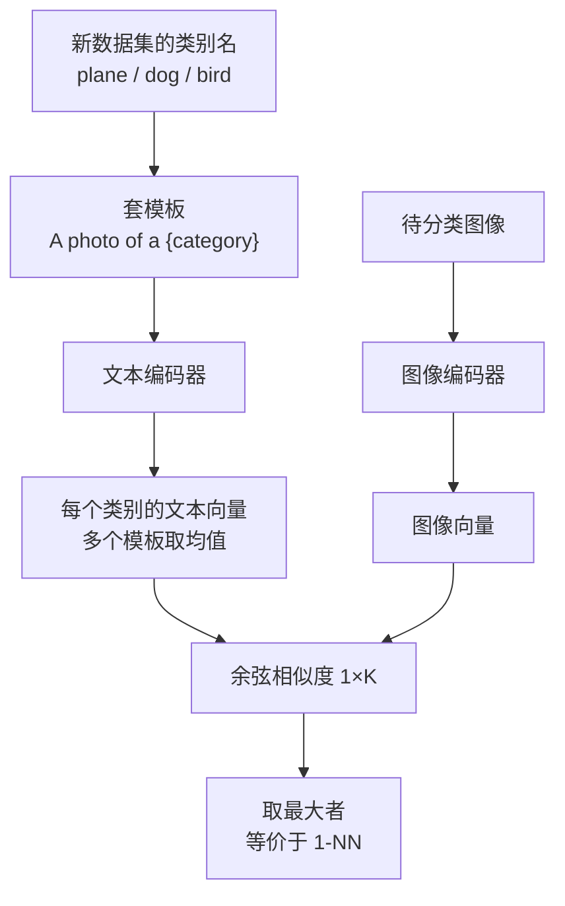

> **课程信息**
>
> - **课程名称**：Stanford CS231n: Deep Learning for Computer Vision（Spring 2025）
> - **本讲主题**：Lecture 16. Vision and Language
> - **主讲教师**：Ranjay Krishna
> - **授课日期**：2025-05-27
> - **课程主页**：[cs231n.stanford.edu/2025](https://cs231n.stanford.edu/2025/schedule.html)
> - **官方课件**：[lecture_16.pdf](</attachments/cs231n-447fe87ad8a0f5389d4f0492.pdf>)（148 页，正文按页链接本地课件）
> - **字幕来源**：[cs231n_sp25_kor_sub · eng](https://github.com/lpaiu-cs/cs231n_sp25_kor_sub/tree/main/eng)（公开英文转写，中文由本书重写）
> - **版权说明**：幻灯片与课程材料版权归 Stanford University 及授课教师所有；本书为非官方学习笔记，仅用于学习与研究。

> **课件索引**：点击下方链接打开本地 PDF 的对应页；全部课件见 [课件索引](/notes/cs231n/slides)。页码按 PDF 文件页序定位，第 1 讲分为 Part 1 / Part 2。

[📄 L16 · 第 1 页｜Lecture 16 标题页：Multi-Modal Foundation Models，Ranjay Krishna，2025 年 5 月 27 日](</attachments/cs231n-447fe87ad8a0f5389d4f0492.pdf#page=1>)

前十五讲的默认工作流是「一套数据、一个模型、一个任务」：图像分类训练一个分类器，目标检测训练一个检测器，分割再训练一个分割器。这套流程在每一讲里都被优化过，但它有一个从未被追问的前提——**任务集合是事先知道的**。一旦换一个没见过的数据集、一种没见过的任务，整条流水线就要重来一遍：重新标数据、重新训模型、重新调参。

Ranjay Krishna 这一讲要把这个前提拆掉。他要回答的是：能不能只训练一次，然后靠「适配」而不是「重训」去覆盖任意下游任务？这条路上有四种适配方式，也对应四种不同的东西被换掉：**换损失**（CLIP 把分类换成图文对比，换来零样本）、**换接口**（LLaVA 与 Flamingo 把图像塞进 LLM 的输入或每一层）、**换输出**（SAM 输出掩码而不是类别）、**换组合方式**（VisProg 把模型当函数写进程序）。这四条线不是四个并列的模型，而是一层层放开约束：放开标签、放开任务、放开输出空间、放开单模型的能力边界。

## 1. 「一任务一模型」的账，已经算不下去了

*(参考时间: 00:00:05 – 00:04:16｜Lecture 16)*

讲师开场没有给定义，而是先画出这门课一直在做的事，再把这件事的成本摊开。

[📄 L16 · 第 2 页｜旧范式：每个领域一套数据、一个任务、一个专用模型，四格互不相通](</attachments/cs231n-447fe87ad8a0f5389d4f0492.pdf#page=2>)

四个格子写得一模一样：Data、Task、Model、Domain 各带一个编号，模型 1 到模型 4 各管一摊。这是前十五讲反复出现的形态——收集训练集与测试集，训练一个高度专用的模型（图像分类器或图像描述器，正是作业里写过的那两个），再在测试集上评估。它在每个格子里都做得很好，但格子之间没有任何共享：domain 1 上学到的边缘、纹理、物体部件，对 domain 4 一点用都没有。

[📄 L16 · 第 3 页｜新范式：大而杂的数据集预训练一个基础模型，再分头适配到四个任务](</attachments/cs231n-447fe87ad8a0f5389d4f0492.pdf#page=3>)

换成基础模型（foundation model）之后，图的左半边塌缩成一个方块：Large Scale、Diverse Dataset 喂给一个 Foundation Model，右边再分叉出 Task 1 到 Task 4。底部一行字是整讲的关键——**Pre-training 与 Fine-tuning / zero-shot / few-shot 是两个阶段**。左边的成本一次性付掉且极大，右边的成本被压到极小：可以微调，可以只给几个例子（few-shot），也可以一个例子都不给（zero-shot）。

### 1.1 适配成本可以低到什么程度

[📄 L16 · 第 4 页｜GPT：Common Crawl 预训练之后，同一套权重分别用于数学、符号推理、常识与翻译](</attachments/cs231n-447fe87ad8a0f5389d4f0492.pdf#page=4>)

讲师的第一个例子是大家都用过的 GPT。左边是 Common Crawl 加一个巨大的预训练阶段，右边四个箭头指向数学题、符号推理、常识问答、翻译。值得注意的是这四个任务没有各自的数据集与模型——它们是同一个模型被不同提示词「问」出来的。讲师的说法是：适配新任务所需的数据可以非常少，**常常可以一个样本都不用**。

这句话的分量要放在上一讲的语境里看。第十五讲讨论三维表示时，换一种表示就要换一整套下游算子——点云没有网格的简化与细分，隐函数不能直接光栅化，每换一个任务都要重写管线；而这里，「下游任务」这个概念本身被降级成了输入格式的差异。基础模型真正的产品不是某个能力，而是**把「新任务」从工程问题降级成接口问题**。

[📄 L16 · 第 5 页｜基础模型的五个家族：语言、分类、语言加视觉、以及更多模态、串联](</attachments/cs231n-447fe87ad8a0f5389d4f0492.pdf#page=5>)

这张表是全讲的目录，五列分别是 Language（ELMo、BERT、GPT、T5）、Classification（CLIP、CoCa）、LM + Vision（LLaVA、Flamingo、GPT-4V、Gemini、Molmo）、And More!（Segment Anything、Whisper、Dalle、Stable Diffusion、Imagen）、Chaining（LMs + CLIP、Visual Programming）。后面每一章开头都会回到这张表，把当章要讲的那一列点亮一次。

### 1.2 判据只有一条，其余三条是伴随现象

[📄 L16 · 第 6 页｜判定一个模型是不是基础模型：必备「通用、对多种任务稳健」，常见大参数量、大数据、自监督预训练目标](</attachments/cs231n-447fe87ad8a0f5389d4f0492.pdf#page=6>)

讲师很坦率地说，这个定义在社区里是有争议的。但他给出的分层很有用：**必备**（Always see）的只有一条——general、robust to many different tasks，同一个模型能用在完全不同的场景里；**常见**（Often see）的是三条伴随特征：参数量大、训练数据量大、用自监督预训练目标。区分「必备」与「常见」的意义在于，后者是前者的手段而不是定义。一个参数不大、数据不多的模型，只要真的能跨任务迁移，它仍然算基础模型；反过来，一个参数很大但只能做一件事的模型不算。

[📄 L16 · 第 7 页｜本讲不讲语言模型：Language 一列被划掉](</attachments/cs231n-447fe87ad8a0f5389d4f0492.pdf#page=7>)

于是第一列被排除。ELMo、BERT、GPT、T5 是这场革命的起点，但它们属于自然语言处理课的范围。这一刀切得干净，也解释了后面为什么所有模型都带一个图像编码器：**本讲讨论的是「视觉如何被接进语言」，而不是语言本身**。

[📄 L16 · 第 8 页｜本讲聚焦多模态（视觉）基础模型：分类、语言加视觉、以及更多输出模态、串联四列](</attachments/cs231n-447fe87ad8a0f5389d4f0492.pdf#page=8>)

剩下的四列就是全讲的范围。可以看到「多模态」在这里是宽口径的：既有 CLIP 这种只对齐不生成的，也有 DALL·E、Stable Diffusion、Imagen 这种生成像素的，还有 Whisper 这种反方向（语音到文本）的。它们的共同点不是架构，而是都把一个非文本模态压进了一个可以被语言检索、被语言调用的表示里。

[📄 L16 · 第 9 页｜从分类开始：Classification 一列被点亮，CLIP 与 CoCa 是这一章的主角](</attachments/cs231n-447fe87ad8a0f5389d4f0492.pdf#page=9>)

顺序上讲师选择从最简单的一列切入：分类。理由是分类任务的目标函数最干净——它只需要一个「这张图和这句话是不是一对」的判断，不需要生成任何东西。**先把对齐做对，再谈生成与推理**，这是整讲的方法论顺序。第 2 到第 5 章都在同一个对齐目标上不断加东西：加模板、加解码器、加 LLM、加数据；第 6 章再把输出空间换掉。

## 2. 一条对比目标，从「同一张图的两个视图」搬到「图与句」

*(参考时间: 00:04:26 – 00:14:42｜Lecture 16)*

CLIP 不是一个新发明，它是第十二讲自监督学习里那个目标的直接推广。所以讲师先花五分钟把 SimCLR 重新讲一遍，再只改一处：把其中一个图像分支换成文本编码器。

[📄 L16 · 第 10 页｜SimCLR 的两段式：先用自监督学图像特征，再在特征上训练一个小分类器](</attachments/cs231n-447fe87ad8a0f5389d4f0492.pdf#page=10>)

幻灯片把 SimCLR 拆成两句：用自监督学习学到好的图像特征；在这些特征之上用监督学习训练小分类器。注意第二句——**自监督那一阶段完全没有标签，标签只出现在最后那个小分类器上**。这正是它能被推广的原因：只要你能定义「什么和什么应该相似」，就不需要人工类别。

[📄 L16 · 第 11 页｜SimCLR 的核心动作：同一张图的两个增强视图拉近，不同图的表示推远](</attachments/cs231n-447fe87ad8a0f5389d4f0492.pdf#page=11>)

绿箭头是「拉近」（Pull Together），红箭头是「推远」（Push Apart）。讲师的原话是：猫的不同增强版本应该得到彼此相似的表示，而狗、猴子这些别的类别应该被推到远处。这里没有任何语义标签参与，模型看到的只是「这两张图来自同一张原图」。

[📄 L16 · 第 12 页｜希望：学到的表示能泛化到没见过的实例，例如一张猫或狗的素描](</attachments/cs231n-447fe87ad8a0f5389d4f0492.pdf#page=12>)

这一步的赌注写在幻灯片标题里：希望表示足够通用，以致于看到一张**素描**的猫时，它仍然落在这个空间里合理的位置上，从而容易被分类。这个「希望」在后面会被反复检验——CLIP 之所以被认为有意义，正是因为它在素描、卡通、对抗扰动这些分布外的输入上仍然站得住。

### 2.1 只改一处：把另一个分支换成文本编码器

[📄 L16 · 第 13 页｜把表示空间扩到语言：图 A 对句子「A cute fluffy cat」，图 B 对句子「My favorite dog is a golden retriever」](</attachments/cs231n-447fe87ad8a0f5389d4f0492.pdf#page=13>)

问题的提法变了：既然图像能被嵌入，**句子能不能被嵌进同一个空间**？幻灯片给了两个配对，A 配「一只可爱蓬松的猫」，B 配「我最喜欢的狗是金毛」。如果这个空间成立，那么 A 的向量应该靠近第一句、远离第二句。

[📄 L16 · 第 14 页｜同一个表示空间里既能放图也能放句子，于是可以用文本去检索图像](</attachments/cs231n-447fe87ad8a0f5389d4f0492.pdf#page=14>)

这一页只是把上一页的两个句子单独拎出来放在空间里。信息量在于标题里的假设句：**如果**表示空间也能嵌入句子和短语，那么「查询」这件事就不再局限于图像——你可以用一句话去找图，也可以用一张图去找描述它的句子。检索、分类、描述这三个任务在这个空间里变成了同一个内积运算。

[📄 L16 · 第 15 页｜SimCLR 的原始结构：两个图像编码器分支，分别处理同一张图的两个视图](</attachments/cs231n-447fe87ad8a0f5389d4f0492.pdf#page=15>)

为了看清改了什么，幻灯片先还原 SimCLR 的接线：Image Encoder 出现两次，代表同一个网络的两份前向（或两个视图共用一套权重）。这是典型的孪生（siamese）结构，两个分支之间唯一的联系是最后的对比损失。

[📄 L16 · 第 16 页｜CLIP 的结构：左边仍是图像编码器，右边换成文本编码器，三条句子各自编码](</attachments/cs231n-447fe87ad8a0f5389d4f0492.pdf#page=16>)

第二帧把右边的图像编码器整个换掉，变成 Text Encoder，输入是三句互不相干的话。**结构上只动了一个方块，目标函数一个字都没改**。这就是 CLIP 的全部秘密：它不是新损失，而是新配对——把「同一张图的两个视图」换成「同一张图与描述它的那句话」。

[📄 L16 · 第 17 页｜CLIP 用同一个对比目标训练：一个 batch 内的图文对互为正样本，其余全是负样本](</attachments/cs231n-447fe87ad8a0f5389d4f0492.pdf#page=17>)

一张图和它对应的文本是正样本对，batch 里所有其他的图与所有其他的文本都是负样本。讲师特别强调这是**双向**的：图要最靠近自己那句文本，文本也要最靠近自己那张图，两个方向各算一次损失再加起来。这个对称性是后面「用文本编码器造分类器」能成立的直接原因——如果只有图找文这一个方向，你就没法反过来用类别名去检索图像。

[📄 L16 · 第 18 页｜CLIP 训练目标：图像与文本各自编码后做内积，在一个 batch 的相似度矩阵上做双向交叉熵](</attachments/cs231n-447fe87ad8a0f5389d4f0492.pdf#page=18>)

形式化一下。设一个 batch 有 $N$ 对 $(x_i, t_i)$，图像编码器与文本编码器分别给出 $z_i^{I}$、$z_i^{T}$（都做过归一化），相似度取内积，温度 $\tau$ 是可学习标量：

$$
\ell_{i}^{\text{image}\to\text{text}}=-\log\frac{\exp(\langle z_i^{I},z_i^{T}\rangle/\tau)}{\sum_{j=1}^{N}\exp(\langle z_i^{I},z_j^{T}\rangle/\tau)}
$$

反向那一项把分子分母里的 $I$ 与 $T$ 对调，总损失是 $(\ell^{\text{image}\to\text{text}}+\ell^{\text{text}\to\text{image}})/2$。把 $N$ 个图向量堆成 $N\times d$ 的矩阵、$N$ 个文本向量堆成 $d\times N$ 的矩阵，一次矩阵乘法就得到 $N\times N$ 的相似度矩阵，对角线是正样本。**训练就是在让这个矩阵的对角线变亮、其余位置变暗**（编者说明：这就是 InfoNCE 损失在图文检索上的标准写法）。

这里可以算一笔账。$N=32768$ 时，相似度矩阵有 $32768^2\approx1.07\times10^{9}$ 个元素；按 fp16 存是约 2.1 GB，还只是 logits，不含反传需要的中间量。这解释了为什么 CLIP 这类模型必须做分布式训练与梯度检查点，也预告了后面那条缺点：**batch 越大，负样本越多，学到的概念越细；但显存是被平方项吃掉的**。

[📄 L16 · 第 19 页｜数据来源：从互联网上成对抓取图片与它的 alt 文本，例如维基百科条目里的插图与说明](</attachments/cs231n-447fe87ad8a0f5389d4f0492.pdf#page=19>)

训练数据不需要人工标注，只需要「图与它旁边的文字」这种弱关联。幻灯片用维基百科的 Mount Rainier 条目做例子：条目的插图下面有说明文字，这就构成一对。讲师说这类数据在互联网上有海量，所以模型可以被推到非常大的规模——OpenAI 在 2021 年发布的 CLIP 就是这么做的。

[📄 L16 · 第 20 页｜训练结束后的产物：一个能对任意图像-文本对打相似度分数的模型](</attachments/cs231n-447fe87ad8a0f5389d4f0492.pdf#page=20>)

训练完之后你拿到的不是分类器，也不是生成器，而是一个**打分函数**：给一张图和一句话，输出一个相似度。这个接口比分类器更窄也更通用——窄是因为它只会打分，通用是因为任何任务只要能化成「图与句是否匹配」，就能用它。

### 2.2 第二步：接一个线性层，先证明特征有用

[📄 L16 · 第 21 页｜两段式流水线：第一步在无监督的 pretext 任务上预训练，第二步把编码器迁到分类、检测、分割等下游任务](</attachments/cs231n-447fe87ad8a0f5389d4f0492.pdf#page=21>)

这张幻灯片是自监督学习那一讲原封不动搬过来的：预训练阶段用对比目标，下游阶段接线性分类器、检测头或分割解码器。讲师强调，CLIP 出来时最让人兴奋的第一件事，就是**只加一层线性探针**（linear probe）就能带来很大提升。

[📄 L16 · 第 22 页｜CLIP 特征的线性探针：横轴是每张图前向所需的 GFLOPs，纵轴是 27 个数据集的平均分，红点（CLIP-ViT）在最上方](</attachments/cs231n-447fe87ad8a0f5389d4f0492.pdf#page=22>)

图的读法值得说清：横轴不是参数量而是计算量（GFLOPs/image，对数刻度），纵轴是 27 个图像分类数据集的平均分。红色星号是 CLIP-ViT 系列，从 L/14@336px 一路排到最上面；同一列里还能看到 CLIP-ResNet（空心星）、EfficientNet、SimCLRv2、BYOL、MoCo、BiT、ResNet 这些基线。两个结论同时成立：**同等计算量下 CLIP 更高**，**同一族里计算量越大分越高**。这说明对比预训练这条路线不是「小修小补」，它的 scaling 曲线比监督预训练更陡。

### 2.3 语言模型能零样本，CLIP 为什么不能

[📄 L16 · 第 23 页｜语言模型的零样本：预训练就是补全，「I love ___」补 cake，「影评说『我讨厌这部电影』」补 negative](</attachments/cs231n-447fe87ad8a0f5389d4f0492.pdf#page=23>)

讲师把语言模型的第二段拆开看：它对下游任务从不重训，因为**所有任务都能被写成补全**。情感分析是补一个词，翻译是补一句话，问答是补答案。预训练目标（下一词预测）与下游任务（任意文本任务）在形式上完全同构，这是零样本能力的来源。

[📄 L16 · 第 24 页｜但 CLIP 没有补全过程：对比目标训练出的模型，要适配新任务仍然需要一个线性层与新数据](</attachments/cs231n-447fe87ad8a0f5389d4f0492.pdf#page=24>)

CLIP 的问题在这里暴露：它的预训练目标是「判断配对」，而下游分类任务是「从 K 个类别里选一个」，两者不同构。你手上只有一个打分函数，没有「接着往下写」的接口。所以第一版 CLIP 的用法仍然是线性探针——**它省掉了标签，但没有省掉适配**。

### 2.4 一个聪明的绕法：把文本编码器当分类器用

[📄 L16 · 第 25 页｜用文本编码器造分类器：图像向量与「word」的文本向量做匹配，得到 0.27 这样的分数](</attachments/cs231n-447fe87ad8a0f5389d4f0492.pdf#page=25>)

绕法只有一句话：**类别名本身就是一个可以被编码的字符串**。既然图像和文本被对齐在同一个空间里，那么「这张图是不是一只狗」就可以改写成「这张图的向量离『dog』这个词的向量有多近」。幻灯片右下角的 0.27 就是这个匹配分数。

[📄 L16 · 第 26 页｜给新数据集的每个类别都算一个文本向量：plane、dog、bird 各得一个](</attachments/cs231n-447fe87ad8a0f5389d4f0492.pdf#page=26>)

于是流程变成三步：把新数据集的所有类别名过一遍文本编码器，得到 K 个文本向量；把待分类图像过一遍图像编码器，得到一个图像向量；在这 K 个向量里找最近的那个。**K 个类别名就是这 K 个「类别中心」，不需要一张训练图**。

[📄 L16 · 第 27 页｜匹配新图像：与 plane 相似度 0.13、与 dog 0.27、与 bird 0.09，取最大者判为 dog](</attachments/cs231n-447fe87ad8a0f5389d4f0492.pdf#page=27>)

幻灯片给出了具体数值：0.13、0.27、0.09。三选一取最大是 0.27，判为 dog。这一步没有任何参数需要学习，也没有任何梯度需要回传。

[📄 L16 · 第 28 页｜等价于 1-NN：K 个文本向量就是「训练集」，每个类别只有一个样本](</attachments/cs231n-447fe87ad8a0f5389d4f0492.pdf#page=28>)

讲师给了一个很准确的类比：这本质上是一个 **1 近邻（1-NN）算法**，只不过「训练集」里的每个样本不是一张图，而是一个词向量，且每个类别只有一个样本。这个视角很有用，因为它立刻指出了弱点：1-NN 对中心点的位置极其敏感，中心点偏一点，分类边界就跟着偏。

### 2.5 提示词工程：先 +1.3%，再 +5%

[📄 L16 · 第 29 页｜模板化：「A photo of a plane」比单个词「plane」在 ImageNet 上高 1.3%](</attachments/cs231n-447fe87ad8a0f5389d4f0492.pdf#page=29>)

第一个改进是把类别名包进一句话里。原因不神秘：CLIP 的文本编码器是在网页文本上训练的，而网页上几乎没有孤立出现的单词，词总是出现在句子里。**用一个和训练分布同构的输入格式，得到的向量才在分布内**。就这一个改动，ImageNet 上提升约 1.3%。

[📄 L16 · 第 30 页｜单一模板仍有偏置，于是为每个类别准备多个模板：A photo of a …、A drawing of a … 等等](</attachments/cs231n-447fe87ad8a0f5389d4f0492.pdf#page=30>)

单一模板会引入偏置——「a photo of a」偏向照片，遇到素描就吃亏。解法是给每个类别写多个模板，得到多组文本向量。

[📄 L16 · 第 31 页｜把同一类别的多个模板向量取平均，作为该类别的最终表示，ImageNet 上再涨约 5%](</attachments/cs231n-447fe87ad8a0f5389d4f0492.pdf#page=31>)

最后一步是取均值：每个类别得到一个平均向量，然后回到 1-NN。这一步在 ImageNet 上带来约 5% 的提升，比模板化那 1.3% 大得多。两笔加起来说明一个反直觉的事实：**在零样本设定下，提示词的写法是模型的一部分**，它决定了类别中心落在空间的哪里。

[📄 L16 · 第 32 页｜完成：CLIP 可以直接当任意数据集的图像分类基础模型，无需训练](</attachments/cs231n-447fe87ad8a0f5389d4f0492.pdf#page=32>)

到这里，CLIP 的零样本分类闭环就完成了，全程没有一次梯度更新。讲师补了一个实现细节：最终取哪个向量取决于编码器架构——ResNet 取最后一层的池化向量，ViT 或 Transformer 取 CLS token 的输出。这个细节在下一章会变成一个大问题：**当你要把 CLIP 接到 LLM 上时，取 CLS 就不是最优选择了**。

## 3. 泛化来自规模，也来自语言的冗余——以及它断在哪

*(参考时间: 00:14:53 – 00:25:41｜Lecture 16)*

零样本在 ImageNet 上追平监督训练，这件事本身并不惊人：ImageNet 是 CLIP 训练分布里最常见的那类图。真正让社区转向的是接下来一组实验——**在 CLIP 从没见过的数据集上，它依然站得住**。

### 3.1 同一批类别，换一种拍法

[📄 L16 · 第 33 页｜训练于 4 亿图文对的 CLIP：零样本精度追平在 ImageNet 上监督训练的 ResNet-101，却没有用过一个人工标签](</attachments/cs231n-447fe87ad8a0f5389d4f0492.pdf#page=33>)

幻灯片左侧是 CLIP 论文里那张著名的对比图，右侧一句话点题：它追平了 ResNet-101 的 ImageNet 精度，而训练过程中**一个人类标签都没有出现**。注意这句话的措辞是「追平」而不是「超越」——在分布内，无标签并没有赢；它的价值要在分布外才兑现。

[📄 L16 · 第 34 页｜更激动的部分：换到 CLIP 没参与训练的数据集上再比一次](</attachments/cs231n-447fe87ad8a0f5389d4f0492.pdf#page=34>)

讲师在这里故意停顿了一下，因为下一页才是重点。数据集不是随机划分出来的测试集，而是**另一个团队用另一种方式采集的新数据集**。

[📄 L16 · 第 35 页｜ObjectNet：类别与 ImageNet 相同，但物体出现在反常的位置、视角与状态下，ImageNet 训练的模型精度大跌](</attachments/cs231n-447fe87ad8a0f5389d4f0492.pdf#page=35>)

ObjectNet 的构造方式很刻意：类别不变，只把拍摄条件改掉——香蕉放在地上拍、拿一根烂掉的香蕉拍。对在 ImageNet 上训练的模型来说，这些输入落在分布之外，精度掉得很厉害。原因不神秘：ImageNet 里每个类别基本只以「最典型的样子」出现，模型学到的是「典型性」而不是「类别」。

[📄 L16 · 第 36 页｜CLIP 零样本在 ObjectNet 上表现很好，讲师现场提问：为什么](</attachments/cs231n-447fe87ad8a0f5389d4f0492.pdf#page=36>)

同一批图片，CLIP 的零样本精度几乎不掉。讲师把原因归到两点，并且强调第一点才是关键：**从网页抓下来的文本包含的远不止类别名**。一句 alt 文本里会有形状、颜色、材质、场景、动作，这些词把「香蕉」这个概念周围的区域也约束住了，于是模型学到的是一个更宽的邻域，而不是一个点。第二点才是规模：ImageNet 约 130 万张，互联网上的图文对以十亿计。

这两点合起来解释了一个反直觉的现象：**监督信号的「质量」不高（网页文本噪声极大），但「覆盖面」极宽**。分类标签是一个 1000 维的 one-hot，它只说「这是第 207 类」；而一句描述文本是几百维的语义约束。前者精确但窄，后者模糊但宽，泛化能力来自后者。

### 3.2 素描、卡通与对抗扰动

[📄 L16 · 第 37 页｜CLIP 在图形、素描、对抗数据集上同样稳健](</attachments/cs231n-447fe87ad8a0f5389d4f0492.pdf#page=37>)

讲师把泛化实验铺到三类分布外数据上：graphic（图形/剪贴画）、sketch（素描）、adversarial（对抗扰动）。三类都指向同一个结论：CLIP 的特征不是绑在像素统计上的，而是绑在语义上的。素描只有轮廓没有纹理，卡通把颜色压成色块，对抗样本在像素上加的是人眼不可见的高频噪声——这三者破坏的恰好是「纹理」这一路线索，而 CLIP 还有语义那一路可用。

[📄 L16 · 第 38 页｜零样本与线性探针的逐数据集差异：多数数据集上接线性层还能再涨（绿色），但并非全部](</attachments/cs231n-447fe87ad8a0f5389d4f0492.pdf#page=38>)

这张图的读法要注意：它比较的不是「CLIP vs 监督」，而是「CLIP 零样本 vs CLIP 加线性探针」。绿色表示线性探针更好，说明这些数据集上还有可榨取的余量；但也有若干数据集零样本直接赢，说明**适配本身会带来过拟合风险**——当你只有几千张下游图时，训一个线性层可能还不如不训。

### 3.3 Scale 的两笔账

[📄 L16 · 第 39 页｜为什么没有标签也能赢过有标签：规模](</attachments/cs231n-447fe87ad8a0f5389d4f0492.pdf#page=39>)

幻灯片的标题只有一个词：Scale。下面一行小字是讲师自己提出的反问——**没有标签的模型凭什么打败有标签的**。他给了两个具体数字来回答。

[📄 L16 · 第 40 页｜模型规模：CLIP 用 Transformer 把参数量推到 3.07 亿，ImageNet 时代的 ResNet 是 4450 万](</attachments/cs231n-447fe87ad8a0f5389d4f0492.pdf#page=40>)

第一个数字是架构换代：从 ResNet 换到 ViT，参数量 3.07 亿对 4450 万，约 6.9 倍。这里换的不只是大小，还有归纳偏置——卷积把「局部性」与「平移等变」写死在结构里，ViT 把它交给数据去学。对图文对齐这种需要全局语义的任务，后者更合适。

[📄 L16 · 第 41 页｜数据规模：CLIP 用 4 亿图文对，ImageNet 只有 128 万张图](</attachments/cs231n-447fe87ad8a0f5389d4f0492.pdf#page=41>)

第二个数字是数据：4 亿对 128 万，约 312 倍。两个倍数乘起来，训练侧的总计算量差了两个数量级以上。讲师的结论很直接：这不是「无标签比有标签更聪明」，而是**用 300 倍的数据把「标签」这件事的边际价值压过去了**。

| 维度 | ImageNet + ResNet | CLIP |
| --- | --- | --- |
| 参数量 | 4450 万 | 3.07 亿（ViT） |
| 训练样本 | 128 万张（人工标注） | 4 亿对（网页 alt 文本） |
| 监督信号 | 1000 类 one-hot | 自然语言句子 |
| 适配方式 | 微调 | 线性探针 / 零样本 |

### 3.4 CoCa：多加一个 decoder，多 10%

[📄 L16 · 第 42 页｜CoCa 在 CLIP 的基础上加了一个生成目标](</attachments/cs231n-447fe87ad8a0f5389d4f0492.pdf#page=42>)

CLIP 之后出现了大量变体，讲师只挑了一个讲：CoCa（2022）。它的改动很小——保留原来的对比损失，再加一路生成损失。

[📄 L16 · 第 43 页｜CoCa 的加法：把图像特征通过交叉注意力送进一个 decoder，让它把这张图描述出来](</attachments/cs231n-447fe87ad8a0f5389d4f0492.pdf#page=43>)

具体做法是给图像编码器的输出接一个文本 decoder，用交叉注意力读图像特征，训练目标是标准的描述生成（captioning loss）。于是同一个图像编码器同时被两个目标约束：对比目标要求它把图和句对到一处，生成目标要求它保留足够细节把图讲清楚。

[📄 L16 · 第 44 页｜CoCa：Contrastive Captioners are Image-Text Foundation Models，对比与描述两个目标共用编码器](</attachments/cs231n-447fe87ad8a0f5389d4f0492.pdf#page=44>)

讲师的解释值得抄下来：**「这是一只猫而不是狗」这种判断所需的信息量，远小于「把这张图描述出来」**。判别任务允许模型偷懒——只要找到能区分 1000 个类的那些线索就够了，剩下的信息可以丢；生成任务不允许，它必须把物体、属性、数量、空间关系都编码进去。所以描述是一个更强的学习目标，学到的特征也更好用。

[📄 L16 · 第 45 页｜ImageNet 榜单：CoCa 微调版 91.0% 排第一，冻结版 90.6%，此前最强的监督模型在 88.6%–90.9% 区间](</attachments/cs231n-447fe87ad8a0f5389d4f0492.pdf#page=45>)

这张表是整讲的转折点。左边列表里 ALIGN 88.6、Florence 90.1、MetaPseudoLabels 90.2、CoAtNet 90.9、ViT-G 90.5（加 Model Soups 90.9），最后两行是 CoCa：**冻结 90.6、微调 91.0**。右边折线图从 2016 年的 GoogLeNet 一路爬到 2024 年，红色方框圈住的正是 CoCa。讲师说这是人们**放弃为图像编码器设计监督目标**的时点：既然自监督预训练能同时赢下冻结与微调两种用法，继续调监督目标就没有意义了。

### 3.5 三个优点，和它们各自的前提

[📄 L16 · 第 46 页｜CLIP 类模型的优点：点积极其高效、开放词表、可与其他模型串联](</attachments/cs231n-447fe87ad8a0f5389d4f0492.pdf#page=46>)

幻灯片列了三条，每一条都值得再追问一句它贵在哪里：

- **点积极其高效**——训练因此可以 scale，推理也因此可以快。讲师举的例子是对 50 亿张图做检索：图像向量可以离线算好存成索引，查询时只算一次内积，这是向量数据库能做的事。
- **开放词表**——任何文本描述都能当查询，不需要预先定义的类别集合。这一条是零样本泛化的另一种说法。
- **可与其他模型串联**——讲师在这里埋了伏笔，说后面会专门讲（CuPL 与 Visual Programming）。

三条优点其实共享同一个来源：CLIP 的输出是一个**对齐好的向量空间**，而不是一个分类决策。决策可以被下游任意改写，空间不能。

### 3.6 组成性：CLIP 的硬伤

[📄 L16 · 第 47 页｜Winoground（Thrush 等，2022）：CLIP 分不清「草丛里有个杯子」与「杯子里有些草」](</attachments/cs231n-447fe87ad8a0f5389d4f0492.pdf#page=47>)

反例来得很干脆：同一组词、只换语序，CLIP 给出的相似度几乎一样。这两句话的图内容天差地别——一张是草地上放着马克杯，另一张是杯子里装着草——但词袋（bag of words）完全相同。

[📄 L16 · 第 48 页｜batch size 决定概念的粒度：batch 为 4 时只学到「动物」，100 时学到「狗」，32000 时才能分辨两种柯基](</attachments/cs231n-447fe87ad8a0f5389d4f0492.pdf#page=48>)

讲师把原因追到训练目标的结构上。对比损失能区分的，只有**同一个 batch 里同时出现的负样本**。batch 为 4 时，猫的负样本可能是卡车，模型只能学到「有毛的四条腿」这种粗粒度概念；batch 到 32000 时，batch 里大概率有另一只柯基，模型才被迫去分辨「Welsh Corgi 与另一种柯基」。所以对比学习学到的概念粒度，是被 batch 的构成直接决定的。

[📄 L16 · 第 49 页｜但 batch 再大也有上限：即使 3.2 万，也很难同时出现「杯中有草」和「草中有杯」这样只差语序的两句](</attachments/cs231n-447fe87ad8a0f5389d4f0492.pdf#page=49>)

问题在于，能区分语序的负样本在自然数据里**极其稀疏**。你要的不是「另一只狗」，而是「同一组词、不同结构」的另一句话——这种样本在 3.2 万个 batch 元素里出现的概率近乎为零。讲师补了一句现实约束：3.2 万的 batch 对大多数实验室来说根本跑不起。

[📄 L16 · 第 50 页｜组成性（compositionality）benchmark：Winoground、CREPE、ARO 反复测出同一类失败](</attachments/cs231n-447fe87ad8a0f5389d4f0492.pdf#page=50>)

这三个基准（其中不少出自讲师自己的实验室）测的都是同一件事：模型能不能把「物体」与「关系」分开处理再组合。结论是一致的——不能。CLIP 的表示更像一个**加性的词袋**：把「杯子」的向量与「草」的向量加起来，语序信息在相加时就消失了。

### 3.7 难负例，以及它的反噬

[📄 L16 · 第 51 页｜解法一：难负例微调（hard negative fine-tuning），用「马吃草」对「草吃马」这类句子对继续训练](</attachments/cs231n-447fe87ad8a0f5389d4f0492.pdf#page=51>)

社区的第一反应是手工构造 batch：既然随机采样碰不到难负例，那就人为把「马在吃草」与「草在吃马」放进同一个 batch。这类方法统称难负例微调（NegCLIP 是代表），流行了大约一年。

[📄 L16 · 第 52 页｜但难负例有自己的问题：它会连带把「hard positive」也推远——「黑猫与棕狗」和「棕狗与黑猫」是同一场景的不同说法，却被判为不匹配](</attachments/cs231n-447fe87ad8a0f5389d4f0492.pdf#page=52>)

反噬来得很快。幻灯片给了三句：`A black cat and a brown dog`（正样本 ✓）、`A brown cat and a black dog`（错配 ✗，这是应该推远的）、`A brown dog and a black cat`（**也是 ✗，但它描述的其实是同一个场景**）。第三句是所谓的 hard positive：语义等价、词序不同。用难负例训练会把这类句子一起推远，于是模型学到「语序一变就是错的」，在真实场景里反而更差。

讲师说这件事至今没有理论解释——为什么加了难负例之后，模型在跨环境、跨数据集的泛化会明显变差。他把这当作一个开放问题留给听众，这也是「构造训练信号」这件事还没被解决的证据。

### 3.8 图像级描述不够，5 亿张也不够

[📄 L16 · 第 53 页｜图像级描述不足以为监督：「living room」对，但「house plants」「couch」被判为错](</attachments/cs231n-447fe87ad8a0f5389d4f0492.pdf#page=53>)

第三个缺点与数据粒度有关。一张客厅的图配一句「一间客厅」，这句话对整张图成立，但对图里的每件家具都不成立。幻灯片用对钩与叉标出：`living room` ✓，`house plants` ✗，`couch` ✗。模型从这句话里学不到「沙发在这张图的左下角」这种**定位信息**。

[📄 L16 · 第 54 页｜补救办法：除了整图描述，再加带边界框坐标的区域描述](</attachments/cs231n-447fe87ad8a0f5389d4f0492.pdf#page=54>)

讲师给的解法是加区域级监督：给每个框配一句描述，让对齐发生在区域而不是整图上。这也是后来「grounding」这一路的起点——模型不只回答「有没有」，还要回答「在哪里」。

[📄 L16 · 第 55 页｜最后一个缺点：再大的数据集也装不下你关心的所有事，数据收集与过滤必须是有意图的](</attachments/cs231n-447fe87ad8a0f5389d4f0492.pdf#page=55>)

最后一条最根本：哪怕你抓了 50 亿张图，它仍然覆盖不了你真正在意的东西。讲师说这正是他自己研究的出发点——**数据过滤已经成为这个领域的前沿问题**，如何从互联网里筛出真正有用的训练数据，比模型结构更难。这句话为下一章的 Molmo 做了铺垫。

## 4. 给 LLM 接一只眼：LLaVA 的线性层与 Flamingo 的门控交叉注意力

*(参考时间: 00:25:51 – 00:41:31｜Lecture 16)*

前面几章的模型都只能「判断」，不能「回答」。视觉语言模型（VLM）要的是第三种能力：吃进图和文，吐出文本。这一章讲两种接法，它们的差别只在**视觉特征在哪里进入语言模型**。

[📄 L16 · 第 56 页｜回到总表：LM + Vision 一列被点亮，LLaVA、Flamingo、GPT-4V、Gemini、Molmo 都在这一列](</attachments/cs231n-447fe87ad8a0f5389d4f0492.pdf#page=56>)

表里这一列的共同点是「输入两种模态、输出一种模态」。但同样是「图文进、文本出」，视觉信息在哪一层进入语言模型，会决定训练成本、上下文长度与支持的任务形态——这正是接下来 LLaVA 与 Flamingo 的分歧点。

### 4.1 为什么从 LLaVA 讲起

[📄 L16 · 第 57 页｜LLaVA 的动机：会做下一词预测的语言模型，在推理时可以应付数学、情感分析、符号推理——能不能也吃图像](</attachments/cs231n-447fe87ad8a0f5389d4f0492.pdf#page=57>)

动机写得非常直接：语言模型之所以通用，是因为**所有任务都能被写成「接着往下写」**。那么如果把图像也变成「上下文的一部分」，图像任务是不是也能被写成「接着往下写」？答案是肯定的，这类模型就叫视觉语言模型（vision-language model）。

[📄 L16 · 第 58 页｜历史背景：视觉语言模型不是从 LLaVA 开始的，最早可以追到 2019 年的 ViLBERT](</attachments/cs231n-447fe87ad8a0f5389d4f0492.pdf#page=58>)

讲师特意做了历史校正：2019 年的 ViLBERT 已经把图像模型与语言模型拼在一起做跨任务泛化了。

[📄 L16 · 第 59 页｜但 ViLBERT 那一代要为每个任务单独微调，还要配非平凡的任务专用模块（例如 RefCOCO 上要用 Mask-RCNN 做框重排）](</attachments/cs231n-447fe87ad8a0f5389d4f0492.pdf#page=59>)

问题在于它没有摆脱第一章那个旧范式：每个任务一套微调、一套任务专用技巧。幻灯片举的例子是 RefCOCO 上的指代消解——要用 Mask-RCNN 先出候选框，再按语言分数重排。**模型能跨模态了，但工程上仍然是一任务一模型**。LLaVA 的意义在于把这个「一任务一模型」换成了「一个模型 + 不同指令」。

### 4.2 先把自回归解码复习一遍

[📄 L16 · 第 60 页｜把注意力拆开看：q、k、v 三个矩阵，softmax 归一化，乘加得到每个位置对历史位置的权重](</attachments/cs231n-447fe87ad8a0f5389d4f0492.pdf#page=60>)

这一页是注意力机制的矩阵形式，讲师用它说明「自回归」到底约束了什么：第 $i$ 个位置的输出只能由 $0..i$ 位置的键值决定，未来的位置被掩掉。图中 $a_{i,j}$ 是注意力权重，$k_j$、$v_j$ 是历史位置的键与值，$\mathrm{softmax}$ 在每一行上归一化。

[📄 L16 · 第 61 页｜自回归解码的直观版：输入「Cats are so」，三个 Transformer block 之后接出下一个词「Cute」](</attachments/cs231n-447fe87ad8a0f5389d4f0492.pdf#page=61>)

换成时间轴就很好懂：输入是已经写下的三个词，模型输出下一个词的概率分布，取最大者得到 `Cute`，再把它接回输入继续。**整段对话就是这一个动作重复若干次**。

### 4.3 图像 token 从哪里来

[📄 L16 · 第 62 页｜关键想法：把图像切成 token（V1…VN）插在文本 token 前面，让同一套注意力同时读图和读文](</attachments/cs231n-447fe87ad8a0f5389d4f0492.pdf#page=62>)

LLaVA 的做法朴素到近乎粗暴：在文本 token 前面插入 $N$ 个图像 token，然后让 Transformer 一视同仁地处理整条序列。幻灯片右侧写着讲师当时的问题——**哪些图像 token 最好用**。这一问就是接下来四页的内容。

[📄 L16 · 第 63 页｜CLIP 编码器是个好选择：它已经把图像和文本对齐到同一个空间](</attachments/cs231n-447fe87ad8a0f5389d4f0492.pdf#page=63>)

选 CLIP 当视觉编码器的理由不是它最强，而是它**已经和语言对齐过**。LLM 要理解的是「这些向量在语言空间里意味着什么」，一个纯自监督的编码器（比如 SimCLR 的）虽然特征很好，但它的空间与词向量没有对应关系，线性层要学的东西就多得多。

[📄 L16 · 第 64 页｜第一直觉：用 CLS token——ViT 把图像切 patch、线性投影加位置编码，最后一层输出 CLS 与各 patch 的 token](</attachments/cs231n-447fe87ad8a0f5389d4f0492.pdf#page=64>)

顺着 CLIP 分类的用法，第一直觉是取 CLS token。毕竟前四章所有的分类实验都是拿它做的，它是整个编码器里唯一被对比损失直接监督过的向量。

[📄 L16 · 第 65 页｜但 patch token 从未被监督：CLS 被对比目标约束，其余 token 可以任意变化而 loss 不变](</attachments/cs231n-447fe87ad8a0f5389d4f0492.pdf#page=65>)

问题立刻出现。对比损失只作用在 CLS 上，patch token 们没有收到任何梯度信号——**它们可以是随机的，损失一点都不会变**。讲师说得很直白：经验上这些 token 的特征并不好用。

[📄 L16 · 第 66 页｜改用倒数第二层：L−1 层的 patch token 保留了空间与语言信息，实践中丢掉 CLS 还能小幅提升](</attachments/cs231n-447fe87ad8a0f5389d4f0492.pdf#page=66>)

解法是往上退一层。倒数第二层（$L-1$）的 patch token 还没有被最后的池化压掉，它们既保留了「哪块 patch 在哪」的空间信息，又因为要生成 CLS 而间接承载了语义。幻灯片底部那句是实践结论：**这些 token 对 LLM 最好用，而且把 CLS 丢掉还能略有提升**。

### 4.4 LLaVA 的三步配方

[📄 L16 · 第 67 页｜LLaVA 全图与训练配方：CLIP 编码器 + 线性层 + LLaMA 解码器，三步训练，十万级样本即可](</attachments/cs231n-447fe87ad8a0f5389d4f0492.pdf#page=67>)

整张图只有三个可动部件，配方也只有三步：

1. 用预训练的语言模型（如 LLaMA）当解码器，用预训练的 CLIP 当图像编码器，权重都初始化好。
2. 新加一个线性层，把 CLIP 特征映射到 LLM 的输入空间——**这个线性层是唯一从零开始训练的部分**。
3. 把 LLM 与线性层放在一起微调。

幻灯片底部给了数据量的量级：**十万级（>100,000）** 的「输入图像 + 输入指令 + 输出文本」三元组就能得到可用的效果。对比 CLIP 的 4 亿对，这是三个数量级的差距——因为这里要学的不是「图像是什么」，而是「怎么回答关于图像的问题」。

这里可以算一笔维度账。CLIP ViT-L/14 在 336 像素输入下切出 $24\times24=576$ 个 patch，每个 token 1024 维；而一句「Cats are so」只有 3 个 token。序列里图像占 576 个位置、文本占 3 个位置，比例约 192:1。**上下文几乎被图像占满**，这带来两个后果：显存随图像分辨率平方增长；LLM 原本擅长的长文本推理被挤掉。下一节 Flamingo 的两个设计，正是冲这两个后果去的。

### 4.5 Flamingo：不在输入处拼，而在每一层里插

[📄 L16 · 第 68 页｜Flamingo 换了融合方式：视觉编码器与 LLM 之间不再是「拼进输入」，而是另有通路](</attachments/cs231n-447fe87ad8a0f5389d4f0492.pdf#page=68>)

LLaVA 把图像 token 当成输入序列的一部分；Flamingo 认为这样太粗暴——图像信息只在最底层进入一次，越往后的层越容易被文本淹没。它的方案是让视觉特征**在每一层都能被读到**。

[📄 L16 · 第 69 页｜Flamingo 里预训练并冻结的部分：视觉编码器与语言模型都不训练（图中雪花标记）](</attachments/cs231n-447fe87ad8a0f5389d4f0492.pdf#page=69>)

这一帧先把「不动的东西」标出来。图中带雪花符号的方块是预训练且冻结的：视觉编码器（两个，分别处理两张图）与 LLM 的每一层。冻结的动机是省钱也是保能力——语言模型的推理能力是花大代价训出来的，微调它会遗忘。

[📄 L16 · 第 70 页｜Flamingo 里只有两个部分是从头训练的：Perceiver Resampler 与门控交叉注意力层](</attachments/cs231n-447fe87ad8a0f5389d4f0492.pdf#page=70>)

紫色方块是可训练部分，只有两处：Perceiver Resampler 与 GATED XATTN-DENSE。整篇论文的创新就落在这两个方块上。

[📄 L16 · 第 71 页｜Perceiver Resampler 把变长的图像 token 压成定长的一小撮](</attachments/cs231n-447fe87ad8a0f5389d4f0492.pdf#page=71>)

第一个方块解决的是长度问题。不同分辨率的图、不同数量的视频帧，切出来的 patch 数不一样；而交叉注意力的查询端需要固定长度。Perceiver Resampler 用一组可学习的查询向量去「读」任意长的视觉 token，输出定长表示。**这是把「变长」变成「定长」的学习式池化**，比平均池化保留更多信息。

[📄 L16 · 第 72 页｜Flamingo 完整架构第一帧：图文交错的输入序列 + 每一层前插入的门控交叉注意力](</attachments/cs231n-447fe87ad8a0f5389d4f0492.pdf#page=72>)

把两个方块接回去就是全图：左边两条视觉通路各自经过编码器与 Resampler，右边是 LLM，每一层（第 1 层到第 n 层）前面都插了一个 GATED XATTN-DENSE。

[📄 L16 · 第 73 页｜这一帧标注了 Perceiver Resampler 的作用：它就是一种学出来的降采样，把图像/视频表示压到固定长度](</attachments/cs231n-447fe87ad8a0f5389d4f0492.pdf#page=73>)

与上一帧相比，这一帧多了一行说明：Resampler 干的事本质上是**可学习的降采样**（learned down-sampling）。这个措辞很重要——它把「压缩」从工程技巧提升成了模型的一部分，压缩率由数据决定而不是由人设定。

[📄 L16 · 第 74 页｜Flamingo 完整架构：视觉侧全部冻结，只有 Resampler 与门控交叉注意力参与训练](</attachments/cs231n-447fe87ad8a0f5389d4f0492.pdf#page=74>)

这一帧没有再添加新标注，只是把完整接线摆清楚：文本从底部进入 LLM，视觉从左侧进入每一层的交叉注意力，输出在最上方。参数量的分布一目了然——绝大部分冻结，可训练部分很少。

### 4.6 门控交叉注意力：两行代码，一个开关

[📄 L16 · 第 75 页｜门控交叉注意力的内部：交叉注意力 → tanh 门控 → 前馈层 → 再一个 tanh 门控，两个残差](</attachments/cs231n-447fe87ad8a0f5389d4f0492.pdf#page=75>)

把其中一个方块放大，结构是标准件的组合：先做一次交叉注意力（查询来自文本、键值来自图像），接一个 $\tanh$ 非线性当门；再过一层全连接，再接一个 $\tanh$ 门；两段都带残差。讲师对门控的解释很到位——**它决定「这一层要不要看图像、看多少」**。$\tanh$ 的输出在 $[-1,1]$，初始化为 0 时整个模块等同于恒等映射，于是训练初期模型的行为与原始 LLM 完全一致，视觉信息是逐渐「打开」的。

[📄 L16 · 第 76 页｜同一模块的另一帧：改动在代码上只有两三行——一个交叉注意力层加一个 tanh 非线性](</attachments/cs231n-447fe87ad8a0f5389d4f0492.pdf#page=76>)

讲师特意强调了这种不对称：**代码上只多了两三行，模型能力上却是巨变**。因为现在每一层都能自己决定「什么时候看、看哪一块」，而不是只在输入处被动接收一次。

### 4.7 图文交错的训练数据，与一份手写的掩码

[📄 L16 · 第 77 页｜训练数据的组织方式像语言模型：用 `<image>` 与 `<eos>` 标记图片出现与文本结束，构成图文交错的长序列](</attachments/cs231n-447fe87ad8a0f5389d4f0492.pdf#page=77>)

数据不是一个图配一句话，而是**多图多段交错的长序列**：一段总述（「这是我宠物的一些可爱照片」）、第一张图、对它的描述、第二张图、对它的描述……训练目标就是补全最后那段描述。这样模型见到的序列长度、图像数量、轮次都远超单图单句的设定，才能支持多轮对话。

[📄 L16 · 第 78 页｜掩码注意力：为每张图手写一个掩码，生成某张图的描述时只能看这张图的视觉 token](</attachments/cs231n-447fe87ad8a0f5389d4f0492.pdf#page=78>)

关键细节在这里。序列里有多张图，但生成第一张图的描述时**不能看第二张图**——否则模型会抄后面的答案。于是作者手工构造了一个注意力掩码：每个描述只能 attend 到它自己那张图的视觉 token。

[📄 L16 · 第 79 页｜掩码的另一视角：文本之间仍然可以互看，被限制的只有「文本到图像」的那部分连接](</attachments/cs231n-447fe87ad8a0f5389d4f0492.pdf#page=79>)

换成矩阵视角看得更清楚：文本 token 之间的因果掩码照旧（只能看左边），额外的限制只加在「文本查询 → 图像键」这一块。这是一份**用工程手段伪造出的监督信号**，代价是数据格式必须严格可控。

[📄 L16 · 第 80 页｜完整架构汇总：冻结的视觉与语言模型，加上两个可训练模块与这份掩码](</attachments/cs231n-447fe87ad8a0f5389d4f0492.pdf#page=80>)

把四帧叠起来，Flamingo 的代价结构就清楚了：可训练参数只占很小一部分（两个 Resampler 加每层的交叉注意力），但**每个 LLM 层多了一次「查询图像」的计算**，推理时的显存与延迟都比 LLaVA 高。换来的是对多图、多轮、图文交错的原生支持——这是「在输入处拼一次」做不到的。

### 4.8 结果与上下文学习

[📄 L16 · 第 81 页｜Flamingo 结果：一批此前必须专门适配 CLIP 才能做的任务，现在零样本或少量样本就能做](</attachments/cs231n-447fe87ad8a0f5389d4f0492.pdf#page=81>)

讲师说这一页的意义不在分数，而在**评测方式的改变**：以前报的是几个分类基准，现在报的是任意可以写成问答的任务。只要能把任务表述成「给图 + 提问 → 给答案」，就可以构造基准。

[📄 L16 · 第 82 页｜Flamingo 的上下文学习：四行示例分别教它识别物种、回答画作信息、读路牌文字、做算术](</attachments/cs231n-447fe87ad8a0f5389d4f0492.pdf#page=82>)

这张图是全讲最漂亮的一页。四行示例，每行都是「两张图 + 答案，第三张图 + 问题」：

- 第一行：龙猫（This is a chinchilla…）、柴犬（This is a shiba…），第三张火烈鸟问 `This is`，补出 `a flamingo. They are found in the Caribbean and South America.`
- 第二行：两幅画各自「标题 / 收藏地」，第三幅问「这幅画所在城市」，答 `Arles.`
- 第三行：伦敦地铁标志 `Underground`、路牌 `Congress`，第三张路牌答 `"Soulomes"`
- 第四行：手写 `2+1=3`、`5+6=11`，第三张 `3×6` 答 `3x6=18`

四行覆盖了四种完全不同的能力：细粒度识别、世界知识、OCR、算术。讲师说这就是 in-context learning 的定义——**你没有训练它做这些任务，只是给了它几个行为示例**。把示例全部拿掉，同一套权重就变成零样本。

[📄 L16 · 第 83 页｜Flamingo 结果续：少样本设置下多数基准的提升幅度](</attachments/cs231n-447fe87ad8a0f5389d4f0492.pdf#page=83>)

这一帧把范围从「四种能力」扩到整张基准表。讲师的说法是：这些任务里有相当一部分，此前必须**专门为 CLIP 接一个适配头**才能做；现在同一个冻结的 Flamingo 换一段提示词就能答。

[📄 L16 · 第 84 页｜零样本与少样本的对照表：横轴是指令示例数（0/4/8/16/32），纵轴是 16 个视觉语言基准](</attachments/cs231n-447fe87ad8a0f5389d4f0492.pdf#page=84>)

这张表信息量很大，读法值得学。左边三组是 Flamingo-3B、9B 与 80B，每组内部按 shot 数展开：0、4、8、16、32。以 80B 那一组为例，VQAv2 从零样本的 50.6 一路涨到 32 样本的 57.8，COCO 从 84.3 涨到 113.8，OKVQA 从 50.6 涨到 57.8。**增益一直到 32 个示例还没有停下来**，而 32 已经是表里测过的最大值。

[📄 L16 · 第 85 页｜同一组结果的另一种排布：按任务类型分栏，对比不同示例数下的表现](</attachments/cs231n-447fe87ad8a0f5389d4f0492.pdf#page=85>)

最下面两行是对照组：`Zero/Few shot SOTA`（第一行，括号里是它用的示例数，最多 16）与 `Pretrained FT SOTA`（最后一行，括号里是微调用的样本量，从 6K 到 50 万）。两条结论因此成立：Flamingo 的零样本已经在若干列上超过专门微调的 SOTA；而它用 32 个示例就逼近了那些用几万到几十万样本微调的模型。

这也修正了「few-shot 等于样本效率高」的直觉——**它省掉的不是示例，是微调**。示例仍然要按任务格式给，但权重一个都不更新。

## 5. 数据比架构更稀缺：70 万对与 60 亿对

*(参考时间: 00:41:41 – 00:54:07｜Lecture 16)*

上一章结束时，Flamingo 已经把「通用视觉助手」这件事做成了，但它的权重不公开。这一章讲的是这条路上最现实的一道坎：**能力被少数几家公司的 API 锁住了**。讲师在这里把自己的工作（Molmo）放了进来，用来证明这道坎可以被绕过，而绕过的办法不是更大的模型，是更好的数据。

### 5.1 11 个基准上的一道裂缝

[📄 L16 · 第 86 页｜今天的主流做法：把 11 个视觉理解基准的平均分画成条形图，按 API Only、Open Weights、Distilled 分组](</attachments/cs231n-447fe87ad8a0f5389d4f0492.pdf#page=86>)

图表的组织方式本身就是论点。条形按来源分成三组，左边竖排三行组名：API Only、Open Weights、Distilled。最上面一整组被红框圈住，那是七家闭源模型；最下面单独用绿框圈出 LLaVA-1.5 的 13B 与 7B（43.9 与 40.7），两条虚线箭头指向右侧的七张小图——人脸、披萨、夜景街道、香槟、一张经济图表、一张动物关系图、一张票据。这些小图是基准题目的实例，讲师用它们提醒：**分数轴从 30 到 82，但这些题目的难度并不均匀**。

[📄 L16 · 第 87 页｜同一张图加一行断言：开放权重的模型很多，但它们都是从 GPT 蒸馏出来的](</attachments/cs231n-447fe87ad8a0f5389d4f0492.pdf#page=87>)

这一帧在同一张图上压了一句结论。注意措辞不是「开放模型很差」，而是「开放模型都是蒸馏的」——差别很关键：**分数不低，但来源可疑**。

[📄 L16 · 第 88 页｜于是问题变成：不依赖专有模型，怎么把这道差距补上](</attachments/cs231n-447fe87ad8a0f5389d4f0492.pdf#page=88>)

这一页只有一行问题，是全章的命题。它的难点在于，蒸馏本质上是一种「借答案」：你用 GPT 的输出当监督信号训自己的模型，学到了分数，但没学到「怎么造出这种能力」。一旦 OpenAI 不再开放 API，整条路线就断了。

[📄 L16 · 第 89 页｜回到同一张图：蒸馏组里的 Qwen、Intern VL、Phi 都被逐一点出，它们共同的老师是 GPT 或 Gemini](</attachments/cs231n-447fe87ad8a0f5389d4f0492.pdf#page=89>)

讲师点了三个名字：阿里的 Qwen、Intern VL、Phi。它们都有公开权重，都能下载，都能跑——但**没有人知道怎么从零复现它们**。他的原话是：「我们能生产它们，但前提是 GPT 存在。」这句话定义了什么叫「开放但不可复现」。

### 5.2 「完全开放」是四个词，不是一个词

[📄 L16 · 第 90 页｜API Only、Open Weights、Completely Open 三档；完全开放要求权重、数据、代码、评测四样都开](</attachments/cs231n-447fe87ad8a0f5389d4f0492.pdf#page=90>)

这一页把「开放」拆成了可核查的四项：Open Weights（能下载权重）、Open Data（能下载训练集与评测集）、Open Code（能自己训一遍）、Open Evals（能自己加评测）。右侧条形图上，Molmo 的四个尺寸（72B、7B-D、7B-O、1B）排在最顶端，往下依次是 API Only 一组（GPT-4o、GPT-4V、Gemini 1.5 Pro/Flash、Claude 3.5 Sonnet、Claude 3 Opus/Haiku）、开放权重组（Qwen VL2、Intern VL2、Pixtral、Phi3.5-Vision、PaliGemma）、蒸馏组（LLaVA OneVision、Cambrian、xGen-MM）与最底部的 LLaVA-1.5。

具体分数值得抄下来，因为它是全讲唯一一组可比的横截面数据：

| 模型 | 11 基准平均分 | 归属 |
| --- | --- | --- |
| Molmo 72B | 81.2 | 完全开放 |
| Qwen VL2 72B | 79.4 | 开放权重 |
| GPT-4o | 78.5 | API Only |
| Gemini 1.5 Pro | 78.3 | API Only |
| Molmo 7B-D | 77.3 | 完全开放 |
| Intern VL2 LLaMA 76B | 77.1 | 开放权重 |
| LLaVA OneVision 72B | 76.8 | 蒸馏 |
| Claude 3.5 Sonnet | 76.7 | API Only |
| Gemini 1.5 Flash | 75.1 | API Only |
| Molmo 7B-O | 74.6 | 完全开放 |
| MolmoE 1B | 68.6 | 完全开放 |
| LLaVA-1.5 7B | 40.7 | 开放权重 |

读这张表要注意两件事。第一，**同一个模型家族内部的差距比家族之间还大**：Qwen VL2 的 72B 是 79.4，7B 只有 73.7；LLaVA OneVision 的 72B 是 76.8，而一年前的 LLaVA-1.5 7B 只有 40.7。第二，Molmo 的 72B 比 GPT-4o 高 2.7 分，这个「高」只在学术基准上成立，换到人类偏好就未必（下一页会看到）。

[📄 L16 · 第 91 页｜同一张图的另一种排布：为的是在旁边腾出位置放示例](</attachments/cs231n-447fe87ad8a0f5389d4f0492.pdf#page=91>)

讲师把图旋转了一下，让右侧空出来讲例子。这张的图例单独列出了「Open Weights / Data / Code / Evals」，是上一页那个「完全开放」四要素的重复。

[📄 L16 · 第 92 页｜评测方式：不是跑分，而是人类偏好——32.5 万次成对比较，870 位标注者](</attachments/cs231n-447fe87ad8a0f5389d4f0492.pdf#page=92>)

这一页给了规模：**325,000 次 pairwise 比较，870 位人类标注者**。这是当时 VLM 领域最大的一次人类偏好评测。为什么要做这件事？讲师的解释是，学术基准测的是「能不能答对」，而用户关心的是「愿不愿意用」。

[📄 L16 · 第 93 页｜结果：Molmo 72B 在人类偏好上排第二，仅次于 GPT-4o，超过 Gemini 1.5 Pro 与 Claude 3.5](</attachments/cs231n-447fe87ad8a0f5389d4f0492.pdf#page=93>)

用 Elo 表示，Molmo 与 GPT-4o 只差 1 分——讲师的说法是「几乎是一次抛硬币」。但要注意这一页与上一页的落差：**在 11 个学术基准上 Molmo 第一，在人类偏好上它第二**。这个反差本身就是一条经验：基准分数与真实可用性之间存在系统性偏差，而偏差的方向取决于基准是谁做的。

[📄 L16 · 第 94 页｜Molmo-7B 超过了 Gemini 1.5 Flash、LLaVA OneVision 72B、GPT-4V、QwenVL2 72B 等一批大得多的模型](</attachments/cs231n-447fe87ad8a0f5389d4f0492.pdf#page=94>)

7B 模型排在只有 72B 模型才该在的位置，这是全章最实用的一条信息：**能塞进单张 GPU 的模型，已经能打平一年前的旗舰**。讲师后面强调了这一点——单卡可跑意味着研究者能微调、学生能实验、小公司能部署，而这正是「完全开放」的实际含义。

### 5.3 一个研究组与几家大公司的差距

[📄 L16 · 第 95 页｜发布后的社区反应：2024 年 9 月 25 日放出，讨论集中在「终于有一个能用的开放 VLM」](</attachments/cs231n-447fe87ad8a0f5389d4f0492.pdf#page=95>)

这一页是发布当天的社交媒体截图合集。讲师用它说明一件与分数无关的事：**一个可下载的 7B 模型，触达的人群与一个 API 完全不同**——能改、能微调、能放到本地跑。

[📄 L16 · 第 96 页｜「永远不要赌开源输」：私有模型的领先会被开源追上](</attachments/cs231n-447fe87ad8a0f5389d4f0492.pdf#page=96>)

讲师引了 NVIDIA 的人也在说的一句话：不管私有模型做得多好，最终开源社区会追上来。这句话在这里有具体所指——一个学术实验室用远少于工业界的算力，在同一个榜单上追平了。

[📄 L16 · 第 97 页｜Molmo 的关键差异：它把推理「钉在像素上」——数数的时候会先指出它数的每一个物体](</attachments/cs231n-447fe87ad8a0f5389d4f0492.pdf#page=97>)

这一页是 Molmo 真正的技术差异点。普通 VLM 被问「有几艘船」时直接吐一个数字，这个数字没有任何依据，所以经常是幻觉。Molmo 的做法是**先把每一艘船指出来（输出点坐标），再给出数字**。讲师的说法是「让决策落地在像素上」——这句话在第六章讲 SAM 时会再出现一次，因为「指」这个动作是连接语言与像素的通用接口。

### 5.4 70 万与 60 亿

[📄 L16 · 第 98 页｜数据量的对比：LLaMA 3.1V 用了 60 亿图文对，Molmo 只用 70 万，来自 PixMo](</attachments/cs231n-447fe87ad8a0f5389d4f0492.pdf#page=98>)

两个圆一大一小，面积差接近四个数量级：**60 亿对 70 万，约 8600:1**。讲师没有停在这个数字上，而是解释了为什么小的那个反而更好用。

[📄 L16 · 第 99 页｜互联网数据是「顺带的」，人工标注数据是「有意的」](</attachments/cs231n-447fe87ad8a0f5389d4f0492.pdf#page=99>)

这一页是整讲最好的一句概括。互联网上的图文对是「顺带」产生的：上传者写「粉色，日本，好看的照片」，写「喜欢这张冬天的照片」，这些文字描述的是**上传者的感受**，不是图像内容。而人工标注的数据是「有意」的：标注者的任务就是把图像内容说清楚。

两者的差别不是噪声大小，而是**信息种类的缺失**。讲师举了一个很具体的例子：没有人会在网上写「这个东西在另一个东西的左边」，因为这对人类读者是废话；但对模型来说，这正是它最缺的那类空间信息。

[📄 L16 · 第 100 页｜PixMo 的密集描述示例：一张书桌，从桌面材质、桌腿形状、双显示器布局、鼠标与纸张位置，一直写到墙色与地砖](</attachments/cs231n-447fe87ad8a0f5389d4f0492.pdf#page=100>)

读这段描述能看到「有意」具体长什么样：`desk is large and rectangular, made from a polished rich wood`（尺寸、形状、材质、表面处理）、`four distinctive A-shaped legs`（结构）、`a tall, vertical screen placed behind and to the right of a wider, horizontal computer monitor`（相对位置）、`pinkish marble tiles`（颜色与材质）。这些属性在网页 alt 文本里几乎不会同时出现。

[📄 L16 · 第 101 页｜密集描述极难收集：一张平板截图的标注要写到状态栏时间 11:48、电量 67%、信号四格，再逐个数图标与文件夹](</attachments/cs231n-447fe87ad8a0f5389d4f0492.pdf#page=101>)

这张更极端：为了把一张平板主屏讲清楚，标注要读到 `time 11:48`、`battery 67%`、`four out of five bars`、`three-quarters Wi-Fi`，再逐个描述底部的文件夹、Gmail、YouTube、地图图标与三个导航键。**这种密度的描述无法从互联网上获得，只能人写**。

### 5.5 用问题去撬，而不是用说明书去写

[📄 L16 · 第 102 页｜为提取有意义的视觉信息而设计的问题清单：第一眼看到什么、物体与数量、文字内容、物体位置、微妙细节、背景、风格与颜色](</attachments/cs231n-447fe87ad8a0f5389d4f0492.pdf#page=102>)

七条问题构成了一个采集协议：`What is the image at first glance?`、`What are the objects and their counts?`、`What does the text say?`、`What are the positions of the objects?`、`What subtle details are noticeable?`、`What is in the background?`、`What is the style and color?`。注意每一条问的都是**模型最难自发学到的东西**：数量、文字、位置。

讲师说他们花了两年做这类诱发（elicitation）研究，反复试哪种问法能问出最多的信息。这已经不是数据标注，而是**数据工程**。

[📄 L16 · 第 103 页｜人不喜欢打字，但喜欢说话：让标注者对着图像讲 60 到 90 秒，再自动转成文本](</attachments/cs231n-447fe87ad8a0f5389d4f0492.pdf#page=103>)

这一页解释了一个反直觉的操作细节。如果让人写，他会不自觉地遵守「格赖斯准则」——不说过于显然的话，于是「杯子在左边」这类句子永远写不出来。**改成口述，这些约束就松了**：人会絮絮叨叨地把看到的一切都说出来，包括那些「显然」的空间关系。60 到 90 秒的语音自动转写成文本，直接进预训练。

### 5.6 模型没变，变的是数据

[📄 L16 · 第 104 页｜起点是现成的：一个开源 LLM 加一个视觉编码器，架构与 LLaVA 无异](</attachments/cs231n-447fe87ad8a0f5389d4f0492.pdf#page=104>)

讲师在这里说了一句很重要的话：**Molmo 的模型结构与 LLaVA 没有区别**——CLIP 编码器进来，一个线性层做连接器，LLM 输出。可训练的部分、参数量、接线方式都一样。

[📄 L16 · 第 105 页｜同一套架构的两种命运，差别全在数据质量与密度上](</attachments/cs231n-447fe87ad8a0f5389d4f0492.pdf#page=105>)

如果架构一样而结果差 30 多分，那么差异只能来自数据。这也解释了为什么「完全开放数据」是四个开放里最难也最关键的一项：**权重可以下载，代码可以复现，但如果数据不开放，别人就无法复现你的结果**。

[📄 L16 · 第 106 页｜从感知到行动：指着数、指着定位](</attachments/cs231n-447fe87ad8a0f5389d4f0492.pdf#page=106>)

这两页把「指」当成一种输出模态。第一帧是数数——它不直接报一个数字，而是把每一艘船的坐标逐个点出来，最后再给总数。

[📄 L16 · 第 107 页｜指的例子：让它指出菜单项在哪、搜索选项在哪、公交线路号在哪，它给出的是坐标而不是一句话](</attachments/cs231n-447fe87ad8a0f5389d4f0492.pdf#page=107>)

第二帧换到界面与交通场景：指出菜单项在哪、搜索选项在哪、公交车身上的线路号在哪。注意这不是画框——框有四个数，点只有两个数，**点是一种更便宜、更通用的指代**。而它带来的能力是别的模型给不了的：告诉你「在哪」，而不只是「是什么」。

### 5.7 从指到动手

[📄 L16 · 第 108 页｜把 Molmo 的输出接到 SAM 2：Molmo 指出板球拍的位置，SAM 2 用这个点做分割，再沿时间传播](</attachments/cs231n-447fe87ad8a0f5389d4f0492.pdf#page=108>)

这是全讲第一次出现「串联」，虽然它出现在第五章而不是最后一章。链路很短：**Molmo 输出一个点 → SAM 2 把这个点当提示 → 输出掩码 → 掩码在视频里跟踪**。每一步都是现成模型，没有一步需要重新训练。

[📄 L16 · 第 109 页｜具身应用：先指水瓶，用运动规划把机器人移过去；再指水槽，把瓶子放进去](</attachments/cs231n-447fe87ad8a0f5389d4f0492.pdf#page=109>)

讲师讲了办公室里玩的那次实验：让 Molmo 指水瓶 → 简单运动规划把机器人送到水瓶 → 再指脏盘子/水槽 → 移过去 → 再指水槽里的空位 → 放下。整条链里没有一个模块是为「机器人」训练的。这就是「基础模型」最实际的价值：**它把新应用变成接口拼接**。

[📄 L16 · 第 110 页｜演示页：molmo.allenai.org](</attachments/cs231n-447fe87ad8a0f5389d4f0492.pdf#page=110>)

讲师在这里回答了一个现场提问：如果图像分辨率总被固定，模型还能指准吗？答案是现代 VLM 可以接受任意分辨率，位置编码随图像尺寸变化，因此指点的坐标系也跟着变。这也是「指」这种输出比「框」更容易迁移的原因之一——**换分辨率只需要重算位置，不需要重训输出头**。

## 6. 输出不一定是词：SAM 的提示接口，与把模型串成程序

*(参考时间: 00:54:12 – 01:07:05｜Lecture 16)*

前面几章的输出都是文本、类别，或者点坐标。这一章换掉最后一个约束：**输出可以是掩码**。而一旦输出变成掩码，「用户怎么告诉模型他要什么」就成了核心问题——这正是 SAM 的全部难点。

[📄 L16 · 第 111 页｜回到总表：And More! 一列被点亮，Segment Anything 排在第一行](</attachments/cs231n-447fe87ad8a0f5389d4f0492.pdf#page=111>)

这一列里 Segment Anything 代表的是「输出空间被换掉」的那一类：它不生成文本，也不输出类别，只输出像素级的掩码。讲师说，把输出从「词」换成「掩码」，暴露出一个前五章被语言掩盖住的问题——**用户到底想要哪一个**。

### 6.1 分割的「基础模型」到底要什么

[📄 L16 · 第 112 页｜旧的分割模型：在 COCO 的 80 类上训练，只输出这 80 类中出现的物体的掩码](</attachments/cs231n-447fe87ad8a0f5389d4f0492.pdf#page=112>)

这一页用 Mask R-CNN（He 等，2017）当对照。它的能力边界被训练集的类别数锁死：80 类之外的任何东西，它都不会给你掩码——不是分错，而是**根本不知道要分**。

[📄 L16 · 第 113 页｜分割基础模型的两条要求：训练集覆盖海量类别，输出用户真正关心的那个物体的掩码](</attachments/cs231n-447fe87ad8a0f5389d4f0492.pdf#page=113>)

SAM 把目标写成两句：训练数据要有巨大数量的类别；输出要能对准用户关心的任何对象。第一句是数据问题，第二句是接口问题。

[📄 L16 · 第 114 页｜这两条各自留下一个问号：这样的数据从哪来，模型怎么知道用户要哪一个](</attachments/cs231n-447fe87ad8a0f5389d4f0492.pdf#page=114>)

幻灯片把两个问号直接标在图上，等于给了这一章的大纲。讲师的选择是先答第二个——因为它是架构问题，第一个是数据问题。

[📄 L16 · 第 115 页｜怎么知道要分割哪一个：一张图里两只猫，用户说「猫」，但没说是哪一只](</attachments/cs231n-447fe87ad8a0f5389d4f0492.pdf#page=115>)

这就是歧义的来源。一句「Cats」配上一张有两只猫的图，正确答案有两个，**任务定义本身就是不唯一的**。任何用单一掩码做监督的训练方式，都会在这里被迫做一个错误的选择。

### 6.2 三段式：编码器、提示编码器、轻量解码器

[📄 L16 · 第 116 页｜SAM 的基本结构：图像编码器 + 提示编码器 → 轻量的掩码解码器 → 有效掩码](</attachments/cs231n-447fe87ad8a0f5389d4f0492.pdf#page=116>)

三个部件各管一件事：图像编码器把 $H\times W\times3$ 压成一组 embedding（重活，每张图算一次）；提示编码器把用户输入（点、框、文本、粗掩码）编成向量（轻活）；掩码解码器把两者合起来输出掩码（轻活，可以反复调用）。**重活与轻活分离**是 SAM 能做交互式分割的关键：换一个提示只需要重跑解码器。

[📄 L16 · 第 117 页｜SAM 的完整接线：图像走编码器，提示可以是点、框、文本或掩码，两路在解码器里相遇](</attachments/cs231n-447fe87ad8a0f5389d4f0492.pdf#page=117>)

与上一帧相比，这一帧把提示的四种形态都摆了出来。这解释了为什么提示编码器必须存在——**四种输入模态要被映射到同一个空间里**，否则解码器没法统一处理。

### 6.3 歧义用三个掩码解决

[📄 L16 · 第 118 页｜歧义的具体形态：用户点在剪刀上，他要的是整把剪刀、还是只用手柄那一部分](</attachments/cs231n-447fe87ad8a0f5389d4f0492.pdf#page=118>)

即使给了点，歧义也没有消失。同一个点可以指向「整把剪刀」、「可握的那一段」、「其中一个握柄」。这三者都是合理的答案。

[📄 L16 · 第 119 页｜如果只输出一个掩码，模型就会因为「猜错」而被惩罚——而它其实无法知道用户想要哪一个](</attachments/cs231n-447fe87ad8a0f5389d4f0492.pdf#page=119>)

这是训练目标设计上的一个陷阱：用单一掩码做监督，等于把「用户的意图」当成唯一确定的，模型只能学到「平均而言最可能的那个」。

[📄 L16 · 第 120 页｜SAM 的解法：一次输出多个候选掩码，各自带一个置信分数](</attachments/cs231n-447fe87ad8a0f5389d4f0492.pdf#page=120>)

解法是把「一个答案」换成「一组答案」。这一帧先给出结构：解码器不再输出单张掩码，而是输出若干候选，每个候选自带一个分数。

[📄 L16 · 第 121 页｜三个不同粒度的掩码：整把剪刀、刀刃部分、手柄部分，每个后面跟着一个 score](</attachments/cs231n-447fe87ad8a0f5389d4f0492.pdf#page=121>)

具体做法在这一页写清楚了：一次输出**三个**不同粒度的掩码，每个配一个分数；**损失只对与真值最接近的那一个计算**，另外两个不惩罚；模型还被训练去预测每个掩码的置信度。讲师说这相当于把「选哪个」的决定权交还给用户——模型负责给出所有合理的答案，人负责挑。

这个设计有一个直接后果：训练时模型不会被逼着在歧义处做平均，推理时可以给出多个候选。**把不确定性显式地输出，比让它隐式地摊平要好**。

### 6.4 图像 6 倍、掩码 400 倍：增长发生在密度上

[📄 L16 · 第 122 页｜数据规模：图像数量扩到约 6 倍，掩码数量扩到约 400 倍](</attachments/cs231n-447fe87ad8a0f5389d4f0492.pdf#page=122>)

两个倍数值得单独记：图像约 6 倍，掩码约 400 倍。掩码的倍数远高于图像，说明增长的不是「更多场景」，而是**每张图里被标注的物体数**——从「一张图一个物体」变成「一张图几十个物体」。这正是「覆盖海量类别」的实现方式。

[📄 L16 · 第 123 页｜SAM 数据集的样例：一张图里所有可分辨的物体都被单独标注](</attachments/cs231n-447fe87ad8a0f5389d4f0492.pdf#page=123>)

第一帧看的是「标注的粒度」：一张货架图里，每一样可分辨的东西都有自己的一块颜色。

[📄 L16 · 第 124 页｜更多样例：成堆的蔬菜、一排雨伞、水下场景、绘画作品，每一个实例都有自己的掩码](</attachments/cs231n-447fe87ad8a0f5389d4f0492.pdf#page=124>)

这两页说明了「类别」在 SAM 里是什么：不是「猫/狗/车」这种语义标签，而是**任何可以被指出的区域**。蔬菜堆里每一根黄瓜、画里的每一块颜色区域，都可以是一个掩码。这种标注不依赖语义体系，因此可以扩展到任意图像。

数据是怎么来的？讲师给了流程：先人工标一小部分，训一个模型，用模型去标剩下的，再让人修正错的，如此循环。**模型在环（model-in-the-loop）** 的标注方式，让这个规模的掩码在人力上成为可能。

### 6.5 结果与零样本

[📄 L16 · 第 125 页｜SAM 结果：货架上每一根蔬菜、每一袋商品都被单独分割出来](</attachments/cs231n-447fe87ad8a0f5389d4f0492.pdf#page=125>)

这张图的说服力在密度：几百个实例，每个都有独立的掩码与边界。传统分割模型在这种场景下会退化成「前景/背景」两片。

[📄 L16 · 第 126 页｜SAM 结果续：同一套权重在不同场景下的分割质量](</attachments/cs231n-447fe87ad8a0f5389d4f0492.pdf#page=126>)

换一张图，分割的密度与边界质量保持一致。这两页要说明的是**同一套权重**：没有任何一张是为这个货架场景微调过的。

[📄 L16 · 第 127 页｜零样本迁移：把 SAM 直接用在显微细胞图像上，不做任何微调](</attachments/cs231n-447fe87ad8a0f5389d4f0492.pdf#page=127>)

这一页是全章的重点。训练数据是自然图像，测试图像是显微镜下的细胞——**分布完全不同，但掩码依然干净**。这说明 SAM 学到的不是「物体的样子」，而是「什么是可以被分离出来的区域」这个更抽象的概念。

[📄 L16 · 第 128 页｜零样本续：换一批图像，仍然是同一套权重](</attachments/cs231n-447fe87ad8a0f5389d4f0492.pdf#page=128>)

讲师没有给 SAM 的数值指标，而是用这两页说明「基础模型」在分割上的含义：**它不解决某个分割任务，它解决「分割」这件事本身**。

### 6.6 串联：当 CLIP 认不出那四个词

[📄 L16 · 第 129 页｜回到总表：Chaining 一列被点亮，LMs + CLIP 与 Visual Programming](</attachments/cs231n-447fe87ad8a0f5389d4f0492.pdf#page=129>)

最后一列「Chaining」不是模型，而是一种用法：把前面三列的模型拼起来。讲师说这一列是过去两年最活跃的方向，因为它不需要训练任何东西。

[📄 L16 · 第 130 页｜课堂小测：四张图配四个类别——marimba、viaduct、papillon、lorikeet，CLIP 全部认不出](</attachments/cs231n-447fe87ad8a0f5389d4f0492.pdf#page=130>)

讲师现场做了个测验。四张图分别是彩虹鹦鹉、马林巴琴、高架桥、蝴蝶犬，四个词是 marimba、viaduct、papillon、lorikeet（幻灯片把四个词按字母序排，并没有和图片对齐，这本身就是题目的一部分）。听众能猜对，CLIP 不能——它对这四个词几乎没有可用的线索，四张全错。

[📄 L16 · 第 131 页｜解法：先让 LLM 生成描述，再用描述去分类](</attachments/cs231n-447fe87ad8a0f5389d4f0492.pdf#page=131>)

关键观察是：**CLIP 没见过这些词的「名字」，但它见过描述这些事物的句子**。于是把任务拆成两步——第一步问 GPT「papillon 长什么样」，得到一段描述；第二步用这段描述去和图像算相似度。

[📄 L16 · 第 132 页｜CuPL：用语言模型生成的定制提示（CUstomized Prompts via Language models）替代手写模板](</attachments/cs231n-447fe87ad8a0f5389d4f0492.pdf#page=132>)

这就是 CuPL。它把第二章的「A photo of a {category}」换成了「LLM 写的一段关于 {category} 的话」。模板从人写变成模型写，覆盖面立刻变宽——因为 LLM 知道的东西比写模板的人多。

[📄 L16 · 第 133 页｜CuPL 的效果：在一批细粒度数据集上，零样本分类明显提升](</attachments/cs231n-447fe87ad8a0f5389d4f0492.pdf#page=133>)

讲师给的例子是细粒度分类：具体品种的花、具体型号的车、具体种类的宠物。这些类别的共同点是**名字本身不含信息**（`papillon` 这个词对没学过法语的人是零信息），而描述含信息（「一种耳朵像蝴蝶的小型犬」）。提升来自这里。

### 6.7 把问题写成程序

[📄 L16 · 第 134 页｜能不能把「串联」推广到所有视觉任务：例如「船里有三个人吗」这种视觉问答](</attachments/cs231n-447fe87ad8a0f5389d4f0492.pdf#page=134>)

视觉问答（VQA）是第一个候选。你可以训一个 VQA 模型，也可以换一条路——**用已有的专用模型拼出答案**。

[📄 L16 · 第 135 页｜VisProg 的题目：左右两张船图，判断「两张图合计六个人、两条船」是否为真](</attachments/cs231n-447fe87ad8a0f5389d4f0492.pdf#page=135>)

陈述是一句话，但要判断它，需要四次计数（左图人数、右图人数、左图船数、右图船数）再做算术。

[📄 L16 · 第 136 页｜旧办法 vs 新办法：为新任务训一个模型（只对两张图有效），或者写一个调用现成模型的 Python 脚本](</attachments/cs231n-447fe87ad8a0f5389d4f0492.pdf#page=136>)

左右对比很直白。左边是「训一个新模型」，它能处理这一类任务，但每换一种问法就要重训；右边是「写一个脚本」，脚本里调用 VQA 函数两次再相加——**它能处理任意张数，但脚本是人写的**。

[📄 L16 · 第 137 页｜GPT 生成程序：把题目给它，它写出 `Class MyMultiImageVQA` 与 `ProcessIms` 函数，执行后输出 False](</attachments/cs231n-447fe87ad8a0f5389d4f0492.pdf#page=137>)

这一页把「人写脚本」换成「模型写脚本」。GPT 输出的程序调用两次 VQA 再相加，执行结果是 `False`——也就是说，模型不仅会答题，还会**写一段代码来答题**。

[📄 L16 · 第 138 页｜程序生成的关键是上下文示例：给 GPT-3 三段「指令 → 程序」的范例（遮脸、换车色、替换天空），它就能为新的指令写出程序](</attachments/cs231n-447fe87ad8a0f5389d4f0492.pdf#page=138>)

三段范例都是图像编辑任务：`Hide the face of Nicole Kidman with :p`、`Create a color pop of the white Audi`、`Replace the red car with a blue car`。每段都示范了同一套写法——先 `Seg` 出区域，再 `Select` 挑出目标，最后 `Replace` 或 `ColorPop`。**示例教的不是知识，是调用约定**。

[📄 L16 · 第 139 页｜VisProg 的模块库：图像理解（Loc/OWL-ViT、FaceDet/DSFD、Seg/MaskFormer、Select 与 Classify/CLIP-ViT、Vqa/ViLT）、图像编辑（Replace/Stable Diffusion、ColorPop、BgBlur、Tag、Emoji、Crop）、知识检索（List/GPT-3）与算术逻辑（Eval、Count、Result）](</attachments/cs231n-447fe87ad8a0f5389d4f0492.pdf#page=139>)

这张表回答了「模型怎么知道有哪些函数可用」：**函数清单本身要作为提示的一部分给进去**。每一行都标了实现（例如 `Select` 用的是 CLIP-ViT，`Replace` 用的是 Stable Diffusion），所以整个系统是「一堆异质模型的统一调用层」。

[📄 L16 · 第 140 页｜执行结果：四次 Vqa 调用分别数左右图的「人」与「船」，再用一次 Eval 把四个中间量代入「和等于 6 且和等于 2」的表达式，最终 Prediction 为 False](</attachments/cs231n-447fe87ad8a0f5389d4f0492.pdf#page=140>)

程序只有七行，但把任务拆得干干净净：`ANSWER0` 与 `ANSWER1` 数左图、右图的人，`ANSWER2` 与 `ANSWER3` 数左图、右图的船，`ANSWER4` 用 `Eval` 把四个数代入 `{ANSWER0}+{ANSWER1}==6 and {ANSWER2}+{ANSWER3}==2`，最后 `RESULT=ANSWER4`。输出 `False` 意味着四次计数之和与陈述对不上。

这一页是 VisProg 最有说服力的地方：**错误是可定位的**。中间量 `ANSWER0..3` 全部打印出来，你能立刻判断是「人数错了」还是「船数错了」；如果错的是 `Vqa` 模块，那说明问题在计数这一环，与语言理解无关。相比之下，一个端到端 VLM 答错时，你没有任何线索——只能换提示词再试一次。

[📄 L16 · 第 141 页｜另一个任务：给《生活大爆炸》七位主角打标签，程序先做人脸检测，再用 List 取角色名，最后 Classify 与 Tag](</attachments/cs231n-447fe87ad8a0f5389d4f0492.pdf#page=141>)

这个例子展示了知识检索模块的用法：`List(query='main characters on the TV show Big Bang Theory', max=7)` 让 GPT-3 吐出七个名字，`Classify` 把检测到的人脸与名字匹配，`Tag` 把标签画上去。**语言模型在这里不是答题者，而是知识库**。

[📄 L16 · 第 142 页｜图像编辑：把沙漠换成草地，程序是 Seg → Select(query='desert') → Replace(prompt='lush green grass')](</attachments/cs231n-447fe87ad8a0f5389d4f0492.pdf#page=142>)

最后一个例子把「串联」推到生成侧。讲师的说法是：图像编辑模型还很初期，与其指望它一次改对，不如**先用分割把要改的区域圈出来，只改那部分像素**，再合成回去。三步都是现成模型，效果比端到端编辑稳定得多。

## 7. 小结：四种「换」，一条主线

*(参考时间: 01:07:10 – 01:09:44｜Lecture 16)*

[📄 L16 · 第 143 页｜总结第一帧：大而杂的数据集 → 基础模型 → 四个任务，与开场那张图完全一致](</attachments/cs231n-447fe87ad8a0f5389d4f0492.pdf#page=143>)

讲师把开场那张图画了回来，用来说明这一讲走了一个闭环：开场是「范式应该变成这样」，结尾是「范式已经变成这样」。中间五章填的是「怎么填上这个方块」。

[📄 L16 · 第 144 页｜总结第二帧：零样本分类的完整流水线，以及六个数据集上 ResNet-101 与 CLIP ViT-L 的对照](</attachments/cs231n-447fe87ad8a0f5389d4f0492.pdf#page=144>)

这张表是全讲最该记住的一组数字。左边是流程：`2. Create dataset classifier from label text`（把类别名套模板送进文本编码器，得到 $T_1..T_N$）、`3. Use for zero-shot prediction`（图像编码成 $I_1$，与每个 $T$ 算内积，取最大）。右边是六个数据集的对照：

| 数据集 | ImageNet ResNet-101 | CLIP ViT-L（零样本） |
| --- | --- | --- |
| ImageNet | 76.2 | 76.2 |
| ImageNet V2 | 64.3 | 70.1 |
| ImageNet Rendition | 37.7 | 88.9 |
| ObjectNet | 32.6 | 72.3 |
| ImageNet Sketch | 25.2 | 60.2 |
| ImageNet Adversarial | 2.7 | 77.1 |

第一行打平，后五行是碾压——最夸张的是对抗集：2.7 对 77.1。这不是「CLIP 更准」，而是**CLIP 的决策依据不一样**：ResNet 依赖的纹理特征被对抗扰动打掉了，CLIP 还有语义那一路。

[📄 L16 · 第 145 页｜总结第三帧：Flamingo 的上下文学习表，四种任务共用一套权重](</attachments/cs231n-447fe87ad8a0f5389d4f0492.pdf#page=145>)

第三帧把「换接口」的证据摆出来：同一套冻结权重，四行不同的示例，四种不同的能力。注意它复用的正是第 82 张幻灯片那张 in-context 表——讲师没有换例子，用同一张图收尾。

[📄 L16 · 第 146 页｜总结第四帧：SAM 把拥挤街景里的每一个人都分割出来](</attachments/cs231n-447fe87ad8a0f5389d4f0492.pdf#page=146>)

第四帧是「换输出」的证据：一条拥挤的商业街，每一个行人与每一处可分辨的区域都被单独分割。这张图的密度比货架那张更高，说明掩码输出可以细到什么程度。

[📄 L16 · 第 147 页｜总结第五帧：左边 CuPL 的两步（GPT-3 生成描述 → CLIP 分类），右边 VisProg 的程序与模块](</attachments/cs231n-447fe87ad8a0f5389d4f0492.pdf#page=147>)

第五帧是「换组合方式」的两栏证据：左边 CuPL（「鸭嘴兽长什么样」→ GPT-3 写描述 → CLIP 用描述分类），右边 VisProg（指令 → GPT-3 写程序 → 程序调用分割、选择、替换模块）。

最后三帧把三条支线各留了一张证据：Flamingo 的四种 in-context 任务、SAM 的密集分割、CuPL 与 VisProg 的串联。它们分别对应「换接口」「换输出」「换组合方式」。

[📄 L16 · 第 148 页｜下一讲预告：Robot Learning](</attachments/cs231n-447fe87ad8a0f5389d4f0492.pdf#page=148>)

下一讲是机器人学习（Robot Learning），第五章末尾那个「指水瓶 → 规划 → 抓取」的例子会在那里展开。

- **基础模型的判据只有「跨任务通用」一条**，大参数、大数据、自监督目标都只是常见伴随特征，不是定义。
- **CLIP 换的是损失函数，不是架构**：把 SimCLR 的一个图像分支换成文本编码器，就同时得到了零样本分类器与开放词表的检索接口。
- **零样本分类 = 1-NN + 提示词工程**：类别名经文本编码器变成向量，模板化 +1.3%，多模板取均值 +5%，这两笔提升都来自「让输入落在训练分布内」。
- **泛化差距在分布外才显现**：ImageNet 上零样本与监督打平，ObjectNet 上是 72.3 对 32.6，对抗集上是 77.1 对 2.7。
- **对比学习的软肋是组成性**：概念粒度由 batch 构成决定，语序类负样本在自然数据里太稀疏；难负例能补，但会把语义等价的 hard positive 一起推远。
- **VLM 的两种接法差在「视觉在哪一层进入」**：LLaVA 用线性层拼进输入（便宜、十万级样本即可），Flamingo 用门控交叉注意力插进每一层（贵、但支持图文交错与多轮）。
- **当架构趋同时，数据成为唯一变量**：Molmo 与 LLaVA 结构几乎相同，用 70 万条人工密集描述（而非 60 亿网页对）在 11 个基准上拿到 81.2。
- **串联把「能力」变成「组合」**：CuPL 让 LLM 写提示、VisProg 让 LLM 写程序，代价是算力与延迟，收益是错误可定位、模块可替换。
