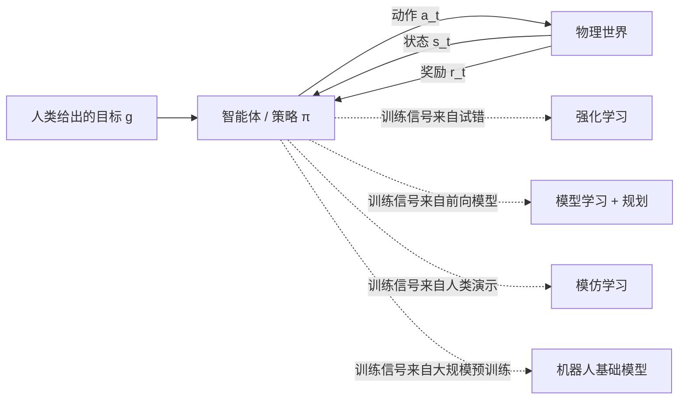

> **课程信息**
>
> - **课程名称**：Stanford CS231n: Deep Learning for Computer Vision（Spring 2025）
> - **本讲主题**：Lecture 17. Robot Learning
> - **主讲教师**：Yunzhu Li
> - **授课日期**：2025-05-29
> - **课程主页**：[cs231n.stanford.edu/2025](https://cs231n.stanford.edu/2025/schedule.html)
> - **官方课件**：[lecture_17.pdf](https://cs231n.stanford.edu/slides/2025/lecture_17.pdf)（103 页，书中逐页插图）
> - **字幕来源**：[cs231n_sp25_kor_sub · eng](https://github.com/lpaiu-cs/cs231n_sp25_kor_sub/tree/main/eng)（公开英文转写，中文由本书重写）
> - **版权说明**：幻灯片与课程材料版权归 Stanford University 及授课教师所有；本书为非官方学习笔记，仅用于学习与研究。

这一讲是客座教师系列的最后一场，讲者是哥伦比亚大学助理教授 Yunzhu Li——他 2023 年还在斯坦福做博后（合作者是 Fei-Fei Li 与 Jiajun Wu），也正是在那一年代过这门课。这个背景决定了本讲的讲法：它不铺陈算法细节，而是把"机器人学习"拆成一条反复被追问的主线——**要产生一个动作，你打算付什么代价**。付真实交互的代价，是强化学习；付训练一个世界模型的代价，是基于模型的规划；付人类示范的代价，是模仿学习；付一次大规模预训练的代价，是机器人基础模型。

这门课前面所有的内容都在回答"看见什么"，这一讲要回答"做什么"。两者的差别不在模型大小，而在因果方向：图像分类的预测不会改变被预测的那张图，机器人的动作却会改变它下一步看到的世界。整讲的每一节，都是这条差别在不同预算下的具体形态。

## 1. 从"预测"到"改变世界"：多出来的那个箭头

*(参考时间: 00:01:36 – 00:11:38｜Lecture 17)*

前十六讲的成功可以压缩成一个句式：给定输入，预测输出。讲师先把这条线摊成两页，然后在第三页上把它拆掉。

分类、回归、目标检测、语义分割、图像描述，全都落在这个句式里：损失度量预测与标签的距离，梯度沿这条距离改参数。这个框架有一个不被写出来的前提——**数据是别人给的，标签是别人标的，模型碰不到数据是怎么产生的**。

自监督把标签这一项去掉了：聚类、降维、特征学习、密度估计、自编码器，都靠从数据本身构造的辅助损失来学表示。它对海量无标注数据的利用效率，是过去几年视觉进步的主要来源。但两页幻灯片共享同一个世界观：**模型是旁观者**。它读到的分布是固定的，它写出的预测不会反过来改变那个分布。

机器人学习在这张图里多加了一个箭头：动作 $a_t$。讲师对这一点的措辞很直接——"无论你在真实世界里决定采取什么动作，世界都会因为这个动作而改变"。于是目标不再是拟合某个标签，而是在物理约束下最大化一个目标函数；数据也不再是给定的，而是由你自己的策略采样出来的。

这张图是整讲的骨架：中间那个回路始终不变，变的是**信号从哪来**。四种范式是在同一张图上换掉"学习信号"这一根线，而不是四个互不相干的领域。

第一页"这个领域在长"的证据不是论文，是视频截帧：四格里每一格左下角都标着 `autonomous`（自主执行）与倍速，其中两格是双臂机械臂在木质台面上叠纸箱、磨咖啡，一格是人形机器人在实验室里走动，一格是家用场景里的两台人形机器人。倍速标注本身是个信号：这些片子是加速播放的，真实速度要慢得多——这一点在第 6 章会被讲师自己拿出来当问题讲。

第二页把融资标题直接拼在一起：Physical Intelligence 拿 4 亿美元（2024 年 11 月，Bezos 与 OpenAI 参投）、Figure 拿 6.75 亿美元（2024 年 2 月，Microsoft、NVIDIA、OpenAI 参投）、Skild AI 3 亿美元（2024 年 7 月）、The Bot Company 1.5 亿美元、1X 的 1 亿美元 B 轮（2024 年 1 月）。讲师用这些数字想说明的不是"泡沫"，而是这类公司的成本结构：通用机器人需要自己建数据采集链路、自己迭代硬件，而机器人数据又没法像文本那样从互联网上爬——钱烧在"造数据"这件事上，是这一行与纯软件 AI 最大的不同。

第三页换成大厂：Toyota Research Institute、Meta AI Research、Google Robotics、NVIDIA Research。两页并排的用意不是比较谁钱多，而是说明参与者结构已经变了——这个方向不再是几个实验室的课题，而是同时有初创公司和大厂研究部门在下注的产业赛道。

提纲七项，顺序本身是有讲究的：先形式化（把"做动作"写成可优化的对象），再感知（动作的输入从哪来），然后依次是三种越来越省真实交互的学习方式，最后落在"这条路还没走完"的部分。后面每进入一个新主题，这张提纲都会再出现一次，并用红框标出进度（第 21 页的红框套住前两项）——本讲共出现 8 次，是全讲的进度条。

### 1.1 一个模板：目标、状态、动作、奖励

讲师把机器人学习的形式化压成四件东西：**目标（goal）**可以是人类给的语言指令，也可以是一个测得出好坏的标量函数；**状态（state）**是智能体对环境当前状况的估计；**动作（action）**是它交给执行器的指令；**奖励（reward）**是环境对这一步好坏的打分。四者合起来定义了一个序贯决策问题，与计算机视觉的差别在于——视觉求的是环境的一个表示，机器人求的是在这个表示之上、受物理约束的一组动作序列。

讲师在这里给了全场唯一一句"定义式"的对照：计算机视觉主要在学高维输入之上的表示，机器人学习则在解一个带约束的优化问题，约束就是物理世界，目标函数由 goal 定义，解是一串动作。这句话解释了为什么本讲后面几乎不谈网络结构，只谈**信号怎么来、代价多大**。

### 1.2 七个实例：同一模板，不同的奖励形状

最经典的入门例子是 cart-pole：状态四维（杆的角度、角速度、小车位置、水平速度），动作一维（施加在小车上的水平力），奖励在杆保持直立时每个时间步给 1。它的价值在于"状态完全可观测、奖励稠密、动力学已知"——三个条件全满足，所以它只是用来校准直觉的玩具，不是机器人学习的代表问题。

换成四足机器人，同一模板立刻变重：状态是所有关节的角度、位置、速度，动作是施加到每个关节上的力矩，奖励在"保持直立且向前移动"时每步给 1。幻灯片右下角标注了图的出处（Schulman et al., *High-Dimensional Continuous Control Using Generalized Advantage Estimation*, ICLR 2016）——这是把策略梯度方法推到高维连续控制上的关键一步，也是后来 PPO 一系工作的前身。

Atari 换掉了状态的性质：状态是屏幕的原始像素，动作是离散的上下左右，奖励是分数的即时增减。它的意义在于把"感知"和"决策"塞进同一个网络——后面第 3 章会看到，这个设定直接催生了用 CNN 拟合 Q 函数的做法。

这一页只写了目标，没有状态、动作、奖励——讲师故意留白，先把"想赢"这件事放出来，再在下一页把它补全成一台机器能读的形式。

围棋是反面极端：状态是棋盘上所有棋子的位置（离散、巨大），动作是落子位置，而奖励**只在最后一手给出**，赢 1 输 0。奖励从"每步都有"变成"整局只有一个"，第 3 章的"信用分配"难题就是从这里长出来的。

提示句本身是个玩笑——"CS231n 期中考试是 ___"——但它把"状态"这个词在语言里的含义摆了出来：状态就是已经写下的那几个词。

讲师把大语言模型也塞进了这个模板：状态是句子里已有的词，动作是下一个词，猜对得 1、猜错得 0。这个映射看着像硬凑，其实点出了一件重要的事——**自回归语言模型是"奖励在每一步都即时可得"的特例**，所以它能用纯监督的方式训练；一旦奖励挪到轨迹末端，监督学习就失效了。

"做一个好的陪伴者"是个连人类都说不清的目标，这正是选择它的理由：越难写成公式的目标，越只能靠人来打分。

聊天机器人把奖励交给人类：状态是当前对话，动作是下一句回复，人满意给 +1、不满意给 -1、中立给 0。这是"奖励不可微、只能采样"的最纯粹形态，也解释了为什么这类系统需要人在回路里持续标注偏好。

从这一页开始，目标从抽象变成物理动作：把一块布折成一个可判定的形状。它的难处不在"叠"这个动作，而在"布"这种物体的状态几乎无法用低维向量描述。

叠衣服是这一组里最接近"真机器人"的例子：状态是多视角 RGB 或 RGB-D 观测（不是低维向量，而是图像），动作是末端执行器的运动加上夹爪的开合，奖励由人判断衣服是否叠好，给 1 或 0。讲师特意强调"该合上还是张开夹爪"也是动作的一部分——夹爪不是工具，是动作空间的一个维度。

> 编者说明：幻灯片第 20 页的 State 一行沿用了上一页的 "Current conversation"，是制作时的复制残留；按讲师口述，这里的状态应为多视角 RGB / RGB-D 观测、以及机器人自身的位置与夹爪状态。

### 1.3 奖励设计：一句话说不清的那部分

形式化只写到"有奖励"就停了，讲师紧接着补了一段很少有课程会讲的内容：奖励怎么定，本身是个开放问题。同样是自动驾驶，"尽快到达"和"乘客坐得舒服"是两个方向相反的奖励；同样是叠衣服，有人要求折叠后占地面积最小，有人要求表面尽可能平整。幻灯片上只写了"人对这件衣服是否算叠好了"这一句通用判据，但真实产品里，奖励的细节决定策略的全部行为。

这段铺垫了一个后面反复出现的判断：机器人学习里最贵的往往不是网络，而是**把一个模糊的人类意图翻译成一个不会把策略带偏的标量**。第 3 章的"非平稳性"和第 6 章的"评估困难"，本质都是这件事的后遗症。

## 2. 机器人感知：具身、主动、情境化改写了什么

*(参考时间: 00:12:38 – 00:18:22｜Lecture 17)*

### 2.1 感知就是那条从状态到智能体的边

同一张 agent 图被调了出来，这次红箭头指向左边的 `State s_t`。讲师的定义很朴素：物理世界给的是高维观测（RGB、RGB-D，也可能是触觉），机器人感知要做的是从中提炼出**对下游决策有用的结构化知识**——不是把场景描述得多完整，而是把与动作有关的那部分提出来。

幻灯片列了三条让人头疼的现实。**知识不完整**：遮挡、传感器噪声、只能看到物体的一面。**动作不完美**：抓取不一定成功，手滑掉东西会反过来改变环境，感知系统必须能处理"自己把局面弄砸了"之后的状态。**环境会变**：不只是刚体，还有布料、绳子、颗粒这类可变形物体，以及狗、小孩、其他人在同一个空间里乱动。

这三条合起来解释了一个工程事实：机器人不会只装一个相机。只要某种传感器能提供有用信息，就往上装——触觉告诉你抓稳没抓稳，相机告诉你整体局面，声音能补上视觉被挡住的那一下。真正的设计难点不是"装几个"，而是让它们在同一个表示里**互补**：触觉给的是局部接触状态，视觉给的是全局位姿，两者的时间尺度都不一样。

### 2.2 传感器：多模态不是堆料，是分工

幻灯片左边画了五感（眼、耳、鼻、舌、手）围着大脑，右边是一排真实的器件：电感式近距传感器、深度相机、激光雷达、超声波模块、事件相机、工业读码器、以及贴着触觉阵列的夹爪。这张图想说的是"多模态"在机器人里的具体含义——它不是把几种数据拼起来喂给一个大网络，而是每种传感器负责一段**物理上它才测得到**的信息。

第二页给了一个把"多模态"做到极致的具体平台（图源标注为 HKU Advanced Robotics Laboratory）。标注里能读出一台真机的全部账目：头部两个鱼眼相机；多传感头里是 3D 激光扫描仪加双目相机；三颗 Intel Core i7 组成的感知计算机；Robotiq 三指自适应夹爪；六轴力/力矩传感器；IMU；应变式压力传感器；30 个自由度由 24 个液压执行器与 6 个电机驱动；3.7 kWh 锂电池；跑 Linux + ROS。

这张图真正想说的是：感知不是一个模型，是一台机器的带宽与供电。这么多路数据要同时进同一块计算机，工程上的关键就落在标定与同步上——所有传感器必须落到同一个坐标系、同一条时间轴上，否则"互补"会变成"互相干扰"。

### 2.3 机器人视觉与计算机视觉的三个差别

这一页是全讲最锋利的一次对照。左边是课程里熟悉的实例分割：给定一张 2D 图，给每个像素打上实例标签，画出轮廓。右边是同一类任务在机器人里的样子：桌上有一堆看起来像"一个物体"的东西，也可能是好几个套在一起的零件——**光看是分不出来的**。机器人必须自己决定"我该做什么动作才能看清"：推一下、拨一下、换个视角，用动作去换取信息。

幻灯片把差别收成三个形容词，每个都给了定义，值得逐条记：

- **具身（embodied）**：机器人有物理身体，直接经历这个世界；它的动作是世界动态的一部分，并且立刻反馈到自己的感觉上。
- **主动（active）**：机器人是主动的感知者；它知道自己为什么要想感知，自己选择看什么、怎么看去哪里看。讲师举的例子很日常——想知道桌子后面有什么，把头探过去就是了。
- **情境化（situated）**：机器人身处世界中，处理的不是抽象描述，而是"此时此地"；世界直接塑造系统的行为。

对照之下，计算机视觉的数据集绝大多数是**被动采集**的：有人事先拍好、标好，模型只负责读。这个差别不是哲学修辞，它决定了训练数据的分布由谁控制——被动数据集里，模型见过的东西与它将要遇到的东西是同一批；机器人遇到的东西，是它自己的策略挑出来的。

### 2.4 感知—动作回路：为什么"看全"是错的

幻灯片摆了三套系统：一架在树林里飞的无人机、一台在绿幕前做自主抓取的 PR2、一台在人类旁边作业的双臂机器人，每张图下面标了出处。这三个例子的共同点是——感知从来不是独立模块，它嵌在一个"看—动—再看"的循环里。

紧接着的三帧是同一张图的逐帧加注（这是本讲典型的"构建页"）。第一帧只有照片与文献；第二帧在每张照片上圈出两个位置并标上 `Perceive` 与 `Act`——无人机那一格里，感知环在机腹相机、动作环在旋翼；PR2 那一格里，感知环在头部相机、动作环在夹爪；双臂那一格里，感知环在头部、动作环在手腕。两个环之间用箭头连起来，指向下一帧的结论。

第三帧在原图上加了一句话：**机器人学习的一个关键挑战，是把感知—动作这个回路闭上**。讲师在这里给了一个很实用的判据：机器人不需要知道环境的完整状态。扣衬衫纽扣时，只需要知道那颗纽扣附近的局部区域；于是感知的精度、范围、频率都应当与任务和下游决策**联合设计**，而不是先做一个通用感知器再往上接策略。这句话在后面每一章都会以不同形式重现：模型该表示什么、策略该看哪里、数据该采哪里，答案都由任务决定。

## 3. 强化学习：试错能走多远，又在哪里撞墙

*(参考时间: 00:18:31 – 00:37:02｜Lecture 17)*

### 3.1 先把"试错"写成算法

最直白的解法是让机器人尽可能多地与世界交互：把经验数据收集起来，观察"这个动作导致高奖励、那个动作导致低奖励"，然后把行为往高奖励的方向挪。强化学习就是把这件事实形式化——智能体不断与环境交互，用试错最大化奖励（或最小化代价）。

这张图在时间轴上展开：环境给出 $s_t$，智能体产生 $a_t$，环境回传 $r_{t+1}$ 与 $s_{t+1}$，然后重复。注意它和监督学习的回路在结构上几乎同构——都是一个"输入进、输出出、拿反馈"的循环，区别全在反馈的性质上。

把两者并排放在一起，讲师问了一个问题：**为什么强化学习与普通监督学习不同？** 幻灯片上这个问题悬在那里，后面四页一条一条回答。

### 3.2 四条差别，一条比一条致命

| 差别 | 具体表现 | 对算法的直接后果 |
| :--- | :--- | :--- |
| 随机性（stochasticity） | 同样的动作，环境可能给出不同的下一个状态与不同的奖励 | 不能假设"一次失败=这个动作错"，只能估计期望 |
| 信用分配（credit assignment） | 奖励 $r_t$ 未必直接依赖动作 $a_t$，甚至可能只在终局出现 | 要把末端的一个标量摊回到几十上百步动作上 |
| 不可微（nondifferentiable） | 无法对世界反传，算不出 $\partial r_t / \partial a_t$ | 只能靠大规模采样做零阶梯度估计 |
| 非平稳（nonstationary） | 智能体经历什么，取决于它自己怎么动 | 训练数据的分布随策略漂移，监督学习那套 i.i.d. 假设失效 |

讲师用推箱子解释随机性：同样一次推动，若地面支撑力的分布稍有不同，箱子转过的角度就可能不一样。于是"这个动作好不好"本身是个随机变量，策略要优化的是期望而不是某一次的结果。这也是机器人策略天生需要"鲁棒"的原因——不是工程洁癖，是问题定义里就带着噪声。

信用分配的经典场景是围棋：只有到最后一手，你才知道自己赢了还是输了；而这个 0/1 的结果，可能是开局第一手就埋下的。把终局的一个标量，公平地摊回到中盘甚至开局的上百步决策上，是强化学习理论里最核心的难点之一。

第三条差别在工程上最要命：监督学习里整条链都是可微的，梯度一路回传到参数；而环境（真实世界或一个游戏模拟器）通常不可微，$\partial r_t/\partial a_t$ 根本不存在。讲师提到业界的做法——依赖大规模采样去做梯度的零阶估计，用"扰动一下看奖励怎么变"来近似方向。代价是样本量，而样本量在真实机器人上就是时间与磨损。

第四条最隐蔽：监督学习里你预测什么，不会影响数据集里下一个样本；而在序贯决策里，你的动作决定了你下一步会看到什么状态。策略一变，数据分布就变，"训练集"和"测试集"不再是两批独立样本，而是同一条不断被自己改写的时间线。

### 3.3 Atari：把 Q 函数塞进一个卷积网络

Atari 案例的设定在第 1 章出现过，这里被当作第一个"端到端"的样本重讲：状态是原始像素，动作是四个离散按键，奖励是每一步的分数变化。幻灯片标注的出处是 Mnih 等人 2013 年的 Deep RL 工作——也就是后来 DQN 的前身。

这一页值得把每个数字都记住，因为它是"深度强化学习"最经典的工程配置：网络输入是 $4\times 84\times 84$——最近 4 帧灰度图堆叠（先做 RGB→灰度、下采样、裁剪），堆 4 帧是为了让网络从帧间差异里看出速度与方向；第一层 `Conv(4→16, 8×8, stride 4)`，第二层 `Conv(16→32, 4×4, stride 2)`，然后 `FC-256`，最后 `FC-A` 输出每个动作的 Q 值。四个动作时，最后一层就给出 $Q(s_t,a_1),Q(s_t,a_2),Q(s_t,a_3),Q(s_t,a_4)$ 四个数。

Q 函数的定义是"在状态 $s$ 下执行动作 $a$ 之后，折扣累积未来奖励的期望"。它的用法极其简单：把当前状态喂进去，得到四个数，执行数值最大的那个动作。整套决策因此被压缩成一次前向传播——这是 Q-learning 在工程上最大的吸引力：**训练可以很贵，推理必须很便宜**。

幻灯片上只放了一个 YouTube 链接，课上放的是 Breakout 的训练过程录像。讲师按三个阶段解读：训练 10 分钟，智能体已经能碰到球，但经常漏接；训练 2 小时，接球变得稳定，能持续靠反弹拿分；训练更久之后，智能体自己发现了一个人类玩家很少用的策略——把球打到左侧墙壁上方，让球在砖块后面来回弹，一次消掉一大片。这是强化学习最有说服力的地方：**它能找到人类没想到的解**。讲师顺带补了一句冷知识，AlphaGo Zero 相当于在 40 天里"学完"了人类三千年的围棋知识——代价是数量级惊人的算力。

### 3.4 AlphaGo 谱系：四步换掉了什么

这一页把四代系统排在一起。AlphaGo（2016 年 1 月）用模仿学习做初始化、用树搜索做决策、用强化学习做自我提升，击败了 18 次世界冠军李世石。AlphaGo Zero（2017 年 10 月）做的是减法：不再用人类棋谱做模仿学习，从零开始自我对弈，击败了当时排名第一的柯洁。

讲师在这里插了一段被称作"苦涩的教训"（the bitter lesson，Richard Sutton）的评论，也是他讲 AlphaGo Zero 时真正想传达的东西：**有时候最简的配方反而赢**，因为它更容易与扩展（scaling）兼容。把模仿学习这个模块拿掉，不是因为人类知识没用，而是因为拿掉之后整条流水线可以无限自我对弈、无限加算力；模块越少，越容易被规模化。这条经验在后面第 6 章会以另一个形式回来——机器人基础模型的预训练加后训练，本质上也是"尽量少的人工设计 + 尽量多的数据与算力"。

第二帧补上 Alpha Zero（2018 年 12 月）：同一套自我对弈算法，不再局限于围棋，推广到国际象棋与将棋。这一帧新增的信息是"算法与游戏解耦"——不需要为每种棋写启发式，规则即接口。

第三帧是谱系里最关键的一次转向：MuZero（2019 年 11 月）不再假设游戏规则已知，而是学一个隐空间的动力学模型，在这个模型里做规划。注意这一步与本章开头四种范式的对应关系——它从"纯试错"挪到了"学模型 + 规划"，而这正是第 4 章的主题。

第四帧没有新内容，只是把四篇论文的完整引用补齐（Nature 2016、Nature 2017、Science 2018、arXiv 2019）。课件的用意是让这张谱系图可溯源：每一次"去掉一个模块"的背后都有一篇独立的论文，而不是同一条路线的渐进调参。

第五帧加了一张李世石的照片和两句引语（引自韩联社 2019 年 11 月 27 日的报道）："随着 AI 在围棋上出现，我意识到即使我拼尽全力成为第一，我也不是最顶尖的"；"即使我成为第一，也有一个无法被击败的存在"。讲师没有对这段话做评价，只是把它放在四代系统之后——一个技术谱系的终点，是一个人的职业生涯。

讲师在这里插了一段个人经历，是本讲少见的"为什么做这行"：2016 年 1 月 AlphaGo 出来的时候，他正在决定研究方向，此前做的是计算机视觉；看到这条新闻之后，他转向了决策问题，一路做到今天的机器人学习。他给的理由是"我不满足于只处理被动采集的数据集"。

再往后是复杂度更高的两款游戏：星际争霸 II 的 AlphaStar 与 Dota 2 的 OpenAI Five。讲师对这一步的判断很干脆：只要算力给够、训练基础设施设计得当，比围棋复杂几个数量级的游戏也能被攻克；反过来说，**如果一个领域的规则能被精确模拟，它迟早会被强化学习吃掉**。这句判断是后面所有"为什么真实机器人不一样"的对照基线。

### 3.5 真实机器人：运动控制接近解决，操作还差得远

左侧是 ETH 那篇发表在 Science Robotics 2020 的工作：四足机器人穿越雪地、灌木、碎石。讲师说这篇论文改变了他对强化学习的看法——在此之前，RL 的成功基本停留在游戏里，因为游戏可以无限复制、训练与测试同分布；而真实机器人有仿真到现实的差距（sim-to-real gap）。这篇工作的结论是：**仿真不必模拟灌木和雪，只要把摩擦、几何等参数随机化得足够宽，真实世界就只是这个分布里的一个采样点**。

右侧是 Unitree 2024 年 12 月的演示：同一套思路做出更极限的动态动作。讲师给出了本讲最大胆的一个判断——在运动控制（locomotion）这个子领域，问题已经接近解决，而解法就是强化学习。他同时给了一个限定：这些演示里仍然有人在给高层指令（往哪个方向走、转不转身），机器人负责的是把高层指令翻译成每个关节的力矩。

操作（manipulation）就没那么乐观。OpenAI 2019 年让一只灵巧手在仿真里学会转魔方，再迁移到真机；讲师特意点出视频背后的两个事实：成功率很低，论文里实际测试的 trial 数量也很有限。右侧的 Visual Dexterity（Science Robotics 2023）把这件事推进到"任意形状物体的手内重定向"，但讲师仍然把它归为"孤立任务上的成功"，而不是通用能力。

### 3.6 无模型 RL 的四个天花板

幻灯片开始收账。第一条是学习方式：纯试错意味着每一点进步都要用真实交互换。第二条是量级：讲师用 AlphaGo Zero 举例——40 天学完人类三千年的棋谱，听起来很浪漫，但换算成机器人就是几十年的等效机时；如果这个任务还有巨大的 sim-to-real gap、只能在真机上练，那这个量级直接判死刑。

第二帧加了三条。**安全**：课上放了一段人形机器人学习行走的过程录像，中间出现过大量诡异姿态——这些姿态如果发生在真机上就是灾难。**可解释性**：策略是一个黑箱，出问题时很难定位是哪一步的决策坏了。**纠错**：当行为不对时，没有一个直观的接口告诉它"应该怎样"。

第三帧把对照对象换成人类：我们并不是只靠试错学习，我们有一个关于世界的**直觉模型**，能在动手之前先"想象"结果，所以同样的事学一两遍就会，而且能迁移到没见过的场景。这一帧是全讲的转折点——它把问题从"怎么把试错做得更高效"改写成"能不能也学一个模型"。

## 4. 模型学习与基于模型的规划：先学会想象，再反解动作

*(参考时间: 00:37:15 – 00:53:56｜Lecture 17)*

### 4.1 把"想象"写成一个可微的前向模型

红框从智能体挪到了物理世界。这一章要学的东西是状态转移函数 $P(s_{t+1}\mid s_t,a_t)$：给我当前状态和动作，预测下一个状态。有了它，决策就从"试"变成了"算"。

幻灯片把规划写成三步循环。左边是几何直觉：灰点是当前状态，红点是目标，几条虚线是不同动作序列在模型里推出的轨迹，绿线是被选中的那条，它与目标的距离最小。右边是算法：**执行第一个动作 → 从环境拿到新状态 → 用梯度下降重新优化整条动作序列**。之所以只执行第一步，是因为模型一定不准，走一步就重新校准，比一条道走到黑安全。

这一页有两个"关键"值得单独记。`Key: GPU for parallel sampling / gradient descent`——因为模型是可微的，整条轨迹的代价可以对动作求导，而 GPU 能同时采样几百条候选轨迹并批量求梯度，这是这类方法在 2017 年之后突然变得实用的直接原因。`Key question: what should be the form of s_t?`——剩下的整章都在回答这个问题：状态到底该表示成什么。

### 4.2 三种状态表示，三代工作

最早的选择是"状态就是图像"。Deep Visual Foresight（Finn & Levine, ICRA 2017）用一个带 LSTM 的编码器—解码器预测下一帧：输入是 $64\times64\times3$ 的当前帧，动作与末端状态（各 5 维）被 tile 成特征图后拼进中间层，解码端用 CDNA 核生成 5 组变换后的图像，再用 compositing masks 合成最终预测。它的历史地位在于：这是第一批证明"像素级前向模型可以用来做规划"的工作，也是后来"世界模型"这条线的起点。

规划的做法很直接：把候选动作序列喂给模型，得到一串预测帧，算它们与目标帧的像素距离，选距离最小的那条执行。讲师指出这类方法的两个隐含代价：像素距离不等于任务距离（背景的一点变化会淹没物体的位移），而且预测多帧之后误差会累积。

第二代把表示从"所有像素"收缩到"少数关键点"（Manuelli, Li, Florence, Tedrake, CoRL 2020）：在物体上标若干关键点，跟踪它们在 3D 空间里的位置，学一个"给定推力和接触点、关键点怎么动"的模型。状态维度从几万降到几十，模型因此更容易学、规划也更快。

这一页是视频截帧：库卡机械臂在木台上推一个纸盒，左上角标着第 4 条候选轨迹，右下角小窗里能看到关键点的彩色轨迹线。它展示的是"规划—执行—重规划"的实际节奏：每一帧都在用当前关键点位置重新求解，而不是照着一条预先算好的轨迹走。

第三代针对的是自由度更高的对象：颗粒、面团、布料。做法是把物体表示成一组粒子（Wang, Li, Driggs-Campbell, Fei-Fei, Wu, RSS 2023），状态就是所有粒子的位置。幻灯片横向排了四个时刻：真实场景里机械臂把一堆深色颗粒从右下推到左上角的圆形目标区（目标区用 goal mask 标出），下面一行是对应的粒子表示——粒子的分布形状与真实颗粒堆的轮廓一一对应。

同一套模型要处理不同尺度的颗粒：麦片、大米、胡萝卜丁、糖果。这页的作用是说明"粒子表示"的通用性——它不假设物体是刚体，也不假设颗粒大小一致，只要能把观测转成一组点，模型就能用。

这一页是效果展示，标注"24x speed"：机器人把颗粒堆从一个形状推到另一个形状，最终拼出字母。任务分两段——先做非平凡的整体再分布（把大部分颗粒挪到目标区域），再对齐细节（边缘、笔画）。讲师强调这类任务靠"反馈 + 重规划"才可靠：模型预测会有偏差，但每一步都能从环境拿到新的观测，误差不会一路累积到不可收拾。

### 4.3 从颗粒到面团：RoboCook 的两级决策

这套系统（Shi, Xu, Clarke, Li, Wu, CoRL 2023，最佳系统论文奖）把前面的粒子模型用到了做饺子：工作台上有 15 个 3D 打印工具（编号 1–15，含压板、滚轮、钩子、模具），四台 RGBD 相机从不同角度重建几何，红框里是面团和馅料。机器人要自己决定**用哪个工具**、以及**怎么用**。

这一页是全讲技术密度最高的一页。模型是一个图神经网络（GNN）：初始状态 $s_0$ 沿时间轴逐步展开，每一步吃进一个动作 $a_t$，输出 $s_{t+1}$，五步之后得到 $s_5$。可视化里红色粒子是工具、蓝色粒子是物体，左侧三张图分别是从顶视图、侧视图、透视图看到的初始构型；右侧 5 列是预测、它下面一行是真值。这一帧的任务是"抓取"，能看出工具下压时颗粒堆的形变被预测得相当接近真值。

第二帧换成"按压"：红色平板从上方压下，蓝色颗粒堆被压扁、向两侧铺开。与上一帧相比，这里新增的难点是接触面积大、形变非线性强——但预测列与真值列仍然对得上，说明粒子表示对大范围接触也成立。

第三帧再换工具：圆柱形滚轮压在蓝色薄层上，形变沿滚动方向传递。三帧连起来看，这套模型的卖点不是"预测得准"，而是**换工具、换动作、换材料都不用重训**——粒子的物理语义是通用的，工具只是另一组粒子。

这一页是本讲信息最密的一帧视频截帧，别被它"没有标题"骗过去。画面左上角标着 `12x speed`；台面正中是一个面团，左上角的木板上是已经包好的几只饺子，中间放着一个金属饺子模具，右侧整整齐齐排着 15 个工具。真正关键的是底部那条阶段轴：`Initial dough → Knife → Gripper → Press → Roller → Circle cutter → Pusher → Skin spatula → Filling spatula → Hook → Dumpling`，一共十一个阶段。

这条轴解释了为什么下一节的账本里要把决策拆成两级：整个任务是一条长程流水线，机器人每一步既要决定"现在处在哪个阶段、该用哪个工具"（离散、少选项），又要决定"用这个工具具体怎么动"（连续、多自由度）。它同时解释了"恢复"是怎么做到的——人把面皮毁掉之后，高层判断当前观测更符合上游某个阶段，于是把指针拨回去，从那里重新往下走。所谓鲁棒，在这套系统里就是一个可以往回跳的阶段状态机。

### 4.4 这套方法的账本

讲师在问答里补了三个工程细节，比幻灯片本身更有信息量。

- **不做物理仿真**。系统里没有任何基于物理方程的仿真器；对照组用的是当时最好的可变形体模拟器 MPM（Material Point Method），即使做了大量系统辨识去估计材料参数，辨识出来的模型精度仍明显不如直接从真实交互里学的模型。讲师的说法是"我们的开环预测和真值对齐得很好，比任何物理仿真器都准"。
- **采样在离线做，在线只跑策略**。测试时对每个决策采样几百条轨迹太慢，所以他们在离线阶段做大规模采样，用这些数据蒸馏出一个策略网络；部署时只做一次前向传播。这里仍然是一个神经网络策略，只不过它的训练信号来自模型的预测，而不是人的演示。
- **两级决策分开训练**。高层是"用哪个工具"的分类器，用人类操作者示范 10 次采集的数据训练；低层是"给定工具、下一步怎么动"的策略。两级分开的好处是恢复能力：人类把已经捏好的面团破坏掉之后，高层分类器能从当前观测判断出"回到更早的阶段"，而不是硬着头皮往下做。

这也解释了课上那段视频里最戏剧性的一幕：人不断往台面上加料、把面皮推开、甚至把成品整个毁掉，机器人仍然能重新开始。讲师对这一幕的总结是"这体现了系统的耐心和鲁棒性"——但支撑它的不是耐心，是每一步都在重新估计状态、重新选工具、重新规划。

## 5. 模仿学习：把"怎么做"变成监督信号

*(参考时间: 00:54:49 – 01:03:08｜Lecture 17)*

### 5.1 同一张回路图，换一个框

红框这次落在 `Agent` 上。讲师给的定位是一句话：**模仿学习就是从演示数据集里做监督学习**——状态是输入，动作是标签。第 4 章把监督学习用在"学世界"上，这一章把监督学习用在"学策略"上；两者共用一个前提，即数据已经采好了。

幻灯片放了一张很生活化的照片：母亲拿着红色积木贴着耳朵"打电话"，孩子拿着绿色积木照着做。讲师由此说明这件事并不新——人类从很小的时候就是靠模仿学会大量的物理动作与社交行为，机器人只是把这个过程搬到了机械臂上。这也解释了为什么模仿学习在机器人领域被研究了几十年，却在最近几年才真正好用：变的是策略的表达能力，不是这个想法本身。

最经典的算法是行为克隆（behavior cloning, BC）：学一个从观测 $o_t$ 到动作 $a_t$ 的映射 $\pi_\theta(a_t\mid o_t)$。左图画的是它坏掉的方式：黑线是训练轨迹，红线是策略实际走出的轨迹，一开始几乎重合，某个位置之后急剧分叉——因为策略在该处的输入已经略微偏离训练分布，它给出的动作就更偏，偏差再放大。右图把这件事画成一条跑道：黄色带是专家轨迹附近的数据覆盖区，一旦策略偏出带外，图上直接写着 `No data on how to recover`（没有数据教它怎么恢复），最后撞上红叉。

这就是**级联误差（cascading error）**：单步误差很小，但它把状态推到训练分布之外，下一步的误差更大，沿时间轴指数放大。它和监督学习的根本差别在于——监督学习里每个样本独立同分布，一个样本预测错了不影响下一个样本；而这里第 $t$ 步的输出就是第 $t+1$ 步的输入。

工程上的解法是把这个环闭上：先用专家演示训一版策略，放到真实环境里跑，专门收集失败的位置，再请专家在这些位置给出纠正动作（或者人直接接管示范一次），把纠正数据加进训练集重训。幻灯片画的正是这个循环——专家提供反馈与演示，产生训练数据，监督学习得到策略，策略在环境里 rollout 产生轨迹，轨迹又回到专家那里。讲师说这是"在真实世界里做任何模仿学习系统"的标准生命周期。

### 5.2 反过来：先学奖励，再学动作

行为克隆有一个隐含的损失：它把任务本身丢掉了。演示里只写了"怎么做"，没写"为什么这么做"，于是策略学到的是动作的表面统计，而不是目标。逆强化学习（inverse reinforcement learning, IRL）走反方向：先从演示里反推出一个奖励函数，再用这个奖励去跑标准的强化学习。幻灯片用两个箭头把这件事讲得很清楚——RL 是"奖励经算法得到行为"，IRL 是"行为经算法得到奖励"。

这一页是视频占位：导出 PDF 时嵌入的视频没有被渲染，页面上只剩一个黑框。课上放的是斯坦福早期的直升机特技飞行——Pieter Abbeel 与 Andrew Ng 等人的工作，让模型直升机学会倒飞、横滚这类激进机动。讲师特意强调这是很老的工作，但在当时能让真机做出这种动作非常惊人；它的方法论意义在于证明了"从人的演示里反推奖励"这条路可以闭环。

### 5.3 策略的表达形式：显式、隐式、扩散

幻灯片把策略分成两类。**显式策略**（explicit policy）是一个函数 $F_\theta(o)$，直接从观测算出动作——行为克隆就是这一类，训练用回归或分类。**隐式策略**（implicit policy）不直接给动作，而是给一个能量函数 $E_\theta(o,a)$，动作由 $\arg\min_{a\in\mathcal{A}} E_\theta(o,a)$ 在推断时求出来。

这个改动解决的是行为克隆最尴尬的一个失效模式：**多模态演示**。同一个任务，人可能从左边绕也可能从右边绕；用 L2 回归去拟合两种示范，学到的是两者的平均——一条谁都没走过的中间路线，往往直接撞上障碍。能量函数不要求单一答案，它只要求"专家用过的动作能量低"，于是多个模态可以同时存在。

这一页给的是 IBC 在真机上的效果：桌面上有两个黑色托盘，左边装蓝色积木、右边装黄色积木，机械臂要把混在一起的积木按颜色分装。这类"接触丰富、初始构型多变"的任务正是显式回归最容易崩的地方——每一个初始摆放都对应一条略微不同的轨迹，用单一均值去拟合会不断撞到托盘边缘。讲师用这组结果说明：换成能量模型之后，策略能在多模态演示上稳定收敛。

第三格是本讲引用最多的一张图，它把三代策略并排：

- **(a) 显式策略**：动作由 $F_\theta(o)$ 一次算出。虚线框里画了三种输出参数化——标量回归、混合高斯、分类直方图；三者都是在"用一个分布去压多模态"，模态一多就互相拉扯。
- **(b) 隐式策略**：学一个能量面 $E_\theta(o,a)$，动作是能量最低点。中间那张热力图就是能量地形，白色曲线是能量等值线；问题是要在推断时做内层优化，慢且可能落进局部极小。
- **(c) 扩散策略**：不直接求最低点，而是学能量场的梯度 $\nabla E(a)$，从一个噪声动作出发迭代 $K$ 步把它"推"到低能量区。右边那张箭头图就是学到的梯度场，白色曲线是目标流形，箭头处处指向它。

这个类比的落点是：**策略学习可以借用生成模型的全部工具箱**。行为克隆对应回归，IBC 对应能量模型，扩散策略对应扩散模型；每换一次生成模型，就换掉一类失效模式。讲师补充说这项工作最初在哥伦比亚大学做出来，主要负责人如今在斯坦福任教——他选这个例子部分是因为"很多工作都和斯坦福有渊源"。

最后一页是全屏视频帧：一台白色机械臂悬在白色料箱上方，画面里叠加了绿色与橙色的实例掩码，说明策略的输入确实是像素级的感知，而不是结构化的物体列表。它在书里只出现一次，作用是把镜头交给下一章。

## 6. 机器人基础模型：一个策略，和一场还没出题的考试

*(参考时间: 01:03:08 – 01:18:25｜Lecture 17)*

### 6.1 什么才算"机器人基础模型"

讲师先划清边界：机器人基础模型**没有**显式的状态表示，也**没有**显式的转移函数；它就是一个策略，输入是观测（或状态）加目标，输出是动作。这一点很重要——它意味着第 4 章那套"世界模型"在这里被放弃了，模型把关于世界的一切都压进了权重里。

幻灯片接着问：这和前面的模仿学习、强化学习有什么区别？答案是**没有本质区别，只有规模与泛化要求**。模仿学习一侧的代表是 Diffusion Policy（Chi et al.），强化学习一侧的代表是 OpenAI 的魔方单手操作。它们用的是同一类函数逼近器，差别在于基础模型要求在大量任务、大量具身上都工作。

讲师给了一个很好用的定义方式——类比当前的视觉语言模型：VLM 的输出不总是完美，但它总会生成**某种合理的东西**。机器人基础模型的目标同理：合成的动作不总是最优，但生成的轨迹总是"漂亮且合理"。他在现场把这两个词拆开解释：`beautiful` 指没有抽搐抖动、平滑连续；`reasonable` 指听得懂语言指令。幻灯片最后列了别名：视觉—语言—动作模型（Vision-Language-Action Models, VLA）、大行为模型（Large Behavior Models, LBM）——同一个东西的不同叫法。

时间线把节奏摆了出来：RT-1 在 2022 年 12 月起步，此后大约每半年一个新模型——RT-2（2023 年 7 月）、RT-X（2023 年 10 月）、OpenVLA（2024 年 6 月）、π0（2024 年 10 月），2025 年则是一次爆发：Figure 的 Helix、Physical Intelligence 的 Hi-Robot、Google 的 Gemini Robotics、π0.5、NVIDIA 的 GR00T、DYNA-1。讲师对这一段的评价很克制：这个领域"很吵"（noisy），因为一旦你把它叫基础模型，你就承诺了"广泛泛化"，而这需要大量证据才能证明——证据恰恰是最缺的东西。

### 6.2 π0：预训练 + 后训练，两段式

讲师选了 π0 作为唯一展开的例子，理由很直接：这是让他相信"这类模型能在真实环境里做可靠灵巧操作"的一个工作。幻灯片六格分别是洗衣、擦台面、叠纸箱、收拾餐桌、磨咖啡、清理杂物，每格都标着 `autonomous` 与倍速——注意这里的倍速多为 1x 到 2x，接近真实节奏，而不是常见的加速宣传片。

全景图的左列是数据：π 自己的跨具身数据集，格子里标着 `bus table`、`pack bottles`、`bag groceries`、`open popcorn`、`load dishes`、`sort legos`、`make coffee`、`sweep table`、`empty dryer`、`set table`、`pack shelf`、`flatten box` 等任务，来自多种不同的机械臂平台。讲师的说法是：任何模型想被称为基础模型，都得有燃料，而燃料就是数据——这里的数据同时来自学术界公开的数据集与自采数据。

红框移到中间。预训练的关键设计是**不从零开始**：底座是一个已经在海量视觉—语言数据上训练过的 VLM，右边接一个 action expert（动作专家），两者用两类目标一起训练——一类是动作预测，一类是从视觉问答任务里搬来的目标。前一类让模型会出动作，后一类让模型不丢掉语义知识。讲师强调这个组合的意义：语义层面的泛化是"白送"的，因为 VLM 已经学过；需要靠机器人数据补的是动作层面的泛化。

红框再移到下方的"高质量后训练数据"。这一块的逻辑借自大语言模型社区：基座模型给的是一个还不错的起点，但要在某个具体任务上做到很好，必须用该任务的数据做后训练。幻灯片把后训练数据分成两堆——高灵巧任务（high dexterity tasks）与未见任务（unseen tasks）。

接下来三页在同一张图上继续移红框，这次标的是评估档位。第一档是**零样本的分布内任务**（zero-shot in-distribution），页面上方标注"简单分布内任务"——直接用基座模型跑，例子是收拾餐桌（bus table）。讲师的说法是：这些任务在预训练阶段大概率见过类似形态，基座模型已经够用。

第二档是**针对困难任务的专门后训练**（specialized post-training to difficult tasks），页面上方标注"复杂分布内任务"，例子是清空公寓烘干机、批量叠衬衫。任务仍在分布内，但对灵巧度与长程一致性的要求高得多，必须用任务数据微调。

第三档是**针对未见任务的高效后训练**（efficient post-training to unseen tasks）：把抽屉里的东西放回去、更换纸巾卷。这一档的关键词是"高效"——不是把模型重训一遍，而是用少量任务数据快速适配。三档合起来其实是同一个问题的三种预算：**你有多少任务数据，就买多少性能**。

这一页是讲师前一天在 Physical Intelligence 办公室里用手机拍的：两台黑色机械臂在木桌上折一个纸箱，旁边是一台打开的笔记本。它的作用是把前面所有精修过的演示视频拉回现场——没有打光、没有剪辑、镜头还在抖。讲师用这段素材说明这类系统已经能在"工程现场"而不是"摄影棚"里跑。

最后一页是开源公告：2025 年 2 月 4 日发布，仓库 `Physical-Intelligence/openpi`，Apache-2.0 许可。README 里写明仓库包含两类模型——π0（基于流的扩散式 VLA）与 π0-FAST（基于 FAST 动作分词器的自回归 VLA），并提供在 1 万小时以上机器人数据上预训练好的 base checkpoint，以及开箱使用与在自己的数据集上微调的样例。公告里还有一句很实在的免责声明：π0 是为他们自己的机器人开发的，与 ALOHA、DROID 这类常见平台不同，所以"它可能不适用于你，但欢迎试试"。

讲师补了三条问答，信息量比幻灯片大：

- **为什么比人慢**。演示数据是人遥操作同一台机器人采的，而遥操作本身就比用自己的手慢——具身形态不熟、机械臂离身体有距离、还有遮挡，操作者得不停换视角确认"现在该不该进入下一阶段"。策略是在这种数据上学的，速度上限就被数据采集方式锁死了。
- **长程任务能走多远**。他对叠纸箱这种长程任务的表现很满意，但明确说不相信"一个巨大策略"能覆盖家庭场景里的所有事（叠衣服、铺床、清理地板）。他的判断是需要高层抽象——场景图、符号表示之类的东西作为条件，喂给 VLA 去分派任务。
- **泛化从哪来**。语义层面的泛化来自预训练 VLM，是免费的；动作层面的泛化必须靠机器人数据后训练补上，这一部分没有捷径。

### 6.3 评估：这一行真正的瓶颈

讲师把评估放在所有挑战的第一位，理由是它决定了这个领域能不能形成"共同进步"。现状是评估主要在真实世界做：图里是 Google Robotics 的 ALOHA 2 工位阵列，成排的遥操作台排成网格，既用来采数据也用来评测。代价是**又贵又吵**：结果取决于初始构型怎么摆、灯光怎么打、台面摩擦多大，换个人做同一套评测，数字就不一样。他转述了对方的一句话——"我们的预算足够大，大到还能继续往前走"——这句话本身就是对现状的注解。

更要命的是第二条：**训练损失与真实成功率之间只有很弱的相关性**。监督学习里损失直接度量模型好坏，这里损失度量的是单步动作预测的准确度，而任务成功要看几十上百步的累积；训练目标是单步似然，评估指标是任务成功率，训练时看的是短程，测试时考的是长程。三个错位叠在一起，就没有一个便宜指标能替代真机评测。

那能不能搬到仿真里评？幻灯片列了五个卡点：sim-to-real gap 在刚体、可变形体、布料上程度完全不同；资产生成效率低（一个场景要建很久）；真实世界的数字化本身是难题；程序化生成要同时保证真实与多样；最后也最重要的是——**仿真里的排名和真实世界的排名相不相关**，这件事没人能保证。图里给了两个代表：斯坦福物理实验室做的 BEHAVIOR 基准（大量家庭活动的虚拟场景），以及 Meta 的 Habitat 3.0（带人形机器人与人类的家庭仿真）。

幻灯片右上角有一个红框，写着 `ImageNet in Embodied AI?`——这是整节的落点。ImageNet 之所以成功，是因为有几年时间里"在 ImageNet 上进步"几乎等价于"在计算机视觉上进步"；具身智能缺的就是这样一个平台：一个任何进步都能在上面被量出来、且与真实世界强相关的基准。

### 6.4 从基础策略到基础世界模型

讲师在这里给了一个自己的定义：世界模型就是**动作条件的未来预测**（action-conditioned future prediction）。幻灯片画的是一个很经济的结构：同一批"动作条件的机器人交互数据"，一路喂给基础策略，一路喂给基础世界模型，两者之间还有双向箭头。

他给的理由是一个不该浪费的观察：现在大家为了训策略，采集了大规模的动作条件交互数据；这些数据里藏着大量动力学知识，如果只拿来做策略学习，"那就太浪费了"。反过来，世界模型能给策略提供想象出来的 rollout，策略能给世界模型提供更相关的数据分布——这正是第 4 章"学模型 + 规划"在基础模型尺度上的重演。

这一页把四条线索并排：左边是 World Models 那张著名的插图（骑车的人头顶想着自己骑车的画面）——世界模型的核心就是这种"先在脑子里过一遍"的能力；右上角是 1X 的世界模型对门厅画面的三帧预测；左下是 DayDreamer 的结构（隐状态 $h_t$ 递推、编码器/解码器重建观测、预测下一帧 $\hat{x}_t$）；右下是 NVIDIA 的 Cosmos 世界基础模型。

幻灯片右侧列了四个还没答案的问题，值得抄下来当研究清单：要不要 3D？要不要结构先验？学习和物理各占多少？与真实世界的相关性怎么保证？这四个问题在第 4 章以"状态该表示成什么"的形式出现过，只是尺度大了一号。

接下来三页讲师明确说了一句 `I can maybe skip through`（我可以快速跳过），所以只做了带过，但页面上的判断仍然成立。这一页的论点是：现有基础模型不是为具身智能体设计的——LLM/VLM 在涉及几何、具身、物理交互的任务上会失败；对应的研究方向是把"从人类反馈做强化学习"（RLHF）推广成"从具身反馈做强化学习"。页面下方摆着 GPT、Segment Anything、DINOv2 三个标志性模型，意思是：通用视觉与语言模型的成功，还没自动转化成具身能力。

第二页讲适应：适应新场景、适应人类偏好、自我提升/终身学习。中间那张图很有意思——横轴是活动排名（1 到 2090），纵轴是偏好分数，蓝色区域标着 BEHAVIOR-1K，气泡里写着"如果机器人替你做这件事，你能受益多少"。它其实是在问一个评估之外的问题：**这两千多项活动里，哪些真的值得机器人去做**。

第三页是讲师认为最容易被忽略的一条：**每一项机器人工作都是系统工作**。左图是 Figure 的 Helix：System 2 是 7B 的预训练 VLM，跑在 7–9 Hz 做语义推理；System 1 是 80M 的 transformer，跑在 200 Hz 做快速反应控制；两者通过 latent vector 通信，机器人图像 20 Hz、关节角 7–9 Hz、手指位置 20 Hz。右图是 PI 的 Hi-Robot：高层策略（VLM）输出"低层语言指令"，低层策略（VLA）结合关节状态输出动作。两张图的共同点是**频率分层**——慢的想、快的做。延迟、算力、模块之间怎么说话，这些不是实现细节，它们决定了整个架构。

倒数第二页是八张 AI 生成的家用机器人图：扫地、擦桌、洗衣、整理行李、煎蛋、端汉堡、铲雪、陪老人喝茶。页面左下角老实标着 `Images generated using AI`。讲师用它收尾的方式很克制——这不是路线图，是需求清单：这些场景里目前只有极少数能被现有系统可靠完成。

最后一页是下一讲预告：Human-Centered AI，由 Fei-Fei Li 主讲。

## 7. 小结

*(参考时间: 01:18:08 – 01:18:25｜Lecture 17)*

- 机器人学习与计算机视觉的分界线不在模型，而在**动作会改变下一步的输入**；所有算法难题（非平稳、信用分配、不可微）都是这条因果边的推论。
- 四种范式是同一张回路图上换"学习信号"：试错最贵但上限最高，学模型最省样本但依赖表示，抄演示最快落地但会被分布偏移咬，基础模型最泛但欠评估。
- 状态表示的选择就是方法的全部：像素、关键点、粒子三种表示对应三种可解的对象复杂度，选错表示会让后面的优化无论怎么调都学不动。
- "仿真不必完美，随机化够宽就行"这条经验在 locomotion 上已被验证，在操作上仍是开放问题——差别的根源是接触与可变形体。
- 模仿学习的失效模式是级联误差，工程解法不是换损失函数，而是**迭代采集纠正数据**；策略的表达形式（显式/能量/扩散）决定它能容纳多少种演示模态。
- 机器人基础模型没有显式世界模型，它把物理压进权重；预训练给语义泛化，后训练买任务性能，"有多少任务数据就买多少性能"是它的定价方式。
- 评估是这一行真正的瓶颈：真机评测贵且吵，仿真评测相关性未知，训练损失与成功率弱相关——在出现"具身界的 ImageNet"之前，进展很难被共同度量。
