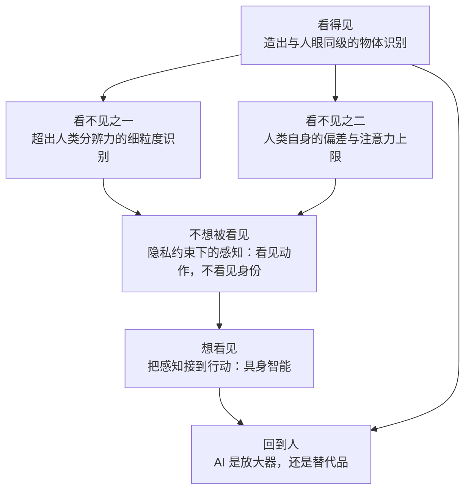
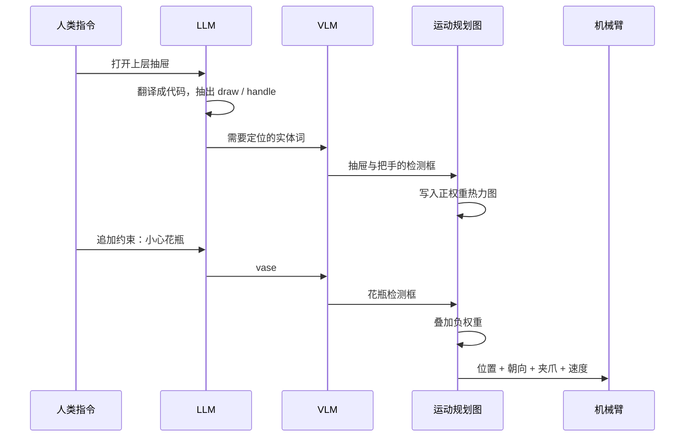
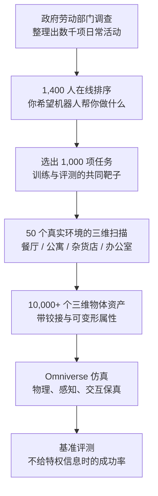

> **课程信息**
>
> - **课程名称**：Stanford CS231n: Deep Learning for Computer Vision（Spring 2025）
> - **本讲主题**：Lecture 18. Human-Centered AI
> - **主讲教师**：Fei-Fei Li
> - **授课日期**：2025-06-03
> - **课程主页**：[cs231n.stanford.edu/2025](https://cs231n.stanford.edu/2025/schedule.html)
> - **官方课件**：本讲无公开课件——2025 年课表中 Lecture 18 的 slides 链接被注释掉，2024 年的 `lecture_18.pdf` 属于另一讲「3D Vision」。因此书中不含任何幻灯片插图，全部内容依据课堂字幕重构；讲者口述的框架用 Mermaid 与表格复述，均标注「据讲者口述整理」。
> - **字幕来源**：[cs231n_sp25_kor_sub · eng](https://github.com/lpaiu-cs/cs231n_sp25_kor_sub/tree/main/eng)（公开英文转写，中文由本书重写）
> - **版权说明**：幻灯片与课程材料版权归 Stanford University 及授课教师所有；本书为非官方学习笔记，仅用于学习与研究。

本讲没有新算法，也不含任何需要推导的公式。它是整门课的退后一步：把前面十七讲拆开的技术——分类、检测、分割、视频、生成、机器人——重新放回一条更长的时间轴上，再补上一个课程里始终没有单独占章的维度，人的价值。讲者给出的讲题是两个并列的动词：我们看见什么（what we see），我们珍视什么（what we value）。

这个组合不是修辞。前面十七讲每一次性能提升，回答的都是同一个问题：机器能不能做到人能做到的事。这一讲要问的是另外两件事——机器能不能做到人做不到的事，以及，做这些事到底为了谁。第一个问题决定能力边界，第二个问题决定这门技术会不会被接受。整场讲座被切成三段，对应这两个问题的两种问法再加上一个收尾，三段的题目分别是「造出和人眼一样强的视觉」「造出看到人类看不见之处的视觉」「造出人类想看到的东西」。

## 1. 三条主线：看得见、看不见、想看见

*(参考时间: 00:00:05 – 00:04:46｜Lecture 18)*

视觉的故事从 5.4 亿年前讲起。三叶虫长出了感光细胞，生命第一次能主动探测外界。动物学家 Andrew Parker 的解释是：视觉一旦出现，生存就变成一场军备竞赛——要么演化出更好的眼睛与更快的反应，要么被淘汰。这场竞赛带来的物种爆发被称作寒武纪大爆发，讲者用了一个更直白的说法：演化的大爆炸。她特意补了一句限定：并非所有动物都依赖视觉，但视觉至今仍是许多动物的第一感觉通道，对人类尤其如此——从生存、工作、娱乐、社交，到学习与发育。

技术与演化的对照落在 1960 年代。当时的「Summer Vision Project」设想让几个本科生用一个夏天造出「视觉系统的重要部分」。这件事与 AI 史的毛病一模一样：**北极星很清楚，路程被严重低估**。讲者说这个毛病今天大概还在，只是确实发生了很多事——自动驾驶、图像理解、生成式 AI 的浪潮里，视觉既是参与者，也常常是领跑的那一环。

据讲者口述整理，整场讲座的主线是这样三句话，最后一句才是她真正的落点：

这三条线看着是同一个领域的三段历史，其实验收标准完全不同。第一条线的成功由人类定义——人能做到，模型做到就算过关，指标是分类准确率。第二条线要越过人类标注的天花板：细粒度鸟种、罕见关系，人类自己也答不对，此时「对齐人类」不再是目标，「超过人类」才是。第三条线的成功标准压根不在模型里：谁受益、谁被看见、谁被替代，这些量不进 loss，却决定技术能不能落地。把三条线的标准混为一谈，是这门课之外最常见的误读。

值得记录的是讲者对"为什么现在讲这个"的定位。她承认为了材料的完整性，本讲会和课程其他部分有少量重叠，但希望放在更长的时间尺度上能说得更圆。这个自我限定其实定义了这场讲座的性质：它不提供新知识，而是**给已有知识一个坐标系**。

把视觉当作主线也有它的道理。vision 是这门课的名字，也是这一轮 AI 里最早被工业化的感知能力：自动驾驶靠它，图像理解靠它，生成式 AI 的浪潮里它同样既参与又领跑。所以"我们从哪里来、要往哪里去"这个问题，在视觉这里问得最实——它有六十年的工程史，也有五亿年的生物学前史，两端都能查。

## 2. 人是标尺：150 毫秒、两次失败与一个 3 万到 10 万的数字

*(参考时间: 00:04:48 – 00:11:06｜Lecture 18)*

### 2.1 两个实验：100 毫秒一帧，150 毫秒一个判断

第一个实验有半个世纪的历史。受试者观看一段从未见过的视频，视频以 10 Hz 播放——每帧在屏幕上只停留约 100 毫秒——任务是在一个毫无先验知识的复杂场景里找出目标，这一次的目标是一个人。人眼毫无困难。讲者用这个实验强调的不是"找得快"，而是"以物体为中心的理解有多稳"：帧率被压到临界值、场景完全陌生，人类的物体级理解仍然不需要犹豫。

第二个实验来自世纪之交的神经生理学。研究者用脑电帽（EEG cap）测量大脑电信号，让受试者区分"动物"与"非动物"——一个概念上相当复杂的判断——结果是在刺激出现后约 150 毫秒就已经完成。讲者的评价是：考虑到颅骨下面那套湿件（wetware）的物理限制，这个速度是惊人的。对做工程的人来说，这两个数字的真正含义是：**人眼是一条被演化压缩到极致的推理管线，它没有"先检测后分类"的显式阶段，而是一次前向就出结论**。

### 2.2 大脑里真的有"物体区"

神经科学还给了一个更硬的证据：物体理解在大脑里有专门的对应区域——面部区、场景（地点）区、身体部位区。演化愿意为"认物体"这件事单独划出地皮，说明它在生存里的权重极高。（编者说明：文献里这三处通常写作 fusiform face area、parahippocampal place area、extrastriate body area；字幕只描述了功能，没有给出缩写。）

这条证据解释了计算机视觉几十年的路径依赖：既然人类智能里有一块专门做物体识别，那么让机器获得视觉智能的第一步，自然就是把物体识别做出来。

### 2.3 任务定义，以及它为什么在数学上难

原始问题的定义朴素得近乎无害：给定一张图像，让计算机说出图里有什么物体。人做这件事毫不费力，可一旦形式化，麻烦立刻出现——光照、纹理、背景、遮挡、视角、尺度，每一项都是一个连续变化的维度，组合起来是无穷多种可能的输入。同一个物体在像素空间里可以落在任意远的位置上。讲者的说法是：学过这门课之后你就知道，这在数学上是一个根本困难的任务，而不是"再调调参数"的问题。

### 2.4 第一次尝试：把物体拆成部件（1970s–1990s）

深度学习之前的第一波尝试，灵感来源是心理学——而且是一种带点自嘲的心理学：人靠着自我内省来推测自己怎么工作，有时内省过了头。内省的结论是：我们看物体时先看到几何部件，再把部件按某种构型组合成物体。于是有了「预设部件 + 构型」的建模路线，从 70 年代一路做到 90 年代，用不同的部件集合与配置规则去匹配不同类别。

讲者的评语很干脆：数学上优美、简单，但不工作。原因在下一波里被说破——部件是人指定的，构型是人设计的，规则本身不从数据里学到任何东西。真实世界的姿态、遮挡、纹理一变，需要枚举的构型就爆炸了，而手工规则没有办法跟着长。

### 2.5 第二次尝试：统计学习登场（2000s）

第二波是 AI 领域真正重要的一次转向，讲者形容为「计算机编程与统计建模的联姻」，机器学习的起点。这次转向带来三条认识，每一条都推翻了一点第一波的假设：

- **世界太复杂**，靠手调模型不可能泛化；
- **必须学参数**，而且要设计出具备"可学习性"的模型族，配上相应的学习规则；
- **必须有数据**——当时还不知道需要多少，只知道需要。

于是随机场、贝叶斯网、支持向量机等一批模型同时开花。到 21 世纪头十年，物体识别已经有国际基准赛，但类别数很少：大家先把算法拉到同一小片场地上比一比。讲者的措辞是「我们在一点点往前挪」（inching together），这种挪动的速度显然不够。

### 2.6 Biederman 数字：3 万到 10 万

最后一个解锁点又来自认知科学。心理学家 Irv Biederman 长期猜想：人能识别的物体类别数量极其庞大——他给这个猜想配了一个数字，6 到 7 岁的儿童大约能识别 **3 万到 10 万个**不同的视觉类别。数字来自两处证据的合成：词典里名词的数量，以及儿童识别物体的行为研究。讲者说她私下把它叫作「Biederman 数字」。

这个数字对当时的计算机视觉是一盆冷水。21 世纪头十年过半，这个领域还在几十个类别、几万张图上打转，而一个七岁小孩的"训练集"是这个量级。数据规模于是成了下一个必须撞开的瓶颈——它直接指向 ImageNet。

讲者对内省这条路线的批评其实很锋利：我们"有时过度内省"，把自己的认知当成设计图纸。部件模型的问题不只是部件选错了，而是**它把"人如何描述看见的东西"误当成了"人如何看见"**。人能说出"手柄、杯身、杯盖"，但说出这些词是语言系统的产物，不是视觉系统内部的计算步骤。这个区分后来被深度学习反复验证：端到端训练出来的特征，和人手工起名字的部件对不上。

第二波还留下一个更耐久的遗产：**基准**这个习惯。把算法拉到同一批数据上比，结论才有可比性，国际挑战赛的意义就在这里。这个习惯一直延续到今天——包括最后一章要讲的机器人基准，思路完全一样，只是把"图像"换成了"可交互的三维环境"。

## 3. 2012 年那扇门：1,500 万张图把物体识别变成工程问题

*(参考时间: 00:11:15 – 00:14:57｜Lecture 18)*

### 3.1 22,000 类、1,500 万张，以及一笔除法

ImageNet 项目把 Biederman 数字当真了。它构建出的数据集是约 **22,000 个物体类别、超过 1,500 万张图像**——与心理学家猜想的量级正面相当。做一笔除法：15,000,000 ÷ 22,000 ≈ 680，平均每类不到 700 张图。这个数字说明 ImageNet 的贡献不是"图多"，而是**类别的粒度第一次接近人类的日常词汇表**；每类几百张的密度并不奢侈，它恰好够让一个高容量模型学到类间的边界。

再算一笔反方向的账。若按 ImageNet 平均每类约 680 张的密度去铺满 Biederman 数字的上限（10 万类），需要约 6,800 万张图像——比 ImageNet 大近五倍。这是量级估算，假设每类密度相同；真实的长尾分布里稀有类别只会更稀疏。这笔账解释了为什么 ImageNet 停在 22,000 类而不是 100,000 类：**类别数与每类密度是一对必须同时妥协的量**，任何数据集都只能在两者之间选一个点，而选点的方式决定了后面十年的算法会长成什么样。

| 参照系 | 视觉类别数 | 图像规模 |
| --- | --- | --- |
| 6–7 岁儿童（Biederman 猜想） | 3 万–10 万 | 来自日常经验，无法计数 |
| ImageNet（2009 起） | 约 22,000 | 超过 1,500 万张 |
| 若按 ImageNet 密度覆盖 10 万类 | 100,000 | 约 6,800 万张（推算） |
| 深度学习之前的基准赛 | 少量类别（讲者只说 tiny，未给数字） | 少量图像 |

### 3.2 三样东西在 2012 撞上

ImageNet 挑战赛提供数据；卷积网络提供算法；两块 GPU 提供算力。三者在 2012 年汇合，讲者称之为深度学习诞生的时刻。这三项里任何一项缺席，那扇门都不会开——数据的规模决定了模型能见到的变化，算力决定了能跑多深的网络，算法决定了梯度能不能穿过这么多层还有信号。此后十年，这个挑战赛本身催生了一串架构：卷积网络的各种变体、ResNet 等等。本书前面几讲已经把它们逐层拆过，这里不再重复结构细节，只保留它在时间线上的位置。

（编者说明：那次提交用两块 GPU，直接原因是当时单卡显存装不下这个网络的参数与激活，把模型切到两张卡上是显存逼出来的工程选择，而不是一套并行训练方法论。这个细节值得记住——本书第十一讲讨论的所有并行策略，起点都是同一个约束。）

还有一个细节能说明这场讲座的受众假设：讲到卷积网络的基础示意页时，讲者直接说"这页我跳过，你们都学过"。到第十八讲，解释卷积已经没有意义，于是她把省下来的时间全部转给了历史与判断。

### 3.3 一个成熟问题的边界：长尾

今天可以拿算法去看世界上任意一张图，认出大的、小的、任意朝向的物体。是不是 100% 可靠？不是——总有长尾问题等着解决。但就工业应用而言，物体识别已经走得很远，讲者用的词是：一个成熟的问题（a matured problem）。

这句话给整门课一个坐标。前面十七讲的大部分技术——更好的归一化、更省的注意力、更强的数据增强——都在这条已经成熟的赛道里做精度与效率的边际改进。而真正还没被解决的，是下一章的内容：物体识别只回答了"图里有什么名字"，没回答"这些东西之间发生了什么"。

## 4. 光有名字不够：关系、故事与仍未解决的动态场景

*(参考时间: 00:15:05 – 00:23:26｜Lecture 18)*

### 4.1 同一组物体，两种故事

讲者用两张图说明差距。两张图里都有羊驼和一个人；如果只做物体标注，两张图得到完全相同的标签集合。但看第二张时，故事完全变了——不是物种变了，也不是人数变了，而是**人与羊驼之间的空间与语义关系变了**。标签系统对这个变化毫无感知。

这个例子点出的是表示能力的问题：一个只输出类别名的表示，把所有"物体如何组织成场景"的信息都丢掉了。而人类看懂一张图，靠的正是这部分信息。

### 4.2 把关系写进表示：场景图

心理学家 Jeremy Wolfe 写过一篇讲得很清楚的论文，主张对复杂自然场景的理解必须把物体之间的关系编码进表示里。计算机视觉随后沿着这条建议走，代表作是当时还是博士生的 Ranjay Krishna 的论文：用**场景图（scene graph）**做表示——节点是物体实体，边是实体之间的关系，属性挂在节点上描述具体形态。

场景图的密度值得注意。一张"两个人、其中一个人在喂另一个人吃蛋糕"的照片，物体层面只有三四个实体，但因为动作、姿态、身体部位、食物、容器都能成为节点，最后能生成一张相当密的图。这也解释了为什么这类数据标注成本高：图的规模随场景复杂度超线性增长，而自然场景总是比看上去复杂。

### 4.3 零样本的"不常见关系"

物体识别之后，这条线建了 Visual Genome：把物体、关系、以及较长的故事性描述放在同一个数据集里。Ranjay 那批工作里讲者最喜欢的一个是**不常见关系的零样本学习**：

- 人骑马，常见；人戴帽子，常见；马戴帽子，不常见。
- 人坐椅子，常见；消防栓在草坪上，常见；人坐在消防栓上，不常见。

后一类组合在自然图像里极少，靠大数据反复采样根本采不到。但用组合式的场景图表示，可以先把常见关系学好，再在表示空间里把"主体—关系—客体"重新组合，推导出没见过的组合。论文里给出的对比显示，这套做法在当时的一批方法中取得了最好的识别率。这里的机制值得记住：**零样本能力来自表示的可分解性，而不是来自更多的数据**。

### 4.4 从标注到叙述：2014 年的 CNN + LSTM

关系还不够。讲者的判断是：能讲出一个更丰富的故事、并且用自然语言讲出来，才是下一个大目标。时间点是 2014 年——距 AlexNet 那次突破只有两年，领域已经开始加速。

做法是把卷积网络和语言模型拼起来：CNN 提特征，LSTM 逐词生成。Andrej Karpathy 的博士论文是这条线上最早的系统性工作之一，同时展示了图像描述（image captioning）与稠密描述（dense captioning）——后者把描述落到区域级别，有 Justin Johnson 的贡献，他后来是本课的共同讲师。2015 到 2018 年这条线被大量推进；今天多模态大模型把它又推高了一档，但起点就在 2014 年那个"CNN + LSTM"的拼装里。

据讲者口述整理，从"给物体起名"到"讲出故事"，问题形式每上一级，验收方式就换一次：

这张阶梯值得用一张表看清每一级的"真值"是什么——因为它决定了谁能评价模型：

| 任务形式 | 模型输出 | 真值从哪里来 | 主要评价方式 |
| --- | --- | --- | --- |
| 物体分类 | 一个类别名 | 人工标注的类名 | 准确率 / Top-5 |
| 场景图 | 实体 + 关系 + 属性 | 人工标注的稠密图 | 关系召回、图匹配 |
| 图像描述 | 一句或多句自然语言 | 人工写的参考句 | BLEU / CIDEr 类文本指标 |
| 动态活动理解 | 谁在何时做了什么 | 时序动作标注 | 动作与关系的联合准确率 |

这张表从上往下读，会看到两件事同时变坏：真值越来越难写，评价越来越不可靠。到动态场景这一级，连"正确答案"都要人来裁量——一段视频里"他在做什么"可能同时有三四个都说得通的答案。这也是讲者说它"未解决"的第二层原因：不只是模型不行，**评测本身还没定下来**。

### 4.5 动态场景：讲者明确说仍未解决

静态图之后是动态场景，难度是另一个量级：关系更复杂，运动更复杂，摄像机自己在动，场景里的行动者各自在做不同的事。讲者与合作者（Ehsan Adeli 等）的工作叫多物体多行动者活动理解（multi-object multi-actor activity understanding），发表才几年。要同时抓住"谁"、"在做什么"、"和谁一起做"、"接下来可能做什么"，讲者的判断是：仍然是一个未解决的问题。

这个判断的工程后果很直接。你如果在硅谷，会听到大量关于机器人的兴奋；但真要有在日常环境里和人共处的机器人，它必须能读懂这一场里谁在做什么、下一步是什么。第 17 讲的机器人学习解决的是"怎么把动作学出来"，这一讲指出的是"喂给它的场景表示还差得远"。

### 4.6 第一段的两条遗产

讲者在这一段的结尾给了两句总结，值得单独记：

1. **数据、算力、神经网络算法在 2012/2013 前后真正汇合**，现代 AI 由此开始。这不是某一条曲线的胜利，而是三条曲线在同一时刻交叉。
2. **这条路上几乎每一个问题的定义都来自认知科学、心理学与神经科学**，反过来 AI 也在帮助脑研究。讲者认为这种双向关系会持续下去。

这两句合起来，其实是给"造出和人眼一样强的视觉"这件事下了定义：它从来不是纯工程，靶子是别人（大脑）画好的。

## 5. 看见人类看不见的：超人分辨力、人的漏洞与隐私的反向约束

*(参考时间: 00:23:37 – 00:38:17｜Lecture 18)*

### 5.1 细粒度：这件事人真的不擅长

第二段的题目是"造出能看到人类看不见之处的视觉"，也就是把 AI 推到人的能力之外。最干净的例子是细粒度分类：多数人认不出几种恐龙，更别说上万种鸟、上万种车型——除了少数把图鉴背下来的孩子。

这条线叫细粒度物体分类（fine-grained object categorization）。讲者的判断有两层：这仍然是一个没有被完全解决的问题；而在生成式 AI 与多模态大模型的时代，它反而被冷落了，因为它不是主流叙事的一部分。但她认为它迟早会重新变得重要。

早期的一个实验用约 4,000 个鸟种的数据集训练分类器，然后按分类树的层级看错误率。结果是单调的：**名字越具体（往"种"走），错误率越高；名字越笼统（往"目""纲"走），错误率越低**。换句话说，模型在粗粒度上已经可用，在"具体到种"这一层仍然不可靠。这个单调关系本身就是诊断工具——它告诉你模型的瓶颈不在特征提取，而在类间差异已经小到接近成像噪声。

成因值得拆开看。分类树越往下，类间差异越小，而类内差异（姿态、光照、个体差异）并不随层级减小。到了"种"这一层，判别所需的信号可能只是喙长差几个像素、羽色差一个色阶——与成像噪声、压缩伪影处在同一量级。这时模型不是"没学会"，而是**可用信噪比已经接近极限**。这也解释了为什么细粒度任务对数据质量的敏感度远高于普通分类：同样多的标注，噪声低一点，收益就很大。

### 5.2 把车当社会透镜

讲者更喜欢的另一个例子是车型识别。实验室训练了一个按品牌、型号、年份（make / model / year）分类的细粒度车辆分类器。这个任务的类别空间有多大？1970 年代之后，不同品牌、型号、年份的组合有几千种。

然后是关键的一步：他们没有停在"识别"。他们取 Google 街景图像，覆盖全美约 100 到 200 个主要城市，用这个分类器把街上每辆车的具体型号读出来，再把这些分布与社会指标对齐。结果的相关性很强：车型分布与教育水平、收入水平、投票行为、环境指标都高度相关。

这件事的意义不在识别精度，而在**测量能力**。没有任何个人、甚至任何一群人类审查员，能对上百个城市的街道做这种规模的逐车统计。视觉在这里不是"替代人看"，而是让人看见一个原本不可能被看见的量。讲者由此给出这一段的中心句：AI 正在推远"人能看到什么"的边界。

### 5.3 人的三个漏洞：Stroop、变化盲、手术室里的纱布

但人类视觉也有硬限制，讲者用三个例子把它摆出来。

**Stroop 测试**：字你都会读，但如果要求你"尽快说出字的颜色"而不是字本身，从左到右、从上到下念一遍，你会发现它和你打架——红色写成"绿"、黄色写成"紫"。这是视觉注意与自动化阅读之间的竞争。

**变化盲（change blindness）**：两张图交替闪烁，中间有一个相当大的变化（讲者给的例子是汽车引擎盖），你要看几秒才能发现。注意力没有落在那里，变化就等于不存在。

**医疗错误**：这一条不再是趣味实验。医疗错误是美国医疗体系里的第三大死因。标志性图像是"剪刀留在病人体内"，但真实情况更琐碎也更难防：缝针、针头、一小块纱布。今天多数医院靠人工清点加清单；一旦数目对不上，手术必须暂停，而平均暂停时间接近一小时——病人多暴露一小时的细菌与出血风险，只为找回一件东西。

AI 在这里的位置很具体：用一个演示系统在术中清点纱布。讲者特意强调这是 demo，不是可部署系统，保真度还不够。但方向清楚——**它不是替医生做判断，而是替医生补上"不会疲劳的眼睛"**。

### 5.4 棋盘格错觉：偏差写在视觉系统里

讲者说她最喜欢的一个视觉错觉是棋盘格：A、B 两格的灰度（亮度）其实完全相同。她把答案直接给你，你再看上面那张图，依然"看到"它们不同——即使下面那张已经把两块灰色并排摆出来了。

原因是演化把一套关于世界的常识物理预装进了视觉：物体有形状、光源有方向、阴影有生成规则，大脑先假定光照，再反推表面反射率。这套先验太深，深到你无法用意志覆盖它。

讲者由此推进到这一讲最关键的一句判断：**人类的视觉系统里有偏差（bias）**。偏差可以来自演化构造，可以来自社会经验，也可以来自你被暴露在其中的数据。有些偏差是无害的错觉，有些则会变成不公平——几年前的人脸识别算法在特定肤色、特定性别上明显更差，而这类误差会落到自动驾驶、医疗这些高风险场景里。她 2025 年的观察是：问题没有解决，但至少学术界和工业界都在看它了，这比几年前"没人注意"要好得多。

### 5.5 不该看见的部分：隐私是设计约束，不是事后补丁

第二段还有第三种"看不见"，而且是故意的：有些信息本来就不该被看见，因为要尊重隐私。于是问题变成——怎么造一个既能帮人看、又不去看人不愿被看的东西。

从机器学习角度，这条路有一串现成手段。但要先看清问题本身有多宽——回到她实验室那篇关于病房智能摄像头的论文：摄像头要帮医生看得更好，同时要处理的不只是人脸，还有整段身体信息，甚至房间本身（家里的布置会泄露生活习惯）。隐私在这里不是一个开关，而是一组需要逐项决定的边界：哪些像素允许离开设备、哪些只能留在本地、哪些连本地都不该存。手段与它们各自的取舍如下：

| 手段 | 保护的是什么 | 保留了哪些可用信息 | 主要代价 |
| --- | --- | --- | --- |
| 模糊 / 失焦 | 身份、面部细节 | 场景布局、大致位置 | 动作细节一起被抹掉 |
| 掩蔽（masking） | 指定区域 | 区域之外的全部内容 | 必须先知道要遮哪里 |
| 降维 | 身份级细节 | 低维结构、统计量 | 下游任务精度下降 |
| 联邦学习 | 原始数据不出端 | 梯度 / 模型更新 | 通信与系统复杂度上升 |
| 加密 | 传输与存储 | 密文域计算能力 | 算力开销 |

这张表的第一行最能说明冲突：**模糊与失焦能保护隐私，但它同时抹掉了"这个人在做什么"——而对很多应用来说，那恰恰是唯一有用的信息**。这不是工程细节，是目标冲突：保护的对象与需要的信号落在同一批像素上。

讲者用一个她很欣赏的工作说明怎么绕开这个冲突（她特意声明这不是她实验室的工作，由合作团队的学生主导）。做法是硬件与软件联合设计：定制一枚镜头，在光学层面就把画面按特定方式滤波——摄像机真正采到的画面里，看不到人脸，也看不到身体外观；因为这枚镜头是为配套软件专门设计的，软件仍能从滤波后的信号里恢复运动与活动信息。于是系统保住了"这个孩子在做什么"，却拿不到"这个孩子是谁"。

这个思路的价值在于层次：隐私保护被放进了光学路径，而不是在拿到高清图之后再打码。前者从物理上就没有采集身份信息，后者只是把已采集的信息藏起来。

### 5.6 第二段的结论：AI 是放大器

这一段的三件事——超人分辨力、人的偏差、隐私的反向约束——最后收敛到一句判断：AI 既能放大我们的能力，也能放大我们的问题。如果我们有偏差，AI 会把偏差放大；如果我们有注意力上限，AI 可以补上；如果我们不想被看见，AI 必须学会不看。

所以造 AI 时不能只取技术视角，还要取人的视角：主动研究它的影响，引导它尊重人的价值。这是全讲的第二条 take-home，也是从"技术"转向"人"的那一步。

## 6. 从看见到行动：短缺比"替代"更接近事实

*(参考时间: 00:38:23 – 00:47:23｜Lecture 18)*

### 6.1 劳动：被冲击的其实是白领

第三段的题目是"造出人类想看到的东西"，而且不止于看——要把看与做接起来。切入点是今天社会对 AI 最大的焦虑：劳动。

讲者的态度是先把两端都摆出来。一方面，否认岗位变化是错的：人类历史上每一次技术变迁都改变了劳动力市场，有些改变非常痛苦，某些时刻甚至导向内战与战争；但另一方面，这种变化有时候也不可避免。头条式的"机器人抢走工作"把图景简化了。

然后是一个反直觉的补充：过去两年生成式 AI 冲击最严重的并不是体力劳动，而是白领岗位，尤其是软件工程与办公室里的分析性工作。也就是说，长期以来"机器替代体力劳动者"的叙事，和这一轮实际发生的事恰好错位。

### 6.2 另一边是短缺：谁在照顾老人

如果只看替代叙事，会漏掉图景的另一半——劳动力短缺，而且缺在最需要人的地方：养老与医疗。

链条是这样的：现代医学进步拉长预期寿命，社会整体变老，这是好事；但同时年轻人要工作，社会才有活力，那么谁来照顾老人、谁来照顾慢性病患者？美国医院里护理人员的流失率已经高到"没有足够的手、耳朵和眼睛去照看病人"的程度。讲者的结论是：与其用 replace 来描述这件事，不如用 augment（增强）。

### 6.3 暗空间与「环境智能」

医疗系统里有一批地方长期缺人盯着：手术室、病房、药房、病人家中。讲者给它们起了个名字——健康的**暗空间（dark spaces of health）**。这些空间的共同点不是没有数据，而是没有足够的人去持续解读数据。

对应的技术路线叫环境智能（ambient intelligence）：把智能传感器与机器学习算法组合起来，从这些场景里提取对健康关键的信号，及时提醒病人、家属或医生。这条线由 Ehsan Adeli 等人主导，成果发表在几年前的一篇论文里。下面三个例子都是它的具体化。

### 6.4 手卫生：深度传感器加动作分类，约等于四个审查员

医院获得性感染是美国病人死亡的主要原因之一，讲者给了一个对比：它每年致死的人数是全美交通事故的三倍。这类病菌主要通过病房之间的人员流动传播，然后在环境里繁殖。手卫生因此是关键环节，而这个项目早在 COVID 之前就开始了。

难点在于"怎么测"。医院试过人工审查员，但护士都不够，更不可能雇足够多的审查员；而且人有疲劳，注意力有限，前面刚讲过变化盲。技术方案试过 RFID 徽章：徽章靠近洗手液分配器就记录一次。问题是它太不具体——病房和走廊都很窄，站在洗手液旁边不等于在洗手。

他们的方案是把只采深度信息的智能传感器装进病房（画面里是蓝色的深度视频，不采彩色纹理），再用视觉算法做动作分类：这个人在洗手，还是没洗。隐私上这已经是低成本设计——深度图里没有面部细节。结果上，与人工真值对比，算法的检测比人更准也更稳定；讲者给了一个很有说服力的换算：要与算法达到相近质量，几乎得让四个人看同一段视频，而这在运营上完全不可行。只派一个人看，检出会非常稀疏。

### 6.5 ICU：GDP 的 1% 与四类动作

第二个例子是重症监护室。ICU 是病人与生死相搏的地方，也是花钱的地方：讲者给的数字是它花掉美国 GDP 的约 1%。因此让 ICU 更有效、更安全是最高优先级。

ICU 的目标之一是让病人安全地转出，进入降级病房甚至回家。而恢复的关键动作之一是早期活动（mobilization）——让病人动起来，而且必须动对。这件事在流程上异常复杂：要有护士协助、医生下医嘱、按指定时间执行、还要评估动作是否到位。对健康人来说是本能，对 ICU 病人来说是治疗。

他们与 Stanford 以及犹他州的 Intermountain 医院合作，在 ICU 里装传感器，监测四类动作：下床、上床、离椅、入椅。有了可靠的检测与预测，医生才能在人力短缺的条件下知道"这个病人今天动了没有、动了多少"。

### 6.6 居家养老，以及传感器的天花板

第三个例子是居家养老（aging in place）：老人希望在自己家里独立、健康地生活。讲者提到 COVID 初期的教训——老年群体死亡率高，很大程度是因为医院被挤兑、系统过载，所以把人安全地留在家里本身就是一种医疗能力。

传感器在这里能做的事不少：用热成像做感染的早期发现，监测行动能力，理解睡眠模式与饮食模式。这些都是 AI 加智能传感器的用武之地。

但讲者紧接着指出了这条路的天花板：传感器是信息采集系统，它不能走过去把病人翻个身，不能端水，不能把药送到老人手里。信息到位之后，还差一双手。于是话题自然转到最后一个技术主题——具身智能，其中很大一部分是机器人。

把这一章的四个场景并排看，边界会非常清楚：

| 场景 | 传感器能提供的 | 传感器做不到的 | 需要谁补上 |
| --- | --- | --- | --- |
| 手术室 | 器械与纱布的清点、流程节点识别 | 递器械、缝合 | 护士与外科医生 |
| 病房 | 手卫生动作分类、感染风险信号 | 提醒并纠正当下行为 | 现场医护 |
| ICU | 四类活动的检测与趋势 | 扶病人起身、评估疼痛 | 护士 |
| 居家 | 感染、睡眠、饮食、行动能力的早期信号 | 端水、送药、翻身 | 家属或机器人 |

这张表从左往右读是一条单向的落差：**感知系统的产出是"信息"，照护的产出是"动作"**。信息可以规模化复制，动作不能——这正是具身智能存在的理由，也解释了它为什么比感知难一个量级：感知错了可以重看一遍，动作错了会伤到人。

## 7. 具身智能：开放指令、零分基准与 1,400 人的偏好排序

*(参考时间: 00:47:29 – 01:04:23｜Lecture 18)*

### 7.1 为什么要闭环：眼睛与运动是同一件事

讲者对具身智能兴奋的理由不是"机器人很酷"，而是它**把感知与行动闭成一个环**。她把这个环拉回寒武纪：眼睛一出现，动物就开始移动。看见与行动在演化上是同一件事的两面，而不是两个模块。

现实则很难。机器人很慢、很笨拙，很难适应需要泛化的场景。今天机器人学习领域进步很大，Stanford 是中心之一，但多数工作仍被限制在短时程任务（抓取、放置）、个案式的实验设置，以及缺少标准基准这三重约束里。这三条约束正好对应下一节要讲的三件事：任务从哪来、环境怎么建、成绩怎么比。

### 7.2 开放指令：LLM 写代码，VLM 定位，热力图做规划

第一个约束是任务从哪来。如果必须预先指定任务集合，机器人就永远困在一个封闭世界里；而今天的 LLM 是完全开放的——你什么都能和它聊。讲者的学生想把这个差距补上：能不能给机器人一条从未训练过的指令，它也能做？

例子的设置很小：训练集里是"那种门"，野外遇到的是"这种门"，目标是在野外泛化。技术路线是把 LLM 与视觉语言模型（VLM）当作两级的"翻译器"：

1. 指令进来（比如"打开上层抽屉"），LLM 把它翻译成代码，代码里出现 draw、handle 这类实体词；
2. 把这些实体词交给 VLM，VLM 在场景里检测出抽屉与把手的位置；
3. 检测结果更新一张运动规划图——用热力图表示机械臂该往哪里使劲、哪里不要碰；
4. 再给一条追加约束（"小心那个花瓶"），走同一条链路，这次得到的是负权重，与前一张图叠加；
5. 规划图不只编码位置，还编码末端朝向、夹爪开合与速度，最后交给机械臂执行。

据讲者口述整理，这个闭环的时序关系是：

关键在于这条链路里没有任何一环需要"为这个任务训练一个策略"。LLM 负责把自然语言拆成可执行的符号，VLM 负责把符号落到像素坐标，规划器负责把这些坐标变成带正负权重的场。三个模块各自都是通用模型，组合起来的泛化能力来自语言与视觉的开放词汇表，而不是来自机器人数据的覆盖。同一个系统还能做铰接物体操作（开合柜门、抽屉）、铺纸巾、扫地、取吐司、摆餐桌，以及应对在线扰动。

从系统设计的角度看，这套做法把"泛化"的负担从策略网络转移到了通用模型上。传统模仿学习的泛化边界由示教数据分布决定；这里凡是 LLM 能命名、VLM 能定位的物体，都能进入规划图，边界改由通用模型的知识决定。代价同样清楚：整条链路是开环的符号传递。若 LLM 生成的代码写错了实体名，VLM 会忠实地检测一个不存在的物体并给出热力图，系统没有任何机制能察觉"语言层错了"。缺的正是用执行反馈纠偏的那一层——那属于策略学习的主场，而这条链路目前只有开环的符号传递。

### 7.3 缺的是一把尺子

第二个约束是环境与成绩。机器人研究仍然缺少好的基准：实验室里的实验条件可控，真实世界却更复杂、更不确定、变化更大、更依赖交互与社会性，而且是多任务的。

对比很刺眼：自然语言处理和计算机视觉都因为建起了大规模数据集（既用于训练，也用于基准）而受益巨大；机器人领域还没有等价物。实验室的项目叫 BEHAVIOR——Benchmark for Everyday Household Activities in Virtual, Interactive, and Ecological Environments，直译就是"虚拟、可交互、生态化的日常家务活动基准"。名字里的三个形容词就是它的设计目标：日常家务（不是抓取积木）、可交互（不是看视频）、生态化（不是孤立场景）。

### 7.4 谁来决定机器人该做什么：1,400 人的排序

建基准之前有个价值问题，讲者特意把它单独拎出来：凭什么由我们来定机器人该做哪些任务？

她先讲了个笑话：每个做机器人的研究生都只想要两个任务——洗衣服和洗碗机。这没问题，但出了研究生院，任务清单该由谁定？

他们的做法是不自己拍脑袋，而是做一次以人为本的调查。步骤是：先从美国、欧洲等地劳动部门的政府调查里整理出**数千项日常活动**；再到网上招募尽可能多样的人（最终找到 1,400 人），请他们判断"你希望机器人帮你做哪些"，然后对结果排序。

结论与直觉部分吻合、部分相反。吻合的部分：清洁类压倒性靠前——擦厨房地板、刷马桶、拖地，人真心想要。相反的部分更能说明问题：人不希望机器人替你打壁球，不希望它替你买婚戒，甚至不希望它替你冲婴儿米粉。讲者的解释是：有些动作对我们有情感或社会意义，它们的价值不在"被完成"，而在"由谁完成"。她还现场做了个投票——擦厨房地板、铲雪、叠衣服，举手的人多；做早餐，答案就开始分裂；拆圣诞礼物，几乎没人愿意。

讲者也主动交代了这次调查的局限：她想要尽可能多样的人群，但自评"还有改进空间"。1,400 人对数千项活动做判断，样本量与覆盖面都只是起点；更重要的是，不同文化对"哪些事该由机器做"的答案很可能不同，而这一版调查主要覆盖欧美。换句话说，**这份排序是一份有立场的先验，不是一份客观的任务清单**——它把"人的偏好"写进了基准的基因里，而这恰恰是它的价值所在。

### 7.5 50 个场景、10,000 个资产、Omniverse

有了排序，就有了一把可以下刀的尺子：从几千项里选出**1,000 项**人最希望得到帮助的任务，作为训练与评测目标。接下来是建环境，这部分的工作量常被低估：

- **场景**：扫描或获取 50 个真实环境的三维场景，覆盖餐厅、公寓、杂货店、办公室等；
- **物体**：采集超过 10,000 个三维物体资产（讲者说这个数字已经过时，实际更多），每个都带属性——是否铰接、是否可变形；
- **仿真**：与 NVIDIA 的 Omniverse 团队合作，目标是物理、感知、交互三方面都高保真，包括热传导透明性、布料与液体的可变形等效应；
- **验证**：用人类被试的感知真实感研究，与其他仿真环境做对比。

据讲者口述整理，从"人想要什么"到"能不能做到"是一条单向的流水线：

这条流水线的每一级都在做减法：数千项活动减到 1,000 项任务，50 个真实环境减成可仿真的场景，10,000 个资产减成有物理属性的刚体与软体。减法的依据始终是"人想要"，而不是"工程上好做"——这是它与一般基准最大的区别。

### 7.6 零分，以及"特权信息"如何把分数买回来

最该记住的一组数字在这里。把今天的机器人算法丢进 BEHAVIOR，不给任何特权信息——不许知道物体在哪、不许知道成功判定，直接放进环境里做——**成功率是 0**。

"零分"值得多说一句，因为这不是模型崩了，而是任务定义在拒绝取巧。BEHAVIOR 的任务是长时程的：要找到物体、在多个子目标之间排序、失败后还要恢复；而"不给特权信息"意味着不许直接读仿真器里的物体位姿。今天多数机器人策略是在"已知物体在哪"的前提下训练的，把这个前提一拿掉，成功率归零并不奇怪——它暴露的是训练设置与评测设置之间的落差，而不是某个网络结构不够深。

一旦开始给特权信息，或者用让任务变简单的假设（magic motion、完美记忆之类），分数才开始动。讲者的读法有两面：只看"不给特权信息"那一行，会对今天的机器人很沮丧；但对研究生来说这是好消息，因为它意味着空间还很大。

演示里的机器人也印证了这一点：整理房间时动作很慢（讲者特意说明没有加速播放），会拿不起瓶子，也会走错方向、把东西放到错的位置。同一套任务在数字环境与真实环境里各有一份"数字孪生"，用来测从仿真到真实的迁移（sim2real）；讲者的判断仍是：未解决，还有很长的路。这套环境还被用来研究视障患者——把患者放进安全的虚拟环境里做研究，本身就是一种伦理上的改进。

### 7.7 脑电波：把"想"变成动作

最后一个演示更接近科幻。他们与心理学家、医生合作，用脑电（EEG）帽控制机械臂：一名学生戴着帽子，机械臂"凭想法"做出一份日式餐食。讲者强调这是非侵入式的，信号来自头皮电信号，不是植入电极。

前提条件是校准：需要先把"想法"与动作原语（lift、place、drop 这类）做预训练对齐，之后才能用连续的脑电信号驱动整段任务。讲者把它定位在临床——这项技术真正的前途是帮助重度瘫痪的病人重新获得动手的能力，而这件事就发生在去年。

### 7.8 第三段的落点

BEHAVIOR 项目的目的，讲者总结为三个词：增强人（augmenting people）、大规模且多样、真实且生态化的物理与感知。这三条合起来是她对具身智能的定义——不是造一个更灵活的机械臂，而是造一个能在人的环境里替人分担的环境智能体。而任务清单的来源，必须是人的偏好，不是工程师的便利。

## 小结

*(参考时间: 01:04:29 – 01:05:00｜Lecture 18)*

- **三段路对应三种验收标准**：对齐人类、超过人类、服务人类。用分类准确率去衡量第三段，是这类讨论里最常见的错位。
- **2012 年是三个量的乘积**，不是一条曲线的胜利：数据的类别粒度、GPU 的算力、可训练的深层网络，缺一项门都开不了。
- **人既是灵感也是上限**：150 毫秒的识别速度与 3 万到 10 万的类别数定义了靶子；而 Stroop、变化盲、棋盘格错觉说明人本身不是可靠的真值来源。
- **主干变强不会自动消灭长尾**：物体识别在工业上已经成熟，不等于在稀有物种、罕见关系、动态场景上成熟；但同一个细粒度模型换个用法，产出就从"预测"变成了"看见"——把上千个城市的车型分布读出来，得到的是一个原本不存在的观测维度。
- **隐私要在采集之前解决**：模糊与打码抹掉身份的同时也抹掉动作，而动作恰恰是有用信息；定制光学加软件解码是唯一同时保住两者的路子。
- **医疗场景里 AI 的对手不是医生，是疲劳**：四个人看同一段视频才追平一个算法，这个换算比任何准确率数字都更能说明问题。
- **具身智能的瓶颈不在单个动作**：开放指令、长时程、可复现基准三件事，BEHAVIOR 上那个"零分"就是这条赛道当前最诚实的刻度。
- **机器人该做什么由人的偏好决定**：清洁要，婚戒不要；工程可行性回答不了这个问题。
