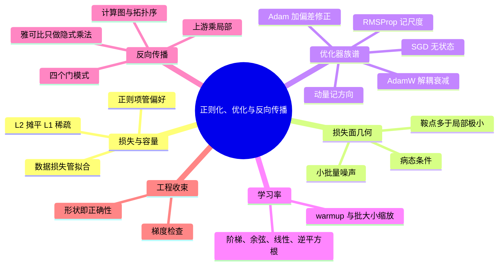

> **课程信息**
>
> - **课程名称**：Stanford CS231n: Deep Learning for Computer Vision（Spring 2025）
> - **本模块覆盖**：Lecture 3. Regularization and Optimization（119 页）+ Lecture 4. Neural Networks and Backpropagation（147 页）
> - **主讲教师**：Zane Durante（Lecture 3）、Ehsan Adeli（Lecture 4）
> - **授课日期范围**：2025-04-08 – 2025-04-10
> - **课程主页**：[cs231n.stanford.edu/2025](https://cs231n.stanford.edu/2025/schedule.html)
> - **官方课件**：[lecture_3.pdf](https://cs231n.stanford.edu/slides/2025/lecture_3.pdf)（119 页）、[lecture_4.pdf](https://cs231n.stanford.edu/slides/2025/lecture_4.pdf)（147 页）
> - **字幕来源**：[cs231n_sp25_kor_sub · eng](https://github.com/lpaiu-cs/cs231n_sp25_kor_sub/tree/main/eng)（公开英文转写，中文由本书重写）
> - **版权说明**：幻灯片与课程材料版权归 Stanford University 及授课教师所有；本书为非官方学习笔记，仅用于学习与研究。


第 2 讲留下的是一个半成品：给定一组权重 $W$ 能算出损失，但没回答两个问题——这组权重到底算不算"好"，以及这组权重从哪里来。第 3 讲把这两个缺口一次补上：先在损失函数里加进一项"偏好"，让"好"不再只由训练集定义；再把"找 W"从一个搜索问题变成一段可以反复执行的过程。第 4 讲换掉被优化的对象——从一层线性映射换成多层非线性堆叠——并造出那台能对任意深度求梯度的机器。四段线索因此串成一条线：**损失面几何**（地形长什么样）→ **正则化与容量控制**（我们要哪一个解）→ **优化器族谱与学习率调度**（怎么走到那里）→ **反向传播引擎**（梯度从哪来）。前两段和第 3 讲的优化器都属于 Lecture 3，最后一段属于 Lecture 4；两讲的接缝处藏着一个很容易被跳过的问题——优化器吃进嘴里的 $\nabla_W L$ 是谁生产的。这个问题不回答，第 3 讲的所有算法都只能停在 3072 维的线性模型上。讲义开头三页是课程事务，课堂上讲得很快，但它们决定了接下来两周的节奏，照录在前。


作业一在本讲次日发布，4/23 23:59 截止；答疑时间只处理高层问题，页面写的是 No Code Show Policy——梯度写错、维度对不上这类事得自己定位。这条政策与第 3 章末尾的梯度检查是配套的：课程不给你调试，但给了你自己查错的方法。


Proposal 4/25 截止；助教的专长方向与答疑时间（线下与 Zoom 混合）都挂在 `cs231n.stanford.edu/office_hours.html`。选题前先确认哪位助教懂你想做的方向，比事后临时问省事得多。


Ed 上的置顶帖要全部读完，勘误与补充说明都发在那里；想在校内参加期中考试的同学需要发邮件到 cs231n-staff-spr25@stanford.edu 登记（CGOE）。

## 1. 上一周做出的三个决定，和一个还没被问出口的问题
*(参考时间: 00:00:17 – 00:11:05｜Lecture 3)*


复习不是把上一讲重讲一遍，而是把三个已经做出的决定摆出来，看哪一个会在今天崩掉：用数据而不是规则来分类、用一种距离度量"相似"、用线性函数把图像映射成分数。前两个决定在第 2 讲已经站住，第三个决定会在本讲第 8 章被推翻。


**第一个困难不在算法，在表示。** 人看到的是"猫"这个概念，机器拿到的是一张 $32\times32$ 的像素网格，每个位置三个整数，共 3072 个离散值。从这堆数字回到语义标签，中间隔着语义鸿沟（semantic gap）。它也顺带解释了后面所有矩阵的宽度为什么是 3072：$32\times32\times3$，不是随便挑的数。


六张图对应六种困难，其中两处值得讲得比图更细。猫是典型的**可形变物体（deformable object）**：能扭、能蜷、能伸，同一个类别在像素层面没有稳定形状，任何依赖"形状模板"的规则都会失效。遮挡那张更狠——画面里只剩一条翘在坐垫外的尾巴，人靠"尾巴的形状 + 猫的行为常识"把它补全，而算法手里没有常识。再加上背景杂乱与类内差异，if-else 规则这条路不是不准，是规则的组合数会爆炸。


数据驱动的做法是把训练样本存起来，来一个新样本就找最近的邻居投票：1-NN 直接抄最近邻的标签，5-NN 取最近 5 个的多数票，这里的 5 就是超参数 $k$。数据要切三份而不只是两份——**验证集用来挑超参数**，测试集只回答"在完全没见过的数据上表现如何"。两者混用，挑超参数的过程本身就把测试集信息泄漏进了模型选择。


把图摊平成 3072 维向量后，$W$ 是 $10\times3072$ 的矩阵（讲师口述时说成 3071，按 $32\times32\times3$ 应为 3072），$b$ 是 10 维。同一个东西有三种读法，本章三种都会用到：**代数读法**——$W$ 的每一行是一个类别的评分器，与 $x$ 做内积再加偏置；**模板读法**——把某一行 reshape 回 $32\times32\times3$ 画出来，就是这个类别"长什么样"的加权模板；**几何读法**——每一行是输入空间里的一个超平面，$w^\top x+b=0$ 是决策边界，符号决定样本落在哪一侧。几何读法最有用：把数据画出来，一眼就能看出红蓝两团点能不能被一条直线分开；分不开，问题就不在优化，而在模型族本身。


具体到这张分数表：cat 那一列 $(3.2,\,5.1,\,-1.7)$ 里正确类只排第二，car 的 5.1 更高，判错；car 那一列 $(1.3,\,4.9,\,2.0)$ 正确类最高，判对；frog 那一列 $(2.2,\,2.5,\,-3.1)$ 正确类垫底。三列分数的"好坏"没法靠肉眼排序——cat 只输了 1.9 分，frog 输了 5.6 分，凭什么说后者更糟、糟多少？于是需要一个把整列分数压成一个数的函数：

$$
L=\frac{1}{N}\sum_{i=1}^{N}L_i\left(f(x_i,W),\,y_i\right)
$$

这就是**数据损失（data loss）**，衡量预测与标签的吻合程度。问题在于，只最小化这一项，模型会不惜一切代价拟合训练集——包括把噪声当规律学下来。损失函数还缺一项；补这一项是本讲前半段的全部内容，而"这个 W 从哪里来"是后半段的全部内容。

## 2. 正则化：唯一一个"故意把训练损失做差一点"的旋钮
*(参考时间: 00:11:07 – 00:24:22｜Lecture 3)*


第二项要做的事情听上去自相矛盾：**故意让模型在训练数据上表现差一点**。讲师讲得很直白——这一项的目的不是提高训练集上的分数，而是让模型不要在训练集上"做得太好"，好在没见过的数据上做得更好。训练集变差、测试集变好，这两件事必须同时发生，否则就不叫正则化。


为什么"训练集上太好"是个坏信号？一张只有五个点的玩具图就能说清。


给定这五个点，可以画出无穷多条曲线穿过它们。图里只给了两条候选：$f_1$ 与 $f_2$。


$f_1$ 精确穿过每一个点，数据损失几乎为 0；$f_2$ 每个点都差一点。只看训练损失，$f_1$ 完胜。但如果这五个点是从某个更平滑的规律里采样出来的、本身带测量噪声，那么 $f_1$ 学到的是"噪声长什么样"，$f_2$ 学到的才是"规律长什么样"。


结论就是页面下方那一行：正则化顶着"别拟合得太好"的力，作用是**不去拟合数据里的噪声**。同一个直觉在哲学里有名字——奥卡姆剃刀：多个互相竞争的假说里，先选最简单的那个；只有当简单假说被证明错了，再去试更复杂的。


写成公式，就是在数据损失后面挂一项惩罚，再用一个系数把它们缝起来：

$$
L(W)=\underbrace{\frac{1}{N}\sum_{i=1}^{N}L_i\left(f(x_i,W),y_i\right)}_{\text{数据损失}}+\underbrace{\lambda R(W)}_{\text{正则项}}
$$


$\lambda$ 是**正则化强度**，又一个人为设定的超参数，取值从 0（完全不正则化）到任意大（惩罚压倒一切）。它不靠训练学出来，而是像 $k$ 一样在验证集上扫。这一项之所以重要，是因为它把"模型好不好"从单一目标变成了两个目标的加权和：数据损失说"你要对训练集负责"，正则项说"你别太用力"。


三个具体形式都是对权重矩阵逐元素操作再求和：L2 是平方和 $R(W)=\sum_k\sum_l W_{k,l}^2$；L1 是绝对值和 $R(W)=\sum_k\sum_l|W_{k,l}|$；弹性网络（elastic net）把两者按系数 $\beta$ 混起来。它们的差别不在公式长短，而在**对大数和小数的惩罚力度不同**，下一节会用一道现场题算清楚。


页面右侧还列了一串"不那么像惩罚项"的正则化：Dropout、批归一化（BatchNorm）、随机深度（stochastic depth）、分数池化（fractional pooling）。它们的共同点是训练时往网络里注入某种随机性或约束，让模型不能依赖某一条固定通路；代价是它们会改变网络结构本身，调起来比 L1/L2 麻烦得多。讲师的说法是这类方法每年都有新论文，属于活跃研究方向，本课只覆盖一小部分。


页面上给了三条理由，第三条最容易被忽略。**表达偏好**：如果你相信这个问题的解应该是"摊开的"或"稀疏的"，就用对应的惩罚项把这个偏好写进目标函数。**简化模型**：如果正则化压的是高次多项式项，模型确实会变简单。**改善优化**：L2 项是平方，画出来是抛物线，加上它相当于给损失面加了一份曲率，凸性更好、更容易优化——这一条本课不展开，但它意味着正则化不只影响泛化，也影响训练本身快不快。前两条都是"让模型变简单"，可讲师特意纠正了一个流行误解：正则化并不总是让模型变简单，Dropout 就是反例——它让模型在训练时更"难学"，结构上反而更复杂，却在测试集上更好。真正统一的定义只有一句：**训练集上更差、测试集上更好**。

![填空题：给定 x=\[1,1,1,1\] 与两个权重向量，L2 会偏好哪一个](</attachments/cs231n-f8ca462857a0b2f003bd8da5.png>)

输入是 $x=[1,1,1,1]$，两个候选权重 $w_1=[1,0,0,0]$ 与 $w_2=[0.25,0.25,0.25,0.25]$。两者的内积都等于 1，也就是**数据损失完全相同**——对训练集的拟合能力一模一样，区别只在权重怎么分布。


算一下就明白：$R_{L2}(w_1)=1^2=1$，而 $R_{L2}(w_2)=4\times(1/4)^2=1/4$，后者低四倍。所以 L2 在"同样能得 1 分"的两个解里会选 $w_2$——它把权重**分散**到所有输入维度上，而不是押在单一维度。课堂投票里多数人选对，讲师的说法是"L2 喜欢把权重的负担摊开"。


紧接着的第二个问题是陷阱。L1 是绝对值求和：$R_{L1}(w_1)=1$，$R_{L1}(w_2)=4\times0.25=1$，**两个答案打平**。课堂上多数人举手选 1 号（稀疏的那个），直觉对，理由不对——单看损失函数，这两个解完全等价。讲师的处理很干脆：承认这是陷阱，然后给出为什么实践中确实会看到 1 号。这一步推导值得补上（编者说明：对两项分别求导即可）：L2 对某个权重的梯度是 $2W_{k,l}$，权重越接近 0，被往回拉的力量越小，于是它可以停在很小的非零值上；L1 的梯度是 $\mathrm{sign}(W_{k,l})$，只要权重不为 0，就始终有一个固定大小的力把它往 0 推。叠加的结果是：L2 得到一组"都小、但都不为零"的权重，L1 得到一组"大量精确为零"的权重——这就是稀疏性（sparsity）的来源，也是"L1 等价于用更少的系数做线性模型"这句话的出处。讲师用的是平方的直觉（0.001 平方后变成 $10^{-6}$，惩罚几乎消失），结论与求导一致。


复习页把整条链子重新串了一遍，其中关于 Softmax 的解释值得抄下来：它把**任意一组实数**变成一组和为 1 的概率；分数越高的类概率越接近 1，其余被压到接近 0。这件事重要，是因为损失要对"正确类的概率"取负对数：概率接近 1 时损失接近 0，概率接近 0 时损失趋于无穷——两端行为正好符合"错得越离谱罚得越重"。


第二版只多了一件事：在逐样本损失的平均后面加上 $\lambda R(W)$。到这里"怎么评价一个 $W$"已经完全确定：数据损失管拟合，正则项管偏好，$\lambda$ 管两者的兑换率。剩下的问题只有一个，也是本讲后半段的全部内容——**这个 W 从哪里来**。课堂上有人追问"用权重幅度做正则化，凭什么等于模型更简单"，讲师承认 L1 的情形比较直接（系数少了），但一般情形并不成立，最终还是要回到"训练差、测试好"这个定义上。

## 3. 损失面是一张看不见的地形：从随机搜索到解析梯度
*(参考时间: 00:24:37 – 00:33:51｜Lecture 3)*


损失函数一旦确定，问题就变成一个纯粹的最优化问题：在 $W$ 构成的高维空间里找一个让 $L(W)$ 最小的点。讲师用的比喻是地形（loss landscape）：把损失值当海拔，把参数当坐标，训练就是在这片地形上走到最低的谷底。


这个比喻有个显而易见的漏洞：人站在山上，抬头就能看见哪边低、谷底在哪。


讲师自己把漏洞补上了——**把走路的人蒙上眼睛**。看不见远景，只能用脚感受脚下这一点的倾斜方向和坡度，然后朝下坡方向迈一步。这个修正版才是优化算法的真实处境：它永远只知道当前位置的局部斜率。在这个设定下"怎么走"有无数种策略。先看一个明知很笨、但值得作为下界的策略。


随机搜索就是一个 for 循环：随机生成一千个 $W$，逐个算损失，留下最好的。没有任何数学，也没有任何方向信息。


它在 CIFAR-10 上拿到 **15.5%**——比 10 类随机猜的 10% 好一点，而当时最好的方法已经做到约 **99.7%**。这个数字的意义是给出量级参照：任何"真正的"优化算法都该远远超过它，否则说明梯度根本没起作用。讲师对它的评价很克制：不严谨，但比随机基线强，走投无路时不算最差的选择。


第二个策略把蒙眼人的动作形式化：感受脚下坡度，朝下坡方向走一步，重复。后面所有算法——动量、RMSProp、Adam——都只是在这个动作上做修补。


一维的斜率是导数，定义是那个熟悉的极限：

$$
\frac{df}{dx}=\lim_{h\to0}\frac{f(x+h)-f(x)}{h}
$$

多维时对每个维度各算一次，得到**梯度** $\nabla_W L$，一个和 $W$ 同形状的向量。两个性质后面要用：任意方向 $u$ 上的斜率等于梯度与该方向的点积 $\nabla_W L\cdot u$；斜率最陡的下坡方向就是**负梯度** $-\nabla_W L$。梯度指向上坡，负梯度指向下坡——这一句话解释了后面所有更新公式里的那个减号。


最直接的实现就是把极限定义硬算一遍。左边是当前的九个权重分量（0.34, −1.11, 0.78, 0.12, 0.55, 2.81, −3.1, −1.5, 0.33, …），下方是当前损失 1.25347；右边一列全是问号。


取 $h=0.0001$，只把第一个分量改成 $0.34+0.0001$，重新前向算一遍，损失变成 1.25322——比原来小了 0.00025。


于是 $\partial L/\partial W_1\approx(1.25322-1.25347)/0.0001=-2.5$。负数意味着"把这个分量调大，损失会下降"，符合预期。


换第二个分量：$-1.11+0.0001$，损失变成 1.25353，比原来大了。


$\partial L/\partial W_2\approx(1.25353-1.25347)/0.0001=+0.6$。正号意味着更新时应该往反方向走。


第三个分量 $0.78+0.0001$ 之后，损失仍然是 1.25347，小数点后五位一模一样。


$\partial L/\partial W_3\approx0$。这个 0 不是算错：损失只打印到小数点后五位，变化量小于 $10^{-5}$，换算成梯度就是 $|g|<0.1$ 这个量级——在显示精度里它看起来就是 0。


到这里可以下判决。要填满整个梯度向量，得对**每一个**分量各做一次完整前向：3072 维要 3072 次，几百万参数要几百万次。而且它只是近似——$h$ 取大了截断误差大，取小了浮点相减会丢有效数字，两头不讨好。


所以讲师说"这很傻"。损失根本就是 $W$ 的显式函数：从 $W$ 到分数是一次矩阵乘法，从分数到损失是 Softmax 加对数，全过程都是初等函数的复合——它当然可导。


既然可导，就直接用链式法则把 $\nabla_W L$ 写出来。$x_i$ 与 $y_i$ 是数据、当作常数，只有 $W$ 是变量；中间隔着指数和对数，但求导过程是机械的。这一推导留作作业，课堂上只强调结果的形态。

![解析梯度一次填满：dW=\[−2.5, 0.6, 0, 0.2, 0.7, −0.5, 1.1, 1.3, −2.1, …\]](</attachments/cs231n-2936c39bfe670b1d1cdef07f.png>)

右边那一列问号被一次填满：$dW=[-2.5,\,0.6,\,0,\,0.2,\,0.7,\,-0.5,\,1.1,\,1.3,\,-2.1,\dots]$，与数值梯度算出来的前三个分量完全一致。差别在代价：一次前向加一次反向就得到全部 3072 个分量，总开销是单次前向的常数倍；数值梯度要 3072 次前向。这里差的是一个 $N$ 倍，不是一个常数因子。


对照表值得背下来：工程结论不是二选一，而是"永远用解析梯度训练，但用数值梯度验一次"——这个流程叫**梯度检查（gradient check）**：把 $h$ 取到 $10^{-4}$ 量级，比较两边算出的分量是否同量级、符号是否一致。作业里的梯度检查就是干这个的。这条流程在 Lecture 4 会以 `gradcheck` 的名字出现在每个框架里，而且那里的"解析梯度"不再由人推导，而是由计算图自动生成——这正是第 4 讲存在的理由。课堂上还有一个值得记的问题：如果某个损失函数更好，但它不可导，能不能用数值梯度硬上？讲师分两层回答——构造一个"更好但不可导"的损失本身很难；而且如果损失在定义域的大部分都不可导（比如一堆互不连通的点），沿最陡方向走就失去意义，因为你根本没有一个连续的地形可以走。反过来，如果函数是凸的，这套下坡法就工作得很好。这也解释了为什么深度学习的损失几乎都是可导的：不是因为可导更优雅，而是因为只有可导才能用梯度。

## 4. SGD 的三个病灶，都长在"只看局部斜率"这件事上
*(参考时间: 00:33:56 – 00:44:44｜Lecture 3)*


有了梯度，算法只有一行：

$$
W\leftarrow W-\alpha\nabla_W L(W)
$$

$\alpha$ 是步长（学习率）。式子里唯一需要解释的是"走多远"：$\alpha$ 固定，但梯度本身会变，所以**实际位移是 $\alpha$ 乘以当前梯度的模**——平坦处走得短，陡峭处走得远。这一点马上会变成麻烦。


换成俯视图更好理解：颜色是损失值，紫蓝是高处、红黄是谷底，白色虚线是走出来的轨迹。轨迹并不指向"全局中心"，每一步都只对着当前点的局部下坡方向——这正是蒙眼人走路的样子。讲师在这里补了一个常被忽略的细节：更新公式里没有"停止"这一项，真按公式写会永远循环。实践中只有两种停法，一是**固定迭代次数**，二是**看损失的变化量**——每步只降 $10^{-5}$ 甚至 $10^{-9}$ 量级时就停下来。


把镜头推近，只剩一条弯曲的谷。这张没有文字的图是必要的过渡：真实的高维损失面不是同心圆，而是这种狭长、弯曲、尺度极不均匀的形状，后面三个"病灶"全部来自这种几何。


下一个问题是算账。完整梯度要对 $N$ 个样本求和，$N$ 是百万级时一步更新就要遍历整个数据集，代价无法接受。**随机梯度下降（SGD）** 的做法是每步只采样一个小批量（minibatch），用这一批的平均梯度当作全量的估计，批大小 32/64/128 最常见。因为每次采的是随机子集，所以叫"随机"；实践中不会纯随机抽，而是把数据集打乱后依次取完再重新打乱——**遍历全部样本一次叫一个 epoch**。到这里 SGD 已经能跑，但它有三个结构性毛病。有意思的是这三个毛病都不是实现 bug，而是"只看局部斜率"这件事本身的后果。


第一个问题是**病态条件（poor conditioning）**。图里画的是等损失线：横向 $w_1$ 很平，纵向 $w_2$ 很陡，等高线被拉成一圈圈极扁的椭圆。


答案就是那条红色锯齿：**沿平缓方向进展极慢，沿陡峭方向来回抖动**。原因不难推：负梯度方向几乎垂直于谷底走向，于是每一步都在"横穿山谷"而不是"沿谷下行"；陡方向上的分量被反复越过、再被拉回，能量全耗在振荡上。学习率再大一点，振荡幅度会逐次放大，最后直接飞出山谷。


页面底部补的旁注给了这件事一个名字：损失函数的**条件数（condition number）** 很大，定义是 Hessian 矩阵最大奇异值与最小奇异值之比。陡方向二阶导大、平方向二阶导小，比值就大；比值越大，等高线越扁，SGD 越难走。这个量在后面会反复出现——它正是动量与 RMSProp 想对付的东西。


第二个问题是**梯度为零的点**。损失面上存在局部极小值，也存在鞍点：某个方向上它是谷底，另一个方向上它是山脊。


在这一点上梯度是 0，更新量 $\alpha\cdot0=0$，参数一动不动。落在局部极小值里还算"运气不好但不算错"，落在鞍点上则是纯粹的白跑——旁边明明有更深的谷，它连方向都感觉不到。


讲师强调了一个反直觉的经验事实：**维度越高，鞍点越多、局部极小值越少**。直觉是——要让一个点成为局部极小值，所有方向都得向上弯；只要有一个方向向下弯，它就是鞍点。参数从几万涨到几亿，方向数跟着涨，"恰好全都向上弯"的概率急剧变小。幻灯片引的是 Dauphin 等人 2014 年那篇专讲高维非凸优化里鞍点问题的论文。


二维的鞍点最好认：像马鞍，前后方向向下、左右方向向上，正中间那一点两个方向的斜率都是 0。三维以上没法画，但"一半方向向上、一半方向向下"的结构是一样的。


第三个问题来自 SGD 自己：梯度是小批量的估计，不是全量的真值，所以每一步都带噪声。方向大体对着谷底，但每一步都会偏。这个噪声既是麻烦（收敛慢、终点抖动），也是好处（能把参数从鞍点附近推出去）——后面动量与批大小的取舍都跟这一点有关。


这张四联图是本讲的转折点：局部极小值、鞍点、病态条件、梯度噪声四个场景各画一次 SGD（黑）与 SGD+动量（蓝）。蓝色轨迹在四个场景里都更"直"——不在鞍点停住，不在陡方向抖动，也不被噪声带偏。下面从代码层面看动量到底改了什么。


```python
while True:
    dx = compute_gradient(x)
    x -= learning_rate * dx
```

两行，没有状态。所有后续优化器的差别，都是在这两行之间插入"记忆"。

## 5. 优化器族谱：给"往哪走"装上记忆与尺度
*(参考时间: 00:44:47 – 00:59:12｜Lecture 3)*


动量的物理类比是滚下山的球：球不会每一刻都重新决定方向，它带着上一段路积攒的速度。写成代码只多一个状态变量：

```python
vx = 0
while True:
    dx = compute_gradient(x)
    vx = rho * vx + dx
    x -= learning_rate * vx
```

$v_x$ 是速度，$\rho$ 是衰减系数。$\rho$ 越大，新速度越依赖旧速度，记忆越长。幻灯片第一版把 $\rho$ 叫"摩擦"（friction）。


第二帧只改了一个词，但改得对：摩擦是让速度衰减的东西，而这里的 $\rho$ 是让旧速度留下来的东西，叫动量更准确。这个改动为什么能同时治四个病？讲师逐条对应过：局部极小值——带着速度冲过去，$\rho$ 够大就能翻过小坡；鞍点——梯度虽为 0，速度不为 0，会沿原方向继续走一段；病态条件——陡方向上的正负分量在累加时互相抵消，平方向上的同号分量越积越大，等于自动把抖动过滤掉、把前进放大；梯度噪声——噪声方向随机，累加后互相抵消，四个场景共有的真实方向被保留。换句话说，动量做的是梯度的滑动平均。课堂上有人追问：动量会不会因为冲过头而更难收敛？讲师回答"会"——它可能收敛得慢一些，但更可能停在更好的点上；到底哪个更好是**经验问题**，有些模型上不加动量的 SGD 反而更快，所以实践中的做法是把几种都试一遍。


幻灯片还给了另一种写法，把速度与更新合并成一步。讲师明说这页"为了赶时间跳过证明"，但结论要记住：两种写法产生**完全相同的参数序列**，只是把 $v_x$ 显式存下来还是隐式推导出来的区别。看别人代码时不要因为公式长得不一样就以为算法不同。


动量记的是梯度的方向，RMSProp 记的是梯度的**大小**。它维护一个"梯度平方的滑动平均"：

```python
grad_squared = 0
while True:
    dx = compute_gradient(x)
    grad_squared = decay_rate * grad_squared + (1 - decay_rate) * dx * dx
    x -= learning_rate * dx / (np.sqrt(grad_squared) + 1e-7)
```

关键在最后一行：梯度被除以 $\sqrt{\text{grad\_squared}}$。某个维度历史上梯度一直很大，分母就大，这一步走得短；某个维度历史上梯度很小，分母就小，这一步走得长。分母里的 $10^{-7}$ 只是防止除零。


这个机制的正式名字叫**逐参数学习率（per-parameter learning rate）** 或**自适应学习率**。名义上只有一个 $\alpha$，但每个维度实际得到的步长是 $\alpha/\sqrt{s}$，$s$ 逐维不同——等于给每个参数配了一个自己的学习率，而这个学习率是从历史梯度里自动估出来的。注意它与动量的根本差别：动量改变的是**方向**，RMSProp 改变的是**每个方向上的尺度**。


课堂上把这个问题又抛回给学生：在这种狭长山谷里，RMSProp 会怎么走？


答案就是上面那段推导的直译：**陡方向被压住，平方向被加速**。在病态条件那个例子里，RMSProp 会迅速把"横穿山谷"的分量压小、把"沿谷下行"的分量放大，于是轨迹很快转向谷底方向——这正是 SGD 最缺的那件事。


三条轨迹摆在一起看很清楚：SGD 慢而抖；动量会冲过头再折回来（讲师在这里又提了一次"会过冲"）；RMSProp 最快转向正确的方向，因为它每一步都在改**方向**，而不只是改速度。


Adam 就是把上面两个机制叠起来，各管一半：

```python
first_moment = 0
second_moment = 0
while True:
    dx = compute_gradient(x)
    first_moment = beta1 * first_moment + (1 - beta1) * dx
    second_moment = beta2 * second_moment + (1 - beta2) * dx * dx
    x -= learning_rate * first_moment / (np.sqrt(second_moment) + 1e-7)
```

一阶矩（first moment）是动量的速度项，二阶矩（second moment）是 RMSProp 的平方项。所谓"一阶/二阶"只是借了物理与统计的用词：一个记梯度的均值，一个记梯度平方的均值。


问题出在初始化：$m_0=0$、$v_0=0$，而 $\beta_1,\beta_2$ 都接近 1（0.9 和 0.999）。第一步时 $m_1=(1-\beta_1)dx=0.1\,dx$，$v_1=(1-\beta_2)dx^2=0.001\,dx^2$，分母是 $\sqrt{0.001\,dx^2}\approx0.032\,|dx|$，分子是 $0.1\,dx$——两者一除，步长被放大约 3 倍，而且放大倍数只取决于 $\beta$、与梯度大小无关。讲师的说法是"分母几乎为 0，于是第一步大得离谱"。


修法是为两个矩各配一个与时间步相关的校正：

$$
\hat m_t=\frac{m_t}{1-\beta_1^t},\qquad \hat v_t=\frac{v_t}{1-\beta_2^t}
$$

第 $t$ 步时 $m_t$ 是过去梯度的加权和，权重之和只有 $1-\beta_1^t$，除以它就把"初期没攒够"补回来了。$t$ 变大以后 $1-\beta^t\to1$，校正自动消失——它只在前几十步起作用。


幻灯片给的默认值是 $\beta_1=0.9$、$\beta_2=0.999$、学习率 $10^{-3}$ 或 $5\times10^{-4}$，并配了一句"对很多模型来说是个很好的出发点"。这三组数是起点，不是最优解。


四条轨迹叠在一张图里，Adam 的形状确实介于两者之间：起步像 RMSProp 一样迅速转向，中段像动量一样保持方向。这是"两个机制并不冲突"的可视化证据。


接下来是本讲最容易被跳过、工程上却最实用的一节：**L2 正则化到底应该加在哪里**。


答案是"取决于你把它放在哪"。两种放法在法律上都叫"L2 正则化"，但优化器感受到的东西完全不同。


标准 Adam 的做法是把 $\lambda R(W)$ 和数据损失加在一起求梯度，于是这个梯度进入一阶矩和二阶矩，**参与了动量和缩放的全部计算**。后果是：正则化的强度会被自适应学习率重新缩放——某个权重若一直被大幅衰减，它历史梯度大、分母也大，实际衰减反而变慢。


AdamW 把两者拆开：矩估计只用数据损失的梯度，权重衰减作为独立的一步加在最后。这样"往哪走"完全由损失决定，衰减只负责把权重往原点拉，不受 $\beta$、$\epsilon$ 干扰。这就是 weight decay（权重衰减）这个名字的来历——它是一步独立的收缩，而不是梯度的一部分。


幻灯片右侧的曲线是同一网络在 ImageNet 上的准确率（来源是 fast.ai 2018 年那篇讲 AdamW 的文章）：用 weight decay 的那条（蓝）在整个训练过程中都压在 L2 那条（橙）上面，30 个 epoch 时大约 0.94 对 0.93，前 10 个 epoch 的差距更明显（约 0.87 对 0.82）。讲师补了一句产业界的观察：Meta 的 Llama 系列都用 AdamW，他推测就是因为这点差别（编者说明：这是讲师的推测，不是论文结论）。课堂上有人问：既然效果差不多，为什么要多写一步？讲师解释——你希望速度与动量是**损失**的函数，而不是**权重本身**的函数；想让优化过程尽量只跟着损失走，就得把正则项从矩估计里摘出去，但又不想放弃正则化，于是放在最后一步。这个争论在第 4 讲会以图形的方式再出现一次：$R(W)$ 在计算图里本来就是一条独立支路，它是否与数据损失在同一个节点相加，决定了两种 Adam 的分野。族谱上每加一个部件治一种病：动量治"只看当前这一步"的短视，RMSProp 治"所有维度共用一个步长"的粗糙，Adam 把两者叠起来，AdamW 再解决"正则化被优化器改写"的副作用——四个部件之间没有替代关系，只有叠加关系。下面这张表把族谱摊平，顺便把每一族要付的状态代价写清楚——"额外状态"那一列在第 4 讲会变成显存账本的一部分，因为优化器要为每个参数额外存一到两份同形状的量：

| 优化器 | 额外状态（每参数） | 治的主要病灶 | 关键超参 | 典型失效场景 |
| :--- | :--- | :--- | :--- | :--- |
| SGD | 无 | 无，作为基线 | 学习率、批大小 | 病态条件、鞍点、噪声 |
| SGD + 动量 | 1 份速度 | 鞍点、噪声、陡方向抖动 | $\rho$（0.9 / 0.99） | 峡谷底部过冲 |
| AdaGrad | 1 份平方累加 | 病态条件 | 学习率 | 步长单调衰减到 0 |
| RMSProp | 1 份平方滑动平均 | 病态条件、逐维尺度 | 衰减率、学习率 | 缺少方向记忆 |
| Adam | 2 份（一阶矩、二阶矩） | 以上全部 | $\beta_1,\beta_2,\epsilon,\alpha$ | 前几步偏差、正则被改写 |
| AdamW | 2 份 + 解耦衰减 | 以上全部 + 正则与优化解耦 | 同上 + weight decay | 衰减系数与学习率需联合调 |

从第 4 讲的角度看，这张表还有一列没写出来：**所有这六个优化器消费的都是同一个东西**——与参数同形状的 $dW$。族谱再复杂，输入端只有一个接口；接口给错了，动量会把错误方向放大，Adam 会把错误尺度归一化，错得更一致。

## 6. 学习率不是常数：调度器才是训练曲线形状的真正作者
*(参考时间: 00:59:15 – 01:03:26｜Lecture 3)*


前面所有算法都假定 $\alpha$ 是一个固定数。这一节要把这个假定去掉：学习率不仅可以是变量，而且**几乎在所有现代模型里都是变量**。


四种学习率画在同一张损失曲线上，读法很直接：太高会振荡发散，太低会慢得看不出下降，偏高但不发散的那种会在最优点附近来回跳、再也压不下去。


然后讲师把问题拆了：**四种都可能是对的**——取决于你训练到哪一步。前期需要大学习率快速下降，后期需要小学习率精修；同一个训练过程里"最好"的学习率本来就在变。于是顺理成章地引入调度（schedule）：让 $\alpha$ 随训练进程变化。


最简单的一种是**阶梯衰减**：到了固定的几个 epoch 就把学习率乘 0.1。ResNet 的经典配方是第 30、60、90 个 epoch 各降一次。图上能直接看到三次断崖：每次降学习率后曲线都会立刻"再往下探一截"——这正是"学习率太大导致压不下去"的直接证据。


第二种是**余弦衰减**，曲线就是半个余弦：从 $\alpha_0$ 平滑降到 0。幻灯片给的公式是

$$
\alpha_t=\frac{1}{2}\alpha_0\left(1+\cos\frac{t\pi}{T}\right)
$$

其中 $\alpha_0$ 是初始学习率，$\alpha_t$ 是第 $t$ 个 epoch 的学习率，$T$ 是总 epoch 数。它与阶梯衰减的差别在形状：阶梯是分段常数、有突变，余弦处处连续——起步平缓、中段最陡、收尾又变平缓。同一页的文献列表也能看出风气：余弦那一行引的是 SGDR（Loshchilov & Hutter, ICLR 2017）与 GPT 的预训练报告。


这一帧只换了左边的图——从"学习率随 epoch 变化"换成"训练损失随 epoch 变化"，横轴拉到 300 个 epoch。可以看到损失在中段一直稳定下降（不是早早压平），到 250 个 epoch 左右才贴近 0。讲师想说的就是这件事：**损失曲线的形状很大程度上是调度器决定的**，拿它去比较不同模型时必须先对齐调度。


第三帧在公式区加了一条**线性衰减** $\alpha_t=\alpha_0(1-t/T)$，左边换成一条直线。右下角的文献也跟着换成 BERT——每一帧只保留用这种调度的代表作，这个细节本身说明"哪种调度"往往和"哪个模型家族"绑在一起。


第四帧补上**逆平方根** $\alpha_t\propto1/\sqrt{t}$，引用换成 Transformer 那篇。到这一帧，四种调度的公式全部到齐，形状覆盖"分段常数、余弦、线性、幂律"四类。讲师的说法是变体数量没有上限，选哪个取决于模型与数据，只能试。


比"怎么降"更容易被忽略的是"怎么起步"。**线性 warmup** 的做法是前若干个迭代（幻灯片给的量级是约 5000 步）把学习率从 0 线性升到 $\alpha_0$，之后才接余弦或逆平方根。原因是初始学习率太大时前几步的梯度方向还不可靠，直接大步走会让损失炸掉；warmup 相当于给优化器一段"试探期"。同一页还有一条经验法则：**批大小放大 $N$ 倍，初始学习率也放大 $N$ 倍**（Goyal 等人 2017 年那篇一小时训完 ImageNet 的文章）。讲师强调这是经验规律而非定理——梯度在批内的方差随批大小下降，所以单步可以走得更远，但"线性"这个比例是实验拟合出来的。讲师连名字都记不太准（先说 linear scaling hypothesis，又说 linear scaling law），这恰好说明它的地位：工程口诀，不是课程要考的定理。

## 7. 二阶方法买不起：Hessian 是 N 平方，求逆是 N 立方
*(参考时间: 01:03:35 – 01:05:47｜Lecture 3)*


讲完调度，讲师用最后几分钟交代了一个"知道它存在就行"的分支：二阶优化。先看一直在用的东西长什么样——用当前点的梯度构造一个**线性近似**。


具体做法是两步：用梯度在当前位置切一条直线（或超平面）近似损失，然后走到这个近似的最小点。对线性近似来说最小值在无穷远处，所以实际做的是"沿这个方向走固定步长"——这正是梯度下降。所有一阶方法（SGD、动量、RMSProp、Adam）都属于这一类，区别只在"走哪个方向、走多远"。


二阶方法把近似从直线换成抛物线：不仅用斜率，还用曲率。


写成公式就是二阶泰勒展开

$$
J(\theta)\approx J(\theta_0)+(\theta-\theta_0)^\top\nabla_\theta J(\theta_0)+\frac{1}{2}(\theta-\theta_0)^\top H(\theta-\theta_0)
$$

令导数为 0 解出极值点，得到**牛顿更新** $\theta^*=\theta_0-H^{-1}\nabla_\theta J(\theta_0)$。注意它与梯度下降的差别：步长不再是标量 $\alpha$，而是矩阵 $H^{-1}$——曲率大的方向自动走小步，曲率小的方向自动走大步，病态条件被一次性校正掉。这也回答了前面那个提问："能不能用 Hessian 决定方向"——能，这就是。


问题在算账。Hessian 是 $N\times N$ 的矩阵，$N$ 是参数个数，幻灯片给的量级是"数千万到数亿"：那意味着 $10^{14}$ 量级的元素，存不下；求逆是 $O(N^3)$，更算不动；而且这些开销还要乘上"每个参数与所有其他参数的混合偏导"这层含义——GPU 显存先撞墙。讲师补了一句很实际的判断：就算你愿意花这个时间，把同样的算力用来多喂一些数据，收益通常更大。所以在今天的网络规模下，二阶方法基本不出现。

## 8. 下一讲真正的问题：优化器再好，也优化不了一个线性函数
*(参考时间: 01:05:58 – 01:08:33｜Lecture 3)*


收尾给了三条可以直接照用的建议。**默认选 Adam 或 AdamW**：新问题上先跑它，即使学习率固定不变往往也能跑出可用结果。**SGD 加动量有时能超过 Adam**，但代价是要调的东西更多——没有 RMSProp 那一项帮忙缩放，学习率得试很多个，调度也得试。**如果你能负担全批量更新**（整个训练集塞进一个 batch），那说明数据或模型不大，这时候才值得去看二阶及更高阶的方法。


最后一个问题是留给下一讲的：这一整讲讲的所有优化技术，优化的对象始终是那个线性评分函数 $f(x,W)=Wx$。如果模型本身不够强，再好的优化器也只能把它优化到它自己的上限——这句话是本讲全部工程建议的天花板。


下一讲要优化的对象长这样：$f=W_2\max(0,W_1x)$。两个权重矩阵，中间夹一个 ReLU（逐元素取 $\max(0,\cdot)$），这就是最小的神经网络。形状上 $x\in\mathbb{R}^{D}$（$D=3072$）、$W_1\in\mathbb{R}^{H\times D}$、$W_2\in\mathbb{R}^{C\times H}$（$C=10$），中间那个 $H$ 是隐层宽度，成了新的超参数——参数量从线性模型的 $10\times3072$ 变成 $H\times(D+C)$，模型的容量就由这个 $H$ 决定。幻灯片底部那句括号话别漏：实践里每一层还会各加一个可学习的偏置，写公式时为清爽省略了。


为什么非要夹那个非线性？回到第 1 章的几何读法就明白了：图上红蓝两团点是一圈套一圈的，**任何一条直线都分不开它们**。如果只是把两个线性变换叠起来（$W_2W_1x$），合起来仍是一个线性变换，等于什么都没加。


出路是先把数据变到另一个空间。幻灯片给的例子是极坐标 $f(x,y)=(r(x,y),\theta(x,y))$，把平面上的点换成"到原点的距离 + 角度"，原本一圈套一圈的结构在新坐标里就变成可以用一条直线切开的两团。神经网络的每一层做的正是这件事——只不过这个变换不是人手设计的，而是和分类器一起学出来的。


顺带纠一个名字。"神经网络"这个词太宽，这一讲要讲的结构更准确的名字是**全连接网络（fully-connected network）**，有时也叫**多层感知机（MLP）**。叫"全连接"是因为相邻两层之间每个神经元都连到下一层的每一个神经元，权重矩阵里没有人为置零的位置。


下一讲两件事：神经网络本身，以及反向传播——它回答的是"多层堆起来之后，怎么算出 $\partial L/\partial x$"。本讲推梯度的办法（对 $W$ 求导、把 $x$ 当常数）在多层结构里会变成一条链，链式法则要系统地用起来，那就是计算图与反向传播的内容。页面括号里那个问题——How do you calculate dx for neural nets?——就是第 4 讲的定义域。

## 附录 A：Lecture 3 的往年备份页（课堂未展示）
讲义最后 22 页标注为 Appendix (Slides from Previous Years)，2025 年的课堂上没有讲。它们不是边角料：其中包含 Nesterov 动量、AdaGrad、L-BFGS 三个正文提到但没展开的方法，以及一段用 SVM 损失重讲"零损失不唯一"的完整推导。按原顺序逐页记录，供查阅。


这一页本身就是说明：以下内容不属于 2025 年的授课范围，只是讲义保留的历史材料。把它当成"如果还有时间会讲"的延长线来读，比当成必读内容更合适。


动量更新被拆成三块：速度、梯度、实际步。一句话概括是"把当前位置的梯度与速度结合，得到真正用于更新权重的步长"。


右半边是 Nesterov 的改动：不取当前位置的梯度，而是**先按速度往前看一步**，取那个"将要到达的点"的梯度，再与速度混合。这个"look ahead"是它和普通动量唯一的区别。


图上标出的正是那个前瞻点——它不在参数当前位置上，而是沿速度方向先往前推一步。


问题随之而来：前瞻点的梯度不好直接写进以当前位置为自变量的更新式，幻灯片上写的是"Annoying, usually we want update in terms of current point"。


代换之后形式重新变得干净，代价是速度的定义里多了一项对梯度的修正。页面右下角指向课程讲义 `neural-networks-3` 一节。


这一页与上一页只差变量代换的展开写法，结论一致：Nesterov 与普通动量只差"梯度取在哪一点"，实现上仍是两行。


三条轨迹并列：SGD 最抖，动量会冲过头，Nesterov 的过冲更小——因为它在到达之前就提前"看到"了坡要变缓。


AdaGrad 是正文 RMSProp 那一节的祖先：同样按维度缩放梯度，但分母用的是**历史梯度平方的累加和**，没有衰减。


问题与正文 RMSProp 那页同款：在"一个方向陡、一个方向平"的山谷里，按累加平方和缩放的步长会走出什么轨迹。


答案与 RMSProp 一致——陡方向被压住，平方向被加速。


第二个追问把时间尺度拉长：分母只增不减，步长会随时间怎么变。


因为分母是单调递增的累加和，步长会**一路衰减到 0**，训练后期几乎停住。这正是 RMSProp 要修的缺陷。


把"累加"换成"带衰减的滑动平均"，分母不再无限增长，步长就不会归零。幻灯片给的名字很形象：漏水的 AdaGrad（leaky AdaGrad）。


既然 $O(N^3)$ 的求逆不可行，就用一系列秩一（rank-1）更新逐步逼近逆 Hessian，每次只要 $O(N^2)$——这就是 BFGS 类方法。L-BFGS 更进一步：连完整的逆 Hessian 都不存，只保留最近若干步的向量对。


它的边界写得很清楚：**全批量、确定性**的 $f(x)$ 上表现很好；换到小批量随机设定里结果会明显变差。把小批量下的二阶方法做对，至今仍是研究课题（页面引的是 Le 等 2011 与 Ba 等 2017 的 K-FAC 工作）。


与正文第 91 页的建议几乎相同，只有最后一条不同：这里推荐的是"能全批量就试 L-BFGS，并且记得关掉所有噪声源"，而不是"去看二阶方法"。


同一组 $W$、$x_i$、$b$ 算出同一组分数 $(-2.85,\,0.86,\,0.28)$，标签是第 2 类：走合页损失（hinge loss）得到 1.58，走交叉熵得到 0.452。同一组预测、两个完全不同的数值——这也提醒一件事：损失值只在同一种损失内部可比，跨模型比较 loss 没有意义。


接下来的三页换成 SVM 损失重推一遍"零损失不唯一"：假设已经找到一组让总损失为 0 的权重，问这个解是否唯一。


答案是不唯一：把 $W$ 整体放大一倍，损失仍然是 0。


这一页把账算完：原来 car 那一列的损失是 $\max(0,1.3-4.9+1)+\max(0,2.0-4.9+1)$，两项都是 0；把分数整体翻倍后变成 $\max(0,2.6-9.8+1)+\max(0,4.0-9.8+1)$，仍然是 0。也就是说 $W$ 与 $2W$ 在训练集上完全等价，而它们的泛化行为并不相同。


最后一个问题正好回到第 2 章：既然 $W$ 和 $2W$ 打平，选择的标准只能来自数据损失之外——**正则项**。这也解释了为什么 L2 惩罚与"权重整体缩放"这件事直接相关：在所有等价的缩放里，它挑出模长最小的那个。

## 9. 交接：第 3 讲把梯度当成输入，第 4 讲必须把它造出来
*(参考时间: 01:06:04 – 01:08:33｜Lecture 3；00:00:05 – 00:01:08｜Lecture 4)*

前面八章的所有算法都建立在一个没有被检查过的假设上：$\nabla_W L$ 已经在你手里。动量对它做滑动平均，RMSProp 对它逐维缩放，Adam 同时做两件事，调度器决定乘多大的 $\alpha$——六个优化器、四种调度、一套二阶分析，输入端全是同一个向量。第 3 讲从头到尾没有回答这个向量怎么来，因为在 $f=Wx$ 这个模型上它太好求了：$dW$ 是一页纸的矩阵微积分，写一次就够。真正的问题在模型换掉之后才出现。第 3 讲第 8 章给的 $f=W_2\max(0,W_1x)$ 只有两层，链式法则展开后仍然可以手推；但如果把层数加到一百层，闭式导数就变成一百个矩阵的连乘，没人会去写。第 4 讲开头那段连续放映正好把规模摆在眼前：DALL-E、GPT-4、Segment Anything、Sora，全是上千层的可微函数堆叠，参数以十亿计。对这些模型，"手推导数"不是慢，是不可写。还有一笔更隐蔽的账：**换损失的成本**。第 3 讲的梯度推导是对 Softmax 做的；如果想把损失换成 Hinge，按手推路线得从头再推一遍，而且每改一次网络结构就要重推一次。第 4 讲把这件事变成一次性的投资——只要每个门会算自己的局部导数，换损失只是换图上的一个节点。两张表把这次交接说清楚。第一张是"同一个量在两讲里的两种身份"：

| 概念 | 在 Lecture 3 里的身份 | 在 Lecture 4 里的身份 |
| :--- | :--- | :--- |
| 损失 $L$ | 要被最小化的目标函数 | 计算图的根节点，反向的起点 $\partial L/\partial L=1$ |
| 梯度 $\nabla_W L$ | 优化器的输入，被消费 | 反向传播的输出，被生产 |
| 参数 $W$ | 被更新的一方 | 图的叶子，也是被更新的那一方 |
| 正则项 $\lambda R(W)$ | 目标函数里的一项，与数据损失相加 | 图上一条独立支路，在损失节点前汇合 |
| 一次迭代的成本 | 一次前向 + 一次参数更新 | 一次前向 + 一次反向 + 一次更新 |
| 典型失败 | 病态条件、鞍点、噪声、学习率过大 | 形状不匹配、漏掉 copy 门的梯度累加、显式构造雅可比 |

第二张是三种求梯度方式的算账，把第 3 章的梯度检查接到第 4 章的计算图上：

| 方式 | 得到全部偏导的代价 | 换损失要做什么 | 能撑到多深 | 本书里的位置 |
| :--- | :--- | :--- | :--- | :--- |
| 数值梯度 | 每个参数一次前向，$O(N)$ 次前向 | 什么都不用改 | 参数一多就不可行 | Lecture 3 第 3 章 |
| 手推解析梯度 | 一次前向的常数倍 | 从头重推 | 两三层，再多就写不动 | Lecture 3 第 3 章 |
| 计算图 + 反向传播 | 一次前向的常数倍 | 换一个门 | 任意深度，随节点数线性 | Lecture 4 全部 |

这两张表合起来解释了一个现象：读这两讲会有强烈的既视感——同一张两层网络的幻灯片，在 Lecture 3 里写的是 Next Class，在 Lecture 4 里写的是 Now。也正因为如此，第 4 讲的顺序不是随意的：先花一半时间讲"模型长什么样"（非线性堆叠、激活函数、容量），再讲"梯度怎么来"（计算图、链式法则、门模式），最后讲"向量与矩阵下怎么写"（雅可比、形状规则）。模型决定了图长什么样，图决定了反向怎么走——这个依赖关系反过来不成立，先讲反向传播会失去所有具体的图。

## 10. 复盘：整条流水线都齐了，只差"模型"这一环
*(参考时间: 00:00:05 – 00:09:53｜Lecture 4)*


讲师开场给了两个判断，都不是修辞。第一个是私人说法：他早年读书时常把这台机器称作"让网络从自己的错误里学习的魔法过程，只不过比人更有组织、也多一点数学"。第二个更硬：后面整个学期会讲到的每一个算法，都在使用某种形式的反向传播——所以这一讲不是诸多主题之一，而是整门课的地基。


项目提案 4 月 25 日（周五）截止，各助教的专长挂在 office hours 页面上。选题之前先按方向找人问，比事后临时打听省事。


次日的讨论课由 Matthew Jin 主讲、Emily Jin 协助，主题正好是反向传播。讨论课排在正课次日，等于给今天的推导留了一次慢速重放——这件事本身就是个信号：今天的内容一遍讲不透。


分隔页只有标题。它的作用是提醒：接下来五分钟讲的全部是"已知条件"。


这一页值得逐块读，因为后面所有符号都沿用它的写法。数据是 $(x_i,y_i)$ 的集合；评分函数取线性形式 $s=f(x;W)=Wx$；损失有两种常见写法：

$$
L_i=-\log\frac{e^{s_{y_i}}}{\sum_j e^{s_j}},\qquad L=\frac{1}{N}\sum_{i=1}^{N}L_i+R(W)
$$


$$
L_i=\sum_{j\neq y_i}\max\left(0,\;s_j-s_{y_i}+1\right)
$$

右边那张流程图是整门课的地图：$W$ 一路走向 score function，再走向 data loss；同时 $W$ 还有一条独立分支走向 regularization loss；两条分支在 $L$ 处相加。讲师特意回应了一个反复被问到的问题——为什么课上一路只用 Softmax。答案是它不是唯一选项，只是分类里最常用的一种；Hinge（早年叫 SVM loss）同样常见，差别在于 Hinge 不把分数变成概率，只要求正确类别的分数比其它类别高出至少一个边界（margin），图里那个 $+1$ 就是边界。条件满足时损失为 0，被违反时从边界开始线性增长。这个对照很实用：Softmax 关心"正确类别的概率质量有多大"，Hinge 关心"正确类别领先了没有、够不够"。前者对分数做全局归一化，后者只看成对比较。二者都不改变今天要讲的东西——不管取哪种损失，梯度都必须从损失一路回传到每一个 $W$。


讲师把损失函数画成一片山谷，谷底是最小值，山上每一点对应一组权重。训练就是在这片地形上往下走：算出 $\nabla_W L$，朝反方向迈一步，步长由学习率决定。这个比喻的价值在于解释了为什么"梯度"是唯一的必需品——不需要知道地形的全局形状，只要知道脚下这一点的最陡下降方向。


两种梯度的分工值得记牢。数值梯度用差分近似，慢、只是近似，但几乎不可能写错；解析梯度用链式法则推出来的闭式表达，快、精确，但推导和实现都容易出错。实践中的做法不是二选一，而是"写解析版，用数值版做单元测试"——这就是第 3 章那个梯度检查，也是后面所有框架里 `gradcheck` 的来历。


全量损失要对 $N$ 个样本求和，$N$ 一大就贵得不可接受。小批量的做法是采样几十到几百个样本，用子集平均梯度作为全量梯度的估计，常见批大小是 32、64、128、256。这里藏着一个后面会反复用到的假设：子集梯度是全量梯度的无偏估计，噪声随批量增大而减小。


四个优化器按"是否利用历史梯度"排成一条线：SGD 只看当前梯度；Momentum 把历史梯度做指数滑动平均，用来穿过狭长山谷里的震荡；RMSProp 按每个参数的历史梯度平方缩放步长；Adam 两者都做。讲师没有展开细节，只给了一句实用经验：越靠后的优化器越不需要手工调衰减。


四种调度并排给出：阶梯在固定 epoch 把学习率乘 0.1（幻灯片举的例子还是 ResNet 的 30、60、90 轮），余弦平滑降到 0，线性匀速下降，逆平方根按 $1/\sqrt{t}$ 衰减。$\alpha_0$ 是初始学习率，$\alpha_t$ 是第 $t$ 轮的学习率，$T$ 是总轮数。讲师补了一句当下的变化：Adam 及其变体把这一步编码进了优化器内部，很多时候不再需要显式衰减——这是第 5 章 AdamW 那条线的延长。

## 11. 十年之后：同一个底座，规模换了一个量级
*(参考时间: 00:09:53 – 00:10:13｜Lecture 4)*


复习到此为止。讲师用一句话把话题推过去："with that, I want us to get to the topic of neural networks and see how we can actually build neural networks and solve more exciting and harder problems."紧接着是一段几乎没有旁白的连续放映，从这张分隔页开始，一口气放了近几年的代表作。这段放映的信息量不在讲解里，而在**它们的共同结构**里。


这三张图放在 2022 年是需要解释的：文本描述里出现的对象、场景、风格，全部由模型凭空生成。画面质量之外，真正的新东西是"同一个模型能对任意组合的语义做出反应"，而不是对某个类别做分类。


论文标题里的两个词后来变成了通用配方：hierarchical（先粗后细的分层生成）与 CLIP latents（用图文对比学习得到的共享语义空间）。这两条线索都会在第 12 讲之后重新出现。


第一例的提示词把景别、材质、风格全写死了，画面几乎逐句兑现：皮毛的细节、服装的质感、medium shot 的构图都进了条件里。


第二例换到完全不同的题材与画风，用来表明这不是针对某一类提示词调出来的效果。对应的论文标题是 Improving image generation with better captions——把"听懂长描述"当成一个独立能力来做。


从语言模型跳到视觉任务，跨度看起来很大，但底层的训练范式并没有换。


从生成到分割，任务形态差别很大，结构上却是同一类东西：输入（图像、文本、点或框提示）经过一个巨大的可微函数，输出（像素、token、掩码），中间是数量庞大的参数，全部靠梯度训练。


Sora 的副标题是"video generation models as world simulators"——这个措辞把"生成像素"换成了"预测世界怎么演化"，也把对模型的要求从单帧合理性推到了时间一致性。


两种用法很能说明问题：一张柴犬戴贝雷帽的静态图可以被"动起来"；一段实拍视频可以被改写成"太空里的彩虹公路"或换成约书亚树的场景。它要求模型同时保持时间一致性和语义可控性。


最后一页把结论压成三个字：more compute。同样的架构、同样的数据分布，只把训练算力放大 4 倍、32 倍，样本的物理合理性与细节稳定性就跟着上一个台阶。讲师没有对这一页做评论，但它和本讲的关系非常直接——算力能换来质量的前提，是梯度能算对、算快、能在上千层上不炸。这也解释了为什么第 3 讲那套优化器必须配第 4 讲这台引擎：规模越大，梯度算错的代价越高。

## 12. 加一层买到的不是深度，是可复用的模板
*(参考时间: 00:10:13 – 00:17:24｜Lecture 4)*


讲师从最熟悉的地方接上：$f=Wx$ 就是"最基础的神经网络"，因为它只有一层。这个说法不是文字游戏，它把"层"定义成"一次线性映射 + 一次逐元素非线性"的组合单元，于是加层就是加一个 $W$ 和一个非线性。


加一层就是在 $Wx$ 外面再套一个 $W_2$ 和一次逐元素非线性：原来直接输出分数，现在先输出一组中间量，再由中间量组合成分数。


从这一页开始符号必须记死：输入 $x\in\mathbb{R}^D$，第一层权重 $W_1\in\mathbb{R}^{H\times D}$，第二层权重 $W_2\in\mathbb{R}^{C\times H}$，其中 $D$ 是特征维数、$C$ 是类别数、$H$ 是隐藏层神经元个数——一个你自己选的超参数。幻灯片底部还有一句容易被跳过的话：实践中每一层还会加一个可学习的偏置，只是写公式时为简洁省掉了。维度对齐是这类网络唯一不能错的地方：$W_1$ 把 $D$ 维压成 $H$ 维，$\max(0,\cdot)$ 不改变形状，$W_2$ 再把 $H$ 维映射成 $C$ 维。任何一层写反，后面的矩阵乘法立刻报错——这也解释了为什么后面讲反向传播时，"形状对不对"会成为检查梯度最有效的手段。


这张图在第 3 讲末尾出现过：两类点交错成两个弯月，任何一条直线都切不开。它说明的不是"线性分类器不好"，而是"在这个坐标系里，类别边界不是线性的"。


把每个点从 $(x,y)$ 映射到极坐标 $(r,\theta)$，两团点在新空间里立刻被一条直线分开。讲师用这个例子说明：真正需要的不是"更复杂的分类器"，而是"一次把数据搬到可分空间的变换"。神经网络做的就是让这个变换本身可学习——$\max(0,W_1x)$ 里的 $W_1$ 学到的正是这样一次映射，只不过它不需要人指定用极坐标还是别的坐标系。这个例子还隐含一个边界：手工设计的特征变换在低维、可视化的问题上完全够用，但图像有 3072 维，没人能靠观察写出正确的变换。可学习性在这里不是优雅，是唯一可行的路径。


"神经网络"这个词太宽，讲师建议在课上用更准确的说法：全连接网络（fully-connected network），或者多层感知机（multi-layer perceptrons, MLP）。理由是结构上它只有矩阵乘法和逐元素非线性，没有任何"神经元"特有的东西。注意与第 3 讲的对应：同一页幻灯片在 Lecture 3 里是"预告"，在这里是"定义"。


层数可以一直叠下去，但真正决定网络行为的是每一层的维度怎么变，而不是层数本身。


这一页是全讲最实用的算账页：输入的 3072 维（$32\times32\times3$）经 $W_1$ 变成 100 维的 $h$，再经 $W_2$ 变成 10 类的分数。

不含偏置的参数量是 308,200，其中 99.7% 集中在第一层。这个分布不是巧合，也不是问题：第一层要覆盖输入空间的所有方向，第二层只需要在 100 个已经"有意义"的方向上做线性组合。


讲线性分类器时说过，10 个输出对应 10 个模板，每个模板是整张图的像素级原型。现在中间多了 100 个神经元，等于允许网络学 100 个模板，而且这 100 个模板可以被 10 个类共享。讲师的例子很具体：鸟、猫、鹿、狗、青蛙、马都有眼睛，那么"眼睛"这个模板不必在每个类里各学一遍，它在隐藏层学一次，然后被多个输出类按不同权重复用。这就是"组合"的含义——隐藏层学的不是整个物体，而是可以被复用的部件。幻灯片上那两句概括值得抄下来：learn 100 templates instead of 10，并且 share templates between classes。


幻灯片先把问题摆出来：如果试着建一个没有激活函数的网络，会发生什么？


这一问一答是整讲的第一个关键论证。去掉 $\max$ 后模型变成 $f=W_2W_1x$；而 $W_2W_1$ 本身就是一个矩阵，记作 $W_3$，于是 $f=W_3x$——层数还在，表达能力却回到了单层线性分类器。换句话说，**深度必须靠非线性"锁住"**，否则所有线性层会被矩阵乘法折叠成一层。这也是后面讲任何新结构（卷积、残差、注意力）时第一个要问的问题："非线性在哪里"。

## 13. 激活函数是"层"的属性：七个候选与一个默认答案
*(参考时间: 00:17:24 – 00:26:09｜Lecture 4)*


这一页把七个候选并排画了出来，红框圈住的 ReLU 写着"对多数问题是个好的默认选择"：

- **ReLU**：$\max(0,x)$，正半轴导数恒为 1，负半轴恒为 0。计算最便宜，梯度不会在正区间衰减。
- **Leaky ReLU**：$\max(0.1x,x)$，负半轴留一个小斜率，用来避免"死神经元"——输入长期为负时 ReLU 的梯度恒为 0，这个神经元就再也不更新了。
- **ELU**：负半轴用 $\alpha(e^x-1)$，讲师认为它比 Leaky ReLU 更好，因为输出更接近零中心。
- **GELU**：$x\cdot\Phi(x)$，用高斯累积分布做门控，在 Transformer 里最常见。
- **SiLU**：$x\cdot\sigma(x)$，Google 在 EfficientNet 一类模型里用过。
- **Sigmoid / Tanh**：把值压进 $(0,1)$ 和 $(-1,1)$，问题也在这里——两端导数趋近 0，层一深就出现梯度消失。讲师的说法是：这两个通常不放在网络中间，而是放在最后的输出层，用来把结果二值化或压到概率区间。

七种函数共享的定义性特征只有"非线性"，其余差异都是工程取舍：是否可导、是否零中心、是否饱和、计算是否便宜。这四条的权重在不同架构里不一样，所以才会同时存在这么多种。这一节末尾的问答比正文更有信息量，因为它是"没有定理时工程师怎么决策"的样本。新问题该选哪个激活函数？讲师回答很干脆——多数情况下是经验性的，起步做法是跟随架构惯例：CNN 里常用什么、Transformer 里常用什么，就先用那一个。这些函数到底共享什么？制造非线性，其余都是次要属性——可导（否则没法反向传播）、零中心、平滑度会影响收敛速度，但都不是定义性的。能不能整个网络所有神经元都用同一个激活函数？通常可以，全连接网络里几乎总是这么做；例外在输出层。这个答案背后是一条工程约定：**激活函数是"层类型"的属性，不是"神经元"的属性**。


命名混乱是初学者最常见的坑：说"3 层网络"时，通常数的是带权重的层（两个隐藏层 + 一个输出层），所以它和"2 个隐藏层网络"是同一个东西；而"1 个隐藏层网络"其实是两层网络。幻灯片把两种叫法并排摆出来，意思是：听到层数先问一句"数不数输入层"。


这一页把抽象公式落成代码：输入是 $3\times1$，两个隐藏层各 4 个神经元，输出 1 个标量；$W_1$ 是 $4\times3$，$W_2$ 是 $4\times4$，$W_3$ 是 $1\times4$。前向就是三行矩阵乘法夹两次激活，最后一层不接激活函数——输出层要不要非线性，取决于任务是回归还是分类，这一页演示的是回归式的标量输出。

## 14. 二十行代码与一个旋钮：容量该由谁控制
*(参考时间: 00:26:09 – 00:35:41｜Lecture 4)*


讲师给了个很具体的说法：用 Python 写一个两层网络的训练，不到 20 行。这话成立的前提是把代码切成四块，每一块都不长。这一页先给出四个块的标题：定义网络（维度与初始化）、前向传播（逐层算激活与损失）、解析梯度、梯度下降。讲师在这里点明：前三块都能照着公式写出来，真正的难点只在解析梯度那一块，而这一讲剩下的时间几乎全部花在它上面。


第一帧把数据形状摆出来：$N$ 是样本数，$D_{in}$ 是输入维数，$D_{out}$ 是输出维数，$h$ 是隐藏层神经元数；$x$、$y$ 随机生成，$W_1$、$W_2$ 随机初始化。这一步之所以单独成帧，是因为后面所有梯度公式的形状都由这四个量决定。


第二帧多出的是前向：把输入逐层乘上权重、过激活、得到预测，再算损失。注意这里没有"训练"发生——前向只是在给定参数下把损失算出来，它同时也把反向要用的中间值留在了内存里。


第三帧是整页的核心，也是讲师反复强调"我们还没真正进去"的部分。它要回答的是：给定前向留下的中间量，$\partial L/\partial W_1$ 与 $\partial L/\partial W_2$ 怎么用几行矩阵乘法写出来。


第四帧把循环补全：算完梯度就沿负方向更新 $W_1$、$W_2$，一次迭代到此结束。四块拼起来就是一个完整的训练循环——定义网络、前向算损失、反向算梯度、按梯度更新，然后回到前向。这个循环的形状后面不会变：换数据集、换损失、换优化器，变的只是中间两块填什么；反向传播要解决的正是"算梯度"那一块，一个能对任意复杂前向图自动求导的通用过程。


这一页把同一个二分类问题用不同容量的网络各训练一遍，规律很直观：隐藏层只有几个神经元时，边界接近直线或简单曲线，欠拟合；神经元增加到几十个，边界开始贴合数据分布；再多，边界会绕开个别点、出现孤岛——那是过拟合。讲师把这个现象直接类比到第 2 讲的 kNN：$k=1$ 时每个点自成一块，边界碎得没法泛化；给网络过多容量，效果是一样的。


这一页是讲师给的一条明确规则：**不要指望"把网络调小"来治过拟合**。理由不是理论上的，而是工程上的——网络规模是要花几天训练才能看出效果的变量，把它当正则化旋钮来回试，代价高得离谱。正确做法是先选一个"比需要的稍大一点"的网络，然后用正则化强度 $\lambda$ 去压过拟合。幻灯片顺手给了两个可以在浏览器里拖参数看边界的演示：ConvNetJS 的 classify2d 与 TensorFlow Playground。现场有同学追问：为什么 $\lambda$ 变大反而欠拟合？讲师把损失的两项拆开回答：$\lambda$ 控制正则项在总损失里的权重，而正则项只定义在 $W$ 上，它不关心预测对不对；$\lambda$ 越大，$W$ 的自由度越小，边界就越"通用"、越平滑，最后连训练集的细节都放弃。两端都坏：$\lambda=0$ 记数据，$\lambda$ 过大记不住任何东西。所以 $\lambda$ 是一个平衡旋钮，不是越大越好的安全阀——这句话把第 3 讲第 2 章那个超参数接回了容量控制。还有两个追问值得记：为什么不能直接问"这个问题需要多少个神经元"？因为没有通用处方，只能先看同类数据、同类任务上别人用了多大规模，从那个区间起步再增减。有没有理论方法直接定这些超参数？有相关研究，也有自动搜索的方法，但每一种都建立在特定假设上，而这些假设未必对你的数据集成立。

## 15. 生物神经元：一个只能当类比用的类比
*(参考时间: 00:35:51 – 00:38:50｜Lecture 4)*


接下来几分钟是"这东西为什么叫神经网络"的历史包袱。讲师先打了预防针：如果现场坐着神经科学背景的人，别把这些例子当成事实——这些类比非常松散（very loose）。


图上标了四个部位：树突（dendrite）、细胞体（cell body）、轴突（axon）、突触前终端（presynaptic terminal）。对应的功能是"输入汇总 → 阈值判断 → 输出传递"。


第二帧把信号方向明确标了出来：冲动沿树突**流向**细胞体，沿轴突**离开**细胞体。这个方向性正是人工神经元里"前向"的来历——信息只朝一个方向流动，反向传播时流动的只是梯度，不是信号。


这一页把"细胞体"那一步换成了 sigmoid：生物神经元在细胞体里对累积输入做一次非线性判决，人工神经元则对加权和做一次激活。讲师用这个对照解释了激活函数存在的理由——它对应"是否发放"这个非线性动作，没有它，神经元退化成一根导线。


分层不是生物事实，是计算事实。生物神经元的连接是杂乱的三维网络，人工网络把连接排成层，是为了让同一层神经元可以并行、让权重变成规整矩阵——这是为 GPU 和矩阵乘法优化的结构，不是对大脑的复刻。


这张反例图很有说服力：把网络连接方式随机化，只要给它足够的搜索，性能可以和人工设计的规则网络相当。既然"规则分层"不是性能的必要条件，那它就只能解释为工程效率的选择。


这一页把类比的裂缝列了三条：生物神经元有很多种类型，人工网络里所有单元却用同一个函数；树突本身能执行复杂的非线性运算，人工网络把整个输入汇总压成一次点积；突触不是单个标量权重，而是一个复杂的非线性动力系统。三条加起来结论很清楚：把人工神经元叫"神经元"是历史命名，不是机制等价。讲师在这里停了一下，说愿意聊神经科学的部分可以课后继续。

## 16. 计算图：把求导从草稿纸搬到图上
*(参考时间: 00:39:01 – 00:43:53｜Lecture 4)*


到这里模型的全部零件都齐了：输入经 $W_1$、激活、$W_2$ 得到分数，分数进 Hinge 或 Softmax 得到数据损失，再加上 $R(W)$ 得到总损失。


讲师把这一页的问题写成一句大白话：只要能算出 $\partial L/\partial W_1$ 和 $\partial L/\partial W_2$，就能学这两个矩阵。剩下的整讲都在回答"怎么算"。


幻灯片把"纸上推导"这条路的三处硬伤列了出来。第一，繁琐：要对矩阵做微积分，草稿纸要很多张。第二，脆弱：想把 Hinge 换成 Softmax，所有推导得从头再来一遍。第三，不可行：模型一复杂，闭式导数根本写不出来。这三条不是效率问题，而是可维护性问题——它意味着"换一个损失函数"的成本等于"重写整个求导过程"。


计算图的构造方式很朴素：把网络里每一个运算（乘法、加法、hinge、正则）都画成一个节点，输入和参数是叶子，损失是根。这张小图里 $x$ 和 $W$ 先汇成分数 $s$，$s$ 进 hinge 得到数据损失，$W$ 另外单独进 $R$，两路相加得到 $L$。注意 $R$ 那条支路：它在图上与数据损失**平行**，这正是第 5 章 AdamW 争论的那个结构的图形版本。


把这张图放大到真实网络就是这个样子：左边一张输入图像，中间十几层堆叠（每一层都有自己的权重），右下角一个 loss。注意图的拓扑并没有变复杂——变多的只是节点数量。


比 AlexNet 更极端的是带外部记忆的结构：图不仅要展开，还要把读写记忆的操作也画进去。


Neural Turing Machine 是讲师挑的例子，因为它同时具备两个难点：结构上有外部记忆，时间上要按序列展开（unrolling）。展开之后同一组权重会在图上按时间步重复出现几十上百次，手工对每个副本写一遍导数是不可能完成的任务。这解释了为什么需要"自动"求导，而不是"更快的手工"求导。


## 17. 一条链式法则走完全图：从 (x+y)z 开始
*(参考时间: 00:43:53 – 00:52:47｜Lecture 4)*


函数只有一行：$f(x,y,z)=(x+y)z$。图上有两个节点：一个加法把 $x$、$y$ 变成中间量，一个乘法把中间量和 $z$ 变成 $f$。


给中间量起名 $q=x+y$ 之后，整个函数就变成了两次简单运算的串联：$q=x+y$，$f=qz$。命名的意义在于：链式法则要求"逐段求导"，而每一段必须有一个可以指认的输出。


代入具体数字。先算前向不只是流程顺序：反向要用的局部梯度（比如 $\partial f/\partial q=z$、$\partial f/\partial z=q$）全都依赖前向算出的值，它们必须被缓存下来。


前向的第一步是 $q=-2+5=3$。


到这里前向结束，$f=-12$。接下来整个反向传播要产出三个数：$\partial f/\partial x$、$\partial f/\partial y$、$\partial f/\partial z$。


这三个偏导不可能一次算出来，只能沿图从右往左倒着走，每到一个节点就顺手把那里的导数记下来。


反向传播永远从 $\partial f/\partial f=1$ 开始。这不是技巧，而是链式法则的边界条件：损失对自己的导数是 1，所有上游梯度都是从这个 1 乘出来的。


$z$ 与 $f$ 之间只隔一个乘法节点，$\partial f/\partial z=q=3$。这一步不需要链式法则，因为 $z$ 直接连着 $f$。


同理 $\partial f/\partial q=z=-4$。乘法的局部导数就是"另一个因子"，这也是后面"mul gate 是交换器"的来源。


$y$ 和 $f$ 之间隔着一个 $q$，这是第一次真正用到链式法则：$\partial f/\partial y=\partial f/\partial q\cdot\partial q/\partial y$。


$\partial q/\partial y=1$（加法对任一输入的偏导都是 1），所以 $\partial f/\partial y=-4\times1=-4$。


$x$ 与 $f$ 之间也隔着 $q$，路径长度一样，只是加法门的另一个输入。


$\partial f/\partial x=-4$。两个输入的梯度相同不是巧合：加法门对两个输入的局部导数都是 1，所以它把上游梯度原样分给两边。


这一帧给两个因子起了名字。**上游梯度（upstream gradient）** 是从损失那边传回来、到达当前节点的梯度；**局部梯度（local gradient）** 是当前节点的输出对某个输入的偏导。二者乘积就是该输入的梯度。


讲师在这里点明一个重要的结构事实：局部梯度只依赖节点自己的函数，与网络其余部分无关；上游梯度只依赖节点之后的图，与节点自己无关。两者相乘，一个节点就可以在完全不知道全局的情况下完成自己那份工作。


这正是"加法门是梯度分配器"的由来，也是后面把门模式背下来的伏笔。


最终 $\partial f/\partial z=3$，$\partial f/\partial q=-4$，$\partial f/\partial x=\partial f/\partial y=-4$。整个反向只做了四次乘法，每一次都是"上游乘局部"。


接下来六帧是同一个节点的逐步标注，目的是把刚才的做法抽象成通用模板。


局部梯度写在节点内部，因为它只由 $f$ 决定：$f$ 是加法就是两个 1，是乘法就是对方的值，是 sigmoid 就是 $\sigma(1-\sigma)$。


上游梯度写在右侧箭头上，它是"损失对这个节点输出的敏感度"。


下游梯度写在左侧箭头上，公式是 $\partial L/\partial x=(\partial z/\partial x)(\partial L/\partial z)$——上游乘局部。


这张图就是后面所有实现的模板。所谓反向传播，就是把这套操作按拓扑序从根往叶子做一遍：每个节点收下上游、乘上局部、发出下游。模板成立的关键是：下游梯度会变成前一个节点的上游梯度。于是整张图不需要任何全局公式，只需要每个节点会算自己的局部导数。

## 18. 八个门的账本：一个 sigmoid 拆开之后
*(参考时间: 00:52:53 – 01:00:01｜Lecture 4)*


这次函数长得多：$f(w,x)=\dfrac{1}{1+e^{-(w_0x_0+w_1x_1+w_2)}}$。图上把它拆成八个门：两个乘法、两个加法、一个乘 $-1$、一个 exp、一个加 1、一个倒数。讲师的意思是，看着复杂，其实只是把上例的两个节点换成八个节点，做法完全一样。


五个输入值先标在叶子节点上。接下来做前向，每个门的输出都写在自己的出边上。


$w_0x_0=2\times(-1)=-2$，$w_1x_1=(-3)\times(-2)=6$。这两个数是后面反向时局部梯度的来源，所以必须先算出来并缓存。


$-2+6=4$，加上偏置 $w_2=-3$ 得 $1$。到这里线性部分结束。


这一页同时给了两样东西：前向的最终数值链（$1\to-1\to0.37\to1.37\to0.73$），以及反向要用的四条局部导数规则——$e^x$ 的导数是 $e^x$，$ax$ 的导数是 $a$，$1/x$ 的导数是 $-1/x^2$，$c+x$ 的导数是 1。这四条就是全部要用到的数学。


反向从 $\partial f/\partial f=1$ 开始。倒数门的局部梯度是 $-1/x^2$，把 $x=1.37$ 代进去得到 $-0.53$，乘上上游的 1 还是 $-0.53$。


$+1$ 这个门的局部导数是 1，所以 $-0.53$ 不做任何改动继续往回走。这类"平移"型操作永远是梯度的透传。


指数门的局部梯度等于它自己的输出，$0.37$；$-0.53\times0.37\approx-0.2$。


取负门的局部导数是 $-1$，于是梯度变成 $+0.2$。注意这里变的不只是数值，还有方向：如果前一步漏掉这个负号，后面所有参数的更新方向都会反。


加法门是下一个要处理的门：它有两个输入（4.00 那一支和 $w_2$），上游梯度只有一个。


加法不放大也不缩小，只是复制。所以 $w_2$ 拿到 $+0.2$，$4.00$ 那一支也拿到 $+0.2$，这就是稍后要总结的"梯度分配器"。


乘法门的局部梯度规则是"交换"：对第一个输入的偏导等于第二个输入的值，反之亦然。


图上有两个加法门串联：$q_3+w_2$ 那个之后，还有一个把 $q_1=w_0x_0$ 与 $q_2=w_1x_1$ 相加的门。梯度穿过这两个门时数值不变，所以两个乘法门各自拿到的上游都是 $0.2$。

![加法门的一对结果：\[0.2\]×\[1\]=0.2，两个输入都是 0.2](</attachments/cs231n-fb8efeb6a20d3fe8ba026128.png>)

这一帧把第二个加法门的结果写全：$[0.2]\times[1]=0.2$，两个输入都是这个值——上游是多少，两边各拿多少。


按交换规则，$w_1$ 的局部梯度是 $x_1=-2$，$x_1$ 的局部梯度是 $w_1=-3$，分别乘上游 $0.2$ 得 $-0.4$ 和 $-0.6$。


另一支同理：$w_0$ 得 $-0.2$，$x_0$ 得 $0.4$。到这里，损失对五个输入的全部偏导都有了，一次反向传播结束。

## 19. 折叠与四个门模式：把八个门压成一个可背的表
*(参考时间: 01:00:01 – 01:03:56｜Lecture 4)*


讲师强调了一句方法论：计算图的表示不是唯一的（computational graph representation may not be unique），要选那种"每个节点的局部梯度容易写出来"的画法。眼前这个函数从乘法一路到倒数，正好就是 $\sigma$ 的定义，所以可以整条折成一个节点。


折叠的回报在这里：$\sigma$ 的导数可以只用 $\sigma$ 自己表示，$\sigma'(x)=(1-\sigma(x))\,\sigma(x)$。不需要重新算 exp，也不需要额外保存中间值。

![代进去：\[1.00\]×\[(1−1/(1+e^−1))(1/(1+e^−1))\]=0.2](</attachments/cs231n-0af70a423682af0bbdb77c8d.png>)

上游梯度仍是 $1.00$，局部梯度把 $\sigma$ 展开成 $\frac{1}{1+e^{-1}}$。

![数值化：\[1.00\]×\[(1−0.73)(0.73)\]=0.2](</attachments/cs231n-5aa8a9e1131538d161861580.png>)

$\sigma=0.73$，$(1-0.73)\times0.73\approx0.2$。这个结果与逐门走一遍完全一致——折叠不改变数学，只改变记账的次数。这也是深度学习框架里"融合算子"（fused kernel）的动机：同样的梯度，更少的节点、更少的内存、更少的启动开销。


加法门的模式最好记：输入 3 与 4 相加得 7，上游梯度 2，于是两个输入各拿 2。它在图里起"分发"作用，与它相连的分支越多，梯度就被复制得越多。


乘法门的模式是"交换"：$5\times3=15$，若上游是 2，则 $5$ 这一路拿到 $2\times3=6$，$3$ 这一路拿到 $2\times5=10$。局部梯度永远是"另一个因子"，不需要算任何新东西。


当一个值被复制给多个消费者时，反向要把各路的梯度**加起来**。图上那个 $4+2=6$ 就是两个下游汇合的结果。这一条在实现里最容易漏：只要某个变量在图里出现了两次，它的梯度就必须累加。


max 门只把梯度送给胜出的那个输入，败者得 0：输入 4 与 5，输出 5，上游 9 全部落到 5 那一路，4 那一路得 0。这解释了 ReLU 的梯度为什么是 0/1 掩码，也解释了"死神经元"一旦输掉就再也不更新——它连梯度都收不到。四个模式合起来就是四句口诀：add 是梯度分配器（前向 $x+y$，局部导数两个 1，分支多时容易漏写一处），mul 是交换乘数（局部梯度取另一个输入，前提是前向把值缓存下来），copy 是梯度累加器（各路相加，实现里必须用 `+=` 而不是 `=`），max 是梯度路由器（胜者拿全部、败者得 0；$x=y$ 时如何分配取决于框架，通常两边各得一半，这会让梯度检查在平局点出现微小差异）。

## 20. 扁平代码、模块化对象与框架里的那一行
*(参考时间: 01:03:56 – 01:05:55｜Lecture 4)*


所谓"扁平"（flat）实现，就是把图摊平成一段线性代码：前向按顺序算一遍并保存中间量，反向按相反顺序手写每一步。

![反向的第一行：基例 grads\[z\]=1](</attachments/cs231n-f7d7512ab439d3ae8fac1d0a.png>)

反向的第一句永远是给输出自身置 1。没有这一行，后面所有乘法都缺一个起点。


sigmoid 那一步在代码里就是一行：把上游梯度乘上 $(1-s)s$，其中 `s` 是前向存下来的输出。


加法门对应两行 `+=`，注意是累加而不是赋值——因为一个变量可能在图里被用到多次。


这一帧把加法门的两条边都补齐，反向继续朝叶子走。


乘法门需要前向保存的两个输入值，这也是"为什么前向必须缓存中间结果"最直接的例子。


到这一帧，整个例子的反向传播就写完了。扁平实现的优点是直观，缺点也明显：每加一个新函数就要手写一段新的反向代码，功能无法复用。


模块化的做法是把"函数"升级成"对象"：`forward` 负责算输出并把反向要用的值存起来，`backward` 收下上游梯度、取回缓存、乘出下游。幻灯片右侧直接给了 PyTorch 的 `Multiply` 实现，三行注释把三件事说清了——缓存值、接收上游、上游乘局部：

```python
class Multiply(torch.autograd.Function):
    @staticmethod
    def forward(ctx, x, y):
        ctx.save_for_backward(x, y)      # 缓存反向要用的值
        z = x * y
        return z

    @staticmethod
    def backward(ctx, grad_z):           # grad_z 是上游梯度
        x, y = ctx.saved_tensors
        grad_x = y * grad_z              # dz/dx * dL/dz
        grad_y = x * grad_z              # dz/dy * dL/dz
        return grad_x, grad_y
```


这一页把框架里的算子并排列出来，它们全都继承同一个基类、遵循同一套 `forward`/`backward` 约定。换句话说，你在第 17 到 19 章手推的十几种门，在框架里是同一类对象的十几个实例。


看源码会觉得奇怪：`forward` 里几乎什么都没做，只有一行调用。


答案在下一帧：真正的计算写在 C++/ATen 里，Python 这层只是胶水。前端看到的是"一行 Python"，跑的是编译好的内核，外加自动生成的反向函数。


反向那一半同样简洁：拿到上游 `grad_output`，用前向存下的输出算出局部梯度，相乘返回。整讲前面所有手推的东西，在框架里最终都收敛成这十几行模式。

## 21. 向量与雅可比：形状规则比公式更好用
*(参考时间: 01:05:55 – 01:09:34｜Lecture 4)*


前面所有例子里的 $x$、$y$、$z$ 都是标量。真实的网络里它们是大矩阵，这一步要把结论推广。


标量对标的导数还是标量，含义是"输入动一点，输出动多少"。


当 $x$ 是 $n$ 维向量、$y$ 是标量时，导数变成一个 $n$ 维向量，每个分量回答"这个分量动一点，$y$ 动多少"。


当两边都是向量时，导数是一个矩阵（雅可比），第 $(i,j)$ 项回答"$x$ 的第 $j$ 个分量动一点，$y$ 的第 $i$ 个分量动多少"。这一页把三种情形并排摆出来，因为后面所有维度讨论都从这张表出发。


结构完全一样，只是每条边上流的不再是一个数，而是一个向量。


损失 $L$ 永远是标量——它是要被最小化的那一个数。所以上游梯度 $\partial L/\partial z$ 的形状与 $z$ 相同。


这一帧只是把名字贴上去：从右边进来的那个向量叫上游梯度。


逐元素读：$\partial L/\partial z_i$ 衡量 $z$ 的第 $i$ 个分量对损失的贡献。这件事在标量情形下是显然的，在向量情形下需要明确写出来，因为后面要靠它来对齐形状。


节点内部的 $\partial z/\partial x$ 和 $\partial z/\partial y$ 现在是矩阵，下游梯度由它们与上游相乘得到。

![雅可比的形状：∂z/∂x 是 \[Dx×Dz\]，∂z/∂y 是 \[Dy×Dz\]](</attachments/cs231n-df21d7258cce4ed8af81f357.png>)

形状规则在这一页定死：$\partial z/\partial x$ 的行数是 $x$ 的维数、列数是 $z$ 的维数。这样"矩阵乘上游向量"才能得到与 $x$ 同形的结果。

![矩阵乘向量：\[(Dx×Dz)\]×\[Dz\]=\[Dx\]](</attachments/cs231n-e8aafca6eb6f70da12015080.png>)

这就是所谓的"隐式乘法"：我们从不真的构造那个矩阵，只实现"用雅可比乘一个向量"的函数。


这条结论值得单独记住：$\partial L/\partial x$ 一定与 $x$ 同形。它是检查实现的第一道关卡——形状不对，一定哪里写错了。

## 22. 逐元素算子：ReLU 的反向就是一张掩码
*(参考时间: 01:09:34 – 01:11:13｜Lecture 4)*

![向量版实例：x=\[1,−2,3,−1\]，z=max(0,x)=\[1,0,3,0\]](</attachments/cs231n-ea5a3641abf0de28036e918d.png>)

ReLU 是最典型的逐元素算子：四个输入各自过一遍 $\max(0,\cdot)$，负数被压成 0。

![给定上游梯度 dL/dz=\[4,−1,5,9\]](</attachments/cs231n-a43104f405915823f002572c.png>)

上游是一个四维向量，四个分量彼此独立。


因为每个输出只依赖对应的那个输入，雅可比只有对角线非零：第一个和第三个输入为正所以导数是 1，第二、第四个被截断所以是 0。


矩阵乘向量就是对每个分量做一次乘 0 或乘 1。

![结果 dL/dx=\[4,0,5,0\]](</attachments/cs231n-e2998387871f51dad4b81fc4.png>)

负输入对应的梯度被清零，正输入原样通过。这正是"ReLU 反向就是一张掩码"的全部内容。


如果真按 $4\times4$ 去存，16 个数里有 12 个是 0；输入若是百万维，这个矩阵就是百万乘百万。所以实现里从不构造它，直接用掩码乘法。


讲师的结论很直接：知道函数怎么逐元素作用，就知道梯度怎么逐元素作用，中间那个巨大的矩阵没有存在的必要。

## 23. 矩阵乘法：256 GiB 的一课
*(参考时间: 01:11:13 – 01:16:17｜Lecture 4)*


矩阵（乃至张量）情形下，"梯度与变量同形"这条规则仍然成立：$dL/dx$ 的形状永远等于 $x$。


上游梯度是与输出同形的矩阵，下游梯度是与输入同形的矩阵。


问题在于中间那个局部梯度：它要把 $y$ 的每个元素对 $z$ 的每个元素的偏导都装进去。

![形状：\[(Dx×Mx)×(Dz×Mz)\]](</attachments/cs231n-c4e002a67326286768c88ffc.png>)

两个矩阵之间的雅可比，维度是两边元素数的乘积。这个数字增长得非常快，下一页就是一个具体的例子。

![矩阵乘法的数值例子：x\[N×D\] 与 w\[D×M\] 相乘得 y\[N×M\]，dL/dy 与 y 同形](</attachments/cs231n-de317bdfa0ff56c27f965624.png>)

例子里 $x$ 是 $2\times3$、$w$ 是 $3\times4$、$y$ 是 $2\times4$，$dL/dy$ 也是 $2\times4$。幻灯片底部给了课程笔记的推导链接（`linear-backprop.pdf`），讲义里把这件事推得更细。

![雅可比的真实尺寸：dy/dx 是 \[(N×D)×(N×M)\]，dy/dw 是 \[(D×M)×(N×M)\]](</attachments/cs231n-19adfa7f3ac05c0ecaa63013.png>)

算账：取 $N=64$、$D=M=4096$，则 $dy/dx$ 有 $(64\times4096)^2\approx6.9\times10^{10}$ 个元素，按 float32 算是 275 GB 左右（幻灯片写的是约 256 GB）。这还只是一个矩阵乘法、一个批次的雅可比。


既然不能构造，就只能利用结构。第一步是问：$x_{n,d}$ 变化会影响 $y$ 的哪些元素？


答案是整行——因为 $y_{n,m}=\sum_d x_{n,d}w_{d,m}$，第 $n$ 行之外的元素与 $x_{n,d}$ 无关。


第二步问具体数值。


$\partial y_{n,m}/\partial x_{n,d}=w_{d,m}$。这其实就是乘法门的"交换"规则在矩阵上的版本：$x$ 的梯度要用 $w$ 来算。

![dL/dx=(dL/dy)Wᵀ：形状 \[N×D\]=\[N×M\]×\[M×D\]](</attachments/cs231n-d93ac809325f02044b81f5c5.png>)

把所有元素的影响加起来，就得到第一条公式：$\partial L/\partial x=(\partial L/\partial y)W^\top$。

![dL/dw=Xᵀ(dL/dy)：形状 \[D×M\]=\[D×N\]×\[N×M\]](</attachments/cs231n-66f3a451b17aff2677ba5a1b.png>)

第二条同理：$\partial L/\partial w=X^\top(\partial L/\partial y)$。幻灯片给了一句非常实用的记法——这两条公式是"唯一能让形状对上的写法"：$[N\times D]=[N\times M]\times[M\times D]$ 只能靠转置 $W$ 得到，$[D\times M]=[D\times N]\times[N\times M]$ 只能靠转置 $X$ 得到。忘了公式就查形状，形状会告诉你怎么转置。

## 24. 小结：一条流水线，三种视角
*(参考时间: 01:16:17 – 01:16:39｜Lecture 4)*


这一页把整讲压成五条：全连接网络是"线性函数 + 非线性激活"的堆叠，表达能力远超线性分类器；反向传播是链式法则沿计算图的递归应用，用来求所有输入、参数、中间量的梯度；实现维护一张图，节点暴露 `forward()` / `backward()` 两个接口；`forward` 算结果，并把梯度计算需要的中间值存进内存；`backward` 用链式法则算出损失对输入的梯度。


下一讲的主题是卷积神经网络。编者说明：全连接层把 $32\times32\times3$ 的图像摊平成 3072 维再与 100 个神经元全连接，像素的二维邻接关系在第一步就丢了，卷积正是把这个先验写回结构里的办法。对本书的叙述来说，重要的是训练循环、反向传播、`forward`/`backward` 这套东西一行都不用改。把两讲合起来看，同一件事有三个视角：**几何视角**把训练看成在地形上走（第 3 讲前半），**优化视角**把走法拆成方向与尺度两个可设计的部件（第 3 讲后半），**计算视角**把梯度看成图上局部导数的连乘（第 4 讲）。三个视角描述的是同一条流水线，缺一个就会出现断层：只有几何与优化，模型永远是线性的；只有计算，你算出的梯度不知道该拿去做什么。

## 工程定律
*(参考时间: 01:16:17 – 01:16:39｜Lecture 4)*

1. **正则化只认一个判据**：训练集更差、测试集更好。稀疏、平滑、容量小都是这件事的结果或手段，不是定义；反过来，任何"训练集更好、测试集也更差"的改动都不是正则化。
2. **优化器只改两件事**：方向与每维尺度。每加一个部件就多一份与参数同形状的状态，显存账要先算——Adam 的两份矩在十亿参数模型上就是十几 GB。
3. **学习率是唯一必须随时间变化的超参**。换模型先对齐调度再比较损失曲线，否则你比的是调度器，不是模型。
4. **梯度只在"算得对"的前提下值钱**：数值梯度是标尺，手推解析梯度是产品，计算图反向传播是生产线；三者的分工不要混。
5. **局部性是可组合性的唯一来源**。每个门只知道自己的局部导数，图才能任意加长；一旦有人开始在纸上推全局闭式导数，深度就封顶了。
6. **形状即正确性**。$\partial L/\partial x$ 必与 $x$ 同形；矩阵反向的两条公式可以只靠形状推出来，忘了就查形状。
7. **永远不要显式构造雅可比**。一个矩阵乘法的雅可比就能到 256 GB，实现里只保留"雅可比乘向量"这个动作。
8. **容量用 $\lambda$ 调，不用层数调**。先用一个稍大于所需的网络，再压过拟合；把网络调小是昂贵且不可控的正则化。



这张图的读法是从上往下：先决定"要什么解"，再理解"地形有多坏"，然后挑"走法"与"步长"，最后回到"梯度从哪来"。任何一层出问题，症状都会往上冒——梯度算错看起来像学习率没调好，正则化没调看起来像模型容量不够。
