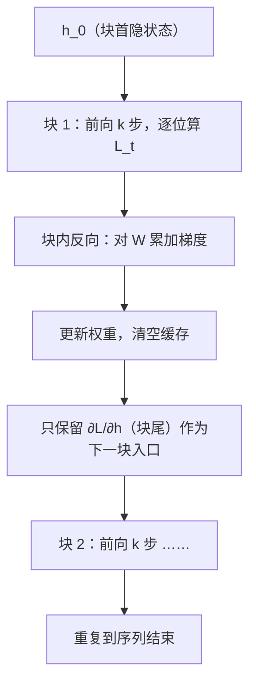
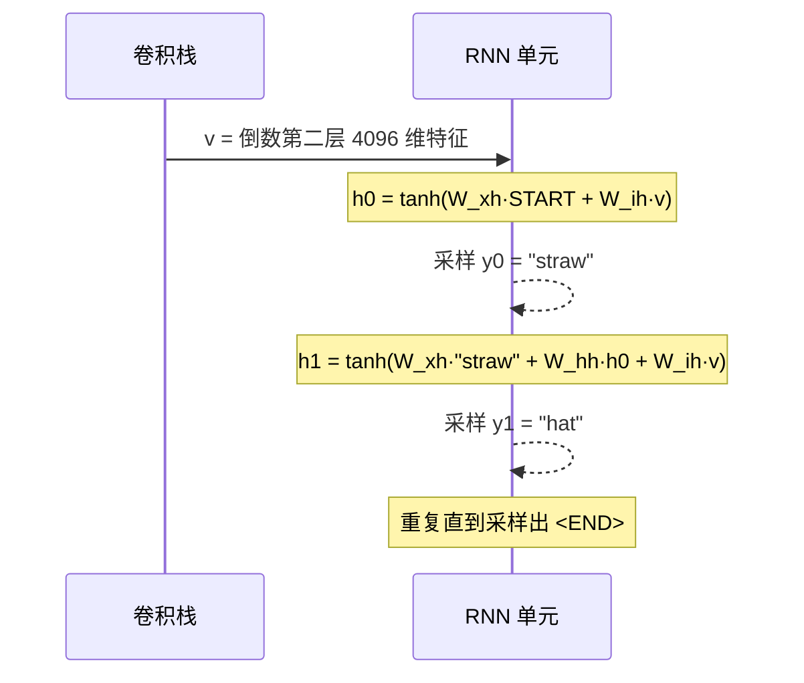
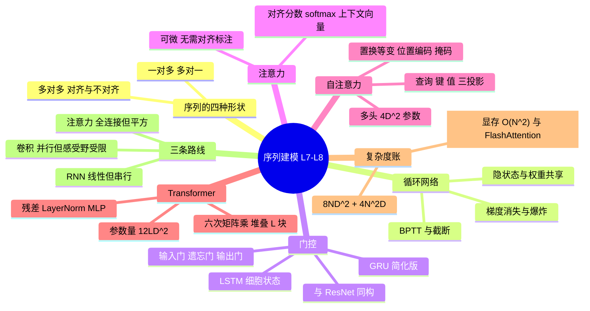

> **课程信息**
>
> - **课程名称**：Stanford CS231n: Deep Learning for Computer Vision（Spring 2025）
> - **本模块覆盖**：Lecture 7. Recurrent Neural Networks；Lecture 8. Attention and Transformers（共 246 页幻灯片）
> - **主讲教师（各讲）**：Zane Durante（Lecture 7）；Justin Johnson（Lecture 8）
> - **授课日期范围**：2025-04-22 – 2025-04-24
> - **课程主页**：[cs231n.stanford.edu/2025](https://cs231n.stanford.edu/2025/schedule.html)
> - **官方课件**：[lecture_7.pdf](https://cs231n.stanford.edu/slides/2025/lecture_7.pdf)（124 页）；[lecture_8.pdf](https://cs231n.stanford.edu/slides/2025/lecture_8.pdf)（122 页）
> - **字幕来源**：[cs231n_sp25_kor_sub · eng](https://github.com/lpaiu-cs/cs231n_sp25_kor_sub/tree/main/eng)（公开英文转写，中文由本书重写）
> - **版权说明**：幻灯片与课程材料版权归 Stanford University 及授课教师所有；本书为非官方学习笔记，仅用于学习与研究。

前六讲的所有网络都共用一个假设：输入是定长张量，输出是定长向量。$224\times224\times3$ 的图像进去，1000 维分数出来，中间无论堆多少卷积、多少残差，形状从头到尾定死。语言、视频、音频都不是这个形状——一句话的词数不定，一段视频的帧数不定，输出的长度还可以和输入不相等。这个模块要处理的就是"长度本身是变量"之后，网络该怎么改。

两讲合起来其实只讲了一件事的三个解法。第一种把历史压进一个定长隐状态，让同一组权重沿时间反复调用（RNN）；第二种在隐状态之外开一条只做逐元素乘法的旁路，让信息可以不被激活函数截断地传下去（LSTM）；第三种干脆取消"传递"，让每个位置直接和所有位置比对一次（注意力）。三者的参数量、并行度、显存账单各不相同，而它们之间的胜负从来不是表达能力的问题，是**信息能不能选择性地通过、以及计算能不能并行**的问题。读这个模块时值得一直带着一把尺子：这个结构在序列长度 $N$ 翻十倍时，参数量、计算量、显存各涨多少。

## 1. 定长假设之外：先把上一讲的两笔账结清
*(参考时间: 00:00:05 – 00:04:37｜Lecture 7)*

Zane Durante 的开场只有两件事：两个截止日期，和上一讲留在 Ed 讨论区上的两个澄清。后者值得细看，因为它们都是"幻灯片写法"与"库实现"不一致的地方——这种不一致在后面每个公式里都会再出现一次，比如 softmax 沿哪一维做、$c$ 到底取 $h_T$ 还是另算。


事务页只有两行：作业一在次日（4/23）23:59 截止，项目提案在本周五（4/25）截止。把它放在这里是因为它标出了时间坐标——这个模块讲的所有结构，都是学生要在作业二里动手实现的东西。


两个澄清并列在目录页上：Dropout 在测试期怎么缩放概率，以及归一化能不能救糟糕的初始化。讲师的原话是这两个问题在课上都被问过，而他的回答都有一处需要修正。


第一个问题的背景是标准 Dropout（Srivastava et al., JMLR 2014）：每次前向传播随机把一部分神经元置零，丢弃比例 $p$ 是超参数，0.5 最常见。麻烦出在 $p$ 的语义上——**多数库把 $p$ 定义为丢弃概率，而上一讲那张幻灯片的实现把它当成了保留概率**，同一个符号在两套约定下指向相反的操作。


判断标准只有一条：测试时所有神经元都活着，所以必须把激活缩放到"测试期输出 = 训练期输出的期望"。训练时丢掉 25%，测试就乘 0.75——训练期这个神经元的输出有 25% 的概率被置零、75% 的概率是它自己，期望是 $0.75a$；测试期人人都在、输出是 $a$，两边才对得上。


这条规则可以缩成六个字：训练丢，测试缩。今天多数框架默认反过来，在训练期就把保留的激活除以 keep 概率，测试期什么都不用做——两种写法只差那个常数因子放在哪一侧，但**读别人的代码时必须先确认他站在哪一侧**。


第二个问题用一个能画在纸上的玩具实验回答：输入是 2 维点，网络是两层 ReLU，目标是按象限输出 1、2、3、4（右上 1、左上 2、左下 3、右下 4）。四种组合各跑一遍——好的 Kaiming 初始化与标准差过大的坏初始化，各自配与不配 LayerNorm。


第一帧的结论是显著改善：坏初始化加上 LayerNorm 之后，误差曲线从"贴着天花板"变成"能往下走"。


第二帧把话说全了：差距仍然存在。坏初始化配 LayerNorm 能落到 $2\times10^{-2}$ 附近，好初始化能压到 $10^{-2}$，而坏初始化不配归一化的一路挂在 $10^{-1}$ 量级。**归一化能救回一大半，救不回最后那一截**；想要最好性能，初始化仍然得做对。


第三帧是反例，也是这三帧里最该记住的一帧：归一化不一定讲得通。象限任务只要求知道"点大概在哪个方向"，减均值、除标准差不会改变象限归属，所以它有用；但如果任务要求精确坐标，标准化恰好把位置信息删掉了，LayerNorm 反而更差。**归一化是在扔信息，扔对了是正则，扔错了是破坏。**


澄清结束，讲师把"非循环网络"的整套流程收成一张清单：一次性设置（激活函数、预处理、权重初始化、归一化、迁移学习）、训练动力学（盯训练过程、参数更新、超参优化）、评估（验证集性能、测试时增强）。这张单子是前六讲的全部内容，也是这一讲要绕开的东西。


清单里第二、三项他推荐了一个工具：Weights & Biases 的平行坐标图，一列一个超参数，颜色编码验证集精度。图上展示的是 dropout 那一列——低 dropout 的 run 整体精度更高，TensorBoard 是同类替代。


最后是路线：先讨论序列建模，再讲 Transformer 之前人们用的简单模型（RNN 及其变体），最后用一页说明 RNN 和今天的**状态空间模型**（state space model，如 Mamba）是什么关系。他的判断很明确：RNN 的关键概念没有过时，只是在很长一段时间里被 Transformer 盖住了。


## 2. 序列的四种形状：一个隐状态要装下整段历史
*(参考时间: 00:04:49 – 00:13:53｜Lecture 7)*

把"定长"这个约束松开，先得到的是四种输入输出形状：一对多（图像描述：一张图生成一句单词，损失落在每个生成步）、多对一（动作识别：一叠帧出一个类别，损失只在最后一步）、多对多不对齐（视频描述：帧序列生成描述序列，每步都有损失）、多对多对齐（逐帧视频分类：每帧一个标签）。它们的差别不在网络多深，而在**哪一维是变长的、以及损失落在哪几个时间步上**。把这四种形状认清楚，后面所有架构图都能对上号。香草神经网络（vanilla neural network）是这四种之外的基准情形：一个定长输入映射到一个定长输出，也是前六讲唯一处理过的形状。接下来所有新东西，都是在这个形状上动刀。


第一种是一对多：输入一张图，输出一串单词或字符，长度由模型自己决定。


第二种是多对一：输入一段视频帧序列，输出一个动作类别——输出形式和图像分类一样，只是输入从一张图变成了一叠图。


第三种是多对多且不对齐：输入一叠帧，输出一句描述，两个序列的长度可以不等，也不必一一对应。


第四种是多对多且对齐：每一帧都有标签，输入输出等长。这是本模块前半段的主战场，因为**每个时间步都有输入、都有输出、都有损失**，最适合把循环机制拆开看。


形状摆完，进入 RNN 本身。最省事的画法是一个标着 RNN 的方块，$x$ 从下面进、$y$ 从上面出，侧面一根箭头绕回自己——**看到这根回指的箭头，就知道这一层是循环层**。


这根箭头只有一个含义：RNN 有一个随序列处理而不断更新的**内部状态**，通常叫隐状态（hidden state）。每来一个新输入，就用它和上一个隐状态算出新的隐状态。


方块画法在算梯度时很容易看晕，所以标准做法是按时间**展开**（unroll）：第 $t$ 个方块的输出喂给第 $t+1$ 个方块，每个方块各自吃一个输入 $x_t$、吐一个输出 $y_t$。展开之后，"当前隐状态依赖当前输入和上一个隐状态"就变成了一张普通的链式计算图。


写成公式只有两行。隐状态更新是


$$
h_t = f_W(h_{t-1}, x_t)
$$


其中 $h_{t-1}$ 是旧状态、$x_t$ 是当前时间步的输入向量、$f_W$ 是带参数 $W$ 的函数。它和前面几讲的层没有本质区别——仍是"权重矩阵乘一下、再过个激活函数"，只不过现在它是一个递归式。


输出由另一个函数给出：


$$
y_t = f_{W_{hy}}(h_t)
$$


$W_{hy}$ 干两件事：把隐状态的维度变成输出的维度（两者本来就可以不一样），并对隐状态做一次可学习的线性变换。所以**算隐状态**和**算输出**是两套参数、两个函数，只是各自在时间上共享。


展开图还需要一个起点：隐状态要初始化成某个 $h_0$。原则上它可以是一个学出来的向量，这个例子里则直接给定。


到这里可以点出 RNN 最要紧的一条性质：**同一个函数、同一组参数，在每一个时间步被使用**。参数量因此与序列长度无关，代价是第 $t$ 步的信息必须挤进同一个定长向量里。


最简形式就是香草 RNN（vanilla RNN），也叫 Elman RNN（以 Jeffrey Elman 命名）：隐状态过 $\tanh$，


$$
h_t = \tanh\left(W_{hh}h_{t-1} + W_{xh}x_t\right), \qquad y_t = W_{hy}h_t
$$


选 $\tanh$ 的理由很实际：它把值压在 $-1$ 到 $1$ 之间，反复迭代不会飞出量级；它零中心，正负都能表示。输出侧最简单的情形就是一次矩阵乘法，不再套激活函数。


课堂上有两个提问值得记下来。其一，旧的 $y$ 能不能影响新的 $h$？可以，最常见的做法是把上一步的输出当成这一步的输入，也就是自回归（autoregressive）建模——后面字符级语言模型和图像描述都靠这一手。其二，$h_0$ 和 $x_1$ 有什么区别？它们乘的是不同的权重：$h_0$ 走隐状态到隐状态的那组参数，$x_1$ 走输入到隐状态的那组参数。这个区分在多对一和一对多里会变得关键。

## 3. 十五个数的手写 RNN：把"记忆"设计成矩阵的一行
*(参考时间: 00:13:57 – 00:21:39｜Lecture 7)*

抽象公式讲完，讲师立刻给了一个能手算到底的例子：输入是 0/1 序列，要求"当前位和上一位都是 1 时输出 1，否则输出 0"。序列 0,1,0,1,1,1,0,1,1 对应的输出是 0,0,0,0,1,1,0,0,1。这是逐位对齐的多对多任务，也是全模块唯一一次把矩阵乘法全部写出来的地方。


问题被压成一句：隐状态里该装什么？答案由信息瓶颈倒推——输出只看隐状态，而判定需要两样东西，所以隐状态至少要装下"上一位输入"和"当前输入"。


具体做法是把隐状态取成 3 维，第三个分量恒为 1，作用相当于给 ReLU 配一个常数偏置；两个函数 $f_W$ 与 $f_y$ 都取 ReLU，让算术可以口算。$h_0$ 初始化为 $(0,0,1)$，含义是"在此之前已经看到两个 0，所以不该触发"。


权重是手写死的，全部逻辑就是一个循环：

```python
w_xh = np.array([[1], [0], [0]])
w_hh = np.array([[0, 0, 0],
                 [1, 0, 0],
                 [0, 0, 1]])
w_yh = np.array([1, 1, -1])

h_t_prev = np.array([[0], [0], [1]])
for t, x in enumerate([0, 1, 0, 1, 1, 1, 0, 1, 1]):
    h_t = relu(w_hh @ h_t_prev + (w_xh @ x))
    y_t = relu(w_yh @ h_t)
    h_t_prev = h_t
```

三个矩阵一共 9 + 3 + 3 = 15 个数，这就是整个模型的全部参数——**参数量与序列长度无关**这件事，在这一页上是字面意义上的。


第一个矩阵 $W_{xh}$ 是 $3\times1$ 的列向量 $(1,0,0)^\top$，唯一职责是把当前输入写进隐状态的第 1 格：$x=0$ 时贡献零向量，$x=1$ 时贡献 $(1,0,0)$。


$W_{hh}$ 的第一行全是 0，所以第 1 格永远不会被历史污染——它每一次都只等于当前输入。


第二行是 $(1,0,0)$，它把上一时刻的第 1 格（也就是"当时的当前位"）搬到第 2 格，于是"当前"变成了这一时刻的"上一位"。


第三行是 $(0,0,1)$，把常数 1 原样传下去，输出层要靠它做减法。


输出权重 $W_{hy}=(1,1,-1)$，一次点积就是 `ReLU(当前 + 上一位 − 1)`：两个都是 1 时得到 1，只要有一个是 0 就落到 0 或负数，被 ReLU 截掉。


这套权重确实跑得通，但它是人手凑出来的。换一个任务，"该往第几格写什么"就不再显然——于是问题变成：**这些 $W$ 在实践中怎么找？** 答案是梯度下降，而 RNN 的梯度必须沿时间走，所以先把展开图写成计算图。顺带一句：把这套权重当初值去训别的任务属于迁移学习，但 3 维隐状态实在太小，实际不会好用。


## 4. 计算图、BPTT 与截断：同一个 $W$ 的梯度要相加
*(参考时间: 00:21:47 – 00:36:30｜Lecture 7)*

这一步是全模块后面所有"梯度消失"讨论的地基：一旦把 RNN 展开成计算图，$W$ 就不再是一个节点上的参数，而是**在图上出现了 $T$ 次**。这一件事同时决定了反向传播的写法和它的显存账单。计算图从一步开始：$h_0$ 和 $x_1$ 进同一个函数 $f_W$，出来 $h_1$。


第二步只是把同一个方块再接一次：$h_1$ 与 $x_2$ 给出 $h_2$。


一直接到第 $T$ 步。整条链就是同一个函数被调用了 $T$ 次。


图上因此可以只标一个 $W$：**每一个时间步复用的是同一个权重矩阵**。这句话意味着 $W$ 在计算图里出现了 $T$ 次，梯度必须把 $T$ 处的贡献全部加起来——这是反向传播里最容易被漏掉的一步，也是"为什么 RNN 的梯度是求和而不是单点"的答案。


把输出接上就是多对多：每个 $h_t$ 各自经过 $W_{hy}$ 得到 $y_t$。


每个 $y_t$ 都有对应的损失 $L_t$。


总损失是逐项相加：$L=\sum_{t=1}^{T}L_t$。反向传播时可以先各自算 $\partial L_t/\partial W$ 再求和，也可以整体一次算完——因为 $W$ 是同一个，两种写法等价。


形状换一下就是多对一：只在最后一步取一个 $y$，损失也只有一项。


但对视频分类这类任务，只在最后一帧取输出是浪费的：整段视频都有信息。更常见的做法是对每个时间步的隐状态做平均池化或最大池化，再算出 $y$——什么该保留交给池化，而不是全压在最后一个向量里。


反方向是一对多：只有第一步有输入，后面每步都吐一个 $y$。


问题是后面那些步骤的 $x$ 从哪来。图上的问号就是这个空缺：$f_W$ 有两个入口，一个期待输入向量，一个期待上一个隐状态，第二个入口不能空着。


最省事的填法是填零。


更有用的填法是把上一步的输出接回去，也就是自回归——图像描述正是这么做的：模型看到的"输入"是它自己刚写出的那个词。


有了图就可以谈反向传播。名字叫**沿时间反向传播**（backpropagation through time，BPTT）：先前向走完整个序列算出损失，再反向走完整个序列算梯度。


它的代价直接写在显存上：每个时间步的激活和梯度都要留着，等反向时用。序列一长，这部分就爆了——讲师的说法是，训练神经网络时几乎所有麻烦最终都归结为显存不够和损失出 NaN。


实用的解法是**截断 BPTT**（truncated BPTT）：把序列切成固定长度的块，每次只在块内前向加反向。


隐状态照常沿时间传下去，但梯度只往回传 $k$ 步。


如果任务只在最后有一个输出，截断照样成立：每个时间步仍然算梯度，只是不再有"该步自己的损失"，全部靠上游传下来的梯度驱动。


实现上就是滑动这个窗口：块与块之间只传递一个量——块首隐状态对损失的梯度，其余全部丢掉、更新完权重、清空缓存、换下一块。



截断把显存从 $O(T)$ 降到 $O(k)$，代价是梯度不再精确。讲师的态度很直接：能全部放进显存当然更好，截断是没办法时的办法。

三个追问值得记下来。**为什么不用每个时间步一套独立的 $W$？** 那就不是递归了，等价于给每个位置训一个独立模型：参数量随长度线性增长、必须预先知道长度、变长序列直接失效，性能通常更差。**截断丢掉了什么？** 丢掉的是跨块的长程梯度，所以它是近似——一次训练变成若干次独立更新，算出来的方向和大 batch 的精确梯度不是一回事。**这在哪见过？** 分布式训练里每张卡各自算梯度、再统一应用到同一份权重上，结构完全一样；区别只是那里切的是设备，这里切的是时间。

## 5. 112 行 Python：字符级语言模型从乱码写到莎士比亚
*(参考时间: 00:36:34 – 00:48:14｜Lecture 7)*

上一个例子的权重是人凑的，这一个的权重是学出来的。任务小到可以整个画在一页上：词表只有四个字符 `[h,e,l,o]`，训练序列是 `"hello"`，模型看着当前字符猜下一个字符。输入用 one-hot 编码，输出过 softmax 得到每个候选字符的分数，标签就是序列右移一位的那个字符——**不需要人工标注，文本本身就是标签**。

![字符级语言模型：词表 \[h,e,l,o\]、训练序列 "hello"、one-hot 输入](</attachments/cs231n-60603482af4e26da3ac618a2.png>)

把隐状态公式叠上去，能看到整条链：每个 one-hot 向量经 $W_{xh}$ 进入当前隐状态，上一个隐状态经 $W_{hh}$ 进来，两者相加过 $\tanh$。


最后一帧接上输出层：每个隐状态经 $W_{hy}$ 得到 4 维分数，行首标出目标字符（e、l、l、o）。第一列分数是 $(1.0, 2.2, -3.0, 4.1)$，而目标是 `e`——**模型在这一步把最高的分数给错了字符**，所以这一步的损失会很大。


测试时的流程反过来：从某个字符起步，一步一步采样并把采样结果喂回去。第一步输入 `h`（one-hot 为 `1,0,0,0`），隐状态 $(0.3,-0.1,0.9)$，输出分数 $(1.0,2.2,-3.0,4.1)$，softmax 之后得到 $(.03,.84,.00,.13)$，采样得到 `e`。


这里有个值得记的细节：讲师当场指出这页的 softmax 列和 logits 对不上——分数最大的是 4.1 那一项，而 .84 落在第二项上。他和学生确认了"这页放了好几年没人发现"，然后照旧用它讲采样，因为要讲的机制不受影响。采到 `e` 之后，把它接回输入端，就长出第二列。


第二步把 `e` 喂回去，隐状态变成 $(1.0,0.3,0.1)$，分数 $(0.5,0.3,-1.0,1.2)$，softmax 给出 $(.25,.20,.50,.05)$，采样得到 `l`。**生成过程就是这样一位一位接出来的**。


第三步同理，`l` 继续喂回去。所谓"用 RNN 生成文本"，展开看就是这张图重复很多次。


输入侧还有一个工程细节：实际实现不会真把 one-hot 向量送进模型，而是用**嵌入层**（embedding layer）。用 one-hot 做矩阵乘法，效果等于"从权重矩阵里抽出某一列"；既然如此，不如直接维护一个 $D\times D$ 的嵌入矩阵（$D$ 是词表大小），按索引取一行。省掉的是乘法，得到的是可学习的稠密向量——初始化用 Kaiming 这类小值，训练时只更新被取到的那一行，比 one-hot 的稀疏梯度更好优化。


这样一套东西有多长？**112 行 Python**。Karpathy 的 gist 就是全部实现，能训练多种任务。


配套的博客写于 2015 年，作者是这门课的前任讲师 Andrej Karpathy；幻灯片左边是莎士比亚十四行诗的原文本，右边还是那个 RNN 方块——模型的全部输入就是这样一叠纯文本，不需要任何标注。他的结论是 RNN 在生成文本这件事上"好得不讲道理"（unreasonably effective）。


训练过程的对照最有说服力。刚开始是纯乱码，因为 $W$ 还是随机的；训练一段时间后开始出现像英文的词；再往后能写出合乎语法的句子，甚至会自己造角色名、模仿莎士比亚的分行与对话格式。


收敛之后的采样长这样：角色名（PANDARUS、VIOLA、KING LEAR）、分行、对话轮转都对，句子内部有时通顺、有时跑偏——**格式学得很像，语义只对了一半**。


再训下去，段落会越写越长：局部越来越像，整体越来越跑题。讲师把这条"越训越像"的曲线称为对后来 AI 时代的一次预演——他给这张图的评价是，这在当时就已经很像今天大模型的行为，只是规模小了几个数量级。


换成代码语料（Linux 源码）训练同一个模型，它开始生成 C 代码：缩进、括号、注释都像模像样。讲师的判断是"不知道能不能编译，但看着挺合理"。


这条路后来变成了今天的样子：Codex、GitHub Copilot、Cursor 用的是同一个任务，只是把"预测下一个字符"换成"预测下一个 token"——token 是一组字符，怎么切取决于模型。**任务没变，规模变了。**


字符级 RNN 还有一处别的模型少有的好处：**隐状态可以直接看**。把 tanh 的激活值按字符对齐画出来，$-1$ 涂红、$+1$ 涂蓝，每个格子就是某个神经元在某个字符处的取值。


大部分格子看起来是噪声，但少数格子有明显结构。论文（Karpathy, Johnson, Fei-Fei, "Visualizing and Understanding Recurrent Networks", ICLR Workshop 2016）就是从这些格子里挑出了几个可解释的。


第一个是引号检测：引号一开就点亮，引号闭合就熄灭。模型必须知道"还有个引号没关"，因为什么时候该补上闭引号是它要预测的东西。


第二个跟踪行宽：一行开始时值很高，接近换行处逐渐压低——它在数这一行还有多长。


第三个对应 if 语句：进入 if 块后持续点亮，块结束才回落。


第四个区分引号与注释——两者都要等一个结束符，但结束符不同。


第五个是代码缩进深度：每进一层嵌套，激活就抬高一档。


这五个格子的意义不在"RNN 学会了语法"这种大话，而在于**第 3 章里我们手写 $W$ 让隐状态去记"上一位输入"，这里模型自己长出了等价的东西**——同样是几个可解释的状态位，只是一个由人设计，一个由梯度下降找出来。顺带说一句：这套可解释性来自"每个时间步只有一个向量"，等到第 8 讲自注意力把序列摊成 $N$ 个向量之后，这种"一格对应一个概念"的读法就失效了。

## 6. CNN 看、RNN 说：图像描述的流水线，与它的幻觉
*(参考时间: 00:48:19 – 00:58:22｜Lecture 7)*

把 RNN 的账算清楚，再谈它在视觉里的用法。四条优点、两条缺点，全部来自"权重在时间上共享"这一个设计：能处理任意长度的输入、理论上第 $t$ 步能用很多步之前的信息、输入变长而模型尺寸不变、每个时间步的处理方式对称。

缺点同样直接：递推计算慢——第 $t$ 步必须等第 $t-1$ 步算完，训练时没法把时间维并行起来，这一点在数据量变大时会变成瓶颈；实践中很难真的取到很多步之前的信息——隐状态是定长的，序列越长，早期信息被挤掉得越多。这两条一条关于速度、一条关于容量，正好构成第 8 讲要拆的靶子：**第一条是并行度问题，第二条是带宽问题，注意力对两条都给了回答。**


视觉侧最经典的应用是图像描述。这条线上有一串工作：Mao et al. 的 "Explain Images with Multimodal Recurrent Neural Networks"、Karpathy & Fei-Fei 的 "Deep Visual-Semantic Alignments for Generating Image Descriptions"（CVPR 2015）、Vinyals et al. 的 "Show and Tell"、Donahue et al. 的 LRCN、Chen & Zitnick 的循环视觉表示——幻灯片上的示意图来自 Karpathy 那篇。


架构上就是两段拼接：一个卷积网络把图像编码成一个向量，一个 RNN 把这个向量和已经生成的词一起变成下一个词。


用一个具体例子走一遍。测试图是一顶草帽（CC0 公有领域）。


图像从顶部进入卷积栈，一路向下：conv-64 两组、池化，conv-128 两组、池化，conv-256 两组、池化，conv-512 六组、池化，最后是两个 4096 维全连接层。


关键的一步是**不取分类层**：扔掉最后的 1000 维分数，取倒数第二层的 4096 维激活作为图像向量 $v$。这与前几讲的迁移学习是同一个套路——分类标签是 ImageNet 的，而这一层保留了通用的视觉特征。


RNN 的第一个输入是起始符 `<START>`，模型据此产出第一个词。


隐状态公式因此多了一项：原来只有"输入 × 权重"和"隐状态 × 权重"，现在还要把图像向量 $v$ 经 $W_{ih}$ 加进来，即 $h=\tanh(W_{xh}x+W_{hh}h+W_{ih}v)$。**图像只在这一项里出现，之后每个时间步都靠这个隐状态把视觉信息带下去**——这正是带宽问题的具体形态：一张图的所有内容，被压进 4096 维，再被压进隐状态。


第一个词采样出来是 `straw`。


第二个时间步：$y_0$ 记下 `straw`，同时把 `straw` 作为新的输入 $x_1$ 送回去，隐状态从 $h_0$ 变成 $h_1$。


第二个词是 `hat`，拼起来 `straw hat`。


第三个时间步继续，隐状态推到 $h_2$。


直到模型采样出 `<END>`，生成过程结束。**长度不受限，终止条件由模型自己给出**——这是它与定长分类器最不一样的地方。


把整条回路画成时序图，视觉信息只在开头注入一次，之后全靠隐状态携带：



在当年的标准测试图上，这套模型给出的描述相当合理：猫坐在行李箱上、狗在草地上跑、网球选手在球场上、长颈鹿站在草地、冲浪者扛着板走在沙滩上。


失败案例更有信息量，而且失败的方式高度一致：**把训练集里的共现关系当成了因果**。手捧成杯状 → 猜成鼠标；毛领外套 → 猜成抱着猫；沙滩 → 猜成抱着冲浪板；棒球手套接球 → 猜成投球。讲师的说法是这类幻觉在今天的视觉语言模型里依然极常见：物体在场景里常见，不代表这张图里有。


第二个应用是视觉问答（visual question answering，VQA），当时有两条典型写法。一条是把描述模型改成"给问题、生成答案"，把答案每个 token 的概率乘起来得到整句答案的概率；另一条更常见：把图像、问题、若干候选答案一起送进模型，输出每个候选的概率，**做成一个四选一的分类器**。


第三个是视觉对话（visual dialog）：围绕一张图来回多轮。当时这叫独立任务，今天一个模型就能做。


第四个是视觉语言导航（visual language navigation）：给一句"去客厅"的指令，智能体把指令编码，用 RNN 一步步生成移动动作，而每走一步视觉输入就变一次——**输出又变成下一次的输入**，这正是第 4 章讲的自回归结构在三维空间里的版本。


还有一个容易被忽略的事实：前面展示的 RNN 基本都是多层的。多层 RNN 的组织方式和多层 CNN 一样，但时间维带来一条额外规则——**每一层只在自己的时间轴上递归**，第 1 层的 $h_t$ 只依赖第 1 层的 $h_{t-1}$，层与层之间只靠"下层的输出作为上层的输入"相连，于是整个计算图变成一个深度 × 时间的网格。要算右上角那个值，得先把整张网格算完。


这也解释了为什么 RNN 训练起来慢：网格的每一列都依赖前一列，时间维没法并行；参数量倒是很省——每一层在时间上共享同一组权重，只有层与层之间换参数。**这条"深度可并行、时间不可并行"的分界，是后面所有架构取舍的起点。**

## 7. 梯度为什么消失：$\tanh$ 的导数与 $W$ 的奇异值
*(参考时间: 00:58:22 – 01:04:11｜Lecture 7)*

LSTM 出现之前，先要给香草 RNN 判个"病因"。幻灯片把两个模型并排放：左边是香草 RNN，右边是 LSTM（Hochreiter & Schmidhuber, "Long Short Term Memory", Neural Computation 1997）。右边明显复杂得多——它要解决的问题也就藏在这份复杂度里。


病因从一张图开始：每个时间步做的是"把 $h_{t-1}$ 和 $x_t$ 拼起来、乘 $W$、过 $\tanh$"。反向传播时，从 $h_t$ 回传到 $h_{t-1}$ 要穿过的正是这个方块。


穿过它的代价是乘一次 $W_{hh}$（严格说是 $W_{hh}^\top$）。一步还好，$T$ 步就是 $T$ 次。


把 $T$ 步连起来看，问题就变成了乘积的形状：**梯度是 $T$ 个因子的连乘**，每个因子是 $\tanh$ 的导数乘上 $W_{hh}$。写成式子更清楚，令 $a_t=\tanh'(z_t)$ 为对角矩阵，则


$$
\frac{\partial h_t}{\partial h_{t-1}}=\mathrm{diag}(a_t)\,W_{hh},\qquad \frac{\partial L}{\partial h_1}=\frac{\partial L}{\partial h_T}\prod_{t=2}^{T}\mathrm{diag}(a_t)W_{hh}
$$


取四步展开成一个具体例子，$x_1..x_4$ 依次进入，$h_0..h_4$ 依次产生，每个 $h_t$ 各自产生 $y_t$。


反向时，第 4 步的损失要一路传回第 1 步。总梯度是各步贡献之和 $\partial L/\partial W=\sum_t \partial L_t/\partial W$，而每一项都是雅可比矩阵的连乘。


连乘链上每一个因子的结构都一样：$\tanh$ 的导数乘 $W_{hh}$。所以整条链的命运由这两样东西共同决定。


先看 $\tanh$ 的导数。它的最大值在 0 处，等于 1；其余位置全部小于 1，$|x|$ 稍大就迅速趋近 0。**把一堆小于 1 的数乘起来，$T$ 一大就归零**——这就是梯度消失（vanishing gradient）。


于是幻灯片给出结论：这些因子几乎总是小于 1，梯度消失。


那如果把非线性拿掉呢？假设 $\tanh$ 换成恒等映射，因子就只剩 $W_{hh}$，梯度变成 $W_{hh}$ 的 $T$ 次幂。


矩阵幂的行为由奇异值决定：最大奇异值大于 1，向量被反复拉伸，梯度爆炸（exploding gradient）；小于 1，被反复压缩，梯度消失。**换句话说，想让梯度稳定，$W_{hh}$ 的谱就得精确地停在 1 附近——这几乎不可能靠学习维持。**


两个方向的处方不一样。爆炸好办：**梯度裁剪**（gradient clipping）——梯度范数超过阈值就整体缩放回去，方向不变、长度受限。


消失不好办，只能改架构。


这里值得把账算得更细一层，因为它解释了为什么"初始化得更好"救不了 RNN。若把 $W_{hh}$ 的特征值写成 $\lambda_i$，$T$ 步之后第 $i$ 个方向的梯度幅度大致按 $|\lambda_i|^T$ 缩放：$|\lambda_i|=0.9$ 时 $T=40$ 就只剩 $0.9^{40}\approx0.015$，$T=100$ 时是 $2.6\times10^{-5}$；反之 $|\lambda_i|=1.1$ 时 $T=100$ 会放大到 $1.1^{100}\approx1.4\times10^{4}$。**只有恰好落在 1 附近的那些方向能活过一百步，而优化过程没有理由把谱精确停在那里。** 这就是"梯度消失不是调参问题，是结构问题"的定量版本。

## 8. LSTM 的传送带：给梯度修一条只做乘法的旁路
*(参考时间: 01:04:17 – 01:09:02｜Lecture 7)*

LSTM 在 1997 年提出，一直用到 Transformer 崛起为止。讲师明确说了课上的要求：**不需要会推 LSTM 的细节**，但要理解它想缓解什么，因为今天的状态空间模型在缓解同一批问题。


思路是把"一个隐状态"变成"一个隐状态 + 一个细胞状态"（cell state），并用四个门控制信息的进出：输入门、遗忘门、输出门，再加一个候选门。


具体算的时候，把 $h_{t-1}$ 和 $x_t$ 拼起来乘一个大矩阵 $W$（$4h\times 2h$，$h$ 是隐状态维度），一次得到 $4h$ 维向量，再切成四份：前三份过 sigmoid 得到 $i,f,o\in(0,1)$，第四份过 $\tanh$ 得到候选值 $g$。同样的隐状态宽度下，这个 $W$ 是香草 RNN 的 4 倍大——门控的好处不是白拿的。


四个门各管一件事：$i$ 决定往细胞里写多少，$f$ 决定旧内容擦掉多少，$o$ 决定细胞里有多少暴露给隐状态，$g$ 是"要写进去的内容"本身。


输入门 $i$ 出现在两个地方：它乘候选值 $g$，决定这一时刻写进细胞多少。


遗忘门 $f$ 直接乘在旧细胞状态 $c_{t-1}$ 上，决定保留多少历史。


输出门 $o$ 乘在 $\tanh(c_t)$ 上，决定这一时刻的隐状态暴露多少。


合起来就是 LSTM 的三行公式：


$$
\begin{pmatrix}i\\f\\o\\g\end{pmatrix}=\begin{pmatrix}\sigma\\\sigma\\\sigma\\\tanh\end{pmatrix}W\begin{pmatrix}h_{t-1}\\x_t\end{pmatrix},\qquad c_t=f\odot c_{t-1}+i\odot g,\qquad h_t=o\odot\tanh(c_t)
$$


关键的一步在细胞状态的更新式上：$c_t=f\odot c_{t-1}+i\odot g$。反向传播从 $c_t$ 回到 $c_{t-1}$，只需要逐元素乘一个 $f$，**没有矩阵、没有 tanh**。


于是沿时间回传时，梯度走的是上面那条"传送带"：一路只做逐元素乘法，只要 $f$ 不接近 0，信息就能一直传下去。


这解决了消失问题吗？答案是有保留的：**它让"保留信息"变得容易学**——若 $f=1$、$i=0$，这个细胞的内容可以原样保留任意多步；而香草 RNN 要学出一个能长期保持信息的 $W_{hh}$，难度完全不是一个量级。但它不保证梯度不消失、不爆炸，只是提供了一条更容易走的路。


把参数账摊开看：同样的隐状态宽度 $h$，香草 RNN 的循环矩阵是 $h\times h$，LSTM 是 $4h\times 2h=8h^2$——**四倍的门控换来的是一条不需要穿矩阵的梯度路径**。这笔交易在后来的 Transformer 里会以另一种形式重演：自注意力块的参数量是 $12D^2$ 量级，比同宽度的 RNN 贵得多，但它换到的是并行度。这条传送带和前几讲的 ResNet 是同一个思想：ResNet 用跳连接让梯度绕过卷积块，LSTM 用细胞状态让梯度绕过激活函数。区别只在维度——一个跳的是层数（深度），一个跳的是时间步（长度）。


中间还有一站：Highway Networks（Srivastava et al., ICML DL Workshop 2015），用门控的跳连接把这条思路先做了一遍，比 ResNet 早一点。


顺带补一句 GRU：课上只把它作为解码器单元的候选提了一句（第 8 讲的公式 $s_t=g_U(\cdot)$ 里 $g_U$ 可以是 LSTM 或 GRU），没有展开推导。编者说明：GRU 是 LSTM 的简化版，把输入门与遗忘门合并成一个更新门、把细胞状态与隐状态合并成一个状态，因此门控参数比 LSTM 少一组——这也是它常被当作"更轻的替代品"的原因。

## 9. 转折：串行的账算不下去了
*(参考时间: 01:09:12 – 01:11:39｜Lecture 7；00:00:04 – 00:02:20｜Lecture 8)*

第 7 讲的最后一张内容幻灯片把话题拉回今天。RNN 这两年以**状态空间模型**（state space model）的名字回来了：结构上仍然是"用一个隐状态总结历史"，但计算量被压到与序列长度成正比，上下文长度不设上限。RWKV 和 Mamba 是这条线上的代表。


这条线为什么突然值钱，答案是 Transformer 的账：注意力的计算量随序列长度平方增长，上下文窗口成了硬约束，业界用 RoPE 之类的技巧去延长它，但平方项始终在那里。线性时间加无限上下文，恰好补上了这个缺口——当然代价也真实：递推无法并行，长序列训练时吞吐上不去。


讲师用五条收尾：RNN 的架构空间很大；香草 RNN 简单但不好用；复杂变体（LSTM、Mamba）的价值在于"有选择地传递信息"；梯度会爆炸或消失，爆炸靠裁剪、消失靠换架构，而梯度计算离不开 BPTT；更好的架构仍然是当下最热的研究方向。


下一讲就是这条线的对手。Justin Johnson 的开场先把两个词分开定义：**注意力（attention）是一个作用在向量集合上的新原语**，**Transformer 是一个把注意力用得到处都是的网络架构**。原语是可以插进任何网络的零件，架构是零件的组装方案。


第 8 讲的事务页只有两行：作业二昨天（4/23）发布，项目提案明天（4/25）截止。它标出的时间坐标是——作业二对应循环网络，项目提案要求学生自己挑一个视觉任务。


复习页只有标题 "Last Time: Recurrent Neural Networks"，内容全部由口头补上：一对多、多对一、多对多，以及"输入可以是一个变长序列"这件事。


今天路线的第一帧把两个定义并列：注意力是原语，Transformer 是架构。这个层次差别很重要——本讲前四分之三在造零件，最后四分之一才把它装成机器。


第二帧补了三行字，最关键的是后两行：Transformer 今天到处都在用，但它其实是 RNN 的一个旁支，所以要从 RNN 讲起。讲师在这里插了一段领域史：Transformer 诞生那一刻并不像一场"海啸"，因为在 2017 年之前，对齐、软对齐、注意力这些想法已经在机器翻译圈发酵了好几年。**新架构常常是把旧机制从旧宿主里剥出来的结果**，而不是凭空出现的发明。


"从 RNN 讲起"不是叙事偏好，是一笔算得清的账。把两讲的内容按"信息怎么跨时间步走"排成一张表，就能看出每一代到底改了什么：

| 代际 | 跨步路径 | 参数（宽度 $d$） | 计算 | 训练并行度 | 代表 |
| :--- | :--- | :--- | :--- | :--- | :--- |
| 香草 RNN | $h_t=\tanh(W_{hh}h_{t-1}+W_{xh}x_t)$，每步穿一次矩阵 | $O(d^2)$ | $O(N)$ 串行 | 时间维完全串行 | Elman RNN |
| LSTM | 细胞状态 $c_t=f\odot c_{t-1}+\dots$，梯度只乘逐元素门 | $O(8d^2)$ | $O(N)$ 串行 | 时间维完全串行 | Hochreiter & Schmidhuber 1997 |
| RNN + 注意力 | 解码每步对全部编码状态加权求和，路径长度 2 | $O(d^2)$ 另加 $f_{att}$ | $O(N^2)$ 但解码仍串行 | 编码器可并行，解码串行 | Bahdanau et al. 2015 |
| 自注意力 + Transformer | 任意两位置一步直连，路径长度 1 | $O(12D^2)$ 每块 | $O(N^2)$，四次矩阵乘 | 序列维完全并行 | Vaswani et al. 2017 |

这张表里最刺眼的一列是"并行度"。RNN 的 $O(N)$ 计算本该是优势——序列多长就走多少步，每步代价固定；但在 GPU 上，$N$ 步串行意味着 $N$ 次核启动、$N$ 次等待，算力利用率被序列长度直接除。**注意力把"路径长度"从 $N$ 压到 1，代价是把"计算量"从 $O(N)$ 抬到 $O(N^2)$；在一个算力过剩、延迟稀缺的年代，这笔交换是划算的。** 第 8 讲剩下的部分，就是把这笔交换一步步做出来。

## 10. 编码器–解码器：整句话被压进一个定长向量
*(参考时间: 00:02:20 – 00:09:03｜Lecture 8)*

动机问题是机器翻译：输入 $x_1,\dots,x_T$（英文），输出 $y_1,\dots,y_{T'}$（意大利文），两个序列的长度和词序都不必对应。编码器就是一个 RNN，$h_t=f_W(x_t,h_{t-1})$，把 "we see the sky" 逐词喂进去，吐出四个隐状态。四个词对应四次函数调用，参数 $W$ 全程共享——这是 RNN 相对全连接层唯一的结构性优势。


第二帧只加了一条线和两个方块：把最后一个隐状态 $h_4$ 取出来记作上下文向量 $c$（通常就取 $c=h_T$），再添一个解码器的起点 $s_0$。取 $h_T$ 的理由来自递归本身：它已经"看过"前面所有词，所以天然是整个输入的摘要。$s_0$ 怎么设是另一个话题，第 11 章末尾会专门算这笔账。


解码器是另一个 RNN，$s_t=g_U(y_{t-1},s_{t-1},c)$，参数 $U$ 与编码器不共享。它在每个时间步吃三样东西：上一步的输出词、上一步的隐状态、以及那个固定的 $c$。第一次解码给出 $y_1=$"vediamo"，输入是 $y_0=$[START]。


再叠一格：$s_1$ 接到 $s_2$，吐出"il"。相比上一帧，新增的只有 $s_2$ 与 $y_2$ 两个方块；那根从 $c$ 引出的线**没有任何变化**——同一个 $c$ 被反复使用，这正是问题所在。


最后一帧补齐 "cielo" 与终止符 [STOP]，解码器四步走完。四步里喂给解码器的上下文始终是同一个 $c$，形状是 $[D]$，与输入有 4 个词还是 400 个词完全无关。

![第五帧：cielo 与 \[STOP\]，一句话译完](</attachments/cs231n-b168ea6d99dc3c6ef78a6615.png>)

这一帧在全图上压了一行红字：输入序列必须通过定长的 $c$ 才能到达输出，如果 $T=1000$ 呢？讲师给的量级是 $c$ 可能是一个 128 维或 1024 维的浮点向量——**这个数字在建模时就被定死了，不会随输入变长而变长**。四个词压进 1024 维还算合理；一整段、一整本书、一整个语料库也压进 1024 维，就等于要求编码器对所有输入做同一种有损压缩。


做一个可推导的估算来感受量级：若 $D=512$，1000 个词的编码器隐状态是 $1000\times512$ 个数（fp32 下约 2 MB），而 $c$ 只有 512 个数（约 2 KB）。压缩比 1000:1，而网络没有任何"这段可以丢、那段必须留"的选择机制。窄口的要害不是容量不够，是**信息无法选择性地通过**。


## 11. 把注意力装进 RNN：打分、Softmax、加权求和
*(参考时间: 00:09:23 – 00:20:53｜Lecture 8)*

改造从零开始：编码器一行不动，仍然要给出一个初始解码状态 $s_0$。红框圈住的正是这个 $s_0$——它马上要被拿去和四个编码器隐状态逐一比对。注意图上的箭头方向：信息从 $s_0$ 流向输入序列，而不是从输入序列流向 $c$ 再流向输出，整个瓶颈的结构在这里被调转了。


新增的是四个小方块 $e_{t,i}=f_{att}(s_{t-1},h_i)$，每个都是一个标量。实现上 $f_{att}$ 只是一个线性层：把解码器状态 $s$ 与某个编码器状态 $h$ 拼接成一个向量，再线性变换压成一个数。**它没有任何特殊结构，就是一组普通的可学习参数**，因此可以直接塞进计算图，和别的参数一起用梯度下降学。


$e$ 的取值是 $(-\infty,+\infty)$ 上的任意实数，直接拿来加权会让数值失去控制。所以在上面加一层 softmax：$a_{t,i}=\exp(e_{t,i})/\sum_j\exp(e_{t,j})$，得到 $0<a_{t,i}<1$ 且 $\sum_i a_{t,i}=1$。这四个数从此可以读成"给定当前解码器状态，输入序列各个位置的相对重要性"，也就是一个离散分布。


第四步是加权求和：$c_t=\sum_i a_{t,i}h_i$。它仍然是 $[D]$ 的向量，但**这个向量是为当前这一步现算的**，不是从编码器末尾抄来的。图上 $c_1$ 从右侧的求和块里出来，与 $s_0$ 汇合。


最后把 $c_t$ 接进解码器：$s_t=g_U(y_{t-1},s_{t-1},c_t)$，其中 $g_U$ 可以是 LSTM 或 GRU。到这里解码器的结构其实没变——变的只是"$c$ 从哪里来"：原来它是编码器的最后一个隐状态，现在它是每个时间步现算的一次加权平均。


图上给了一组具体数字：要生成 "vediamo"（等于英文的 "we see"）时，$a_{1,1}=a_{1,2}=0.45$，$a_{1,3}=a_{1,4}=0.05$。四个数之和恰好是 1。这个分布的意思是：解码器把 90% 的注意力放在 "we" 和 "see" 上，几乎不看 "the" 和 "sky"。**这不是人写死的规则，而是模型自己长出来的偏好。**


这一帧补的是训练侧的关键事实：从 $s_{t-1}$ 到 $e$、到 $a$、到 $c_t$、再到 $s_t$，全是可微运算。所以不需要任何"第 3 个英文词对应第 2 个意大利词"的标注，损失函数仍然是输出端的 softmax 加交叉熵，梯度顺着 $c_t$ 一路回传到 $f_{att}$。讲师强调，如果真要做对齐标注，这种数据根本没法大规模获得——**可微是这套机制能成立的前提，不是实现细节**。


第二帧把整个流程再走一遍：拿 $s_1$ 与四个 $h_i$ 重新算对齐分数、重新 softmax、重新加权，得到 $c_2$。注意它复用的是同一个 $f_{att}$——一套参数，被所有解码时间步共享。


$c_2$ 与 $y_1$ 一起进入解码器单元，得到 $s_2$ 与 "il"。图上还标出了上一章漏画的那根从 $s_0$ 到 $s_1$ 的箭头——讲师自嘲"我大概是把这根线掉了"，这处口误本身说明图在表达"解码器内部是递归的"。


同样的读法：生成 "il"（"the"）时，$a_{2,1}=a_{2,2}=0.05$，$a_{2,3}=0.8$，$a_{2,4}=0.1$——质量从"两个 0.45 的平摊"变成"一个 0.8 的尖峰"，因为 "il" 在英文里对应的是单个词 "the"（$h_3$），而 "sky"（$h_4$）只留下 0.1 的余量。四个数之和仍然是 1。两帧对照着看，就看懂了注意力的全部表达力：**它是一个随解码状态变化的、可微的软指针**。


把四个时间步并排画出来：$c_1,c_2,c_3,c_4$ 各自对应一个解码步，每个都是四个隐状态的一次不同加权。对比第 10 章那张只有单个 $c$ 的图，瓶颈消失了：输入序列不再需要先被压缩，而是被保留在四个隐状态里，由每个解码步按需取用。


课堂上有人追问"解码器怎么初始化"。讲师指出这个词被重载了两次：**权重初始化**指解码器作为带参数网络在训练开始时的随机初始化，和别的网络没有区别；**隐状态初始化**指每处理一个新序列时给 $s_0$ 定值，常见做法有三种——直接取编码器最后一个隐状态、用一个学出来的线性投影把 $h_T$ 映射成 $s_0$、或者干脆置零。三种都能用，前提是训练与推理始终采用同一种约定。

代价也写在同一页上，只是当时没人明说：**每一步解码都要对整条输入序列做一次打分**。输入长度 $T$ 越大，这部分的计算量线性增长；如果把它推广成自注意力，就变成第 16 章那笔 $O(N^2)$ 的账。注意这里已经埋下了两讲的接缝：第 7 讲的 RNN 是"把历史压进状态"，这一章的注意力是"把历史留在原地，按需回看"——**前者是压缩，后者是检索**。

## 12. 一张可以读的注意力矩阵，与藏在里面的通用算子
*(参考时间: 00:20:53 – 00:31:27｜Lecture 8)*

注意力有一个副产品：权重本身就是数据。既然每一步解码都会产出一个"对输入序列的分布"，把所有步的分布按行摞起来，就得到一张 $T'\times T$ 的矩阵，可以当作热力图直接看。讲师的说法是，这是少数能让人**直接观察网络内部在做什么**的机制之一，因为从来没人告诉它该怎么对齐。


例子换成英译法（讲师特别声明自己不会念法语）。输入是 "The agreement on the European Economic Area was signed in August 1992."，输出是 "L'accord sur la zone économique européenne a été signé en août 1992."。选这个句子是有意的：它包含一个三词的名词短语（European Economic Area），在法语里被重排成 zone économique européenne，还包含介词、日期这些语序差异。


图上出现一条从左上到右下的对角线：预测 "le" 时质量全压在 "the" 上，预测 "accord" 时全压在 "agreement" 上。对角线意味着**两个序列在同一位置上的词一一对应**，也就是最省事的直译情形。讲师的说法很克制：网络自己决定了这件事，而人类只提供了一个"可以回看"的机制。


真正有意思的是中间：European Economic Area 在法语里的语序不同，热力图上就出现一段反向的对角线；而法语里两个词对应英语一个词（或反之）的地方，会出现一个 2×2 的小方块，表示注意力无法把它们干净地拆开。**矩阵的形状把语法差异直接暴露了出来**，这比任何准确率数字都直观。


到这里讲师换了口气：这套东西是为了修 RNN 才发明的，但它其实是一个通用、独立、本身就很强的算子。下一步要做的是把注意力从 RNN 里**切出来**，让它单独成为一个层。


重命名是抽离的第一步。解码器的隐状态改叫**查询向量（query）**："我想要产出这一段输出，因此我要去找点东西"；编码器的隐状态改叫**数据向量（data）**："这些是可能用得上的素材"；而输出的 $c_t$ 改叫**输出向量**。规则也随之变得干净：每个查询对全部数据向量打分，得到**一个**输出向量。至于下一个查询从哪来，注意力层不关心——这一句是它脱离 RNN 的许可证。


新的一页从零开始定义这个层。第一帧只写了 `Inputs: Query vector q [D_Q]`，右侧仍是那张 RNN 图，$s_0$ 被红框标出——它在提醒读者这个抽象的出处。接下来几帧会把左侧的清单一行行补满，而右侧的图始终不动，这个对比本身就说明了抽离的含义：**图的拓扑属于 RNN，公式属于注意力**。


第二行是 `Data vectors: X [N_X x D_X]`——$N_X$ 个数据向量，每个 $D_X$ 维。此刻查询与数据的维度可以不同（$D_Q$ 对 $D_X$），因为第一版的相似度函数 $f_{att}$ 是任意的，不要求两边同维。


第三行是 `Similarities: e [N_X]`，$e_i=f_{att}(q,X_i)$。注意输出的形状：一个查询对 $N_X$ 个数据打分，得到长度为 $N_X$ 的向量——**打分是"一对多"，这一条决定了后面所有的形状**。


第四行 `Attention weights: a = softmax(e) [N_X]`。到这里，一个查询已经变成一组权重，这组权重之和为 1，可以读成"这个查询在各数据向量上的分配比例"。


最后一行 `Output vector: y = Σ_i a_i X_i [D_X]`。输出维度等于数据维度 $D_X$ 而不是查询维度 $D_Q$——因为输出是数据向量的线性组合，它只能落在数据张成的空间里。这条规则在后面每一版注意力里都不变。


五条定义补齐后，页面上多了一行 "Let's generalize this!"。下面三节做三次推广：把 $f_{att}$ 换成点积、加缩放、再把单查询扩成多查询。


## 13. 三次推广：点积、缩放、多查询，以及键值的分离
*(参考时间: 00:31:27 – 00:45:44｜Lecture 8)*

第一个改动是让 $f_{att}$ 变简单：既然任何"两向量进、标量出"的函数都行，那就用最简单的——点积 $e_i=q\cdot X_i$。代价是维度约束：点积要求两边同维，于是 $q$ 的形状从 $D_Q$ 改成 $D_X$。讲师的说法是"一边简化、一边推广"，因为点积同时带来了一个可批量化的形式。


第二个改动是缩放：$e_i=q\cdot X_i/\sqrt{D_X}$。


这一步看着像小技巧，理由在下一帧。页面上给的是常向量论证：由 $a\cdot b=|a||b|\cos\theta$，若 $a,b$ 都是常向量，则 $|a|=(\sum_i a_i^2)^{1/2}=a\sqrt{D}$，所以两个常向量的点积随 $D$ 线性增长。分数越大，softmax 越接近 one-hot，输出对分数的导数越小，**梯度消失**。除以 $\sqrt{D_X}$ 之后增长被压到 $\sqrt{D}$ 量级，softmax 落回有梯度的区间。


> 编者说明：更常见的等价说法是从随机性出发——若两个向量的各分量独立同分布、方差为 1，则点积的方差是 $D$，除以 $\sqrt{D}$ 之后方差回到 1，与维度无关。幻灯片用的是常向量版本，结论相同。

这个改动为什么重要，讲师给的理由是"规模"：网络会越做越大，向量维度会往上走，如果相似度的尺度随维度漂移，同一套超参在 128 维能训、在 1024 维就训不动。所以**架构的每一处都要问一句"维度变大十倍时会怎样"**，这是第 8 讲反复出现的检查姿势。在 RNN 里我们从来不止一个查询——解码器每步都有一个。所以把 $Q$ 写成 $[N_Q\times D_Q]$ 的矩阵，一次处理一整批：


$$
E=QK^\top/\sqrt{D_X}\in\mathbb{R}^{N_Q\times N_X},\qquad A=\mathrm{softmax}(E),\qquad Y=AX\in\mathbb{R}^{N_Q\times D_X}
$$


三个操作各自有明确的矩阵解释。打分是"两个向量集合之间所有配对的内积"，正好是一次矩阵乘；归一化要沿"数据"这一维做，使每个查询各自成为一个分布；加权求和是"用 $A$ 的每一行去线性组合 $X$ 的行"，也是一次矩阵乘。


关于 softmax 沿哪一维做，页面上有一个容易读错的地方：公式写的是 `softmax(E, dim=1)` 且标注形状 $[N_Q\times N_X]$，配图却把**键排在行、查询排在列**，于是讲师口头说的是"对每一列归一化"。两种说法指的是同一件事——沿数据/键那一维归一化，让每个查询拿到一个分布。记住这个约定就够了：**行是查询，列是键，每一行和为 1**。到此为止 $X$ 在一次前向里被用了两次：一次用来和查询算相似度，一次用来做加权求和的被加项。讲师认为这有点别扭——**"用什么去匹配"和"匹配上之后取回什么"理应是两件事**。于是引入两个可学习投影：


$$
K=XW_K\in\mathbb{R}^{N_X\times D_Q},\qquad V=XW_V\in\mathbb{R}^{N_X\times D_V}
$$


$W_K$ 把数据投影到查询所在的维度（因为要算点积），$W_V$ 投影到输出维度 $D_V$（可以与 $D_Q$ 不同）。之后的流程不变：$E=QK^\top/\sqrt{D_Q}$，$A=\mathrm{softmax}(E)$，$Y=AV\in\mathbb{R}^{N_Q\times D_V}$。


讲师用的类比是搜索引擎。你在框里敲 "what is the best school in the world"，这是**查询**；这条查询要和后端记录的**键**去匹配；而你想拿回来的**值**是 "Stanford"——它和你敲进去的那句话完全不同。三者的内容本来就不该相同，所以拆开是自然的。至于"怎么把数据向量拆成键和值"，答案和前面一样：不告诉它怎么拆，只给它两个投影矩阵，让梯度下降自己决定。讲师把这理解为**对同一个向量做两种不同的过滤**：查询只和其中一部分特征匹配，取回的是另一部分特征。

从这一页起，RNN 的图彻底消失，只剩下算子本身。第一帧摆出四个查询 $Q_1..Q_4$ 和三个数据向量 $X_1..X_3$，右侧标了 1、2、3 三个序号，对应接下来三步。


第二帧在数据侧加了三个紫色方块 $V_1,V_2,V_3$——值是数据经 $W_V$ 投影的结果。此时查询还没有和任何东西发生关系，只是站在那里。


第三帧补上键 $K_1..K_3$，并在右侧展开一张 $4\times3$ 的 $E$ 网格：行是键（$K_1..K_3$），列是查询（$Q_1..Q_4$），格子里的 $E_{i,j}$ 是第 $j$ 个查询与第 $i$ 个键的缩放点积。这张网格就是 $QK^\top$ 的全部内容。


第四帧把每个格子过一遍 softmax，并明确写出"softmax 归一化的是每一列：每个查询据此预测一个在键上的分布"。三行四列的网格变成 $A$，每一列和为 1。到这一步，"注意力"这个名字才名副其实：**每一列都是一次分配决策**。


第五帧在右侧加了 `Product(→), Sum(↑)`：把 $A$ 的每一列乘上对应的值再加起来，得到 $Y_1..Y_4$。每个输出都是所有值向量的线性组合，权重由那一列决定。讲师在这里给了一句总结：**一个输出里混合了所有值的信息，混合比例由查询决定**。


同一张图的标题换成了 Cross-Attention Layer（交叉注意力层）。这个层有两个输入（查询与数据）、两个可学习参数（$W_K,W_V$），输入两串向量、输出一串向量，可以像卷积层一样插进任何网络。之所以叫"交叉"，是因为查询和数据来自两个不同的来源；下一章会看另一种更常见的版本——只有一份输入，让每个向量与同一组里的其他向量比对。


把三版注意力的账并排放在一起，能看清"推广"到底换来了什么：

| 版本 | 相似度函数 | 关键形状 | 可学习参数 | 代价 |
| :--- | :--- | :--- | :--- | :--- |
| 加性（第 11 章） | $f_{att}(s,h)$，拼接后过线性层 | $q[D_Q]$、$X[N_X\times D_X]$、$e[N_X]$ | $f_{att}$ 一层 | 每个 (查询, 数据) 对都要过一遍小网络，无法写成一次矩阵乘 |
| 点积（推广一） | $q\cdot X_i$ | 强制 $D_Q=D_X$ | 无 | 尺度随 $D$ 增长，softmax 饱和 |
| 缩放点积（推广二） | $q\cdot X_i/\sqrt{D_X}$ | 同上 | 无 | 多一次标量除法 |
| 缩放点积 + 键值（推广四） | $QK^\top/\sqrt{D_Q}$ | $Q[N_Q\times D_Q]$、$K,V[N_X\times\cdot]$ | $W_K,W_V$ | 参数量 $D_XD_Q+D_XD_V$ |

四步都只是"把 $f_{att}$ 换成一个能批量算的形式"，但最后一步是质变：**它把注意力从"一个解码器配件"变成了"一个只依赖矩阵乘的层"**，而只要一个层只由矩阵乘组成，它就能被堆叠、被并行、被塞进任何架构。第 14 章要做的，就是把查询和数据合成同一份输入。

整条数据流可以读成一句话：查询只参与打分，数据分两路——一路经 $W_K$ 变成键去打分，一路经 $W_V$ 变成值被加权。**输出永远在值的空间里，不在查询的空间里**，这是后面算维度时最常被忽略的一条。

## 14. 自注意力：一份输入、三份投影，以及对"顺序"的两次补救
*(参考时间: 00:45:44 – 00:55:30｜Lecture 8)*

自注意力（self-attention）把交叉注意力的两套输入合并成一套：只有一个 $X\in\mathbb{R}^{N\times D_{in}}$，但它同时被投影成查询、键、值三份——$Q=XW_Q$、$K=XW_K$、$V=XW_V$，三个权重都是 $[D_{in}\times D_{out}]$。页面上一句话点明了形状上的简化：**几乎总是 $D_Q=D_V=D_{out}$**。讲师也承认自己"在记号上写得比实际更一般"，从业这么久几乎没见过 $D_{in}\neq D_{out}$ 的自注意力层。


第二帧加了一个实践技巧：把三个权重矩阵沿输出维拼起来，一次算完


$$
[Q\ K\ V]=X\,[W_Q\ W_K\ W_V],\qquad [N\times 3D_{out}]=[N\times D_{in}]\,[D_{in}\times 3D_{out}]
$$


理由纯粹是硬件效率——**少数几次大矩阵乘比多次小矩阵乘更划算**，GPU 在大矩阵上才能吃满。这条"把能拼的矩阵拼起来"的习惯，在第 16 章数矩阵乘次数时会一直用到。


第三帧在图上画出 $E$ 网格，$E_{i,j}=Q_i\cdot K_j/\sqrt{D_Q}$。形状是 $[N\times N]$——自注意力里查询数和键数都是 $N$，这是它与交叉注意力最实质的差别，也是 $O(N^2)$ 的来源。


第四帧把 $E$ 归一化成 $A$，同样是每列一个分布。注意此时"列"和"行"都长 $N$，矩阵是方的，所以更容易看错轴——判据始终是"哪一个方向的和为 1"：**每个查询所在的那一条线和为 1**。


第五帧用 `Product(→), Sum(↑)` 得到 $Y_1..Y_3$。到这里，四步已经全部走完，剩下的两节都在讨论这套机制的"副作用"。


讲师在这里问了一个看似无害的问题：如果把输入向量的顺序打乱会怎样？幻灯片把 $X_1,X_2,X_3$ 换成 $X_3,X_1,X_2$。


第二帧给出第一个结论：因为 $Q,K,V$ 都是逐向量的线性投影，所以打乱输入只会让它们以同样方式被打乱，**内容一个不差**。


第三帧：相似度是点积，点积不看位置，所以 $E$ 里每个数都还在，只是行列跟着换位。页面上 $E$ 网格的行标签从 $K_1,K_2,K_3$ 变成 $K_3,K_1,K_2$，列标签从 $Q_1,Q_2,Q_3$ 变成 $Q_3,Q_1,Q_2$，格子里的数跟着搬家。


第四帧：softmax 是逐列做的，打乱行列之后每一列还是原来那一列，只是换了列号。**归一化不引入任何跨向量的耦合**，所以它不会破坏这个性质。


第五帧收口：线性组合的结果自然也还是原来那几个输出，只是顺序变了。


四帧合起来是一个精确的代数性质：$F(\sigma(X))=\sigma(F(X))$，称为**置换等变（permutation equivariance）**。讲师特意把它和第 5 讲的平移等变性并列——卷积对平移等变，自注意力对置换等变。含义是：自注意力并不真的在"序列"上工作，**它在集合上工作**，只是这个集合恰好被装进了一个有顺序的矩阵里。这也解释了它为什么能同时处理语言、图像 patch、点云这些结构完全不同的数据。


等变是一把双刃剑。"cat eats fish" 和 "fish eats cat" 在自注意力眼里是同一个集合，输出只差一个置换。对语言来说这是致命的，所以必须有东西把顺序注入进去。


解法是**位置编码（positional encoding）**：对第 $i$ 个输入加一个向量 $E(i)$，它是下标的固定函数，不含可学习参数（也可以学，但本质一样）。图上标出了 $E(1),E(2),E(3)$ 三个附加项。加法之后，同一个词在不同位置就变成不同的输入向量，置换等变被打破——**注入顺序的成本，仅仅是每个向量多存 $D$ 个数**。


第二个补救是**掩码自注意力（masked self-attention）**。做法很直接：算出 $E$ 之后，把不允许看的位置直接覆写成 $-\infty$；softmax 之后 $e^{-\infty}=0$，那些位置的权重就精确为零，输出 $Y$ 也就不再依赖对应位置的值向量。页面右侧的 $A$ 矩阵里，被屏蔽的格子全是 0——图上按"键在行、查询在列"排布，零落在左下角；换成"行是查询"的写法，被抹掉的就是右上三角。**不管怎么画，含义都一样：信息只能从过去流向未来。**


为什么需要这个？因为一旦把 RNN 拿掉，自注意力就可以直接干语言建模的活：输入 "attention is very"，预测下一个词 "cool"。但训练时整句话是同时喂进去的，如果第 2 个位置能看见第 3 个位置，"预测下一个词"就变成了抄答案。掩码保证第 $t$ 个输出只依赖前 $t$ 个输入。讲师对这一页的评价写在标题上——"这非常酷"，因为它用一个 $-\infty$ 的覆写，就把训练时的并行和推理时的因果性同时满足了。


## 15. 多头：不是循环，是批维
*(参考时间: 00:55:30 – 00:56:42｜Lecture 8)*

下一个问题是"为什么不再多来几份"。既然深度学习的经验是"更大更强"，那就把同一套自注意力复制 $H$ 份并行跑，每份叫一个**头（head）**。


关键细节在于：三个头**架构完全一样、计算完全一样，唯一不同的是权重**，而且初始化时就被随机成不同的值，所以训练后它们会分化成三种不同的相似度度量。讲师对"输入 $X_1,X_2,X_3$ 是不是同一份"的追问回答得很干脆：是同一份，喂给三份不同参数的副本。


第三帧把输出按 $Y_{i,h}$（第 $i$ 个输入、第 $h$ 个头）摞成矩阵。到这里还没有跨头的信息交换——三个头各说各话。


第四帧加了 $W_O$：把摞起来的 $H$ 个输出过一个线性层，融合成一份。**这是多头里唯一让不同头互相看见的地方**，也是它比"跑三遍再平均"更强的原因——融合权重是可学的。


这一帧把整套形状写清楚，也是最值得抄下来的一页：$X$ 是 $[N\times D]$，三个投影都是 $[D\times HD_H]$；拆成 $H$ 份之后 $Q,K,V$ 各是 $[H\times N\times D_H]$，相似度与权重都是 $[H\times N\times N]$（softmax 沿 `dim=2`，即键那一维）；各头输出拼回 $[N\times HD_H]$，最后由 $W_O[HD_H\times D]$ 压回 $[N\times D]$。

页面上还有一句关键的约定：**通常 $D_H=D/H$**，这样输入输出维度相同，块才能一层层叠上去。顺带算一下参数量：三个投影共 $3D\cdot HD_H=3D^2$，输出投影 $D^2$，合计 $4D^2$，与头数无关。所以多头并不增加参数预算，它做的是**把同一份预算切成 $H$ 份，让模型同时学 $H$ 种不同的相似度度量**。也正因为如此，$H$ 从 16 涨到 96 并不意味着注意力变贵了——它只是把 $D/H$ 这个头维度切得更细（原版 $1024/16=64$，GPT-3 是 $12288/96=128$）。


最后一帧是工程结论：不需要写 `for h in range(H)`，把所有头并进一个批量矩阵乘的批维，一次算完。讲师说这是"实践中到处都在用"的写法——**多头不是循环，是批维**。


## 16. 四次矩阵乘与 $O(N^2)$ 的显存账
*(参考时间: 00:56:42 – 00:58:21｜Lecture 8)*

这一页的标题改成 "Self-Attention is Four Matrix Multiplies!"，左侧的输入清单和右侧的公式一个字没动——**换的只是视角**：不再问"它是什么"，而问"它要花几次矩阵乘"。答案分四帧给出。


第一次：$[N\times D]\,[D\times 3HD_H]\Rightarrow[N\times 3HD_H]$，然后 split + reshape 成三个 $[H\times N\times D_H]$。这一次的花费是 $2N\cdot D\cdot 3HD_H=6ND^2$（取 $HD_H=D$）。


第二次：$[H\times N\times D_H]\,[H\times D_H\times N]\Rightarrow[H\times N\times N]$。花费是 $2N^2D$——它是四步里第一个平方项，也是唯一一个必须真正把 $H\times N\times N$ 的相似度矩阵算出来的步骤，下面要算的显存账全压在它身上。


第三次：$[H\times N\times N]\,[H\times N\times D_H]\Rightarrow[H\times N\times D_H]$，再 reshape 回 $[N\times HD_H]$。花费同样是 $2N^2D$。


第四次：$[N\times HD_H]\,[HD_H\times D]\Rightarrow[N\times D]$，花费 $2ND^2$。四步加起来：$8ND^2+4N^2D$。**前一项线性于 $N$，后一项平方于 $N$**，两者相等的分界点在 $N\approx 2D$；$D=1024$ 时大约是 $N\approx 2048$。这条分界线解释了为什么短序列时 Transformer 的瓶颈在参数、长序列时在注意力矩阵。


讲师把问题写成一行字挂在页面右下角："随着向量个数 $N$ 增加，这要花多少算力？"注意他没问"贵不贵"，而是先问"怎么涨"——**复杂度是架构的属性，绝对耗时是硬件的属性**。


答案 $O(N^2)$，来自第 2、3 次矩阵乘里的 $N\times N$ 配对。$N=1000$ 时是一百万个分数，还算便宜；$N=10^6$ 时是一万亿个分数，任何硬件都吃不下。


第二个问题换成内存。这一步比算力更致命，因为算力可以慢慢等，显存不够就直接跑不起来。


答案还是 $O(N^2)$：$E$ 和 $A$ 两张 $[H\times N\times N]$ 的矩阵都要落地。


代进具体数字：$H\times N\times N=64\times10^5\times10^5=6.4\times10^{11}$ 个元素。按 fp16 每元素 2 字节算，是 $1.28\times10^{12}$ 字节，约 1.2 TB——与页面上印的 1.192 TB 量级一致（差别来自 TB 与 TiB 的换算口径）。作为对比，一块主流数据中心 GPU 的显存是 80 GB 量级，**差了一个数量级以上**。这就是"注意力很贵"这句话的真实含义：贵的不是一个 $N\times N$ 的矩阵乘，而是那张必须写回显存的中间结果。


最后一帧给出解法：FlashAttention（Dao et al., 2022）把第 2、3 步（打分与加权）合在一起做，**算完立即用掉、不把整张 $A$ 写回显存**，于是显存从 $O(N^2)$ 降到 $O(N)$，大 $N$ 才变得可行。讲师没有展开这个算法的分块细节，只留下结论；对本书读者来说，记住"贵的是中间矩阵，不是计算本身"就够了。


## 17. 三种处理序列的原语：一张表决定的取舍
*(参考时间: 00:58:21 – 01:02:36｜Lecture 8)*

这一页只有标题，作用是把前面所有内容收进一个横向对比。从第 5 讲的卷积、第 7 讲的 RNN 到这一讲的自注意力，我们已经见过三种处理序列的原语，接下来的三帧把它们并排放在一起。


RNN 一栏的账很清楚：它工作在 1 维有序序列上，理论上的优点是**对长序列仍然是 $O(N)$ 的计算和内存**——序列多长，就走多少步，每步的代价固定。缺点是致命的那一条：隐藏状态一步依赖一步，**无法并行**，序列维上没有任何可以同时开工的活。


加上卷积一栏。卷积工作在 $N$ 维网格上（图像是 2 维，语音是 1 维，视频是 3 维），它的优点是**可并行**：卷积核滑到每个位置的计算彼此独立。缺点是感受野——想让一个输出看见整张图，要么用很大的核，要么叠很多层，而"叠层"本身又引入了串行深度。


第三栏补上自注意力：工作在向量的集合上，优点是**长序列上每个输出直接依赖所有输入**（一层就够，不用叠），并且高度并行（四次矩阵乘）。缺点正是上一节算过的账：$O(N^2)$ 算力、$O(N)$ 显存（这里指的是配 FlashAttention 之后的内存）。


最后一帧只是把页脚换成 "Vaswani et al, NeurIPS 2017"——那篇论文的标题就是 "Attention is All You Need"，也是这一页的答案。讲师的原话是：三者之中，**只用注意力也能走很远**。


把三栏并成一张表，这门课里所有序列建模的取舍都能落在这四列上：

| 原语 | 作用对象 | 单层能看多远 | 计算 / 显存 | 并行度 | 主要弱点 |
| :--- | :--- | :--- | :--- | :--- | :--- |
| RNN（L7） | 1 维有序序列 | 理论上无限，实际受隐状态带宽限制 | $O(N)$ / $O(1)$ | 时间维串行 | 长程信息被定长状态挤掉 |
| 卷积（L5） | $N$ 维网格 | 核大小 × 层数 | $O(N\cdot k^2)$ / $O(N)$ | 空间维完全并行 | 感受野靠叠层，深了就串行 |
| 自注意力（L8） | 向量的集合 | 一层看到全部 | $O(N^2)$ / $O(N)$（FlashAttention） | 完全并行 | 平方级算力，长序列显存吃紧 |

课堂上有两个追问值得记下来。第一个是"并行到底有什么用"。讲师给的理由是硬件史：单核主频在 2000 年代中期之后基本停滞，算力的增长来自核数。所以真正能扩张的算法，是那种"给一万个处理器就能快一万倍"的算法，而不是"必须在一个很聪明的处理器上按顺序跑"的算法。第二个追问是"$N^2$ 是不是致命缺陷"。讲师的态度相反：$N^2$ 意味着更多计算，而更多计算意味着网络在输入上有更多"思考"的余地，所以它贵，但不一定是坏事——**真正要担心的是显存，而显存可以用 FlashAttention 和更多 GPU 换**。

## 18. Transformer 块：唯一让向量互相说话的地方只占一个格子
*(参考时间: 01:02:40 – 01:04:36｜Lecture 8)*

有了原语，接下来是组装。输入仍然是一组向量 $x_1..x_4$，输出要求同形——这样才能一层层叠。这一帧只画了输入，整个块还是空的。


第二帧填入第一个部件：多头自注意力，页面上写的是"所有向量通过它互相作用"。这是整个块里**唯一**发生跨向量信息交换的地方，后面每一个部件都只看单个向量。


第三帧加残差：$x+\mathrm{SA}(x)$。理由与 ResNet 完全一样——给梯度一条恒等通路，深堆叠时不会退化。讲师特意强调这不是"Transformer 的发明"，而是从 CNN 借来的成熟做法。


第四帧接 LayerNorm，公式对每个向量独立做：


$$
\mu_i=\frac{1}{D}\sum_j h_{i,j},\qquad \sigma_i=\Big(\frac{1}{D}\sum_j (h_{i,j}-\mu_i)^2\Big)^{1/2},\qquad y_i=\gamma\cdot\frac{h_i-\mu_i}{\sigma_i}+\beta
$$


注意统计量的范围：$\mu_i,\sigma_i$ 是**每个向量一个标量**（在 $D$ 维内部求），$\gamma,\beta$ 是 $[D]$ 的可学习缩放与平移，所有向量共享。这与第 6 讲的 BatchNorm 恰好相反——不跨样本、不跨 batch，所以训练和推理的行为一致。**这一条差异在推理时是硬需求：语言模型一次只生成一个 token，batch 里没有别的样本可以统计。**


第五帧加 MLP：对每个向量**独立**跑一个两层网络，经典配置是 $D\to4D\to D$，也叫 FFN（feed-forward network）。它与自注意力分工明确——自注意力负责"向量之间"，MLP 负责"向量之内"。


第六帧给 MLP 也加残差。至此块里有两个残差、两个归一化位置，结构开始对称。


第七帧在块的出口加第二个 LayerNorm，输出 $y_1..y_4$ 与输入同形。**同形是块能堆叠的前提**，这一点在所有后续变体里都没有被破坏。


这一帧是全讲的账本：自注意力是唯一的跨向量交互，LayerNorm 与 MLP 都是逐向量的；整个块的主要计算是 **6 次矩阵乘——4 次来自自注意力（QKV 投影、QK、AV、输出投影），2 次来自 MLP（$D\to4D$ 与 $4D\to D$）**。这句话解释了 Transformer 为什么对硬件友好：它的计算图几乎就是六个 GEMM，没有分支、没有循环、没有数据依赖。


把七帧压成一句话：输入集合进多头自注意力，残差相加后过 LayerNorm；再逐向量过 MLP，残差相加后过第二个 LayerNorm；输出与输入同形。两条残差绕过的分别是块里唯一的一次跨向量交互（自注意力）和唯一的一次特征扩张（MLP）。**只要输入输出保持同形，这个盒子就能原地复制 $L$ 次。**

顺带把两讲的"单元"放在同一把尺子上量一次，会发现它们的取舍几乎是镜像的：

| 对照项 | LSTM 单元（L7） | Transformer 块（L8） |
| :--- | :--- | :--- |
| 跨步/跨位置路径 | 细胞状态逐元素乘 $f$，路径长度 $N$ | 自注意力一步直连，路径长度 1 |
| 参数量（宽度 $d$） | $8d^2$（$4h\times2h$） | $12d^2$（$4d^2$ 注意力 + $8d^2$ MLP） |
| 时间/序列维并行 | 不可并行 | 完全并行 |
| 归一化 | 无（靠门控） | LayerNorm，逐向量 |
| 计算量 | $O(N)$ | $O(N^2)$ |
| 主要成本 | 串行导致的硬件空转 | $N\times N$ 中间矩阵的显存 |

页面上接着画出三层堆叠。讲师的说法是：结构从 2017 年到现在**基本没变，变的是规模**。


原版 Transformer（Vaswani et al, 2017）：12 块、$D=1024$、$H=16$、训练序列长度 $N=512$、2.13 亿参数。


GPT-2（Radford et al, 2019）：48 块、$D=1600$、$H=25$、$N=1024$、15 亿参数。参数量涨了 7 倍，块数涨了 4 倍。


GPT-3（Brown et al, 2020）：96 块、$D=12288$、$H=96$、$N=2048$、1750 亿参数。八年里同一个架构跨了三个数量级。


这里可以自己核一遍参数量，方法是每块 $4D^2$（注意力）+ $8D^2$（MLP，$D\to4D\to D$ 两次投影）= $12D^2$。原版 12 块、$D=1024$：$12\times12\times1024^2\approx1.5\times10^8$，加上词表嵌入后约 $2.1\times10^8$，与页面上的 213M 对得上；GPT-2 是 48 块、$D=1600$，$12LD^2\approx1.5\times10^9$，加嵌入后 1.6B；GPT-3 是 96 块、$D=12288$，$12LD^2\approx1.7\times10^{11}$，加嵌入后 1.8B——三个数字都与页面上的数字一致。

这说明**参数量的主项就是 $12LD^2$，与 $N$ 无关**。这带来一个反直觉的结论：把 $N$ 从 512 调到 2048，这个公式一分钱也不会涨——变长上下文买到的是"每次前向能看多少 token"，不是"模型有多大"。GPT-3 比原版大 800 倍，靠的是 $L$ 从 12 涨到 96、$D$ 从 1024 涨到 12288，而不是序列长度。顺带还能算出头维度：$1024/16=64$、$1600/25=64$、$12288/96=128$——头数在变，头维度基本守在 64 到 128 之间。

## 19. 同一个块的两种接线：语言模型与 ViT
*(参考时间: 01:04:36 – 01:05:20｜Lecture 8)*

Transformer 本身只接受向量集合，所以要有一个把离散符号变成向量的入口：学一个 $[V\times D]$ 的嵌入矩阵，$V$ 是词表大小。它的作用就是一次查表——第 $i$ 个词的向量就是矩阵的第 $i$ 行。**这一步没有非线性，也没有位置信息**，纯查表。


第二帧补上因果性：块内用掩码自注意力，保证第 $t$ 个 token 只能看见前 $t$ 个。这一条与 14 章的掩码是同一件事，只是从"技巧"变成了"架构的必需件"——没有它，语言模型在训练时就是在抄答案。


第三帧在出口加一个 $[D\times V]$ 的投影矩阵，把每个 $D$ 维向量打成 $V$ 维分数，每个分量对应词表里的一个词。它与入口的嵌入矩阵形状正好互为转置，但通常是两个独立的参数。


最后一帧是损失：对每个位置做 softmax，与真实的下一个 token 算交叉熵。页面上那句 "Attention is all you need" 横贯全图，正好演示了掩码的含义——预测 "is" 时只能看见 "Attention"，预测 "all" 时只能看见前三个词。**整个语言模型就是"查表 → $L$ 个块 → 投影 → 交叉熵"这四步**，没有别的机关。


换到图像，问题变成"怎么把一张图变成一组向量"。ViT（Dosovitskiy et al., ICLR 2021）的答案极其朴素：把图切成小块，每块当一个 token。


第二帧把猫脸切成 $16\times16\times3$ 的小块。按 $224/16=14$ 算，一张图正好切成 $14\times14=196$ 个 patch——**这 196 就是 ViT 的序列长度 $N$**。


第三帧把每块 $16\times16\times3$ 展平成 768 维（$16\times16\times3=768$，正好），再乘一个 $[768\times D]$ 的线性层。这一步把像素变成和词嵌入同构的东西——**从这一刻起，图像和文本对 Transformer 没有区别**。


讲师在这里停了一下，把问题抛给课堂：切块 + 展平 + 线性，还能怎么描述？


答案是：**这就是一个 $16\times16$、步长 16、3 个输入通道、$D$ 个输出通道的卷积**。卷积核大小等于步长时，窗口互不重叠，每个输出位置正好对应一个 patch，输出通道数就是 $D$。所以 ViT 的"patch embedding"不是新算子，只是把第 5 讲的卷积用成了一个不重叠的切块器。


第四帧明确了这个对应关系：$N=196$ 个 $D$ 维向量，就是自注意力层的输入集合。


第五帧补位置编码。注意这里编码的是**二维位置**（行、列），而不是一维下标——把 196 个 patch 拉成一条线之后，一维下标就不再直接告诉你"谁在谁上面、谁在谁左边"，而图像的空间结构恰恰由这两件事决定。


第六帧说明掩码的有无：图像分类没有因果性要求，所以用完整的自注意力，每个 patch 都能看见其余 195 个。**"用不用掩码"取决于任务有没有时间方向，与架构无关**。


第七帧：块堆完之后，每个 patch 位置都有一个 $D$ 维输出。


最后一帧是分类头：把 196 个 $D$ 维向量平均池化成 1 个，再过一个 $D\to C$ 的线性层得到 $C$ 个类别分数。这里可以顺手对比一下规模：ViT 的注意力矩阵是 $196\times196\approx3.8\times10^{4}$ 个分数，而语言模型 $N=2048$ 时是 $2048^2\approx4.2\times10^{6}$——**图像 patch 的序列短两个数量级，所以 $O(N^2)$ 在视觉里长期不是瓶颈**，这也是 ViT 能用较小序列长度起步、而语言模型必须靠 FlashAttention 才能撑住长上下文的原因。


## 20. 课后阅读：四项现代改动，都不动主干
*(参考时间: 01:05:20 – 01:05:28｜Lecture 8)*

讲到这里，讲师的原话是"近年来 Transformer 有一些小改动，但时间不够了，我把它们留作课后阅读"，随后直接进入总结。因此第 110–120 页在课堂上只被翻过、没有被讲解；本节按 deck 原始顺序把它们保留在这里，每页说明取自幻灯片本身，不再冒充课堂内容。


这一页给出基线：残差连接 + LayerNorm + MLP，也就是第 18 章那个块；下面四组页面分别对应四项在现代实现里已经很常见的改动。原版的排布是"子层 → 相加 → 归一化"，归一化位于残差**之外**。幻灯片给的批评很直接：这样一来残差路径也要穿过归一化，模型实际上学不到恒等映射（identity），深堆叠时优化会变脆。


改动只有一句：把 LayerNorm 挪到自注意力与 MLP **之前**，放进残差内部，于是残差路径上是一条干净的加法链。代价是输出端要多一个归一化，收益是训练稳定得多（Baevski & Auli, 2018）。这也是今天开源实现里最常见的排布。


RMSNorm 把 LayerNorm 的"减均值"整段删掉，只保留除以均方根：


$$
y_i=\frac{x_i}{\mathrm{RMS}(x)}\cdot\gamma_i,\qquad \mathrm{RMS}(x)=\sqrt{\varepsilon+\frac{1}{N}\sum_{i=1}^{N}x_i^2}
$$


参数只剩缩放 $\gamma$，平移 $\beta$ 没了。少了"求均值"和"减均值"这两步归约，在大模型上是实打实的带宽节省；页面的评价是"训练稍微更稳一点"（Zhang & Sennrich, 2019）。


先摆出经典 MLP：$W_1\in[D\times4D]$、$W_2\in[4D\times D]$，$Y=\sigma(XW_1)W_2$，参数量 $8D^2$。


SwiGLU 把中间层拆成两条并行分支，一条过激活、一条不过，然后逐元素相乘再做输出投影：


$$
Y=\big(\sigma(XW_1)\odot XW_2\big)W_3,\qquad W_1,W_2\in[D\times H],\ W_3\in[H\times D]
$$


参数量是 $3DH$。令 $H=8D/3$，正好等于 $8D^2$——**"参数不变、表达力更强"是这页唯一的算术**。


第三帧引了 Shazeer 论文里那句著名的自嘲："We offer no explanation as to why these architectures seem to work; we attribute their success, as all else, to divine benevolence."（我们无法解释这些架构为什么有效，只能把成功归因于神的恩典。）这句话值得记住，因为它标出了这一类改动的性质：**先有实验收益，后有解释**。


Mixture of Experts 把每个块的 MLP 复制 $E$ 份，每份叫一个**专家**，权重形状从 $[D\times4D]$ 扩成 $[E\times D\times4D]$。


每个 token 只被送去 $A<E$ 个专家，其余不参与计算。于是**参数涨 $E$ 倍、计算只涨 $A$ 倍**——这一条把"模型容量"和"推理成本"解耦开，也是 MoE 能撑起万亿参数的原因。


页面点名了 GPT-4o、GPT-4.5、Claude 3.7、Gemini 2.5 Pro 这一代模型，判断它们"几乎肯定"用了 MoE 且参数超过 1T，同时指出厂商已不再公布细节。这句话的方法论意义大于结论：**当架构趋同时，可公开的信息会从"结构"退化成"规模"**。


最后一页把四项改动列成清单：Pre-Norm（把归一化挪进残差）、RMSNorm（换一个归一化层）、SwiGLU（换一个 MLP 形状）、MoE（学 $E$ 个 MLP、每个 token 用 $A$ 个）。四项都只改局部，不动"自注意力是唯一跨向量交互"这条主干——这正是第 18 章那句话的证据：**九年过去，骨架没变。**


## 21. 小结
*(参考时间: 01:05:28 – 01:06:16｜Lecture 8)*

讲师的收尾回到开头那两张定义：注意力是作用在向量集合上的原语，Transformer 是以注意力为核心的架构；今天几乎所有大规模 AI 模型——语言、视觉、语音——都是它的后代。


下一讲换任务但不换骨架：目标检测、语义分割、可视化与可解释性，看这套架构还能被接到哪些问题上。


把这两讲压缩成可以带走的几条判断：

- **序列建模的约束是带宽，不是深度**：RNN 把历史压进定长状态，LSTM 用门控决定"写多少、擦多少"，两者都没有跳出"一个向量装一段历史"的框架。
- **BPTT 的账单是显存 $O(T)$，截断把它降到 $O(k)$**，代价是梯度变成近似；能全放显存就别截断。
- **梯度消失是连乘问题**：$\tanh'$ 小于 1 与 $W$ 的奇异值偏离 1，乘 $T$ 次注定失衡；裁剪只治爆炸，治消失要靠改结构。
- **注意力的本质是可微的软检索**：查询决定看哪里，键决定拿什么去比，值决定取回什么；三者由三个投影分开学，人只提供"可以对齐"这个形状。
- **自注意力作用在集合上**：置换等变是它的定义性质，顺序靠位置编码注入，因果性靠掩码注入。
- **一层的代价是 $8ND^2+4N^2D$**：$N\approx2D$ 是线性项与平方项的分界点；真正的硬约束是 $O(N^2)$ 的中间矩阵，FlashAttention 绕开的正是它。
- **可堆叠性来自同形与分工**：自注意力管"向量之间"，MLP 与 LayerNorm 管"向量之内"，残差保证梯度有路可走；六次矩阵乘、无分支、无循环，这是它对硬件友好的根本原因。
- **九年里变的是规模，不是骨架**：从 12 块 213M 到 96 块 175B，参数量主项始终是 $12LD^2$；Pre-Norm、RMSNorm、SwiGLU、MoE 都只换零件。

## 工程定律
*(参考时间: 01:05:28 – 01:06:16｜Lecture 8)*

把两讲里反复出现的判断压成八条，每条都能在具体页面上找到出处，也都能直接用在设计决策上。

1. **参数量与序列长度解耦，是所有序列架构的第一条硬指标。** RNN 用"同一组权重沿时间复用"做到这一点（第 3 章的 15 个参数），Transformer 用"同一块沿深度复制"做到这一点（$12LD^2$ 与 $N$ 无关）。凡是参数量随输入长度增长的方案，先怀疑它是不是退化成"每个位置一个独立模型"。
2. **梯度能不能走通，取决于路径上有没有矩阵。** 香草 RNN 的跨步路径是 $\mathrm{diag}(\tanh')\,W_{hh}$，LSTM 的细胞状态路径是逐元素乘 $f$，Transformer 的跨位置路径是残差加法。**路径上每多一个矩阵乘，就多一次谱半径的赌博。**
3. **并行度是可以换的，但要用计算量去买。** RNN 用 $O(N)$ 计算换串行，注意力用 $O(N^2)$ 计算换并行。当单核频率停滞、核数继续增长时，这笔交易的方向不会反转——这是过去十年架构演化的底层动力。
4. **复杂度要看两项，不要只看指数。** 自注意力一层是 $8ND^2+4N^2D$，分界点在 $N\approx2D$：短序列时参数是瓶颈，长序列时注意力矩阵是瓶颈。**同一个架构在不同 $N$ 下的瓶颈是不同的部件**，调优前先算这个分界点。
5. **先算显存，再算算力。** $N=100$K、$H=64$ 的注意力权重是 1.192 TB，任何单卡都放不下；算力可以等，显存不够直接跑不起来。FlashAttention 的价值不在于算得更快，而在于**不把中间矩阵写回显存**。
6. **结构上的等变性决定了你要额外注入什么。** 卷积对平移等变，所以位置信息天然存在；自注意力对置换等变，所以顺序必须靠位置编码注入、因果性必须靠掩码注入。**没有免费的归纳偏置，只有显式的注入。**
7. **归一化的位置和形状，和它归一化谁一样重要。** LayerNorm 逐向量、不跨 batch，所以推理时行为一致；Pre-Norm 把归一化挪进残差，才让深堆叠学得到恒等映射。改归一化往往比改注意力更能稳住训练。
8. **架构趋同之后，剩下的变量只有规模与数据。** 从 2017 到 2025，块的结构几乎没动，动的是 $L$、$D$、$N$ 和专家数；当厂商不再公布结构细节时，"结构创新"的边际收益已经低于"规模与数据"的边际收益——这也是第 7 讲结尾把 RNN 请回来时，赌的是同一件事的反面：**当规模撞上平方项，结构又会重新值钱。**


