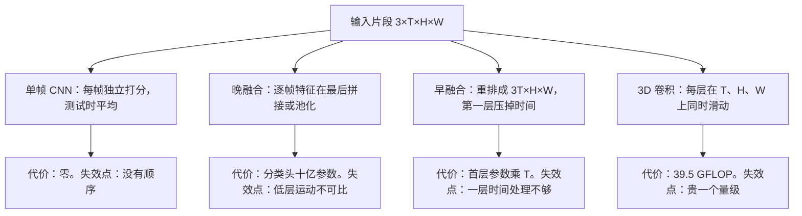
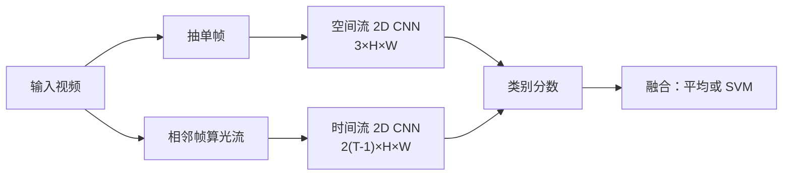
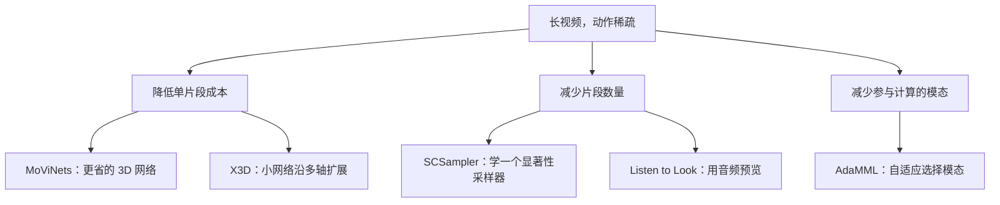
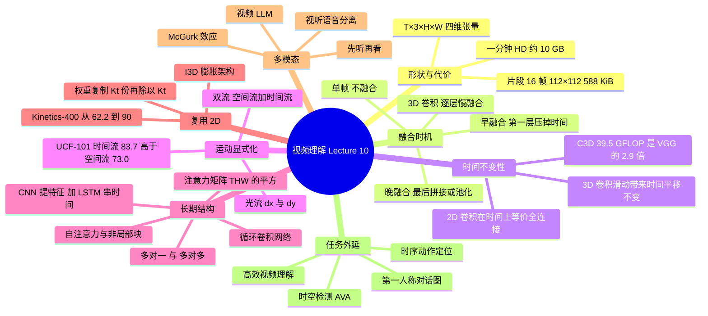

> **课程信息**
>
> - **课程名称**：Stanford CS231n: Deep Learning for Computer Vision（Spring 2025）
> - **本模块覆盖**：Lecture 10. Video Understanding（103 页幻灯片）
> - **主讲教师（各讲）**：Ruohan Gao（Lecture 10，客座讲师；马里兰大学学院公园分校）
> - **授课日期范围**：2025-05-01
> - **官方板块**：感知与理解视觉世界
> - **课程主页**：[cs231n.stanford.edu/2025](https://cs231n.stanford.edu/2025/schedule.html)
> - **官方课件**：[lecture_10.pdf](</attachments/cs231n-97459e980d0382fd925b6b47.pdf>)（103 页，正文按页链接本地课件）
> - **字幕来源**：[cs231n_sp25_kor_sub · eng](https://github.com/lpaiu-cs/cs231n_sp25_kor_sub/tree/main/eng)（公开英文转写，中文由本书重写）
> - **版权说明**：幻灯片与课程材料版权归 Stanford University 及授课教师所有；本书为非官方学习笔记，仅用于学习与研究。

> **课件索引**：点击下方链接打开本地 PDF 的对应页；全部课件见 [课件索引](/notes/cs231n/slides)。页码按 PDF 文件页序定位，第 1 讲分为 Part 1 / Part 2。

[📄 L10 · 第 1 页｜Lecture 10 标题页：Video Understanding](</attachments/cs231n-97459e980d0382fd925b6b47.pdf#page=1>)

第 9 讲结束时，2D 视觉的接口已经推到「一组框加一张掩码」：分类给一个标签，语义分割给每个像素一个类别，检测给每个物体一个框，实例分割再给每个框一张掩码。四种任务共用同一个主干，区别只在头部的输出形状，而它们共享同一个前提——**输入永远是一帧**。这一讲拆掉这个前提：输入变成 T 帧，形状从 3×H×W 变成 T×3×H×W。多出来的这一维远不止「多存几张图」：一分钟 HD 原片就是 10 GB，把一个 VGG 风格的网络整体搬到三维要付 39.5 GFLOP 的前向，而 Kinetics-400 上的 top-1 从单帧模型的 62.2 一路走到 90。所以这一讲真正回答的不是「怎么把视频喂进网络」，而是**时间信息在哪一层融合、融合要付多少算力、以及除了像素还有没有别的模态可用**。

这三个问题也标出了本模块在这一辑里的位置。第 5 讲给了卷积这个算子，第 7、8 讲给了循环与注意力这两套序列工具，第 9 讲给了检测头；这一讲把三样东西装上同一条时间轴，并第一次让「训练成本」成为架构选择的一等公民。也正因如此，它后面紧接第 11 讲的大规模分布式训练：当精度要靠更大的模型与更大规模的预训练来换时，讨论的对象就从「网络结构」变成了「训练系统」。

## 1. 多出来的那一维：从一张图到一卷 T×3×H×W 的体积

*(参考时间: 00:00:05 – 00:03:10｜Lecture 10)*

开头的几页是复习，但它们在模块层面并不多余：这一讲之后每出现一个新架构，都要和「把视频当图像」的单帧分类器比一次。先把尺子摆出来，后面的每一次涨点才有参照系。

### 1.1 十年、一位客座讲师，与一次换轨

[📄 L10 · 第 2 页｜讲师页：Ruohan Gao，马里兰大学学院公园分校](</attachments/cs231n-97459e980d0382fd925b6b47.pdf#page=2>)

标题页把三件事并排写着：Lecture 10、Video Understanding，以及页脚那行 Stanford CS231n 10th Anniversary。这一讲是 2025 春季学期第一位客座讲师——课程开头就预告过，会请几位以前教过这门课的人回来，各讲一次自己最熟的方向。幻灯片上的履历可以按时间读：UT Austin 博士；2021 到 2023 年在 Stanford 做博士后，合作者是 Fei-Fei Li、Jiajun Wu 与 Silvio Savarese；期间在 2022–2023 学年担任 CS231n 的讲师；也在 Meta 待过；现在是马里兰大学学院公园分校的助理教授，主持 Multisensory Machine Intelligence Lab。他的关键词是「多模态」：视觉之外还要用声音、触觉这些通道。这个背景解释了本讲最后三分之一的突然转向——在他眼里，视频从来不是「会动的图像」，而是一段带声音的事件。

### 1.2 2D 视觉能回答什么，不能回答什么

[📄 L10 · 第 3 页｜复习页之一：给定标签集合的图像分类](</attachments/cs231n-97459e980d0382fd925b6b47.pdf#page=3>)

图像分类的设定被压缩成一行：给定一个候选标签集合 $\{dog, cat, truck, plane, \dots\}$，输出其中哪一个。它的输入是一张三维张量，输出是一个 C 维分数向量，中间既没有「位置」也没有「顺序」——位置由第 9 讲补上，顺序由这一讲补上。

[📄 L10 · 第 4 页｜上一讲的四个任务：分类、语义分割、检测、实例分割](</attachments/cs231n-97459e980d0382fd925b6b47.pdf#page=4>)

上一讲把这套接口往前推了三步，四格图分别标注了它们放弃了什么：分类「没有空间范围」（no spatial extent）；语义分割「没有物体，只有像素」；检测开始处理「多个物体」；实例分割再要求同类的两只狗各有一张掩码。四者的共同点是**输入永远是一帧**——它们都能回答「这张图里有什么、在哪里」，却没有一个位置能存放「什么时候」。

[📄 L10 · 第 5 页｜真实场景：客厅里的狗和婴儿](</attachments/cs231n-97459e980d0382fd925b6b47.pdf#page=5>)

把工具箱搬到真实场景，这个缺口更明显：客厅里有狗、有婴儿，检测框和掩码都画得出来，可这段视频真正的信息是狗扑过来、婴儿笑出声这样的**事件**。单帧分不出「扑」和「趴」，因为两者的姿态可以几乎相同；区别只在相邻帧之间的位移。

### 1.3 两种轴序，以及三个必须重算的量

[📄 L10 · 第 6 页｜章节分隔页：CS231n 十周年](</attachments/cs231n-97459e980d0382fd925b6b47.pdf#page=6>)

中间这页没有任何内容，只有十周年的标题条。它在本讲出现两次（第 88 页还有一次），作用是把「2D 视觉回顾」与「视频本身」切成两段；本书照录，因为它标记的是讲者的换气点。

[📄 L10 · 第 7 页｜今天的核心一句：视频 = 2D + 时间](</attachments/cs231n-97459e980d0382fd925b6b47.pdf#page=7>)

真正的定义在这一页：视频是一串图像，形状是四维张量 $T\times 3\times H\times W$，也可以写成 $3\times T\times H\times W$。这两种写法不是排版偏好。前者把一帧的三个通道放在一起（帧优先），后者把同一通道的所有帧堆在一起（通道优先）；早融合要从 $T\times 3$ 直接展平成 $3T$ 个通道，用的正是帧优先，而卷积库要的是通道优先。

> **编者说明**：PyTorch 的 `nn.Conv3d` 接受 `(N, C, D, H, W)`，其中 `D` 即时间维；TensorFlow 的 `conv3d` 默认 `(N, D, H, W, C)`。本书写 $3\times T\times H\times W$ 时一律指「通道在前」的排布，与 PyTorch 一致。

同一个视频换一种轴序，第一层卷积核看到的东西完全不同——这一点在第 3 章会变成一笔具体的参数账。眼下先记住三个必须重算的量：**激活值随 T 线性增长**（特征图从 $D\times H\times W$ 变成 $D\times T\times H\times W$，显存与算力一起涨）；**感受野、池化、归一化的「邻域」要重新定义一次**（空间邻域之外还多了一个时间邻域）；**采样策略本身成为模型的一部分**，这一讲它会以三种面貌出现——训练时的片段采样、测试时的多片段平均、第 12 章「哪些片段值得算」。

## 2. 先算存储再谈架构：一分钟 10 GB 与「片段」这个妥协

*(参考时间: 00:03:37 – 00:08:16｜Lecture 10)*

### 2.1 标签从名词换成动词

[📄 L10 · 第 8 页｜视频分类任务：输入 T×3×H×W，输出动作标签](</attachments/cs231n-97459e980d0382fd925b6b47.pdf#page=8>)

视频分类的接口和图像分类一模一样，只有标签集合换了：swimming、running、jumping、eating、standing。既然还是「一个张量进、一个分数向量出」，交叉熵、反向传播、SGD 就可以原封不动搬过来。讲师把困难的位置说得很明确：视频理解的第一层难处不在损失函数，而在怎么把像素变成一个能喂给损失函数的特征。

[📄 L10 · 第 9 页｜图像识别物体，视频识别动作](</attachments/cs231n-97459e980d0382fd925b6b47.pdf#page=9>)

这一页把差别摊开：图像这边是 dog、cat、fish、truck，全是**名词**；视频这边是 swimming、running、jumping、eating、standing，全是**动词**。名词可以由单帧的纹理和形状决定，动词不行——「跑」的定义里天然含着一个时间跨度。推论有两步：输入必须是「一段」而不是「一张」；所有架构之争都归结为同一句话，这一段怎么压成一个向量。

### 2.2 一分钟有多少字节

[📄 L10 · 第 10 页｜视频有多大：30 fps，未压缩每像素 3 字节](</attachments/cs231n-97459e980d0382fd925b6b47.pdf#page=10>)

账是这么算的：约 30 帧每秒、每像素 3 字节。幻灯片给的两个数是 SD（640×480）一分钟约 1.5 GB、HD（1920×1080）一分钟约 10 GB。自己验一遍会更牢：$1920\times1080\times3=6{,}220{,}800$ 字节一帧，乘 1800 帧是 $1.12\times10^{10}$ 字节，即 11.2 GB（10.4 GiB）；SD 是 921,600 字节一帧，一分钟 $1.66\times10^{9}$ 字节（1.55 GiB）。页面写 ~10 GB 与 ~1.5 GB，用的是 GiB 口径。

这两个数字的分量在于它逼近硬件：一分钟 HD 原片已经接近一张 24 GB 显卡的显存，而训练一个 batch 远不止一分钟。讲师还补了一句常被忽略的成本——要存的不只是输入，还有权重和卷积网络的激活值。

[📄 L10 · 第 11 页｜解法：低帧率加低分辨率，把片段压到 588 KB](</attachments/cs231n-97459e980d0382fd925b6b47.pdf#page=11>)

解法在这一页，同时降两样东西：帧率和空间分辨率。幻灯片给的例子是 $T=16$、$H=W=112$，在 5 fps 下是 3.2 秒、588 KB。这个数可以手算：$16\times112\times112\times3=602{,}112$ 字节，正好 588 KiB。能这么降的前提是帧间冗余——讲师的原话是「每一秒不必取 30 帧，取 5 帧就够，因为视频帧里有大量冗余」。

| 表示 | 帧数 × 单帧字节 | 未压缩大小 | 相对同长度 HD 原片 |
| --- | --- | --- | --- |
| HD 一分钟 | 1800 × 6,220,800 B | $1.12\times10^{10}$ B（10.4 GiB） | 1× |
| SD 一分钟 | 1800 × 921,600 B | $1.66\times10^{9}$ B（1.55 GiB） | 约 1/7 |
| 训练片段（T=16，112×112） | 16 × 37,632 B | 602,112 B（588 KiB） | 约 1/990 |

降采样不是免费的：5 fps 会把挥拍、起跳这类快速动作抹成模糊的一片，112×112 会让远处的小物体消失。幻灯片的口径是「如果你有算力，当然可以用更大分辨率」——这句话在第 5 章会变成一笔 39.5 GFLOP 的账，也是这一讲反复出现的同一条权衡：空间分辨率与时序粒度都是要花钱的，区别只在于花在哪一层。

### 2.3 训练在片段上，测试在片段上平均

[📄 L10 · 第 12 页｜原始视频：很长，帧率很高](</attachments/cs231n-97459e980d0382fd925b6b47.pdf#page=12>)

页面上只有一条时间轴，标注「长、高 FPS」。它要说明的是：完整视频根本不是一个可以送进网络的样本，长度从几十秒到几小时不等，帧率也远高于模型能承受的范围。

[📄 L10 · 第 13 页｜训练：用低帧率短片段训练分类器](</attachments/cs231n-97459e980d0382fd925b6b47.pdf#page=13>)

训练时用滑动窗口采样：把长视频切成许多 T 帧的片段，每个片段继承整段视频的标签，当成一个独立分类样本来训。这一步把「变长输入」这个麻烦，转换成了「定长输入 + 更多样本」，代价是样本之间高度相关——相邻片段几乎重叠，梯度里的有效信息并没有样本数看起来那么多。

[📄 L10 · 第 14 页｜测试：在多个片段上跑模型，平均预测](</attachments/cs231n-97459e980d0382fd925b6b47.pdf#page=14>)

测试时反过来：在长视频上采样若干片段（课上提到大约 10 个），每个片段单独打分，再把概率平均，作为整段视频的预测。课上有人追问「到底该取多少帧」，讲师的口径是：这一讲所有模型都假定一个固定长度（16 或 32 帧），片段级的预测怎么聚合是另一个问题。

这个「训练在片段、测试平均」的协议是后面所有模型共同的前提，它有两个隐含假设，值得在这里就点破。其一是**片段标签等于视频标签**——对 Sports-1M 这种整段只含一种运动的视频成立，对未剪辑的视频就不成立，第 10 章的时序动作定位正是为拆掉这个假设而生。其二是**片段之间可平均**——如果动作只发生在十秒里，随机采样的十个片段大部分是空的，平均值会被稀释，第 12 章的「高效视频理解」就是在修这一条。

## 3. 融合位置的四分法：单帧、晚融合、早融合与慢融合

*(参考时间: 00:08:29 – 00:19:16｜Lecture 10)*

有了「片段」这个统一输入，剩下的问题只有一个：T 帧的信息在哪一层合并？四个答案按融合位置排开——完全不合并（单帧）、最后合并（晚融合）、最前合并（早融合）、逐层合并（3D 卷积）。讲师按这个顺序讲，晚融合与早融合各用两页，第二页只在上一页上加一行红字，而那行红字标记的正是该方案失效的地方。所以读这一章的方法是盯住红字，而不是盯住结构图。

### 3.1 单帧 CNN：先跑这个基线

[📄 L10 · 第 15 页｜单帧 CNN：每帧独立分类，测试时平均概率](</attachments/cs231n-97459e980d0382fd925b6b47.pdf#page=15>)

最省事的做法是把视频当图像：每帧过一个 2D CNN，测试时把各帧的概率平均。幻灯片上七帧各过一个 CNN，全部输出 "Running"。讲师给它的评价很重——**这往往是非常强的基线**：像跑步这样的片段，帧间变化不大，静态外观已经足够判别。设计任何视频模型之前都应该先跑它，别一上来就写 3D 卷积。

真正的问题因此被推到采样上。讲师在这里停了一下，说「怎么采帧，本身是关键问题，也是一个活跃的研究方向」：最笨的办法是均匀采样（一小时的视频每分钟取一帧），好一点的办法是用第一次判断的结果决定下一步看哪里。这条伏笔在第 12 章回收。

### 3.2 晚融合：把 T 张特征图拼成一根巨型向量

[📄 L10 · 第 16 页｜晚融合（全连接）：每帧特征展平后拼接，送入 MLP](</attachments/cs231n-97459e980d0382fd925b6b47.pdf#page=16>)

晚融合（late fusion）的第一步仍然是逐帧过 2D CNN，但不再直接输出类别，而是取中间那层特征图，形状 $T\times D\times H'\times W'$。然后展平、拼接，得到一根 $TDH'W'$ 维的「片段特征」，再送进 MLP 映射到 C 个类别分数。它叫「晚」，是因为每一帧都被独立处理到很靠后的阶段，时间信息直到最后才被拼起来。

参数账不难算，而且算完就知道这条路走不远。取 $D=512$、$H'=W'=7$、$T=16$：每帧特征 25,088 维，拼起来 401,408 维；若第一层全连接宽 4096，这一层就是 $401{,}408\times4096\approx1.64\times10^{9}$ 个参数。ResNet-50 约 2,560 万个参数，这一个分类头就是它的六十多倍，而且这个数字随 T 线性增长——片段从 16 帧拉到 32 帧，分类头直接翻倍。

[📄 L10 · 第 17 页｜晚融合（池化）：在空间和时间上做平均池化，再过一个线性层](</attachments/cs231n-97459e980d0382fd925b6b47.pdf#page=17>)

改法很直接：不拼接，改在空间和时间上做平均池化，把 $T\times D\times H'\times W'$ 压成一根 D 维的片段向量，再过一个线性层得到 C 个分数。参数量从十亿级掉到 $512\times C$，而且不再随 T 增长。

[📄 L10 · 第 18 页｜同一页加上红字：低层运动在帧间难以比较](</attachments/cs231n-97459e980d0382fd925b6b47.pdf#page=18>)

代价写在下一页的红字上：**帧间的低层运动变得难以比较**。讲师用画面里那个跑者的脚做例子——每帧红圈标出的落脚位置都不一样，这是判断「跑」最直接的线索；但逐帧 2D CNN 一路卷积池化到深层，特征图里早就没有「脚在哪一帧抬起」这种位置级别的信息了，剩下的只有语义级的外观。平均池化再把时间轴压掉，连顺序都不剩。

这就是「晚」的真正含义：融合得越晚，被融合的东西越抽象。深层特征擅长回答「画面里像不像跑步」，不擅长回答「两帧之间脚动了多少」。讲师补了一句直觉：抽取越靠前层的特征，越接近原始帧，越可能保留低层运动；越靠后，越是语义。晚融合把这个选择固定在了「靠后」这一端。

### 3.3 早融合：把 3T 个通道一次性压掉

[📄 L10 · 第 19 页｜早融合：把 T×3×H×W 重排成 3T×H×W，第一层 2D 卷积直接吃掉时间](</attachments/cs231n-97459e980d0382fd925b6b47.pdf#page=19>)

早融合（early fusion）走到另一个极端：把 T 帧的三个通道直接摞成 3T 个通道，重排成 $3T\times H\times W$，让**第一层** 2D 卷积就把通道维度从 3T 映到 D。此后整个网络就是标准 2D CNN，只是时间信息已经在第一层被压成了一个 $D\times H\times W$ 的特征图——幻灯片上把这句写得很直白：collapses all temporal information。

好处是时间感受野一步到位：第一层卷积核在时间上就看满了全部 T 帧。参数代价也不小：第一层是 $D\times3T\times3\times3$，$T=16$ 时输入通道 48，若 $D=12$ 则是 5,184 个参数；同样的 D 与卷积核大小，晚融合那一层只有 $12\times3\times3\times3=324$ 个，差 16 倍。这 16 倍正是「时间被折进通道」的直接后果。

[📄 L10 · 第 20 页｜同一页加上红字：单层时间处理可能不够](</attachments/cs231n-97459e980d0382fd925b6b47.pdf#page=20>)

红字指出了它的毛病：**只靠一层做时间处理，可能远远不够**。第一层卷积是线性加权加非线性，它能表达「哪些帧的哪些位置同时亮」，却难以表达「先 A 后 B」这种顺序关系——而动作恰恰由顺序定义。讲师的说法是「我们太贪心了，想在一层里抓住所有东西」。

### 3.4 3D 卷积：让感受野在时间和空间里一起长大

[📄 L10 · 第 21 页｜3D CNN：用 3D 卷积和 3D 池化缓慢融合时间信息](</attachments/cs231n-97459e980d0382fd925b6b47.pdf#page=21>)

第三条路是 3D 卷积：卷积核和池化核都多一个时间维度，输入是 $3\times T\times H\times W$，网络里每一层的特征都是四维张量 $D\times T\times H\times W$，时间维被逐层、缓慢地压小。Karpathy 等人把它叫「慢融合」（slow fusion）——不在最前也不在最后，而是分散到每一层的每一次滑动里。

### 3.5 把四种融合方式摆进一张表

四条路线的差别可以压进一张表。表的最后一列是这张表存在的理由：每一种融合方式都有一个明确的失效点，而这些失效点不能靠调参消除，只能靠换位置。

| 方案 | 时间信息在哪一层进入 | 时间感受野 | 代表参数账 | 能否表达「先 A 后 B」 | 主要失效点 |
| --- | --- | --- | --- | --- | --- |
| 单帧 CNN | 不进入（只在测试时平均概率） | 1 帧 | 与 2D 网络相同 | 不能 | 帧间顺序完全丢失 |
| 晚融合 + FC | 最后（拼接后进 MLP） | 全部 T 帧，但只在最后一步 | 分类头约 $1.64\times10^{9}$（T=16, D=512, 7×7, 隐层 4096） | 理论可以，实际受限于特征已语义化 | 参数随 T 线性增长 |
| 晚融合 + 池化 | 最后（时空平均池化） | 全部 T 帧，无顺序 | $512\times C$ | 不能 | 低层运动不可比 |
| 早融合 | 第一层 2D 卷积 | 全部 T 帧，第一步到位 | 首层 $D\times3T\times3\times3=5{,}184$（T=16, D=12） | 弱（单层线性加权） | 一层时间处理不够；无时间平移不变性 |
| 3D 卷积（慢融合） | 每一层 | 逐层长大：3 → 6 → 14 → 20 | 首层 $D\times3\times3\times3\times3=972$（D=12）；C3D 整网 39.5 GFLOP | 强（多层时空非线性） | 算力贵一个量级 |

四条分支的分岔点就是「融合层」的位置：B 根本不融合，C 在最后融合，D 在第一层融合，E 在每一层融合。参数量、时间感受野、能否表达顺序，全部由这个位置决定。**晚融合把时间留到最后，早融合把时间压在最前，3D 卷积把时间摊到每一层——三条路线，三种代价。**

## 4. 从 2D 卷积到 3D 卷积：把核变成立方体，再用三份账本验算

*(参考时间: 00:19:16 – 00:26:06｜Lecture 10)*

上一章最后一条路需要把「3D 卷积」讲清楚，而讲清楚它的最好办法是先复习 2D 卷积——因为多出来的那一维改变了三件事：核的形状、输出的形状、以及「一个输出值到底看到了多少输入」。

[📄 L10 · 第 22 页｜复习：2D 卷积，32×32×3 的图配 5×5×3 的核，得到 28×28×1](</attachments/cs231n-97459e980d0382fd925b6b47.pdf#page=22>)

2D 卷积核只在 H、W 两个方向上滑，第三个维度（通道）一次看满：$5\times5\times3$ 的核滑过 $32\times32\times3$ 的输入，每个位置出一个标量，得到 $28\times28\times1$ 的激活图。通道在这里不是「空间」，而是「每个位置上的特征向量长度」。

[📄 L10 · 第 23 页｜3D 卷积：核变成立方体，在 T、H、W 三个方向上滑](</attachments/cs231n-97459e980d0382fd925b6b47.pdf#page=23>)

3D 卷积把核变成 $k_t\times k_h\times k_w$ 的立方体：不只滑过画面的 x、y，还滑过时间轴。幻灯片上标的三组数字（6×6×6、5×5×5、4×4×4）是三层卷积的核尺寸，方块本身画的是特征体逐层缩小，最后接 FC 层输出类别分数。要注意图上只画了三个轴，通道维 C 被省掉了——真实张量是 $C\times T\times H\times W$，每个格点上是一整条 C 维向量。讲师特意提醒这一点，因为四维物体没法画在纸上，所有 3D 卷积的示意图都缺一维。

### 4.1 三份玩具账本：同一份输入，三种感受野

接下来八页是同一张表的逐帧搭建。输入统一为 $3\times20\times64\times64$（20 帧、64×64），层宽故意做得很小，幻灯片右下角也注明「实际模型大得多」。看这八页的正确方式是盯住「这一帧比上一帧多了什么」：表格每次多一行，下面的节点图每次多一层，红色圆点标出的正是「一个输出值到底看到了多少输入」。

[📄 L10 · 第 24 页｜玩具表第一帧：表头、Input 行与第一层卷积](</attachments/cs231n-97459e980d0382fd925b6b47.pdf#page=24>)

第一帧只有两行数据：Input 是 $3\times20\times64\times64$，Conv2D(3×3, 3→12) 输出 $12\times20\times64\times64$，感受野 $1\times3\times3$。注意 T 仍然是 20——这一层只在 H、W 上滑，时间维连碰都没碰。

[📄 L10 · 第 25 页｜第二帧：表格下方长出节点链，红点只有三个](</attachments/cs231n-97459e980d0382fd925b6b47.pdf#page=25>)

第二帧在表格下方补了一张节点图：Input 一行是蓝色圆点，Conv(3×3) 一行也是圆点，中间三个红点汇到一个红点。这就是 $1\times3\times3$ 的来历——一个输出只连三个相邻输入；时间维上没有跨帧的连线，所以第一个数字是 1。

[📄 L10 · 第 26 页｜第三帧：加入 Pool2D 一行与对应的池化节点层](</attachments/cs231n-97459e980d0382fd925b6b47.pdf#page=26>)

第三帧加一行 Pool2D(4×4)：尺寸变成 $12\times20\times16\times16$，感受野 $1\times6\times6$。节点图相应多出 Pool(4×4) 一层，红点从 3 个扩到 6 个——池化把「一个输出看几个输入」放大了。

[📄 L10 · 第 27 页｜第四帧：补上第二层卷积，红点扩到 14](</attachments/cs231n-97459e980d0382fd925b6b47.pdf#page=27>)

第四帧补上 Conv2D(3×3, 12→24)：$24\times20\times16\times16$，感受野 $1\times14\times14$，节点图长到四层。右侧同时出现第一句结论「Build slowly in space」。

[📄 L10 · 第 28 页｜第五帧：GlobalAvgPool 与「时间一次性到位」](</attachments/cs231n-97459e980d0382fd925b6b47.pdf#page=28>)

第五帧补完晚融合：GlobalAvgPool 把 $24\times20\times16\times16$ 压成 $24\times1\times1\times1$，感受野一栏跳到 $20\times64\times64$，整条节点链全部变红。右侧句子补全为「Build slowly in space, All-at-once in time at end」——时间感受野不是长出来的，是在做全局平均的那一刻一次性覆盖全部 20 帧。

[📄 L10 · 第 29 页｜第六帧：追加早融合的五段](</attachments/cs231n-97459e980d0382fd925b6b47.pdf#page=29>)

第六帧追加早融合：Input 之后第一层就是 Conv2D(3×3, 3*20→12)，输出尺寸里 T 直接消失（$12\times64\times64$），感受野第一行就是 $20\times3\times3$；后面的 Pool2D 与 Conv2D 只继续长空间，时间恒为 20。右侧标注换成「All-at-once in time at start」。

[📄 L10 · 第 30 页｜第七帧：追加 3D CNN 的五段](</attachments/cs231n-97459e980d0382fd925b6b47.pdf#page=30>)

第七帧追加 3D CNN：Conv3D(3×3×3, 3→12) 后感受野 $3\times3\times3$，Pool3D(4×4×4) 后 $6\times6\times6$ 且 T 从 20 掉到 5，再一个 Conv3D 到 $14\times14\times14$。右侧两行「Build slowly in space, Build slowly in time」旁边打了引号 "Slow Fusion"。

[📄 L10 · 第 31 页｜第八帧：中央浮出「差别到底在哪」](</attachments/cs231n-97459e980d0382fd925b6b47.pdf#page=31>)

最后一帧什么也没加，只在表中央浮出一行字：What is the difference? 三份账摆在一起，差别只剩一句：**时间感受野是在最后一层、第一层，还是每一层长出来的**。

三份账本还藏着一个容易漏掉的观察：早融合那一栏的 Size 列少了一维（$12\times64\times64$ 而不是 $12\times20\times64\times64$），因为它把 20 帧折进了通道；而 3D CNN 的 Size 列一直保留 T，直到最后的 GlobalAvgPool。**「时间在哪一列消失」比任何文字描述都更准确地刻画了一种融合方式。** 另外记住 3D 那一栏的降采样节奏：Pool3D 一次把 T 从 20 压到 5，感受野从 3 跳到 6——3D 网络里时间维的降采样必须激进，因为 T 本来就短，耗不起。

## 5. 时间平移不变性：3D 卷积真正买到的性质，与 39.5 GFLOP 的账单

*(参考时间: 00:26:12 – 00:39:10｜Lecture 10)*

上一章的玩具表把早融合与 3D 卷积放在一起，两者的时间感受野最终都能覆盖整段，差别被压成一句「第一层长出来还是每层长出来」。这一章把那句话展开成两个问题：2D 卷积在时间方向上到底做了什么？3D 卷积多付的钱花在哪一层？

### 5.1 2D 卷积在时间方向上是「全连接」的

[📄 L10 · 第 32 页｜2D 卷积（早融合）：权重只有 3×3，时间维靠通道堆进来](</attachments/cs231n-97459e980d0382fd925b6b47.pdf#page=32>)

这张图把 2D 卷积用在「时间已经拼进通道」的张量上：输入 $C_{in}\times T\times H\times W$，权重是 $C_{out}\times C_{in}\times T\times3\times3$——注意核里确实有 T 这一维，但它是「一次看完」的整段，不是「滑动」的。它在 x、y 上滑动，在通道上一次看满（也就是把 3T 个通道全连上），输出仍是 $C_{out}\times T\times H\times W$，T=16 一点没少。所以早融合的「2D 卷积」看起来是卷积，在时间方向上其实是**全连接**：每个输出格点都连到全部 16 帧。

[📄 L10 · 第 33 页｜同一页加上结论：没有时间平移不变性](</attachments/cs231n-97459e980d0382fd925b6b47.pdf#page=33>)

结论随之而来：**没有时间平移不变性**。同一个「蓝变橙」的过渡，如果发生在第 4 帧和第 15 帧，卷积核在这两个时刻用的是权重里不同的切片（第 4 片和第 15 片），必须分别学会。空间上完全不是这样——同一条边缘出现在左上角还是右下角，用的是同一组 3×3 权重，这正是卷积在图像上有效的原因。

[📄 L10 · 第 34 页｜同一页追问：怎么在任意时空位置识别同一个过渡](</attachments/cs231n-97459e980d0382fd925b6b47.pdf#page=34>)

幻灯片把问题写成一句追问：如何在空间和时间的**任意位置**识别蓝到橙的过渡？答案不在 2D 卷积里，因为它的时间权重是逐时刻绑定的。

### 5.2 3D 卷积买到的是「同一个核滑过所有时刻」

[📄 L10 · 第 35 页｜3D 卷积：权重变成 3×3×3，核在时间上只覆盖 3 帧](</attachments/cs231n-97459e980d0382fd925b6b47.pdf#page=35>)

换成 3D 卷积，权重是 $C_{out}\times C_{in}\times3\times3\times3$，多出来的一维让核在时间上也只覆盖 3 帧（图上标的 T=3 是核的时间宽度，输入仍是 16 帧）。于是输出里每个位置都只依赖一个 3 帧的局部窗口，而不是全部 16 帧。

[📄 L10 · 第 36 页｜同一页加上结论：时间平移不变性](</attachments/cs231n-97459e980d0382fd925b6b47.pdf#page=36>)

这就买到了**时间平移不变性**：同一个核在 t=1 到 t=14 上共用，蓝变橙无论在哪个时刻发生，都由同一组权重响应。讲师把这句归成「表征效率」——不必为每个时刻各学一个核。第 4 章那三份账本到这里才真正合上：3D 卷积省下的不是参数，是**需要被学习的模式数量**。

[📄 L10 · 第 37 页｜第一层滤波器可以当成小视频看：3(RGB)×4 帧×5×5](</attachments/cs231n-97459e980d0382fd925b6b47.pdf#page=37>)

回报在这一页直接可见。第一层滤波器因此是一个 $3\times4\times5\times5$ 的小视频，可以像 GIF 一样逐个播放：有的核只对颜色斑块响应（几乎退化成 2D 滤波器），有的对某个方向的运动响应，有的对边缘的时序变化响应。讲师提醒，这不只是可视化技巧，它说明 3D 卷积确实在学「运动」这一类的模式，而不只是把帧叠起来。

### 5.3 Sports-1M：单帧 77.7，3D 卷积 80.2

[📄 L10 · 第 38 页｜Sports-1M：100 万个 YouTube 视频，487 类运动](</attachments/cs231n-97459e980d0382fd925b6b47.pdf#page=38>)

数据集这一页给的是规模与难度：100 万个 YouTube 视频，标注到 487 种运动类别，细到 marathon 与 ultra marathon 这种外行分不清的区别（讲师的原话是「我也不知道这两个差在哪」）。图上蓝框是标注框，绿字是正确预测，红字是错误预测——它同时也是模型输出的可视化。

讲师补了一段数据集特有的麻烦：视频太大，没法像 ImageNet 那样打包分发，Sports-1M 最初只发布一份 YouTube URL 列表；十年过去，用户删视频、改视频，讲师估计当年的一百万条链接「大概一半已经不在了」。**这意味着 2014 年那批数字今天很难原样复现**，读旧论文时要把这一点算进去。

[📄 L10 · 第 39 页｜Sports-1M 前五准确率：单帧 77.7，早融合 76.8，晚融合 78.7，3D CNN 80.2](</attachments/cs231n-97459e980d0382fd925b6b47.pdf#page=39>)

结果页是本讲第一个反直觉：单帧模型 77.7，早融合 76.8（反而更低），晚融合 78.7，3D CNN 80.2。融合时间信息并不自动带来提升——早融合那一层线性投影吃不下顺序，晚融合的池化把低层运动抹平，只有逐层融合的 3D 卷积拿到 2.5 分。幻灯片右侧两句批注就是讲师的结论：单帧模型很强，永远先试它；3D 卷积自 2014 年以来进步很大。

### 5.4 C3D：把 VGG 整体搬到三维

[📄 L10 · 第 40 页｜C3D 的层表：全 3×3×3 卷积 + 2×2×2 池化](</attachments/cs231n-97459e980d0382fd925b6b47.pdf#page=40>)

C3D 的思路是「VGG 的 3D 版」：输入 $3\times16\times112\times112$（正好是第 2 章那个 588 KB 的片段），所有卷积都是 3×3×3，所有池化都是 2×2×2，只有 Pool1 例外，用 1×2×2——时间上先不降采样，先把空间减半。八个卷积之后接 FC6、FC7 各 4096 维，FC8 输出 C 类。它在 Sports-1M 上预训练后公开了权重，很多人拿它当视频特征提取器：抽完特征再接一个线性分类器，就省掉了自己训 3D 网络的钱。

[📄 L10 · 第 41 页｜同一张表加上逐层 FLOPs，以及 AlexNet / VGG-16 / C3D 的对比](</attachments/cs231n-97459e980d0382fd925b6b47.pdf#page=41>)

这一页加了最要命的一列：逐层 MFLOPs。把这些数加起来正好 39.5，与页面左侧标注的 C3D 39.5 GFLOP 对上；作为对照，AlexNet 0.7 GFLOP，VGG-16 13.6 GFLOP，C3D 是 VGG 的 2.9 倍。可以挑一层验算：Conv3b 是 256→256 的 3×3×3 卷积，输出 $8\times28\times28$，$256\times256\times27\times8\times28\times28\approx1.11\times10^{10}$，正好对上表里的 11.10。这一层单独就占全网的 28%。

| 网络 | 输入 | 单次前向 | 相对 VGG-16 |
| --- | --- | --- | --- |
| AlexNet | 单帧图像 | 0.7 GFLOP | 0.05× |
| VGG-16 | 单帧图像 | 13.6 GFLOP | 1× |
| C3D | 片段 16×112×112 | 39.5 GFLOP | 2.9× |

钱花在哪很清楚：同一个 3×3 核在时间上多乘一次 3，特征图又多出一维 T=8，两项相乘就是二十几倍的膨胀。3D 卷积的算力不是「稍贵」，而是贵一个量级。

还有一笔由这张表直接读出来的账：Conv2 与 Conv3b 并列最贵（各 11.10），原因是 Pool1 用了 1×2×2，T 在第二层仍然是 16。若 Pool1 也按 2×2×2 在时间上降采样，Conv2 的 FLOPs 会立刻减半到 5.55。**C3D 为了不在早期牺牲时间分辨率，主动付了这一笔**——这是全讲最清楚的一处「算力换时间分辨率」的显式选择：Pool1 的 1×2×2 只压空间、不压时间，代价直接记在 Conv2 那一行的 11.10 里。

[📄 L10 · 第 42 页｜Sports-1M 前五准确率补上 C3D：84.4](</attachments/cs231n-97459e980d0382fd925b6b47.pdf#page=42>)

补上 C3D 之后，柱状图变成 77.7 / 76.8 / 78.7 / 80.2 / 84.4。C3D 比单帧高 6.7 分，比 2014 年那个 3D CNN 高 4.2 分（讲师的口径是「约 4% 的 top-5 增益」）。这一页也标出了本讲前半段的基准线：**在 39.5 GFLOP 的预算下，Sports-1M 的前五准确率大约 84%**。后半段的所有架构——双流、RNN、非局部块、I3D——都可以理解成「想用更少的算力超过这条线，或者用同样的算力超过更多」。

## 6. 外观与运动分开算：光流、双流，与「运动流更强」这个反直觉

*(参考时间: 00:39:59 – 00:45:22｜Lecture 10)*

3D 卷积把空间和时间塞进同一个核，代价是每个核在时间上多乘 $k_t$、输出又多出一维 T，两项叠起来就是一个数量级的膨胀。这一章换一个问法：空间和时间是两种性质不同的信号，能不能用两条独立的通路分别处理，再在分数层合并？讲师先给出一个人类实验作为动机，再给出显式测量运动的工具，最后是双流网络与它在 UCF-101 上的结果。

### 6.1 只有运动，也足够认出动作

[📄 L10 · 第 43 页｜生物运动感知：画面全黑，只剩几个亮点也能认出动作](</attachments/cs231n-97459e980d0382fd925b6b47.pdf#page=43>)

幻灯片引的是 Johansson 1973 年的经典实验（点光源显示，point-light display）：人身上只保留若干关节点作为亮点、其余全部涂黑，观察者依然能认出「走」「跑」「坐」。这一页的定格画面几乎是全黑，只有几个亮点——讲师现场放的是一小段，让听众猜动作：没有外观、没有背景、没有颜色，只有点的运动轨迹。这一页确立了一个前提：**运动本身就是强判别信号**，不必依赖纹理和物体。既然这样，就没有理由强迫一个卷积核同时学外观和运动。

### 6.2 光流：把「像素往哪走」写成两个通道

[📄 L10 · 第 44 页｜光流：相邻两帧，第 t 帧与第 t+1 帧](</attachments/cs231n-97459e980d0382fd925b6b47.pdf#page=44>)

显式测量运动的工具是光流（optical flow）：取相邻两帧，估计每个像素从这一帧到下一帧移动了多少。页面上只放了两帧原图，还没有任何箭头——先让人看清输入是什么。

[📄 L10 · 第 45 页｜同一页加上位移场：F(x,y)=(dx,dy)](</attachments/cs231n-97459e980d0382fd925b6b47.pdf#page=45>)

第二帧补上定义：光流是一个位移场 $F$，把第 t 帧的每个像素映射到第 t+1 帧的位置，$F(x,y)=(dx,dy)$，满足 $I_{t+1}(x+dx,\,y+dy)=I_t(x,y)$。讲师提到，具体算法有很多种假设（最常用的一条是「亮度恒定」：同一个点移动后亮度不变），但无论用哪种，输出都是一张两通道的图。

[📄 L10 · 第 46 页｜光流拆成水平与垂直两个通道分别可视化](</attachments/cs231n-97459e980d0382fd925b6b47.pdf#page=46>)

第三帧把它拆开看：水平分量 $dx$ 与垂直分量 $dy$ 各是一张灰度图，前者亮的地方在横向移动，后者亮的地方在纵向移动；幻灯片右侧那句话是「光流把局部运动高亮出来」。这一步很重要，因为接下来双流网络的输入正是「把 $(dx,dy)$ 当成两个通道堆起来」。

### 6.3 双流网络：一条看外观，一条只看运动

[📄 L10 · 第 47 页｜双流网络：空间流吃单帧，时间流吃堆叠的光流](</attachments/cs231n-97459e980d0382fd925b6b47.pdf#page=47>)

结构在这一页：上面一条**空间流**（spatial stream）吃单帧 $3\times H\times W$，就是普通的图像分类网络；下面一条**时间流**（temporal stream）吃堆叠的光流，输入通道数是 $2(T-1)$——T 帧产生 T−1 个流场，每个场两个通道。两条流的结构完全对称（conv1 7×7×96 步长 2、conv2 5×5×256 步长 2、conv3–5 都是 3×3×512、fc6 4096、fc7 2048），最后在 class score 层融合。幻灯片特别标注：时间流的第一层 2D 卷积一次性处理所有光流图，也就是在时间流内部用了早融合。

这个设计其实把上一章的四分法用了一遍：外观走「单帧」，运动走「早融合」，两路之间用「晚融合」合并。**三种融合策略出现在同一个网络里，各管一段**——这是双流最容易被忽略的一点，也是它能同时吃到外观与运动两类证据的原因。

[📄 L10 · 第 48 页｜UCF-101 上的结果：时间流单独就超过空间流](</attachments/cs231n-97459e980d0382fd925b6b47.pdf#page=48>)

结果在 UCF-101（101 类动作）上：3D CNN 65.4，仅空间流 73.0，仅时间流 83.7，双流平均 86.9，双流 + SVM 融合 88.0。最值得停一下的是第二、三根柱子——**只看运动的时间流，比只看外观的空间流高 10.7 分**。讲师的解释是一个假设：外观流容易过拟合背景（UCF-101 里不少视频的背景和类别强相关），而运动流里几乎只剩动作本身，反而更难作弊。

这段要给三个边界。其一，光流是预计算的，推理时前半段是传统算法，端到端训练只覆盖后半个网络，「一个模型」其实是「一个模型 + 一个算法」。其二，两条流不共享梯度，训练成本翻倍；视频本身已经比图像贵，这一刀不轻。其三，「运动流更强」是 UCF-101 上的现象，讲师自己用的是 hypothesis 这个词——换到背景与动作解耦的数据集上，这个结论未必成立。

## 7. 五秒之外：CNN 提特征、RNN 串时间，然后撞上并行度

*(参考时间: 00:45:22 – 00:51:42｜Lecture 10)*

到第 6 章为止，所有模型都只处理 2 到 5 秒的片段——这不是设计选择，是感受野的物理限制：3D 卷积堆十几层，时间感受野也不过几十帧。可动作的时间尺度可以从「抬手」到「做饭」，后者跨越几分钟。这一章把问题摆出来，用第 7 讲的工具答一遍，最后看清它为什么没被用起来。

### 7.1 局部窗口之外

[📄 L10 · 第 49 页｜此前的模型只建模 2–5 秒片段内的局部运动](</attachments/cs231n-97459e980d0382fd925b6b47.pdf#page=49>)

幻灯片把限制写在标题上：此前的时间卷积网络只建模「很短片段内、帧与帧之间的局部运动」，那么长时间结构怎么办？页面下方画了一条 CNN 覆盖约 5 秒的时间轴，两侧标注 First event 与 Second event——两个事件相隔很远，任何局部窗口都装不下。

[📄 L10 · 第 50 页｜同一页追问：序列我们不是学过吗，用循环网络？](</attachments/cs231n-97459e980d0382fd925b6b47.pdf#page=50>)

第二帧把答案指向已经学过的工具：序列建模有循环神经网络（RNN）。这不是新知识，而是把第 7、8 讲的工具搬过来用——这正是这一讲反复出现的模式：视频理解很少发明新算子，多是把图像与序列的现成零件重新排布。

### 7.2 两步：CNN 抽局部特征，LSTM 串全局

[📄 L10 · 第 51 页｜第一步：用 CNN（2D 或 3D）在时间上抽特征](</attachments/cs231n-97459e980d0382fd925b6b47.pdf#page=51>)

具体做法分两步。第一步是特征提取：沿时间轴以固定间隔取片段，每个片段过一个 CNN（2D 或 3D），得到一串特征向量。CNN 在这里的角色从「分类器」退化成「定长的局部编码器」。

[📄 L10 · 第 52 页｜第二步：用 LSTM 处理这串局部特征](</attachments/cs231n-97459e980d0382fd925b6b47.pdf#page=52>)

第二步把这串特征喂给 LSTM。此时时间跨度不再受 CNN 的感受野限制——只要隐状态一直传下去，第一秒的信息可以影响第十秒的输出。

[📄 L10 · 第 53 页｜多对一：整段视频只出一个标签](</attachments/cs231n-97459e980d0382fd925b6b47.pdf#page=53>)

输出形式有两种。**多对一**（many-to-one）只在最后一个时间步取输出，得到一个视频级标签，对应第 2 章「整段视频一个类别」的设定。

[📄 L10 · 第 54 页｜多对多：每一帧都出一个输出](</attachments/cs231n-97459e980d0382fd925b6b47.pdf#page=54>)

**多对多**（many-to-many）则每个时间步都输出，适合逐帧标注的任务，第 10 章的时序动作定位就属于这一类。同一套网络换一个读出方式，就能服务两种任务。

[📄 L10 · 第 55 页｜工程细节：可以不反传到 CNN，把它当预训练特征提取器](</attachments/cs231n-97459e980d0382fd925b6b47.pdf#page=55>)

幻灯片给了一条很实用的工程建议：为了省显存，可以**不把梯度反传回 CNN**，而是把 CNN 预训练好、冻结，只训后面的循环部分。否则一个「卷积 + 循环」的巨型网络端到端训练非常难。这条建议在 2011 年的 Baccouche 等工作里就出现了，2015 年被 Donahue 等人的 LRCN 普及——讲师补了一句：2011 年那篇远超它的时代，因为 AlexNet 要到 2012 年才出现。

[📄 L10 · 第 56 页｜两种时间结构的对照：CNN 是局部窗口，RNN 是全体历史](</attachments/cs231n-97459e980d0382fd925b6b47.pdf#page=56>)

这一页把两者的性质并排放：CNN 内部每个值是**固定时间窗口**的函数（局部时间结构），RNN 内部每个向量是**此前所有向量**的函数（全局时间结构）。问题自然变成：能不能把两者合到一个网络里？

### 7.3 循环卷积网络：把矩阵乘换成卷积

[📄 L10 · 第 57 页｜复习：多层 RNN，深度 × 时间的网格](</attachments/cs231n-97459e980d0382fd925b6b47.pdf#page=57>)

先复习多层 RNN 的形状：横轴是时间，纵轴是深度，每个格点 $h_t^l$ 同时接收同一层上一时刻的 $h_{t-1}^l$ 和下面一层同一时刻的 $h_t^{l-1}$。讲师说，同样的网格可以用来处理视频，只是每个格点从向量变成一个特征图。

[📄 L10 · 第 58 页｜循环卷积网络：整个网络都用 C×H×W 的特征图](</attachments/cs231n-97459e980d0382fd925b6b47.pdf#page=58>)

循环卷积网络（recurrent convolutional network）就是这张网格的卷积版：所有状态都是 $C\times H\times W$ 的特征图，每个格点依赖两个输入——同层上一时刻的特征图、上一层同一时刻的特征图；每层有自己的一组权重，权重在时间上共享。

[📄 L10 · 第 59 页｜对照：普通 2D 卷积只有一个输入](</attachments/cs231n-97459e980d0382fd925b6b47.pdf#page=59>)

对照页先摆出普通 2D 卷积：一个输入特征图 $C\times H\times W$，一个输出特征图 $C\times H\times W$。

[📄 L10 · 第 60 页｜循环单元：新状态 = 旧状态与当前输入的函数](</attachments/cs231n-97459e980d0382fd925b6b47.pdf#page=60>)

再把循环单元画出来：新状态是「旧状态」与「当前输入」经过某个带参数 $W$ 的函数的结果。这一步和标准 RNN 没有区别。

[📄 L10 · 第 61 页｜把矩阵乘换成 2D 卷积：h_t = tanh(W_h * h_{t-1} + W_x * x_t)](</attachments/cs231n-97459e980d0382fd925b6b47.pdf#page=61>)

关键的一行在这一页：把 vanilla RNN 的 $h_t=\tanh(W_h h_{t-1}+W_x x_t)$ 里所有矩阵乘法换成 2D 卷积，$W_h$、$W_x$ 从矩阵变成卷积核，两个卷积的结果相加再过 tanh，就得到当前时刻的隐特征图。参数量因此从「状态维度的平方」变成「核大小 × 通道数」，而且与时间长度无关。

[📄 L10 · 第 62 页｜三种时间跨度：CNN 有限，RNN 无限（全连接），循环 CNN 无限（卷积）](</attachments/cs231n-97459e980d0382fd925b6b47.pdf#page=62>)

这一页把三种时间跨度并排：普通 CNN 的感受野是**有限**的，只能看到固定窗口；全连接 RNN 的记忆是**无限**的，能回看整段历史；循环卷积网络同样是**无限**的，只不过它的状态更新用卷积实现——局部连接、权重在时间上共享，而记忆仍然靠隐状态一路传下去。

[📄 L10 · 第 63 页｜问题：RNN 无法并行，长序列上非常慢](</attachments/cs231n-97459e980d0382fd925b6b47.pdf#page=63>)

代价也跟着来了。循环卷积网络把卷积的局部性与循环的无限记忆合到了一起，但继承了 RNN 的致命缺点：**时间步必须串行计算**，一段一千帧的视频就要走一千次前向，GPU 的并行度几乎用不上。讲师说这正是这类模型「没有被用起来」的原因——不是效果不好，是太慢。

| 结构 | 时间感受野 | 每个位置的依赖 | 跨时间可并行 | 代表 |
| --- | --- | --- | --- | --- |
| 2D / 3D CNN | 有限（深度 × 核宽） | 固定窗口内的帧 | 是 | C3D、I3D |
| 全连接 RNN | 无限 | 全部历史（隐状态） | 否 | LRCN |
| 循环卷积网络 | 无限 | 全部历史（卷积更新） | 否 | Ballas 等，ICLR 2016 |
| 自注意力 | 无限（一次看全） | 全体时空位置 | 是 | 非局部块 |

这张表把下一章的门推开了一条缝：四种结构里，唯一同时满足「无限时间跨度」和「跨时间可并行」的是自注意力。第 8 章就从这里开始。

## 8. 非局部块与膨胀：把「全局」和「预训练」同时买下来

*(参考时间: 00:51:42 – 00:58:20｜Lecture 10)*

上一章的表把答案指得很清楚：需要一种既能看全局、又能并行的算子。答案在第 8 讲（注意力与 Transformer）已经出现过——自注意力。这一章先把自注意力搬成一个可插拔的块，再回答它外面那圈 3D CNN 该长什么样。

### 8.1 自注意力复习：把「看哪里」变成一次矩阵乘

[📄 L10 · 第 64 页｜复习：自注意力的 Q、K、V 与对齐分数](</attachments/cs231n-97459e980d0382fd925b6b47.pdf#page=64>)

自注意力里每个位置同时发出 query、key、value 三个向量（$q=xW_q$、$k=xW_k$、$v=xW_v$），任意两个位置的对齐分数是 $e_{ij}=q_j\cdot k_i/\sqrt{D}$，softmax 之后得到权重 $a_{ij}$，输出是 $y_i=\sum_j a_{ij}v_j$。关键在于：**所有位置的对齐可以同时算**，没有时间步依赖。

### 8.2 非局部块：七帧搭出一个可插拔的块

[📄 L10 · 第 65 页｜把非局部块插进 3D CNN：输入片段先过 3D 卷积](</attachments/cs231n-97459e980d0382fd925b6b47.pdf#page=65>)

把自注意力搬到视频上，就是非局部块（nonlocal block，Wang 等，CVPR 2018）。第一帧先摆出承接结构：输入片段先过 3D CNN 得到 $C\times T\times H\times W$ 的特征，再进这个块。

[📄 L10 · 第 66 页｜第二帧：用 1×1×1 卷积生成 Q、K、V 三张特征图](</attachments/cs231n-97459e980d0382fd925b6b47.pdf#page=66>)

第二帧加上三路 1×1×1 卷积：它们把 C 维特征各自映到 C' 维，得到 queries、keys、values 三张 $C'\times T\times H\times W$ 的特征图。用 1×1×1 而不是 3×3×3，是为了让这个块只管「全局关系」，局部结构交给外面的 3D 卷积。

[📄 L10 · 第 67 页｜第三帧：转置 queries 与 keys 相乘，得到 (THW)×(THW) 的注意力矩阵](</attachments/cs231n-97459e980d0382fd925b6b47.pdf#page=67>)

第三帧是核心：把 queries 的空间时间维展平、转置，与 keys 相乘，得到一个 $(THW)\times(THW)$ 的注意力矩阵，再按行 softmax。这里的「非局部」就是字面意思——每个位置都在和**所有**时空位置比较，而不是只看邻域。

[📄 L10 · 第 68 页｜第四帧：注意力矩阵加权 values](</attachments/cs231n-97459e980d0382fd925b6b47.pdf#page=68>)

第四帧用这个矩阵去加权 values，得到一张 $C'\times T\times H\times W$ 的新特征图。至此，每个位置的新特征都是全体位置特征的加权和。

[📄 L10 · 第 69 页｜第五帧：再用 1×1×1 卷积映回 C 维](</attachments/cs231n-97459e980d0382fd925b6b47.pdf#page=69>)

第五帧补一个 1×1×1 卷积，把 C' 映回 C，好与原始输入对齐。

[📄 L10 · 第 70 页｜第六帧：加上残差连接](</attachments/cs231n-97459e980d0382fd925b6b47.pdf#page=70>)

第六帧加上残差连接（+），块的输出 = 原特征 + 注意力结果。这一笔是它能塞进任意网络的前提：最坏情况下学成恒等映射，不会把已有特征破坏掉。

[📄 L10 · 第 71 页｜第七帧：把非局部块串进 3D CNN，端到端输出动作](</attachments/cs231n-97459e980d0382fd925b6b47.pdf#page=71>)

最后一帧把块串起来：3D CNN → 非局部块 → 3D CNN → 非局部块 → Running。幻灯片同时抛出问题：非局部块可以插进任何 3D CNN，但**最好的 3D CNN 架构是什么**？这就把话题推到了 I3D。

这里有一笔必须算的账。注意力矩阵是 $(THW)\times(THW)$，若在 $T=16$、$H=W=56$ 的特征上做，$THW=50{,}176$，矩阵有 $2.5\times10^{9}$ 个元素，半精度也要 5 GB——单层就爆显存。所以非局部块实际上只能放在分辨率已经被降过几轮的层上，例如 $T=8$、$28\times28$ 时 $THW=6{,}272$，矩阵约 $3.9\times10^{7}$ 个元素，约 78 MB。**「全局」是有价格的，价格随特征图面积平方增长**，这也是后面视频 Transformer 要 factorize attention 的直接原因。

### 8.3 膨胀：把 2D 架构搬进三维

[📄 L10 · 第 72 页｜思路：拿一个 2D CNN，把每个 2D 卷积/池化层换成 3D 版本](</attachments/cs231n-97459e980d0382fd925b6b47.pdf#page=72>)

I3D（Carreira 与 Zisserman，CVPR 2017）的想法只有一句：取一个成熟的 2D CNN，把每个 $K_h\times K_w$ 的卷积或池化层替换成 $K_t\times K_h\times K_w$ 的 3D 版本。这样网络的拓扑、通道数、深度全都不变，只是核多了一维。

[📄 L10 · 第 73 页｜原版 Inception 块：四条并行分支后拼接](</attachments/cs231n-97459e980d0382fd925b6b47.pdf#page=73>)

要膨胀的具体对象是 Inception 块：四条并行分支（5×5 卷积、3×3 卷积、1×1 卷积、3×3 最大池化），每条分支前再套一个 1×1 卷积降维，最后沿通道拼接。

[📄 L10 · 第 74 页｜膨胀后的 Inception 块：所有核都多一个时间维](</attachments/cs231n-97459e980d0382fd925b6b47.pdf#page=74>)

膨胀之后，5×5 变 5×5×5，3×3 变 3×3×3，1×1 变 1×1×1，连最大池化也变成 3×3×3。拓扑一模一样，参数量的膨胀倍数由 $K_t$ 决定。

### 8.4 权重也能膨胀：复制 K_t 份，再除以 K_t

[📄 L10 · 第 75 页｜权重初始化：把 2D 核复制 K_t 份、每份除以 K_t](</attachments/cs231n-97459e980d0382fd925b6b47.pdf#page=75>)

架构能膨胀，权重也能。做法是：把 2D 卷积核沿时间轴复制 $K_t$ 份，再整体除以 $K_t$，用它初始化对应的 3D 卷积。理由是一行代数——若输入视频的 $K_t$ 帧完全相同（常数视频），3D 卷积的输出是

$$
\frac{1}{K_t}\sum_{t=1}^{K_t}\sum_{c,k_h,k_w} w_{c,k_h,k_w}\,x_{c,k_h,k_w}=\sum_{c,k_h,k_w} w_{c,k_h,k_w}\,x_{c,k_h,k_w},
$$

正好等于 2D 卷积在单帧上的结果。**这保证了膨胀后的网络在「静止视频」上不退化**，ImageNet 上学到的边缘、纹理 detector 原样保留，剩下的时间维再从视频数据里微调。幻灯片把这件事写成三个动作：duplicate input $K_t$ times、copy kernel $K_t$ times、divide by $K_t$，并注明「给定常数视频输入时，输出与 2D 卷积相同」。

[📄 L10 · 第 76 页｜Kinetics-400 前五准确率：五种架构，蓝色从零训练、橙色 ImageNet 预训练](</attachments/cs231n-97459e980d0382fd925b6b47.pdf#page=76>)

结果页把「架构」与「预训练」两个因素拆开：Per-frame CNN 57.9→62.2，CNN+LSTM 53.9→63.3，Two-stream 62.8→65.6，Inflated CNN（I3D）68.4→71.1，Two-stream inflated 71.6→74.2。三件事值得记：从零训练的 CNN+LSTM 只有 53.9，比单帧还差，说明循环部分很难训；预训练对这一档的补偿最大（+9.4）；膨胀本身（68.4 对 62.8）就已经带来 5.6 分，不需要任何新数据。

还有一条推论：Two-stream inflated 比 Inflated CNN 再高 3.1，说明「膨胀」与「双流」是两笔独立的收益，可以叠加——前者给时间建模，后者给运动显式化。

## 9. 从 62.2 到 90：Transformer 进场，以及模型依赖哪三类证据

*(参考时间: 00:58:20 – 01:01:16｜Lecture 10)*

第 8 章用膨胀绕过了「最好的 3D CNN 是什么」这个问题，但没有真正回答。Kinetics-400 上的曲线给出了另一条路：不再改卷积，而是把序列建模的主角换成 Transformer，再让预训练规模去填数据。

### 9.1 三条路线：分解注意力、池化降 token、掩码自编码

[📄 L10 · 第 77 页｜视频 Transformer 的三条路线：分解注意力、池化降 token、掩码自编码](</attachments/cs231n-97459e980d0382fd925b6b47.pdf#page=77>)

Transformer 进入视频后分成三条路线，幻灯片只列了论文没展开讲：**分解注意力**（在空间与时间上分别做注意力，代表是 Bertasius 等的 "Is Space-Time Attention All You Need for Video Understanding?"、ViViT、Video Transformer Network）；**池化模块**（逐层减少 token 数，代表是 MViT 与 MViTv2）；**视频掩码自编码**（把 MAE 搬到视频，代表是 VideoMAE、VideoMAE V2 与 "Masked autoencoders as spatiotemporal learners"）。三条路线分别在解决注意力的三个成本项：token 数的平方、token 数量本身、以及对标注数据的依赖。

### 9.2 十年曲线

[📄 L10 · 第 78 页｜Kinetics-400 的十年曲线：62.2 到 90](</attachments/cs231n-97459e980d0382fd925b6b47.pdf#page=78>)

把数字连起来看：Per-frame CNN 62.2、CNN+LSTM 63.3、Two-stream 65.6、I3D 71.1、Inflated I3D 74.2、SlowFast 16×8+NL 79.8、MViTv2-L 86.1、VideoMAE V2-g 90。从 62.2 到 90 是 27.8 分，而每一档涨分的来源并不相同。

| 模型（Kinetics-400，top-1） | 精度 | 新引入的零件 | 相对上一档 |
| --- | --- | --- | --- |
| Per-frame CNN | 62.2 | ImageNet 预训练 + 单帧 | 基线 |
| CNN + LSTM | 63.3 | 循环 | +1.1 |
| Two-stream | 65.6 | 光流 | +2.3 |
| I3D（Inflated） | 71.1 | 3D 膨胀 + 预训练 | +5.5 |
| Two-stream I3D | 74.2 | 双流 + 膨胀 | +3.1 |
| SlowFast 16×8 + NL | 79.8 | 双速率 + 非局部块 | +5.6 |
| MViTv2-L | 86.1 | 多尺度 Transformer | +6.3 |
| VideoMAE V2-g | 90.0 | 掩码自编码预训练 | +3.9 |

这张表要配三条读法。其一，涨幅不均匀：3D 卷积只值 5.5 分，双流再加 3.1 分，而 79.8 之后的两步（多尺度 Transformer、掩码预训练）合计 10.2 分，靠的是模型容量与预训练数据，不是新的时间算子。其二，SlowFast 与 MViTv2 之间那 6.3 分不能全记在架构上——SlowFast 是双速率（一条慢而宽、一条快而窄），MViTv2 是多尺度层级，两者的训练配方也不同。其三，也是最重要的边界：**这张表是 Kinetics-400 的 top-1，与第 5 章 Sports-1M 的 top-5 不可直接比较**，两个数据集、两种指标、两批划分。

### 9.3 模型在看什么：梯度上升造出的三类证据

[📄 L10 · 第 79 页｜可视化方法：前向算分数，反向对输入求梯度，再做梯度上升](</attachments/cs231n-97459e980d0382fd925b6b47.pdf#page=79>)

分类做好之后，自然要问模型到底在看什么。方法沿用第 9 讲那套：随机初始化一张外观图和一张光流图，前向算出某个类别的分数，反向对**输入**求梯度，沿梯度上升修改输入，让分数变大。视频这边多了一步：给光流加一个空间平滑项，并调节惩罚系数，就能分别逼出「慢运动」和「快运动」两种证据。

[📄 L10 · 第 80 页｜三个面板：外观、慢运动、快运动，先猜动作](</attachments/cs231n-97459e980d0382fd925b6b47.pdf#page=80>)

幻灯片先不放答案，只给三个面板：appearance、slow motion、fast motion，让听众猜这是什么动作。这一页右下角署了 Slide credit: Christoph Feichtenhofer，素材出自他那两篇分析动作表征的工作。

[📄 L10 · 第 81 页｜答案：Weightlifting；慢运动面板显示 Bar Shaking，快运动面板显示 Push overhead](</attachments/cs231n-97459e980d0382fd925b6b47.pdf#page=81>)

答案揭晓：weightlifting。更有意思的是两个运动面板的内容——慢运动那一栏被优化成杠铃的抖动（Bar Shaking），快运动那一栏被优化成向上推举（Push overhead）。**同一个动作被拆成两个时间尺度上的证据**，说明网络确实分别利用了慢速与快速的运动信息，而不是只记住了一个静态姿势。

[📄 L10 · 第 82 页｜换一个动作，同样给三个面板](</attachments/cs231n-97459e980d0382fd925b6b47.pdf#page=82>)

再换一个动作：三面板布局不变，右侧两栏仍标着 Fast motion appearance，但优化出来的纹理换了——同样的方法换一个类别，就得到另一组证据，说明这些面板不是固定模板。

[📄 L10 · 第 83 页｜答案：Apply Eye Makeup](</attachments/cs231n-97459e980d0382fd925b6b47.pdf#page=83>)

答案是 Apply Eye Makeup。这类可视化不能证明模型「理解」了动作，但它能说明模型依赖的是哪一类线索——对调试数据集偏置很有用：如果背景里出现了杠铃，模型可能只是在认器械。

### 9.4 把五种方案的代价放在一张表里

到这里，本讲出现过的所有时间建模路线都已经到齐，可以把它们的代价摆在同一个坐标系里看。

| 方案 | 时间算子 | 单层权重形状 | 时间参数共享 | 时间平移不变 | 主要成本 | 代表工作 |
| --- | --- | --- | --- | --- | --- | --- |
| 2D 卷积（早融合） | 只在 H、W 上滑 | $C_{out}\times C_{in}\times T\times3\times3$ | 否（每时刻一片） | 否 | 首层参数乘 T | Karpathy 等，2014 |
| 3D 卷积 | 在 T、H、W 上滑 | $C_{out}\times C_{in}\times3\times3\times3$ | 是 | 是 | FLOPs 乘 $k_t$ 与 T | C3D、I3D |
| 双流 | 光流 + 两条 2D CNN | 同 2D，输入通道 $2(T-1)$ | 否（流场已含位移） | 否（时间流内部早融合） | 光流预计算 + 两倍前向 | Simonyan 与 Zisserman，2014 |
| 非局部块 | 全局自注意力 | 三组 $C\times C'\times1\times1\times1$ | 是 | 是（全局，非滑动） | $(THW)^2$ 注意力矩阵 | Wang 等，2018 |
| 视频 Transformer | 时空或分解注意力 | 投影矩阵 | 是 | 是 | token 数的平方或 token 数量 | ViViT、TimeSformer、MViT |

横向读这张表，能看到一条主线：每一种方案都是在「时间感知的粒度」与「并行度/成本」之间换位置。2D 卷积给不了时间平移不变性，3D 卷积给得起但贵一个量级，双流把运动外化成光流、用两倍前向换显式位移，非局部块用 $(THW)^2$ 换全局，Transformer 用 token 数换容量。到第 12 章还会多出一列：这些成本能不能被「少算一些片段」直接削掉。

## 10. 片段之外：时序定位与时空检测

*(参考时间: 01:01:16 – 01:02:21｜Lecture 10)*

到第 9 章为止，任务一直是「给一个剪辑好的片段，说它是什么动作」。真实视频不是这样：它是未剪辑的、长的，而且大部分帧没有信息量。这一章把前面所有模型当成零件，看它们能拼出哪些新任务。

[📄 L10 · 第 84 页｜收束页：此前一直在做短片段分类](</attachments/cs231n-97459e980d0382fd925b6b47.pdf#page=84>)

页面回到第 2 章那张标签图：swimming、running、jumping……不同的是这次它被当作「已完成的部分」放在这里。

[📄 L10 · 第 85 页｜时序动作定位：在长视频里标出每段动作的起止](</attachments/cs231n-97459e980d0382fd925b6b47.pdf#page=85>)

时序动作定位（temporal action localization）的任务定义很清楚：给定一段长而未剪辑的视频，找出各个动作对应的帧区间。幻灯片上的例子是一段走廊监控，蓝框标 Running、红框标 Jumping，中间夹着没有动作的帧。做法借自检测：**先生成时序提议，再对提议分类**，与 Faster R-CNN 的两阶段结构一一对应，只不过把二维的锚框换成一维的时间窗。

[📄 L10 · 第 86 页｜时空检测：在空间和时间上同时定位人并分类动作（AVA 数据集）](</attachments/cs231n-97459e980d0382fd925b6b47.pdf#page=86>)

再进一步是时空检测（spatio-temporal detection）：不只问「哪几秒」，还问「哪个人、在画面哪里」。幻灯片给的是 AVA 数据集的例子——每个演员在每一秒都有一个框和一个动作标签。到这里，第 9 讲的检测框与本章的时间窗合成了一个三维的定位问题：输出从「框 + 类别」变成「时间窗 + 框 + 类别」。

[📄 L10 · 第 87 页｜阶段小结页：3D CNN、双流、时空自注意力](</attachments/cs231n-97459e980d0382fd925b6b47.pdf#page=87>)

这一页的标题是 Today: Temporal Stream，正文只列三行：3D CNN、Two-Stream Neural Network、Spatial-Temporal Self-Attention。它是本讲前半段的目录，也是后半段的起点——接下来要加的不是新架构，而是新模态。

## 11. 声音不是配角：McGurk、视听分离与视听分类

*(参考时间: 01:02:21 – 01:05:10｜Lecture 10)*

到这里，输入一直是像素。讲师在最后二十分钟换了一个问题：如果视频本来就带声音，为什么只读画面？这一章从一个人耳实验开始，走到他自己做的「用眼睛分离声音」。

[📄 L10 · 第 88 页｜章节分隔页（第二次出现）](</attachments/cs231n-97459e980d0382fd925b6b47.pdf#page=88>)

分隔页第二次出现，标志着话题从「像素」转到「声音」。同一张图在一讲里出现两次，通常意味着讲者要换一个完全不同的知识域——这里换的是模态。

[📄 L10 · 第 89 页｜演示页之一：画面上写着 Ba Ba Ba](</attachments/cs231n-97459e980d0382fd925b6b47.pdf#page=89>)

课堂在这里放了一段演示：同一段人脸视频，先标成「Ba Ba Ba…」，出处是 McGurk & McDonald 1976，视频来源 BBC。

[📄 L10 · 第 90 页｜演示页之二：同一段视频标成 Fa Fa Fa](</attachments/cs231n-97459e980d0382fd925b6b47.pdf#page=90>)

再标成「Fa Fa Fa…」。两页的画面相同、标注不同，指向的正是「听到什么会被看到什么改写」这件事。

[📄 L10 · 第 91 页｜演示页之三：出处 McGurk & McDonald (1976)，视频来源 BBC](</attachments/cs231n-97459e980d0382fd925b6b47.pdf#page=91>)

第三页只留一行出处：McGurk & McDonald (1976)，视频来源 BBC。

> **编者说明**：McGurk 效应指听觉与视觉言语信息冲突时，人听到的音节会被看到的口型改变——例如配音是 /ba/、口型是 /ga/，被试常报告听到 /da/。幻灯片用两页「Ba」与「Fa」的对照来演示这一点，本讲借此说明视频理解不能只看像素。

讲师由此展开：视频里还有声音这一维，少了它，「情绪」和「互动」这两类信息就丢了——婴儿的笑声、狗的叫声、谁在说话、语气是凶还是软，全在音轨里。这也是他本人的研究方向：**用视觉去帮助听觉**。

### 11.1 用眼睛分离声音

[📄 L10 · 第 92 页｜视觉引导的音频分离：一页密集的参考文献](</attachments/cs231n-97459e980d0382fd925b6b47.pdf#page=92>)

这一页列了十几篇文献（Gao 等 ECCV 2018、Afouras 等 Interspeech 2018、Owens 与 Efros ECCV 2018、Ephrat 等 SIGGRAPH 2018、Gao 与 Grauman ICCV 2019、Gao 等 CVPR 2021……），本身就是一条时间线：视觉引导的音频分离（visually-guided audio source separation）在 2018 年前后成为一个独立方向。

[📄 L10 · 第 93 页｜语音混合：一段两人同时说话的音频](</attachments/cs231n-97459e980d0382fd925b6b47.pdf#page=93>)

任务设定用一页波形讲清楚：输入是一段混合语音（speech mixture），两个人同时说话，波形叠在一起。

[📄 L10 · 第 94 页｜分离结果之一：左侧说话人的声音](</attachments/cs231n-97459e980d0382fd925b6b47.pdf#page=94>)

输出是分离后的单路语音——左侧说话人的声音。注意这里用到的视觉信息是**谁在什么时候动嘴**：口型开合与声音包络对齐的那一路，就是要留下的那一路。

[📄 L10 · 第 95 页｜分离结果之二：右侧说话人的声音](</attachments/cs231n-97459e980d0382fd925b6b47.pdf#page=95>)

另一路是右侧说话人的声音。两页合起来说明：同一段混合音频，配上画面就能拆成两条独立的音轨，而纯音频的盲分离在两人同时说话时很难做到。

[📄 L10 · 第 96 页｜乐器分离：在 10 万段无标注多声源视频上训练](</attachments/cs231n-97459e980d0382fd925b6b47.pdf#page=96>)

同样的思路可以推广到音乐：幻灯片给的是乐器分离（Gao 与 Grauman，ICCV 2019），训练集是 10 万段**无标注**的多声源视频片段，模型自己学会把「哪个物体在动」与「哪条音轨在响」对应起来，再迁移到新视频上做分离。这里的监督信号不是人工标注，而是「视觉事件与声音事件同时发生」这一事实。

### 11.2 视听分类

[📄 L10 · 第 97 页｜视听视频理解：音频频谱也切成 patch，与视频 patch 一起进 Transformer](</attachments/cs231n-97459e980d0382fd925b6b47.pdf#page=97>)

一旦承认音频是输入，视频分类本身也变了：把音频的频谱图切成 patch，与视频 patch 一起送进 Transformer（Attention Bottlenecks，Nagrani 等，NeurIPS 2021），或者用掩码自编码器同时预测图像 patch 与频谱 patch（Audio-Visual MAE，Zhang 等，CVPR 2022）。这些工作与第 9 章的 VideoMAE 是同一个套路，只是模态从一种变成两种；幻灯片还并排列了 Audio-Adaptive Activity Recognition（Georgescu 等，ICCV 2023），它处理的是跨域问题。

## 12. 效率与前沿：先听再看、第一人称，以及把视频接进 LLM

*(参考时间: 01:05:10 – 01:08:41｜Lecture 10)*

最后一个工程问题是效率。第 2 章的协议是对所有采样片段都跑一遍模型，但长视频里真正有动作的片段只占很小一部分——算力大部分花在空镜头上。

[📄 L10 · 第 98 页｜长视频里的动作识别：动作只占很少的时间](</attachments/cs231n-97459e980d0382fd925b6b47.pdf#page=98>)

幻灯片把这句话画成一条长胶片：动作识别要在长视频里做，而绝大多数帧与类别无关（图片署名 Korbar 等）。

[📄 L10 · 第 99 页｜四条效率路线：MoViNets、SCSampler、X3D、AdaMML](</attachments/cs231n-97459e980d0382fd925b6b47.pdf#page=99>)

四条互补的路线：**MoViNets**（把 3D 网络做得更省，Kondratyuk 等，CVPR 2021）、**X3D**（沿多个轴扩展一个小网络，Feichtenhofer，CVPR 2020）、**SCSampler**（学一个「哪些片段显著」的采样器，Korbar 等，ICCV 2019）、**AdaMML**（自适应地选模态，Pandal 等，ICCV 2021）。前两个降低单片段的成本，后两个减少片段数量与模态数量。

[📄 L10 · 第 100 页｜Listen to Look：用音频当预览，先听再决定看哪几帧](</attachments/cs231n-97459e980d0382fd925b6b47.pdf#page=100>)

讲师自己的方案在最后一页：**用音频当预览**（Listen to Look，Gao 等，CVPR 2020）。一个 LSTM 沿时间走，每一步根据当前隐状态发出两个 query，分别从图像特征序列与音频特征序列里挑出最相关的一段（图中的 Index I 与 Index A），融合后进入下一步。音频比视频便宜得多，先用它定位「值得看的地方」，再只对那几帧做昂贵的视觉计算——这就是「先听后看」。幻灯片底部把这句写成一行标题：Audio as a preview mechanism for efficient action recognition。

[📄 L10 · 第 101 页｜多模态第一人称视频：智能眼镜的相机与麦克风阵列](</attachments/cs231n-97459e980d0382fd925b6b47.pdf#page=101>)

再往前是两个方向。第一个是第一人称（egocentric）视频：智能眼镜的镜框上是一圈麦克风阵列，旁边一个相机，录下的是佩戴者视角的画面与多通道音频。任务是**对话图预测**（Ego-Exo Conversational Graph，Jia 等，CVPR 2024）——判断画面里谁在对谁说话、谁在听谁，输出是一张有向图，幻灯片右下角把预测图与真值图并排放。这类任务单靠视觉很难：背对镜头的人嘴没动，但声音的方向能告诉你他在说话。

[📄 L10 · 第 102 页｜视频理解接上 LLM：把视频 token 化后映射进语言模型的嵌入空间](</attachments/cs231n-97459e980d0382fd925b6b47.pdf#page=102>)

第二个是当下最热的一条线：视频理解 + 大语言模型。代表工作有 Video-LLaVA（Lin 等，EMNLP 2024）、Video-ChatGPT（Maaz 等，ACL 2024）、VideoLLaMA 3（Zhang 等，2025）。做法是把视频切成 token、映射到 LLM 的嵌入空间，然后用自然语言提问——「这个人在做什么」——模型输出一段文字描述。讲师把它概括为「把视频理解接进 LLM」，并说明这是正在进行中的工作，不是已经解决的问题。

[📄 L10 · 第 103 页｜下一讲预告：Large Scale Distributed Training](</attachments/cs231n-97459e980d0382fd925b6b47.pdf#page=103>)

课程在这里收尾：下一讲回到训练系统本身——大规模分布式训练。

这个安排并不随意。第 9 章的曲线说明，从 79.8 到 90 的那 10 分主要来自更大的模型与更大规模的预训练；而第 5 章的 39.5 GFLOP 只是一个片段、一次前向的账。把这两件事乘起来——视频数据量 × 片段数 × 3D 卷积的算力——就是第 11 讲要处理的规模问题：单卡放不下、单机跑不完，只能谈数据并行、模型并行与通信开销。视频理解在这里第一次不是「模型设计问题」，而是「系统工程问题」。

## 小结

*(参考时间: 01:08:27 – 01:08:41｜Lecture 10)*

- 视频的额外维度不是「多几张图」：形状变成 $T\times3\times H\times W$，激活值、感受野、池化邻域与采样策略都要重算一遍。
- 单帧 CNN 是必须先跑的基线：Sports-1M 上 77.7，早融合反而 76.8——融合时间信息不自动等于涨点。
- 融合位置决定代价：晚融合的分类头随 T 线性增长（16 帧、4096 宽就是 16 亿参数），早融合首层参数乘 T 且无时间平移不变性，3D 卷积逐层融合但贵一个量级。
- 3D 卷积真正买到的是时间平移不变性：同一个 3×3×3 核滑过所有时刻，不必为每个时刻各学一个「蓝变橙」检测器；代价写在 39.5 GFLOP 里，Conv2 与 Conv3b 各占 28%。
- 外观与运动分开算有回报：UCF-101 上仅时间流 83.7，高于仅空间流 73.0；但这是「背景与类别强相关」的数据集上的现象，讲师自己称之为 hypothesis。
- 循环方案败给并行度而非表达力：无限时间跨度与跨时间可并行，只有自注意力同时满足，代价是 $(THW)^2$ 的注意力矩阵。
- 2D 架构与权重都能膨胀复用：I3D 在 Kinetics-400 上把双流从 65.6 推到 74.2，而整条曲线十年从 62.2 走到 90；后者是 top-1，不能与 Sports-1M 的 top-5 直接比。

## 工程定律

*(参考时间: 01:08:27 – 01:08:41｜Lecture 10)*

- **先跑单帧基线，再谈时间建模。** 单帧 CNN 在 Sports-1M 上是 77.7，早融合是 76.8；任何新架构如果不能在同一个数据划分上超过这条线，它的复杂度就没有被证明。
- **把「时间在哪一层被压掉」写进架构文档。** 四种融合方式的差别全部落在这一个位置上，参数量、感受野、能否表达顺序都是它的推论；说不清这一点的架构图，等于没说清模型在学什么。
- **算力预算按「片段 × 帧数 × 分辨率」三维记账。** C3D 的 39.5 GFLOP 不是「比 VGG 贵一点」，而是 2.9 倍；最贵的两层（Conv2 与 Conv3b 各 11.1）分别来自「T 还没降下来」与「通道已翻到 256」，降 T 的位置比降 H、W 的位置更影响总账。
- **需要平移不变性的地方让核滑动，需要全局的地方让注意力算。** 3D 卷积买时间平移不变性，非局部块买全局感受野，两者成本结构完全不同：一个线性于 T，一个平方于 THW。
- **预处理出来的模态是半个模型。** 双流的时间流强于空间流，但光流要在推理前算；Listen to Look 用音频当预览，省的是视觉算力。把预计算成本算进总账，才不会高估这类方案。
- **长视频的瓶颈在采样，不在主干。** 「训练在片段、测试平均」假设片段标签等于视频标签、且片段可平均；一旦动作稀疏，两个假设同时失效，SCSampler、AdaMML 修的是协议而不是网络。
- **模态是免费的第二路监督。** 视听分离用的是「视觉事件与声音事件同时发生」这一事实，不需要人工标注；McGurk 效应则提醒，两路模态冲突时人以视觉为准——这既是机会，也是偏置来源。
- **精度曲线要连数据集与指标一起引用。** 62.2→90 是 Kinetics-400 的 top-1，77.7→84.4 是 Sports-1M 的 top-5；跨数据集比较是这类综述最常见的错误。

整讲的骨架可以压成一张图：形状决定了代价，代价决定融合位置，融合位置决定架构，架构之外才有任务、模态与效率这几层。

