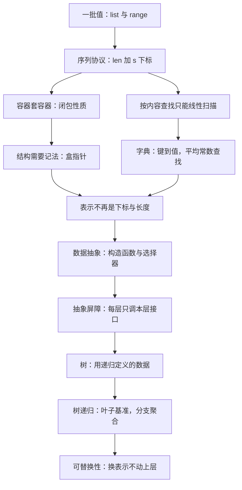
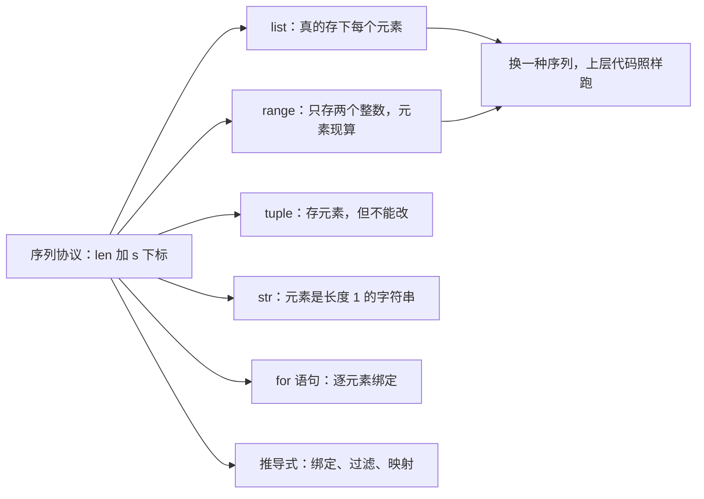
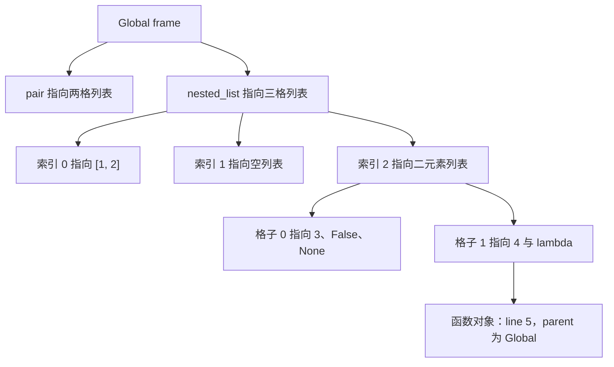
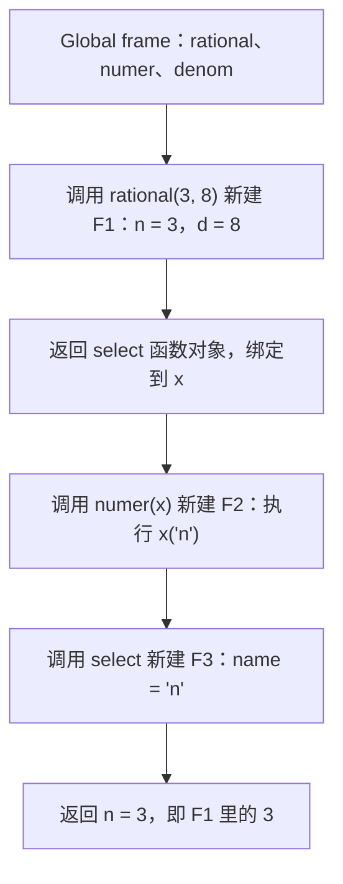
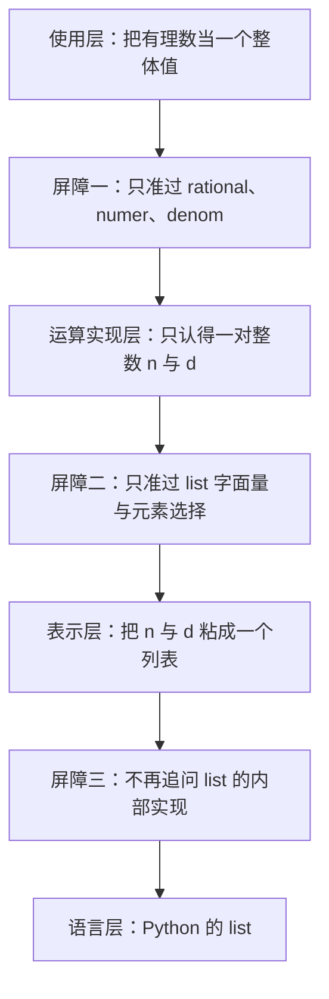
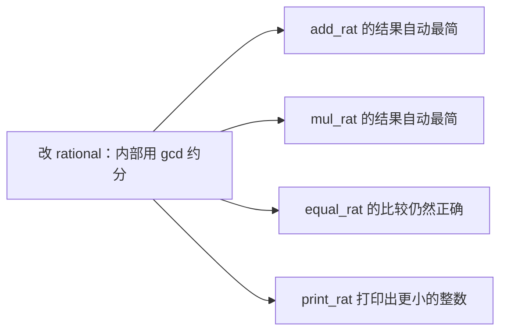
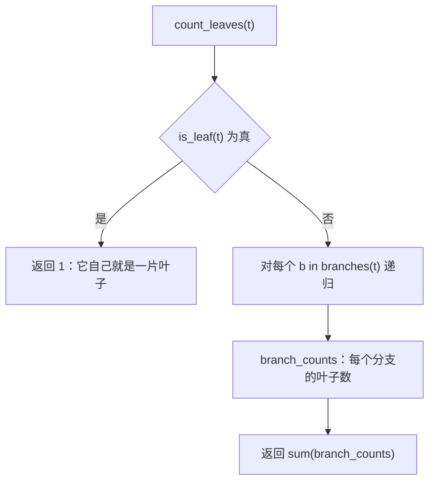
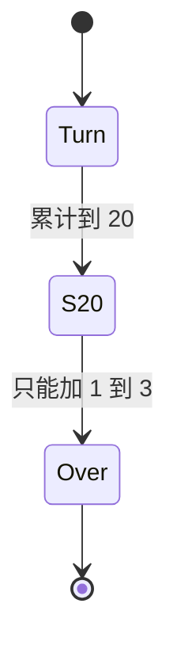
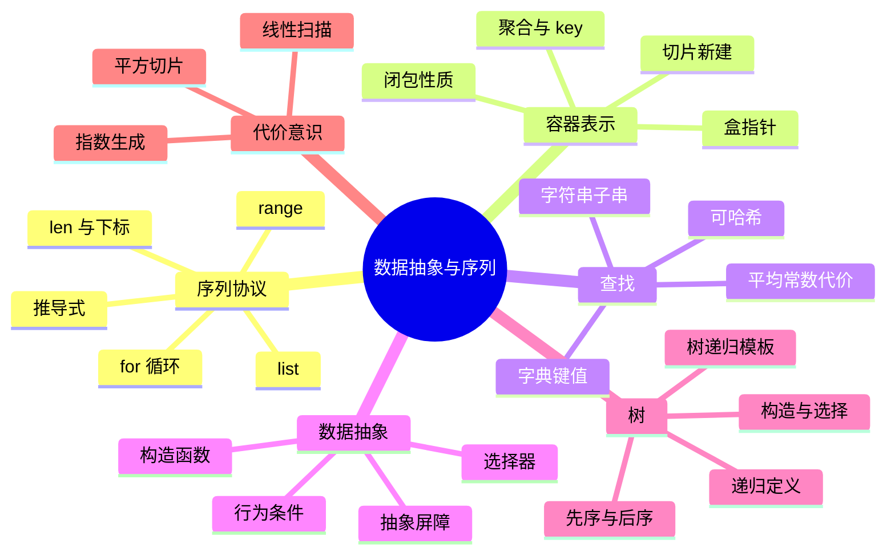

> **模块**：M3 CS61A-data，含 Lecture 11–14（Sequences、Containers、Data Abstraction、Trees）
> **总时长**：01:53:48（22:15 + 27:53 + 29:08 + 34:32）
> **合集**：[CS61A Fall 2024 中文字幕合集](https://www.bilibili.com/video/BV1sy411z7nA)，本模块对应分 P 11–14
> **课件**：`10-Sequences.pdf`（12 页）、`11-Containers.pdf`（16 页）、`12-Data_Abstraction_1pp.pdf`（17 页）、`13-Trees_1pp.pdf`（14 页），4 份官方 PDF 共 59 页，逐页渲染为正文插图
> **字幕**：B 站英文原声字幕；Lecture 12 与 Lecture 13 的片源是剪辑版，课件中存在而片源未讲的页面按逻辑位置保留并标注
> **版权**：课程与课件版权归 UC Berkeley CS61A 教学团队（Fall 2024）；本文是学习用途的中文二次整理，不是逐句翻译

## 0. 模块导览

*(参考时间: 00:00:01 – 00:00:53｜Lecture 11)*

前两个模块处理"一个值"。到第 11 讲，数据第一次成批出现，问题换成了"这批值怎么放、怎么找、怎么改"。四讲是围绕这句话的四步：把一批值组织成序列；承认序列的表示会变复杂、查找会变昂贵；给复杂表示配一套治理手段；用这套手段造出一个递归定义自己的类型。四讲是**一条因果链**——序列只承诺 `len(s)` 与 `s[i]`；一旦容器能装容器，这条承诺就不够用了（两个嵌套结构打印出来可能一模一样，实际结构却不同），于是先需要"结构化地描述表示"（盒指针），再需要"明确地规定接口"（抽象屏障）。屏障交付的性质可以一句话概括：**接口不变，表示可换**。

### 0.1 讲次清单

| 讲 | 主题 | 时长 | 课件页数 | 分 P | 在本模块里承担什么 |
| :--- | :--- | :--- | :--- | :--- | :--- |
| 11 | Sequences 序列 | 22:15 | 12 | [P11](https://www.bilibili.com/video/BV1sy411z7nA?p=11) | 立协议：构造、选择、遍历、按公式生成 |
| 12 | Containers 容器 | 27:53 | 16 | [P12](https://www.bilibili.com/video/BV1sy411z7nA?p=12) | 暴露表示：嵌套、共享、切片、聚合、字典 |
| 13 | Data Abstraction 数据抽象 | 29:08 | 17 | [P13](https://www.bilibili.com/video/BV1sy411z7nA?p=13) | 立屏障：构造函数、选择器、行为条件 |
| 14 | Trees 树 | 34:32 | 14 | [P14](https://www.bilibili.com/video/BV1sy411z7nA?p=14) | 验收：用屏障封装递归数据结构 |

### 0.2 主线图



左支是**表示越来越复杂**，右支是**接口越来越抽象**，两支在"抽象屏障"处汇合。最下面那个节点是本模块真正想留下的东西：可替换性有一个可演示的判据——改动一处表示，数一数上层有多少行代码需要跟着改。

### 0.3 跨讲重复的页面

四份课件由同一门课不同周次拼接而成，有几页在不止一份 PDF 里出现。本模块的规则是**每页各出现一次**，由所在章节决定讲哪一面。

| 内容 | 出现在 | 本模块的处理 |
| :--- | :--- | :--- |
| Two Lists 例题（按 y 找 x） | lec12 第 13 页、lec13 第 9 页 | §3.6 讲 `key` 的用法，两份都在该节 |
| 前缀和期中题 | lec12 第 14 页、lec13 第 11 页 | §7.3 并列，说明是同一道题 |
| Parking 停车方案 | lec12 第 15–16 页、lec13 第 12–13 页 | §7.4 分两处：一处讲建模，一处讲递推 |
| Data Abstraction 总结页 | lec13 第 17 页、lec14 第 4 页 | §5.8 并列，比较两版措辞 |
| Data Abstraction 分节页 | lec13 第 16 页、lec14 第 3 页 | §5.4 与 §5.8 |

> **编者说明**：Lecture 12 的片源从盒指针开始，Lecture 13 的片源从中段开始，所以这两讲课件的前半段页面在录像中没有对应讲解；本模块把它们放在逻辑上该在的位置，涉及推断处加注。

## 1. 序列：一种能力，而不是一个类型

*(参考时间: 00:00:01 – 00:16:37｜Lecture 11)*

程序里第一次出现"一批数"，最直接的做法是开一堆变量；这条路走不通，因为变量个数必须写在代码里，而数据个数往往到运行时才知道。序列把"个数未定的一批值"收进一个值里，于是函数可以收下任意多个数，也可以返回任意多个结果。它还有第二层价值：**把"一批值"的操作压缩成两个能力**——知道有多长（`len`）、能按下标取（`s[i]`），就足以写出遍历、筛选、求和、查找；至于内部是连续内存、链表还是每次现算，使用者不需要知道。这就是后三讲反复使用的数据抽象，只不过在这里由内建类型免费提供。


> **编者说明**：本讲录像从 `list` 的内容直接开始，字幕中没有公告口播，第 2 页按页码顺序保留。

### 1.1 构造、选择与偏移量模型


```python
odds = [1, 3, 5, 7]
>>> odds[3]
7
>>> len(odds)
4
>>> odds[odds[3] - odds[2]]
5
```

最后一个元素的下标是 3、长度却是 4，这是几乎所有人都会绊一下的地方。讲师给的模型不是"Python 从 0 开始数"这句口诀，而是**下标即从开头起的偏移量（offset）**：偏移 0 是开头本身，偏移 3 是最后一个元素。于是"最后一个下标 = 长度 − 1"成了"最后一个元素离开头有 `len - 1` 步"的直接翻译。元素选择是**表达式**，两侧都可以嵌套（`odds[odds[3] - odds[2]]` 先算出 2、再取 `odds[2]`）；它还有函数写法 `operator.getitem`，把"取元素"降级成普通实参，于是可以被传来传去——与"函数即值"是同一套思路。

### 1.2 序列的四条基本操作

Lecture 13 的课件里有一页把"一个数字列表上最重要的操作"压成四行交互，内容属于本节——它是序列操作的清单式复习。


```text
>>> s = [5, 7, 9, 11]  # Make a list using a list literal
>>> s[0]               # Get the first element using item selection
5
>>> s[1:]              # Get the rest using slicing
[7, 9, 11]
>>> [3] + s            # Make a longer list using addition
[3, 5, 7, 9, 11]
```

注释里的动词选得很准：make（造）、get（取）、get the rest（取剩下的）、make a longer（造一个更长的）；四个动作里两个是"造"、两个是"取"——序列上的绝大多数算法，都是"取出一部分、造出一个新的"。

| 操作 | 写法 | 返回 | 是否新建对象 | 代价 |
| :--- | :--- | :--- | :--- | :--- |
| 构造 | `[5, 7, 9, 11]` | 列表 | 是 | 与元素个数成正比 |
| 选择一个 | `s[0]`、`getitem(s, 0)` | 第 0 个元素 | 否 | 常数 |
| 取一段 | `s[1:]` | 新列表 | 是 | 与片段长度成正比 |
| 拼接 | `[3] + s` | 新列表 | 是 | 与两段总长成正比 |
| 长度 | `len(s)` | 整数 | 否 | 常数 |

"是否新建对象"这一列最容易被忽略：`s[1:]` 造新列表，所以改片段不会改原文；`s[0]` 不造新对象，如果第 0 个元素本身是列表，"取出来"取到的仍是那一个列表。

> **编者说明**："与长度成正比"是渐近说法：CPython 里 `s[1:]` 与 `[3] + s` 都是 `O(n)`，而 `s[0]` 与 `len(s)` 是 `O(1)`。另外 `*` 复制的是元素引用，嵌套列表会共享内层。

### 1.3 嵌套、`in` 与线性扫描

```python
>>> pairs = [[10, 20], [30, 40]]
>>> pairs[1][0]
30
>>> 8 in [1, 8, 2, 8]
True
>>> [1, 8] in [1, 8, 2, 8]
False
```

`pairs[1][0]` 是**组合表达式**：先取第 1 号元素，再取那个元素的第 0 号元素。讲师在这里说了本讲最关键的一句：**列表是一个值，它表示其他值的集合**——于是"某个值是否出现在这个集合里"变成必须回答的问题。`in` 只做**逐元素的相等比较**，三个常见误读可以压成一张表：

| 被检验的表达式 | 结果 | 原因 |
| :--- | :--- | :--- |
| `'1' in [1, 8, 2, 8]` | `False` | 不做类型转换，字符串与整数不相等 |
| `[1, 8] in [1, 8, 2, 8]` | `False` | 不搜索子序列，只比一级元素 |
| `[1, 2] in [[1, 2], [3, 4]]` | `True` | `[1, 2]` 恰好是一个一级元素 |
| `[1, 2] in [[[1, 2]]]` | `False` | 一级元素是 `[[1, 2]]`，再深一层不算 |

`in` 不会"钻进结构里找任何看起来匹配的东西"。这个决定很省事，代价是它无法表达"任意深度地找"——那种需求只能自己写递归，这里已经埋下后半程的伏笔：**容器的结构一旦有层次，就再也不能靠一个通用运算符替你走完全程**。代价还有第二个维度：每次判定都是一次线性扫描，把 `in` 放进遍历同一个列表的循环里，整体就成了平方级——这正是第 4 章字典存在的全部理由。

### 1.4 `for`：把遍历的样板代码收进语法

```python
def count(s, value):
    total, index = 0, 0
    while index < len(s):
        element = s[index]
        if element == value:
            total += 1
        index += 1
    return total

def count(s, value):
    total = 0
    for element in s:
        if element == value:
            total += 1
    return total
```

上面五步里只有 `if` 那一步是真正的逻辑，其余四步都在为"把列表从头走到尾"服务。`for` 一行替掉了初始化下标、检查边界、每轮推进三件事，更重要的是把失败模式移出了写作者的视野：

| 判据 | `while` 版本 | `for` 版本 |
| :--- | :--- | :--- |
| 需要显式下标变量 | 需要 | 不需要 |
| 终止条件 | 手写 `index < len(s)` | 语句自动判断 |
| 每轮推进 | 手写 `index += 1` | 语句自动推进 |
| 循环变量绑在哪一帧 | 当前帧 | 当前帧（同样不新建帧） |
| 典型出错方式 | 忘推进则死循环；边界写成 `<=` 越界 | 基本不存在这两类错误 |

`for` 的语义只有三条：求值头部得到**可迭代值（iterable）**；对每个元素绑定名字、执行 suite；绑定发生在**当前环境的第一帧**里，不新建帧。第三条是与函数调用的关键差别——循环不提供作用域隔离；第二条是它与 `while` 等价性的来源，因为展开式里同时出现 `s[i]` 与 `len(s)`，这解释了为什么此刻可以把"可迭代"直接理解成"序列"。头部还有一处灵活性：`for x, y in pairs:` 可以写多个名字，前提是每个元素定长——这叫**序列解包（sequence unpacking）**，与多重赋值同构，因此也要求长度匹配。

### 1.5 `range`：两个整数表示一串整数


课件上的画法值得复述：想象一条排满整数的数轴，`range(-2, 2)` 是在数轴上截出**有限的一段**，从 `-2` 往右数到 `2` 之前。图上两个箭头都指向数字左侧的空隙：`-2` 落在这段区间里，`2` 被挡在区间之外。包含起点、排除终点，初看古怪，但它让两件事同时变简单：**长度**是结束值减起始值（`2 - (-2) = 4`），**元素选择**是起始值加下标（下标 3 是 `-2 + 3 = 1`）；两条公式都不需要 `±1` 修补，这就是半开区间的回报。

于是 `range` 满足序列协议：有长度，能按下标取元素。讲师据此下结论——**它有 `len` 和元素选择，所以它必须是序列，哪怕它不是列表**。这句话是整个模块的枢纽：序列不是某个具体类型，而是一组能力。

```python
>>> list(range(-2, 2))
[-2, -1, 0, 1]
>>> range(5, 8)
range(5, 8)
```

第二行的回显值得注意：`range(5, 8)` 求值得到的仍是 `range` 对象，屏幕上那行只是它的表示形式；要看到元素必须显式调用 `list`。讲师强调，理解语义之后 `[5, 6, 7]` 是可以直接推出来的，`list` 只用来**确认**。



这张图要说明的是一件反直觉的事：`range` 与列表在**内存里没有共同点**，在**接口上完全一致**；`for` 与推导式只依赖接口，因此对两者一样好用——这就是抽象最朴素的样子。

> **编者说明**：`range` 不保存元素、每次按公式现算，这种行为称为惰性（lazy）。后果有两个：`range(10**12)` 几乎不占内存；`range` 不可原地修改，也不能用 `+` 拼接另一个 `range`。

## 2. 推导式：把"遍历 + 加工 + 收集"压成表达式

*(参考时间: 00:18:38 – 00:22:12｜Lecture 11；00:23:22 – 00:25:21｜Lecture 12)*

`for` 是**语句**：它要占用一行标题、一个缩进块，还得先准备空的结果容器。读者要读五行才能看到"每个元素变成什么"，而真正的信息只有一个表达式。列表推导式把这三件事压成一种表达式形式；它的价值不只是短，而是用固定的语法槽位承载意图——任何一个槽位空着，读代码的人立刻知道缺了什么。

### 2.1 三段式语法


```text
[<map exp> for <name> in <iter exp> if <filter exp>]
[<map exp> for <name> in <iter exp>]     # 短版本
```

```python
odds = [1, 3, 5, 7, 9]
>>> [x + 1 for x in odds]
[2, 4, 6, 8, 10]
>>> [x for x in odds if 25 % x == 0]
[1, 5]
>>> [x + 1 for x in odds if 25 % x == 0]
[2, 6]
```

| 组成 | 语法位置 | 作用 | 例子 |
| :--- | :--- | :--- | :--- |
| 数据源 | `<iter exp>` | 提供可迭代对象 | `odds`、`range(2, n)` |
| 绑定名 | `<name>` | 每轮指向一个元素 | `x`、`e` |
| 映射表达式 | `<map exp>` | 决定输出元素 | `x + 1` |
| 过滤表达式 | `<filter exp>` | 决定是否保留 | `25 % x == 0` |

第三行的结果不是 `[1, 5]` 再加一，而是对每个通过的 `x` 直接算 `x + 1`——顺序上永远是**先过滤、后映射**，尽管 `if` 写在后面。记住"`if` 是守卫，守卫先于加工"即可。推导式还能和 `+` 组合，本讲最后一道例题把"永远成立的平凡解"从循环里剥离出来：

```python
def divisors(n):
    """Return the divisors of n.

    >>> divisors(4)
    [1, 2]
    """
    return [1] + [x for x in range(2, n) if n % x == 0]
```

`[1]` 单拎出来，因为 1 能整除任何正整数；把它从循环里拿掉，循环就能从容得不成立的 2 开始。`range(2, n)` 的上界取 `n` 而不是 `n + 1`，靠的正是"排除终点"。

> **编者说明**：试除法是 `O(n)` 的。若 $d$ 是 $n$ 的因子，则 $n/d$ 也是，故只需枚举到 $\sqrt{n}$ 再成对收集；实现它需要拼接两个列表并处理完全平方数导致的重复。

### 2.2 两个等长列表：表示里没有"对齐"


```python
xs = range(-10, 11)
ys = [x*x - 2*x + 1 for x in xs]
xs_where_y_is_below_10 = [xs[i] for i in range(len(xs)) if ys[i] < 10]
```

`ys` 的每一项都是 `(x - 1) ** 2`，于是"小于 10"等价于 `x - 1` 落在 $-3$ 到 $3$ 之间，答案应当是 `[-2, -1, 0, 1, 2, 3, 4]`，与课件回显一致。这道题真正暴露的问题是：**两份列表之间的对应关系只存在于程序员脑子里的下标约定中**——容器本身不记录"第 i 个元素属于同一条记录"，于是每个用到它们的函数都要重写一遍 `for i in range(len(xs))` 并保证两个下标同步；错位一格，程序不报错，只给出一个看起来合理的结果。**当关系只能靠下标约定维持时，它就是不可检查的**，这个症状要到第 4 章的字典与第 5 章的抽象数据类型才根治。

### 2.3 `promoted`：分组而保序


```python
def promoted(s, f):
    """Return a list with the same elements as s, but with all
    elements e for which f(e) is a true value placed first.

    >>> promoted(range(10), odd)  # odds in front
    [1, 3, 5, 7, 9, 0, 2, 4, 6, 8]
    """
    return [e for e in s if f(e)] + [e for e in s if not f(e)]
```

答案是两个推导式相加。稳定性来源很朴素：两个推导式各自按 `s` 的原顺序产出，拼接只发生在段与段之间。这个写法要成立必须满足一个条件——**两组互斥且穷尽**：`f(e)` 与 `not f(e)` 恰好互补，所以每个元素必定落在且只落在一组里；若换成两个无关判断，元素就会被重复或丢失。代价是遍历两遍、`f` 被调用 $2n$ 次；若 `f` 很贵，就该换成一趟遍历加两个累积列表。


同一道题在 Lecture 12 的课件里又出现一次，作为"列表推导式复习"的开场：模式简单（分组）、约束明确（保序）、答案短（一行），是检验"是否真的会写推导式"的最小样本。

### 2.4 求值过程与作用域

推导式的求值可以拆成四步，这四步在 Lecture 12 讲字典推导式时被正式念过，也完全适用于列表推导式：

1. 新建一个帧，父帧是**当前帧**；
2. 创建一个空的结果容器，它就是整个表达式的值；
3. 求值迭代表达式，对每个元素在新帧里绑定名字；
4. 若过滤表达式为真值，就把映射表达式的值加进结果容器。

"先有容器、后填条目"是理解嵌套推导式的钥匙：内层推导式在**外层帧的子帧**里求值，所以它看得见外层绑定的名字。第 1 条还有一处与 `for` 相反的细节：`for` 把循环变量绑在当前帧，推导式却有自己的帧，所以 `[x for x in odds]` 执行完，外层的 `x` 仍是执行前的那个。

> **编者说明**：`for` 泄漏循环变量、推导式不泄漏，是 Python 3 的行为（Python 2 的列表推导式同样会泄漏）。`list(map(f, s))` 与 `[f(e) for e in s]` 等价，`list(filter(f, s))` 与 `[e for e in s if f(e)]` 等价，区别在于前两者返回按需计算的迭代器。

## 3. 容器与表示：闭包性质、切片与聚合

*(参考时间: 00:00:10 – 00:12:15｜Lecture 12)*

到目前为止，容器被当作"一串有编号的格子"来用。这一讲的重心换了：不再问"怎么取"，而问"取出来的东西到底是什么"。触发转向的是一个很小的语言事实——列表的元素可以是列表。于是程序里出现两种结构完全相同、含义完全不同的情况：共享与复制，而两者打印出来一模一样。从这一讲开始，"表示"成为必须被明确讨论的对象：先要有能画出结构的记法，再要有能判断代价的分析，最后要有能约束访问的接口。


### 3.1 闭包性质：容器为什么一定会套容器


> **编者说明**：本讲片源从盒指针开始，字幕里没有公告口播，第 2 页按页码顺序保留。

课件用一个术语解释这个转折点：**闭包性质（closure property）**——一种组合数据值的方法满足闭包，当且仅当"用这种方法组合出来的结果，本身还能用同一种方法再组合"；放在列表上就是：能往列表里放元素，就应当能把列表放进列表。闭包让**层次结构（hierarchical structures）**成为可能：文件夹里放文件夹、章节里套小节、语法树里套子树。没有闭包，数据结构只能是一张平铺的表；有了闭包，任何"整体包含局部、局部再包含更小局部"的模型都能被同一个类型表达。代价在 §1.3 出现过一次：一旦列表能装列表，"哪个元素在哪一层"就不再是一眼看穿的事。


### 3.2 盒指针：两种箭头画清一个结构

**盒指针记法（box-and-pointer notation）** 只有两条规则：列表画成一排**带索引标号的相邻方格**，每个元素一格；每个格子要么直接装着**基本值（primitive value）**，要么用箭头指向一个**复合值（compound value）**。

```python
pair = [1, 2]

nested_list = [[1, 2], [],
               [[3, False, None],
                [4, lambda: 5]]]
```

`nested_list` 是三个元素的列表，所以画面上是三个相邻格子；它的三个元素**全都是列表**，而列表是复合值，所以三个格子里的内容都不是数值而是箭头。讲师给出一条一般规则：列表是复合值，函数也是复合值，凡是"由多个部分组成"的东西，都用一个箭头指向对它的描绘。




索引 1 指向空列表，画面上是一条写着 "empty list" 的箭头；索引 2 的格子 0 指向 `[3, False, None]`，格子 1 指向 `[4, lambda: 5]`，而 `lambda` 是函数、属于复合值，所以画成指向函数对象的箭头。

> **编者说明**：讲师口述时把最后那个内层列表说成"索引 3 处的元素"，画面上它是索引 2——`nested_list` 只有 0、1、2 三个位置，这是一处口头小口误。

读环境图只需分清两类箭头：**名字 → 值**是绑定，**值 → 组成部分**是包含；读图的方法是固定的——先顺着名字找到对象，再顺着格子一层层往下走。这个过程与第 6 章处理树的递归是同一件事。

### 3.3 打印文本不是结构

```python
def f(s):
    x = s[0]
    return [x]

t = [3, [2+2, 5]]
u = [f(t[1]), t]
print(u)          # [[4], [3, [4, 5]]]
```

按求值顺序走：`t` 是 `[3, [4, 5]]`；`f(t[1])` 的实参是那个 `[4, 5]` 列表本身（不是副本），`x = s[0]` 得 4，`return [x]` **新建**列表 `[4]`；于是 `u[0]` 指向新列表，`u[1]` 指向 `t` 自己。


这道题真正想问的是最后一步：屏幕上那行 `[[4], [3, [4, 5]]]` **完全不能区分结构差异**——假如 `u` 的第二个元素是 `t` 的一份独立拷贝，打印结果一模一样，但环境图里会是两条指向不同列表的箭头。同一个值可能对应两种结构，而值本身不携带这个信息。这条结论是第 5 章抽象屏障的前提：既然打印文本不足以描述结构，"这个数据类型允许被怎么用"就不能靠观察打印结果来约定，必须另有明文规定——那套明文规定就是构造函数与选择器。

> **编者说明**：录像没有讨论这一页，环境图分析与打印结果由编者按课件代码补写。`print` 输出的方括号形式是列表的 `repr`，与"列表在内存里的样子"不是一回事。

### 3.4 切片：`range` 规则的紧凑写法

```python
>>> [odds[i] for i in range(1, 3)]    # 先看推导式版
[5, 7]
>>> odds[1:3]                          # 切片只是它的紧凑记法
[5, 7]
>>> odds[:], odds[1:], odds[:3]
([3, 5, 7, 9, 11], [5, 7, 9, 11], [3, 5, 7])
```


`range(1, 3)` 给出 1 和 2、**不含** 3；切片沿用同一条规则：含下界、不含上界。省略起点默认为 0，省略终点默认到末尾，两端都省略得到整个列表的副本。

| 表达式 | 语义 | 值 |
| :--- | :--- | :--- |
| `odds[1:3]` | 索引 1 起，到 3 之前 | `[5, 7]` |
| `odds[:3]` | 从头到索引 3 之前 | `[3, 5, 7]` |
| `odds[:]` | 整个列表的一份副本 | `[3, 5, 7, 9, 11]` |

紧跟着是本节最要紧的一句话：**切片总是创建新值**。课件用三次切片把这句话摆成了图：`digits = [1, 8, 2, 8]` 切出 `[:1]`、`[1:3]`、`[2:]`，做完之后环境图里一共有**四个**列表，`digits` 自己一个格子都没变。但"新建外层"与"复制元素"是两回事：`nested[:]` 造出了新列表，两个内层列表还是原来那两个——这就是浅拷贝。

切片最实用的用法是把"窗口"固定成若干格。课件的问题是：判断列表 `s` 里是否有**两个相邻的** 8。


```python
def double_eights(s):
    for i in range(len(s) - 1):
        if s[i] == 8 and s[i + 1] == 8:
            return True
    return False


def double_eights(s):
    if s[:2] == [8, 8]:
        return True
    elif len(s) < 2:
        return False
    else:
        return double_eights(s[1:])
```

上界写成 `len(s) - 1` 有原因：循环体要访问 `s[i + 1]`，`i` 最大只能到 `len(s) - 2`。递归版把切片当窗口，没命中就丢掉首元素；`elif len(s) < 2` 是出口，位置必须在真正的判断之后，否则 `[8, 8]` 这种输入还没被比较就被当成"太短"挡掉了。

| 判据 | 循环版 | 递归版 |
| :--- | :--- | :--- |
| 窗口怎么移动 | `i` 自增 | `s[1:]` 丢掉首元素 |
| 出口 | 循环走完返回 `False` | `len(s) < 2` |
| 总代价 | `O(n)` | `O(n^2)`，每步切片复制剩余元素 |

递归版每次 `s[1:]` 都造新列表，复制长度随 $n$ 递减，总代价平方级。课件并排展示两种写法是为了对比"同一问题的两种表达"，不是暗示代价相当。

> **编者说明**：录像没有讲到这一页，上面对 `range` 上界、出口位置与两种写法代价的分析由编者补写。若 `s` 是字符串，窗口比较要写成 `s[:2] == '88'`，递归版依然成立。

### 3.5 聚合：把整次遍历折成一个值

处理容器里的值时，绝大多数操作都是"遍历所有元素，最后得到一个结果"。Python 内置了一批函数专门做这件事：它们接受**可迭代（iterable）**参数，把一批值折叠成一个值，这类操作叫**序列聚合（sequence aggregation）**。


```text
sum(iterable[, start]) -> value
max(iterable[, key=func]) -> value
max(a, b, c, ...[, key=func]) -> value
all(iterable) -> bool
```

文档里的方括号**不是让你调用时写方括号**，而是"这个参数可选"的惯例；读成"可选"之后，`max` 两种形态的区别也就一目了然：前者收一个容器，后者收一串实参。

```python
>>> sum([2, 3, 4], 5)
14
>>> sum([[2, 3], [4]], [])
[2, 3, 4]
```

`start` 的本质不是"额外加一个数"，而是**告诉聚合器用哪种加法、从哪个单位元开始**。不给起点时 `sum` 从 0 开始，第一步就是 `0 + [2, 3]`，数字加列表非法；给了空列表，整个可迭代被"接"成一个列表。空可迭代时返回 `start` 也是同一条设计的推论。

| 判据 | `sum` | `max` | `all` |
| :--- | :--- | :--- | :--- |
| 可选参数 | `start`：加法起点 | `key`：比较依据 | 无 |
| 折叠规则 | 逐个相加 | 保留最大者 | 逐个取 `bool` 后取"全都真" |
| 空输入 | 返回 `start` | 抛 `ValueError` | 返回 `True` |

> **编者说明**：两个常见陷阱。`all(range(5))` 返回 `False`，因为 `bool(0)` 是假值——想表达"0 到 4 都小于 5"，要传的是谓词结果而不是数本身。`max([])` 抛 `ValueError`：空集合没有最大值，返回默认值只会掩盖调用方的错误。`min` 与 `any` 分别是 `max` 与 `all` 的对偶。

三个聚合函数还揭示了上一讲没讲透的一件事：`for` 是语句，而"折叠"本可以是**表达式**。`sum(xs)` 与手写循环的区别不只是短，而是它把"遍历"从语句层挪到表达式层，于是它可以出现在推导式里、嵌在别的调用里、作为 `key` 的返回值。

### 3.6 `key`：把"比较什么"作为参数传进去

`max` 的文档写了 `key=func`，但没说它干什么。讲师的解释是：`key` 指定的函数会被**应用到每一个候选元素上**，比较按这些**返回值**进行；最终返回的仍然是原来那个元素。

```python
>>> max(range(10), key=lambda x: 7 - (x - 4) * (x - 2))
3
```

这条抛物线在 `x = 3` 处取到最大值 8，而 `max` 返回的是产生这个值的元素 3。判据可以压成两行：`max(s)` 比较元素本身、返回最大的元素；`max(s, key=f)` 比较 `f(元素)`、返回使 `f` 最大的那个元素。`key` 因此是一种"注入比较依据"的机制：`max` 负责遍历与保留，`key` 负责定义什么叫"大"。

> **编者说明**：这行 `max(range(10), key=...)` 按字幕口述还原：讲师说的是"7 减去（x 减 4）乘以（x 减 2）"，展开后正是 $-x^2 + 6x - 1$，顶点在 `x = 3`、值为 8；代码现场敲出，没有对应幻灯片。

`key` 还有一种用法，正好接上第 2 章那道"两个等长列表"的题。课件给两份长度相同、按位置对齐的列表，问"y 最小时对应的 x"：

```python
xs = range(-10, 11)
ys = [x*x - 2*x + 1 for x in xs]
>>> min(ys)
0
>>> min(xs, key=lambda x: x*x - 2*x + 1)
1
```


`min(ys)` 返回 0，那是 **y 的值**，不是 x；两份列表之间没有任何自动对齐关系。把同一个表达式交给 `key`，`min` 就会对 `xs` 的每个候选 `x` 先算出对应的 y，再保留"使 y 最小"的那个 `x`——`key` 在这里充当的是**两份列表之间的对齐通道**。


同一张例题页在 Lecture 12 的课件里也出现过一次，两份课件用的是同一份 `xs`、`ys` 与同一个答案 1。合起来可得一个可迁移的技巧：**当关系存在但容器不知道时，用函数把关系重新表达一遍**。

> **编者说明**：这一页不在录像中，答案与解释由编者按课件补写。`x*x - 2*x + 1` 恒等于 `(x - 1) ** 2`，所以最小值在 `x = 1` 处取 0。

## 4. 字符串与字典：两种"不像序列的序列"

*(参考时间: 00:12:18 – 00:23:21｜Lecture 12)*

上一章末尾留下一个问题：两份列表之间的对应关系，容器自己不知道。这一章给出两个方向相反的回应。字符串也是序列，但它的"元素"与"容器"是同一个类型，于是 `in` 的语义悄悄从"找一个元素"变成"找一段子串"；字典干脆放弃"按位置编号"，改用键定位，于是"按内容查找"从线性扫描变成平均常数时间。两者放在同一章，是因为它们共同证明了一件事：**"序列"这个词没有唯一正确的实现**。

### 4.1 字符串是一种抽象

讲师开场就说，字符串是他最喜欢的话题，理由是它是一种**抽象（abstraction）**：它把"到底怎么编码"藏了起来，但确实携带信息。课件用三类例子说明它表示什么——**数字**（科学计数法、带小数点的写法都是字符串，形状本身在传递信息）、**语言**（课件引了莎士比亚的诗，把语言、计算机科学与抽象串在一起：抽象做的就是"给空无一物一个名字"）、**程序**（Python 源文件本身就是字符串）。


最后一点现场演示过：`curry = lambda f: lambda x: lambda y: f(x, y)` 写进源文件，`curry` 就定义好了；同样地，在解释器里先把它当字符串创建出来，它"只是字符串"，而**执行**这个字符串，`curry` 就出现了。

> **编者说明**：要复现这个演示，需要用内置的 `exec` 执行一段字符串：`from operator import add` 之后 `exec('curry = lambda f: lambda x: lambda y: f(x, y)')`，再 `curry(add)(2)(3)` 得 `5`；`exec` 不在本讲字幕与课件中。写字符串有三种方式：单引号与双引号等价，三引号可跨多行；换行写作 `\n`，反斜杠连同后面那个字符在字符序列里其实只是**一个**元素。

### 4.2 字符串是序列，但元素类型是它自己

```python
>>> len('Berkeley')
8
>>> 'Berkeley'[3]
'k'
>>> 'here' in 'where'
True
>>> [2, 3] in [1, 2, 3, 4]
False
```

从字符串里选出一个元素，得到的是**一个字符串**，只是长度为一；讲师特意与列表对照——数字列表索引第 3 个元素得到的是一个数字，字符串不这样。这一差异是**自相似**带来的必然结果：字符串的容器类型是 `str`，如果元素类型不是 `str`，这个类型就不封闭（`s[0]` 得到的值不能继续索引、不能与别的字符串拼接）。规定"元素是长度为 1 的字符串"之后，整个类型在自己身上闭合了——这正是第 3 章闭包性质在**类型层面**的版本，而列表并不要求这一点。同样的自相似解释了 `in` 为什么换了语义：既然任何子串也是字符串，"一个字符串是否出现在另一个字符串里"就是类型内部完全合法的问题。

| 判据 | 列表 `list` | 字符串 `str` |
| :--- | :--- | :--- |
| 元素是什么 | 任意值 | 长度为 1 的字符串 |
| `s[i]` 返回 | 第 `i` 个元素本身 | 长度为 1 的字符串 |
| `x in s` 找什么 | 一个完整的元素 | 一段连续的子串 |
| 元素类型与容器类型 | 可以不同 | 相同（自相似） |

### 4.3 字典：只朝一个方向走的容器

字典（dictionary）存放"键（key）+ 值（value）"的配对：键是用来查东西的，值是被查出来的东西。按键查值的语法与列表一样用方括号，但括号里放的不是索引，而是键。

```python
numerals = {'I': 1, 'V': 5, 'X': 10}
>>> numerals['V']
5
>>> numerals['X-ray']
KeyError: 'X-ray'
>>> list(numerals)
['I', 'V', 'X']
```


这里有一条方向性限制必须记牢：**不能用值去查键**——想按 `5` 找出 `'V'` 是做不到的，直接写 `numerals[5]` 只会得到键错误；讲师的说法是"字典只朝一个方向走"。字典同时也是序列，而且是**键的序列**：`list(numerals)` 给出所有键，`for k in numerals` 逐个遍历键。想遍历值得换入口 `numerals.values()`，它是序列的一种但不是列表，却能求和、能被 `for` 遍历；真需要列表时包一层 `list` 即可——讲师用的类比是 `range`：只与某类东西相关的特殊序列。字典还能表示比"一一对应"更复杂的结构，因为**值可以是任意复杂的东西**：`len(d)` 数的是键，永远回答"容器的条目数"，不回答"内容有多重"。

> **编者说明**：字幕只讲了 `list(numerals)` 与 `numerals.values()`；实际写代码时更常用 `numerals.items()`，成对给出 `(键, 值)`，于是可以写 `for k, v in numerals.items():`。`sorted(numerals)` 按键排序、`sorted(numerals.items(), key=lambda kv: kv[1])` 按值排序。Python 3.7 之后字典保持插入顺序。

### 4.4 键的两条限制与查找的代价

字典的键有两条限制，来源完全不同。**键不能重复**：`{1: 'first', 1: 'second'}` 得到的字典里键 `1` 只出现一次；想给一个键关联多个值，正确做法是让这个键关联一个**列表**。**键本身不能是列表或字典**：

```python
>>> {[1, 2]: 'a'}
TypeError: unhashable type: 'list'
>>> {'a': [1, 2]}
{'a': [1, 2]}
```

讲师在这里踩了刹车：unhashable 是重要术语，他很想现在讲清楚，但"得给 61B 留点东西"；同时他强调**限制只针对键**，字典完全可以作为值。两条限制的性质不一样——**可哈希性**来自字典的**底层实现**；**键不重复**来自字典这个**抽象本身的约定**：字典的职责是"给你某个键对应的那**一个**值"，同一个键出现两次就无所谓"那一个值"了。于是字典的全部意义可以浓缩成一句话：**为一个键找到那一个值**。

> **编者说明**：字幕明确说 unhashable 属于 61B 的内容，以下为编者补充。字典底层是**哈希表（hash table）**：存键时先算 `hash(key)`、对桶数取模落到某个桶；查时对同一个键再算一次，直接跳到那个桶，所以"在 100 万个键里找一个"与"在 10 个键里找一个"平均耗时差不多。代价是键必须**稳定**：哈希值在键存活期间不能变；列表与字典可变，一旦允许它们当键，放进字典后再修改，哈希就变了，桶位失效，键再也找不回来。所以要求键可哈希——相等的键有相同哈希值且哈希值不变，对内置容器来说这等价于"键必须不可变"。同一条机制还解释了 `set`：元素必须可哈希，去重与 `in` 判断平均常数时间；空集合必须写 `set()`，因为 `{}` 是空字典。

### 4.5 五种内置容器的操作与代价

| 判据 | `list` | `tuple` | `str` | `dict` | `set` |
| :--- | :--- | :--- | :--- | :--- | :--- |
| 字面量 | `[1, 2]` | `(1, 2)` | `'ab'` | `{'a': 1}` | `{1, 2}` |
| 是否可变 | 可变 | 不可变 | 不可变 | 可变 | 可变 |
| 元素 | 任意值 | 任意值 | 长度 1 的字符串 | 键加值 | 可哈希的值 |
| 下标访问 | `s[i]` | `t[i]` | `s[i]` | 无下标，只有 `d[k]` | 无下标 |
| `len` 统计 | 元素数 | 元素数 | 字符数 | 键数 | 元素数 |
| `in` 语义 | 元素相等 | 元素相等 | 子串匹配 | 键是否存在 | 成员是否存在 |
| `in` 代价 | `O(n)` | `O(n)` | `O(n)` 量级 | 平均 `O(1)` | 平均 `O(1)` |
| 增加一个 | `append`，摊还 `O(1)` | 不支持 | 不支持 | `d[k] = v`，平均 `O(1)` | `add`，平均 `O(1)` |
| 能作字典键 | 不能 | 能，前提是元素都可哈希 | 能 | 不能 | 不能 |
| 典型用途 | 有序的一批值 | 定长记录 | 文本 | 关联查找、计数 | 去重、成员判断 |

表里三行最值得记：`in` 的语义、`in` 的代价、能不能作键。前面四讲反复出现的"为什么需要字典"，答案就在"`in` 的代价"这一行——列表与字符串的成员判断只能扫描，字典与集合靠哈希直接定位。而"能不能作键"这一行把可哈希性从一个陌生术语变成了可以检查的性质：**可变的东西没有稳定的哈希，因此不能作键**。

> **编者说明**：`tuple`、`set` 不在 Lecture 11–14 的讲解范围内，列出它们是为了让"协议共享、实现各异"有完整对照。表中 `O(1)` 均为平均代价，最坏情况会退化；`append` 的"摊还"指单次可能 `O(n)`（扩容），均摊到每次是 `O(1)`。

### 4.6 字典推导式与 `index`

字典推导式（dictionary comprehension）与列表推导式只差一个冒号，求值过程仍是第 2 章那四步，差别只在"填充"这一步：列表放的是映射表达式的值，字典放的是一对"键的值 + 值的值"。

```text
{<key exp>: <value exp> for <name> in <iter exp> if <filter exp>}
```


```python
>>> {x*x: x for x in range(1, 6) if x > 2}
{9: 3, 16: 4, 25: 5}
```

把推导式用起来的最好例子是 `index`：它接收一串键、一串值，以及一个两参数 `match` 函数，返回一个字典——对每个键 `k`，字典里那条的值是 `values` 中所有使 `match(k, v)` 为真的 `v` 组成的**列表**。讲师读题时特意停在一句话上：当题目说"一个从键到列表的字典"，意思是字典的每条**有一个键**，而它对应的值**是一个列表**——这正好用上了 §4.4 那条限制。

```python
def index(keys, values, match):
    """Return a dictionary from keys k to a list of values v in values
    for which match(k, v) is a true value.
    """
    return {k: [v for v in values if match(k, v)] for k in keys}

>>> index([7, 9, 11], range(30, 50), lambda k, v: v % k == 0)
{7: [35, 42, 49], 9: [36, 45], 11: [33, 44]}
```

逐块对上四步：**键表达式**就是 `k`；**值表达式**是内层列表推导式，它遍历 `values` 只留下匹配的值；**迭代来源**是 `keys`，外层不需要过滤。内层能用到的两个名字值得单独指出：`v` 是它自己绑定的，`k` 来自外层。之所以能这样写，正是四步求值的第 1 步——字典推导式在**新建的帧**里求值，内层列表推导式又在它的子帧里求值，查名字时沿父帧往上走，自然找到了 `k`。讲师的原话是："因为这条列表推导式在这条字典推导式里面，这个表达式既能引用 `v`（值），也能引用 `k`（键）。"

> **编者说明**：这一页的代码是讲师现场敲的，幻灯片上没有；docstring 按字幕口述整理。返回值里键的次序取决于 `keys` 的次序。这段代码的代价是 `O(|keys| × |values|)`——每个键都要扫一遍值列表，值列表很大时这个二次结构就是瓶颈。

## 5. 数据抽象：把表示藏到接口后面

*(参考时间: 00:00:34 – 00:15:51｜Lecture 13；00:01:23 – 00:02:36｜Lecture 14)*

前四章处理的是"别人给好的容器"。这一讲开始，我们要自己定义数据类型。触发点是一个很实际的困难：有理数没法用浮点数精确表示，`1 / 3` 只能给出有限近似。要精确，就必须把分子与分母**成对**保存。可是"成对保存"具体怎么保存？列表、字典、元组、还是两个闭包？这个选择一旦写进代码，就会渗到每一个用到有理数的地方——除非有办法把选择限制在一处。这一讲的办法，是把程序切成两半：一半管"数据怎么表示"，一半管"数据怎么被使用"，中间立一道屏障。切法本身简单，难的是**切干净**：判断标准不是代码能不能跑，而是它是否假设了下层的表示。

### 5.1 行为条件：什么才算一个有理数

一个值之所以是有理数，不是因为它长成某个样子，而是因为它**表现**得像有理数。具体写法是一条**行为条件（behavior condition）**：若 $x$ 由分子 $n$ 与分母 $d$ 构造而成，那么用两个选择器把它拆开、再做除法，必须还原出 $n/d$：


$$
x = rational(n, d) \quad \Longrightarrow \quad \frac{numer(x)}{denom(x)} = \frac{n}{d}
$$


这条等式把三样东西绑在一起：构造函数 `rational`、两个选择器 `numer` 与 `denom`、以及选择器结果之间的一次运算。单看构造函数只能知道"它收下两个整数"，单看选择器只能知道"它吐出两个数"，只有放进同一条等式才构成可验证的定义。讲师的说法很干脆：**除非一个东西的行为像有理数，否则你并没有有理数的表示**；反过来，这条等式也是自由的来源——只要它成立，底层怎么放这几个数就完全无所谓。

### 5.2 先写使用层：三个函数的契约

有理数真要被用起来，需要加法、乘法、相等判断、打印，这批代码构成**使用层**。讲师的说法很直接：这些函数"对表示本身不作任何假设，只要求构造函数与选择器存在"。这句话听起来平淡，做起来反直觉：它意味着**可以先写运算，再写数据**。

```python
def mul_rat(x, y):
    return rational(numer(x) * numer(y),
                    denom(x) * denom(y))


def add_rat(x, y):
    nx, dx = numer(x), denom(x)
    ny, dy = numer(y), denom(y)
    return rational(nx * dy + ny * dx, dx * dy)


def equal_rat(x, y):
    return numer(x) * denom(y) == numer(y) * denom(x)
```

三处细节值得单独说。`add_rat` 先起名字，是因为分子与分母在表达式里各出现两次，`nx, dx = numer(x), denom(x)` 既避免重复调用选择器，也让公式与代码一眼对得上；`mul_rat` 里每个选择器只出现一次，所以不必起名字。`equal_rat` 不能逐项比较：`rational(1, 2)` 与 `rational(2, 4)` 是同一个数，可部件是 `(1, 2)` 与 `(2, 4)`，逐项比会得出"不相等"，正确做法是交叉相乘——比的是值，不是写法。第三个细节最容易被忽略：**这三个函数一个都没被实现过**，它们此刻照样可读、可推导、可评审，因为契约已经成立。


> **编者说明**：本讲片源是剪辑版，字幕从"维护抽象屏障的目的"开始，公告内容没有口播，第 2 页按页码顺序保留。有理数的代码在录像里敲在编辑器中，课件页上没有对应代码；打印函数字幕没有给名字，本文统一写作 `print_rat`。

### 5.3 换一种表示：让函数携带数据

有了契约，第一件事就是证明它可以被换。构造函数不再返回 `[n, d]`，而是在自己内部定义一个叫 `select` 的小函数，把 `n` 与 `d` 关在里面，再把这个函数交出去：

```python
def rational(n, d):
    def select(name):
        if name == 'n':
            return n
        elif name == 'd':
            return d
    return select


def numer(x):
    return x('n')


def denom(x):
    return x('d')
```

构造函数把 `select` 作为返回值送出，于是"一个有理数"变成了一个**函数**；选择器随之改变写法——`numer(x)` 不再取下标，而是**调用** `x`。再跑一遍 `rational(1, 2)` 与 `rational(3, 8)`，`print_rat(mul_rat(x, y))` 仍打印 `3/16`。真的换了吗？当然换了，因为 `x` 现在是一个函数——而且**只用函数就够了，连内置的列表类型都不需要**。



这张图值得记住的是它的**形状**：数据不在任何一条语句里，而在一个函数对象的父帧里——名字 `n`、`d` 早已随着 `rational` 的调用结束而"离开"了活动环境，但 `F1` 因为被 `select` 的父指针指着所以没有消失。这是闭包第一次被当作**数据表示**使用。

| 判据 | 列表表示 | 函数表示 |
| :--- | :--- | :--- |
| 构造 | 返回 `[n, d]` | 返回闭包 `select` |
| 取分子 | `x[0]` | `x('n')` |
| 使用层是否要改 | 不必 | 不必 |
| 依赖的内置类型 | `list` | 只有函数 |
| 打印出来是什么 | `[1, 2]` | 一个函数对象（只显示地址） |

最后一行是这次更换的代价：有理数一旦变成函数，再想"看一眼它是什么"就不行了。可见性被牺牲掉，换来的是"不需要任何内置复合类型也能造出复合数据"。

### 5.4 抽象屏障：一层使用，三层表示


讲到这里，讲师重新开了一个头："一种新的抽象方法。"落点是**复合值（compound value）**：日期由年、月、日拼成，地理位置由纬度与经度拼成；把这类东西"当成一个整体来操作"本身就是一种抽象。数据抽象比"打包"多走一步：把任何用到数据的程序切成两半——**数据怎么表示**，与**数据怎么被使用**。分层的结果是四层：**使用层**拿有理数做计算，这里它是一个整体数据值；**运算实现层**把它看作"一个分子与一个分母配成的一对"，但不需要知道它们怎么粘起来，只准用 `rational`、`numer`、`denom`；**表示层**真正实现这三个函数，把它看成两个元素的列表；**语言层**是列表自身，写选择器的人不该再操心列表怎么实现。



图上每一道屏障，在课堂上是画成一条**非常粗的线**的。粗线的含义很硬：拿有理数做计算的那部分代码，只准用这条线以上提供的函数，不准伸手去够另一层的函数。这样写出来的程序，对"用的是哪种表示"所作的假设**尽可能少**。

| 层 | 这一层把有理数看成 | 唯一允许调用 | 越界的后果 |
| :--- | :--- | :--- | :--- |
| 使用层 | 一个整体值 | `add_rat`、`mul_rat`、`equal_rat`、`print_rat` | 绑死在某一种表示上，改表示时整段失效 |
| 运算实现层 | 分子加分母 | `rational`、`numer`、`denom` | 假设底层是列表，换表示时计算结果出错 |
| 表示层 | 两个元素的列表 | 列表字面量、元素选择 | 假设列表内部布局，语言层改动时受牵连 |
| 语言层 | 语言提供的 `list` | 字面量与下标运算符 | 越界即等于自己重写一个列表 |

"就这些了吗？"讲师自问自答：程序里的抽象层远不止这三层。列表本身是 Python 实现出来的东西，我们不需要知道它内部怎么排列、怎么扩容；需要知道的只有两件事——可以用字面量创建，可以用元素选择拆开。由此得到一条可迁移的规则：**每一根粗线都是一道屏障；写程序时，要使用与当前任务相匹配的那一层抽象**。

### 5.5 越界的代价：最坏的地方是它暂时对

```python
def div_rat(x, y):
    return rational(numer(x) * denom(y), denom(x) * numer(y))


def div_rat(x, y):                                  # 违规版本
    return [x[0] * y[1], x[1] * y[0]]
```

上面两个版本是合规与违规的对照。违规版**不报错**，甚至在当前实现下给出正确答案。讲师的原话是：它能工作，不会抛异常，"然而我们做了一件极其错误的事"——我们违反了抽象屏障。错在哪里可以拆成两条：**它假设了表示**，写 `x[0]` 就等于宣布"有理数是一个装着两个整数的列表"；**它绕过了构造函数**，将来改 `rational` 的代码，这一块不会跟着变。讲师的反应把这条规则的分量说足了：一次还不够，这里连着犯了两次；"如果我在别人的电脑上看到这样的代码，我会把电脑点着，看着它烧掉——因为违反抽象屏障的代码就该烧。"

| 判据 | 合规的 `div_rat` | 违规的 `div_rat` |
| :--- | :--- | :--- |
| 取部件的方式 | `numer(x)`、`denom(y)` | `x[0]`、`y[1]` |
| 造结果的方式 | `rational(...)` | 手写列表 |
| 当前实现下能否跑通 | 能 | 能（正是危险之处） |
| 换成函数表示后 | 仍然正确 | 立刻出错 |
| 改 `rational` 后是否跟随 | 跟随 | 不跟随 |

最后两行是本讲的要害：**越界最坏的地方不是它错，而是它暂时对**。错误被推迟到"改表示"的那一天才暴露。屏障是**约定**，靠命名、靠代码评审、靠每隔一段时间就真的换一次表示来检验。

### 5.6 一次真实改动：只改构造函数，全部受益

乘法 $\frac{3}{2} \times \frac{5}{3}$ 按代码直译应当是 $15/6$，可课堂上的答案是 $\frac{5}{2}$——15 与 6 都能被 3 整除；加法同理：$\frac{2}{5} + \frac{1}{10}$ 交叉相乘得 25、分母 50，约去 25 得 $\frac{1}{2}$。为什么要约分？讲师的回答很务实：**让整数尽可能小，好读、好理解**。于是有了新要求：有理数**永远**以最简形式表示，即分子与分母互质——注意措辞，不是"打印时约分"，而是"表示本身就该最简"。

怎么做到？讲师把问题倒过来看：**加法与乘法本来就是对的**，错的是 `rational` 的定义；要约分，就该在造有理数的那一刻完成。

```python
from math import gcd


def rational(n, d):
    g = gcd(n, d)
    return [n // g, d // g]
```

`gcd` 的两条性质都要用上：它是 $n$ 与 $d$ 的**公约数**，能整除两者；它又是**最大**的那个，所以除完之后的两个数互质。$15/6$ 的 $g$ 是 3，得到 `[5, 2]`。真正重要的是接下来这句：**`add_rat`、`mul_rat`、`print_rat` 一个字都不用改**——因为它们的每一个结果都是通过 `rational` 造出来的。



这是本讲唯一一次"收益兑现"：抽象屏障不是审美要求，它的收益是可度量的——**改动一个函数，影响所有调用它的地方，而没有任何地方需要跟着改代码**。这个性质有个别名：可替换性。

### 5.7 直接操作表示 vs 经由接口

```python
# 直接操作表示：把"有理数 = 两个整数的列表"焊进代码
def div_rat(x, y):
    return [x[0] * y[1], x[1] * y[0]]

# 经由接口：只认构造函数与选择器
def div_rat(x, y):
    return rational(numer(x) * denom(y), denom(x) * numer(y))

# 直接操作表示：把"树 = 标签在第一个位置"焊进代码
def leaf_count(t):
    if len(t) == 1:
        return 1
    return sum(leaf_count(b) for b in t[1:])

# 经由接口：只认构造函数、选择器与校验函数
def count_leaves(t):
    if is_leaf(t):
        return 1
    return sum(count_leaves(b) for b in branches(t))
```

两段逻辑完全一样，可替换性完全不同。左边这段一旦表示从列表换成字典 `{'label': ..., 'branches': [...]}` 就全线崩溃；右边这段只需要重写 `tree`、`label`、`branches`、`is_leaf` 四个函数，其余代码一行不动。第 6 章会真的做一次这样的替换。

| 数据 | 直接操作表示 | 经由接口 | 换表示后左边的下场 |
| :--- | :--- | :--- | :--- |
| 有理数 | `x[0]`、`x[1]`、`[n, d]` | `numer(x)`、`denom(x)`、`rational(n, d)` | 函数表示下立刻失效 |
| 直线 | `f[0]`、`f['slope']` | `slope(f)`、`y_intercept(f)` | 改成"两个点"后失效 |
| 树 | `t[0]`、`t[1:]`、`len(t) == 1` | `label(t)`、`branches(t)`、`is_leaf(t)` | 改成字典后失效 |

判断一段代码属于哪一列有个很机械的办法：**问它假设了什么**。出现"它是第几个元素""它的键叫什么""它的长度是多少"这类说法，它就在左列；只出现"它有分子与分母""它有标签与分支"这类说法，才在右列。

> **编者说明**：左列并不总是错的。当代码与表示写在同一层、且只服务于这一份表示时（例如 `numer` 本身的实现），下标操作是正当的；越界与否的判断标准是有没有**跨层**。

### 5.8 同一套论证的另外两个对象


课件用最后一页把这条原则推广到另一类数据。**少量函数在"表示"与"使用"之间强制执行一道抽象屏障**：以一条直线（仿射函数）`f` 为例——用 `slope(f)` 而不是 `f[0]` 或 `f['slope']`，用 `y_intercept(f)` 而不是 `f[1]` 或 `f['y_intercept']`。理由有两条：代码更好读、更好改；以及，将来完全可以把直线表示成两个点，而**用到直线的代码一行都不用动**。


Lecture 14 的课件在讲树之前把同一页又放了一遍，作为"数据抽象"的复习。两版措辞有一处值得注意的差别：树这一版在结尾多写了 "as a Python function"——直线的第三种可能表示。§5.3 的有理数已经演示过这种表示；把三者并列，恰好说明抽象屏障能容纳的表示范围有多宽。

> **编者说明**：这两页是课件的收尾总结页，片源在讲完 `gcd` 版构造函数后就结束了，直线例子与"两个点"的说法没有对应的口述讲解，此处按课件原文转述；Lecture 14 版本多出的 "Python function" 同样没有口播。

## 6. 树：递归定义的数据，递归地处理

*(参考时间: 00:02:36 – 00:34:29｜Lecture 14)*

第 5 章给出了一套通用做法：定义一小组构造函数与选择器，用它们把表示挡住。当时被挡住的表示只是"两个整数的列表"，规模很小。这一讲换一个真正复杂的表示来检验这套做法——一棵树。树底下是嵌套列表，层数不固定、宽度也不固定；如果处理树的代码直接下标到第二层，它立刻会被嵌套结构淹没。而一旦用四个函数把树封起来，递归处理它就变成三四行的事。另一条线是"递归"的第二次出场：前面的模块用递归处理**数**，第 2 章用递归处理**字符串**，这一讲用递归处理**结构**——而且这个结构本身就是用递归定义的，定义与处理共用同一套形状。

### 6.1 两种描述：木质树与家族树


本讲公告集中在项目与作业节奏上：项目二（CATS）已发布，其中两个阶段需要在周四前通过检查点，整份项目下周二截止；讲师还预告了下一讲的**可变性（mutability）**，并给出整门课唯一的建议：**尽量不要落后，每天都动一点手**。树值得单开一讲，理由有三：它会反复出现；它本身就是"表示层次关系"的通用建模手段；它同时用上递归的两面。


**递归描述（wooden trees，木质树）** 由四条规则组成：一棵**树**有一个**根标签**和一个**分支列表**；每个**分支（branch）**本身也是一棵树；没有任何分支的树叫**叶子（leaf）**；树从**根（root）**开始。关键在于第二条：分支是树。于是"叶子"不是另一种类型，只是"分支列表为空"的退化情形——它照样有自己的根标签，只是没有下层。**相对描述（family trees，家族树）** 则不问"怎么构造"，只问"某个位置在哪"：每一个位置叫**节点（node）**，每个节点有一个**标签（label）**，一个节点可以是另一个节点的**父节点**或**子节点**，最上面的叫**根节点**。

| 判据 | 木质树（递归描述） | 家族树（相对描述） |
| :--- | :--- | :--- |
| 基本对象 | 树本身：根标签加分支列表 | 位置：节点 |
| 组织方式 | 递归：分支也是树 | 相对：父、子、祖先、后代、兄弟 |
| 终结概念 | 叶子就是分支列表为空 | 没有子节点的位置 |
| 适合回答 | 怎么构造、怎么递归处理 | 两个位置之间是什么关系 |
| 代码里的落地 | `label(t)` 与 `branches(t)` 递归下去 | 遍历时的 `t` 与 `branches(t)[i]` |

两套说法常常混着用。课件末尾那句批注点的就是这种省略：**人们习惯用位置来指代标签**——"每个父节点等于它的子节点之和"。图上那棵树恰好满足它：3 = 1 + 2，1 = 0 + 1，2 = 1 + 1，所以它是**斐波那契树（Fibonacci tree）**。课件还标出一条**路径（path）**：从根 3 出发，经过 2、1，落到标签为 0 的叶子；路径可以停在叶子，也可以停在中间某个节点——最后这半句很重要，§6.7 的路径计数题就吊在它上面。

### 6.2 接口：使用者被允许做的五件事


先立接口，再写实现。**构造器接收两个值**：一个根标签，和一个分支列表；**列表里的每一项都必须是一棵树**。课件把使用者的权限写得很死：对一棵树 `t`，**只能**取根标签 `label(t)`、取分支列表 `branches(t)`、取第 `i` 个分支 `branches(t)[i]`、判断是不是叶子 `is_leaf(t)`、把 `t` 当成普通的**值**；清单之外的动作都算越界。

这里有一个必然会出现的质疑：既然构造器里用的是列表，这不算破坏抽象屏障吗？**不算**。因为"一棵树有一个分支列表"本来就是抽象的一部分——列表属于**抽象**，不属于**表示**；真正属于表示的，是"用列表的第一个元素存标签、其余元素存分支"这个决定。这条区分值得复述一遍形状：**抽象可以包含具体的数据结构，只要它不承诺结构的具体布局**。

### 6.3 实现与自检


```python
def tree(label, branches=[]):
    return [label] + branches


def label(tree):
    return tree[0]


def branches(tree):
    return tree[1:]

>>> tree(3, [tree(1), tree(2, [tree(1), tree(1)])])
[3, [1], [2, [1], [1]]]
```

表示选**嵌套列表**：一棵树就是一个列表，第一个元素是标签，其余元素是分支；分支又是同样形状的列表。`tree` 把标签放进单元素列表再与分支拼接，`label` 取下标 0，`branches` 用切片取出"剩下的全部"。打印出来的 `[3, [1], [2, [1], [1]]]` **只是表示的副产品**，不是使用者关心的东西。


上面三个函数能造出树，但保证不了"造出来的都是树"：任何列表都能混进去。所以构造器要加两道校验：

```python
def tree(label, branches=[]):
    for branch in branches:
        assert is_tree(branch)
    return [label] + list(branches)


def is_tree(tree):
    if type(tree) != list or len(tree) < 1:
        return False
    for branch in branches(tree):
        if not is_tree(branch):
            return False
    return True


def is_leaf(tree):
    return not branches(tree)
```

第一道校验逐个确认每个分支确实是一棵树，不满足就当场抛 `AssertionError`；第二道 `list(branches)` 先把传进来的东西转成列表再拼接。`is_tree` 三条：类型必须是 `list`；长度至少为 1；**所有分支都必须是树**——第三条让它自己也变成了树递归函数。`assert` 在这里不是装饰：它把"每个分支都是树"这条抽象约定变成**可执行的检查**。`is_leaf` 则完全依赖"空列表为假值"这条约定，所以它只对**格式合法**的树可靠。

> **编者说明**：`branches=[]` 是默认参数，正是靠它把"只给一个标签"解释成"一片叶子"。Python 的默认参数在函数定义时求值一次并被所有调用共享，用可变值作默认值通常要小心；这里的 `tree` 只把 `branches` 读出来拼进新列表，从不原地修改它，所以不会踩到这个坑。

### 6.4 生成一棵树：`fib_tree` 与它的调用树


```python
def fib_tree(n):
    if n <= 1:
        return tree(n)
    else:
        left, right = fib_tree(n - 2), fib_tree(n - 1)
        return tree(label(left) + label(right), [left, right])
```

输入是树、或者输出是树的函数，往往本身就是树递归；实践中很少用构造器一棵棵手搭树，更多是让程序按规则生成。三段结构对应三条口述：**基准情形**是 `n <= 1` 时直接返回一片叶子；**递归调用**是两个分支各由一次递归生成；**拼装**是标签取"左树标签 + 右树标签"。`fib_tree(4)` 的两棵子树标签分别是 1 与 2，根标签 3，数一数叶子正好五片；`fib_tree(10)` 顶上挂着第 10 个斐波那契数，叶子却有 **89** 片，而 89 正好是下一个斐波那契数。

> **编者说明**：`fib_tree` 的源码不在本讲课件里（讲师在编辑器里现场写），上面按字幕逐句还原；分支顺序取左 `n-2`、右 `n-1`，若调换，每个节点的子树会整体左右镜像。叶子数满足 $L(n) = L(n-1) + L(n-2)$、$L(0) = L(1) = 1$，因此等于下一个斐波那契数。节点总数同样是指数级的：整棵树画出来的其实是朴素斐波那契递归的**调用树**，这也解释了为什么朴素递归求 `fib(40)` 慢得不可接受。

### 6.5 遍历模板：`count_leaves`


树处理函数有一个几乎固定的骨架：**处理叶子**通常是**基准情形**；**递归情形**通常对**每个分支各递归一次**，再把结果**聚合**起来。

```python
def count_leaves(t):
    if is_leaf(t):
        return 1
    else:
        branch_counts = [count_leaves(b) for b in branches(t)]
        return sum(branch_counts)
```



基准情形回答"如果 `t` 只是一片叶子，它有几片叶子"——答案是 1，不是 0。递归情形先对每个分支数一遍，得到一个数字列表，再把这些数字加起来。按讲师的口述再走一遍：`t` 进来，你不知道它是大树还是小树；如果它只是叶子，答案确定，就是 1；否则对每个分支递归数叶子，把结果求和；最后**别忘了 return**。这套"先看最小情形、再假设递归调用已经正确、最后只做聚合"的推理，就是"递归的信仰之跃"在树上的具体形态。代价与**节点数**成正比——每棵子树恰好被访问一次；把它与 `fib_tree` 放在一起看很有意思：**生成**一棵树是指数级的，**遍历**一棵树是线性的，二者的差距就是树本身的大小。

访问顺序在这里第一次显出重要性。`count_leaves` 的返回值依赖孩子，所以必须先算完所有分支；而 `print_tree` 恰好相反，先处理本节点再往下走。这两种扫描顺序有固定名字：

| 判据 | 先序：先处理本节点 | 后序：先处理所有子节点 |
| :--- | :--- | :--- |
| 处理本节点的时机 | 进入节点的瞬间 | 从所有分支返回之后 |
| 状态的流向 | 往下传：`indent`、`so_far` | 往上传：子结果聚合成层结果 |
| 本讲中的例子 | `print_tree`、`print_sums` | `count_leaves`、`increment_leaves` |
| 直觉 | 先宣布，再下潜 | 先取证，再上报 |

顺序不是风格问题，而是**依赖问题**：本层的答案若要用到孩子的答案，就只能后序；本层的信息若要传给孩子，就只能先序。

> **编者说明**：本讲字幕没有使用"先序遍历""后序遍历"这两个术语，讲师是用"先打印标签，再对每个分支递归"这类描述表达的。以 `tree(3, [tree(1), tree(2, [tree(1), tree(1)])])` 为例，先序得到 3、1、2、1、1，后序得到 1、1、1、2、3。

### 6.6 四个问题与两种聚合策略


动手之前先把四个问题答出来：**会做哪些递归调用**、**它们返回什么类型的值**、**这些返回值可能是什么意思**、**怎样用它们把当前这层补完**。四问对应递归函数的四块肌肉：定形状、定类型、定语义、定聚合。以 `increment_leaves` 为例——返回一棵结构完全一样、但叶子标签都加了 1 的新树：递归调用是"对每个分支各调一次"，它们返回**树**，含义是"那个分支被改造后的样子"，把这堆新树原样交给构造器、配上**不变**的本节点标签就得到结果。如果**每个节点都被同样对待**，就不需要单独的叶子基准情形：

```python
def increment_leaves(t):
    if is_leaf(t):
        return tree(label(t) + 1)
    else:
        bs = [increment_leaves(b) for b in branches(t)]
        return tree(label(t), bs)


def increment(t):
    return tree(label(t) + 1, [increment(b) for b in branches(t)])
```

第二个版本一行、没有 `if`，仍然是树递归。基准情形去哪了？**藏在列表推导里**：当 `t` 是叶子时，`branches(t)` 是空列表，列表推导对空列表求值得到空列表，一个递归调用都不会发生。递归之所以会停，是因为每层都往树里下降一层，而叶子没有下一层。这条经验值得记住：**基准情形不一定要写成 `if`，只要递归的输入在结构上真的会变小**。

第三种策略是把信息**作为参数传进递归调用**。任务：对每一条从根到叶子的路径，打印这条路径上所有标签之和。

```python
def print_tree(t, indent=0):
    print('  ' * indent + str(label(t)))
    for b in branches(t):
        print_tree(b, indent + 1)


def print_sums(t, so_far):
    so_far = so_far + label(t)
    if is_leaf(t):
        print(so_far)
    else:
        for b in branches(t):
            print_sums(b, so_far)
```

缩进版的 `print_tree` 里，`'  ' * indent` 是两个空格乘层数，对每个分支递归时把 `indent + 1` 传下去，于是每一行的缩进层数正好等于该标签在树里的**深度**：值对不对看 `print_tree`，结构对不对看缩进。`print_sums` 则在进门时先把本节点的标签并进 `so_far`（叶子与非叶子都做），走到叶子才打印：`print_sums(tree(3, [tree(4), tree(5, [tree(6)])]), 0)` 输出 7 与 14；换成字符串树并把初始值改成 `''`，同一个函数输出 `has`、`hat`、`he`。**累加器策略的可复用之处就在这里**：只要"组合"这个操作存在，函数形状完全不变。

> **编者说明**：这一节的四个函数都是讲师现场写的，不在课件中，函数体按口述还原。`print_sums` 只在叶子处产生输出，所以它的输出顺序既不是纯粹的节点先序也不是节点后序，而是"沿每条根到叶的路径、在终点报一次数"。

### 6.7 路径计数：`count_paths`

题目：给定树 `t` 与数 `total`，返回**从根出发、到树中任意节点为止**、沿途标签之和恰好等于 `total` 的路径条数。两个词要读准：**任意节点**，不必是叶子，走到一半停下来也算一条路径；**从根出发**，只有"根到某个节点"这一种。课件那棵树从根 3 伸出三个分支：问"怎么加到 7"有两条（3 + 1 + 2 + 1 与 3 + 1 + 3）；问"怎么加到 4"也有两条，而这两条都没有走到底；问"怎么加到 3"，一条是**根自己**，另一条是 3 + 1 + (-1)。这个例子暴露了两件事：只看根的标签就可能凑出 `total`，所以"往下找"之前必须先在本层结一次账；找到一条路径之后还得继续找，因为下面可能还有——第二点决定了代码形状，**不能**写成"找到了就 `return 1`，否则再数下面的"。

```python
def count_paths(t, total):
    if label(t) == total:
        found = 1
    else:
        found = 0
    return found + sum([count_paths(b, total - label(t)) for b in branches(t)])
```

第一类候选只有一条——"只含 `t` 这一个节点"的路径，它等于 `total` 当且仅当 `label(t) == total`，于是 `found` 取 1 或 0；`found` 必须在两条路上都有值，若 `if` 不成立又没有 `else`，后面那行 `return` 会抛 `UnboundLocalError`。第二类路径都**经过 `t`**，它们能凑到 `total` 的前提是"下面那一段"能补上剩下的部分，于是递归的第二个实参是 `total - label(t)`。讲师用原来的例子解释这一步：原本要找 7，就得先减掉根上的 3，再下去找一条加起来等于 4 的路径。**减法是递归的参数，加法是返回时的聚合。**

用前面的例子验算 `total = 7`：根标签 3 不等于 7，`found` 为 0，实参都是 7 − 3 = 4；进入标签 1 的分支，1 不等于 4，往下的实参是 3，它的孩子里标签 2 的继续把 3 减成 1，最终在标签 1 的节点上成立、计 1；兄弟分支上标签 3 的节点当场计 1，回到根处得 2。这个算法**不剪枝**：因为标签可以是负数（例子里出现了 3 + 1 + (-1)），"剩下的 total 变成 0 或负数"并不意味着不用再往下走。

### 6.8 树与列表：递归处理的三处差别

| 判据 | 列表上的递归 | 树上的递归 |
| :--- | :--- | :--- |
| 数据的形状 | 线性的序列 | 一个根加一列分支 |
| 每层调几次 | 通常一次（`s[1:]`）或两次（`s[0]` 与 `s[1:]`） | 每个分支各一次，次数由数据决定 |
| 基准情形 | 空列表，或长度小于 2 | 没有分支（叶子） |
| 返回值 | 多为一个聚合值 | 既可能是值，也可能是同形状的新树 |
| 典型陷阱 | 下标越界、忘记推进 | 漏掉根这一层、出口返回 `[]` 而不是 `['']` |
| 本模块的代表 | `double_eights`、`max_product` | `count_leaves`、`count_paths` |

三处最本质的差别在第二行、第四行与第五行。**每层调几次**：列表递归的调用次数由代码写死，树递归的次数由数据的宽度决定。**返回值**：列表递归通常把一路的结果压成一个值，树递归常要把"同形状的新树"交给上层，所以构造器在递归里出现得和选择器一样频繁。**陷阱**：列表递归的经典错误是越界与忘记推进；树递归的经典错误是漏掉根这一层——`largest_label` 忘了把 `label(t)` 放进候选、`count_paths` 忘了 `found`，都是同一个错误。

> **编者说明**：树递归在纯函数式语言里叫"结构化递归（structural recursion）"：递归的依据是数据本身的结构，而不是某个计数器。这也是为什么树的处理函数几乎无需求出"树的规模"。

### 6.9 两页留白练习


```python
def largest_label(t):
    if is_leaf(t):
        return label(t)
    else:
        return max([largest_label(b) for b in branches(t)] + [label(t)])
```

第一题返回树中最大的标签，还是同一个骨架，只是聚合换成 `max`。关键在末尾那个 `+ [label(t)]`：只对分支取 `max` 会漏掉**根本身**的标签——这与 `count_paths` 的 `found + ...` 是同一个教训。


```python
def above_root(t):
    def process(u):
        if label(u) > label(t):
            print(label(u))
        for b in branches(u):
            process(b)
    process(t)
```

第二题打印树中所有**严格大于根标签**的标签。它需要在遍历时始终读得到"根的标签"，而 `process` 会被递归调用、拿不到原始的 `t`——所以让它做内层函数，从外围作用域里读 `label(t)`。`process` 的参数是"当前要处理的子树" `u`，比较基准 `label(t)` 来自包住它的那一层，这就是内层函数写 `t` 而不是 `u` 的原因，也是**闭包**在树遍历里的典型用法；另外，`process` 先判断再进循环，天然是**先序**。

> **编者说明**：这两段解答由编者按课件留白位置补写，录像中没有讲解。填空依次是：`largest_label` 为 `label(t)`、`max`、`largest_label(b)`、`[label(t)]`；`above_root` 为 `label(u) > label(t)`、`label(u)`、`u`。

## 7. 练习场：把四讲的工具合起来用

*(参考时间: 00:21:14 – 00:22:12｜Lecture 11；00:27:30 – 00:27:51｜Lecture 12；00:26:59 – 00:29:05｜Lecture 13)*

四份课件里有一批页面，录像没有讲到：有的是讨论课习题（Lecture 13 的第 5–7 页），有的是给下课准备的练习（第 10–13 页），还有第 11 讲课件末尾的三道例题。它们值得单独成章，因为每一道题都要同时用到两讲以上的工具：状态倒推要用递归与聚合，最大乘积要用"首元素 + 剩余"的分解，前缀和要把切片、`sum`、推导式压进一行，停车方案则是字符串上的树递归。本章的锚点取各讲收束段落的时间，标记这些页面各自所属的讲次——它们没有对应的口播，因此不存在"讲到某一页的那一分钟"。

### 7.1 Twenty-One：把状态分成好与坏


规则很短：两名玩家轮流把 1、2 或 3 加到当前总数上；总数从 0 开始；达到 21 或更多时游戏结束；**最后加数的人输**。课件给出的关键观察是"有些状态好，有些状态坏"，并在图上点出 20——"轮到你时，这是坏的"：轮到某人时总数若已是 20，他无论加 1、2 还是 3，总数都会立刻达到或超过 21，而"最后加数的人"正是他自己，所以他必输。



于是 20 是**坏状态**；反过来 17、18、19 是**好状态**，因为从它们出发可以分别加 3、2、1 把 20 留给对手。这条"把坏状态推给对方"的链条可以一直往回倒推：16 是坏的（无论加几都落进 17–19），15、14、13 是好的，依此类推。这道题与本模块的技术主线有两处连接：**状态由数值决定，而不是由历史决定**；倒推是沿着状态图反向做一次聚合，与 `count_paths` 沿着树往下做聚合是同一类推理。

> **编者说明**：倒推到底可以证明坏状态恰是 4 的倍数（20、16、12、8、4、0），因此开局 0 是坏状态，先手在双方都最优时必输。这个推广不在课件与口播中，是按"好状态能一步走到坏状态、坏状态每一步都走到好状态"这条定义推出来的；它同时给出这类博弈题的标准解法：先找终局附近的坏状态，再成对标记。

### 7.2 列表递归两题：最大乘积与求和方案


```python
def max_product(s):
    """Return the maximum product that can be formed using non-consecutive elements of s.

    >>> max_product([10, 3, 1, 9, 2])  # 10 * 9
    90
    >>> max_product([])
    1
    """
    if len(s) == 0:
        return 1
    elif len(s) == 1:
        return s[0]
    else:
        return max(s[0] * max_product(s[2:]), max_product(s[1:]))
```

答案是两种选择的较大者：要么**选** `s[0]`，那就一定跳过 `s[1]`，于是乘上 `max_product(s[2:])`；要么**不选** `s[0]`，整个问题退化成 `max_product(s[1:])`。两个分支穷尽了所有方案——任何合法方案对 `s[0]` 只有"用"与"不用"两种态度，用则 `s[1]` 必弃。两个基准情形各有理由：空列表返回 1，因为乘积的单位元是 1，而且"一个都不选"也是合法方案；单元素列表返回该元素本身。若把空列表写成返回 0，第一次"选 `s[0]`"的分支就会被 0 吞掉。

> **编者说明**：这个写法是指数级的：`max_product` 对每个位置都展开两个分支，重复子问题（同一个后缀）会被反复求解；若在课堂外实现，可以用一个按后缀长度缓存的表把它降到线性，思路与"斐波那契树的重复调用树"完全一样。


```python
def sums(n, m):
    if n < 0:
        return []
    if n == 0:
        sums_to_zero = []
        return [sums_to_zero]
    result = []
    for k in range(1, m + 1):
        result = result + [[k] + rest
                           for rest in sums(n - k, m)
                           if rest == [] or k != rest[0]]
    return result
```

第二题更复杂：`sums(n, m)` 返回所有"元素和为 `n`、每个元素都是不超过 `m` 的正整数、且没有相邻重复"的列表；课件右侧两个反例被红笔圈出，`[1, 1, 3]` 与 `[1, 2, 2]` 都因为相邻重复而不合法。结构上它仍是"按首元素分类"：首元素 `k` 取 1 到 `m`，剩下的和是 `n - k`，由递归解决；过滤条件 `rest == [] or k != rest[0]` 处理"相邻不能相同"——若剩余部分为空，说明这个 `k` 是最后一个元素，否则要求 `k` 与剩余部分的首元素不同。两个基准情形再次出现不对称：`n < 0` 返回 `[]`（一条方案也没有），`n == 0` 返回 `[[]]`（一个方案，内容是空列表），第二行那个嵌套的方括号是最容易写错的地方。

### 7.3 前缀和：切片、聚合与推导式压成一行


```python
def prefix(s):
    """Return a list of all prefix sums of list s.

    >>> prefix([1, 2, 3, 0, 4, 5])
    [1, 3, 6, 6, 10, 15]
    """
    return [sum(s[:k+1]) for k in range(len(s))]
```

一个数字序列的**前缀和（prefix sum）**，是它前 `n` 个元素之和；要求返回所有前缀和、按前缀长度递增排列。两个空可以顺着"输出里每个位置对应哪个前缀"反推：长度为 `k + 1` 的前缀正好是切片 `s[:k+1]`，交给 `sum` 就得到这个前缀的和，所以 **(a) 是 `sum(s[:k+1])`**；`k` 要取 `0` 到 `len(s) - 1` 才能覆盖全部长度，所以 **(b) 是 `range(len(s))`**。课件给的五个选项是 `s`、`[s]`、`s[1:]`、`range(s)`、`range(len(s))`：迭代来源必须逐个给出整数，所以只有最后一项成立。


`prefix([1, 2, 3, 0, 4, 5])` 逐项验证：1、1+2=3、1+2+3=6、6+0=6、6+4=10、10+5=15，与 doctest 一致。答案只有一行，却同时用上了本模块三样工具——切片给出前缀、`sum` 做聚合、推导式负责枚举长度；代价要看清：每算一个前缀都要从头加一遍，总代价是平方级。

> **编者说明**：前缀和本可以一次累加做到线性，代价是多维护一个"运行中的和"；课件选择这种写法，是因为它把切片、`sum`、推导式压进一行。同一道期中题在 Lecture 12 与 Lecture 13 的课件里各出现一次，两版的填空位置与选项完全相同。

### 7.4 停车方案：字符串上的树递归


一排车位可以停两类车：摩托车占 **1** 个车位，汽车占 **2** 个相邻车位。用长度为 `n` 的字符串表示 `n` 个相邻车位，`%` 表示摩托车、`<>` 表示汽车、`.` 表示空位（课件例子是 `'.%%.<><>'`）；要求返回所有把车停进 `n` 个相邻车位的方案字符串，车位可以空着。

```python
def park(n):
    """Return the ways to park cars and motorcycles in n adjacent spots.

    >>> park(1)
    ['%', '.']
    >>> park(2)
    ['%%', '%.', '.%', '..', '<>']
    >>> len(park(4))
    29
    """
    if n < 0:
        return []
    elif n == 0:
        return ['']
    else:
        return ['%'+s for s in park(n-1)] + ['.'+s for s in park(n-1)] + ['<>'+s for s in park(n-2)]
```

递归的结构由"**第一个车位放什么**"完整决定：放摩托车占 1 格、剩下 `n - 1` 格；留空位占 1 格、剩下 `n - 1` 格；放汽车占 2 格、剩下 `n - 2` 格。三个分支的答案集**互不相交**，因为每个方案的首字符不同，所以直接拼接不会产生重复。两个出口的写法看起来反直觉，但各有硬理由：**`n < 0` 返回 `[]`**，因为负数格意味着"剩下的车位不够放"，这条分支上没有任何合法方案；**`n == 0` 返回 `['']`**，因为零格意味着"刚好排满"，此时有且只有一个方案——什么都不再放，它必须用**空字符串**表示；若返回 `[]`，上层 `[前缀 + s for s in []]` 什么都不产生，所有方案都会在半路消失。

`park(2)` 由此得到 5 个方案：`'%' + park(1)` 给出两个，`'.' + park(1)` 给出两个，`'<>' + park(0)` 给出一个。计数满足递推 $f(n) = 2f(n-1) + f(n-2)$，其中 $f(0) = 1$、$f(n<0) = 0$，于是 $f(1) = 2$、$f(2) = 5$、$f(3) = 12$、$f(4) = 29$，与 doctest 里的 29 一致。


同一对页面在 Lecture 12 的课件里也出现过，内容相同，位置都在"聚合与推导式"之后——这道题确实需要推导式拼字符串，也需要递归枚举方案。它放在树这一讲之前出现是有道理的：`park` 的调用结构是一棵树，每个节点三个分支，深度随 `n` 增长；它只是把"分支"写在了三条并列的推导式里，而不是装在一个 `branches` 列表里。

> **编者说明**：课件只给了题目、空位与答案，上面关于三条分支互斥、两个出口为何那样写、以及 $f(n) = 2f(n-1) + f(n-2)$ 的计数分析，都是编者补写的。$f(n)$ 的增长速度由 $x^2 = 2x + 1$ 的根决定，约为 $2.414^n$，比斐波那契的 $1.618^n$ 快；但两者的调用树形状是同一类。这道题还隐式用到了字符串不可变：`'%' + s` 每次都造出新字符串，所以已生成的方案不会被后续拼接改写。

## 工程定律与设计清单

*(参考时间: 00:15:53 – 00:20:33｜Lecture 13)*

下面十条是本模块最该带走的东西。每条给一条理由，理由是判据，不是修辞。

1. **序列是能力，不是类型。** 只依赖 `len` 与 `s[i]` 的代码能接受任何序列；接口越薄，可替换的实现越多。
2. **下标是偏移量，区间是半开的。** 半开区间让"长度 = 结束减开始""元素 = 开始加下标"同时成立，省掉所有 `±1` 的边界修补。
3. **容器能装容器，就一定要能画结构。** 打印文本无法区分共享与复制，结构判断只能靠盒指针。
4. **切片总是新值，元素仍是引用。** 说"切片是复制"会漏掉共享，说"切片是视图"会漏掉复制，两种说法在嵌套结构上都会出错。
5. **遍历优先用 `for`，需要位置才用 `range`。** 判据只有一条：循环体里用不用 `s[i]`。
6. **聚合优于手写循环，两个注入点是 `start` 与 `key`。** 把"用哪种加法"与"按什么比大小"变成参数，循环骨架就只需要写一次。
7. **一个键要挂多个值，就把值做成容器。** 键唯一是抽象约定，不能绕；`index` 函数正是这条规则的实例。
8. **用行为定义数据：构造函数、选择器、行为条件。** 形状会变，行为不会；判据落在行为上，表示才有替换的余地。
9. **越界的代码暂时是对的，判断标准是它假设了什么。** 错误被推迟到"改表示"的那一天才结算，所以屏障要靠评审与"真的换一次表示"来维持。
10. **先问依赖，再问顺序。** 本层答案依赖孩子就后序，本层信息要传给孩子就先序；顺序由数据依赖决定，不由偏好决定。

十条里如果只能记住一条，记第 9 条。它把整门课从"写出能跑的代码"推到"写出可以被替换的代码"，而这两种能力的差距，恰好就是第 13 讲那三个函数与第 6 讲那四个函数所演示的东西。

## 模块知识总览（Mermaid mindmap）

*(参考时间: 00:00:01 – 00:22:12｜Lecture 11；00:00:01 – 00:27:51｜Lecture 12；00:00:01 – 00:29:05｜Lecture 13；00:00:00 – 00:34:29｜Lecture 14)*



读这张总览的办法是"从中心往下走一层，问自己能不能说出下一层的判据"。若"序列协议"这一支说不出 `len` 与下标的关系，回到第 1 章；若"容器表示"这一支说不清打印与结构的差别，回到 §3.3；若"数据抽象"这一支说不出行为条件是什么，回到 §5.1，那是全模块唯一一条真正的定义；若"树"这一支写不出 `count_leaves` 的四行，回到 §6.5。最后那支"代价意识"不属于任何一讲，而是四讲合起来才长出来的直觉：什么时候是线性、什么时候不可避免是平方、什么时候是指数。

## 附：本模块幻灯片索引

*(参考时间: 00:00:01 – 00:22:12｜Lecture 11；00:00:01 – 00:27:51｜Lecture 12；00:00:01 – 00:29:05｜Lecture 13；00:00:00 – 00:34:29｜Lecture 14)*

四份课件共 59 页，每页在正文中出现恰好一次。下表按讲次排列，位置一列指向它在本模块里被讲到的章节。

| 讲 | 页 | 内容 | 出现位置 |
| :--- | :--- | :--- | :--- |
| 11 | 1 | 标题页 Sequences | §1 |
| 11 | 2 | Announcements 开场公告页 | §1 |
| 11 | 3 | 分节页 Lists | §1.1 |
| 11 | 4 | 分节页 Ranges | §1.5 |
| 11 | 5 | The Range Type：半开区间与两条公式 | §1.5 |
| 11 | 6 | 分节页 List Comprehensions | §2.1 |
| 11 | 7 | 列表推导式语法（含短版本） | §2.1 |
| 11 | 8 | Example Two Lists：配对筛选 | §2.2 |
| 11 | 9 | 分节页 Example Promoted | §2.3 |
| 11 | 10 | First in Line：`promoted` 的答案 | §2.3 |
| 11 | 11 | 分节页 Example Twenty-One | §7.1 |
| 11 | 12 | Twenty-One 规则与好坏状态 | §7.1 |
| 12 | 1 | 标题页 Containers | §3 |
| 12 | 2 | Announcements 公告页 | §3.1 |
| 12 | 3 | 分节页：列表推导式示例 Promoted | §2.3 |
| 12 | 4 | Promoted：两条推导式拼接 | §2.3 |
| 12 | 5 | 分节页 Strings | §4.1 |
| 12 | 6 | 分节页 Box-and-Pointer Notation | §3.1 |
| 12 | 7 | 盒指针在环境图中的表示 | §3.2 |
| 12 | 8 | 讨论题：环境图与打印结果 | §3.3 |
| 12 | 9 | 分节页 Slicing | §3.4 |
| 12 | 10 | Double-Eights：循环版与递归版 | §3.4 |
| 12 | 11 | 分节页 Processing Container Values | §3.5 |
| 12 | 12 | Aggregation：`sum`、`max`、`all` | §3.5 |
| 12 | 13 | Example Two Lists：最小 y 对应的 x | §3.6 |
| 12 | 14 | 2023 春期中题：前缀和 | §7.3 |
| 12 | 15 | 分节页 Tree Recursion with Strings | §7.4 |
| 12 | 16 | Parking：停车方案 | §7.4 |
| 13 | 1 | 标题页 Data Abstraction | §5 |
| 13 | 2 | Announcements 公告页 | §5.2 |
| 13 | 3 | 分节页 Manipulating Lists | §1.2 |
| 13 | 4 | 数字列表上的四个基本操作 | §1.2 |
| 13 | 5 | 分节页 Discussion 4 | §7.2 |
| 13 | 6 | Max Product：非相邻元素最大乘积 | §7.2 |
| 13 | 7 | Sum Fun：和为 n 且无相邻重复 | §7.2 |
| 13 | 8 | 分节页 Min Practice | §3.6 |
| 13 | 9 | Example Two Lists：最小 y 对应的 x | §3.6 |
| 13 | 10 | 分节页 Slicing Practice | §7.3 |
| 13 | 11 | 2023 春期中题：前缀和 | §7.3 |
| 13 | 12 | 分节页 Tree Recursion with Strings | §7.4 |
| 13 | 13 | Parking：停车方案 | §7.4 |
| 13 | 14 | 分节页 Dictionaries | §4.3 |
| 13 | 15 | Dictionary Comprehensions 语法 | §4.6 |
| 13 | 16 | 分节页 Data Abstraction | §5.4 |
| 13 | 17 | 抽象屏障总结：直线与可替换性 | §5.8 |
| 14 | 1 | 标题页 Trees | §6.1 |
| 14 | 2 | Announcements 公告页 | §6.1 |
| 14 | 3 | 分节页 Data Abstraction | §5.8 |
| 14 | 4 | 数据抽象：抽象屏障与直线例子 | §5.8 |
| 14 | 5 | 分节页 Trees | §6.1 |
| 14 | 6 | Tree Abstraction：两套描述与术语 | §6.1 |
| 14 | 7 | Using the Tree Abstraction：五个动作 | §6.2 |
| 14 | 8 | 树的实现：构造器与选择器 | §6.3 |
| 14 | 9 | 加上校验的实现：`is_tree` 与 `is_leaf` | §6.3 |
| 14 | 10 | 分节页 Tree Processing | §6.4 |
| 14 | 11 | 树处理模板：`count_leaves` | §6.5 |
| 14 | 12 | 写递归函数之前的四个问题 | §6.6 |
| 14 | 13 | 练习：`largest_label`（课堂未展示） | §6.9 |
| 14 | 14 | 练习：`above_root`（课堂未展示） | §6.9 |

**出处与许可**：课程内容来自 UC Berkeley 的 [CS61A: Structure and Interpretation of Computer Programs](https://cs61a.org)，Fall 2024 学期的讲义、课件与录播；四份课件分别为 `10-Sequences.pdf`、`11-Containers.pdf`、`12-Data_Abstraction_1pp.pdf`、`13-Trees_1pp.pdf`，正文插图均由官方 PDF 逐页渲染，未作内容修改。课程与课件的版权归 UC Berkeley CS61A 教学团队所有；本文是为中文读者重写的学习笔记，采用"重述 + 对照 + 编者补充"的写法，不是逐句翻译，也不代表课程官方立场。文中标注"编者说明"的段落为二次整理时添加的外部知识（哈希表实现、Python 版本差异、复杂度分析、练习解答等），引用或转载时请一并保留出处与这一说明。
