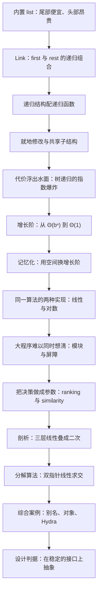
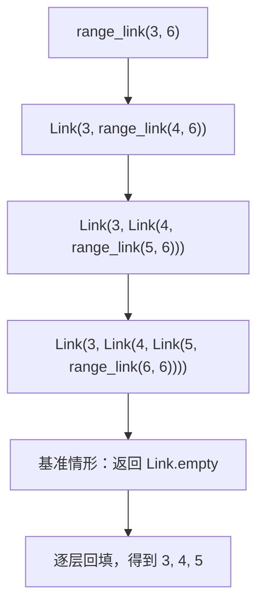
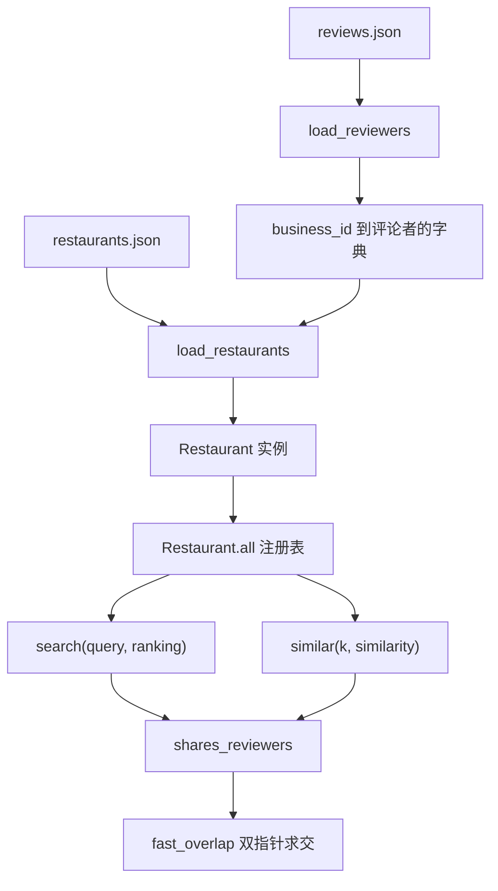
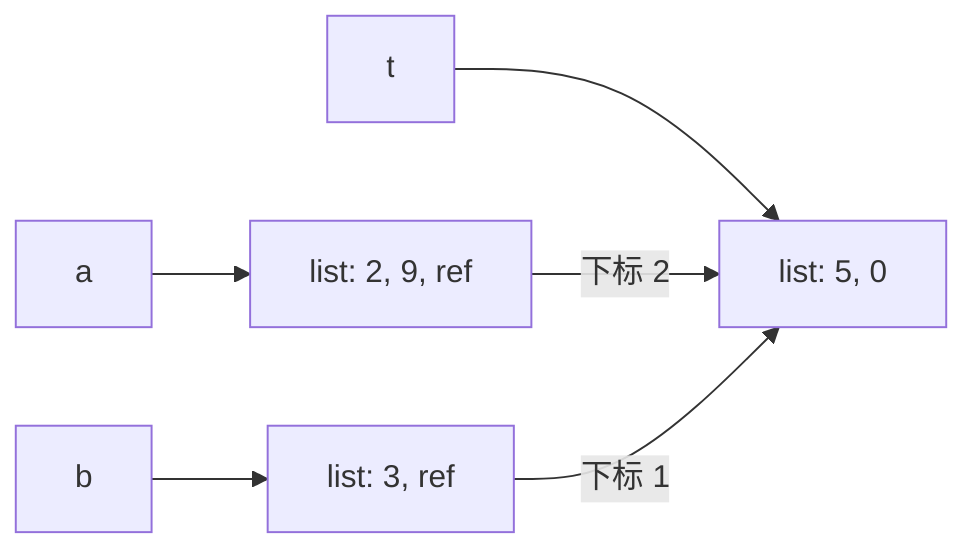
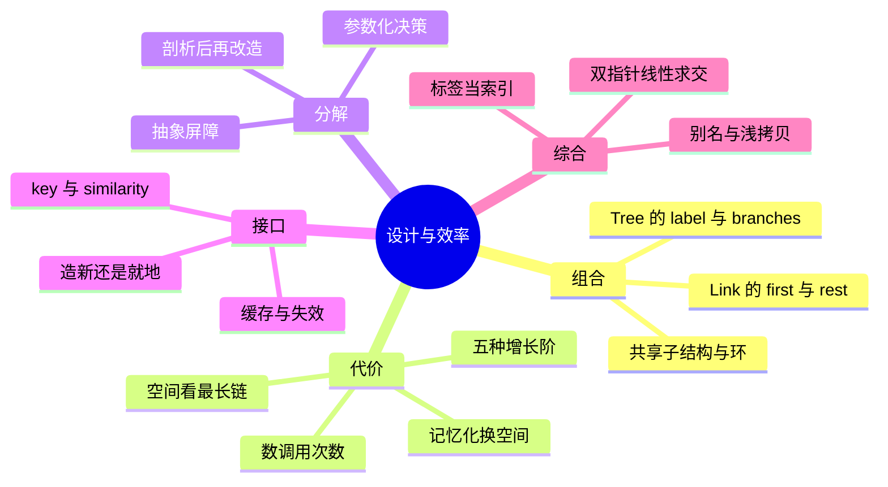

> **模块**：M5 CS61A-design，含 Lecture 22–25（Composition、Efficiency、Decomposition、Data Examples）
> **总时长**：02:15:46（33:16 + 36:37 + 27:16 + 38:37），对应 B 站分 P 22–25
> **合集**：[CS61A Fall 2024 中文字幕合集](https://www.bilibili.com/video/BV1sy411z7nA)，本模块从分 P 22 起
> **课件**：`21-Composition_1pp.pdf`（16 页）、`22-Efficiency_1pp.pdf`（15 页）、`23-Decomposition_1pp.pdf`（14 页）、`24-Data_Examples_1pp.pdf`（14 页），共 59 页，全部逐页渲染为正文插图
> **字幕**：B 站英文原声字幕；四讲片源完整，但课件里有相当一部分页面（增长阶练习、链表练习、树复习、部分期中题）并未被讲授，本文按逻辑位置收录并在正文标注
> **版权**：课程与课件版权归 UC Berkeley CS61A 教学团队（Fall 2024）；本文是学习用途的中文二次整理，不是逐句翻译

## 0. 模块导览

*(参考时间: 00:00:01 – 00:00:08｜Lecture 22；00:00:01 – 00:00:13｜Lecture 23；00:00:00 – 00:00:07｜Lecture 24；00:00:01 – 00:00:32｜Lecture 25)*

前四个模块回答"程序该长什么样"：表达式怎么求值、函数怎么抽象、递归怎么保证正确、数据怎么藏住表示。这四讲换了一个更难的问题——**程序正确之后，它还付得起吗？** 一旦这样问，前面所有干净的抽象都要被拿到秤上称一遍：链表比内置列表好在哪、递归的调用树有多宽、记忆化省下的时间是从哪里借来的、一个能跑通的搜索为什么慢到没法交互。

四讲是一条**付账的顺序**：第 22 讲造出新结构，随即发现它的代价与内置列表完全不同；第 23 讲把代价变成可命名的增长阶，并给出第一个能改掉增长阶的工具；第 24 讲把镜头拉远到一整个程序；第 25 讲用一串小案例把三样东西压在同一张纸上。主线是：**可组合性（composability）与可负担性（affordability）需要反复称量，而抽象是唯一能同时改善两者的手段——前提是抽象放在了对的那一层。**

### 0.1 四讲清单

| 讲 | 主题 | 时长 | 课件 | 分 P | 在本模块里承担什么 |
| :--- | :--- | :--- | :--- | :--- | :--- |
| 22 | Composition 组合 | 33:16 | 16 页 | [P22](https://www.bilibili.com/video/BV1sy411z7nA?p=22) | 用类把数据组织成递归结构，并第一次为"改指针"付账 |
| 23 | Efficiency 效率 | 36:37 | 15 页 | [P23](https://www.bilibili.com/video/BV1sy411z7nA?p=23) | 用调用次数与增长阶给代价起名，用记忆化改掉增长阶 |
| 24 | Decomposition 分解 | 27:16 | 14 页 | [P24](https://www.bilibili.com/video/BV1sy411z7nA?p=24) | 把大程序拆成模块，把决策做成参数，把二次降到线性 |
| 25 | Data Examples 数据案例 | 38:37 | 14 页 | [P25](https://www.bilibili.com/video/BV1sy411z7nA?p=25) | 用别名、对象与树把前三讲的工具合练一遍 |

四份课件的封面页如下，它们各自标出了这一讲的落点。


### 0.2 主线图



这张图的前半段是**结构在变复杂**，后半段是**代价在被迫摊开**。两条线在"记忆化"处第一次交汇，给出的教训是"改增长阶比优化常数值钱"；同一条教训后来原样出现在第 24 讲——把评论者两两比较换成双指针，程序才从 1.7 秒降到 0.7 秒。

### 0.3 四讲如何串成一条线

| 讲 | 它给出的工具 | 它留下的问题 | 谁接住了 |
| :--- | :--- | :--- | :--- |
| 22 | `Link` 与 `Tree` 两个递归类型；就地修改、共享子结构、环 | 慢在哪里、慢多少？只有秒表读数，没有语言 | 23 |
| 23 | 调用计数、记忆化、五种增长阶、活动环境的空间账 | 单个函数能算清代价了，一个真实的大程序怎么组织？ | 24 |
| 24 | 模块、抽象屏障、参数化决策、剖析之后再改造 | 分解的判据只在"游戏/搜索"上验过 | 25 |
| 25 | 别名与浅拷贝的形式化、`ordered` 的 `key`、两种 `merge` | 把三讲的工具压进同一道题：设计一个自己的数据结构 | 本篇 §5 |

第三列是这张表的重点：每一讲都**留下一笔没结的账**，下一讲不是新章节，而是来结账的。记住"结构 → 代价 → 组织 → 合练"这条因果链，任何一讲的位置都能推出来。

### 0.4 关于这 59 页课件

四份 PDF 与课堂讲述并不同步，这一点必须先交代：

- Lecture 22 的第 3–4 页（列表效率）只有画面没有口播；第 9–16 页是链表练习与期中题。
- Lecture 23 的第 3–7 页是树的复习，录像从第 8 页才开始；第 15 页的期中题也没有讲到。
- Lecture 24 的 14 页**全部是练习页**，正题"餐馆搜索"是现场敲出来的，一页幻灯片都没有。
- Lecture 25 的第 3–5 页与第 12–14 页都没有口播。

因此编排原则是：**页随内容走，不随讲次走**。没讲到的页面用 `编者说明` 标明"画面取自课件，评述由编者补写"，不把补写的解读伪装成课堂原话。

### 0.5 阅读路线

- 只想知道"链表值不值得"：§1 与 §2.2 的速度对照。
- 只想知道"为什么我的递归这么慢"：§3，重点看调用计数与三栏表。
- 只想动手设计一个东西：直接跳到 §5，那里有从需求到缓存的七步。

## 1. 序列的两种实现：接口、代价与表示

*(参考时间: 00:00:09 – 00:07:13｜Lecture 22)*

上一模块结束时，读者手里已经有了 `class`、属性、继承、`__repr__`，但用它们造的还都是"一个对象管一件事"的小东西。本章要用同一套工具造**容器**：一个对象里装另一个同类对象，于是"有多少个"不再由代码写死，而由运行时的引用链决定。这就是组合（composition）。

一动手就会撞上一个必须先回答的问题：Python 已经有 `list` 了，为什么还要自己造一个序列？答案不是"练习写类"，而是 **`list` 的代价结构对某些操作根本不合适**。所以这一章从一张耗时表开始。

### 1.1 内置列表的账：快慢取决于"要不要搬动"


课件的判断只有两句话：**追加、按下标赋值、列表推导都很快；在开头或中间插入、切片、把两个列表相加都很慢**。分界不在"做了什么"，而在"要不要搬动已经放好的元素"。


| 写法 | 扩张手段 | 真实代价 | n = 100,000 的耗时 |
| :--- | :--- | :--- | :--- |
| `using_list_comprehension` | 一次推导出新表 | 一次分配，n 次写入 | 1.58 ms |
| `using_append` | 写进预留的尾部空位 | 均摊常数 | 1.76 ms |
| `using_assign` | 先按长度占位，再按下标写 | 常数，但先造一张占位表 | 2.58 ms |
| `using_insert` | 每次都挤到最前面 | 线性：已有元素整体后移一格 | 1,470 ms |
| `using_add` | 每次都整表复制 | 线性，且每步都要复制 | 9,210 ms |

```python
def using_list_comprehension(n):
    return [k * k for k in range(n)]

def using_append(n):
    s = []
    for k in range(n):
        s.append(k * k)
    return s

def using_insert(n):
    s = []
    for k in range(n):
        s.insert(0, k * k)
    return s
```

前三名都是"往后面放"：`list` 占一整块连续空间，而且故意留了冗余容量，`append` 只要把值写进下一个空位；容量耗尽时才重新分配并整体搬运，摊到每次仍是常数。`using_insert` 每次都在**开头**插一格，第 k 次要搬 k 个元素，总搬移量是 $n^2/2$；`using_add` 还要多复制一遍整表。

> **编者说明**：$n^2/2$ 在 n = 100,000 时是 $5 \times 10^{9}$ 次指针搬移，而现代 `memmove` 每秒能搬十亿级个指针，算出来正好是秒的量级，与 1,470 ms 的读数一致。看到平方级的搬移量，先算它够不够一个"秒"。

这张表说明了件反直觉的事：**一种序列的代价分布由它的接口决定**。`list` 承诺了"按下标随机访问"，这个承诺逼着它把元素连续摆放，而连续摆放就必然带来"中间插队要搬家"。若换一种序列，放弃随机访问、只允许从头部生长，"头部插入"就能从线性降到常数——代价是"取第 k 个"从常数升到线性。

### 1.2 链表的递归定义：一个 `first`，一个 `rest`


定义只有一句话：**一个链表要么是空的，要么是一个"第一个值"加上"序列剩下的部分"**。非空链表把首个元素放 `first`，把剩下的元素放进一个**同样是链表**的对象，挂在 `rest` 上。


每个非空链表都拿一个**更小的链表**当自己的 `rest`，唯一的例外是最末端那个空链表——它没有 `first` 也没有 `rest`，只代表"结束"。写成表达式就是构造函数一层层套下去：

```python
Link(3, Link(4, Link(5, Link.empty)))
```

这里有一条求值规则在起作用：**调用表达式先求值操作数，再应用函数**。要算出最外层的 `Link(3, ...)`，Python 必须先算出第二个操作数，而那又是一个调用，于是求值一路向内钻到最深处，再一层层往外造。这个"先内后外"的顺序正是递归构造函数成立的原因：**先造尾巴，再用尾巴造头**。


同一页把三种视图叠在一起：属性表、两条并排的构造式、以及底下那排带斜杠的方框。方框加箭头不是官方记号，但业界通用：**指向空链表的那根箭头不画，改成一道斜杠**。左下角那个 `<3 4 5>` 是打印形式，正好对应 `str` 与 `repr` 的分工。

### 1.3 `Link` 类：把不变量写进构造函数


```python
class Link:
    empty = ()      # Some zero-length sequence

    def __init__(self, first, rest=empty):
        assert rest is Link.empty or isinstance(rest, Link)
        self.first = first
        self.rest = rest
```

`__init__` 的第一个动作不是存值，而是**检查**：`rest` 要么就是 `Link.empty`，要么是一个 `Link` 实例，别的一概拒绝。这条断言把归纳规则变成了可执行的检查——误传 `Link(3, [4, 5])` 会在构造那一刻报错，而不是等到遍历到某个深处时抛出莫名其妙的 `AttributeError`。

三个细节各有讲究。检查用 `is` 而不是 `==`：终止条件从来是同一个对象，身份比较才是本意。用 `isinstance` 而不是 `type(rest) == Link`：前者在子类上也为真，于是将来写"有序链表"作为子类，同一个构造函数照样能用。`empty = ()` 是设计选择：空链表本来就是零长度序列，借空元组省掉一个概念，代价是凡用到空链表处都必须先判 `is Link.empty`。

### 1.4 跨讲对照：`Link` 与 `list` 的接口、代价、可变性

| 判据 | 内置 `list` | 链表 `Link` |
| :--- | :--- | :--- |
| 接口承诺 | `len`、`s[i]`、切片、`for`、`+` | 只有 `first` 与 `rest`，没有下标语法 |
| 按下标取第 k 个 | Θ(1)：首地址加偏移，一次定位 | Θ(k)：顺 `rest` 走 k 步 |
| 在头部插入 | Θ(n)：所有元素后移一格 | Θ(1)：造一个节点指向旧头 |
| 在中间插入 | Θ(n)：后半段整体后移 | Θ(k) 找位置，之后只改两个指针 |
| 追加到末尾 | 均摊 Θ(1)：写进预留容量 | Θ(n)：没有尾指针就得走到末尾 |
| 切一段 | 有语法 `s[i:j]`，复制那一段 | 没有语法，要自己写递归函数 |
| 拼接两个序列 | `+` 造新表，Θ(n+m) | 只能共享尾巴：`Link(0, s)` 是 Θ(1) |
| 内存布局 | 一整块连续空间，带冗余容量 | 每节点两个字段，散落在堆上 |
| 可变性 | 可改元素、可伸缩长度 | 可改 `first`/`rest`，能造出环 |
| 共享 | 多个名字可指向同一个列表 | 一条尾巴可以被任意多条链共享 |
| 适合的算法 | 随机访问、批量排序、切片迭代 | 头插、增量构造、流式处理 |

最容易忽略的是"可变性"那一行。`list` 的可变是**元素级**的；`Link` 的可变是**结构级**的：`s.rest = t` 改的是一条引用，于是能接长、能断开、甚至能让链指回自己。这个自由度既是链表的全部威力，也是它的全部风险。

## 2. 递归结构上的算法：造新结构、改指针与共享

*(参考时间: 00:08:54 – 00:33:14｜Lecture 22)*

第 1 章只造了结构。本章看两件事：**处理递归结构的函数长什么形状**，以及**允许就地修改之后，程序多出了哪些写法、又多了哪些危险**。

### 2.1 三件套：自己实现 `range`、`map`、`filter`

`range`、`map`、`filter` 都是内置的，但它们不认识用户自己定义的类，所以要各写一份。

```python
def range_link(start, end):
    if start >= end:
        return Link.empty
    else:
        return Link(start, range_link(start + 1, end))

def map_link(f, s):
    if s is Link.empty:
        return s
    else:
        return Link(f(s.first), map_link(f, s.rest))

def filter_link(f, s):
    if s is Link.empty:
        return s
    filtered_rest = filter_link(f, s.rest)
    if f(s.first):
        return Link(s.first, filtered_rest)
    else:
        return filtered_rest
```

三个函数的形状完全一致：**先问是不是空，空就收工；不空就处理第一个元素，把剩下的交给递归**。区别只在两处：`range_link` 的"规模"由两个整数刻画，基准情形是 `start >= end`；`filter_link` 先把尾巴筛好再决定当前元素留不留——**先递归、后决定**，否则两个分支里会各算一遍尾巴。



递归的展开过程被摊平了：四次调用先在"向下"的方向叠起来，直到碰到基准情形才停；然后 `Link` 从最内层开始一层层往外造。**递归函数在链表上的形状，恰好是链表自身的形状**。

> **编者说明**：这三个函数是讲师现场写的，不在课件页上。另有一条课件没提的事实：递归版把调用深度绑在链长上，链长超过 Python 的递归上限（默认约 1000）就会抛 `RecursionError`。这正是 §2.2 那 100,000 元素的演示必须用 `while` 的原因。

### 2.2 同一算法的两种实现：`double` 与 `double_link`

课件用一道"重复插入"的题把两种结构放在同一把尺子上：把序列里每个等于 `v` 的元素复制一份，插在它后面。


```python
def double(s, v):
    i = 0
    while i < len(s):
        if s[i] == v:
            s.insert(i+1, v)
            i += 2
        else:
            i += 1
```

`i += 2` 是关键：刚插进去的副本本身也等于 `v`，只跳一格就会在副本后面再插一个副本，无限翻倍。


```python
def double_link(s, v):
    while s is not Link.empty:
        if s.first == v:
            s.rest = Link(v, s.rest)
            s = s.rest.rest
        else:
            s = s.rest
```

三处翻译：循环条件从"下标小于长度"变成"还没走到空链表"；取值从 `s[i]` 变成 `s.first`；推进从 `i += 2` 变成 `s = s.rest.rest`——先走到刚插入的副本，再跨过它。插入的全部工作就是改一条引用，**没有任何元素搬动**。


| 实现 | 结构 | 每次插入的真实动作 | 耗时 |
| :--- | :--- | :--- | :--- |
| `double(cycle(5, 100000), 3)` | 内置列表 | `insert` 把后面所有元素后移一格 | 299 ms |
| `double_link(cycle_link(5, 100000), 3)` | 链表 | 造一个节点、改一条 `rest` | 14 ms |

差二十倍。原因不是"递归比循环慢"，而是**插入的代价**。同一页右下角的 `cycle_link` 还解释了"链表怎么才不慢"：它维护尾指针 `last`，每次把新节点挂到 `last.rest` 再更新 `last`，于是建表是线性的。**链表想常数时间追加，必须自己记住末尾在哪。**

### 2.3 共享子结构与环：结构级可变性的两面

| 写法 | 改的是什么 | 影响范围 | 典型用途 |
| :--- | :--- | :--- | :--- |
| `s.first = 7` | 一个节点的值 | 所有指向这个节点的链 | 就地更新一个元素 |
| `s = s.rest` | 名字 `s` 的指向 | 只影响这个局部名字 | 遍历时推进游标 |
| `s.rest = t` | 一条结构引用 | 整条链的形状，可能波及共享者 | 插入、拼接、断开 |

第三种才是链表真正的强项。造一条新链只要一行——`t = Link(0, s)`——没有任何节点被复制，`t` 的 `rest` 就是 `s` 本身。这叫**共享子结构（shared structure）**，函数式风格的程序大量依赖它：不改旧结构，只在它上面包一层新的。

共享的另一面是改一处等于改多处。从三元素链表出发，两次赋值就能闭合出一个环：

```python
>>> s = Link(1, Link(2, Link(3)))
>>> s.first = 5
>>> t = s.rest
>>> t.rest = s
```

此时 `s` 是 `5, 2, 3`，`t` 是 `2, 3`，而 `t.rest` 被改成 `s` 之后，链就首尾相接了。数 `rest` 的落点呈奇偶规律：`s.rest.first` 落在 `t` 上（2），`s.rest.rest.first` 落回 `s`（5），走五次又落在 `t` 上（2）——总共三个元素，却能回答"第五次 `rest` 的值"，因为结构变了。

这就引出了链表的安全边界：本讲后面所有遍历都以 `is Link.empty` 作基准情形，一旦链上有环，这个条件永远等不到。链表之所以"通常不改结构"，不只是风格偏好，也是终止性的前提。

### 2.4 递归只为副作用：`add` 与三页练习

还有一种写法没出现：**递归调用不返回要用的值，只负责把事情做完**。

```python
def add(s, v):
    assert s is not Link.empty
    if s.first > v:
        s.first, s.rest = v, Link(s.first, s.rest)
    elif s.first < v and s.rest is Link.empty:
        s.rest = Link(v)
    elif s.first < v:
        add(s.rest, v)
    return s
```

三个分支对应三种位置关系：`v` 比当前头小，就地插在头前；比当前头大而后继为空，接在末尾；比当前头大且后面还有节点，往下走。**`v` 等于当前头时三个条件都不成立**，函数直接走到最后的 `return s`——"不重复插入"不是靠显式判等，而是靠三个条件互补留出的空档。最值得记的是 `add(s.rest, v)` 那一行没有 `return`：这次调用不是为了算出一个值，而是**在剩余部分上把加法做掉**。

| 判据 | `map_link` 式递归 | `add` 式递归 |
| :--- | :--- | :--- |
| 递归调用的返回值 | 下一层的结构，必须用它拼出结果 | 无人使用，直接丢弃 |
| 是否改动实参 | 完全不改，造新结构 | 就地改 `first` / `rest` |
| 递归的作用 | 计算 | 推进到一个位置 |
| 基准情形 | `s is Link.empty` | 找到插入点就停，不必到底 |
| 空间代价 | 新链表与原链表等长 | 只多一个新节点 |


`slice_link` 用两个计数器模拟下标，是"先跳后取"的通用套路：`j` 说"还要取几个"，`i` 说"还要跳过几个"。当 `j` 归零或链空时返回空表；`i` 归零时留下当前元素并让 `i` 保持 0；`i > 0` 时丢掉当前元素，两个计数都减一。

```python
def slice_link(s, i, j):
    assert i >= 0 and j >= 0
    if j == 0 or s is Link.empty:
        return Link.empty
    elif i == 0:
        return Link(s.first, slice_link(s.rest, i, j-1))
    else:
        return slice_link(s.rest, i-1, j-1)
```


`insert_link` 有一处顺序陷阱：要让"下标 0 的位置变成 `x`"，调用者手里握着的是 `s` 这个对象本身，只有复制整表（贵）或**把当前节点改造成新头**两条路。三行顺序不能颠倒：先把旧头值与原后继打包成 `second`，再覆盖 `s.first` 与 `s.rest`；若先写 `s.first = x`，旧的头值就丢了。

```python
def insert_link(s, x, i):
    if s is Link.empty:
        print('Index out of range')
    elif i == 0:
        second = Link(s.first, s.rest)
        s.first = x
        s.rest = second
    elif i == 1 and s.rest is Link.empty:
        s.rest = Link(x)
    else:
        insert_link(s.rest, x, i-1)
```


```python
def tens(s):
    def f(suffix, total):
        if total % 10 == 0:
            print(total)
        if suffix is not Link.empty:
            f(suffix.rest, total + suffix.first)
    f(s.rest, s.first)
```

内层函数只带两个参数：还没加进去的那一段、已经加出来的和。外层只调一次，把"第一个元素已经算进 `total`"写进初始实参，于是长度 1 的前缀不会被漏掉。**打印发生在"向下"的路上，所以输出顺序天然等于前缀长度顺序**——递归的访问顺序就是输出的顺序。

### 2.5 树：同一种组合，换个方向

树在本课程前面已经用数据抽象实现过，这次换成类。两者定义几乎一样：**一棵树有一个根标签和一串分支，每个分支又是一棵树**；链表有一个首元素和剩下的部分。唯一的差别是**分叉数**。

```python
class Tree:
    def __init__(self, label, branches=[]):
        self.label = label
        for branch in branches:
            assert isinstance(branch, Tree)
        self.branches = list(branches)

    def is_leaf(self):
        return not self.branches
```

`self.branches = list(branches)` 做两件事：留一份副本，以及把任意序列转成列表。若直接写 `self.branches = branches`，外面那张列表和树就共享同一块内存，调用者在树之外往里 `append` 一个不是树的东西，不变量就被绕过了。**边界处复制一次，换来内部不必再检查**。

| 判据 | 链表 `Link` | 树 `Tree` |
| :--- | :--- | :--- |
| 递归成分 | `first` 加 `rest` | `label` 加 `branches` |
| 后继个数 | 至多一个 | 零个或多个 |
| 基准情形 | 空链表 `Link.empty` | 叶子（没有分支） |
| 能否分叉 | 不能，只能接一条链 | 能，任意多条 |
| 遍历方式 | 只有从头到尾一种 | 先根、后根、逐层都可以 |
| 典型用途 | 序列、栈、队列、邻接表 | 表达式、语法树、决策树、文件系统 |

与数据抽象版本相比，差别集中在"要不要显式写选择器"：数据抽象要发明一种把碎片拼成整体的办法，再写 `label(t)`、`branches(t)` 取回来；类版本不必对"碎片怎么拼"做任何决定，属性名就是表示。**抽象给的是可替换性，类给的是省事**。

`fib_tree` 的代价埋在一个事实里：`fib_tree(6)` 要造 25 个节点，而 `fib(6)` 只要 8 次加法——**生成一棵树的代价远大于算一个数**，因为每个中间结果都要留下。

## 3. 树递归的代价：调用计数、记忆化与空间的账

*(参考时间: 00:00:01 – 00:10:47｜Lecture 23)*

第 23 讲拿最熟悉的树递归——递归求斐波那契——当标本，数清它到底做了多少次函数调用，再给出一件能改掉这个数字的工具。结论可以提前说完：**时间看调用树的节点数，空间看调用树的最长链，而改变增长阶比优化任何常数值都值钱。**

### 3.1 课件上的树复习：两套接口与两道递归题

第 23 讲的课件开头是五页树复习，录像没有讲（讲师从这里直接进入效率）。


这一页把两套树抽象并排放：左边用类（`t.label`、`t.branches`），右边用数据抽象（`label(t)`、`branches(t)`）。它出现在"效率"这一讲不是随手放的：**`fib_tree(n)` 与 `fib(n)` 的调用结构完全相同**，区别只在于前者把每个中间节点都留下来了——同一棵调用树，在 `fib` 那里体现为"调用了多少次"，在 `fib_tree` 那里体现为"占了多少内存"。


`twins` 数"标签相同的兄弟节点对"：双重循环数同一个父节点下的兄弟对（`j` 从 `i+1` 开始，保证每对只数一次），递归把每个分支内部的对数加起来。值得留意那段双重循环：节点越"宽"它越贵，一个根上挂 100 个分支，根这一层就要比 4,950 次——**节点数乘以平均宽度**，与第 4 章要讲的二次增长同一种形状。


`remove` 演示了一种更高明的写法：题目已提供 `exclude(t, x)`，它返回一棵去掉标记为 x 的非根节点的**新树**，而 `remove` 要的是**原地修改**。

```python
def remove(t, x):
    t.branches = exclude(t, x).branches
    return t
```

两行。思路是"借一份答案，只搬分支"：既然 `exclude` 已经算出了正确的分支结构，把新树的分支列表接到 `t` 上就完成了原地修改；根标签保持不动，正好符合"只删非根节点"。这是本模块里第一个分解的样本：**当一件事已经有人做对了一半，就不要重写那一半。**

> **编者说明**：第 3–7 页都没有出现在字幕里，录像的第 1 句话已经是"用递归计算斐波那契"。上面对 `twins`、`remove` 的讲解与"页面为什么放在效率讲"的分析，均由编者补写。

### 3.2 `fib` 的调用树：指数从哪里来


要谈"多久"，第一把尺子不是秒表。同一段代码连跑两次，读数可能差一个数量级。可靠的量是**函数被调用了多少次**：它只由代码和数据决定，与机器无关。


```python
def fib(n):
    if n == 0:
        return 0
    elif n == 1:
        return 1
    else:
        return fib(n-2) + fib(n-1)
```

`fib(5)` 被展开成一棵树：`fib(3)` 先算 `fib(1)`（返回 1），再算 `fib(2)`（展开成 `fib(0)` 与 `fib(1)`，返回 1），于是返回 2。课件把基例的返回值标在叶子下面，再用虚线按实际发生的顺序把整棵树串起来：先一路向左下到底，再逐层回到分叉点。

走完就会看到一件刺眼的事：`fib(3)` 被算了两次，`fib(2)` 被算了三次。**同一棵子树被整枝重算**，这就是它昂贵的全部原因。为了不用手数，写一个装饰器把计数自动化：

```python
def count(f):
    def counted(n):
        counted.call_count += 1
        return f(n)
    counted.call_count = 0
    return counted

fib = count(fib)
```

`call_count` 挂在**函数对象**上而不是藏在闭包里，于是从外部读 `fib.call_count` 就能取到；把 `fib` 重新绑定到 `counted` 是让递归调用也走包装器的关键。课堂上的数字很直接：`fib(5)` 返回 5，计数 15；`fib(30)` 返回 832040，代价是 **2,692,537 次调用**。

> **编者说明**：调用次数满足 $C(n) = 1 + C(n-1) + C(n-2)$，解出来是 $C(n) = 2F(n+1) - 1$。核对：n = 10 得 177，n = 20 得 21891，n = 30 得 2692537。相邻两项的比值稳定在 1.618 附近，也就是每加一个 n 就多做约 60% 的工作——这正是指数增长的指纹。

### 3.3 记忆化：把算过的结果留在身边


既然浪费发生在"重算同一棵子树"，解法就只有一句话：**记住以前算过的结果**。


```python
def memo(f):
    cache = {}
    def memoized(n):
        if n not in cache:
            cache[n] = f(n)
        return cache[n]
    return memoized
```

`cache` 是闭包里的字典，键是参数，值是 `f` 在该参数上的返回值。`memoized` 先做成员检查：不在缓存里才算 `f(n)` 并存进去；然后统一 `return cache[n]`——第一次算与以后取走同一条返回路径，差别只在要不要调用 `f`。

课件在 `return memoized` 旁边挂着第二条批注："Same behavior as f, if f is a pure function"。这是整个技巧的**前提条件**：纯函数对同样的参数永远返回同样的值，也不产生副作用，跳过重复调用不会改变任何可观察的结果；如果 `f` 会打印、会修改参数、会读时钟或随机数，跳过调用就少了一次副作用或少了一个不同的值。


记忆化之后，`fib(3)` 返回后轮到 `fib(4)`，它的左孩子 `fib(2)` 在缓存里，命中即返回——那些 `fib(0)`、`fib(1)` 调用**根本不会发生**。

| n | 纯递归的调用次数 | 记忆化包装器的调用次数 | 真正执行 `fib` 的次数 | 调用次数之比 |
| :--- | ---: | ---: | ---: | ---: |
| 10 | 177 | 19 | 11 | 约 9 倍 |
| 20 | 21,891 | 39 | 21 | 约 560 倍 |
| 30 | 2,692,537 | 59 | 31 | 约 4.6 万倍 |

31 很好解释：真正需要计算的参数只有 31 个，30 到 0 每个值只算一次。59 则要数调用：每个 k（2 ≤ k ≤ n）被请求两次，一次来自 k+2 的第一个孩子、一次来自 k+1 的第二个孩子，再加上最顶上的 `fib(n)`，恰好是 $1 + 2(n-1)$。纯递归每加一个 n 就乘 1.6，记忆化每加一个 n 只多 2——**同一段递归定义，只因为外加了一个字典，就从指数掉到了线性。** 代价当然有：`cache` 要把所有算过的参数存下来。

### 3.4 空间：活动环境与最长链

要弄清内存被谁占着，得先问：**在某一时刻，哪些环境还在用？** 规则是：任一时刻存在一组**活动环境（active environments）**，其中的值与帧占内存，不在其中的可以被回收。正在求值、尚未返回的调用，它的帧是活动的；另一种少见情形是活动环境里某个函数的**父环境**——函数定义在另一个函数内部时，只要还需要这个函数，就需要那个外层帧。

这件事可以被看见。Python Tutor 有一个"不显示已经退出的函数"的开关，打开之后返回过的帧会被直接删掉。代码里也能数出来：写一个 `count_frames` 装饰器，进入时把"开放帧数"加一并更新历史最大值，返回前再减一。用它包住 `fib` 再调用 `fib(20)`，`max_count` 是 **20**。

为什么是 20？取任意时刻：左边分支都算完了、右边的还没开始、正要从某个 `fib(1)` 返回，此刻的活动帧就是"当前这条链上还没返回的那些调用"。最长的一条链长度就是 n。于是有了本模块最值得记住的一组对照：**`fib(20)` 的调用次数是两万多，但同一时刻的帧只有 20 个。** 时间由调用树的节点数决定，空间由最长链决定。

### 3.5 三栏对照：递归、迭代与记忆化

| 判据 | 纯递归（无缓存） | 迭代 | 记忆化递归 |
| :--- | :--- | :--- | :--- |
| 时间 | Θ(φⁿ)：与调用树节点数同阶 | Θ(n)：一遍扫描 | Θ(n)：每个参数只真算一次 |
| 空间 | 栈深等于树高 | 一个或几个游标 | 栈深 Θ(n) 加缓存 Θ(n) |
| 前提条件 | 无 | 状态能写进游标 | 被缓存的函数必须是纯的 |
| 可读性 | 与数学定义一一对应 | 需要先想清不变量 | 与原递归同形，只多一层包装 |
| 致命失败 | 重复子问题指数爆炸 | 有环就死循环 | 命中率低时白占内存 |
| 能否改增长阶 | 不能，它就是增长阶的来源 | 不能，只改常数因子 | 能，指数可以压成线性 |
| 本模块的例子 | `fib`、`twins` | `length`、`append`、`double_link` | `memo(fib)` |

最重要的一行是最后一行。递归与迭代只是**同一个算法的两种书写**，谁也改不了增长阶——`length` 递归版与迭代版都是 Θ(n)。记忆化不同，它改的是算法：把"每个子问题算一次"变成"每个子问题只算一次"，于是指数变线性。**改变增长阶，比在常数上抠细节值钱得多**。

## 4. 度量与分解：从增长阶到大程序的秩序

*(参考时间: 00:17:40 – 00:24:52｜Lecture 23；00:00:08 – 00:26:44｜Lecture 24；00:00:32 – 00:00:47｜Lecture 25)*

第 3 章只认真算了一种代价：调用次数。本章把它变成可命名的阶，然后回答"知道慢了之后怎么办"。答案分两层：**算法层**换一个增长阶更低的算法（每层减半、双指针）；**结构层**把程序拆开，让"慢的那一处"能被单独替换掉。前者管一个函数，后者管一整个程序。

### 4.1 五种增长阶：给曲线起名字


linear、constant、quadratic 这些词都有精确的数学定义，用处是：**不用真的运行程序，也能证明某个函数属于哪一阶**。


| 增长阶 | 大 Θ 写法 | 大 O 写法 | 一句话直觉 | 本模块的例子 |
| :--- | :--- | :--- | :--- | :--- |
| 指数 | Θ(bⁿ) | O(bⁿ) | n 加 1，时间乘一个常数 | 未记忆化的 `fib` |
| 二次 | Θ(n²) | O(n²) | n 加 1，时间加 n 倍常数 | `overlap` 的双重循环、`max_sum` |
| 线性 | Θ(n) | O(n) | n 加 1，时间加一个常数 | `near_pairs`、`prefix`、`fast_overlap` |
| 对数 | Θ(log n) | O(log n) | n 翻倍，时间才加一个常数 | `exp_fast`、`search_sorted` |
| 常数 | Θ(1) | O(1) | n 怎么变都不影响时间 | 字典按键查找 |

常数那一行最容易让人停顿：n 去哪了？答案是 n 不在那里，因为常数增长里**增大 n 根本不影响时间**，写 n 反而是错的。大 O 与大 Θ 长得一样，含义不同：**大 O 只描述上界，大 Θ 同时给上下界**。记号要有效，还得说清 n 是什么——n 是序列长度时，还要进一步指定最坏、最好还是平均。

四种阶还可以写成一组等式，用来回答同一个问题：**输入每变大一点，你要付的账是乘法、是随 n 增长的加法，还是常数？** 乘法对应 $T(n+1) = b\cdot T(n)$，随 n 增长的加法对应 $T(n+1) = T(n) + a(2n+1)$，常数对应 $T(n+1) = T(n) + a$；对数特例是"翻倍才加一个常数"，$T(2n) = T(n) + a\log 2$。


```python
def prefix(s):
    "Return a list of all prefix sums of list s."
    t = 0
    result = []
    for x in s:
        t = t + x
        result.append(t)
    return result
```

只有一层 `for`，每个元素做一次加法、一次 `append`，两者都是常数时间，所以是 **Θ(n)，线性**。这道题的价值在于提醒：判断增长阶看的是"循环嵌套了几层、每层走了多少次"，而不是"代码看起来长不长"——若把 `result.append(t)` 换成"把整个 `result` 复制一遍再加一项"，同一个循环立刻变成二次的。

> **编者说明**：录像在 00:36:34 结束，讲师没有讲到这一页；题目与代码逐字取自课件，分析与答案为编者所加。

### 4.2 换算法而不是换常数：`exp` 与 `exp_fast`

`fib` 的问题是"重复子问题"，`exp` 的问题是"每层只缩小一点点"。题目是求 b 的 n 次方，目标不是"少做几次乘法"，而是**让多一次乘法就把指数翻一倍**。先看一个达不到目标的写法：

```python
def exp(b, n):
    if n == 0:
        return 1
    else:
        return b * exp(b, n - 1)
```

它对应 $b^n = b \cdot b^{n-1}$，定义正确，但指数每加 1 就多一层递归、多一次乘法。而 $b^n$ 不止一个数学定义：n 为偶数时 $b^n = (b^{n/2})^2$，先算一半指数再平方；n 为奇数时退回前一个定义，把 n 变成偶数。

```python
def exp_fast(b, n):
    if n == 0:
        return 1
    elif n % 2 == 0:
        return square(exp_fast(b, n // 2))
    else:
        return b * exp_fast(b, n - 1)
```

偶数分支用 `n // 2`：既然已知 n 是偶数，地板除法给出精确的一半。**递归形状值得单独强调**：函数体里出现了两次 `exp_fast`，看上去像树递归，但任何一次调用只可能走其中一条分支，所以它是**线性递归**。**形状由执行路径决定，不由书写形式决定。**

| 判据 | `exp` | `exp_fast` |
| :--- | :--- | :--- |
| 递归依据 | $b^n = b \cdot b^{n-1}$ | 偶数平方，奇数退一步 |
| n 加 1 | 多 1 次乘法 | 最多多 2 次乘法 |
| 乘法次数（n = 200 / 400 / 800 / 1600） | 200 / 400 / 800 / 1600 | 10 / 11 / 12 / 13 |
| 增长阶 | Θ(n) | Θ(log n) |

秒表也验过一次：`exp` 的曲线是直线（2¹⁶⁰⁰ 约 4 毫秒），`exp_fast` 每翻一倍只多约 0.002 毫秒。

> **编者说明**：单次计时与 `timeit` 取中位数是两种不同的测量方式，绝对值不可直接相比，能相比的只有趋势。1,024 = 2¹⁰，所以"输入变 1000 倍"在对数时间下只对应"多做 10 份固定工作"。

### 4.3 第 24 讲的练习页：先校准尺子

第 24 讲的课件从公告页开始，接下来两节全是练习——增长阶配对与链表回顾。正题"餐馆搜索"是讲师现场敲出来的，一页幻灯片都没有，所以本章的幻灯片集中在这一节与 §4.6。


```python
def search_sorted(s, v):
    if len(s) == 0:
        return False
    center = len(s) // 2
    if s[center] == v:
        return True
    if s[center] > v:
        rest = s[:center]
    else:
        rest = s[center + 1:]
    return search_sorted(rest, v)
```

每次用中点把搜索范围砍成一半，只保留可能包含目标的那一半，所以是**对数增长**：n 翻倍只多一层递归。

> **编者说明**：这一版还带着一次线性成本：`s[:center]` 会复制切片，总代价是 $O(n \log n)$。要真正做到 $O(\log n)$，应当传下标区间而不是传子列表。课件只要求按"规模减半"识别增长阶。


`near_pairs` 只有一个循环：`count` 记当前连续重复段长度，`max_count` 记历史最长，`last` 记上一个元素；`count == 0` 处理第一个元素没有 `last` 可比的边界。n 加一只是多一次常数工作，**线性**。`max_sum` 是双层循环：外层固定起点 `i`，内层从 `i` 一路累加（累加只需常数时间），总步数约为 $n + (n-1) + \cdots + 1 \approx n^2/2$，**二次**。

| 函数 | 增长阶 | 一句话理由 |
| :--- | :--- | :--- |
| `search_sorted` | 对数 | 每层把区间对半砍，n 翻倍只多一层 |
| `near_pairs` | 线性 | 单层循环，每个元素常数工作量 |
| `max_sum` | 二次 | 外层定起点、内层累加，总步数约 $n^2/2$ |

三道题合起来是三种常见形状的校准。它们不产生新知识，但产生一种能力：**看到一个循环结构，就能说出它的阶**——这种能力在 §4.6 会立刻变现。

### 4.4 分解：让一个模块只知道自己的事

假设单个函数都够快了，一整个程序还会慢吗？会，而且原因往往不是算法错了，而是**没有人能在同一时刻把它的所有部分都想清楚**。模块化设计（modular design）的回答是：把程序拆成若干**小而相当独立**的部件，让它们可以**换进换出**，彼此之间被各种**抽象屏障（abstraction barrier）**隔开。目标是**分离关注点（separation of concerns）**。

课程项目 Hog 是一个掷骰子计分游戏，被切成三个组件：模拟器管规则、事件顺序与胜负状态，**完全不知道**解说怎么写；解说函数管事件如何被描述，既不关心规则怎么定义，也不关心玩家做了什么；玩家策略管决策规则与策略参数，同样不关心记分与解说。三者并非没有联系：解说函数与策略函数都作为参数传给 `play`，关键在于 `play` 只需要知道"这东西能被调用"。

| 组件 | 关心什么 | 明确不关心什么 |
| :--- | :--- | :--- |
| Hog 模拟器 | 规则、事件顺序、比分与胜负 | 解说文案、玩家策略 |
| 解说函数 | 事件如何被描述、解说需要的状态 | 规则如何定义、玩家怎么决策 |
| 玩家策略 | 决策规则、策略参数 | 记分规则、解说形式 |

ANTS 是同一套分工的放大版：模拟器管动作顺序、食物总量与游戏是否结束，动作函数管每种动物的个性，地图管隧道与位置，三块可以并行推进。讲到这里，"分解"有了更严格的定义：**它不只是把长函数拆成几个小函数，还意味着程序的不同侧面被隔离到不同的代码位置**；检验规则也随之明确——**如果修改游戏规则只需要修改模拟器，这个设计就更模块化。**

该切多细？粒度与耦合度是同一枚硬币的两面。

| 粒度 | 一个单元管什么 | 典型耦合方式 | 换掉它的代价 | 本模块的例子 |
| :--- | :--- | :--- | :--- | :--- |
| 表达式级 | 一个值 | 无耦合 | 改一行 | `query in r.name` |
| 函数级 | 一个动作 | 参数与返回值（数据耦合） | 改调用点 | `search(query, ranking)` |
| 对象级 | 一份状态加行为 | 属性与方法（共享状态耦合） | 改构造与所有访问点 | `Restaurant.all` |
| 模块级 | 一个关注点 | 接口约定（控制耦合） | 改接口与实现 | 装载器、搜索引擎、相似度 |
| 系统级 | 一个服务 | 协议与数据格式 | 改协议 | 本模块未涉及 |

"耦合方式"那一列才是判据的关键。**数据耦合**最松：只通过参数收值、通过返回值交货。**控制耦合**中等：一方传一个标志位去指挥另一方走哪条分支，被指挥的那方就再也不能独立演化。**共享状态耦合**最紧：两个模块改同一个可变对象，任何一方的改动都可能在另一方地盘上引发 bug。所以分解的方向不是"越小越好"，而是**把会变的东西推到耦合更松的那一侧**。

> **编者说明**：粒度表与"数据/控制/共享状态耦合"的分类，是把讲师在 00:02:39–00:04:37 给出的两条检验法整理成清单的结果，扩展部分属于编者。

### 4.5 参数化：把还没想清楚的地方变成接口

分解最经济的手段是**参数化**：与其替使用者做一个决定，不如把决定做成参数。第 24 讲后半段的餐馆搜索把这一招用到了极致。

数据是一批 Yelp 记录。每家餐馆是一个字典，含名字、星级（1–5）、价格档（1–3）与 `business_id`；`business_id` 本身没有意义，却是两个数据文件之间**唯一的连接键**。评论是另一批字典，每条含它针对哪家餐馆、谁写的、几星、正文与日期。数据集规模是 133 家餐馆、约一千条评论。

| 字段 | 出现在餐馆文件 | 出现在评论文件 | 在本程序里的用途 |
| :--- | :--- | :--- | :--- |
| `business_id` | 是 | 是 | 唯一连接键：把评论挂到餐馆上 |
| `name` | 是 | 否 | 搜索时做子串匹配 |
| `stars` | 是（餐馆平均分） | 是（单条评分） | 餐馆侧用于默认排序 |
| `review_count` | 是 | 否 | 本程序不用它，改用评论者列表 |
| `user_id` | 否 | 是 | 计算"共同评论者"这一相似度 |

看到数据之后，真正的工作才开始：按名字查找到底意味着什么？两家餐馆"相关"意味着什么——离得近、评分接近，还是被同一批人评论？讲师的姿态是：先把程序骨架写出来，**把尚未决定的决策留成参数**。

```python
def search(query, ranking=lambda r: -r.stars):
    """Return restaurants whose names contain query, ranked by ranking."""
    results = [r for r in Restaurant.all if query in r.name]
    return sorted(results, key=ranking)
```

这段代码写下来时还跑不起来（`Restaurant` 尚未定义），但它已经具备正确的形状。排序规则是搜索引擎最重要的关注点之一，与其把某种排序写死，不如把它作为参数传进去；代价是每次调用都得自己准备一个函数，于是需要默认值——默认按星级从高到低。`sorted` 从小到大排，所以把星级取负：星级最高那家负值最小，排到最前。

| 维度 | 排序（ranking） | 相似度（similarity） |
| :--- | :--- | :--- |
| 回答的问题 | 结果谁排前面 | 两家餐馆有多像 |
| 函数签名 | 一个参数：某家餐馆 | 两个参数：两家餐馆 |
| 默认实现 | `lambda r: -r.stars`（星级降序） | 共同评论者人数 |
| 替换的后果 | 只影响结果顺序 | 影响"相关推荐"的整个含义 |

表示一家餐馆自然用类，还需要一个地方记录"所有餐馆"。讲师选择用**类属性**：`all = []` 在类体里初始化，在 `__init__` 里 `Restaurant.all.append(self)`，于是每创建一个实例就自动登记。写这段代码时遇到两个 bug：写成 `all.append(self)` 时 `all` 被解析成内置函数（它没有 `append` 属性），类属性必须写全；直接打印一家餐馆时屏幕上出现默认的、没有信息量的表示，于是要加 `__repr__`。

第三个待补的洞是 `similar`。讲师先只写下 docstring——"返回与 self 最相似的 k 家餐馆"——把实现留空。**写不下去时先写接口**，是同一套分解思路的微观版本。

```python
def similar(self, k, similarity):
    """Return the k most similar restaurants to self."""
    others = list(Restaurant.all)
    others.remove(self)
    ranked = sorted(others, key=lambda r: -similarity(self, r))
    return ranked[:k]
```

四行里有四个要点：先复制一份再 `remove`（否则注册表会被悄悄破坏）、按元素而不是下标删、把 `self` 提前绑进 `lambda` 让 `key` 保持一元、末尾用切片取前 k 个。第一次运行的结果还让讲师改了措辞：把"相似"改说成"**共享评论者**"——它说明**相似度的定义决定了结果的含义**，而这正是把 `similarity` 做成参数的价值。

### 4.6 从剖析到改造：三层线性叠成二次

程序能用了，但太慢：搜一个 `Thai` 并把每个结果的相似餐馆都列出来要 0.7 秒，换成 `cafe` 要 1.7 秒。讲师没有逐段打点计时，而是直接读代码结构。

| 层 | 每次在做什么 | 规模 | 增长阶 |
| :--- | :--- | :--- | :--- |
| 第一层 | 遍历餐馆，判断名字是否含 query | 餐馆数 n | 线性 |
| 第二层 | 对每个命中结果，遍历其余餐馆算相似度 | 餐馆数 n | 线性 |
| 第三层 | 对每对餐馆，两两比较评论者 | 评论者数 m | 二次 |
| 合计 | 三层嵌套相乘 | 以评论者长度为主导 | 二次（相对 m） |

第三层藏得最深：`len([x for x in r.reviewers if x in s.reviewers])` 里，遍历 R 的每个评论者，对每一个人再在 S 的列表里做一次 `in` 查找，而列表的 `in` 本身就是一次线性扫描。**三层里有两层线性、一层二次，相乘后主导的是那个二次项。**

关键问题因此变成：能不能在**线性时间**内算出"同时评论了 R 和 S 的人数"？答案是能，技巧只有一句话：保留**排好序的**评论者列表，再写一个线性过程统计两个有序序列的重叠量。第 25 讲的课件正好把这道题的两版摆在一起。


```python
def fast_overlap(s, t):
    k = 0
    while s and t:
        if s.first == t.first:
            k, s, t = k + 1, s.rest, t.rest
        elif s.first < t.first:
            s = s.rest
        elif s.first > t.first:
            t = t.rest
    return k
```

既然两边都有序，就可以让两个游标各自单向前进：相等时两个游标一起走一步并记一分；哪一边的元素更小，就把那一边往前走，因为它不可能再和另一边的任何元素相等。任何一条链表走到空，匹配就不可能再发生。

| 步 | s 侧当前值 | t 侧当前值 | 判断与动作 | count |
| :--- | :--- | :--- | :--- | :--- |
| 1 | 3 | 1 | 1 < 3，推进 t | 0 |
| 2 | 3 | 3 | 相等，两侧同时推进 | 1 |
| 3 | 4 | 5 | 4 < 5，推进 s | 1 |
| 4 | 6 | 5 | 5 < 6，推进 t | 1 |
| 5 | 6 | 7 | 6 < 7，推进 s | 1 |
| 6 | 7 | 7 | 相等，两侧同时推进 | 2 |
| 7 | 9 | 8 | 8 < 9，推进 t | 2 |

用 `s = [3, 4, 6, 7, 9, 10]` 与 `t = [1, 3, 5, 7, 8]` 走一遍，结果是 2，公共元素是 3 与 7；步数上界是两条链长度之和，因为每一步至少消耗一个节点。


课件第 5 页把慢的写法摆出来做对照：`count_if` 把"要不要计数"外置，`contained_in` 是柯里化（先记住链表开头，返回一个只等元素的判断函数），`overlap` 把两者拼起来。代价一眼可见——对 `s` 的每个元素，`contained_in(t)` 都要把 `t` 从头扫到尾，总步数约等于两边长度之积。**写起来短，跑起来贵。**

改造完成后还有一步，是本章最重要的：`fast_overlap` 不该留在"评论者"这个概念里，因为这段过程**不关心列表里装的是什么**。

```python
def shares_reviewers(r, s):
    return fast_overlap(r.reviewers, s.reviewers)
```

业务概念缩成一行，而 `fast_overlap` 完全不知道"餐馆""评论者"是什么。算法关注"如何在线性时间内求交"，业务关注"哪两个列表要做交集"，两者被一条清晰的接口隔开。



这张模块依赖图里，箭头总是从"调用者"指向"被调用者"。`Restaurant` 不知道文件存在；`search` 与 `similar` 只认识 `Restaurant.all`；`fast_overlap` 只认识两个有序列表。**改变任何一层的内部实现，都不会逆流影响上层。**

效果立刻可见：咖啡馆那一组从 1.5 秒降到 0.7 秒，泰国餐馆那一组从 0.7 秒降到 0.5 秒——0.5 秒意味着程序已经足够响应，可以做成交互式程序。

> **编者说明**：0.7 / 1.5 / 0.5 秒是演示时屏幕上的读数，值得记的是数量级与结构变化（二次 → 线性），而非具体毫秒。"预排序 + 双指针"只有在**同一个列表被反复求交**时才划算：若每个列表只求一次交，排序本身的 $O(n \log n)$ 会吃掉全部收益。

本章的经验可以压成一句话：**先有尺子，再有分解，最后才有改造。** 没有 §4.1–4.3 的阶，就看不出第三层是二次的；没有 §4.4 的模块边界，就算出了 `fast_overlap` 也无处安放；而没有分解，改造只能停留在"把循环写短一点"。

## 5. 从零设计一个数据结构：课程注册名单

*(参考时间: 00:27:02 – 00:27:14｜Lecture 24；00:32:22 – 00:38:29｜Lecture 25)*

前四章给了三样东西：`Link` 的表示与操作、增长阶的尺子、分解与参数化的纪律。这一章把它们用在一件具体的事上——**从零设计一个数据结构**。要设计的是 `Roster`：一门课的注册名单，需求六条——按（分数，姓名）插入记录、取前 k 名、数出某个分数区间的人数、合并两份名单、求两份名单的交集、在交互式会话里能读懂。

### 5.1 第一步：先把接口写下来

设计数据结构最容易犯的错是先写表示。正确的顺序是先写**承诺**：这张表既是给使用者的文档，也是给自己定的验收标准。

| 操作 | 语义 | 目标复杂度 | 是否修改对象 |
| :--- | :--- | :--- | :--- |
| `add(name, score)` | 插入一条，保持整体有序 | 想做到 Θ(1)；实际 Θ(n) | 是 |
| `top(k)` | 前 k 条记录 | 想做到 Θ(k)；实际 Θ(n) | 否 |
| `count_between(lo, hi)` | 分数落在区间内的人数 | Θ(n) | 否 |
| `merge(other)` | 两个有序名单合成一个 | Θ(n+m) | 否（造新） |
| `intersect(other)` | 同时出现在两份名单里的人数 | Θ(n+m) | 否 |

表里"想做到"与"实际"的差别就是本章的戏。`add` 在链表上是 Θ(n)，因为**找位置**要走路；这不是实现不够努力，而是接口与表示互相牵制的结果。这张表还该交代两件事：**谁拥有返回值**，以及**失败怎么表示**。

### 5.2 第二步：选表示，并且接受它的限制


每个 `Link` 实例是一个两格的盒子：`first` 存值，`rest` 存指向下一段的箭头；最后一段的 `rest` 指向 `Link.empty`，画成一道斜杠。这种记法把"数据在哪里"与"它指向什么"分开了。

选 `Link` 而不是 `list` 的理由有三条，也都有代价：榜单是**增量维护**的，而链表的插入只改指针、不搬元素；榜单需要**有序**，每次插入都要先走 Θ(n) 找位置，无可回避；榜单**不需要随机访问**，没有任何操作要求"第 7 名是谁"。**选表示不是选更好的那个，而是选"代价落在你不心疼的那一侧"的那个。**

链表还有一项能力更自然：元素本身可以是链表。


```python
>>> s = Link(2, Link(3, Link(4, Link(5))))
>>> t = Link(2, Link(3, Link(Link(4), Link(5))))
>>> print(t)
<2 3 <4> 5>
```

区别只在第三段：`s` 的第三个元素是数字 `4`，`t` 的第三个元素是一条包含 `4` 的链表；`__repr__` 递归地把自己写成尖括号里的一串元素，于是嵌套的那一条被写成 `<4>`。


读属性链的方法是从左往右逐段求值：`s.rest.first.rest.rest.first` 一路 `rest → first → rest → rest → first`，停在内层那条只装着 `7` 的链上——它返回的是**链表对象**而不是数字，所以显示为 `Link(7)`。`Roster` 暂时不用这条能力，但要知道它在：**表示能表达的东西比当前需求多一点是好事，少一点是灾难。**

### 5.3 第三步：构造与遍历，先递归后迭代


`length` 的两版只差一个计数器 `k`：递归版把"长度"拆成"1 加剩余部分的长度"，迭代版用 `s, k = s.rest, k + 1` 一次推进链指针与计数。构造的顺序正相反：**先搭好后面那段，再把它接在当前元素后面**，所以迭代版必须从 `end - 1` 倒着走——每新建一个 `Link` 只能接在已有链的前面。

`Roster` 的选择是**迭代加尾指针**。理由来自第 3 章的空间账：初始名单可能有十万条，递归版会在第 1000 层左右被 `RecursionError` 拦住。**同一算法在两版里代价等价，在"能不能跑完"上不等价。**

### 5.4 第四步：插入与删除，先定"就地还是造新"


全局帧里 `t` 指向第一段；`f1: append` 帧里 `s` 起初也指向第一段，`x` 是 6。循环里反复执行 `s = s.rest`；走到最后一段时执行 `s.rest = Link(x)`，在尾部接上新盒子。由于 `t` 始终指向原来的头，`t` 自然"看到"了新增的末尾。


两版的分支条件完全相同，只是一个写成 `if`、一个写成 `while`。递归版虽然调用了自己，却没有把返回值组合起来——**它在推进，不在计算**。


```python
def pop(s, i):
    assert i > 0 and i < length(s)
    for x in range(i - 1):
        s = s.rest
    result = s.rest.first
    s.rest = s.rest.rest
    return result
```

`assert` 把前提写进代码，也说明了为什么它不能删头元素：删头需要改动外部对链的引用，那是调用者的责任。循环走 `i - 1` 步，`s` 停在第 `i` 个元素的**前一段**；接下来两行先存下要返回的值，再让 `s.rest` 跳过被删的那一段。

`Roster.add` 由此定下三条：**就地修改、返回 `None`**（与 `list.append` 一致）；**前置条件用 `assert` 钉住**；**越界抛异常而不是打印**——课件里那个 `print('Index out of range')` 是教学写法，生产代码里它会让"出错"与"正常输出"混在一起。

### 5.5 第五步：把总代价算清楚

三个操作各自是 Θ(n) 并不等于整个程序是 Θ(n)。真正要回答的是：**录入 n 条记录，总共付多少？**

| 策略 | 每次插入的动作 | 录入 n 条的总代价 | 什么时候可用 | 失败模式 |
| :--- | :--- | :--- | :--- | :--- |
| A 每次重排 | `append` 后整体 `sort` | 教科书式 Θ(n² log n) | 数据很少，或只插入几次 | 数据一多就抖 |
| B 增量有序插入 | 走过插入点，再改两个指针 | Θ(n²) | 必须边录边查 | 录入阶段慢，n 大时明显 |
| C 批量攒后一次排序 | 只 `append`，最后 `sort` 一次再建链 | Θ(n log n) + Θ(n) | 能先攒后查 | 不能边存边查 |

策略 B 就是 `Roster.add` 的自然实现：每次先走 Θ(n) 找位置，再 Θ(1) 改指针，n 次合计 Θ(n²)。策略 C 把"排序"从 n 次变成 1 次，代价是它**不是在线算法**。

> **编者说明**：策略 A 的实际表现会好于教科书估计：CPython 的 `sort` 是 Timsort，对"末尾只多一个元素"的近乎有序数据是 Θ(n)。这恰好是反面教材——**具体实现会把增长阶藏起来，所以要先算阶、再看读数**。

选哪一条取决于场景，而场景已经写在需求里："助教在课上临时查人"意味着要边录边查，所以选 B。**代价的选择题，答案永远在需求里，不在代码里。**

### 5.6 第六步：加缓存，然后立刻让它失效

`top(k)` 会被反复调用。第 3 章的 `memo` 可以搬过来，但前提必须一起搬：**只对纯函数安全**。`top` 读的是 `self` 的可变状态，而 `self` 随时会变，于是缓存必须带失效机制。

| 缓存挂在哪 | 命中条件 | 失效方式 | 代价 |
| :--- | :--- | :--- | :--- |
| 对象内字典，键是 k | 同一个 k | 每次 `add` 整表清空 | 简单，交替读写时命中率极低 |
| 对象内字典，键是 `(k, version)` | k 与版本都相同 | 版本号加一，旧项作废 | 命中率高，旧项要定期清理 |
| 不可变快照 | 快照身份相同 | 不失效，换新快照 | 每次修改多一次 Θ(n) 复制 |

第三种把第 6 章的别名知识直接变成设计工具：`top` 不再读可变对象，而是读一份**冻结的快照**；旧快照不可变，以它为键的缓存**永远正确**，不需要失效逻辑。判据因此变成——**查询远多于修改时冻结划算；修改与查询交替时写时失效更划算。**

### 5.7 第七步：把可替换的地方做成参数

三个地方明显属于"关注点"。**比较规则**：写死"按分数"只能服务一种榜单，把比较键抽成参数就能按姓名或学号排序。**合并策略**：造新链表还是原地改接，取决于合并之后原名单还要不要用。**求交算法**：`intersect` 直接复用 `fast_overlap`——它只认识两个有序序列，不知道什么叫"名单"。

```python
class Roster:
    def __init__(self):
        self.head = Link.empty
        self.size = 0
        self._cache = {}

    def add(self, name, score):
        self.head = insert_sorted(self.head, (score, name), key=lambda r: r[0])
        self.size += 1
        self._cache.clear()

    def top(self, k):
        if k not in self._cache:
            self._cache[k] = take(self.head, min(k, self.size))
        return self._cache[k]

    def merge(self, other):
        return merge(self.head, other.head)

    def intersect(self, other):
        return fast_overlap(self.head, other.head)
```

最后还有一个工程习惯：**用三个条目先测**。第 24 讲在建 `Restaurant` 类时，还没读任何数据文件就用三家手工创建的餐馆把 `search` 跑通了。三条记录足够验证 `add` 的有序性、`top` 的截断、`merge` 的基准情形——**在数据到位之前先把逻辑跑通，是把"数据问题"与"代码问题"分开的唯一办法。**

### 5.8 本章判据

- **接口先于表示**：先写下承诺与复杂度；写不出这张表，说明需求还没想清。
- **表示的选择题，答案在需求里**：随机访问与头插不可兼得，选你不心疼的那一侧。
- **在线还是批量，决定增长阶**：增量有序插入是 Θ(n²)，批量排序是 Θ(n log n)。
- **缓存必须带失效**：记忆化只对纯函数安全；缓存挂在可变对象上，就必须写清作废条件。

## 6. 综合案例：别名、对象与树

*(参考时间: 00:00:47 – 00:38:35｜Lecture 25)*

第 25 讲没有半个新语法。它把前二十讲的工具放在同一张纸上，考一件很朴素的事：**能不能先画出箭头、再写代码。**

### 6.1 列表的两类操作：改对象还是造对象


名字可以改指别的列表，列表的内容也可以变长变短——这两件事互相独立，环境图正好把它们分开画。课件给的基准例子永远相同：先执行 `s = [2, 3]` 与 `t = [5, 6]`，然后每次只做一个操作。

`s.append(t)` 把**一个对象**加到末尾，第三个格子里装的是**箭头**，指向 `t` 原来指向的 `[5, 6]`。箭头指向的是**值**，不是名字 `t`——求值时先把 `t` 求值成它绑定的列表，再把那个列表放进去。于是 `t = 0` 只是把名字重新绑到 0：**改名字不会改内容。**

| 判据 | `s.append(t)` | `s.extend(t)` |
| :--- | :--- | :--- |
| 加进去的是什么 | 一个对象（一条引用） | `t` 的每一个元素 |
| `s` 的长度变化 | 加 1 | 加 `len(t)` |
| 之后修改 `t` 的内容 | 会反映到 `s` 里 | 不会（数字不可变） |
| 结构的形状 | 嵌套 | 展平（一层） |

一句话记住：**`append` 存的是"这个对象"，`extend` 存的是"它的元素"。**


`+` 和切片都**造新列表**，但只复制格子，不复制格子里的东西。接着两次修改：`a[1] = 9` 只是改 `a` 的一格；`b[1][1] = 0` 动的是**共享的那个列表**，所以 `t`、`a`、`b` 三处同时变，课件把它总结成"三个 0"。

| 名字 | 改之前 | 改之后 | 说明 |
| :--- | :--- | :--- | :--- |
| `t` | `[5, 6]` | `[5, 0]` | 被 `b[1][1] = 0` 改到 |
| `a` | `[2, 9, [5, 6]]` | `[2, 9, [5, 0]]` | 第三个格子与 `t` 共享 |
| `b` | `[3, [5, 6]]` | `[3, [5, 0]]` | 第二个格子与 `t` 共享 |



**新列表是新的，元素里的引用是旧的**：所谓"复制"，复制的是入口，不是里面的人。


`list(t)`、`t[:]`、`t + []` 三种写法完全等价，而且都是**浅**拷贝。切片赋值则是另一件事：它把选中的那段格子整体替换成另一个列表的元素，**长度不必相等**——`s[0:0] = t` 是一个长度为零的"缝"，往里塞两个元素就完成了插入。

![方括号字面量：u = \[s, t\] 存的是两个引用](</attachments/cs61a-48d208956fe5d075349c6d7d.png>)


会加长就要会缩短。`pop` 删掉并返回**最后一个**元素，`remove` 删掉**第一个等于参数**的元素；列表里有重复值时 `remove` 只动最前面那一个。`u = [s, t]` 则是"造新列表"规则的另一面：求值时先算出两个值，再装进新列表。

### 6.2 列表套列表与自引用

![列表套列表：t\[0\].append(t\[1:2\]) 的结果](</attachments/cs61a-a1fa7b31d8c9760aa0b4a120.png>)

```text
>>> t = [[1, 2], [3, 4]]
>>> t[0].append(t[1:2])
>>> t
[[1, 2, [[3, 4]]], [3, 4]]
>>> t = [1, 2, 3]
>>> t[1:3] = [t]
>>> t
[1, [...]]
```

`t[1:2]` 是切片，造出一个只装着一个引用的列表，再 `append` 进去就多出两层——结果里那个 `[[3, 4]]` 就是这么来的（写 `1:2` 而不是 `1` 是关键）。自引用更极端：`t[1:3] = [t]` 让 `t` 包含自己。这不会让 Python 爆炸——引用是循环的，但对象只有一个；打印时解释器不能把引用一层层展开，于是用 `[...]` 表示"这里绕回了已经打印过的列表"。

> **编者说明**：`[...]` 不是省略号语法，而是解释器对循环引用的一种保护性显示。

这一节结束在讲师的一句提醒上：**从代码直接跳到最终结果是很困难的**，不画一张盒针图，几乎不可能算对。

### 6.3 对象：查找朝上，赋值朝左

对象系统的全部规则只有两条：**属性查找先实例、后类、再基类**；**属性赋值永远落在点号左边那个对象上。**

| 表达式 | 结果 | 为什么 |
| :--- | :--- | :--- |
| `Worker().work()` | `'Sir, I work'` | 实例没有 `greeting`，查类得 `'Sir'` |
| `jack` | 显示 `Peon` | `__repr__` 返回 `Bourgeoisie.greeting`，与 `self` 无关 |
| `jack.work()` | `"Ma'am, I work"` | `jack.greeting` 先查到实例属性 |
| `john.work()` | 打印 `Peon, I work`，返回 `'I gather wealth'` | 用基类方法算台词，再返回自己那句 |

`jack` 那一行最容易吓人：显示出来是 `Peon`，因为 `__repr__` 根本不看 `self`——这是一个**故意写坏的**表示方法。`john.work()` 那一行有两层输出：`Worker.work(self)` 返回的字符串被 `print` 送到屏幕上（不带引号），随后返回的 `'I gather wealth'` 是交互式会话的返回值（带引号）。**屏幕上的有无引号，取决于这个字符串是被打印的，还是被当作值回显的。**


环境图题把这些规则压进一张图，输出是 `[[3], 6, 5, 3]`，图里有四个帧。三个容易踩的地方都与"名字落在哪一帧"有关：`last` 里的 `result` 既不是参数、也没在内部被赋值，所以它沿父链找到的是 **Global 的 `result`**；`surround` 里的 `result = f(2)` 是**重绑**，局部名字从 `[3]` 改指 `f(2)` 的返回值；`return result.append(n)` 返回的是 `append` 的返回值 `None`，屏幕上那行结果全部来自 Global 的 `result` 被原地修改。

### 6.4 数据加工：先想清楚遍历的是下标还是值

| 题 | 遍历什么 | 关键工具 | 一句话陷阱 |
| :--- | :--- | :--- | :--- |
| 最小绝对值的那些元素的**下标** | `range(len(s))` | `map`、`min`、推导式 | `min(s, key=abs)` 给的是元素，不是绝对值 |
| 相邻两元素之和的最大值 | `range(len(s) - 1)` 或 `zip` | 切片、`zip`、`max` | `zip(s, s)` 配的是自己与自己 |
| 按末位数字给元素分组 | 值 `d in range(10)` 与 `x in s` | 字典推导式、`any` | 没出现过末位数字的键不能留 |
| 每个元素是否都等于另一个元素 | 下标或值 | `all`、`count`、切片拼接 | 只剔掉一个下标，不等于剔掉所有等值 |

第一行最容易写成"找出所有绝对值为 2 的元素"，但题目要的是下标，所以遍历对象必须从 `s` 换成 `range(len(s))`。第三行的外层字典推导式配一个过滤子句，`any(...)` 回答"有没有任何一个元素以 `d` 结尾"，空集合上 `any` 为假，于是没有出现的键被跳过。第四行的关键在 `s[:i] + s[i + 1:]`：它只去掉了**下标 i 的那一个元素**，剔掉一个之后还能找到，就说明另有一个相等。

### 6.5 递归链表的两个接口决定：`key` 与 `merge`

```python
def ordered(s, key=lambda x: x):
    if s is Link.empty or s.rest is Link.empty:
        return True
    if key(s.first) > key(s.rest.first):
        return False
    return ordered(s.rest, key)
```

三个分支对应三种已知：零个或一个元素排不出乱子；头两个逆序立刻为假；头两个有序但整体未知，把判断推给 `s.rest`。`key` 与 `sorted`、`min`、`max` 的 `key` 对齐：**写死 `abs` 只能解决一种需求，把比较规则抽成参数，同一段代码能服务任何"先映射再比较"的顺序。**

合并的两版只差三行：

| 判据 | `merge` | `merge_in_place` |
| :--- | :--- | :--- |
| 基准情形 | 返回另一条链表 | 返回另一条链表 |
| 选中 `s.first` 时 | `Link(s.first, merge(...))` | `s.rest = merge_in_place(...)`，返回 `s` |
| 新节点来源 | 每次 `Link` 造一个 | 复用原有节点 |
| 原链表的命运 | 不变，仍可访问 | 被改接，结构被破坏 |
| 空间代价 | 与被合并元素数同阶 | 只花递归栈 |

`merge` 保住了输入，可以复用；`merge_in_place` 省下了内存，代价是调用之后原链表不再完整。选哪个取决于"这条链表后面还要不要用"。

### 6.6 树上的索引：从许德拉到 `chop_head`


课件用一张古希腊陶瓶画引出树：赫拉克勒斯与伊俄拉俄斯面对九头蛇许德拉（公元前 6 世纪，盖蒂博物馆藏）。用许德拉引出树很贴切——**砍掉一个头，长出两个头**，于是每个内部节点恰好有两个分支，叶子就是"头"。


题目把传说写成规格：每个节点 0 个或 2 个孩子，叶子都是标着 1 的头，每个内部节点的标签等于它后代中叶子的个数；要求砍掉左起第 n 个头、在原位补上两个新头，并更新所有祖先的标签。

```python
def chop_head(hydra, n):
    assert n > 0 and n <= hydra.label

    if hydra.is_leaf():
        hydra.label = 2
        hydra.branches = [Tree(1), Tree(1)]
    else:
        hydra.label += 1
        left, right = hydra.branches
        if n > left.label:
            chop_head(right, n - left.label)
        else:
            chop_head(left, n)
```

两个要点都藏在"标签就是叶子数"这句话里。叶子砍头之后标签从 1 变成 2 并长出两个新头，所以祖先链上每个节点的标签都要加 1——`hydra.label += 1` 就是"更新祖先"。左子树里有 `left.label` 个头，所以第 n 个头落在哪边，只需比较 n 与 `left.label`。这是**用数据结构自带的字段代替遍历**的典型写法：`label` 既是对外的信息，也是内部的索引。

| 判据 | 破坏型修改（`prune`、`remove`） | 维护型修改（`chop_head`） |
| :--- | :--- | :--- |
| 改的是什么 | 删掉整棵子树或整段节点 | 局部替换，并维护派生字段 |
| 祖先节点要不要动 | 不必动 | 必须动（标签等于叶子数，加 1） |
| 是否需要额外信息 | 只需要被删的条件 | 需要知道"左子树有几个头" |
| 代价 | 与被删部分无关，Θ(节点数) | 只走一条根到头的路径，Θ(树高) |
| 失败模式 | 遍历时删元素会导致漏访 | 忘了更新祖先，元数据与结构不一致 |

`prune` 要"先删、再修剪"，`chop_head` 给出了另一种秩序：**先更新元数据、再递归下去**。两者都对，区别在于结构里有没有"派生字段"——一旦有，任何修改都必须同时维护它，否则数据与结构会静默地不一致。这类 bug 最难查，因为每一处代码单独看都是对的。

## 工程定律与设计清单

*(参考时间: 00:21:44 – 00:21:54｜Lecture 22；00:24:52 – 00:29:34｜Lecture 23；00:02:39 – 00:04:37｜Lecture 24；00:32:22 – 00:38:29｜Lecture 25)*

下面九条可以背下来、在设计时逐条对照。每条后面的半句是理由；理由比结论重要，因为题目一变，能迁移的只有理由。

- **接口决定代价，先写接口再选表示。** 承诺了随机访问就必须连续存放，于是中间插队必然搬家。
- **改变增长阶胜过优化常数。** 常数只影响"跑多快"，增长阶决定"还能处理多大的输入"。
- **记忆化的前提是纯函数。** 缓存把"调用"替换成"查表"，只有结果不随调用次数改变时这次替换才安全。
- **时间看节点数，空间看最长链。** 调用树决定时间，而同时活着的帧只在一条根到叶的路径上。
- **分解的判据是"改动落在哪里"，不是"函数有多短"。** 改规则要顺手改解说，说明屏障已被打穿。
- **把会变的选择做成参数，把不变的决定做进代码。** `ranking`、`similarity`、`key` 属于前者；为永不变更的常量再包一层抽象，只是把复杂度转了个账。
- **在稳定的接口上做抽象，不在会变的实现上做抽象。** `fast_overlap` 只承诺"两个有序序列求交"，所以哪里都能用。
- **有派生字段的结构，修改时必须同步维护它。** 漏更新不会报错，只会静默地不一致。
- **先画箭头再写代码，先三个例子再接真实数据。** 别名、浅拷贝、共享子结构这三类题，画图之前没有一次算对。

## 模块知识总览（Mermaid mindmap）

*(参考时间: 00:00:01 – 00:00:08｜Lecture 22；00:00:01 – 00:00:13｜Lecture 23；00:00:00 – 00:00:07｜Lecture 24；00:00:01 – 00:00:32｜Lecture 25)*



五个分支的地位并不平等。**组合**是入口：没有 `Link` 与 `Tree`，后面所有关于代价的讨论都没有对象。**代价**是主干：它占了本模块一半的篇幅。**分解**是尺度上的跃迁：从"一个函数多快"跳到"一个程序怎么组织"。**接口**是把前三者粘起来的胶：`key` 参数、两种 `merge`、缓存失效策略，本质上都在回答"把决定放在哪一层"。**综合**是验收：第 25 讲那些看似零散的题目，每一个都在考同一件事——能不能在写代码之前先把值之间的箭头画对。

如果只有半小时，建议按这个顺序读：§1.4 的表（知道代价从哪来）→ §3.2 的调用计数（学会用计数代替秒表）→ §3.5 的三栏表（知道三种写法的账）→ §4.4 的粒度与耦合度（知道程序怎么拆）→ §5.5 的三策略表（知道阶怎么用在过程中）。

## 出处与许可

*(参考时间: 00:00:01 – 00:00:04｜Lecture 22；00:00:00 – 00:00:03｜Lecture 23；00:00:00 – 00:00:02｜Lecture 24；00:00:01 – 00:00:03｜Lecture 25)*

本模块依据以下材料整理：UC Berkeley CS61A（Structure and Interpretation of Computer Programs，Fall 2024）Lectures 22–25 的课堂录像与 B 站英文原声字幕；四份官方课件 `21-Composition_1pp.pdf`（16 页）、`22-Efficiency_1pp.pdf`（15 页）、`23-Decomposition_1pp.pdf`（14 页）、`24-Data_Examples_1pp.pdf`（14 页），正文 59 张插图均为其逐页渲染图。课程主页为 `cs61a.org`，教材为 John DeNero 编写的 *Composing Programs*；`Link`、`Tree` 两个类与餐馆搜索所用的数据文件随课程项目分发。

课程与课件的版权归 UC Berkeley CS61A 教学团队所有；本文是面向中文读者的二次整理，用于学习与教学讨论，不替代原课程。文中凡讲师口述与课件画面里没有的内容，均以 `编者说明` 标出，包括：调用次数的闭式解、Python 的递归深度上限、`timeit` 的测量方式、`search_sorted` 的切片复制成本、Timsort 自适应行为与教科书值的差别、"预排序 + 双指针"只在反复求交时才划算、冻结快照与持久化数据的对应关系，以及第 24 讲练习页与第 25 讲环境图题的补写讲解。这些补充如果与官方材料冲突，以官方材料为准。

排版上，各章开头的锚点取自字幕中对应段落的真实起止时间；`mermaid` 图与表格为本文自制，用于替代课堂上的手绘盒针图、环境图与调用树。代码按课件画面逐字誊写，录像中现场敲出的代码按字幕口述复原，差异处已在正文标注。

## 附：本模块幻灯片索引

*(参考时间: 00:00:01 – 00:33:14｜Lecture 22；00:00:01 – 00:36:34｜Lecture 23；00:00:00 – 00:27:14｜Lecture 24；00:00:01 – 00:38:35｜Lecture 25)*

| 页 | 讲次 | 内容 | 出现位置 |
| :--- | :--- | :--- | :--- |
| 1 | lec22 | 标题页：Composition 组合 | §0.1 |
| 2 | lec22 | 公告页：Announcements 与本周安排 | §1.1 |
| 3 | lec22 | 分节页：List Efficiency 列表的效率 | §1.1 |
| 4 | lec22 | 五种建表写法与 n = 100,000 的耗时对照 | §1.1 |
| 5 | lec22 | 分节页：Linked Lists 链表 | §1.2 |
| 6 | lec22 | 链表结构：三个 Link 实例串成 3, 4, 5 | §1.2 |
| 7 | lec22 | 链表的两副面孔：构造式与打印式 | §1.2 |
| 8 | lec22 | `Link` 类：`empty` 与 `__init__` 里的断言 | §1.3 |
| 9 | lec22 | 分节页：Repeated Inserts 重复插入 | §2.2 |
| 10 | lec22 | 列表版 `double`：五个填空与 `i += 2` | §2.2 |
| 11 | lec22 | 链表版 `double_link`：改两个指针完成插入 | §2.2 |
| 12 | lec22 | 循环链表的建表与两种插入的耗时对照 | §2.2 |
| 13 | lec22 | 分节页：Linked List Practice 链表练习 | §2.4 |
| 14 | lec22 | 链表切片 `slice_link`：双计数器递归 | §2.4 |
| 15 | lec22 | 链表按位插入 `insert_link`：头部插入的三行 | §2.4 |
| 16 | lec22 | 期中真题：打印为 10 的倍数的前缀和 | §2.4 |
| 1 | lec23 | 标题页：Efficiency 效率 | §0.1 |
| 2 | lec23 | 公告页：Announcements 与本周安排 | §3.1 |
| 3 | lec23 | 分节页：Tree Class 树的抽象数据类型 | §3.1 |
| 4 | lec23 | `Tree` 的两套接口与两个 `fib_tree` | §3.1 |
| 5 | lec23 | 分节页：Tree Practice 树的课堂练习 | §3.1 |
| 6 | lec23 | Count Twins：统计标签相同的兄弟节点对 | §3.1 |
| 7 | lec23 | 期中题 `remove`：复用 `exclude` 改分支 | §3.1 |
| 8 | lec23 | 分节页：Measuring Efficiency 度量效率 | §3.2 |
| 9 | lec23 | `fib` 的树递归调用图与基例返回值 | §3.2 |
| 10 | lec23 | 分节页：Memoization 记忆化 | §3.3 |
| 11 | lec23 | `memo` 装饰器：用字典缓存参数到返回值 | §3.3 |
| 12 | lec23 | 记忆化后的调用树：调用、命中与跳过 | §3.3 |
| 13 | lec23 | 分节页：Orders of Growth 增长阶 | §4.1 |
| 14 | lec23 | 五种常见增长阶与各自的增长规律 | §4.1 |
| 15 | lec23 | 期中题：`prefix` 前缀和函数的增长阶 | §4.1 |
| 1 | lec24 | 标题页：Decomposition 分解 | §0.1 |
| 2 | lec24 | 公告页：Announcements 与项目安排 | §4.3 |
| 3 | lec24 | 分节页：Order of Growth Practice 增长阶练习 | §4.3 |
| 4 | lec24 | `search_sorted`：二分查找与五种增长阶的判据 | §4.3 |
| 5 | lec24 | `near_pairs` 与 `max_sum` 的增长阶 | §4.3 |
| 6 | lec24 | 分节页：Linked Lists Practice 链表练习 | §5.2 |
| 7 | lec24 | 链表记法：`Link` 实例与 box-and-pointer 图 | §5.2 |
| 8 | lec24 | 嵌套链表：`s` 与 `t` 的打印差异 | §5.2 |
| 9 | lec24 | 深嵌套链表与属性链的读法 | §5.2 |
| 10 | lec24 | `length` 的递归与迭代两种写法 | §5.3 |
| 11 | lec24 | `range_link` 的递归与迭代构造 | §5.3 |
| 12 | lec24 | 链表变异：`append` 的环境图 | §5.4 |
| 13 | lec24 | `append` 的递归与迭代实现对位 | §5.4 |
| 14 | lec24 | `pop`：按下标删除并返回元素 | §5.4 |
| 1 | lec25 | 标题页：Data Examples 数据案例 | §0.1 |
| 2 | lec25 | 公告页：Announcements 与讨论课安排 | §4.6 |
| 3 | lec25 | 分节页：Discussion 8 与本讲的衔接 | §4.6 |
| 4 | lec25 | 有序链表的线性时间交集：递归版与 while 版 | §4.6 |
| 5 | lec25 | 慢速 overlap：`count_if`、`contained_in` 与三种增长阶 | §4.6 |
| 6 | lec25 | 分节页：Lists 可变序列的三类操作 | §6.1 |
| 7 | lec25 | `append`、`extend` 与加法切片的盒针图 | §6.1 |
| 8 | lec25 | `list()` 浅拷贝：复制列表，不复制元素 | §6.1 |
| 9 | lec25 | 方括号字面量：`u = [s, t]` 存的是两个引用 | §6.1 |
| 10 | lec25 | `pop` 与 `remove`：让列表变短的两种写法 | §6.1 |
| 11 | lec25 | 列表套列表：`t[0].append(t[1:2])` 的结果 | §6.2 |
| 12 | lec25 | Fall 2022 期中第二题：`of` 与 `surround` 的环境图 | §6.3 |
| 13 | lec25 | 分节页 Trees：九头蛇许德拉的陶瓶画 | §6.6 |
| 14 | lec25 | Hydra 砍头题：`chop_head` 的递归与标签更新 | §6.6 |

四份课件合计 59 页，每页在正文出现恰好一次。页号按各自讲次独立编号，因此表中出现四组从 1 开始的页码；第 22、23、25 讲都有课堂上未讲到的练习页，第 24 讲的 14 页全部是练习页，正文已分别标注。
