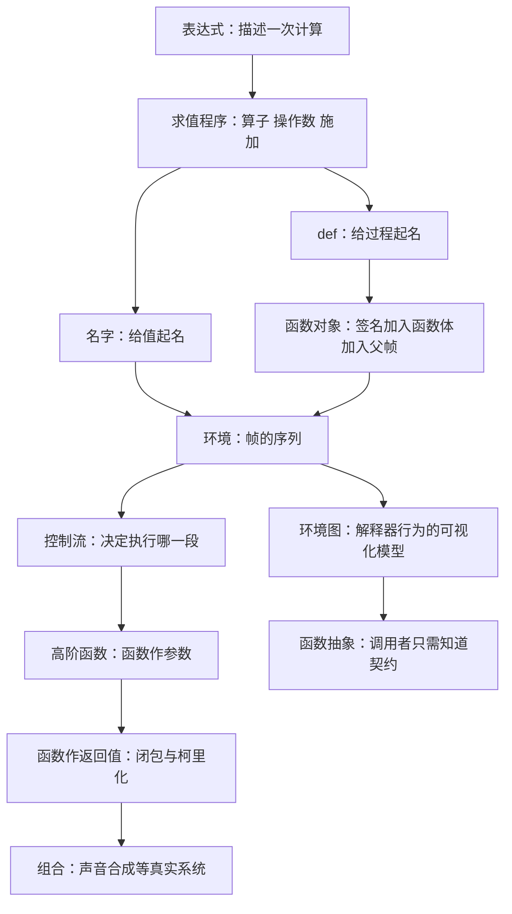
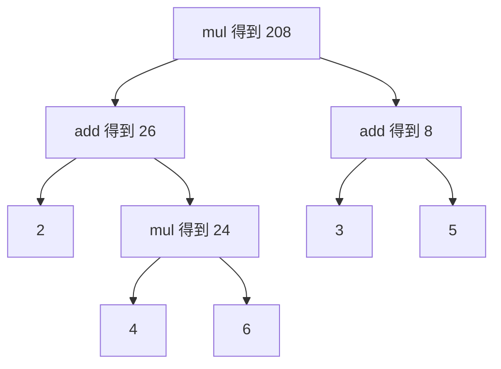
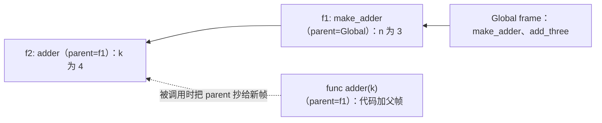
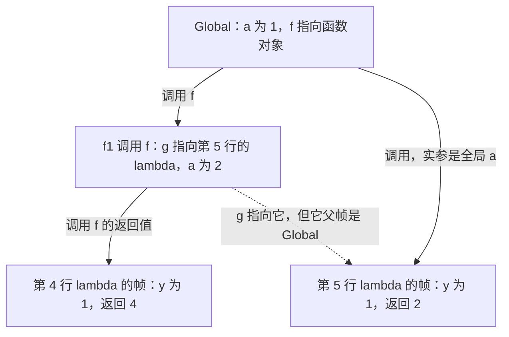
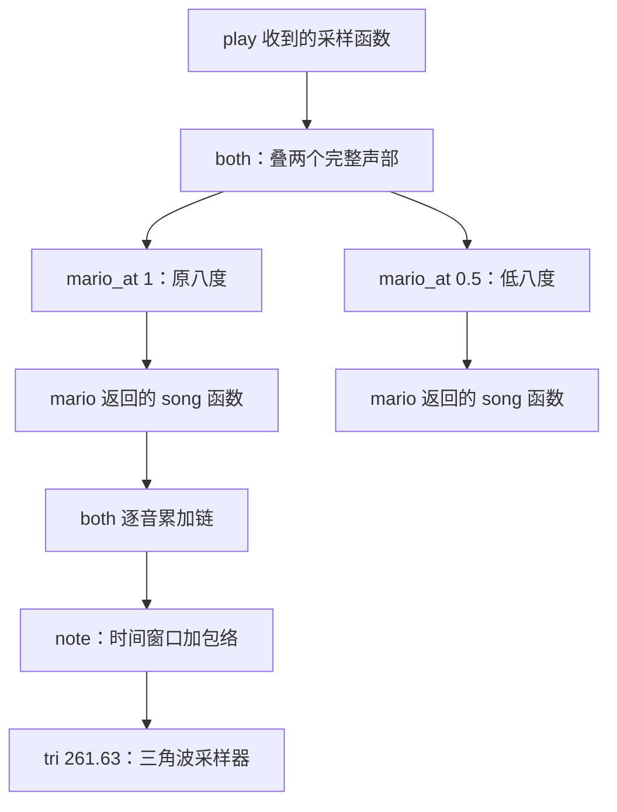
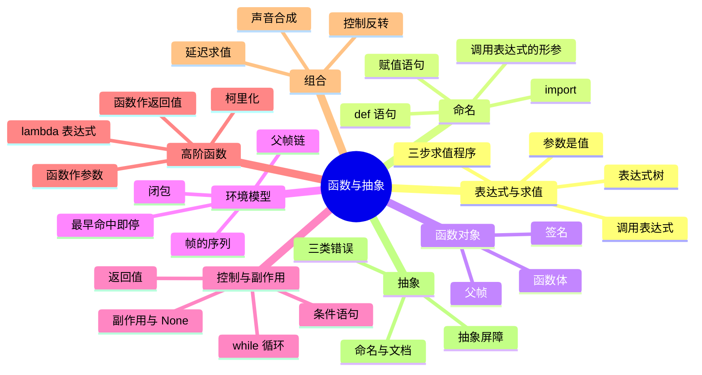

> **模块**：M1 CS61A-functions，含 Lecture 1–7（Welcome、Functions、Control、Higher-Order Functions、Environments、Sound、Functional Abstraction）
> **总时长**：03:30:26（7 讲，其中 Lecture 6 为无课件的选修专题）
> **合集**：[CS61A Fall 2024 中文字幕合集](https://www.bilibili.com/video/BV1sy411z7nA)，本模块对应分 P 1–7
> **课件**：`01-Welcome`、`02-Functions`、`03-Control`、`04-Higher-Order_Functions`、`05-Environments`、`06-Functional_Abstraction` 共 6 份官方 PDF、92 页，全部按官方 PDF 逐页渲染为正文插图（Lecture 6 无课件）
> **版权**：课程与课件版权归 UC Berkeley CS61A 教学团队（Fall 2024）；本文是学习用途的中文二次整理，不是逐句翻译

## 0. 模块导览

*(参考时间: 00:00:12 – 00:02:02｜Lecture 1)*

Lecture 1 到 Lecture 7 回答的是同一个问题的两面：**怎样把一段计算过程命名成一个可复用的整体，又怎样让机器在求值时知道每个名字此刻指什么。** 前半个问题的答案是函数，后半个问题的答案是环境图。七讲的依赖是单向的——第 5 讲的环境图若离开第 2 讲的 `def` 与第 4 讲的高阶函数就没有东西可画；第 7 讲的抽象屏障若离开第 5 讲的父帧，就无法解释"换个实现调用者为什么不用改"。叙述顺序与讲次基本一致，只有一处重排：第 7 讲关于 `lambda` 父帧的三页提前到第 6 章，与第 5 讲的 `lambda` 语法接在一起，因为它们考的是同一条规则。


### 0.1 讲次清单

| 讲 | 主题 | 时长 | 课件页数 | B 站分 P |
| :--- | :--- | :--- | :--- | :--- |
| 1 | Welcome 课程导论与表达式记号 | 13:29 | 22 | [P1](https://www.bilibili.com/video/BV1sy411z7nA?p=1) |
| 2 | Functions 名字、def 与调用三步 | 40:20 | 18 | [P2](https://www.bilibili.com/video/BV1sy411z7nA?p=2) |
| 3 | Control 返回值、副作用与控制流 | 32:21 | 13 | [P3](https://www.bilibili.com/video/BV1sy411z7nA?p=3) |
| 4 | Higher-Order Functions 函数作参数与作返回值 | 42:53 | 12 | [P4](https://www.bilibili.com/video/BV1sy411z7nA?p=4) |
| 5 | Environments 帧、父帧、闭包与柯里化 | 36:42 | 11 | [P5](https://www.bilibili.com/video/BV1sy411z7nA?p=5) |
| 6 | Sound 声音合成（选修，无课件） | 14:36 | 0 | [P6](https://www.bilibili.com/video/BV1sy411z7nA?p=6) |
| 7 | Functional Abstraction 抽象、命名与错误 | 30:05 | 16 | [P7](https://www.bilibili.com/video/BV1sy411z7nA?p=7) |

七讲里最容易被低估的是第 1 讲与第 6 讲。第 1 讲只有 13 分钟、一半时间在讲课程安排，但它给出的"求值程序"是后面六讲全部推理的发动机；第 6 讲是选修、没有课件，却是唯一一次把前五讲的零件装成整机——如果只补看一讲，选第 6 讲。

### 0.2 主线图



这张图是"两条腿走路"：左支是**写程序的人**的视角（怎么命名、怎么复用），右支是**解释器**的视角（怎么查名字、怎么建帧）。两支在"环境"处汇合，因为名字的意义只能由环境给出；全图收敛到"抽象"，因为环境与闭包存在的全部理由，就是让一个名字背后可以藏起一整段实现。

### 0.3 课程的组织方式与团队


这门课的技术形态本身就是一个设计决定：核心内容全部录成视频，现场课只复习其中最重要的部分。视频覆盖全部内容、课前必看、每支 5–10 分钟可暂停重看；教科书与视频高度重合，提供另一种更精确的表述，可跳读回查；现场课每周一三五，只讲例题与解题策略，**故意不覆盖全部**。第三列那句"故意"是关键：现场时间有限，应花在视频做不到的事上——卡点、策略、当场纠错。


三位讲师的分工里，与读这门课直接相关的是**答疑时间是公开承诺的固定资源**：周二 13:00–15:00、周一 15:00–16:00、周四 13:00–15:00 各有一个人在指定地点，不需预约。第 3 页介绍客座讲师的研究方向——计算伦理教育，即"技术如何影响社会，以及社会价值如何优先支持某些技术的发展"。

> **编者说明**：字幕提到视频"不全是今年录的"，内容更新时只重录其中一部分，这提示读者年份越早的片段越可能配旧版课件。第 3 页在录像中没有对应讲解，内容按课件原文整理。

### 0.4 练习闭环与提问渠道


第 6 页写着一句教学法声明：**解题是学会解题的有效方式**。它决定了课时怎么分配：Lab 周一/周二、Discussion 周三至周五都是硬性要求（大班除外），共同为每周作业与 4 个编程项目做准备；office hours 是随到随问的一对一答疑。练习之所以要占这么多课时，是因为"看懂一段代码"与"写出这段代码"调用的是两种能力——前者只需识别，后者需要检索、组合、调试。


讨论课的组织方式：每组 6–7 人，一间教室通常有 2–5 个组；大多数有助教在场，其余通过 Zoom 接入；材料是一张写满例题的工作表；**不计分，也不必全部做完**。"不计分 + 不必做完"是真正的设计：一旦计分，讨论就会退化成抄答案，而讨论课的目标是学会解**同类**问题。


提问按"谁能看到"分流：Ed 私帖走全体助教与讲师（适合涉及自己代码、成绩的问题），公帖全体学生可见（概念疑问、题目思路，别人也能受益），讲师邮箱只处理只有本人能处理的事，课程邮箱分发到几位助教。

### 0.5 这门课在讲什么


课件把课程概括成三条：**管理复杂性**（掌握抽象、复杂程序的组织技术）、**编程入门**（完整理解 Python 基础、大项目演示如何管理复杂性、计算机如何解释编程语言）、**不同种类的语言**（Python、Scheme、SQL）。第一条是本模块的主题，第三条是贯穿全课的视角。真正需要提前建立的心智模型是：抽象是手段，项目是检验，解释器是原理，多语言是视角。

### 0.6 选课建议与课程规则


课纲的原话是：没有正式的编程类先修要求，但是——完全没有编程经验来上这门课通常相当吃力；大多数学生已有可观的编程经验；零基础的学生往往要花更多时间，最终成绩也倾向偏低。措辞值得注意：它不设门槛，只把代价讲清楚。"没有先修要求"不等于"零基础友好"，中间差的是每周多出来的那几个小时。


对零基础或目标不同的学生有两门替代课：CS 10 面向完全没有经验的人，用图形化积木环境入门，不设大项目，为 61A 与 C88C 打基础；Data C88C 基于 61A 但只覆盖 4 个单元中的 3 个，2 个项目而不是 4 个，省略"程序如何运行程序"这个单元与部分高级 Python 主题，仍足够接 CS 61B。


政策被压成两个词：**Learning**（作业、协作、评分与截止时间的规则）与 **Community**（尊重与举报）。课件只展开两处最容易出问题的地方。


协作被高度鼓励，但边界由一条统一判据划定：**代码有没有经过你自己的思考**。讨论思路、看项目搭档的代码、自己解出之后看别人的写法都允许；把代码发给同学、让 AI 直接生成提交用的代码都不允许。所以"解出之后再看"被允许——那时看的是别人的写法，不是答案。


最后一页换到 Community 这条线：针对特定性别、种族或民族的贬损言论不可接受；伯克利社区原则写明"确认每一个人的尊严"；举报渠道包括讲师的匿名反馈页与 EECS 系的举报表。这页与函数无关，但它解释了为什么课程把协作边界写得这么细——程序员的产出是文本，而文本最容易在不经意间被复制。

## 1. 表达式与求值程序

*(参考时间: 00:02:04 – 00:13:25｜Lecture 1)*

课程行政讲完，第 1 讲只剩十分钟技术内容，但这十分钟给出了整门课最重要的一条规则。它要回答的问题很朴素：`mul(add(2, mul(4, 6)), add(3, 5))` 为什么等于 208？如果只能背"先算括号里"，遇到函数、副作用、递归时会立刻失效；需要的是一套可以机械执行、且能反复套用到任意深度的**程序**。

### 1.1 一个记号覆盖所有记号


数学为不同运算发明了不同记号：加法是横向的加号，除法上下叠放，开方是"小房子"，三角函数的 `sin` 是前缀。人类读得懂，是因为记住了每一套约定。课件把这些记号并排画出来，中间那个 `f(x)` 被一个浅灰方框圈住——那就是转折点：`6/23` 可写成 `truediv(6, 23)`，`sin π` 是 `sin(pi)`，`2¹⁰⁰` 是 `pow(2, 100)`，`7 mod 2` 是 `mod(7, 2)`，`√3493161` 是 `sqrt(3493161)`，`C(69,18)` 是 `comb(69, 18)`，`|−1869|` 是 `abs(-1869)`。

> **编者说明**：上面这些函数名是编者补充的，用来演示"统一成调用"之后的样子；课件只画了数学记号并用灰框标出 `f(x)`。像 `lim` 这样的记号没有对应函数，因为它不是一次可以算完的运算。

收益有三条，都不只是"好看"：规则集变小（解释器只需实现一种表达式的求值）、优先级消失（括号的嵌套结构本身就是求值顺序）、元数可变（同一个名字后面可以接两个参数，也可以接五个）。

### 1.2 解释器：三步求值程序


课件把这件事写成一句断言：**所有表达式都可以使用函数调用记号**，紧接着一个 `(Demo)`——断言不能只靠嘴说。

```python
>>> 2000 + 15
2015
>>> max(1, 2, 3, 4, 5)
5
>>> from operator import add, mul
>>> add(2, mul(4, 6))
26
```

第三段分量最重：`add` 不是语法糖，而是一个**函数值**，必须先 `import` 才存在。这证明"加法"并不是语法中不可替代的东西——它可以只是一个值。中缀写法之所以不受待见，是因为 `2 + 3 * 4` 的求值顺序依赖一条记在脑子里的优先级约定，而表达式自身并不携带这条信息；调用表达式没有这个问题，括号的嵌套结构直接把顺序写在纸上。

调用表达式的求值永远一样，这套规则叫**求值程序**（evaluation procedure）：求值算子子表达式得到一个函数；从左到右求值各个操作数子表达式得到各个参数；把函数施加到这些参数上。只为了把 2 和 3 加起来，走这三步显得小题大做，理由在于**它可以被反复套用**："程序"意味着不需临场判断，"反复"意味着它可以套在自己身上——这正是表达式树、也是后面递归的起点。



把嵌套式画成树，求值就是自底向上把每棵子树替换成它的值。两条观察值得记住：**顺序是信息依赖，不是风格偏好**——父节点要等子节点算完；**参数永远是值**——参与最后那次乘法的是值 26 与值 8，不是 `add(2, mul(4, 6))` 这串字符。第二条会在第 3 章有一次戏剧性后果：`if_` 函数之所以失败，就是因为它无法阻止公式被提前算成值。

> **编者说明**：表达式树是讲师现场画的，不是课件的一页，上面的结构按字幕叙述重画。树的深度决定解释器要递归多少层，CPython 默认上限约一千层，超深嵌套会抛 `RecursionError`。以上交互按字幕复述，字幕没有给出的输出此处不补。

## 2. 名字、def 与函数对象

*(参考时间: 00:01:13 – 00:32:46｜Lecture 2；00:00:33 – 00:10:13｜Lecture 3)*

第 1 讲的规则能算任何表达式，但只能算**一次**。要让它复用，需要两样东西：给值起名（赋值）、给过程起名（`def`）。这一章建立第一版环境模型——只有"局部帧 + 全局帧"两层的简化版；第二版（函数对象携带父帧）留给第 5 章，因为只有高阶函数才真正需要它。


### 2.1 名字不会凭空存在，赋值保存的是值


在解释器里敲 `pi`，得到的是一句 `NameError`：不是 Python 不认识 π，而是它不认识这个名字——绝大多数名字默认不可见，必须先 `from math import pi`。赋值语句的处理方式同样固定：先求右边表达式，再把值绑定到左边的名字。

```python
>>> radius = 10
>>> area = pi * radius * radius
>>> radius = 20
>>> area
314.1592653589793
```

`radius` 已经变成 20，`area` 仍然是 314——两者"失去同步"。原因在于赋值保存的是**值**：求值把 `pi * radius * radius` 压缩成一个数，只有这个数被绑定；"`area` 曾经是用 `radius` 定义的"这件事没有被记录在任何地方。课件用 `x = 2; y = x + 1; x = 5` 给出最小版本（`y` 仍是 3），并划掉 `1 + 2 = x`、`x - 1 = 2` 两行，强调赋值语句的等号不是数学等号：它没有对称性，也不能反解。这个失败模式在工程里有个更凶险的版本：把配置、连接、缓存算好存进变量，之后修改源头却忘了重新计算。

### 2.2 def 只造函数，不跑函数体

```text
def <name>(<formal parameters>):
    <body>
```

`def` 与冒号之间的部分叫**函数签名**（function signature），它最重要的职责是说明这个函数要几个参数；冒号之后缩进的部分是函数体，它规定函数做什么，并在**每次调用时重新求值**。于是"失去同步"的问题有了修法——把算法写成函数而不是把算好的数绑给名字，例如 `def area(): return pi * radius * radius`：每次 `radius` 变化，`area()` 都会重新读一次当前值。这是本模块第一个重要区别：**函数的返回表达式在每次被调用时都会被重新求值**；代价是每次调用都要重做一遍计算，收益是永远不会过期。`def` 的执行过程固定为三步，其中第二步的措辞最关键：创建一个新函数，签名就是第一行写下的签名；把函数的**函数体设为**第一行之后所有缩进的代码（不是"执行"这些代码）；在当前帧里把名字绑定到这个新函数上。所以执行 `def square(x): return mul(x, x)` 时，一次乘法都没有发生。函数体是被**储存**的代码，不是被**运行**的代码——讲师用的比喻是 squirreled away（藏到安全的地方）。

### 2.3 函数的一生与调用三步

第 3 讲用一页课件把上一节的全部词汇压成一张生命周期图，它是本模块最好用的复习页。


| 动作 | 触发 | 发生了什么 | 代价 |
| :--- | :--- | :--- | :--- |
| `def` 语句 | 执行到这一行，只一次 | 新建函数对象（名字、形参、函数体、父帧），在当前帧绑定名字 | 不执行函数体，不做任何计算 |
| 调用表达式 | 每次求值到这一处 | 求值算子与操作数，得到函数与实参 | 可能产生副作用 |
| 施加（apply） | 调用表达式求值到第三步 | 新建局部帧、绑形参、在新环境执行函数体 | 时间与空间随调用次数增长 |

表里"`def` 只一次、调用每次"这一行，是后面所有性能讨论的地基：一个 `def` 写在循环外还是循环内，决定了函数对象被创建一次还是 N 次。


演示代码只有四行：`from operator import mul`、`def square(x): return mul(x, x)`、`square(-2)`。第一行把 `mul` 绑定到内置乘法函数；第二行定义 `square`——创建函数、把函数体收进去、把名字绑到全局帧，此时仍没有任何乘法发生。调用（apply）用户自定义函数同样是固定三步：增加一个局部帧（local frame），形成一个新环境；在这个帧里把形参绑定到实参；在这个新环境中执行函数体。


这张截图的注解值得逐条读：**内置函数**与**用户自定义函数**画法几乎一样，区别只在于自定义函数会把形参写出来——因为它马上要用到；**局部帧**是三步法第 1 步的产物，帧标题用函数原来的名字只是方便追踪的标签；真正重要的是帧内那条绑定（形参 `x` 与实参值 -2）；帧内的 `Return value 4` **不是绑定**，而是记录"这次求值返回了什么"的注解。


局部帧的形状完全由签名决定：`square` 这个名字给帧起标题，`x` 是帧里那条绑定。所以课件说"函数签名包含了构造局部帧所需的全部信息"——这也解释了规范问题：为什么每次调用 `square`，帧里都恰好有一个 `x`。

> **编者说明**：课件把这条规则标为"version 1"，因为后续的条件表达式、高阶函数、嵌套定义都会扩展它。就第 2 讲而言，三步法已足够解释全部演示。

### 2.4 名字查找：环境是帧的序列


课件把这一节标成"今天要讲的最重要的两件事"：**环境是一串帧**（a sequence of frames），帧是名字与值之间的绑定；**一个名字求值的结果，是当前环境中最早的那个含有该名字的帧里绑定的值**——操作化就是从序列头部逐帧查找，第一次找到就停下。一个序列由"第一个帧"与"序列的剩余部分"组成，全局帧永远是查找的最后一站。图上画了三层帧，旁边一行字点破最容易犯的错误：**虽然三个帧画在同一张图里，它们未必在同一个环境中**。环境是"某次求值时的帧序列"，图是"整个程序生命周期里出现过的所有帧"。

规则听起来抽象，讲师用一次"故意捣乱"的演示把它钉住：把形参取名成函数自己的名字。

```python
def square(square):
    return mul(square, square)

square(-2)     # 4
```

`square` 既是函数名又是形参名，结果仍是 4。原因在调用时的环境：全局帧里 `square` 绑定着函数对象；调用时新建局部帧，帧标题仍叫 `square`（只是标签），帧里绑定 `square = -2`。执行 `mul(square, square)` 时，`square` 在**局部帧里就已经找到**，查找停止，全局帧里那个函数对象此刻"看不见"。这不是 bug，而是"最早找到即停"的直接推论：不是函数名被破坏，而是更近的那层绑定遮住了更远的那层。

> **编者说明**：真实 Python 的内置名字存放在 `builtins` 模块的命名空间里，查找时作为全局帧之后的一层（即 LEGB 中的 B）。课件为画图简单把它并进 global frame，本章沿用这一简化。

### 2.5 多重赋值


```python
a = 1
b = 2
b, a = a + b, b
```

第三行的执行规则有两条：从左到右求等号右边的**所有**表达式；把等号左边的所有名字绑定到这些结果值上（在当前帧里）。先求 `a + b` 得 3、再求 `b` 得 2，然后才做绑定：`b` 绑到 3、`a` 绑到 2。第二步的绑定顺序不影响结果，因为右侧的值在第一步就已经全部算完——这正是 `b, a = a + b, b` 能一次写对的原因：右边用到的都是旧值。这条规则是"求值发生在绑定之前"的第二次出现（第一次是第 1 章的参数），它会在交换变量、更新状态机、以及后面递归里的 `pred, cur = cur, pred + cur` 反复救命。

### 2.6 案例：把表达式本身当成对象

Lecture 2 的课件最后 6 页讲"小表达式"，录像没有讲到（本讲在 `print` 与 `None` 处结束）。放在这里是合适的收尾，因为它把"表达式"从一个求值动作变成了一个**可以被枚举、被计算、被打印的数据结构**——数据抽象那条主线的入口。


规则很短：只允许三个函数——`f(x)` 减一、`g(x)` 翻倍、`h(x, y)` 把两个正整数的十进制数字拼起来（`h(789, 12)` 得 78912）。从 5 出发，怎样用最短的小表达式走到 2024？"最短"有两种读法：调用次数最少，还是字符数最少，两种度量并不总是同步。


策略是**搜索**：先枚举所有含 3 次调用的小表达式，再 4 次、5 次，以此类推。这一页的结果要靠程序生成，因为每多一层调用，候选数量成倍增长。


第一批命中 2024 的表达式里，最短的一条是 `g(h(g(5),g(g(f(f(5))))))`：7 次调用、24 个字符。拆开看是 `f(5)=4`、再 `f` 得 3，`g` 两次得 12，`g(5)=10`，`h(10,12)=1012`，再 `g` 得 2024。


最后一页把整套搜索写成程序，并标注它用到的课程主题：Functions、Control、Higher-Order Functions、Objects、Representation、Sequences、Mutability、Iterators、Generators、Recursion、Tree Recursion、Containers。页脚那句 **By Midterm 2, you can do this** 是全学期的路线图。代码用两个类表示表达式：`Number` 保存数值、`calls()` 返回 0；`Call` 保存算子与操作数、`calls()` 返回 `1 + sum(o.calls() for o in self.operands)`。`smalls(n)` 则是"还允许用几次调用"的递归枚举：基例只产出数字 5，否则对每个 `n-1` 层的子表达式套一次 `f` 或 `g`，再用两层循环把剩余次数分给 `h` 的两个操作数，并且只拼接两个正数。

> **编者说明**：这一页只展示代码，没有展示运行输出，也没有说明"调用次数与字符数"是怎么统计的；上面的解读是对代码本身的分析，不是课堂讲述。这段代码用到的类、生成器、递归分别属于后面几个模块的主题，此处只需看懂"表达式可以被表示成对象"这一点。

## 3. 返回值、副作用与控制流

*(参考时间: 00:32:49 – 00:40:18｜Lecture 2；00:00:17 – 00:32:19｜Lecture 3；00:09:08 – 00:21:07｜Lecture 4)*

第 2 章解决了"怎么命名"，但没有解决"命名之后，一次调用到底留下了什么"。同一个动作其实留下两样东西：一个可以继续参与计算的**值**，和一件真实发生过的**事**。把这两条通道分开，才能理解 `print` 为什么不能参与算术；把"执行哪一段"也交出去，才有了 `if` 与 `while`。这一章最后会用第 4 讲的一个失败实验证明：控制语句不能被函数替代。


### 3.1 两条通道：返回值与副作用


在解释器里敲一个表达式，它会显示这个值；敲 `print(-2)`，屏幕上也会出现 `-2`。看起来一样，其实发生了两件不同的事。直接求值 `None` 什么都不显示，`print(None)` 却会打出 `None`——因为解释器自动显示输入表达式的值，而 `None` 是特例。这条规则使"函数没有输出"与"函数返回 `None`"在屏幕上看起来一模一样，是初学阶段最常误判的一处。

```python
>>> print(print(1), print(2))
1
2
None None
```

按求值顺序拆开：求算子 `print`；求第一个操作数 `print(1)`——应用时产生副作用（显示 1），这个子表达式的值是 `None`；求第二个操作数 `print(2)`——同理；最后外层变成 `print(None, None)`，显示 `None None`，返回值仍是 `None`，而解释器不显示它。


课件用"封闭的管子"画纯函数：进去一个值，出来一个值，中间没有别的事情发生；`print` 则不是封闭系统。**副作用不是一个值**，而是"调用函数作为后果发生的任何事情"。

| 判据 | 纯函数（Pure） | 非纯函数（Non-pure） |
| :--- | :--- | :--- |
| 返回值 | 由实参决定的一个值 | 常常是 `None`（也可能有值） |
| 副作用 | 没有 | 有：打印、改动外部状态、读写文件 |
| 能否嵌入更大表达式 | 能，`abs(-2) + 1` 合法 | 形式上能，但组合的是求值顺序，不是值的组合 |
| 重复调用同一实参 | 结果不变 | 每重复一次，副作用再来一次 |
| 能否安全地重排 | 可以随意嵌套、交换顺序 | 顺序改变会改变输出 |

最后一行是这张表真正的用处：纯函数可以随便重排，非纯函数不行。第 7 章做声音合成时"组合子可以任意嵌套"之所以成立，前提正是参与组合的采样函数都是纯的。

### 3.2 三种 h(x)：把"打印"与"返回"拆开看


```python
def h(x):
    return print(f(x))        # (A)

def h(x):
    print(f(x))               # (B)
    return f(x)

def h(x):
    y = f(x)                  # (C)
    print(y)
    return y
```

**(A)** 把 `f(x)` 交给 `print`，`print` 打印它并返回 `None`，于是 `h` 返回 `None`——屏幕上对，值错，最典型的"看起来没问题"。**(B)** 先打印 `f(x)`，再**重新求值一次** `f(x)` 并返回——屏幕对、值对，但 `f` 被调用两次。**(C)** 只求值一次 `f(x)`，存进 `y`，打印 `y`，返回 `y`。课件接着问：什么样的 `f` 会让 (B) 与 (C) 行为不同？如果 `f` 是纯函数，两者返回值相同、打印内容相同，只差一次多余计算，肉眼看不出来。

> **编者说明**：最省事的反例是把 `f` 取成 `print` 本身。此时 (B) 会先执行一次 `print(print(2))`（内层打印 2、外层打印 None），再执行 `return f(2)`（又打印一次 2），屏幕上是三行；而 (C) 只有 `2` 与 `None` 两行。这说明 (C) 的价值不只是"省一次计算"，而是"副作用只发生一次"。

### 3.3 语句、suite 与条件语句


语句与表达式的根本区别是：**表达式求值得到值，语句执行产生动作**。跨多行的语句叫**复合语句**（compound statement），结构固定：一个 header，后面跟一组缩进的语句。**clause（子句）**是一个 header 加上它后面那组缩进的语句；**suite（语句组）**是那个 clause 里缩进的一整组语句；而 header **控制**它后面的 suite——这句话是理解 `if` 与 `while` 的全部钥匙。执行一个 suite 的规则是：**先执行第一条语句，然后除非被要求另做，否则继续执行剩下的**。但真实程序很少这么听话：有的函数会**提前结束**，有的会**不按顺序执行**，前者对应条件语句，后者对应循环语句。


一个求绝对值的函数，body 只有一条语句，而这条语句包含三个 clause（`if`、`elif`、`else`）与三个 suite。执行规则只有一句：按顺序考虑每个 clause，求值它的 header；若得到真值，就执行该 clause 的 suite，并跳过剩下的所有 clause。由此得到最本质的性质：**只有一个 suite 会被执行**。

| 写法 | `x = 10` | `x = 1` | `x = -1` |
| :--- | :--- | :--- | :--- |
| 两条独立的 `if` | 打印 `big` 和 `positive` 两行 | `positive` | 什么都不打印 |
| 一条语句两个 clause：`if` + `elif` | `big` | `less big` | 什么都不打印 |
| 一条语句三个 clause：`if` + `elif` + `else` | `big` | `less big` | `not pos` |

第一行最能说明问题：`x = 10` 同时满足两个条件，两条独立语句各执行一次，于是打印两行。换成 `if` + `elif` 后，第二个条件根本不会被测试。这不是优化，而是语义差别：**`if/elif` 表达"互斥的若干情况"，两条 `if` 表达"彼此独立的若干条件"**。代价是 `if/elif` 后面的条件在第一个真值出现后永远不被测试，所以把小范围条件放在大范围条件之后会让后一个 clause 变成死代码。

### 3.4 布尔上下文与 while

"若得到一个真值"这句话里藏着一个概念：**布尔上下文**（Boolean context）。它是代码里的一个位置，可以放任意表达式，但这个位置只关心"真还是假"。Python 的假值包括 `False`、`0`、空字符串 `''`、`None`，其余一切都是真值。


课件列出三条必须想清楚的事：**需要几个名字，它们分别是什么意思**；**条件最终必须变成假值**，语句才会结束（除非 body 里有 `return`）；**条件一旦求值，整个 body 都会被执行**——执行到一半时条件可能已不成立，但循环不会中途回头检查。

```python
i, total = 0, 0
while i < 3:
    i = i + 1
    total = total + i
```

| 轮次 | 求值 `i < 3` | `i = i + 1` 后 | `total = total + i` 后 |
| :--- | :--- | :--- | :--- |
| 1 | 真 | `i = 1` | `total = 1` |
| 2 | 真 | `i = 2` | `total = 3` |
| 3 | 真 | `i = 3` | `total = 6` |
| 4 | 假 | 不执行 | 不执行 |

两处细节值得单独拿出来：**赋值语句右边用的是"执行前"的值**（第一轮 `i = i + 1` 读到 0），所以两条语句的顺序至关重要；**第三轮里 `i` 已被改成 3，但 body 没有中断**，`total` 仍然加上 3 得到 6。这也是为什么循环结束后 `i` 是 3 而不是 2。

> **编者说明**：把"每一轮结束时 `total` 等于 1 加到 `i`"写成**循环不变量**，是验证循环正确性的标准模板：初始化后成立；每轮开始时成立、执行完 body 后仍成立；循环结束时配合条件为假，就给出结论。课件与字幕都没有使用这个词。

### 3.5 例题：质因数分解


循环最适合处理"规模未知、但每轮都在缩小"的问题。每个正整数都有一组**质因数**：乘积等于它的那些质数（质数的质因数就是它自己）。课件给的思路是：**找出 `n` 的最小质因数，用它除一次，对商重复同样的动作**。

| 轮次 | 当前的 `n` | 最小质因数 `k` | 下一轮的 `n` | 这一轮的因子 |
| :--- | :--- | :--- | :--- | :--- |
| 1 | 858 | 2 | 429 | 2 |
| 2 | 429 | 3 | 143 | 3 |
| 3 | 143 | 11 | 13 | 11 |
| 4 | 13 | 13 | 1 | 13 |

四轮之后 `n` 变成 1，`while n > 1` 不成立，循环结束。循环变量每轮都在变小，这是"条件最终会变成假值"的结构性保证——判据不是"我数了四轮"，而是"每一步商严格变小，且下界是 1"。

> **编者说明**：字幕在 `while` 追踪结束后就终止了，课件第 13 页的 (Demo) 没有出现在字幕里。若补一版实现，就是两个 `while` 配合：内层 `smallest_prime_factor` 从 2 往上找第一个能整除 `n` 的 `k`，外层 `print_prime_factors` 在 `n > 1` 时反复取因子、`n = n // k` 并打印；`print_prime_factors(858)` 会依次打印 2、3、11、13。这里 `print` 的副作用正是输出本身，函数不需要返回值——又一次回到 3.1 节的两条通道。

### 3.6 失败实验：为什么 if 不能是一个函数

第 4 讲用一个反例回答了"为什么不干脆用函数实现分支"。顺着规则可以设想一个"if 函数"：收三个参数——条件、条件为真时的值、条件为假时的值。

```python
def if_(c, t, f):
    if c:
        return t
    else:
        return f
```

为把差别暴露出来，需要一个"实数部分平方根"的函数：对正数返回平方根，对负数返回 0（因为 $\sqrt{-4}$ 的实数部分是 0），而负数**不能**交给 `sqrt`。

```python
def real_sqrt(x):
    """Return the real part of the square root of x."""
    if x >= 0:
        return sqrt(x)
    else:
        return 0
```

这个版本工作正常：`real_sqrt(-16)` 得 0，而 `sqrt(x)` 根本没有被求值。改成 `return if_(x >= 0, sqrt(x), 0)` 后，`real_sqrt(-16)` 抛 `ValueError: math domain error`。原因不在 `if_` 的定义，而在求值顺序：解释器先求值算子得到函数，然后**把三个操作数全部求值**，再把三个值绑到 `c`、`t`、`f`；当 `x` 为 −16 时，第二步求值 `sqrt(x)` 就已经抛错，函数体一行都没执行。

结论由此得出：**调用表达式不能跳过其中任何一部分的求值**，所有部分永远在函数被调用之前就求完；而控制语句天生具备"执行一部分、跳过另一部分"的能力。这就是编程语言必须有控制语句的理由。

| 判据 | `if` 语句 | `if_` 调用表达式 |
| :--- | :--- | :--- |
| 分支选择时机 | 求值 header 之后，只执行被选中的 suite | 函数体内按 `c` 的取值返回，但全部实参已先求值 |
| 未被选中的分支 | 完全不求值，可安全包含 `sqrt(x)` | 必先求值，非法输入当场报错 |
| 求值顺序 | 惰性：按需执行 | 严格：算子与全部操作数先求值 |
| 失败模式 | 只可能在被执行的分支里失败 | 任一操作数失败即整体失败 |

这条实验的价值超出"分支"本身：它证明**求值顺序不能用函数封装**。任何"想跳过某段计算"的需求，都必须由语言的语法层提供，函数做不到。

### 3.7 短路求值：写在表达式里的控制

Python 里也有允许解释器跳过子表达式的表达式：`and` 与 `or`，行为叫**短路求值**（short-circuiting）。`left and right` 先求左；若它是假值，整个表达式取这个假值，右子表达式根本不求值；否则求右并取右值。`left or right` 先求左；若它是真值，直接取左值收工；否则求右并取右值。

| 表达式 | 左操作数 | 整个表达式的值 | 右操作数是否求值 |
| :--- | :--- | :--- | :--- |
| `a and b` | 假值 | `a` 本身 | 否 |
| `a and b` | 真值 | `b` | 是 |
| `a or b` | 真值 | `a` 本身 | 否 |
| `a or b` | 假值 | `b` | 是 |

注意值不必是 `True`/`False`：`2 and 3` 得 3，`0 and 3` 得 0。返回的始终是**某个操作数本身**。第一个用途是挡住危险子表达式：`return x > 0 and sqrt(x) > 10` 在 `x = -1000` 时返回假而**没有崩溃**，因为 `x > 0` 已是假值，`and` 立刻判假，`sqrt(-1000)` 从未被求值——这正是 `if_` 做不到的事。第二个用途是提供默认值：`return n == 0 or 1 / n != 0` 在 `n = 0` 时返回真，因为 `n == 0` 已是真值，`or` 随即收工；否则 0 会除以零，而 0 明明是一个合理的数，只是不适合做"取倒数"这个测试。

> **编者说明**：讲师的原话是"能表示的数只有这么小"。实现上这是浮点数的下溢（underflow）：绝对值小于最小正规数（约 $10^{-308}$）的结果落入非正规数区间，再小就被舍入为 0，具体由 IEEE 754 双精度格式决定。

### 3.8 三种"选择性执行"的分工

| 判据 | 控制语句 `if`/`while` | 短路运算符 `and`/`or` | 高阶函数 |
| :--- | :--- | :--- | :--- |
| 决定什么 | 哪一段 suite 执行、执行几次 | 右侧子表达式是否求值 | 传入哪段计算，何时被调用 |
| 语法层 | 语句 | 表达式 | 表达式 |
| 能否跨越语句边界 | 能 | 不能 | 不能 |
| 典型用途 | 分支、循环 | 守卫危险子表达式、提供默认值 | 把可变部分参数化 |

三者的关系可以这样记：`if` 管"执行哪段"，`and`/`or` 管"算不算右边"，高阶函数管"这段代码交给谁"。第 4 讲正是从第三条展开的。

## 4. 高阶函数：把差异变成参数

*(参考时间: 00:00:00 – 00:42:11｜Lecture 4)*

第 3 章把"执行哪一段"交给了语句，但有一类重复没有被消除：两个函数除了中间一行以外完全相同。`if` 帮不上忙，因为它只能决定"走哪条路"，不能把一个计算过程塞进另一个函数。第 4 讲的答案是把**函数本身变成参数**——抽象的对象从一个数升级为一段计算。


### 4.1 迭代的样板：先把状态列出来

进入高阶函数之前，第 4 讲用斐波那契数列做了一次迭代设计示范。方法论只有一句，但它是后面所有推理的地基：**设计迭代函数时，最重要的问题是——为了完成这次迭代，必须持续跟踪哪些信息。** 解法的三个名字各自有明确语义：`pred` 是前一项、`cur` 是当前项、`k` 记录"此刻 `cur` 里装的是第几个斐波那契数"；循环体里 `pred, cur = cur, pred + cur` 能一行写对，靠的正是 2.5 节那条"先全部求值，再统一绑定"。

| 阶段（`n = 5`） | `k` | `pred` | `cur` | `k < n` |
| :--- | :--- | :--- | :--- | :--- |
| 进入函数 | 1 | 0 | 1 | 真 |
| 第 1 轮结束 | 2 | 1 | 1 | 真 |
| 第 2 轮结束 | 3 | 1 | 2 | 真 |
| 第 3 轮结束 | 4 | 2 | 3 | 真 |
| 第 4 轮结束 | 5 | 3 | 5 | 假 |

课堂讨论题：把开头三行改成 `pred, cur = 1, 0` 与 `k = 0`，新定义与旧定义"一样"吗？它**仍然正确**，而且更好——因为 `n = 0` 时它返回 0，而旧版返回 1；代价是 `n = 5` 时多执行一轮。这题的教益不在"哪种更快"，而在于**初值的语义选择会改变边界行为**：判断两个定义是否相同，必须逐个输入去看。

### 4.2 描述一个函数：定义域、值域、行为


课件用 `square` 讲描述函数的三个层次：**定义域**（domain）是可能接受的全部输入——"x 是一个数"；**值域**（range）是可能返回的全部输出——"返回一个非负实数"；而纯函数的**行为**（behavior）是它在输入与输出之间建立的关系——"返回 x 的平方"。用关系描述而不是用过程描述，正是后面能放心替换实现的前提：只要关系不变，实现怎么写都不影响调用者。


设计准则只有两句：**给每个函数恰好一个职责，同时让它能适用于许多相关的情境**；**DRY（Don't Repeat Yourself）——一个过程只实现一次，但可以执行很多次**。课件用内置的 `round` 展示"一个职责、多种情境"：`round(1.23)`、`round(1.23, 1)`、`round(1.23, 5)` 都是同一个四舍五入职责，通过一个可选参数覆盖不同精度。

> **编者说明**：课件上 `round(1.23, 0)` 显示为 `1`，那是 Python 2 时代的输出；Python 3 返回浮点 `1.0`。

### 4.3 第一次泛化：把常数变成参数


面积公式是最朴素的例子：正方形 $r^2$、圆 $\pi r^2$、正六边形 $\dfrac{3\sqrt{3}}{2} r^2$。共同的骨架是 $r \times r$，剩下的只与形状有关。最直白的实现是同一条断言写三遍，而"三处粘贴同一行"恰好违反 DRY。把共同骨架抽出来、差异做成参数：

```python
def area(r, shape_constant):
    assert r > 0, 'A length must be positive'
    return r * r * shape_constant

def area_hexagon(r):
    return area(r, 3 * sqrt(3) / 2)
```

`area_hexagon(-10)` 现在会抛 `AssertionError`，因为断言只写了一份却对三个函数同时生效。代价也要说清楚：`area(r, shape_constant)` 这种签名并不直观，必须靠文档说明第二个参数是什么——**复用换来可读性的下降**。而这一版的局限是决定性的：被参数化的是"数"，可接下来的差异落在表达式上。

### 4.4 第二次泛化：把过程变成参数

三个求和式：自然数之和、立方和、以及一个项数越多越逼近 $\pi$ 的级数。它们都是"从 1 到 n 逐项相加"，区别只有一项：每一项怎么算。先老实写两遍——`sum_naturals` 与 `sum_cubes` 除了 `total + k` 与 `total + pow(k, 3)` 之外逐字重复。既然差异是"由 k 算出这一项"的计算，就把它写成函数传进去：

```python
def summation(n, term):
    """Sum the first n terms of a sequence.

    >>> summation(5, cube)
    225
    """
    total, k = 0, 1
    while k <= n:
        total, k = total + term(k), k + 1
    return total
```


课件的四处标注构成理解高阶函数的最小闭环：`cube` 是"只有一个参数的函数"，它的名字**不叫** `term`——`term` 是形参，`cube` 是传进来的那个函数；`term` 这个形参会被绑定到一个**函数**上；调用 `summation(5, cube)` 时 `cube` 作为**参数值**被传进去；循环体里的 `term(k)` 真正调用的就是 `term` 此刻绑定的函数。于是两个重复的函数各自缩成一行：`return summation(n, identity)` 与 `return summation(n, cube)`。

第三个式子用来验收，它需要一个项函数 `pi_term(k) = 8 / mul(4 * k - 3, 4 * k - 1)`；求和一百万项得到 3.141592，这不是精确的 $\pi$ 而是一个近似值。

| 求和 | 每一项 $f(k)$ | 传给 `summation` 的 `term` | 结果 |
| :--- | :--- | :--- | :--- |
| 自然数之和 | $k$ | `identity` | 15（n = 5） |
| 立方和 | $k^3$ | `cube` | 225（n = 5） |
| 逼近 $\pi$ 的级数 | $\dfrac{8}{(4k-3)(4k-1)}$ | `pi_term` | 3.141592（n = 10⁶） |

这里值得停一下，看清"抽象层次提高"的确切含义：**被抽掉的不再是一个数，而是一整段计算**。`summation` 只承诺"逐项累加"，把"每一项是什么"完全交给外部，因此它对任何形状的项都开放。

### 4.5 程序设计的三个词与两个案例


紧接着的一页给出三个词：**模块化**（可独立替换的单元——`summation` 的骨架与 `term` 的实现是两块）、**抽象**（只暴露必要的接口——`term` 是唯一对外暴露的边界）、**关注点分离**（"怎么累加"与"累加什么"彻底分到两边）。它们是对前面所有工作的命名。


案例是二十一点：两名玩家轮流把 1、2 或 3 加到总和上；总和从 0 开始；达到或超过 21 立即结束；**最后一个加数的人输**。这页图在第 8 章会被完整解读，此处只需注意它与函数的对应关系：**策略就是一个函数**——接受当前总数、返回要加多少。只要签名对上，`play` 不关心策略是人、是随机数、还是会打印日志的包装器。

> **编者说明**：课件第 9 页在录像中没有对应的独立讲解段落，讲师在求和演示之后直接进入"函数作为返回值"；三个词的落点由本章内容承担，而非课堂原话。

### 4.6 函数作为返回值：make_adder


```python
def make_adder(n):
    """Return a function that takes one argument k and returns k + n.

    >>> add_three = make_adder(3)
    >>> add_three(4)
    7
    """
    def adder(k):
        return k + n
    return adder
```

课件的四处标注：`make_adder` 是"一个返回函数的函数"；`add_three = make_adder(3)` 让名字绑定到**一个函数**；`def adder(k)` 是"出现在另一个 `def` 内部的 `def`"，因此 `adder` 落在 `make_adder` 调用的**局部帧**里；`return k + n` 里的 `n` 不是 `adder` 的形参，而是外围函数的形参，内层可以引用它。结构上必须分清两条 `return`：`return k + n` 属于 `adder`，返回一个数；`return adder` 属于 `make_adder`，返回一个**函数对象**——注意没有括号，所以它不是"调用 `adder`"，而是"把 `adder` 本身交出去"。于是本讲留下一个悬念：调用 `add_three(4)` 时，`make_adder` 早就返回了，它的帧应该消失了，可 `k + n` 里的 `n` 凭什么还是 3？`adder` 函数对象里到底存了什么？第 2 章的第一版环境模型回答不了这个问题，因为它只有两层，而这里的帧链是三层。第 5 章正是为回答它而来的。

## 5. 环境模型：帧、父帧与闭包

*(参考时间: 00:00:00 – 00:19:13｜Lecture 5)*

第 5 讲的总纲只有一句：**环境图存在的全部理由，就是为了描述高阶函数是怎么工作的**。好消息是已有的规则一条都不用改——高阶函数不需要补丁，它只是"函数也是值"的自然推论。这一章要做的只有一件事：给函数对象补上它一直缺的那个字段。


### 5.1 复习：环境图追踪的是值与绑定


课件用一页复习把"值"再钉一遍：`print` 只产生副作用、不返回有用值，返回的是 `None`。这在环境图里尤其重要，因为**环境图追踪的是值与绑定的流动，不是屏幕上的字符**。紧接着一道期中真题把第 2、3 章的规则压成一次追踪：

```python
s = "Knock"
print(print(print(s, s) or print("Who's There?")), "Who?")
```

按表达式树自内向外拆：`print(s, s)` 打印 `Knock Knock`、返回 `None`；`or` 左边是假值，求右边 `print("Who's There?")`，打印该行、返回 `None`，整个 `or` 的值是右边那个 `None`；中间层 `print(...)` 收到它并打印第三行 `None`（课件批注：This None is passed to print!）；最外层收到 `None` 与 `"Who?"`，打印末行 `None Who?`——四行输出，而整个表达式的值仍然是 `None`。

> **编者说明**：这条表达式本身的值仍是 `None`。若在交互式解释器里直接求值它，屏幕上还会额外回显一个 `None`；作为脚本运行则不会——这正是"打印出来的东西"与"表达式的值"最容易混淆的一处。

### 5.2 apply_twice：形参里装的是函数


```python
def apply_twice(f, x):
    return f(f(x))

def square(x):
    return x * x

result = apply_twice(square, 2)
```

`apply_twice` 之所以是高阶函数，理由很朴素——实参里有一个本身是函数。调用写法值得多看一眼：`apply_twice(square, 2)` 里被求值的是两个**值**——`square` 这个名字指向的函数对象，以及数字 2；不是"函数名"，也不是"函数调用"。

- **Global frame**：`apply_twice`、`square` 各指向一个函数对象
- **f1: apply_twice [parent=Global]**：`f` → `func square(x) [parent=Global]`（一个函数**值**，不是一次调用）、`x` → `2`
- **f2: square [parent=Global]**：`x` → `2`，返回 4
- **f3: square [parent=Global]**：`x` → `4`，返回 16

求值顺序在这里第一次被说清楚：要算 `f(f(x))`，必须先弄清算子 `f` 是什么、操作数 `f(x)` 又是什么。内层 `f(x)` 在 `f1` 里命中 `f`，实际发生的是 `square(2)` 返回 4；这个 4 成为外层 `f` 的实参，`square(4)` 返回 16。注意 `f2` 与 `f3` 的父帧都是 Global，**不是 `f1`**——此时它恰好与"调用者的帧"相同，所以看不出区别，这正是需要嵌套 `def` 的原因。

### 5.3 嵌套 def 与父帧


```python
def make_adder(n):
    def adder(k):
        return k + n
    return adder

add_three = make_adder(3)
add_three(4)
```

逐帧跟踪：调用 `make_adder(3)` 新建 `f1: make_adder [parent=Global]`，`n` 绑到 3；`def adder(k)` 在**当前帧 `f1`**（不是全局帧）创建 `func adder(k) [parent=f1]`，名字绑在 `f1`；此刻 `f1` 里有了 `adder`，但从全局帧出发没有任何路径能引用它；`return adder` 把这个函数对象带回调用处，随即被赋值语句绑到全局名字 `add_three`，同一个函数对象因此有了两个名字。调用 `add_three(4)` 时新建 `f2: adder [parent=f1]`，`k` 绑到 4——**它的父帧不是全局帧**，而是 `f1`。求 `k + n` 时当前环境是 `f2 → f1 → Global`：`k = 4` 在 `f2` 命中，`n = 3` 在 `f1` 命中，得 7。

关键在最后一步：`make_adder` 早就返回了，可 `f1` 并没有消失，因为调用 `add_three` 时创建的 `f2` 把 `f1` 当作父帧，而 `f1` 里存着 `n`。



> **编者说明**：这种"函数对象带着定义时的环境、从而记住外层名字"的现象，教材与后续课程里称为**闭包（closure）**。本讲口播没有使用这个词，讲师只描述了机制。

### 5.4 四条父帧规则与画图五步法

课件把上面的推理压缩成四条：每个用户定义函数都有一个父帧，通常是全局帧；函数的父帧是**它被定义（被创建）时所在的那个帧**；每个局部帧都有一个父帧；帧的父帧 = 被调函数的父帧。最后一条正是画图最容易错的地方：**帧的 `parent` 不是"谁调用了我"，而是"我所属的函数当年出生在哪里"**。讲师的自问自答是：只有记下"出生地"，调用它时才写得出正确的帧 `parent`；而帧链决定了"当前环境"往哪走。反过来看，画一个调用帧所需要的一切——函数名、父帧标注、形参——**全都记在函数值上**。


把清单整理成五步：

1. **只造值不执行体**：每遇到 `def`（或 `lambda`）创建函数值，函数体等被调用时才执行。
2. **函数值写全三段**：`func <name>(<形参>) [parent=<标签>]`，`parent` 填**定义时的当前帧**。
3. **在当前帧绑定名字**：`def` 自动完成；`lambda` 只造值，名字由外面那句赋值给出。
4. **调用时按固定顺序建帧**：新建局部帧、把函数值上的 `parent` 抄下来、把形参逐个绑到实参。
5. **在以新帧开头的环境里求值函数体**：查名字从当前帧沿 `parent` 向上，第一个命中的绑定就是答案。

| 场景 | 函数值的 `[parent=…]` | 调用帧的 `[parent=…]` | 能否读外层局部名 |
| :--- | :--- | :--- | :--- |
| 顶层 `def` | Global | Global | 只能读全局名 |
| 嵌套 `def`（在 `f1` 里定义） | `f1` | `f1` | 能，`f1` 的绑定都可见 |
| 嵌套函数的返回值被再次调用 | `f1`（抄自函数值） | `f1` | 能，`n` 仍然有效 |
| 两个并列的顶层函数互相调用 | Global | Global | 不能，看不到调用者的局部帧 |

### 5.5 反例：y 明明在那里，为什么找不到

```python
def f(x, y):
    return g(x)

def g(a):
    return a + y

f(1, 2)        # NameError: name 'y' is not defined
```

画面上一眼就能看出荒谬：`x` 绑到 1、`y` 绑到 2，都在 `f` 的帧里摆着；调用 `g` 正是执行 `f` 的函数体；进入 `g` 之后 `a` 绑到 1。所有的值都在，`y` 就在"旁边"的帧里，可程序偏偏说它不存在。答案只有一句：**那个帧不在当前环境里**。当前环境由 `g` 的局部帧与全局帧两段组成；查 `y` 时先看 `g` 的帧——没有；再看全局帧——也没有；于是报错。把它和 `make_adder` 对照，两讲的差别只剩一个词：**嵌套**。

> **编者说明**：这个现象在语言设计里叫**词法作用域（lexical scoping）**——名字解析只取决于函数在哪里被定义。另一种可能的设计是动态作用域：若按"谁调用我"决定父帧，`g` 就能看到调用者 `f` 的帧，`y` 会是 2。Python、Scheme 与现代主流语言都选择词法作用域，因为只有它能让代码行为在阅读时就被确定。

### 5.6 两版环境模型，以及一次语言对照

| 判据 | 第 2 版（Lecture 2） | 第 5 版（Lecture 5） |
| :--- | :--- | :--- |
| 环境是什么 | 局部帧 + 全局帧两段 | 一串帧，长度任意 |
| 函数对象里有什么 | 签名 + 函数体 + 名字 | 签名 + 函数体 + 名字 + **父帧** |
| 帧的父帧从哪来 | 恒为全局帧 | 抄自被调函数值的 `parent` |
| 能解释 `make_adder` 吗 | 不能 | 能 |
| 够用范围 | 无嵌套 `def`、无返回函数 | 全部一阶函数与高阶函数 |

这张表也解释了为什么第 5 讲必须排在第 4 讲之后：如果先讲父帧，没有任何例子需要它；先看 `make_adder` 失败一次，父帧就成了必需品而不是规定。

同一套求值思想在 Scheme 里会以更纯粹的形式出现（第 28 讲起）。提前对照一次，可以避免把 Python 的语法习惯误当成计算本身的性质：

| 判据 | Python | Scheme |
| :--- | :--- | :--- |
| 调用写法 | `f(x, y)`，算子在前、括号在后 | `(f x y)`，整体一对括号，算子在最前 |
| 中缀运算符 | 有 `+ - * /`，并带优先级 | 没有中缀，`(+ 1 2)` 就是调用 |
| 定义函数 | `def f(x): return ...` 是语句 | `(define (f x) ...)`，本身也是一次求值 |
| 表达式与语句 | 分两套，语句不产生值 | 不区分，一切皆有值 |
| 求值程序 | 先算子、再从左到右求操作数、再施加 | 同一条规则，只是写法统一后更显眼 |
| 能否跳过子表达式 | 靠 `if`、`while`、`and`/`or` | 靠特殊形式 `if`、`cond`、`and`/`or` |

最值得记住的是"求值程序"那行：**规则的骨架完全一样**，差别只在语法把算子摆在哪儿。`mul(add(2, 3), 5)` 翻成 Scheme 是 `(* (+ 2 3) 5)`，括号位置变了，求值顺序一点没变。

> **编者说明**：Scheme 相关内容不在本模块七讲的字幕里，属于对后续讲次的预告；上表只保留与本模块直接相关的对照项，细节以第 28–34 讲的正式讲解为准。

## 6. lambda、闭包与柯里化

*(参考时间: 00:24:28 – 00:36:40｜Lecture 5；00:02:21 – 00:07:32｜Lecture 7)*

父帧规则一旦立住，剩下的事情都是它的推论：匿名函数为什么能记住外层变量、为什么"返回函数"的三层调用能一路读对名字、为什么把双参函数拆成两层单参函数之后中间产物还能复用。这一章把 `lambda` 当作"造函数的表达式"来讲，并用两道期中题验收父帧规则。

### 6.1 lambda 表达式与三条限制


前面的函数都是 `def` 出来的，都有名字。能不能用**赋值语句**把函数绑到名字上？`square = x * x` 不行——赋值先求右边，`x * x` 求出来是个数。让右边变成"求值结果为函数的表达式"就行：

```python
square = lambda x: x * x
square(4)                    # 16
(lambda x: x * x)(4)         # 16
```

`lambda x: x * x` 整体是一个**表达式**，读法是"一个以 `x` 为形参、返回 `x * x` 之值的函数"。三条限制：**没有 `return` 关键字**，冒号后面直接写返回值表达式；**函数体只能是单个表达式**；**不能包含语句**——想写 `while`、多行逻辑，必须退回 `def`。第三条直接决定了第 8 章"条件表达式"的地位：既然 `lambda` 体内不能写 `if` 语句，要在匿名函数里做判断就只能用"表达式的 if"。

### 6.2 练习：五个帧


课件末尾的期中题要求找出使 `f(y)(lambda z: z - y + 10)` 不为 0 的最大正整数 `y`（小于 10）。代码本身不难，难在它有五个帧：

```python
def f(x):
    y = max(x * x, 3 * x)
    def zero(t):
        if t(x) > 0:
            return y
        return 0
    return zero

y = 1
while y < 10:
    if f(y)(lambda z: z - y + 10):
        max = y
    y = y + 1
```

第一轮（`y = 1`）：`f(y)` 新建 `f1: f [parent=G]`，`x → 1`；体内 `y = max(x * x, 3 * x)` 让 `f1` 的 `y → 3`，它与全局的 `y = 1` 是两个互不相干的绑定；`def zero(t)` 在 `f1` 里创建 `func zero(t) (parent=f1)`；`return zero` 把它交回全局，进入第二次调用。那个 `lambda` 写在模块层，父帧是 `G`。于是 `f2: zero (parent=f1)` 里 `t → λ`，`x` 沿 `f2 → f1` 查到 1，调用 `λ(1)` 得 `1 - 1 + 10 = 10`；10 > 0 成立，`return y` 沿 `f2 → f1` 取到 `f1` 的 3；条件为真，执行 `max = y`——这一行在模块层，在**全局帧**里把 `max` 绑到 1，遮蔽了内建函数。第二轮 `f(2)` 的 `max(x * x, 3 * x)` 于是触发 `TypeError`。

| 帧 | 何时创建 | 关键绑定 | 它证明了什么 |
| :--- | :--- | :--- | :--- |
| `f1: f` | 第一次 `f(1)` | `x → 1`、`y → 3` | `zero` 的父帧是这里，不是全局帧 |
| `f2: zero` | `zero(λ)` | `t → λ` | 返回的是 `f1` 里的 `y = 3` |
| `f3: λ` | `t(1)` 触发 | `z → 1`、返回 10 | `λ` 的父帧是 `G`，读到全局的 1 |
| `f4: f` | 第二次 `f(2)` | `x → 2` | 全局 `max` 已被改写，函数体崩在这里 |

这道题把本章要点一次考完：同名不同帧、局部帧的父帧抄自函数值、`lambda` 的父帧取决于它写在哪里，以及重新绑定全局名字的连锁后果。最后一条尤其值得警惕——"遮蔽"是双向的：内层可以遮蔽外层，模块层的赋值也可以遮蔽内置名字。

### 6.3 lambda 的父帧：一个 4 的推导


```python
a = 1
def f(g):
    a = 2
    return lambda y: a * g(y)

f(lambda y: a + y)(a)      # 4
```

答案是 4，而 `a` 在这五行里出现了五次：第 1 行与第 3 行各写一次，第 4 行读一次，第 5 行读两次。规则只有一条：**lambda 函数的父帧，就是求值这个 lambda 表达式时所在的那一帧**——它不看谁调用它、不看它被传给谁，只看它在源码里的位置。



第 5 行的 lambda 在全局帧里被求值，父帧是 Global，此刻全局 `a` 还是 1；调用 `f` 新建 `f1`，`a = 2` 只遮蔽全局；`return lambda y: a * g(y)` 这个 lambda 在 `f1` 里被求值，父帧是 `f1`；外层调用的实参是全局 `a`（值为 1），调用返回的 lambda 新建帧、父帧 `f1`、`y = 1`；求 `a * g(y)` 时 `a` 沿父帧取 `f1` 的 2，`g` 也取 `f1` 里那个 lambda；调用 `g(1)` 新建帧、父帧 Global（因为那个函数对象记着 Global），`a + y` 得 2；最后 `2 * 2` 得 4。

两个结论值得背下来：**参数传递不改变父帧**——第 5 行的 lambda 明明是被 `f1` 作为实参接进去的，父帧仍然是创建它的 Global；**返回之后帧不消失**——`f` 已经返回，`f1` 里也没有代码在跑，但第 4 行那个 lambda 一直抓着 `f1`。两者合起来就是闭包的完整定义：函数值 = 代码 + 创建时的帧。

### 6.4 lambda 与 def 是同一件事的两种写法


课件给的命题很硬：任何含 `lambda` 表达式的程序，都能改写成只用 `def` 的程序。`(lambda f: lambda x: f(f(x)))(lambda y: y * y)(3)` 与 `twice(square)(3)` 都得 81，两段程序的帧结构与求值顺序完全同构。

| 判据 | `lambda` 表达式 | `def` 语句 |
| :--- | :--- | :--- |
| 身份 | 表达式，可出现在任何需要值的位置 | 语句，只能单独成行 |
| 函数体 | 只能是一个表达式 | 可有多条语句、循环、`return` |
| 名字 | 不绑定名字，除非赋给变量 | 在当前帧里绑定名字 |
| 内在名字 | 回显为 `<lambda>` | 回显为函数名 |
| 父帧 | 定义处的当前帧 | 定义处的当前帧，完全相同 |
| 适合场合 | 一次性、内联、作参数或返回值 | 要复用、要文档、要递归自引用 |

"能改写"不等于"该改写"。`twice` 这种要被反复调用的东西写成 `def` 更好读；而传进去就再也不会被单独提到的判断，写成 `lambda` 反而把重点留在参数位置上。

> **编者说明**：内在名字（intrinsic name）在环境图里的作用是给帧起标题：`lambda` 版本的函数值写成 `func λ(x) [parent=G]`，调用帧标题也写 `λ`；而赋值语句留下的名字仍然出现在帧里。

### 6.5 两道期中题：funsquare 与 snap


`funsquare` 接受一个单参数函数 `f`，返回一个单参数函数 `f2`，使 `f2(x)` 与 `f(f(x))` 行为相同。六个候选可以按"签名"与"在哪个帧里求值"两把尺子筛：返回 `f(f)` 的值的把函数当参数传给了 `f`；返回零参数 lambda 的参数个数不对；签名多一个 `x` 的在第一步就报错。答案落在 `lambda x: f(f(x))` 与其 `def` 版本——两者与 `twice` 同构。这道题考的其实不是 `lambda`，而是"返回值应该是一个还没被调用的函数"：差一对括号，函数就变成了值。


```python
>>> snap = lambda chat: lambda: snap(chat)
>>> snap, chat = print, snap(2020)
```

第二行是多重赋值，右边全部求值完再统一绑定。右边 `snap(2020)` 要调用第一行那个 lambda：新建帧，`chat = 2020`，父帧 Global；函数体 `lambda: snap(chat)` 在这一帧里被求值，于是内层 lambda 的父帧是这一帧，它记住了 `chat = 2020`。绑定完成后全局 `snap` 变成 `print`，全局 `chat` 变成那个内层 lambda。调用 `chat()` 时，函数体 `snap(chat)` 里两个名字的绑定时机完全不同：`chat` 是形参，闭包在创建时就把 2020 记死了；`snap` 是全局名，直到调用那一刻才去查，查到的是被改写后的 `print`。于是执行 `print(2020)`，屏幕上是 `2020`。

> **编者说明**：这一页只写了 "What is displayed here?"，没有给答案；上面的推导与结论 `2020` 是按环境图规则补的，实跑可以复核。两个容易踩的点：赋值右侧先求值、绑定在后；`chat` 被内层 lambda 的父帧挡住，而不是从全局取。

### 6.6 柯里化：把多参函数拆成管道

第 5 讲的收尾是"老传统"：前两讲都实现过 `make_adder`，这次改用 `lambda`。

```python
def make_adder(n):
    return lambda k: n + k

make_adder(2)(3)      # 5
```

注意它的形状——**算子本身就是一个调用表达式**：`make_adder(2)` 先返回一个"会加 2"的函数，紧跟的 `(3)` 立刻把它作用在 3 上。要真正拿到一个数，必须调用两次。对照 `add(2, 3)`，两者是一条普遍对应的两端：一边"只吃一个参数、返回函数"，另一边"一次吃多个参数、直接给答案"。这条关系可以写成代码：`curry2(f)` 定义 `g(x)`，`g` 再定义 `h(y)`，`h` 才真正调用 `f(x, y)`——三层函数值、三层帧。写成一行就是 `curry2 = lambda f: lambda x: lambda y: f(x, y)`。

| 判据 | `add(x, y)` 双参函数 | 柯里化后的 `curry2(add)(3)(4)` |
| :--- | :--- | :--- |
| 一次接几个参数 | 两个 | 一个，分两次给 |
| 中间产物 | 无 | 一个仍携带 `x` 的函数对象 |
| 拿到答案要几次调用 | 一次 | 两次 |
| 能否部分应用 | 不能 | 能，`curry2(add)(3)` 就是部分应用 |
| 依赖哪个外层帧 | 只需全局帧 | 依赖 `x` 所在的那一层 |

讲师给的术语定义可以直接引用：**柯里化是把多参数函数变换成一个单参数高阶函数、后者返回一个继续接收其余参数的函数的过程。** 名字的来历有个反转：它不是 Haskell Curry 发现的，而是 Moses Schönfinkel 先发现的。

把本模块的两个方向并排，就是一张完整的对照：

| 判据 | 函数作为参数 | 函数作为返回值 |
| :--- | :--- | :--- |
| 典型例子 | `summation(n, cube)`、`apply_twice(square, 2)` | `make_adder(3)`、`curry2(add)` |
| 抽象的维度 | 把"算哪一项/施加什么"变成参数 | 把"先绑定哪个参数"变成中间产物 |
| 依赖哪条规则 | 参数永远是值 | 函数值携带父帧 |
| 需要的环境模型 | 第 2 版（局部 + 全局）足够 | 必须有第 5 版的父帧 |
| 失败模式 | 传错函数签名，运行时才炸 | 忘记返回函数，或忘记调用返回的函数 |

一句话总结这一章：`lambda` 只是语法糖，"函数值 = 代码 + 父帧"才是新的内容；柯里化只是把这条规则用两次。

## 7. 函数空间的工程实例：声音合成

*(参考时间: 00:00:13 – 00:14:07｜Lecture 6)*

第 6 讲是选修专题，没有官方课件，时长 14:36。它在模块里的位置不是讲次顺序，而是**整机演示**：把前五讲的零件——高阶函数、闭包、组合、延迟求值——一次性装进一个真实系统。因此这一章不引用任何幻灯片。

### 7.1 问题的来处

学生最常问的是：高阶函数到底有什么用？`make_adder` 很可爱，但既然最后还是要算出 `x + y`，为什么不直接相加？讲师没有正面辩论，而是构造一个稍长的程序，让整个程序**一直待在函数空间里**，直到最后一步才把函数变成具体数值。选声音而不是加法是有讲究的：加法里"函数"看起来是多余的中间层，因为一步就能算完；声音合成相反，任何一段音乐都不可能一步算完——它需要波形、多个声部、节奏、移调，每一项都天然是"数值到数值"的变换。

| 判据 | 立刻求值：直接算 `x + y` | 函数空间：`add(x)` 返回 `lambda y: x + y` |
| :--- | :--- | :--- |
| 结果何时产生 | 调用的一瞬间 | 直到最后一刻才被求值 |
| 能参与的组合 | 只能与数值打交道 | 可与任意其他函数组合 |
| 参数结构能否复用 | 不能，每次重写 | 能，闭包记住先前绑定的名字 |
| 表达复杂结构的能力 | 随规模线性膨胀 | 与音乐结构同构，几乎不增长 |

### 7.2 波形即函数

声音的物理形态是一条**波形**（waveform）：空气压强随时间连续起伏，任意时刻的高度叫**振幅**（amplitude）。连续的东西计算机存不下，于是有**采样**（sampling）：只在特定时刻记录高度，把连续曲线变成一串点。关键的一步是把物理图像翻译成代码：**一段声音就是一个"时间 → 振幅"的函数**。于是"合成声音"被翻译成"构造函数"：同时发声 = 两个函数在每一点相加；音符 = 给函数加一个时间窗口；移调 = 把频率乘以一个倍率；整首曲子 = 层层包装后的一个函数。

采样率 `frame_rate = 11025` 把连续时间切成帧：帧号 `t` 是离散整数，秒数 `t / frame_rate` 是连续时间。一个 `tri(frequency, amplitude)` 只做三件事：按 `period = frame_rate / frequency` 算出一个周期占多少帧，把帧号折成锯齿相位 `t / period - floor(t / period + 0.5)`，再用 `2 * abs(2 * saw_wave) - 1` 把锯齿折成三角并乘上振幅。它返回的是采样函数而不是数据，于是 `tri` 成了一个**波形工厂**：频率与振幅被闭包记住。这与 `make_adder` 是同一种能力，只是尺度不同——前者记一个数，后者记一段音乐的全部参数。

### 7.3 三个组合子

| 判据 | `both(f, g)` | `note(f, start, end)` | `mario_at(octave)` |
| :--- | :--- | :--- | :--- |
| 输入 | 两个采样函数 | 采样函数加时间区间 | 一个倍率数字 |
| 输出 | 新的采样函数 | 新的采样函数 | 一整首曲子（采样函数） |
| 音乐概念 | 和弦、声部叠加 | 音符时值与包络 | 移调、八度 |
| 变量维度 | 声部 | 时间 | 频率 |

`both` 只有一行：`return lambda t: f(t) + g(t)`。物理上几乎不需辩护——同一时刻两个声源推同一块空气，总压强是两者之和。这里有一个具体的错误模式值得记住：顺手写成 `return f(t) + g(t)` 会立刻失败，因为 `both` 的形参是 `f` 与 `g`，根本没有 `t`；`t` 必须由返回出去的那个新函数在被调用时引入。

`note` 给波形开时间窗，并补上淡入淡出：落在区间外返回 0，落在起点 `fade` 秒内乘以 `(seconds - start) / fade`，落在终点 `fade` 秒内乘以 `(end - seconds) / fade`，其余原样返回。这个乘数序列叫**包络**（envelope）——它不是波形本身，而是包在波形外面的振幅控制。为什么需要它？因为音符开始那一帧输出从 0 瞬间跳到非零值，结束那一帧又跳回 0，这种阶跃包含大量高频分量，扬声器跟不上，于是发出"咔"的一声；斜坡把跳变抹平，爆音消失。

> **编者说明**：`fade=0.01` 这个默认值的来历是听觉而非数学——讲师先把 `fade` 调到 0.1 秒，听到明显的渐强渐弱，再改回极短。另外这个写法有个隐含限制：如果音符时长比 `2 * fade` 还短，淡入分支先命中、淡出分支永远轮不到，音符会在满振幅处被硬截断。

`mario_at(octave)` 则把"变的部分参数化"：按传入的倍率缩放四个音符的频率，再交给 `mario` 生成整首曲子。`octave` 是**倍率**而不是音名：高一个八度写 `2`，降一个八度写 `1/2`。于是移调变成一行调用，旋律、节奏、包络完全不变，因为它们写在 `mario` 里，与频率无关。

### 7.4 整首歌是一棵树

编排的最后一步是把两个八度的版本同时播放：`play(both(mario_at(1), mario_at(1/2)))`。此时 `both` 的角色从"和弦"升级成"声部"——它叠的不再是两个音，而是两整首曲子。



树的每一层都只是"返回一个函数"，没有任何一层产生音频数据。**数据只在最下面 `play` 的 `while` 循环里出现**，一帧一帧地被问出来。`play` 最值得注意的是它**不知道**的事：它不知道 `sampler` 是三角波还是和弦，不知道它是一层闭包还是五层嵌套，也不知道这个函数写得对不对。它只依赖两个约定：参数是一个函数，返回值落在 `[-1, 1]`。这是控制反转的教科书式例子。

| 判据 | 帧数组 `[y(0), y(1), …]` | 采样函数 `lambda t: …` |
| :--- | :--- | :--- |
| 计算时机 | 构造时全部算完 | 每帧被调用时才算 |
| 未知长度的组合 | 必须先知道长度才能建表 | 任意组合，长度由 `play` 决定 |
| 叠加两个声部 | 逐元素相加，需要等长 | 直接 `f(t) + g(t)`，无需对齐 |
| 截取一个音符 | 切片，越界要特殊处理 | 在函数里判断秒数，返回 0 |

数组是"已经算完的声音"，函数是"知道怎么算的声音"。前者损失了结构信息，后者把它保住了——所以 `note` 可以在**任何**波形上开时间窗。代价同样真实：函数版本无法随机访问，调试只能靠抽样求值。取舍点在于：这一讲的程序里，组合次数远多于求值次数，所以延迟求值划算。

### 7.5 这一讲回答了开头的疑问吗

讲师收尾时说的那段话，其实就是对"高阶函数有什么用"的回答：定义函数，用一个由 `both` 与 `tri` 搭出来的精巧函数把各种东西组合在一起，最后把这个函数交给 `play`；`play` 在每一个 `t` 上调用它，把结果写进文件，于是就有了歌。回到 `make_adder` 的疑问：`add(x)` 与 `both(f, g)` 是同一种能力的两种尺度。这也解释了为什么第 6 讲排在第 7 讲之前：它是"组合"的极限示范，而第 7 讲要收口的是"什么时候该组合、组合之后调用者需要知道什么"。

## 8. 函数抽象、命名与诊断

*(参考时间: 00:00:00 – 00:30:03｜Lecture 7)*

最后一讲把前面所有工具收成三条工程纪律：**抽象屏障**（调用者只需要知道契约）、**命名**（名字是写给人看的）、**诊断**（读 traceback 是从内往外读）。它还提供了本模块唯一一套"如何判断该不该抽一层函数"的判据。


### 8.1 考前复习页：四个小工具

课件前半叠是复习与练习页，录像只讲了两分钟公告就转入 `lambda`。这四页复习的是"函数是值"的几种边缘形态。


零参数函数没有任何形参，调用只写一对空括号：`six_sided` 的值是一个函数对象，`six_sided()` 的值才是一个点数。这对括号不是装饰——少了它，拿到的是"骰子"这件工具本身。写成函数而不是常量，是因为每次调用都该重新掷一次。


`repeats(n, dice)` 的帧里，`dice` 一栏画着箭头指向函数对象，所以 `dice()` 才是在掷骰；`previous` 会被就地改写，环境图里同一格的值随时间变化。三个设计细节值得看：`previous = 0` 是**哨兵值**（sentinel），骰子只出 1–6，永远不会等于 0，所以第一次比较必定为假；`previous = outcome` 在 `if` 外面无条件执行，记录的是"上一颗骰子"而不是"上一次重复"；`while n:` 依赖真值而不是 `n > 0`。所谓"高阶循环"，指循环的边界由外层调用的参数决定，循环体写在返回的函数里——`reprint(2)` 返回 `a`，此时 `n` 已不在任何活动帧里，但 `a` 仍然记得它。


条件表达式的形式是 `<consequent> if <predicate> else <alternative>`，例如 `x if x >= 0 else -x` 与 `abs(x)` 等价。它与 `if` 语句的差别在于身份：`if` 是语句，执行它不产生值；条件表达式是表达式，一定产生一个值，因此可以出现在赋值右边、函数实参、以及 `lambda` 的函数体里。两条硬规则：`else` 分支不能省，两个分支只会有一个被求值。


`(3 and 4) - 5` 的值是 `-1`。`and` 不是"把两边变成布尔再与"：它从左到右求值，遇到第一个假值就原样返回，全部为真则返回最后一个操作数。3 是真值，于是继续求 4，返回 4。


| 判据 | 表达式 | `bool(x)` | 说明 |
| :--- | :--- | :--- | :--- |
| 零 | `bool(0)` | `False` | 整数零是假 |
| 非零 | `bool(-1)` | `True` | 负数只要不是零就是真 |
| 浮点零 | `bool(0.0)` | `False` | 与整数零同理 |
| 空格串 | `bool(' ')` | `True` | 长度为一，非空即真 |
| 空串 | `bool('')` | `False` | 空序列是假 |
| 无返回值 | `bool(print('fool'))` | `False` | 先打印 `fool`，再判断返回的 `None` |

最后一行最值得记：`print` 先产生副作用（屏幕上多出 `fool`），它的返回值是 `None`，`bool` 判的是 `None`。副作用与返回值是两件事，这条在第 3 章已经出现过一次，这里以"被 `bool` 检查"的形式又出现一次。

### 8.2 调用表达式、return 与三条命名途径


求值一个调用表达式分四步：求值算子得到函数对象；求值每个操作数得到实参；调用——新建一个帧，**父帧就是那个函数对象记着的父帧**，把形参绑定到实参；在新环境里执行函数体，直到遇到 `return` 或函数体结束。第三步是全部关键：新帧的父帧不是"调用发生的那一帧"，而是"函数对象自己记着的父帧"。`return` 只有一个职责：**给调用表达式一个值，并结束这次调用**。四条推论：一次调用只会执行一个 `return`；函数体走到末尾还没遇到 `return`，值就是 `None`；`return None` 与 `return` 等价；`return` 结束的是整个函数，`break` 只跳出当前循环。


这一页把"绑定名字"归成三条途径，加上第 2 章的 `import`，就是本模块全部的命名手段：

| 判据 | `import` 语句 | 赋值语句 | `def` 语句 | 调用表达式 |
| :--- | :--- | :--- | :--- | :--- |
| 在哪一帧绑定 | 当前帧 | 当前帧 | 当前帧 | 新建的局部帧 |
| 绑定的是什么 | 模块里已有的值或函数 | 右侧表达式的值 | 新建的函数对象 | 形参对实参 |
| 何时发生 | 执行到该语句 | 执行到该语句 | 执行到该语句 | 每次调用 |
| 生命周期 | 到程序结束 | 到重新绑定 | 到重新绑定 | 到这次调用结束 |

同一页的例子把三条都用上了：`h = lambda f: lambda x: f(f(x))` 是赋值语句，`h` 绑在 Global；`h(abs)(-3)` 是嵌套调用——第一次调用新建帧、`f = abs`，第二次再新建一帧、`x = -3`，`f` 沿父帧找到 `abs`，结果是 3。

### 8.3 search 与反函数：把"试"写成函数

`search(f)` 只有四行：`x = 0`，`while not f(x): x += 1`，出了循环 `return x`。它从 0 开始逐个整数试，第一个让 `f(x)` 为真值的 `x` 就是答案；循环本身不知道要找多久，退出条件藏在循环体里。判据从"是否等于 3"换成"平方减去 100 之后取非负"，同一段 `search` 就从玩具变成"找一个数的平方根附近"的工具：`search(positive)` 返回 11，因为 `square(10) - 100 = 0` 是假值，10 被跳过。换成"函数值等于目标值"的判据就得到反函数：

```python
def inverse(f):
    def g(y):
        return search(lambda x: f(x) == y)
    return g

sqrt = inverse(square)      # sqrt(256) 得 16
```

平方能开方，立方也能开方，任何"把整数映到整数"的函数都能免费得到反函数，而 `search` 只写了一次。这是抽象带来的**同构问题归一化**：表面上不同的问题（找平方根、找立方根、解 $f(x) = y$）被归约成同一个形状。代价也要说清楚：这个 `sqrt` 只对完全平方数有效（`sqrt(2)` 会一直试下去），还是线性扫描。更短的版本是 `while not f(x): x += 1`，出了循环再返回——更短的写法往往把"真正在重复什么"暴露得更清楚。

### 8.4 函数抽象：调用者需要知道什么

讲师给的定义很干脆：**函数抽象，就是给一段计算过程起个名字，然后把这个过程当成整体来引用，不去关心它内部怎么实现。** `some_squares(x)` 的 body 里调用了 `square`，问题不是"它能不能跑"，而是"它到底需要知道 `square` 的什么"：**需要**知道它接受几个参数、算的是不是平方；**不需要**知道它的内在名字、也不需要知道它是用 `mul(x, x)` 还是 `pow(x, 2)` 算的。讲师把后两条对立起来讲，是因为初学者最容易把两者混在一起：**需要知道"它做什么"，不需要知道"它怎么做"**。

屏障的意义是**允许两边独立演化**，判断有没有越过屏障的测试是：**把实现整段换掉，调用者要不要改？** 要改，说明依赖泄漏了。这条测试可以直接用于前面的例子：`summation` 与 `cube` 之间有一条屏障，所以换 `pi_term` 不用改 `summation`；`play` 与采样函数之间也有一条屏障，所以换整首曲子不用改 `play`。

### 8.5 名字是写给人看的

名字选什么，程序的结果不会变；但名字决定别人读不读得懂，也决定这段代码能不能被组合进更大的程序。三条原则：名字要传达被绑定值的**意义或用途**；值的细节（类型、单位）写进文档字符串而不是挤进名字；函数名通常传达**效果**（`print`）、**行为**（`triple`）或**返回值**（`abs`）。

| 判据 | 不要这样写 | 这样写 | 理由 |
| :--- | :--- | :--- | :--- |
| 布尔值 | `true_false` | `rolled_one` | 名字该说"代表哪件事实"，而不是"值是布尔" |
| 缩写 | `d` | `dice` | 单字母在大程序里无处可查 |
| 调用关系 | `play_helper` | `take_turn` | 按"做了什么"命名，而不是"被谁调用" |
| 类型 | `my_int` | `num_roles` | 类型从值上看得出，名字要写用途 |

哪些值值得起名？两种：**同一个复合表达式反复出现**时，将来改算法只改一处；**表达式长到人读不动**时，把判别式 `b*b - 4*a*c` 抽成 `discriminant`，两个根立刻可读。反过来，单字母也可以，前提是它代表**泛型量**——`abs(x)` 里的 `x` 可以是任何实数，这个位置上 `x` 比 `the_input_value` 更清楚。

### 8.6 三类错误与 traceback 的读法

| 判据 | 何时被发现 | 典型例子 | 谁发现 |
| :--- | :--- | :--- | :--- |
| 语法错误 | 程序开始执行之前 | 括号不配对、`1 / * y`、`def` 缺冒号 | 解释器 |
| 运行时错误 | 执行到出错的那一行时 | `None - None`、除以零、类型不匹配 | 解释器，附 traceback |
| 逻辑错误 | 永远不会自动发现 | 少写一步、条件写反、返回错的值 | 只有测试 |

语法错误最好修，因为位置准。麻烦的是另一种：假设某行漏掉一个右括号，Python 报的可能是**下一行**——报出来的这一行只是解释器**第一个能够发现**问题的地方，真正的原因在上方。运行时错误的读法很固定：**从最内层（最后一块）开始**。

```text
Traceback (most recent call last):
  File "ex.py", line 10, in <module>
    print(f(12))
  File "ex.py", line 5, in g
    return abs(h(y) - h(1 / y))
TypeError: unsupported operand type(s) for -: 'NoneType' and 'NoneType'
```

最后一块说"第 5 行，`g` 里"，那里的 `h(y) - h(1 / y)` 拿到了两个 `None`。但真正的毛病在 `h` 少写了 `return`。traceback 给出的是"发现问题的位置"，不是"造成问题的位置"，两者经常不在一处。同一个报错行还可以对应完全不同的病因：换成 `print(f(1))` 后仍是第 5 行，但错误变成 `ZeroDivisionError`——`f(1)` 让 `x = 1`，`g` 收到 `y = 0`，该改的是调用处的实参。三条经验：先看最后一行定错误类型；再看最后一块定"发现位置"，然后往上看整条链定"值从哪来"；语法错误往上看几行找括号，运行时错误先问"这一行收到的值对不对"。

> **编者说明**：较新的 CPython（3.10 起）对未闭合括号会直接给出 `SyntaxError: '(' was never closed` 并指向开括号所在行；报错位置随版本变化，但"报出来的行不一定是真正要改的行"这条经验不变。

### 8.7 案例：Twenty-One 的环境图


规则四句话：两名玩家轮流行动；每次可以给当前总数加 1、2 或 3；总数从 0 开始；达到或超过 21 时结束，**把总数推过 21 的那位输**。下半部分的箭头图是一棵倒着长的状态树：`20` 一步通到 `21+`；`19`、`18`、`17` 各自都能一步走到 `20`；`16` 无论加几都只能落到 17–19；`15`、`14`、`13` 又能走到 `16`；再往左是 `12`。红绿交替，因为"轮到谁走"在交替。

> **编者说明**：这一页只画了图，没有解释颜色。按规则推：站在 20 的人加任何数都会让总数达到或超过 21，而推过 21 的人输，所以 20 是"轮到就输"的坏状态；站在 19 的人加 1 就能把对手送到 20，所以 19 是好状态。于是红 = 轮到谁走谁输，绿 = 一步能走到红。`12`、`16`、`20` 同色，说明这个游戏有周期为 4 的节奏。

要画环境图的程序在页面底部的链接里：`play(strategy0, strategy1, goal=21)` 用 `while n < goal` 轮流让两位玩家调用各自的策略，最后返回赢家；`noisy_strat(who, s)` 是一个**包装器**（wrapper）——接受任意策略 `s`，返回一个新策略，做同样的事，只是顺带打印一行。`play` 对策略的要求只有两条：接受当前总数、返回一个要加进总数的数。它不知道策略是永远加 2 还是随机数，也不知道它会不会打印——这正是 8.4 节那四个问题的答案。

环境图里有六类帧：Global；两次 `noisy_strat` 调用的帧（`who` 分别是 0 与 1，各返回一个 `strat`）；`play(...)` 的帧；`strat(n)` 的帧（父帧是对应的 `noisy_strat` 帧）；`two_strat(n)` 的帧。两个 `strat` 的父帧不同，是这张图最值得看的地方：它们由两次不同的调用创建，所以一个记得 `who = 0`，另一个记得 `who = 1`，打印出来才是"Player 0"和"Player 1"。同一段代码、两个闭包、两份状态——第 5 章的规则在这里变成了可见的输出。

> **编者说明**：这一页的代码不在幻灯片正文里，而在页面底部 pythontutor 链接的查询串中；上面的描述按链接内容还原。本段录像的字幕没有讲到 Twenty-One，这一节整体属于按课件补全的案例。

## 工程定律与设计清单

*(参考时间: 00:21:07 – 00:27:12｜Lecture 4；00:15:28 – 00:17:32｜Lecture 7)*

下面十条覆盖了本模块全部可背的判据。每一条都可以独立使用：遇到一段看不懂的代码，先找它违反了哪一条。

| # | 判据 | 理由 |
| :--- | :--- | :--- |
| 1 | 调用表达式先求算子，再从右到左求操作数，最后施加 | 因为求值顺序决定了副作用发生的顺序，而副作用一旦发生就无法撤回 |
| 2 | 参数永远是值，不是表达式 | 因为求值发生在调用之前，函数拿到的是结果而不是公式 |
| 3 | `def` 只造函数对象，绝不执行函数体 | 否则每次定义都会执行一次副作用，函数就不能被反复定义 |
| 4 | 一次调用一个帧，帧的父帧抄自函数值 | 因为父帧记的是"出生地"而不是"谁调用我"，这是词法作用域的落地方式 |
| 5 | 名字查找从当前帧沿父帧上溯，命中即停 | 因为它让内层可以遮蔽外层，也解释了"同名不同义"为什么不报错 |
| 6 | 差异是数就做参数，差异是过程就做函数参数 | 这是抽象层次的唯一判据：抽掉的东西越大，函数越通用 |
| 7 | 要延迟求值就返回函数 | 因为函数体只在被调用时展开，这是把"何时算"变成参数的唯一手段 |
| 8 | 有副作用的计算只求值一次，先存进名字 | 因为重复求值会重复产生可观察的效果，(B) 与 (C) 的差别就在这里 |
| 9 | 控制语句不可能被函数替代 | 因为调用表达式不能跳过任何操作数的求值，`sqrt(-16)` 一定先炸 |
| 10 | 抽象契约 = 参数个数 + 行为；换掉实现，调用者不改 | 这是判断抽象屏障有没有泄漏的唯一测试 |

十条里有三条（第 1、2、9 条）其实是同一条：**求值发生在调用之前，且不能跳过任何一部分**。把它记牢，第 3 章那个失败实验就不必再推一遍；另外七条也都可以从它和"函数值是代码加父帧"这两句话推出来。还有三条配套的操作习惯：**算不清就画图**（只造值、写全三段、当前帧绑名字、按固定顺序建帧、在新环境求值）；**延迟求值就抽样求值**；**从内往外读 traceback**。

## 模块知识总览（Mermaid mindmap）

*(参考时间: 00:02:04 – 00:13:25｜Lecture 1；00:32:44 – 00:36:40｜Lecture 5)*



这张图的骨架只有三层：**表达式**（怎么算）、**环境**（名字指谁）、**抽象**（调用者需要知道什么）。控制、高阶函数、组合都是夹在中间的技术手段，各自解决"顺序"、"复用"、"规模"这三类问题。

## 附：本模块幻灯片索引

*(参考时间: 00:00:12 – 00:13:25｜Lecture 1；00:00:00 – 00:30:03｜Lecture 7)*

92 页幻灯片按讲次列出，每页只出现一次，位置即正文中的实际插入点。Lecture 6 为选修专题，官方无课件（`pdf_pages = 0`），因此没有任何 `slide_*.png`。

| 讲 | 页 | 内容 | 所在章节 |
| :--- | :--- | :--- | :--- |
| 1 | 1 | Welcome 标题页 | §0 |
| 1 | 2 | 讲师团队与答疑时间 | §0.3 |
| 1 | 3 | 客座讲师的研究：计算伦理教育 | §0.3 |
| 1 | 4 | About the Course 分节页 | §0.3 |
| 1 | 5 | 视频、教科书与现场课的分工 | §0.3 |
| 1 | 6 | 练习环节：Lab、讨论与项目 | §0.4 |
| 1 | 7 | 讨论课的期望与真实 | §0.4 |
| 1 | 8 | 讨论课的组织方式 | §0.4 |
| 1 | 9 | 提问渠道 | §0.4 |
| 1 | 10 | 课程的三条主线 | §0.5 |
| 1 | 11 | Should you take CS 61A 分节页 | §0.6 |
| 1 | 12 | 课纲中的选课提醒 | §0.6 |
| 1 | 13 | CS 10：面向零基础 | §0.6 |
| 1 | 14 | Data C88C：CS61A 的精简版 | §0.6 |
| 1 | 15 | Course Policies 分节页 | §0.6 |
| 1 | 16 | 政策的两条主线 | §0.6 |
| 1 | 17 | 协作与学术不端 | §0.6 |
| 1 | 18 | 反对骚扰与歧视 | §0.6 |
| 1 | 19 | Expressions 分节页 | §1.1 |
| 1 | 20 | 各种表达式记号，`f(x)` 被框出 | §1.1 |
| 1 | 21 | 所有表达式都能写成函数调用 | §1.2 |
| 1 | 22 | Demo：在解释器里验证 | §1.2 |
| 2 | 1 | 标题页 Functions | §2 |
| 2 | 2 | Announcements 分节页 | §2 |
| 2 | 3 | Assignment Statements 分节页 | §2.1 |
| 2 | 4 | 赋值语义：先求右侧再绑定 | §2.1 |
| 2 | 5 | Environment Diagrams 分节页 | §2.3 |
| 2 | 6 | 调用自定义函数的全局帧与局部帧 | §2.3 |
| 2 | 7 | 函数签名决定局部帧的形状 | §2.3 |
| 2 | 8 | 名字查找规则 | §2.4 |
| 2 | 9 | 三层帧序列与环境的关系 | §2.4 |
| 2 | 10 | Multiple Assignment 分节页 | §2.5 |
| 2 | 11 | 多重赋值的执行规则 | §2.5 |
| 2 | 12 | Print and None 分节页 | §3.1 |
| 2 | 13 | Small Expressions 分节页 | §2.6 |
| 2 | 14 | 小表达式定义与 2024 问题 | §2.6 |
| 2 | 15 | 搜索：棋盘与路线类比 | §2.6 |
| 2 | 16 | 枚举 3、4 次调用的结果 | §2.6 |
| 2 | 17 | 最先命中 2024 的表达式 | §2.6 |
| 2 | 18 | 枚举小表达式的完整代码 | §2.6 |
| 3 | 1 | 标题页 Control | §3 |
| 3 | 2 | Announcements | §3 |
| 3 | 3 | Print and None 分节页 | §3.1 |
| 3 | 4 | 纯函数与非纯函数对照 | §3.1 |
| 3 | 5 | Print Then Return 的三种实现 | §3.2 |
| 3 | 6 | Multiple Environments 分节页 | §2.3 |
| 3 | 7 | 用户自定义函数的生命周期 | §2.3 |
| 3 | 8 | Control 分节页 | §3.3 |
| 3 | 9 | What is Control：提前返回与乱序执行 | §3.3 |
| 3 | 10 | 条件语句的三种写法 | §3.3 |
| 3 | 11 | While 语句与三条注意事项 | §3.4 |
| 3 | 12 | 质因数分解分节页 | §3.5 |
| 3 | 13 | 质因数分解例题与 858 的分解链 | §3.5 |
| 4 | 1 | 标题页 Higher-Order Functions | §4 |
| 4 | 2 | Announcements：作业、项目与期中 | §4 |
| 4 | 3 | Office Hours：You Should Go! | §4 |
| 4 | 4 | Designing Functions 分节页 | §4.2 |
| 4 | 5 | Describing Functions：定义域、值域、行为 | §4.2 |
| 4 | 6 | A Guide to Designing Function：职责与 DRY | §4.2 |
| 4 | 7 | Higher-Order Functions 分节页 | §4.3 |
| 4 | 8 | Summation Example：`term` 形参与标注 | §4.4 |
| 4 | 9 | Program Design：模块化、抽象、分离 | §4.5 |
| 4 | 10 | Twenty-One Rules：规则与好坏状态 | §4.5 |
| 4 | 11 | Functions as Return Values 分节页 | §4.6 |
| 4 | 12 | Locally Defined Functions：`make_adder` | §4.6 |
| 5 | 1 | 标题页 Environments | §5 |
| 5 | 2 | Announcements 过渡页 | §5 |
| 5 | 3 | Print and None Review 过渡页 | §5.1 |
| 5 | 4 | 期中真题 Q1：`or` 与 `None` 的传播 | §5.1 |
| 5 | 5 | 高阶函数的环境图分节页 | §5.2 |
| 5 | 6 | `apply_twice` 环境图 | §5.2 |
| 5 | 7 | 嵌套 `def` 环境图与父帧规则 | §5.3 |
| 5 | 8 | 如何画环境图：规则清单 | §5.4 |
| 5 | 9 | Lambda Expressions 演示分节页 | §6.1 |
| 5 | 10 | Environment Diagram Practice 分节页 | §6.2 |
| 5 | 11 | 期中真题 Q2 的五个帧 | §6.2 |
| 7 | 1 | 标题页 Functional Abstraction | §8 |
| 7 | 2 | Announcements：作业与期中 | §8 |
| 7 | 3 | Zero-Argument Functions 分节页 | §8.1 |
| 7 | 4 | Dice Functions：`repeats` 与环境帧 | §8.1 |
| 7 | 5 | Higher-Order Loops 分节页 | §8.1 |
| 7 | 6 | Conditional Expressions Practice | §8.1 |
| 7 | 7 | 期中真题：`(3 and 4) - 5` | §8.1 |
| 7 | 8 | True and False Values：`bool(x)` | §8.1 |
| 7 | 9 | Lambda Expressions Practice | §6.3 |
| 7 | 10 | Lambda and Def：两种写法等价 | §6.4 |
| 7 | 11 | 期中真题：`funsquare` 六个候选 | §6.5 |
| 7 | 12 | 期中真题：`snap` 与 `chat` | §6.5 |
| 7 | 13 | Call Expressions 分节页 | §8.2 |
| 7 | 14 | Assigning Names to Values | §8.2 |
| 7 | 15 | Twenty-One 环境图分节页 | §8.7 |
| 7 | 16 | Twenty-One Rules：规则与状态树 | §8.7 |

**出处与许可**：课程与课件版权归 UC Berkeley CS61A 教学团队（Fall 2024），课程主页为 [cs61a.org](https://cs61a.org)，教科书为 [composingprograms.com](https://www.composingprograms.com)。本模块所有幻灯片插图均由官方 PDF（`01-Welcome_1pp.pdf` 至 `06-Functional_Abstraction_1pp.pdf`）逐页渲染得到；正文代码以课件画面与课堂演示为准，超出七讲范围的说明一律以"编者说明"标出。文字部分为学习用途的中文二次整理，非逐句翻译，转载或引用请注明课程来源。
