> **模块**：M6 CS61A-interpreters，含 Lecture 28–34（Scheme、Scheme Lists、Calculator、Interpreters、Tail Calls、Programs as Data、Macros）
> **总时长**：03:33:29（31:14 + 24:44 + 47:54 + 29:48 + 32:50 + 18:06 + 28:53），对应 B 站分 P 26–32
> **合集**：[CS61A Fall 2024 中文字幕合集](https://www.bilibili.com/video/BV1sy411z7nA)，本模块从分 P 26 起
> **课件**：`27-Scheme_1pp.pdf`（15 页）、`28-Scheme_Lists_1pp.pdf`（13 页）、`29-Calculator_1pp.pdf`（15 页）、`30-Interpreters_1pp.pdf`（14 页）、`31-Programs_as_Data_1pp.pdf`（9 页）、`32-Macros_1pp.pdf`（11 页），六份官方 PDF 共 77 页，全部逐页渲染为正文插图；Lecture 32 是选修专题，官方没有课件
> **字幕**：B 站英文原声字幕；七讲片源完整，但课件里有一部分页面（海龟绘图两页、`split` 两版、`cons-count`、Lab 10 复习页、六道讨论题）并未被讲授，本文按逻辑位置收录并在正文标注
> **版权**：课程与课件版权归 UC Berkeley CS61A 教学团队（Fall 2024）；本文是学习用途的中文二次整理，不是逐句翻译

## 0. 模块导览

*(参考时间: 00:00:02 – 00:00:23｜Lecture 28；00:00:00 – 00:00:09｜Lecture 29；00:00:01 – 00:00:10｜Lecture 30；00:00:02 – 00:00:12｜Lecture 31；00:00:00 – 00:00:17｜Lecture 32；00:00:00 – 00:00:30｜Lecture 33；00:00:01 – 00:00:11｜Lecture 34)*

前面的模块都在回答"怎么用一门语言写程序"。这一模块把镜头转 180 度，问的是**语言本身怎么工作**：表达式凭什么求值成值、函数对象里装了什么、递归吃掉的栈能不能省、一段程序能不能生成另一段程序。

### 0.1 七讲清单

七讲的分工、时长与片源位置如下表，最后一列说明它在整条流水线上负责哪一段。

| 讲 | 主题 | 时长 | 课件 | 分 P | 在本模块里承担什么 |
| :--- | :--- | :--- | :--- | :--- | :--- |
| 28 | Scheme | 31:14 | 15 页 | [P26](https://www.bilibili.com/video/BV1sy411z7nA?p=26) | 换一套语法重新学求值：前缀表达式、特殊形式、`lambda`、递归 |
| 29 | Scheme Lists | 24:44 | 13 页 | [P27](https://www.bilibili.com/video/BV1sy411z7nA?p=27) | 给"代码"找到数据结构：`cons`、`car`、`cdr`、`quote` |
| 30 | Calculator | 47:54 | 15 页 | [P28](https://www.bilibili.com/video/BV1sy411z7nA?p=28) | 第一个解释器：解析、`calc_eval`、`calc_apply`、REPL 与错误处理 |
| 31 | Interpreters | 29:48 | 14 页 | [P29](https://www.bilibili.com/video/BV1sy411z7nA?p=29) | 把解释器写到能解释 Scheme：分派、特殊形式、帧与环境 |
| 32 | Tail Calls | 32:50 | 无 | [P30](https://www.bilibili.com/video/BV1sy411z7nA?p=30) | 选修专题：尾位置、帧复用与常数空间的递归 |
| 33 | Programs as Data | 18:06 | 9 页 | [P31](https://www.bilibili.com/video/BV1sy411z7nA?p=31) | 代码即数据：`quote` 与 `eval` 的双向通道、准引用 |
| 34 | Macros | 28:53 | 11 页 | [P32](https://www.bilibili.com/video/BV1sy411z7nA?p=32) | 在求值之前改写源码：`define-macro`、宏展开、卫生性 |

六份课件的封面页如下。第 32 讲是选修专题（`pdf_pages = 0`），官方没有配套课件，因此封面缺席，它的内容完全由代码块、帧清单与判定流程图承接。


### 0.2 主线图

把七讲按"谁给谁补课"的顺序连起来，就得到下面这条链。

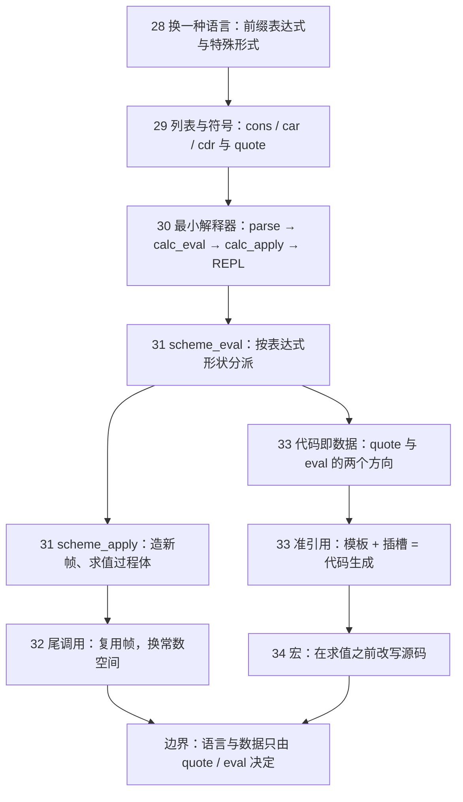

### 0.3 七讲如何串成一条线

每一讲留下的问题，就是下一讲的题目。这条因果链可以列成表。

| 讲 | 它给出的工具 | 它留下的问题 | 谁接住了 |
| :--- | :--- | :--- | :--- |
| 28 | 前缀表达式、特殊形式、`lambda`、递归替代循环 | 这些括号密集的表达式，在机器里到底是什么形状？ | 29 |
| 29 | `cons` 链、`quote`、`map` / `filter` / `apply` | 有了"代码的形状"，能不能写一个程序去执行它？ | 30 |
| 30 | `Pair` 树、`calc_eval` / `calc_apply`、REPL | 这门语言没有名字、没有过程、没有条件，怎么补？ | 31 |
| 31 | 分派、`LambdaProcedure`、帧链、eval/apply 互递归 | 递归写得再正确，深一层就爆栈，能不能不等价于"慢"？ | 32 |
| 32 | 尾位置判定、累积参数、常数空间 | 既然代码就是列表，能不能让程序写程序？ | 33 |
| 33 | `eval`、准引用、模板化代码生成 | 每次都要写 `eval` 与反引号，能不能让语言自动做？ | 34 |
| 34 | `define-macro`、宏展开、三层求值时机 | 宏引入的名字污染调用者，怎么办？ | §7.7 |

六份 PDF 与课堂讲述并不同步，必须先交代清楚：Lecture 28 的公告页、分节页与多道练习页只有画面没有口播；Lecture 29 的海龟绘图两页与 `split` 两页在字幕里没有对应段落；Lecture 30 第 3–5 页承接上一讲的列表处理，属于收尾内容；Lecture 31 的成片只有 29:48，第 1–3 页落在录音开始之前，而第 10–11 页才是录像开头那段讲述所对应的页面，因此**正文的插图顺序不等于课件页序**；Lecture 32 没有课件；Lecture 33 与 34 各有若干讨论题页，课堂上未展开。

由此得到编排原则：**页随内容走，不随讲次走**。一页幻灯片只在它最能说明问题的那一节出现一次；课堂上讲到的页面按讲述位置插入，未讲到的页面按逻辑位置收录，并用 `编者说明` 标明"画面取自课件，评述由编者补写"。

### 0.4 六页公告：课件里的非讲授页面

六份课件的第 2 页都是公告页，整页只有一个标题，录像与字幕里没有与之对应的口述内容。课堂公告（作业截止、考试安排、讲座通知）不属于技术内容，但它们确实是课件顺序的一部分，所以按讲次收在这里，每页只出现一次。第 31 讲第 3 页的 Lab 10 复习分节页同理，放在第 4 章开头。


## 1. 换一种语言：Scheme 的表达式、特殊形式与过程即值

*(参考时间: 00:00:24 – 00:31:11｜Lecture 28；00:00:00 – 00:00:40｜Lecture 29)*

### 1.1 一门比 Python 更老的方言

Scheme 是 Lisp 的方言（dialect）。Lisp 是今天仍在使用的最古老的两门编程语言之一，也是其中唯一还在快速生长的一门。讲师引了三句评价作注脚：Alan Kay 称它是"有史以来设计得最伟大的单门编程语言"；一位科幻作家说它是"唯一一门称得上美的计算机语言"；Brian Harvey 的说法更不客气——"上帝写程序用的语言"。

> **编者说明**：Lisp 由 John McCarthy 在 1958 年前后设计，通常与 1957 年的 Fortran 并称"仍在使用的最古老语言"。Scheme 诞生于 1970 年代，是 Lisp 的一个极小化方言。

Lisp 的美在于简单：整门语言一天就能学完，但它能写出的程序，复杂度和课程里见过的任何程序相当。这不是推销话术，而是设计目标——**把语法压缩到几乎不存在，让复杂性全部留给问题本身**。后果是：没有 `for`、没有 `while`、没有 `return`、没有语句与表达式的分界，剩下的东西少到可以在一页纸上写完。


### 1.2 表达式的四个格子

Scheme 程序由表达式（expression）组成。一个表达式在某个环境（environment）里求值，得到一个值；环境的作用是给符号赋予含义。这套模型和 Python 完全一样：局部帧里"这门课的讲师"有具体所指，全局帧里"乘法"是所有人都懂的操作，查找时先局部后全局。

表达式分两大类、四个小类：

- **基本表达式（primitive expressions）**：自求值表达式（self-evaluating），例如 `2`、`3.3`、`true`；以及符号（symbols），例如 `+`、`quotient`，它们是名字，值要到环境里查。
- **组合（combinations）**：调用表达式（call expressions），例如 `(quotient 10 2)`；以及特殊形式（special forms），例如 `(if a b c)`、`(let ((x 2)) (+ x 1))`。

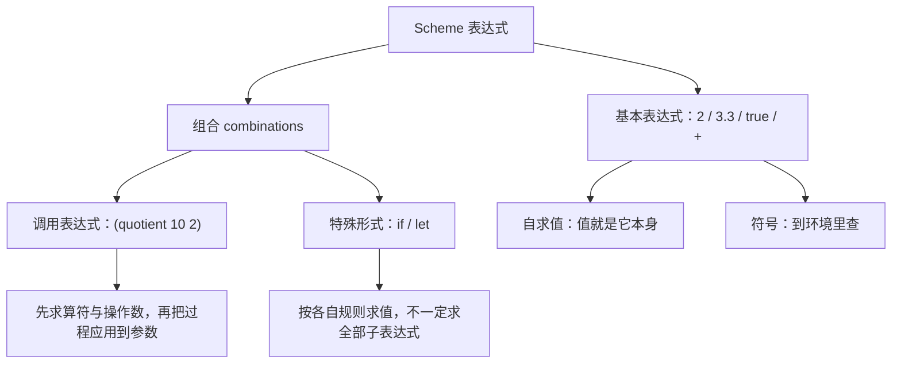


### 1.3 前缀记法：括号就是语法树

调用表达式的写法是本模块第一个必须改掉的习惯：**括号在外，算符在括号里的第一位**。Python 写 `quotient(10, 2)`，算符在括号外；Scheme 写 `(quotient 10 2)`，算符也在括号里，只是排在第一个。`quotient` 是内置的整除过程——Python 里叫函数，Scheme 里叫过程（procedure），本质是同一个东西。

于是 `(quotient 10 2)` 求值为 `5`，`(not true)` 求值为假。数字自求值，符号要被绑定到值上——这两句话就是 Scheme 求值规则的全部基础。

演示从最简单的开始：`2` 求值为 `2`；`(+ 1 2 3 4)` 求值为 `10`。接着讲师抛了一个问题：把什么都没有加起来，结果是多少？答案是 `0`；把什么都没有乘起来，结果是 `1`。这是**单位元**（identity element）的直接体现：加法的单位元是 0，乘法的单位元是 1，空组合只是把"什么都不做"写了出来。这条性质在写 `calc_apply` 时会变成一个具体的初值选择（§3.6）。

```scheme
scm> (- (* 2 2 2 2 2 3 3 3) 1)
863
```

同样的位置放 `+`、`/`、`*` 都行。这正是前缀记法最省事的地方：**新的组合永远只在最前面加一个符号、在最后面加一个括号，不需要记住优先级，也不需要额外加括号去覆盖优先级**。中缀写法里"先乘除后加减"是一条必须背的隐含规则；前缀写法里这条规则不存在。

组合可以跨任意多行，怎么折行、怎么缩进，解释器完全不管；它只关心开过的括号都要关上。

```scheme
(+ (* 3
      (+ (* 2 4)
         (+ 3 5)))
   (+ (- 10 7)
      6))
```

读法是自上而下看算符：最外层是加法，要加两个东西。第一项是 `3` 乘以 `8 + 8 = 16`，得 `48`；第二项是 `3 + 6 = 9`；两项相加得 `57`。之所以第二项的两个操作数缩进到同一层，是因为它们地位相同，都是这个加法的加数——**缩进是在给读者标注语法树的高度，不是给解释器看的东西**。

这也回答了"Scheme 的括号是不是噪音"：括号不是装饰，它是语法树的直接编码。Python 用缩进表达块结构、用优先级表达结合顺序、用逗号和圆括号表达调用；Scheme 把这些全部收进一对括号里，看起来密，但**没有任何隐含信息**——读到的嵌套深度就是求值的嵌套深度。

> **编者说明**：这段缩进示例的字幕只口述了各子表达式的求值顺序，没有念出完整表达式。代码按口述的数值关系与"同层缩进对齐"的排版规则还原。

### 1.4 谓词：问号是名字的一部分

除了算术过程，Scheme 还自带一批判断用的过程。`(number? 3)` 为真，`(number? +)` 为假——后者说明"是数"这件事和"是个名字"无关，`+` 是一个过程对象。`(zero? (- 2 2))` 为真，因为 `(- 2 2)` 先求值成 0 再判断。

```scheme
scm> (number? 3)
#t
scm> (integer? 2.2)
#f
```

> **编者说明**：Scheme 社区还有一条同源惯例——以叹号结尾的名字（例如 `set!`）表示会修改状态的过程。这门课的分发版 Scheme 不强调这条区分，第 28 讲也没有出现。

### 1.5 解释器从哪里来：Project 4

课堂演示用的 Scheme 不是下载来的，而是**本课程 Project 4 的实现**。Project 4 要求用 Python 写一个程序，它实现一个 Scheme 解释器；写完之后，就能在它上面求值 Scheme 表达式。做到这件事的办法是：亲手写出执行各种过程所需的代码——读入表达式的代码、判断表达式属于哪一类的代码、按规则求值的代码。这样的程序有一个专门的名字，叫**求值器（evaluator）**。

### 1.6 define 与"没有 return"

绑定新值靠 `define`。最简单的形式是"把一个符号定义成某个表达式的值"：先求值那个表达式，再把结果绑到符号上；绑定位置是**当前环境的第一帧**，在全局环境里执行就落在全局帧。讲师特意强调：**Scheme 用的是同一套环境模型**，和 Python 讲过的没有区别。

```scheme
(define (abs x)
  (if (< x 0)
      (- x)
      x))
```


```python
def fib(n):
    if n == 0 or n == 1:
        return n
    else:
        return fib(n - 2) + fib(n - 1)
```

```scheme
(define (fib n)
  (if (or (= n 0) (= n 1))
      n
      (+ (fib (- n 2)) (fib (- n 1)))))
```

> **编者说明**：这一页在字幕中没有对应的口述段落，讲师课堂上直接进入了交互式演示；代码按课件原文逐字誊写。

### 1.7 调用表达式与短路

同一段逻辑在两种语言里各写一遍，差别立刻显形：

```python
f(3) and f(4)      # 只打印 3，返回 False
```

```scheme
(define (f x) (print x) False)
(and (f 3) (f 4))  ; 只打印 3，返回 #f
```


定义可以钉下来：**特殊形式就是任何不是调用表达式的组合**。判定方法很机械：**看列表的第一个元素**。是 `if` 就是 if 表达式；首元素不在已知特殊形式之列的组合，都是普通调用。

`if` 的求值顺序是：先求谓词（predicate），再根据真假**只求其中一个分支**。三个部分各有 Python 里的对应物：

| `if` 的组成部分 | 位置 | 对应的 Python 结构 |
| :--- | :--- | :--- |
| 谓词 predicate | 第二个子表达式 | `if` 语句的条件表达式 |
| 结果 consequent | 第三个子表达式 | `if` 分支的语句块（suite） |
| 替代 alternative | 第四个子表达式 | `else` 分支的语句块 |

### 1.8 没有 for/while：递归就是迭代

课堂用"求平方根"把前面所有零件串了起来。思路是不断改进猜测值，用的方法叫**巴比伦方法**（Babylonian method）：如果当前的猜测值已经满足 `guess² = x`，那就别改了；否则用"当前猜测值与 `x / guess` 的平均值"作为更好的猜测值。

```scheme
(define (sqrt x)
  (define (update guess)
    (if (= (square guess) x)
        guess
        (update (average guess (/ x guess)))))
  (update 1))
```

讲师让听众注意一个细节：`update` 的过程体里用到了 `x`，而 `x` 是外层过程 `sqrt` 的形参。这不是巧合：**Scheme 和 Python 一样是词法作用域（lexically scoped）的**，内层过程可以引用外层过程的形参，靠的是定义时所在的环境。这条规则在第 31 讲会变成一个非常具体的实现细节：过程对象必须记住自己被创建时的环境（§4.5）。

Scheme 没有 `for` 和 `while`，所以**循环也必须用递归写**。课件用一个 Python 三种写法对一种 Scheme 写法的对照，把这件事讲透：


```python
def sum_first_n(n):
    total = 0
    for k in range(1, n + 1):
        total += k
    return total
```

```scheme
(define (sum-first-n n)
  (define (f k total)
    (if (> k n)
        total
        (f (+ k 1) (+ total k))))
  (f 1 0))
```

> **编者说明**：`(f (+ k 1) (+ total k))` 位于 `if` 的分支位置，是尾调用（tail call）。标准 Scheme 要求尾调用不增长调用栈，因此这种写法在真正的 Scheme 里是常数空间；CS61A 的求值器要到第 32 讲才会引入尾调用优化。

### 1.9 算符位置可以放任何东西

课件进入"Writing Scheme"一节；核心只有一页，一道填空题：`a-plus-abs-b` 接受两个数 `a` 和 `b`，返回 `a + |b|`，但**不许调用 `abs`**。


Python 版的答案是让 `f` 成为函数名，再调用 `f(a, b)`；Scheme 版的填空位置在算符位置上，答案是一整个 `if`：


```scheme
(define (a-plus-abs-b a b)
  ((if (< b 0) - +) a b))
```

最外层的组合里，算符位置上的东西是 `(if (< b 0) - +)`，它先求值，得到要么是减法过程、要么是加法过程；然后这个刚得到的过程被应用到 `a` 与 `b` 上。**算符位置可以放任何表达式，只要它求值出一个过程**。Python 也能写 `(sub if b < 0 else add)(a, b)`，只是很少这样写。

> **编者说明**：这一页与前一页的分节页在字幕中没有对应的口述段落，属于课堂练习级别的材料，代码按课件原文誊写。

### 1.10 lambda：过程是被造出来的值

`lambda` 表达式用来造新过程：它求值出一个**匿名过程**。语法是关键字 `lambda`、一对括号里的形参列表、然后是过程体。


有了 `lambda`，"定义过程"这件事就有了两种写法，而它们是等价的：

```scheme
(define (plus4 x) (+ x 4))
(define plus4 (lambda (x) (+ x 4)))
```


算符位置既然可以放任何求值为过程的表达式，把它放成 `lambda` 也就顺理成章：

```scheme
((lambda (x y z) (+ x y (square z))) 1 2 3)
; 12
```

课件最后一页是两道"猜猜 Scheme 会做什么"：


```scheme
((lambda (g y) (g (g y))) (lambda (x) (+ x 1)) 3)

(define (f g)
  (lambda (y) (g (g y))))
((f (lambda (x) (* x x))) 3)
```

> **编者说明**：这两题的答案（`5` 与 `81`）由编者按词法作用域与求值规则推导，课件上只给出题目。第二题的价值在于它同时考了两件事：过程可以作为参数传进去，过程可以作为返回值传出来。

第二题其实是第 31 讲的预告片：返回的那个过程就是闭包（closure）。它必须在自己的对象里带着 `g` 的绑定，而这个绑定的载体就是 `LambdaProcedure` 的 `env` 字段。**没有环境，闭包无法解释；没有闭包，`lambda` 只是一段没被执行的代码。**

### 1.11 cond 与 begin：把语句塞进表达式的位置

`cond` 是 condition 的缩写，对应 Python 里的 `if`/`elif`/`else`，写法如下：

```scheme
(cond ((> x 10) (print 'big))
      ((> x 5) (print 'medium))
      (else (print 'small)))
```


读法是：`x` 大于 10 就打印 `big`；否则若大于 5 就打印 `medium`；否则打印 `small`。不管 `x` 是多少，**只有一件事会被打印**：若 `x` 是 12，它既大于 10 也大于 5，但只打印 `big`，因为前一支先命中。

`cond` 表达式**本身有值**，所以也可以只让它算出一个值，再对这个值做别的事：

```scheme
(print (cond ((> x 10) 'big)
             ((> x 5) 'medium)
             (else 'small)))
```

`begin` 把多个表达式合成一个表达式，它的值就是**最后一个子表达式的值**。之所以需要它，是因为很多位置（比如 `if` 的分支）只放得下一个表达式，而实际工作往往要按顺序做几件事。


```scheme
(cond ((> x 10) (begin (print 'big)   (print 'guy)))
      (else     (begin (print 'small) (print 'fry))))
```

### 1.12 let：只活一个表达式的绑定

`let` 有点像 `define`，区别在于它绑定的符号是**临时的**：只在一个表达式里有效，那个表达式求值完毕，绑定就消失。

Python 里没有真正等价的东西，所以最好的讲法是把同一个计算用两种语言各写一遍：

```python
a = 3
b = 2 + 2
c = math.sqrt(a * a + b * b)
```

```scheme
(define c (let ((a 3)
                (b (+ 2 2)))
            (sqrt (+ (* a a) (* b b)))))
```


`let` 的结构只有两部分：**绑定列表**（每个绑定是一对，第一个必须是符号，第二个可以是任意表达式，先求值再绑）与**值表达式**（绑定生效之后求值，它的值就是整个 `let` 的值）。讲师的说法很形象：这就像在这里放一堆小小的 `define`，只不过绑定在算完的那一刻就消失了。

从解释器的角度看，`let` 是"造一个临时帧"的糖：`(let ((a 3)) body)` 等价于 `((lambda (a) body) 3)`。第 31 讲不会为 `let` 单独写一个分支，因为这个等价式已经够用；而 `split` 第二版之所以必须用 `let`，原因也在这里——它需要一个名字，把一次递归的结果用两次（§2.4）。

### 1.13 Python 与 Scheme：一张对照表

零件齐了，此时值得并排清点一次。第一列是判据，用它去找对应关系，比背语法更省力。

| 判据 | Python | Scheme |
| :--- | :--- | :--- |
| 函数叫什么 | function | procedure |
| 调用的写法 | `f(3, 4)`，算符在括号外 | `(f 3 4)`，算符在括号内第一位 |
| 定义函数 | `def f(x, y):` 加 `return` | `(define (f x y) <body>)`，无 `return` |
| 返回值从哪来 | `return` 语句，可有多处 | 过程体最后一个表达式的值 |
| 多分支选择 | `if` / `elif` / `else` | `if` 或 `cond` |
| 顺序执行多条 | 语句块靠缩进 | `begin` 或过程体 |
| 循环 | `for`、`while` | 没有，用递归表达 |
| 匿名函数 | `lambda x: x + 1` | `(lambda (x) (+ x 1))` |
| 临时绑定 | 无真正等价物，赋值会留在作用域里 | `let`，只活一个表达式 |
| 真与假 | `True` / `False` | `#t` / `#f`（书写可用 `true`） |
| 除法 | `/` 真除，`//` 整除 | `/` 真除，`quotient` 整除 |
| 相等比较 | `==` | `=`（用于数）、`equal?`（用于结构） |
| 前缀还是中缀 | 中缀 `x * x + y * y` | 前缀 `(+ (* x x) (* y y))` |
| 过程是不是值 | 是，但要靠名字或 `lambda` 显式造 | 是，且算符位置可直接写表达式 |

表里最有信息量的是"返回值从哪来"和"循环"这两行：它们不是语法差异，而是**语言把哪件事当成基本构件**的差异。Python 的基本构件是语句，所以需要 `return` 和 `while`；Scheme 的基本构件是表达式，所以"值"天然来自最后一个表达式，"重复"天然来自递归调用。一旦接受这个前提，`cond`、`begin`、`let` 的存在都不是偶然：它们全在解决同一个问题——**怎样把一个只能放表达式的空位，塞进需要多做几步才能算出的东西**。

### 1.14 案例：用海龟画 Sierpinski 三角形

最后用绘图把本讲的零件拼起来。课程分发的 Scheme 版本自带绘图设施：启动之后除了能算加法，还能指挥一只小海龟（turtle）在画布上走。

> **编者说明**：这一节用的是 Lecture 29 课件第 3–4 页（Turtle Graphics 与 Drawing Stars）。第 29 讲录像的字幕从 Lists 部分开始，这两页没有口述；下面按课件画面整理代码，评述为编者所加。


课件的 `star` 过程有两个参数：`n` 是边数，`m` 是每画一条边要跳几个顶点。转角 `a` 由 `let` 算出来，等于 `360 * m / n`；调用 `(star 5 2)` 时 `a = 144` 度，五条边各转 144 度、累计 720 度，恰好绕两圈，图形闭合。

```scheme
(define (star n m)
  (let ((a (/ (* 360 m) n)))
    (define (side k)
      (if (< k n) (begin (fd 100) (rt a) (side (+ k 1)))))
    (side 0)))
```

把 `side` 抽出来，会得到一个更通用的模式——"把某件事做 k 遍"：

```scheme
(define (repeat k f)
  (f)
  (if (> k 1)
      (repeat (- k 1) f)))
```

Sierpinski 三角形把这一层抽象再用一次：它的每一条边，本身也是一个小一号的 Sierpinski 三角形。于是"画三角形"与"画边"互相调用，形成一组互递归（mutually recursive）的过程。

```scheme
(define (line k) (forward k))

(define (sierpinski d k)
  (if (= d 1)
      (repeat 3 (lambda () (line k) (right 120)))
      (repeat 3 (lambda () (leg d k) (right 120)))))

(define (leg d k)
  (sierpinski (- d 1) (/ k 2))
  (penup)
  (forward (/ k 2))
  (pendown))
```

> **编者说明**：课堂上这段代码是从文件里 `load` 进解释器执行的，第 29 讲课件上没有这页代码，字幕也只用口述描述了结构。上面按口述的结构重建：`d = 1` 时画出线三角，否则重复三次"画一条腿、右转 120 度"；`leg` 画出半尺寸、深度减一的子三角形，然后抬笔、前进、落笔，把海龟送到这条腿的终点。

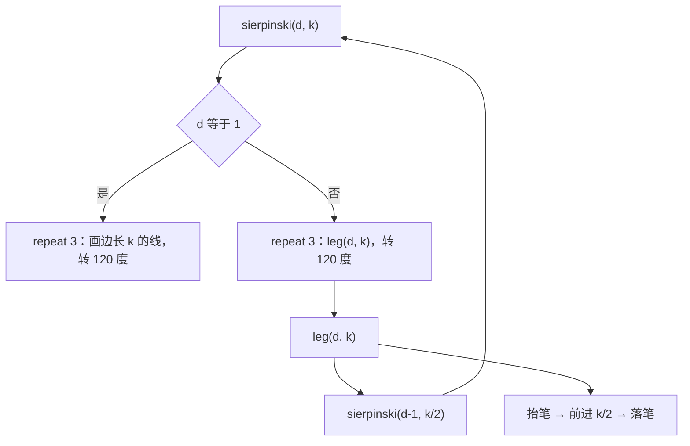

## 2. 列表与符号：给"代码"找到数据结构

*(参考时间: 00:00:41 – 00:24:42｜Lecture 29；00:00:01 – 00:00:29｜Lecture 30)*

第 28 讲只能说"表达式是语法树"，说不出树是怎么存下来的。这一章的回答是：**Scheme 的代码就是一串链表**，链表由 `cons` 一格一格接起来。一旦接受这一点，第 30 讲写解释器时就不需要发明任何新数据结构——`Pair` 就是 `cons`，`first` 就是 `car`，`rest` 就是 `cdr`。

### 2.1 链表的最小词汇表

造链表只有在"能取到第一个元素"和"能取到剩下的表"的前提下才有意义，所以除了 `cons`，还必须配两个访问过程。四个名字各自一句话：

- **`cons`**：双参数过程，造一个链表节点（第一格放值，第二格放"剩下的表"）。
- **`car`**：返回列表的第一个元素。
- **`cdr`**：返回除第一个元素之外的剩余部分。
- **`nil`**：空表，链条的终点。

> **编者说明**：`car` 与 `cdr` 的名字来自 1950 年代 IBM 704 机器上的两个寄存器字段——地址部分（address）与减量部分（decrement）。讲师在课上只说"那个年代的人喜欢让人困惑的名字"。


```scheme
scm> (define x (cons 1 (cons 2 nil)))
scm> x
(1 2)
scm> (cdr x)
(2)
```


这张图里只有三种箭头。**所有列表操作都能翻译成"沿箭头走几步"**：`car` 读当前格的左半边，`cdr` 走一条箭头，`cons` 造一个新格子并让它的右半边指向某个已有的格。第 30 讲的 `Pair` 类、第 31 讲的 `scheme_eval`、第 33 讲的 `eval`，做的全是这三种动作。

### 2.2 四种"看走眼"与它们的解药

先看四个需要自己推一遍的例子，它们各自对应一种常见的误读：

```scheme
scm> (define s (cons 1 (cons 2 nil)))
scm> (cons 3 s)
(3 1 2)
scm> (cons (cons 4 (cons 3 nil)) s)
((4 3) 1 2)
scm> (cons s (cons s nil))
((1 2) (1 2))
```

| 表达式 | 显示结果 | 结构读法 |
| :--- | :--- | :--- |
| `(cons 3 s)` | `(3 1 2)` | 一层新 cons + 原来那张表 |
| `(cons 4 (cons 3 s))` | `(4 3 1 2)` | 两层新 cons，都在最前面 |
| `(cons (cons 4 (cons 3 nil)) s)` | `((4 3) 1 2)` | 第一个元素本身是一张表 |
| `(cons s (cons s nil))` | `((1 2) (1 2))` | 同一张表被引用两次 |

### 2.3 三条构造路径：cons、list、append

`cons` 每次只加一个元素，用起来很快就烦了。三条路径的分工值得逐字记住：

- **`cons`** 永远只收两个参数：一个"值"，和一张"剩下的表"。
- **`list`** 收任意多个参数，每个参数都成为新表里的一个元素。
- **`append`** 收任意多个**表**参数，把它们首尾相接成一张表。

设 `s` 是 `(1 2)`：

| 表达式 | 结果 | 读法 |
| :--- | :--- | :--- |
| `(cons 3 s)` | `(3 1 2)` | 3 作为一个元素，接在 `s` 的元素前面 |
| `(list 3 s)` | `(3 (1 2))` | 3 和 `s` 各算一个元素，所以 `s` 整张表成了一个元素 |
| `(append 3 s)` | Error | `append` 要的是表，`3` 不是表 |
| `(cons s s)` | `((1 2) 1 2)` | 第一格是整张 `s`，剩余部分还是 `s` 的元素 |
| `(list s s)` | `((1 2) (1 2))` | 两个元素，各是一张表 |
| `(append s s)` | `(1 2 1 2)` | 两张表首尾相接，元素被摊平 |


### 2.4 递归构造：split 的两版写法

> **编者说明**：`split` 两页是本讲课件里的内容，但本讲录像的字幕从头到尾没有讲到它——讲师的口述线索一路是链表、`quote`、列表处理与 `even-subsets`。


第一版把它拆成两个内部过程：`prefix` 负责前 `n` 个，`suffix` 负责剩下的。

```scheme
(define (split s n)
  (define (prefix s n)
    (if (zero? n) nil (cons (car s) (prefix (cdr s) (- n 1)))))
  (define (suffix s n)
    (if (zero? n) s (suffix (cdr s) (- n 1))))
  (list (prefix s n) (suffix s n)))
```

`suffix` 那一行是这一页最值得看的地方：它**不复制**任何节点，返回的 `s` 就是原链表的某一段。课件右侧的盒针图正好画出这件事——`prefix` 新建了三个节点，而 `suffix` 只是把指针挪到第 4 个节点上。**"返回一段原表"与"造一张新表"在显示上无法区分，在空间代价上差得很远。**


第二版把两次递归合成一次：递归拿回一张装着两段的表，再用 `cons` 把当前元素拼到第一段前面。

```scheme
(define (split s n)
  (if (= n 0)
      (list nil s)
      (let ((split-rest (split (cdr s) (- n 1))))
        (cons (cons (car s) (car split-rest))
              (cdr split-rest)))))
```

| 判据 | 第一版（prefix + suffix） | 第二版（let + split-rest） |
| :--- | :--- | :--- |
| 每层递归调用几次自己 | 两次 | 一次（一次拿回两段） |
| 返回什么 | 两张表分别造好，最后用 `list` 装起来 | 每层返回"前缀 + 后缀"这一对 |
| 是否需要中间名字 | 不需要 | 需要 `let`，因为结果要用两次 |
| 终止条件 | 两个过程各写一次 `(zero? n)` | 一个 `(if (= n 0) ...)` |

### 2.5 quote：让符号本身成为值

Lisp 以引入**符号编程**（symbolic programming）而闻名——操作"符号组成的表"，而这些表代表世界上的事物。而让这一切成为可能的，只有一个特性：**引用**（quotation）。


`'` 是特殊形式 `(quote ...)` 的简写。特殊形式的含义是：**被引用的那个表达式本身就是值**，不需要再对它求值。引用也能作用在组合上：`'(a b c)` 得到装着三个符号的表；而且**表里的每个表达式也一起被引用了**——引用是递归的，它一直作用到最内层。

| 判据 | 符号 symbol | 字符串 string |
| :--- | :--- | :--- |
| 字面写法 | `'a`、`'apple`（一个前导单引号） | `"a"`、`"apple"`（一对双引号） |
| 求值结果 | 被引用时是符号本身；未引用时按环境查找它的值 | 字符串本身（自求值） |
| 是否必须先定义 | 不必；可以先出现、后定义 | 不必，字面量就是值 |
| 典型用途 | 符号计算：公式、代数式、程序本身 | 文本处理、输出 |

> **编者说明**：本讲没有专门讲字符串，上表"字符串"一列是编者为了对照补的。

引用有三个易错点。**其一，`'a` 和 `(quote a)` 等价。** **其二，符号可以先引用、后定义。** 直接写 `(list 1 a)` 而 `a` 从未被定义会报错；但 `(list 1 'a)` 得到 `(1 a)`——在定义它之前就可以引用它，因为它只是一个符号。**其三，一个单引号只引用紧跟其后的那一个表达式。** `(list 'a b)` 得到 `(a 2)` 就是证据。

引用还能嵌套，讲师给了一个需要连取四层的题：

```scheme
scm> (define x '(1 (2 3)))
scm> (car (cdr x))
(2 3)
scm> (car (cdr (car (cdr x))))
3
```

### 2.6 列表处理四件套

工具齐了，四个内置过程各自一句话定义：

- `(append s t)`：把 `s` 和 `t` 的元素依次列进一张表；可以接两个以上的表。
- `(map f s)`：对表 `s` 的每个元素调用 `f`，把结果收成一张表。
- `(filter f s)`：对表 `s` 的每个元素调用 `f`，把"`f` 返回真值"的那些元素收成一张表。
- `(apply f s)`：把表 `s` 的元素当作参数去调用 `f`，也就是只调用一次 `f`。


| 判据 | `map` | `filter` | `apply` | `append` |
| :--- | :--- | :--- | :--- | :--- |
| `f` 被调用几次 | 每个元素一次 | 每个元素一次 | 整张表只调用一次 | 不涉及 `f` |
| 结果是什么 | 一张表，长度与输入相同 | 一张表，长度不超过输入 | 一个值（通常不是表） | 一张表 |
| 结果里的元素来自 | `f` 的返回值 | 输入表里原有的元素 | `f` 的返回值 | 各表原有的元素 |
| 典型用途 | 逐个变换 | 按条件挑选 | 把表摊成参数 | 拼表、摊平嵌套表 |

```scheme
scm> (map (lambda (x) (* 2 x)) s)
(2 4)
scm> (filter list? '(5 (6 7) 8 (9)))
((6 7) (9))
scm> (apply + '(1 2 3 4))
10
```

课件底部用 `map` 与 `apply` 串了一个更漂亮的例子：

```scheme
(define count (list 1 2 3 4))
(define beats (map (lambda (x) (list 'and 'a x)) count))
(define rhythm (apply append beats))
```

### 2.7 下一讲的重放：为什么解释器需要 map 与 apply

第 30 讲的开头又把这一页放了一遍，而且紧跟着一道新练习。这不是编排上的重复，而是一次**有意的提前量**：解释器里最重要的两个动作，恰好就是 `map` 与 `apply`。


> **编者说明**：Lecture 30 的录像第 1 秒就进入异常话题，第 3–5 页在字幕里没有对应段落，很可能是上一讲末尾的收尾内容。

为什么说解释器就是"`map` 与 `apply` 的交替"？`calc_eval` 拿到一个组合，就 `exp.rest.map(calc_eval)` 把每个操作数递归求值成数字，再 `calc_apply(exp.first, arguments)` 把这个运算符应用到参数表上。第一步是 `map`，第二步是 `apply`；而 `calc_apply` 内部又是 `reduce(add, args, 0)`——又一次列表折叠。**一门语言的语义，可以完全用列表过程写成。**

第二道练习把"数 cons 格"变成一个递归：


```scheme
(define (cons-count s)
  (if (list? s)
      (+ (length s)
         (apply + (map cons-count s)))
      0))
```

## 3. 最小解释器 Calculator：文本、树、两个函数与一个循环

*(参考时间: 00:00:01 – 00:47:51｜Lecture 30)*

有了"代码是链表"这个前提，第 30 讲就可以动手了。这一讲要造的东西叫**计算器（calculator）**：一门只有数字和四则运算的极小语言，语法借 Scheme，实现用 Python。它小到可以在半小时内写完，却已经具备一门语言的全部零件——文本、解析、求值、应用、错误、循环。

### 3.1 异常：给"出错"一个类型

在 Python 和很多语言里，"通告异常"与"处置异常"合称**异常（exception）**：用 `raise` 通告一件不该发生的事，用 `try` 处置它。`raise` 后面跟一个表达式，它必须求值成一个异常类或异常实例。异常对象和普通对象一样被构造：所谓"制造一个 `TypeError`"，不过是给这个类传一个描述发生了什么的字符串。


内置异常类各有分工，而且它们在合适的场合会**自动**抛出：

| 异常类 | 什么时候自动抛出 | 本讲演示 |
| :--- | :--- | :--- |
| `TypeError` | 函数收到的参数个数或类型不对 | `abs('hello')` |
| `NameError` | 一个名字找不到绑定 | 未定义的名字 |
| `KeyError` | 字典里没有这个键 | 缺失的键 |
| `RecursionError` | 递归调用层数过多 | 一个只调用自己的 `f` |

`abs(3)` 正常返回 3，而 `abs('hello')` 立刻抛出 `TypeError`。但异常并不神秘，自己也能抛：

```python
def double(x):
    if isinstance(x, str):
        raise TypeError('double takes only numbers')
    return 2 * x
```

为什么要多写这三行？因为 `2 * 'hello'` 在 Python 里是合法的，结果是 `'hellohello'`。如果 `double` 的语义只允许数字，那么"静默地拼出字符串"就是最坏的失败方式：程序继续跑，错误被推迟到很远的地方才爆出来。主动 `raise` 把失败点提前到了错误的源头。**抛出异常是把"我拒绝处理这种输入"写进接口**：代价是调用者必须知道可能有哪些异常，收益是失败不再被伪装成成功。

异常为什么要分类？第一，类型让错误消息能说明"发生了什么"。第二，也是更重要的：**分类让语言有能力处理异常并继续运行**。只有错误带着类型标签，`try` 语句才有东西可以匹配；没有类型，程序只能一概停机。

### 3.2 try/except 与 reduce：错误该由谁处理

`try` 语句由两部分组成：`try` 后面跟一个代码块（套件，suite），以及一个或多个 `except` 行。

```python
try:
    x = 1 / 0
except ZeroDivisionError as e:
    print('handling a zero division error:', e)
    x = 0
```

| 情形 | try 套件 | except 套件 | 程序 |
| :--- | :--- | :--- | :--- |
| 没有异常 | 全部执行完 | 跳过 | 继续 |
| 抛出的异常类匹配 | 执行到出错处即中断 | 执行 | 继续，不打印 traceback |
| 抛出的异常类不匹配 | 中断 | 跳过 | 中止并打印 traceback |

先看一个会出错的函数：`invert(x)` 返回 `1 / x`，`x` 为 0 时 `1 / x` 抛出 `ZeroDivisionError`，函数体在那一行就地中断。写成 `b = invert(0)` 时，`b` 不是被绑定成 `None`，而是**根本没有被绑定**——赋值语句整体作废了。很多人第一次遇到"名字未定义"的 `NameError`，根源就是之前那条赋值语句被异常打断了。

安全版本把这个错误就地消化成普通返回值：

```python
def invert_safe(x):
    try:
        return invert(x)
    except ZeroDivisionError as e:
        return str(e)
```

`invert_safe(0)` 得到字符串 `'division by zero'`，屏幕上没有任何错误信息。同一个 `try` 结构，`except` 套件返回什么，函数对失败的"态度"就是什么。

在进入解释器之前，还有一个必须交代的高阶函数：`reduce`。它的职责是**把一个序列归约成一个值**——用一个两参数的函数，从初值开始，把序列元素一个个"吃"进去：


```python
def reduce(f, s, initial):
    """Combine elements of s pairwise using f, starting with initial."""
    for x in s:
        initial = f(initial, x)
    return initial
```

> **编者说明**：讲师提到标准库里有内置的 `reduce`，字幕记作"iter tools 模块"；这个函数实际位于 `functools`。`itertools` 提供的是迭代器工具，与本函数无关。

`reduce` 的第一个应用是一个除法器：

```python
def divide_all(n, ds):
    try:
        return reduce(truediv, ds, n)
    except ZeroDivisionError:
        return float('inf')
```

`divide_all(1024, [2, 0, 8])` 得到 `inf`，而 `divide_all(1024, [2, 4, 8])` 依旧得到 16。这段代码的设计价值在于**关注点分离（separation of concerns）**：`reduce` 的实现里没有一行与除零有关，`divide_all` 则知道自己做的是除法、知道除零是可能的失败，于是就地决定失败的含义。

把这件事说成一句话：**错误应该在"知道这个错误意味着什么"的那一层被处理**。后面写解释器时会反复用到这条判据：词法分析知道什么是不合法的数字，语法分析知道什么是不配对的括号，`calc_apply` 知道哪个运算符需要几个参数。而 REPL 那一层（§3.8）负责的只有一件事：**把错误变成一句话，然后继续等下一句输入**。

### 3.3 解释器与语言的层次

**解释器是一个程序：它把用某门语言写成的代码作为输入，执行这些代码，从而产生程序所描述的行为。** 这句话里没有玄机——解释器本身也是用某门语言写的普通程序，只不过它处理的数据恰好是"代码"。

这里有一个容易被忽略的事实：**电脑里没有任何一块硬件是为 Scheme 或 Python 设计的**。机器语言代码负责执行全部行为；在这门高级语言与机器语言之间，必须有一个解释器或编译器来实现所有那些抽象手段。而且这种分层是常态：机器语言可以用来实现 C 的编译器，而 C 又是一门高级语言，用来实现 Python 的解释器。

| 层次 | 谁在执行 | 如何扩展 | 本讲提到的例子 |
| :--- | :--- | :--- | :--- |
| 机器语言 | CPU 硬件 | 改电路 | 固定指令集 |
| 编译型高级语言 | 编译产物直接在硬件上跑 | 改编译器 | C |
| 解释型高级语言 | 另一个程序逐条执行 | 改解释器 | Python、Scheme |
| 领域专用语言 | 专用解释器或编译器 | 改语言与解释器 | Erlang、MediaWiki 标记 |

表里后两行值得展开一句：Erlang 为并发程序而设计，多台自动取款机同时访问同一账户也不能骗出两份钱；MediaWiki 标记语言为生成维基百科那样的静态网页而设计。它们同样需要解释器或编译器，只是服务的领域窄得多。高级语言好写的另一半理由是**可移植**：同一份程序能在不同厂商的硬件上运行，因为系统细节被抽象掉了。Python 的具体做法是：运行前先编译成字节码（bytecode），再由一个解释器执行这份字节码。

一门编程语言由两部分构成。**语法（syntax）** 描述语言里所有合法的语句与表达式，回答"形式上怎么写才算数"；**语义（semantics）** 给出这些语句与表达式的执行或求值规则，回答"写出来是什么意思"。要把一门语言钉死，只有两条路：写一份形式化的规格文档；或者实现一个解释器或编译器，用实现本身充当参照。后一条路之所以成立，是因为**规范实现（canonical implementation）就是标准**。两条路的历史顺序可以相反：Scheme 是先有规格、后有实现；Python 则是先有实现，形式化描述是后来照着补出来的。

| 判据 | 解释 | 编译 |
| :--- | :--- | :--- |
| 时机 | 读入即执行 | 先翻译，后执行 |
| 产物 | 行为（值或副作用） | 另一门语言的程序 |
| 出错时 | 当场中断当前表达式 | 可能在翻译阶段就报错 |
| 典型场景 | 交互式会话 | 生成机器码或字节码 |

### 3.4 语法：一门语言两行就能写完

**Scheme 语法的计算器（Scheme-syntax calculator）** 是一个不支持 Scheme 大多数特性的 Scheme 解释器，只保留算术运算符 `+`、`-`、`*`、`/` 和调用表达式，调用可以任意嵌套。

```text
scm> (+ 1 2 3)
6
scm> (+ 2 (* 4 6))
26
```


表达式在 Python 里用 Scheme 列表表示，也就是 `Pair` 实例，它编码了树形结构。以 `(* 3 (+ 4 5) (* 6 7 8))` 为例，三种视角是同一件事：

| 视角 | 形态 |
| :--- | :--- |
| 写下来的表达式 | `(* 3 (+ 4 5) (* 6 7 8))` |
| 表达式树 | 根是 `*`，三个孩子分别是 `3`、`(+ 4 5)`、`(* 6 7 8)` |
| Pair 表示 | 一条 `first` 为 `*` 的链，第二个元素指向 `(+ 4 5)` 的链 |

这解释了一个乍看奇怪的事实：**代码在解释器眼里就是数据**。同一个 `Pair` 结构，既可以当成"待求值的程序"，也可以当成"一个列表"，区别只在于你拿它去做什么。第 33 讲会把这个观察变成整个主题（§6.1）。

语法分析这一步则必须自己写：`scheme_read` 的约定是**消费恰好一个表达式所需的 token，返回那棵树**。它只有一个基例和一处递归：遇到符号或数字，直接造出一个叶子；遇到左括号，就对括号里的每一个子表达式递归调用 `scheme_read`，把结果依次串成 Pair。终止条件是读到与开头那个左括号配对的右括号。

用一句话概括它为什么必须递归：**括号的嵌套深度就是树的深度，而读的过程必须跟着这个深度走**。第一次调用读到 `(+ 1 (* 2 3))` 时不会立刻返回，因为它必须先读完 `(* 2 3)`；而读子表达式又会再发起一次调用。这也是为什么解析器能跨行工作。

### 3.5 语义：三行递归定义

语义也短得可以写完：**数字求值为它自身；调用表达式求值为"它的各参数值由运算符组合起来"的结果**。


| 运算符 | 语义 |
| :--- | :--- |
| `+` | 所有参数之和 |
| `*` | 所有参数之积 |
| `-` | 只有一个参数时取负；多于一个时从第一个里减去其余 |
| `/` | 只有一个参数时取倒数；多于一个时用第一个依次除以其余 |

课件用 `(+ 5 (* 2 3) (* 2 5 5))` 把语义跑了一遍：`(* 2 3)` 得 6，`(* 2 5 5)` 得 50，`+` 把 5、6、50 加起来，整个表达式求值为 61。每个内部节点都对应一次 `calc_apply`，叶子对应"数字求值为自身"：

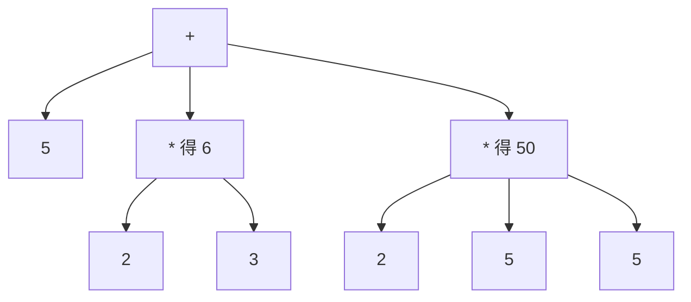

### 3.6 calc_eval：按形状分派

整个计算器只有两个函数：一个求值，一个应用。`calc_eval` 计算一个表达式的值，而计算器里表达式的值**永远是数字**。它是一个**泛型函数（generic function）**：按表达式的类型分派。


```python
def calc_eval(exp):
    if isinstance(exp, (int, float)):
        return exp
    elif isinstance(exp, Pair):
        arguments = exp.rest.map(calc_eval)
        return calc_apply(exp.first, arguments)
    else:
        raise TypeError
```

`Pair` 分支是全部精巧之处：`exp.rest` 是"除运算符之外的全部"，对它 `map` 上 `calc_eval`，就对每个子表达式递归求值一次；递归调用保证"每个操作数都被约简成一个数字"；于是 `arguments` 是一个**数字的 Scheme 列表**；`exp.first` 是运算符那个符号，交给 `calc_apply` 去决定加还是乘。

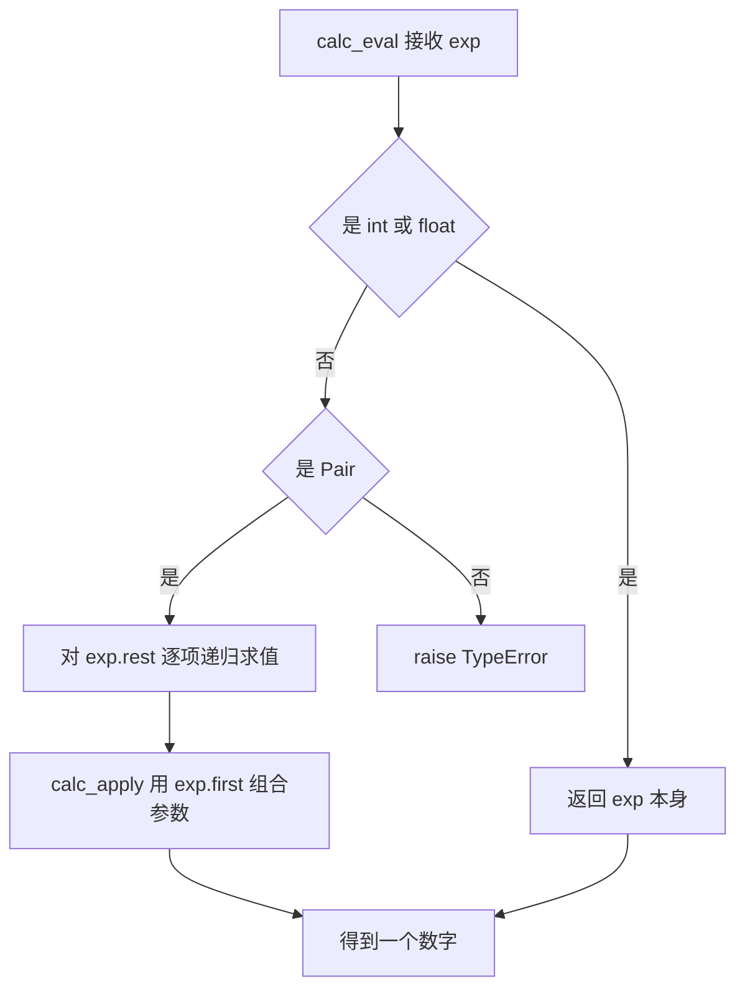

> **编者说明**：`exp.rest.map(...)` 里的 `map` 不是 Python 内置的 `map`，而是课程项目给 `Pair` / `SchemeList` 定义的同名方法，它接收一个函数并把结果收成 Scheme 列表。

课堂上的版本与课件略有差别：真实代码会调用 `simplify`，把 `8.0` 归一成 `8`；同时给 `TypeError` 写上一段消息字符串，而不是裸抛一个类。两个改动都不改变语义，但都很有代表性：`simplify` 是"表示层"的修整（值不变、显示变干净），消息字符串是"诊断层"的补强（行为不变、可读性变好）。**解释器里最容易被忽略的两类工作，恰好就是这两类。**

### 3.7 calc_apply：把运算符落到数字上

`calc_apply` 拿到一个运算符和一个数字的 Scheme 列表，按照这个运算符的含义把参数组合起来。在计算器里所有操作都是内置的，只有四个。


```python
def calc_apply(operator, args):
    if not isinstance(operator, str):
        raise TypeError(str(operator) + ' is not a symbol')
    if operator == '+':
        return reduce(add, args, 0)
    elif operator == '-':
        if len(args) == 0:
            raise TypeError(operator + ' requires at least 1 argument')
        elif len(args) == 1:
            return -args.first
        else:
            return reduce(sub, args.rest, args.first)
    elif operator == '*':
        return reduce(mul, args, 1)
    elif operator == '/':
        if len(args) == 0:
            raise TypeError(operator + ' requires at least 1 argument')
        elif len(args) == 1:
            return 1 / args.first
        else:
            return reduce(truediv, args.rest, args.first)
    else:
        raise TypeError(operator + ' is an unknown operator')
```

> **编者说明**：`calc_apply` 的完整源码没有出现在课件上，上面这版是按录制时的演示与项目结构重建的，分支顺序与语义与课堂一致，变量名与消息文本可能与源码有个别出入。

| 运算符 | 实现要点 | 课堂演示 |
| :--- | :--- | :--- |
| `+` | `reduce(add, args, 0)`，初值 0 | `(+ 1 2 3)` 得到 6 |
| `-` | 零参数报错；一参数取负；否则从第一个里减去其余 | `(- 10 1 2 3)` 得到 4 |
| `*` | `reduce(mul, args, 1)`，初值 1 | 未单独演示，只说明它是一次 `reduce` |
| `/` | 零参数报错；一参数取倒数；否则用第一个依次除以其余 | `(/ 1024 2 2 2 2 2)` 得到 32 |

到这里语言的核心就齐了：`calc_eval` 负责沿树下降，`calc_apply` 负责在叶子把符号变成运算。两者加起来不到二十行，却已经是一个完整语言的语义。第 31 讲做的全部工作，就是把这两个函数各自的分支表加长（§4.7）。

### 3.8 REPL：解释器的人机接口

解释器通常有一个**读取-求值-打印循环（Read-Eval-Print Loop，REPL）**：用户输入一个表达式，它被求值，结果被打印，然后提示符再次出现。


```python
@main
def read_eval_print_loop():
    """Run a read-eval-print loop for calculator."""
    while True:
        try:
            src = buffer_input()
            while src.more_on_line:
                expression = scheme_read(src)
                print(calc_eval(expression))
        except (SyntaxError, TypeError, ValueError, ZeroDivisionError) as err:
            print(type(err).__name__ + ':', err)
        except (KeyboardInterrupt, EOFError):
            print('Calculation complete.')
            return
```

> **编者说明**：这段循环的源码同样没有出现在课件上，是依据讲师对 `while True` + `try` + `scheme_read` + `calc_eval` + `print` 的逐句描述重建的；`buffer_input`、`more_on_line` 等辅助接口来自课程项目。

有两行值得停下来看。第一行是 `print(calc_eval(expression))`：**打印只会在 `calc_eval` 正常返回时发生**。如果求值过程中抛了异常，这个 `print` 调用的参数根本算不出来，于是什么也不会被打印。第二行是 `except (KeyboardInterrupt, EOFError)`：`while True` 需要一个出口，出口是文件结束或键盘中断；这时它打印 `Calculation complete.` 并 `return`。

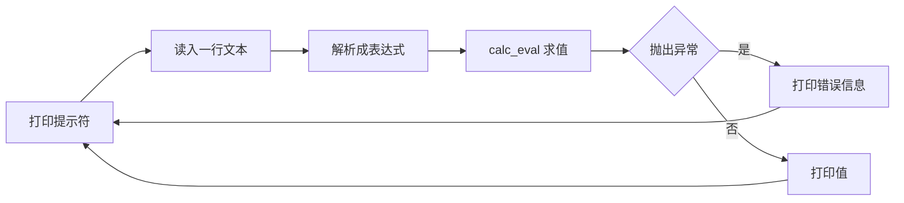

### 3.9 错误的完整链条：抛出散落各处，捕获集中一处

以输入 `(? 2)` 为例，完整链条是八步：读入这一行；词法分析切成四个 token；语法分析组装成一个 Pair 树；`calc_eval` 判断它不是数字、是 Pair，进入调用分支；先对 `exp.rest` 逐项递归求值，得到 `(2)`；`calc_apply` 拿到运算符 `?` 与参数列表 `(2)`，四个分支都不匹配，落到 `else`，抛出 `TypeError('? is an unknown operator')`；异常沿 `calc_apply → calc_eval → read_eval_print_loop` 一路上抛，中途没有 `try` 拦截，所以 `print(calc_eval(...))` 里的 `print` 从未执行；循环顶层的 `except` 捕获它，打印消息，然后 `while True` 进入下一轮——程序没有停机。

同一套链条也适用于更早一层的失败。如果输入是一个孤立的符号或空组合，异常在第 4 步的 `else` 分支就抛出来了；如果运算符的位置上是个数字，则要等到第 6 步才被 `calc_apply` 的第一个守卫挡下。也就是说，**报错的位置取决于哪一层先认出"这不是我能处理的东西"，而回显的位置始终是 REPL 那一个 `except`**。

| 错误类 | 由谁抛出 | 触发方式 | 课堂所见 |
| :--- | :--- | :--- | :--- |
| `ValueError` | 词法分析 | 畸形数字，如 `2.3.4` | 值不合法 |
| `SyntaxError` | 语法分析 | 多余的右括号等结构错误 | 消息含 `unexpected token` |
| `TypeError` | `calc_eval` | 空组合 `()`、孤立符号 | 不是数字也不是调用 |
| `TypeError` | `calc_apply` | `(-)` 零参数、`(? 2)` 未知运算符 | `? is an unknown operator` |
| `ZeroDivisionError` | Python 内建除法 | `(/ 1 0)` | 由 `truediv` 自己抛出 |

表里最后一行值得单独说：`ZeroDivisionError` 不是计算器的代码抛的，而是 Python 的除法运算符抛的。**解释器的错误语义，往往是从宿主语言"继承"来的**：用什么实现一门语言，就会连带继承它的一部分行为。第 32 讲讨论尾调用时会再遇到同一个现象——Scheme 的递归深度上限，直接由宿主 Python 的递归深度决定（§5.6）。

这也正是讲师最后强调的设计原则：**一个设计良好的交互式解释器不应该停机**。它应当停止求值当前表达式、打印错误信息，然后让程序员有机会修改，在**当前环境**里再试一次。唯一的退出方式是文件结束或键盘中断。

## 4. Scheme 解释器：把解释器写到能解释自己

*(参考时间: 00:00:02 – 00:29:45｜Lecture 31)*

第 30 讲的计算器只认识两样东西：数字，以及以 `+ - * /` 开头的调用表达式。这种二分法在计算器里够用，因为那门语言没有名字、没有过程、没有条件。Scheme 不是这样。

这一章做的全部工作，就是把计算器的两个函数各自的分支表加长，直到它们能解释"定义过程、调用过程、在过程体里再定义过程"这套完整的语言。加长分三步：先加**符号**这一种基本情况（于是需要环境），再加**特殊形式**（于是求值顺序不再统一），最后加**用户定义过程**（于是 `apply` 也要递归，并且要会造帧）。


第 31 讲录制前的这一段是 Lab 10 的复习，成片里没有保留；它原本要交代的是"读入表达式"与"对它求值"在实现上是两件不同的事，而这一章正好从这件事讲起。

### 4.1 第一层分派：按形状，而不是按内容

要判断一个 Scheme 表达式怎么求值，第一步不是看它写了什么，而是先问"它属于哪一类"，然后按类别分派（dispatch）。三个类别可以完整覆盖所有合法表达式：

- **符号（symbol）**：被绑定到当前环境里某个值的名字，求值的动作就是查环境。
- **自求值表达式（self-evaluating expression）**：求值结果就是它自己，只有两个代表——数字与空列表 `nil`。
- **组合（combination）**：其余一切合法的表达式，在 Python 里都表现为一条 Scheme 列表。叫它组合，只是想说它是一条良构的（well-formed）Scheme 列表。

组合再往下分两类，判据是**列表的第一个元素**。首元素是 `if`，那就是一个 if 表达式；是 `lambda`，就是 lambda 表达式。特殊形式就这样靠首元素认出来。如果一个组合的首元素不在已知的特殊形式之列，那它就是一个普通的调用表达式。


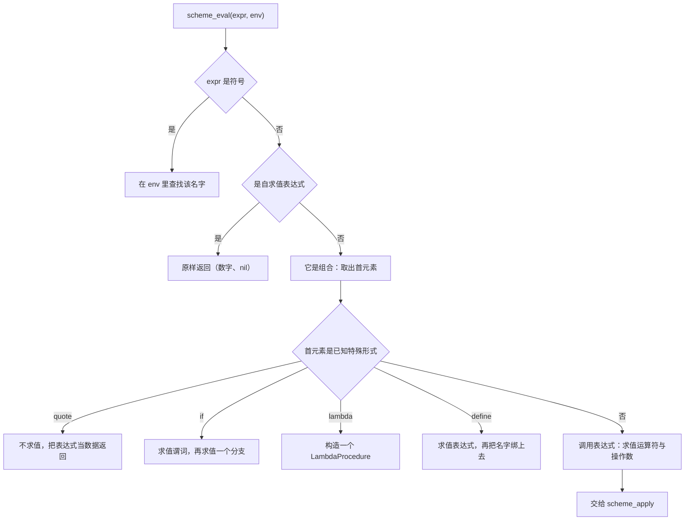

与第 30 讲对照，差别就落在这张图上：

| 判据 | 计算器的 `calc_eval` | Scheme 的 `scheme_eval` |
| :--- | :--- | :--- |
| 分支数 | 2：数字、`Pair` | 4 大类，其中"组合"再按首元素细分 |
| 符号 | 不存在这种表达式 | 一个基本情况：查环境 |
| 自求值 | 数字 | 数字与空列表 `nil` |
| 特殊形式 | 没有 | `quote`、`if`、`lambda`、`define` 各一条路 |
| 出现分支的原因 | 语法有两种 | 语法有几种，分支就有几条 |
| 是否需要环境 | 不需要 | 必须，查名字与造新帧都要用它 |

这张表值得记住一句话：**语言的语法有多少种表达式，求值函数就有多少个分支**。计算器只有两种表达式，所以它的求值函数短得可以背下来；Scheme 多出符号与特殊形式，分派表随之变长——而每一项新增都只是为了实现一条已经写进语言规范的规则。

### 4.2 求值操作数：从表达式树到参数列表

分派到"调用表达式"之后，还剩三件事：求值运算符、求值每一个操作数、把两者交给 `apply`。


这一步在实现上就是一次 `map`：对操作数列表逐项递归求值，收集成一个新列表。**第 2 讲花了整整一章讲 `map`，最后落在这里：它是解释器的第一个齿轮。**

有了操作数求值，`demo` 就可以登场了：

```scheme
(define (demo s) (if (null? s) '(3) (cons (car s) (demo (cdr s))) ))
(demo (list 1 2))
```

> **编者说明**：为什么非得递归不可？因为 Pair 链只能从前面挂东西——`cons` 的第二个参数是"剩下的链"，它没有"往末尾追加"这种便宜操作。

讲师接着跟踪一次调用，演示环境怎么变：


- 输入 `2`：`scheme_eval` 在全局帧里求值它，结果是 2——自求值表达式解释了"什么都不用做也是一种求值"。
- 输入 `(- 2)`：求值运算符 `-` 得到取负过程，求值操作数 `2` 得 2，应用到参数上得 -2。
- 输入 `demo` 的定义：回车之后发生的**很少**——`scheme_eval` 没有求值过程体，它只造出一个过程。过程体的求值被推迟到过程**被应用**的那一刻。
- 输入 `(demo (list 1 2))`：求值运算符与操作数之后，在一个**新环境**里求值过程体，新环境把形参 `s` 绑到 `(1 2)`，父帧是全局帧。

| 跟踪位置 | 环境里 `s` 的绑定 | 这一层交回什么 |
| :--- | :--- | :--- |
| 第一次调用 | `(1 2)` | `(1 2 3)` |
| 第一次递归 | `(2)` | `(2 3)` |
| 第二次递归（基例） | `nil` | `(3)` |

### 4.3 quote 与语法糖：在读入阶段消灭一种形状

`'` 只是 `(quote ...)` 的简写，而且这个等价关系是双向的。副作用是：`'` 是一种**语法糖**，属于读入阶段的书写便利，不属于语言的核心语义。讲师的说法是，这是"一小片句法信息"，希望在求值器不得不处理 quote 之前就把它消灭掉。消灭它的是 Scheme Reader 那个文件。

| 输入的写法 | Reader 产出的结构 | 求值器看到的 |
| :--- | :--- | :--- |
| `'(1 2)` | `(quote (1 2))` | 只有 `quote` 一种形状 |
| `(quote (1 2))` | `(quote (1 2))` | 同上 |

所以当 Scheme 求值器真正处理引用时，它从来见不到单引号那一种。这条分工线很值得记住：**语法糖在读入阶段被消掉，核心语义只需要认识一种形状**。第 34 讲的宏会再消一次，只不过那次消掉的是整棵宏调用子树（§7.3）。

### 4.4 惰性：只求值该求值的那部分

逻辑特殊形式（logical special forms）的共同点是两件事：它们都与条件有关；它们**只求值一部分子表达式**。`if` 只求值谓词与一个分支；`and` 与 `or` 从左到右逐个求值，直到能确定真假为止；`cond` 带着一串条件和子句。三者共同的后果是：**有些子表达式永远不会被求值**。这不是实现上的优化，而是语义本身。

```python
def do_if_form(exp, env):
    """两件事：求值谓词，挑出下一步要求值的那个子表达式。"""
    predicate = scheme_eval(exp.rest.first, env)
    if scheme_truep(predicate):
        return scheme_eval(exp.rest.rest.first, env)          # consequent
    return scheme_eval(exp.rest.rest.rest.first, env)         # alternative
```

> **编者说明**：讲师口头把这个函数读作「doIfForm」，项目 4 骨架里的写法是 `do_if_form`。上面这段是按讲师口述重写的示意版，**不是课件内容**。

为什么分支不能都求值？因为求值是有代价的：`(/ 1 0)` 会抛异常，有副作用的调用会真的产生副作用，递归会吃掉栈空间。若 `if` 把两个分支都求值，`demo` 里那句 `(if (null? s) '(3) (cons ...))` 就会在每次调用时都往深处再递归一次，永远停不下来。**惰性求值在这里不是性能技巧，而是可终止性的前提。**

### 4.5 lambda 与过程对象：代码加出生环境

lambda 表达式求值为一个**用户定义过程（user-defined procedure）**。一个以 lambda 开头的整表达式，求值时得到的是一个之前并不存在的新过程；它有形参（formal parameters），也有过程体（body）。


在 Python 里怎么表示？答案是引入一个类 `LambdaProcedure`，它有形参表、过程体和环境三样东西：


| 字段 | 装着什么 | 应用过程时用来干什么 |
| :--- | :--- | :--- |
| `formals` | 一串符号：参数的名字 | 决定新帧里要绑哪些名字 |
| `body` | 一串表达式：过程体 | 就是应用时要求值的东西 |
| `env` | 一个 `Frame` 实例 | 决定自由的名字去哪里找——它是过程**最初被定义时**的第一帧 |

第三个字段是本章的枢纽。过程不只是一段代码，它是**一段代码加上它出生时所在的环境**。两个 lambda 的形参表和过程体可以一模一样，但只要 `env` 不同，同名变量查出来的值就不同。这也解释了为什么过程定义之后还能用到定义处的名字：那些名字不在过程体里，而在它记着的那个环境里。

### 4.6 帧与环境：父帧决定名字去哪儿找

帧（frame）通过拥有一个**父帧（parent frame）**来表示一个环境。所以一个帧总是某个环境的第一帧；它有父帧，父帧还有父帧，一直追下去最后到全局帧（global frame），这一整条链才是"环境"。帧是 Python 实例，有两个重要的方法：`lookup` 与 `define`。在 Project 4 里，帧**不保存返回值**——它只保存用于查找的"名字-值"绑定。


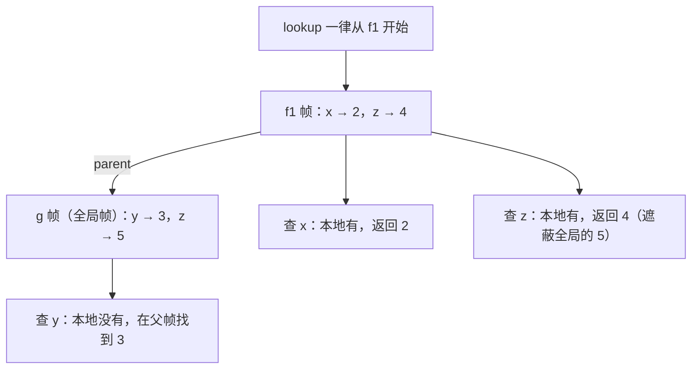

这就是**词法作用域（lexical scope，也叫静态作用域）**的全部规则，一句话概括：**一个帧的父帧，是过程被定义时所在的环境**。实现上很机械——为应用一个过程而造新帧时，去看那个过程对象，把它出生时的环境当作新帧的父帧。

但把环境造成"扩展定义处环境"的样子并不是唯一做法。另一种选择叫**动态作用域（dynamic scope）**：**一个帧的父帧，是过程被调用时所在的环境**。用一个例子就看清差别：

```scheme
(define (f x) (+ x y))
(define (g x y) (f (+ x x)))
(g 3 7)
```

| 判据 | 词法作用域（lexical / static scope） | 动态作用域（dynamic scope） |
| :--- | :--- | :--- |
| 新帧的父帧是谁 | 过程**定义**时所在的环境 | 过程**调用**时所在的环境 |
| 一句话记法 | 名字写在哪儿，就在哪儿找 | 谁调用你，就在谁的环境里找 |
| `(g 3 7)` 中 `f` 里的 `y` | 查不到，报错 | 查到 `g` 的 7，结果为 13 |
| 谁在用 | Scheme、Python、Lisp | 早期 Lisp 实现、Emacs Lisp 默认设置 |

**在动态作用域里，重要的是"谁调用了你"，而不是"你在哪里被定义"。**

> **编者说明**：动态作用域并非纸上方案。早期的 Lisp 与今天的 Emacs Lisp（默认设置）都用动态绑定；Common Lisp 则同时提供两种绑定。词法作用域后来成为主流，理由很直接：一个名字指什么，只看源码就够。

### 4.7 骨架：eval 与 apply 的相互递归

Project 4 要写的就是一个 Scheme 语言的解释器，而这一章讲的正是这个解释器的结构——那些重要的部件怎样拼在一起，才能得到一个能理解其他程序的程序。


这一小节就是把 Project 4 的骨架摊开：一个求值函数、一个应用函数、两个盒子、两条弧线。


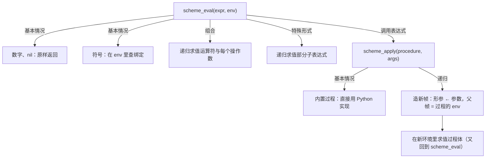

把"今天的扩展"与"计算器里已有的部分"叠在一起看：

| 判据 | 计算器解释器（第 30 讲） | Scheme 解释器（第 31 讲） |
| :--- | :--- | :--- |
| `eval` 的基本情况 | 数字：原样返回 | 数字与 `nil` 原样返回；**符号：去环境里查** |
| `eval` 的递归情形 | 组合：求值操作数 | 组合：求值运算符与操作数；**特殊形式：只求值部分子表达式** |
| `apply` 的基本情况 | `+ - * /` 四个内置过程 | 内置的原始过程 |
| `apply` 的递归情形 | 没有，全是基本情况 | **用户定义过程：求值它的过程体** |
| 是否需要环境 | 不需要 | **必须**：查名字要用它，造新帧也要用它 |
| 相互递归 | `calc_eval` 与 `calc_apply` 互调 | `scheme_eval` 与 `scheme_apply` 互调，且 `eval` 还直接调用自己 |

### 4.8 define：两种写法，一个问题

`define` 把一个符号绑定到当前环境的**第一帧**里。查一个名字时，可能是在父帧里找到的；而绑定永远落在当前这一帧。求值过程是：先求值那个表达式，再把名字绑到求出来的值上。所以 `(define x (+ 1 2))` 会先算出 3，再把 `x` 绑到数字 3——它把"造出 3 的那个表达式"忘掉了。

过程定义是 `define` 与 `lambda` 的简写关系：

```scheme
(define (f x) (+ x 3))            ; 简写
(define f (lambda (x) (+ x 3)))   ; 展开后的等价形式
```

课件在这个位置安排了一道讨论题：怎样从一个 define 表达式里取出被定义的那个符号？难点在于两种格式：`(define x (+ 2 3))` 里符号在第二格，而 `(define (f x) (+ x 3))` 里第二格本身是一条列表，符号在它的第一格。


```python
def symbol(exp):
    """Given a define expression exp, return the symbol defined."""
    assert exp.first == 'define' and exp.rest is not nil and exp.rest.rest is not nil
    signature = exp.rest.first
    if scheme_symbolp(signature):
        return signature
    else:
        return signature.first
```

这段代码虽短，却把本章的一个主题演示得很清楚：**同一层语义的两种语法，先归一到一个公共形状，再写一份处理逻辑**。define 的两种写法归一成 `define` + `lambda`，quote 的两种写法归一成 `(quote ...)`，都是同一种手艺。

### 4.9 apply：造帧、绑定、求值过程体

`apply` 对用户定义过程的处理，可以用一句话讲完：造一个新帧，把形参绑到参数值上，父帧是**这个过程的环境**；然后在这个新帧起头的环境里求值过程体。这里的"过程的环境"，就是 `LambdaProcedure` 的 `env` 属性。


课件里那张 Project 4 的项目页正好把这句话讲全了。它先交代数据表示：数字就是数字，符号是字符串，列表是 `Pair` 类的实例。再交代求值：`scheme_eval(expr, env)` 返回一个表达式在某个环境里的值；`scheme_apply(procedure, args)` 把一个过程应用到它的参数上；而 **Python 函数 `scheme_apply` 返回它应用的那个过程的返回值**。两层职责分得很干净：帧不记返回值，Python 的 `return` 记返回值。第 32 讲的尾调用优化之所以能只改"要不要造帧"而不改语义，靠的就是这条分界（§5.6）。

用帧的眼光重看 `demo`：定义时它绑到一个 `LambdaProcedure` 上，`env` 是全局帧；调用时先造出参数值 `(1 2)`，再造新帧把 `s` 绑上；新帧的父帧是全局帧——因为 `LambdaProcedure` 的 `env` 就是全局帧，这一步不由调用点决定；求值过程体发现 `s` 不是 `nil`，于是在 `(cdr s)` 上再调一次；再往下一次 `s` 绑到 `nil`，过程体直接返回 `(3)`；逐层回来，`(2 3)`、`(1 2 3)`。

### 4.10 这套结构有多老：Lisp 1.5 的 eval 与 apply

讲师放出一张老得有点意外的幻灯片：Lisp 1.5 文档里 `apply` 与 `eval` 的原始定义。Lisp 1.5 是 Scheme 的前身，那份文档的年代远早于这门课，但这段代码已经具备今天看到的绝大部分结构，只是语法完全不同。

那段代码只依赖很少几样东西：`car`、`cdr`、`cons`；一个判断"是不是原子"的检查；一个内建的相等判断；以及引用与条件式。除此之外的一切，都得从这几样东西里搭出来——除了那个著名的 `lambda`。换句话说，一门完整的语言，可以只用"取头、取尾、造对、原子判断、相等、引用、条件、lambda"这八样东西定义出来。

> **编者说明**：Lisp 1.5 文档里那个函数通常被称为"普适函数"（universal function）或 `eval`。这门手艺在 SICP 第 4 章被正式命名为**元循环求值器（metacircular evaluator）**——"元循环"的意思是：用来写解释器的语言，正好就是被解释的那门语言（或用它与它同构的一个子集）。第 31 讲没有使用"元循环"这个词，这个术语属于编者的补充；Project 4 恰好就是一次元循环实践。

### 4.11 从零到 scheme_eval：一条实现路径

七讲的内容到这里可以串成一条**实现路径**了。它不是一个教学顺序，而是一个人从零开始把 Scheme 解释器写出来时，真正会经历的八个步骤。

1. **能读文本**：写词法分析把源码切成 token，写 `scheme_read` 把 token 组成 `Pair` 树。这一步的产物没有任何语义，只有结构（§3.4）。
2. **能表示代码**：把 `Pair` 链当成语法树用，`first` 取算符，`rest` 取操作数列表；`nil` 是链的终点（§2.1）。
3. **能求最简单的值**：`calc_eval` 的两条分支——数字返回自身、`Pair` 递归求值操作数再 `calc_apply`。此时还没有环境（§3.6）。
4. **能给名字赋值**：加入 `Frame` 类与 `define`，`scheme_eval` 多出一条"符号去环境里查"的基本情况。环境成为求值函数的第二个参数（§4.1、§4.8）。
5. **能按形状分派**：把特殊形式逐条接上——`quote` 直接返回、`if` 走 `do_if_form`、`lambda` 造 `LambdaProcedure`、`define` 先求值再绑定（§4.3–§4.5）。
6. **能应用过程**：`scheme_apply` 分两路——内置过程直接用 Python 实现，用户定义过程则造新帧、绑形参、求值过程体，从而回到 `scheme_eval`（§4.9）。
7. **能撑住深递归**：把"要造帧的递归"改成"复用当前帧的循环"，尾位置上的调用不再增长栈（§5.6）。
8. **能改写源码**：读入阶段把宏调用展开成普通表达式，展开结果再交给前面七步（§7.3）。

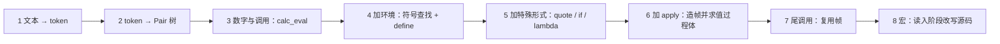

这条路径里有两个"断层"，特别值得记住：

| 断层 | 之前 | 之后 | 断层处新增的东西 |
| :--- | :--- | :--- | :--- |
| 第 3 步到第 4 步 | 求值函数只有一个参数：表达式 | 求值函数有两个参数：表达式与环境 | 环境；符号查找；`define` 的落点 |
| 第 6 步到第 7 步 | 每次应用都造帧，栈深随递归增长 | 尾位置上的应用复用当前帧 | 尾位置判定；"当前帧还需不需要"这个判断 |

## 5. 尾调用：把递归写成迭代

*(参考时间: 00:00:00 – 00:32:48｜Lecture 32)*

第 31 讲造出来的解释器有一个隐藏成本：每应用一次用户定义过程，就造一个新帧。递归二十层没事，递归十万层就爆栈。这让"用递归代替循环"从一句漂亮话变成实际限制——纯函数式语言禁掉了重绑定，迭代只能写成递归，而递归按朴素语义要吃线性空间。

这一讲（选修专题）要还的就是这笔空间账。结论只有一句：**若调用者要返回的就是被调用者返回的那个值，调用者的帧在调用发出之后不再携带任何信息，可以被复用**。

### 5.1 问题的来处：禁掉重绑定之后，循环靠什么

第一项好处是：一个表达式的值，与它的子表达式**按什么顺序**求值无关。既然顺序无关，就可以任选一种顺序，可以并行求值，也可以一直拖着不算。这些好处都来自引用透明性（referential transparency）：把一个子表达式替换成它的值，整个表达式的值不变。它顺带解决了一件在命令式语言里很棘手的事——记忆化（memoization）：记住算过的结果、下次直接取用，不必担心"读缓存"本身会改变程序行为。

于是问题就来了：没有 `for` 也没有 `while`，又不允许重绑定，迭代还能高效吗？

| 判据 | 命令式：`while` 循环 | 纯函数式：递归调用 |
| :--- | :--- | :--- |
| 改变状态的手段 | 把名字重新绑定到新值 | 只能把新值作为实参传给下一次调用 |
| 迭代的写法 | `while` / `for` 语句 | 递归调用 |
| 子表达式的求值顺序 | 有副作用时会影响结果 | 不影响结果 |
| 并行求值 | 需人工证明无依赖 | 由引用透明性保证 |
| 记忆化 | 可能改变程序行为 | 安全 |
| 一次迭代的空间开销 | 常数 | 朴素递归下线性（本讲要解决的点） |

### 5.2 递归与迭代的空间账

讲师把账算在一个尽量小的例子上：计算 `k` 乘以 `n` 的阶乘。多出来的 `k` 不是冗余参数，而是累积器——它把"已经乘过的那些项"随身带着走。

```python
def factorial(n, k):
    if n == 0:
        return k
    else:
        return factorial(n - 1, k * n)
```

迭代写法是 `while n > 0: n, k = n - 1, k * n`。两段代码在时间上只差一个常数因子：递归版是线性时间，但线性时间的递归还要占用**线性空间**；迭代版同样线性时间，却只占常数空间。

| 判据 | 递归版 | 迭代版 |
| :--- | :--- | :--- |
| 时间 | 线性，`n` 次调用 | 线性，`n` 轮循环 |
| 空间 | 线性，`n` 个帧同时活着 | 常数，三个名字 |
| 状态存在哪里 | 分散在每层帧的局部绑定里 | 集中在 `n`、`k` 两个变量里 |
| 失败模式 | 递归太深就栈溢出 | 只受数值规模限制 |
| 与数学定义的距离 | 几乎逐字对应 | 需要额外想到循环不变式 |
| 需要语言提供什么 | 只要支持函数调用即可 | 必须允许重绑定 |

请注意一个容易被忽略的细节：**这个 Python 递归函数在逻辑上已经处在尾位置了**——`return` 后面直接就是递归调用，拿到它的值之后没有任何运算要做。可 CPython 仍然为每一层开一个新帧，因为 Python 语言本身不承诺尾调用优化。**逻辑上的尾调用**与**实现上的帧复用**是两件事。

### 5.3 Scheme 的承诺：properly tail recursive

这道缝在 Scheme 里被规范明文堵上了：

> 实现 Scheme 的系统**必须**是正确尾递归的（properly tail recursive）。这使得一个迭代计算可以在常数空间内执行——即使这个迭代计算是由一个**语法上递归**的过程描述的。

```scheme
(define (factorial n k)
  (if (= n 0)
      k
      (factorial (- n 1) (* k n))))
```

这段代码和 Python 版本逐行对应，区别只在求值规则——它按规范**应当**只占常数空间。

| 判据 | CPython 里的递归版 | Scheme 里的递归版 |
| :--- | :--- | :--- |
| 语言是否承诺尾调用优化 | 否 | 是，规范强制 |
| `n` 取 1000 时 | 栈溢出 | 正常运行 |
| 空间随 `n` 增长 | 线性 | 常数 |
| 属于"语法递归"还是"语义迭代" | 两者都是递归 | 语法递归，语义迭代 |

语言凭什么敢做这个承诺？因为在没有可变状态的前提下，一次调用对调用者的全部价值就是"那个返回值"。如果调用者拿到值之后无事可做，它与被调用者之间的边界就不再携带任何信息，整块帧于是可以丢掉。

> **编者说明**：CPython 不做尾调用优化，是语言设计上的取舍，常见解释有两条。其一是可调试性：一旦复用帧，调用栈里就看不到中间层。其二是语义耦合：`try` / `finally`、`with` 以及跟踪钩子都假设帧在调用期间一直存活。这与"技术上做不到"无关——把求值器写成显式循环而不是递归调用，就能拿到同样的效果。

### 5.4 尾位置：一条可以机械判定的语法规则

一次**尚未返回**的过程调用称为**活跃的（active）**。有些活跃调用是**尾调用（tail call）**：被调用者交出的那个值，就是调用者要交出的值，中间没有任何加工。

严格的说法只有一句：**尾调用是处于尾位置（tail context）的调用表达式**。尾位置是一条递归的语法规则，本讲只用了其中两条：

- 一个 `lambda` 表达式（包括 `define` 出来的过程，二者等价）的**最后一个 body 子表达式**；
- 如果一个 `if` 表达式本身在尾位置，那么它的**第 2、第 3 个子表达式**在尾位置，第 1 个不在。

第一条为什么要限定"最后一个"？因为 `lambda` 的 body 可以有多个表达式，只有最后一个决定返回值；前面那些只为副作用而求值，它们的结果会被丢弃，谈不上"尾"。

拿阶乘逐层判定：`define` 的 body 只有一个表达式，就是这个 `if`，所以这个 `if` 在尾位置；于是它的第 2、第 3 个子表达式都在尾位置，条件不在；第 3 个子表达式是一个调用表达式，它又在尾位置，因此它是**尾调用**。

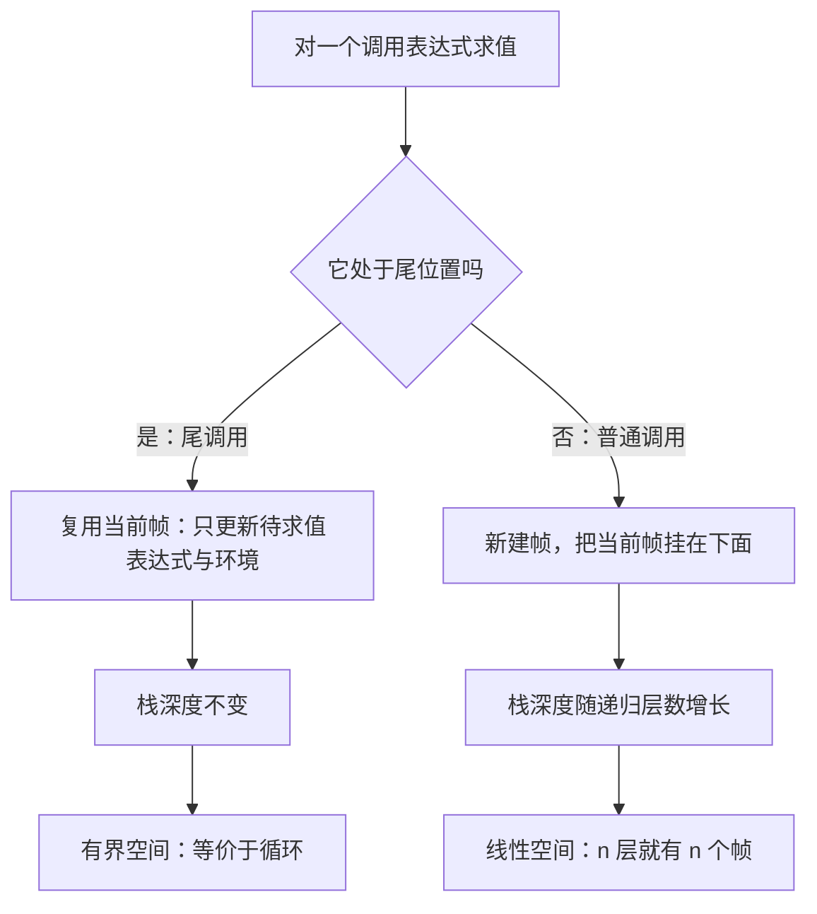

规范里还列了别的尾位置：

| 上下文 | 哪些子表达式在尾位置 | 理由 |
| :--- | :--- | :--- |
| `lambda` / `define` 的 body | 最后一个表达式 | 它决定返回值 |
| `if` | 第 2、第 3 个 | 条件只决定走哪条路，其值被丢弃 |
| `cond` | 每个子句的最后一个表达式（不含条件） | 条件只需一个布尔值 |
| `and` / `or` | 最后一个 | 前面几个的结果可能被短路丢弃 |
| `begin` | 最后一个 | 前面几个只为副作用而求值 |

反过来，判据的另一半是：**如果调用者拿到返回值之后还要接着算，这个调用就不是尾调用**。讲师的说法是"more computation is required in the calling procedure"——递归调用算出了值，但如果还要拿这个值去和别的东西组合，尾位置就断了。

### 5.5 例一：length 与累积参数

最自然的 `length` 不是尾递归的：

```scheme
(define (length s)
  (if (null? s)
      0
      (+ 1 (length (cdr s)))))
```

用一句话记住这个形状：**调用表达式套调用表达式，里面那个一定不在尾位置**。因为外面那个还要用里面那个的值。这就是线性空间的来源：帧里存着 `s`，等子调用返回之后这一层还要把 1 加上去，于是帧必须活到加法算完。

改写的方法是引入第二个过程，多带一个参数表示"到目前为止数了多少个"：

```scheme
(define (length-tail s)
  (define (length-iter s n)
    (if (null? s)
        n
        (length-iter (cdr s) (+ n 1))))
  (length-iter s 0))
```

| 判据 | 朴素 `length` | `length-tail` |
| :--- | :--- | :--- |
| 递归调用在哪 | `+` 的参数里 | `if` 的第 3 个子表达式 |
| 是否尾调用 | 否 | 是 |
| 是否需要额外参数 | 不需要 | 需要，累积器 `n` |
| 额外空间 | 线性 | 常数（链表本身仍是线性） |
| 返回值从哪来 | 从最内层逐层加一冒上来 | 最内层直接给出，逐层原样上交 |

最后一句限定不能省：**表本身占的空间没法省**。尾调用省掉的是"为了算长度而额外开的那一摞帧"，不是数据。

**累积参数（accumulating parameter）** 是尾递归化的标准手柄：把"还没做完的事"从栈上搬进实参。`length` 加一个计数、`map` 加一张逆序累积表、`reverse` 加一个已反转表，共同点都是这个。

### 5.6 演示：scheme.py 里的那个开关

原理可以压成一句：**尾调用的返回值就是当前这次调用的返回值**，所以中间那些帧可以全部跳过。演示用的解释器就是课程项目里的 `scheme.py`，文件靠下的加分题部分有一行注释，取消注释就会启用尾调用优化，默认它是注释掉的。

| 调用 | 未启用尾调用优化 | 启用之后 |
| :--- | :--- | :--- |
| `(factorial 10 1)` | 正常 | 正常 |
| `(factorial 100 1)` | 正常 | 正常 |
| `(factorial 673 1)` | 推进到 673 就到顶，随即放弃 | 正常 |
| `(factorial 1000 1)` | `maximum recursion depth exceeded while calling a Python object` | 正常 |
| `(factorial 10000 1)` | 不可达 | 正常；耗时明显，最终受数字本身大小的限制 |

报错出现在 `1000` 那一次，而且求值器一直撑到"大约 673 的阶乘"才放弃。原因很直白：调用了太多次，占掉太多内存，Python 说"到极限了"。这个"极限"不是 Scheme 的极限，而是宿主 Python 的递归深度——解释器用 Python 的递归来实现 Scheme 的递归，于是 Scheme 的空间开销直接映射成了 Python 调用栈的深度。

> **编者说明**：为什么是 673 而不是 1000 左右？每求值一次 Scheme 调用，在宿主 Python 里要压好几层帧（求值表达式、应用过程、再求值 body），因此 CPython 默认约 1000 层的递归上限被提前撞到。这也说明：元循环解释器里"被解释对象的复杂度"会继承"宿主语言"的资源限制。

> **编者说明**：本讲只讲到"跳过不需要的帧"这一层。真实实现通常走两条路。其一是**帧复用**：求值循环发现待求值表达式处于尾位置时，不递归调用自己，而是把"待求值表达式"和"当前环境"更新为被调用过程的 body 与其新环境，然后 `continue` 同一个循环。其二是 **trampoline（蹦床）**：应用过程时返回一个"待办"，由最外层的驱动循环反复取出来执行。CS61A 项目的加分题走的是第一条路。

### 5.7 判别练习：四个过程的空间诊断

第二题 `contains`：判断元素 `x` 是否在表 `s` 里。

```scheme
(define (contains s x)
  (if (null? s)
      #f
      (if (equal? (car s) x)
          #t
          (contains (cdr s) x))))
```

第三题 `has-repeat`：判断表里有没有重复元素，做法是对每个元素问一句"后面的表里还有没有它"。

```scheme
(define (has-repeat s)
  (if (null? s)
      #f
      (if (contains (cdr s) (car s))
          #t
          (has-repeat (cdr s)))))
```

第四题是用两个互相递归的过程求第 `n` 个斐波那契数：

```scheme
(define (fib n)
  (if (= n 1)
      0
      (fib-iter n 2 1)))

(define (fib-iter n k current)
  (if (= n k)
      current
      (fib-iter n (+ k 1) (+ current (fib (- k 1))))))
```

判定结果是**不成立**。`fib-iter` 的递归调用本身确实是尾调用，但它第 3 个实参 `(+ current (fib (- k 1)))` 里含有一次对 `fib` 的递归调用，而这次调用是 `+` 的参数——不在尾位置。于是每一轮都必须先把更小的那个 `fib` 算出来，再把它加进去，帧无法丢弃。

| 过程 | 递归调用的位置 | 是否全为尾调用 | 额外空间 | 断在哪 |
| :--- | :--- | :--- | :--- | :--- |
| `length` | `+` 的参数里 | 否 | 线性 | 第 3 个 body 表达式是 `+` 调用，`length` 在其中作参数 |
| `contains` | 内层 `if` 的第 3 个 | 是 | 常数 | 无 |
| `has-repeat` | 内层 `if` 的第 3 个 | 是 | 常数 | 无；`contains` 调用非尾，但它自己常数空间 |
| `fib` / `fib-iter` | `fib-iter` 的实参里 | 否 | 线性 | `(+ current (fib (- k 1)))` 中 `fib` 是 `+` 的参数 |

### 5.8 高阶函数：空间复杂度变成参数

高阶函数会把"空间占用"这件事也变成参数。`reduce` 收三样东西：一个用来组合的过程 `f`、一张要遍历的表 `s`、一个起始值 `start`。

```scheme
(define (reduce f s start)
  (if (null? s)
      start
      (reduce f (cdr s) (f start (car s)))))
```

`map` 则**不是**尾递归的：`(cons (f (car s)) (map f (cdr s)))` 里，`cons` 在尾位置，但它的第 2 个实参不在。尾递归版的思路不直观：**先把映射的结果反着建出来，最后整体反转**。

```scheme
(define (map-reverse f s m)
  (if (null? s)
      m
      (map-reverse f (cdr s) (cons (f (car s)) m))))

(define (map f s)
  (reverse (map-reverse f s nil)))

(define (reverse-iter s r)
  (if (null? s)
      r
      (reverse-iter (cdr s) (cons (car s) r))))
```

### 5.9 收束：解释器是一台通用机器

写解释器这件事本身究竟在造什么？答案是**一台通用的计算机器（general computing machine）**。

解释器则是**通用**的那种：它接受任意一份代码，按那份代码去模拟任意一台特定机器。Scheme 解释器一次接收两样东西——`5` 这样的数据，以及"如何计算阶乘"的源码——把两者合起来，输出 `120`。这个正在项目里搭起来的 Scheme 解释器是一台**通用机器（universal machine）**，具体算什么取决于它被输入源码**参数化**成什么样。

但在内部，别忘了它到底是什么——**一组求值规则，一个程序而已**。讲师最后一句是："an interpreter is nothing more than a program." 求值器不是魔法，它和阶乘、和 `map` 一样是可以按帧数清开销的普通代码。

## 6. 程序即数据：quote、eval 与准引用

*(参考时间: 00:00:00 – 00:18:04｜Lecture 33)*

第 31 讲留下的最后一个问题是：解释器解释的语言，能不能比写它的语言更大？答案是能，而且办法简单得有点意外——**让程序把程序当成数据来处理**。

第 29 讲已经说过"组合就是列表"，第 30 讲已经用 `Pair` 表示过表达式树。这一章把这两句话合起来，做成两个方向相反的操作：`quote` 把代码冻结成数据，`eval` 把数据当代码执行。

### 6.1 表达式即列表

Scheme 表达式只有两类：**基本表达式**（数 `2`、布尔值 `true`、符号 `+`）与**组合**（把算符与操作数括在一起的形式，例如 `(quotient 10 2)`）。


课件标题给出的判断是：**一个 Scheme 表达式就是一个 Scheme 列表**。这句判断对组合成立，对基本表达式也成立——单个原子也是一种平凡的列表结构。以 `(quotient 10 2)` 为例，把它当列表看，它有三个元素：符号 `quotient`、数 `10`、数 `2`。这套结构原本是给数据用的，此刻它同时承担了"程序"的角色。


```scheme
scm> (list 'quotient 10 2)
(quotient 10 2)
scm> (eval (list 'quotient 10 2))
5
```

第一行打印出 `(quotient 10 2)`，和手写的代码文本一模一样，但它是一个**列表值**：求值 `(list 'quotient 10 2)` 的整个过程中，除法一次都没有发生。第二行才真正执行：`eval` 接受一个用 Scheme 列表表示的表达式，返回它的值，于是得到 `5`。读 REPL 输出时必须分清两行各自的角色：`scm>` 后面是要被求值的表达式，下一行是它的值。

### 6.2 eval 与两条边

**想让程序生成 Scheme 代码，只需要构造列表；想知道生成出来的代码会算出什么，就调用 `eval`。**

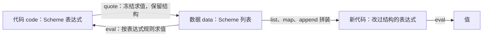

向下的一条边是 `quote`：让一段代码停止求值，原样变成数据，于是可以拆开、替换、拼接。向上的一条边是 `eval`：把一段数据按 Scheme 的求值规则跑一遍，得到值。剩下的内容只是在演示这两条边能组合出什么：先手工拼代码，再用模板批量拼代码，最后把模板本身也写成过程。

> **编者说明**：`eval` 就是解释器的入口。本模块前几讲用 Python 写的求值器——读入表达式、判断它属于哪一类、按规则递归求值——本质上实现的正是 `eval` 这一个过程。另外，Python 的 `eval` 会在当前作用域里执行任意表达式，工程上通常被视为危险接口。

### 6.3 半成品：quote 控制的是求值的时间

先看最普通的情况，再把它"列"出来：

```scheme
scm> (+ 1 2)
3
scm> (list '+ 1 2)
(+ 1 2)
```

```scheme
scm> (list '+ 1 (+ 2 3))
(+ 1 5)
```

半成品这个说法值得记住。用 `list` 拼代码时，**哪些子表达式会被提前求值，取决于它出现在引用位置还是普通位置**。这条规则是后面所有代码生成技巧的基础，也暴露出一个麻烦——手工给每个符号加引号太啰嗦，模板一长就没法读。准引用（§6.6）正是为解决这个麻烦而存在的。

> **编者说明**：本讲第 3、4、6、7、8 节的交互演示与程序文件来自课堂屏幕，课件没有收录；这里按字幕口述的表达式、结构与输出重建。

### 6.4 会返回表达式的过程：fact-exp 与 fib-exp

课堂先载入一个小程序，用阶乘做对照。`fact` 是标准的递归定义，返回一个数：

```scheme
(define (fact n)
  (if (= n 0)
      1
      (* n (fact (- n 1)))))
```

```scheme
(define (fact-exp n)
  (if (= n 0)
      1
      (list '* n (fact-exp (- n 1)))))
```

`(fact-exp 5)` 返回 `(* 5 (* 4 (* 3 (* 2 (* 1 1)))))`。它仍然是一段可以求值的代码，`(eval (fact-exp 5))` 得 120；作为数据，它让读者看见了 5 是怎么一路乘到 1 的。

| 判据 | `fact` | `fact-exp` |
| :--- | :--- | :--- |
| 返回什么 | 一个数 | 一个 Scheme 列表（表达式） |
| 基线 `n = 0` | `1` | `1`（数字本身也是表达式） |
| 递归步 | `(* n (fact (- n 1)))` | `(list '* n (fact-exp (- n 1)))` |
| 乘法何时发生 | 构造过程中立刻发生 | 交给 `eval` 时才发生 |
| 典型用途 | 得到结果 | 生成代码、观察计算过程 |

同样的改造可以套在斐波那契上：

```scheme
(define (fib-exp n)
  (if (<= n 1)
      n
      (list '+ (fib-exp (- n 2)) (fib-exp (- n 1)))))
```

`(fib-exp 6)` 得到的是一棵只由 `+`、`0`、`1` 组成的加法树。求值这棵树，就得到 8。这棵表达式树与 `fib` 的调用树同构，只是节点换了一种身份：一个是"还没算的调用"，一个是"已经写好的表达式"。

### 6.5 两道讨论题：改写程序与观察求值顺序

课件在 `(Demo)` 之后插入了两页讨论题，课堂录像没有展开它们。


第一题的动机很实际：机器生成的代码常常带着多余的嵌套结构。能不能写一个程序，在**不求值**的前提下把嵌套的乘法摊平？

```scheme
(define (is-*-call expr)
  (and (list? expr) (equal? '* (car expr))))   ; E.g., (* 3 4)

(define (flatten-nested-* expr) ; Return an equivalent expression with no nested calls to *
  (if (not (list? expr))
      expr
      (let ((expr (map flatten-nested-* expr))) ; Now expr is (* 1 2 (* 3 4) (+ 5 (* 6 7 8)))
        (if (is-*-call expr)
            (apply append
                   (map (lambda (e)
                          (if (is-*-call e)
                              (cdr e)
                              (list e)))
                        expr))
            expr))))
```

第二题要求写 `print-evals`：它接受一个只含数字、`+`、`*`、`>`、`if` 与括号的表达式，把求值过程中被求值的每个子表达式及其值按**求值完成的顺序**打印出来。


```scheme
(define (print-evals expr)
  (if (list? expr)
      (if (equal? (car expr) 'if)
          (begin
            (print-evals (car (cdr expr)))
            (if (eval (car (cdr expr)))
                (print-evals (car (cdr (cdr expr))))
                (print-evals (car (cdr (cdr (cdr expr)))))))
          (map print-evals expr)))
  (print expr '=> (eval expr)))
```

`(print expr '=> (eval expr))` 写在 `if` **外面**，是过程体的最后一个表达式，所以它总会执行：无论 `expr` 是原子还是组合，都会在子表达式处理完之后打印自己。里面的 `if` 只负责"往下走"：非列表的原子什么也不做；普通组合用 `map` 把所有子表达式各处理一遍；`if` 表达式则特殊对待——先处理谓词，再求值谓词，然后**只**处理被选中的分支。由于 `if` 只求值一个分支，另一支永远不会被打印，输出的顺序因此精确等于求值完成的顺序。

> **编者说明**：上面两页的代码按课件原文誊写，绿下划线处是课件留空的答案；讲解部分按代码语义补写，课堂录像中没有对应口述。

### 6.6 准引用：引号里的插槽

在动手写代码生成器之前，需要先补一个语言特性——**准引用（quasiquotation）**。它和 `quote` 很像，区别在于准引用表达式里可以**反引用（unquote）**某些部分。


```scheme
Quote:       '(a b)   =>   (a b)
Quasiquote:  `(a b)   =>   (a b)
(define b 4)
Quasiquote:  `(a ,(+ b 1))  =>   (a 5)
```


| 记号 | 名称 | 作用范围 | `b` 为 4 时的结果 |
| :--- | :--- | :--- | :--- |
| 单引号 `'` 或 `quote` | 引用 | 整个表达式冻结 | `'(a ,(+ b 1))` 得 `(a (unquote (+ b 1)))` |
| 反引号或 `quasiquote` | 准引用 | 整体冻结，但逗号处解冻 | `` `(a ,(+ b 1)) `` 得 `(a 5)` |
| 逗号 `,` 或 `unquote` | 反引用 | 只在准引用内部有效 | 单独写 `,(+ b 1)` 是语法错误 |

逗号不是独立运算符，它只在准引用的语境里有意义。同一个表达式，引用与准引用给出两种结果：

```scheme
scm> '(a ,(+ b 1))
(a (unquote (+ b 1)))
scm> `(a ,(+ b 1))
(a 5)
```

为什么 `(+ b 1)` 被求值而 `a` 没有？答案就是那个逗号。读法是：**准引用先按照"构造列表"的方式搭出整体结构；遇到逗号标记的子表达式时，把它按 Scheme 的普通求值规则算出一个值，再把这个值放进对应位置**。于是准引用做的事情可以一句话概括：**把"引用"与"求值"混合在同一个模板里**。

课件给出第一个实用例子：

```scheme
(define (make-add-lambda n) `(lambda (d) (+ d ,n)))
(make-add-lambda 2)  => (lambda (d) (+ d 2))
```

### 6.7 参数化：把"哪一部分会变"抽出来

**Scheme 里没有 while 语句**，但 while 语句确实方便。为了说明"没有循环"到底有多不方便，先看一个具体的计算：求 10 以下所有偶数的平方和，即 $2^2 + 4^2 + 6^2 + 8^2$。

```python
x, total = 2, 0
while x < 10:
    total = total + x * x
    x = x + 2
```

循环结束时 `total` 是 120。在 Scheme 里，没有 while 可用，只能递归。思路是把循环变量变成过程参数：

```scheme
(define (sum-while x total)
  (if (< x 10)
      (sum-while (+ x 2) (+ total (* x x)))
      total))
```

定义完这个过程，还需要用正确的初值调用它，于是写成两个表达式而不是一个。若想把它们并成一个表达式，就要借助 `begin`：

```scheme
(begin
  (define (sum-while x total)
    (if (< x 10)
        (sum-while (+ x 2) (+ total (* x x)))
        total))
  (sum-while 2 0))
```

讲师的提议是：**让 Scheme 来写这段代码**。

```scheme
(sum-while-expr 1 '(< (* x x) 50) 'x '(+ x 1))
```

四个参数分别是：初值 `1`；继续条件 `(< (* x x) 50)`；累加项 `x`；更新式 `(+ x 1)`。后三个用引号包住，因为它们是**表达式**，要在模板里原样嵌入，而不是现在就求值——若不加引号，`(< (* x x) 50)` 会立刻被求值，而此刻 `x` 还没有值。

### 6.8 生成代码：模板、插槽与 eval 的闭环

把上一节的骨架写成准引用，就得到生成器：

```scheme
(define (sum-while-expr initial-x condition add-to-total update-x)
  `(begin
     (define (f x total)
       (if ,condition
           (f ,update-x (+ total ,add-to-total))
           total))
     (f 0 ,initial-x)))
```

四处逗号对应四个参数。讲师逐处解释了为什么要反引用：如果写成 `condition` 而不加逗号，生成结果里留下的是**符号** `condition`，而不是调用者传进来的那个表达式；`initial-x` 若不反引用，`(f 0 initial-x)` 就会在求值时去找一个叫 `initial-x` 的变量，而它并不存在。

```scheme
scm> (define result (sum-while-expr 1 '(< (* x x) 50) 'x '(+ x 1)))
scm> (eval result)
28
scm> (eval (sum-while-expr 2 '(< x 10) '(* x x) '(+ x 2)))
120
```

第一次求值得到 28，即 1 到 7 的和；第二次得到偶数平方和 120——正是上一节手写的那道题。

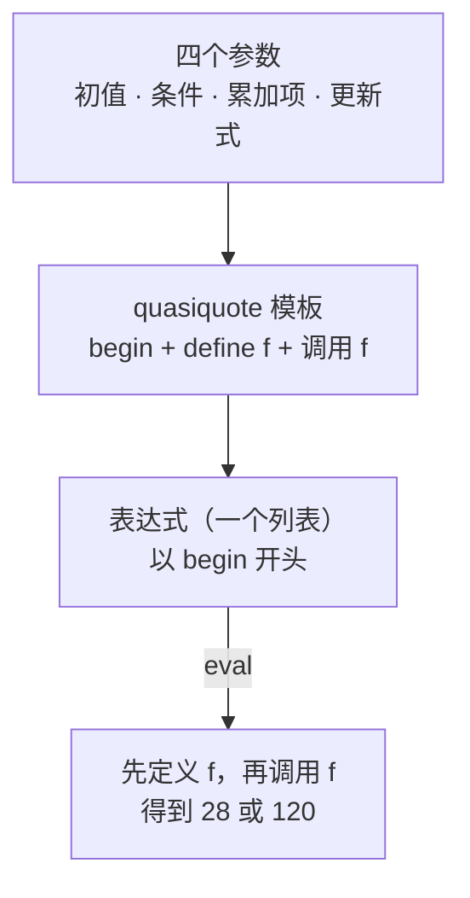

本讲最后一句总结是：**能够写出"为其他过程写代码"的过程，是编程语言的一种额外表达力**。这句话之所以成立，靠的正是前面几节攒下的三件东西：代码就是列表、`quote` 能冻结结构、`eval` 能执行结构。

> **编者说明**：代码生成在工程上并不罕见：编译器把语法树翻译成目标代码、测试框架按数据表批量生成用例、Web 框架把模板编译成函数，本质都是"构造一段程序再交给求值器"。第 33 讲演示的是这套机制的最小版本。

课件最后一页把 `fact-exp` 换了一种写法，要求用准引用重写同一个过程：


```scheme
(define (fact-expr n)
  (if (= n 0) 1 `(* ,n ,(fact-expr (- n 1)))))
```

两处逗号分别把当前的 `n` 与递归得到的表达式填进乘法模板。与 §6.4 用 `list` 写的版本相比，这段代码把"构造列表"的细节全部藏进了反引号：`(* ,n ,(fact-expr (- n 1)))` 直接写出了结果表达式的形状，读起来几乎和它生成出来的代码一样。

> **编者说明**：这一页在课堂录像中没有被讲解，属于课件留给讨论课或课后完成的练习；代码按课件给出的填空答案誊写。

## 7. 宏：在源码层改写程序

*(参考时间: 00:00:01 – 00:28:51｜Lecture 34)*

第 33 讲写出的代码生成器已经能做一件了不起的事：喂它四个参数，它吐出一段可求值的程序。但每次都要人手动写 `eval`，每次都要人手动加反引号。第 34 讲把这两个动作交给语言自己——让一门语言拥有"在求值之前改写源码"的能力，这就是**宏（macro）**。

### 7.1 准引用复习：给代码模板留洞

单引号（quote）把后面的表达式原样当成数据，一个子表达式都不求值；反引号（quasiquote）做的几乎一样，但它允许在模板里"开洞"。


```scheme
scm> '(a b)
(a b)
scm> (define b 4)
scm> `(a ,(+ b 1))
(a 5)
```

| 符号 | 名称 | 作用 | 例子 | 求值结果 |
| :--- | :--- | :--- | :--- | :--- |
| `'` | quote 引用 | 完全阻止求值，把表达式当作数据 | `'(a b)` | `(a b)` |
| 反引号 | quasiquote 准引用 | 同样阻止求值，但允许内部用逗号开洞 | 反引号 `(a b)` | `(a b)` |
| `,` | unquote 反引用 | 只在准引用内部生效：这个子表达式要先求值 | 反引号 `(a ,(+ b 1))`，`b` 为 4 | `(a 5)` |

**引用的层数决定求值的深度**。没有洞时两种引用可以互换；一旦有洞，只有反引号能表达"这里要算一下"。

课件接着给出准引用最典型的用途——生成一段以后要执行的代码：

```scheme
(define (make-add-lambda n)
  `(lambda (d) (+ d ,n)))

scm> (make-add-lambda 2)
(lambda (d) (+ d 2))
```

`make-add-lambda` 返回的是一个**列表**，不是过程；要得到一个真的过程，还得把这个返回值再求值一次。模板里的分工一目了然：`lambda`、`d`、`+` 是骨架，原样进入结果；`n` 是洞，换成调用时给的值。整套宏的写法就是这套分工的放大版。

### 7.2 一道填空题与五种错填

讲师把一道填空题放上屏幕，规则说得极窄：每个空位要么留空，要么填一个反引号或一个逗号；填完之后，第二个表达式应当求值为"a 的平方加 b 的平方"。

> **编者说明**：这道题的画面不在官方 11 页课件里（课件第 5 页是另一道 `fact-expr` 填空题），下面的骨架按字幕里逐句念出的答案还原。

```scheme
(define (square-expr term)
  `(* ,term ,term))

`(+ ,(square-expr 'a) ,(square-expr 'b))
```

| 空位 | 该填什么 | 理由 |
| :--- | :--- | :--- |
| `define` 整句之外 | 留空 | 这是定义表达式，要被求值；引用它只会造出一段数据 |
| `(* ...)` 之前 | 反引号 | 返回值必须是列表，不能真的做乘法 |
| 两个 `term` 之前 | 逗号 | 形参的值要换进来，否则留下的是形参名 |
| `(+ ...)` 之前 | 反引号 | 整个结果是一段以 `+` 开头的代码 |
| `+` 之前 | 留空 | 已经在准引用里，多引用一层会改变列表头 |
| 两个 `(square-expr ...)` 之前 | 逗号 | 这里要调用过程，不是保留这棵树 |
| `a`、`b` 之前 | 引用（`'` 或反引号） | 它们处在求值上下文里，必须挡住求值 |

| 错填 | 屏幕上看到什么 | 原因 |
| :--- | :--- | :--- |
| `square-expr` 里 `term` 前少了逗号 | `(+ (* term term) (* term term))` | 两次调用都把形参名原样留下，模板里那个洞没有开 |
| `(* ...)` 之外少了反引号 | 报错：符号不是数 | 这段代码真的被求值了，符号被当成操作数拿去乘 |
| 外层 `(+ ...)` 之外多了一层引用 | 列表头不是符号 `+` | 多引了一层，`+` 连同反引号一起变成了数据 |
| `(square-expr ...)` 前少了逗号 | 结果里留着 `(square-expr ...)` 这棵子树 | 该调用过程的位置被当成了数据 |
| `a`、`b` 前少了引用 | 报错：未知标识符 `a` | 那个位置在求值的上下文里，符号无处可查 |

### 7.3 宏：给语言增加新的特殊形式

每一门语言都有一份"表达式类型"的清单——Scheme 里是 `define`、`lambda`、`if`、`cond` 等等；清单之外的组合都按过程调用处理。宏的作用，就是让人**往这份清单里加条目**：发明新的特殊形式。


```scheme
(define-macro (twice expr)
  (list 'begin expr expr))

scm> (twice (print 2))
2
2
```

课件把宏调用表达式的求值程序写成三条，顺序不能换：

- 求值算符子表达式——它的值应当是一个由 `define-macro` 定义的宏；
- 把这个宏过程应用到**操作数表达式**上，但不先求值它们（课件用斜体强调 "without evaluating them first"）；
- 求值宏过程返回的那个表达式。

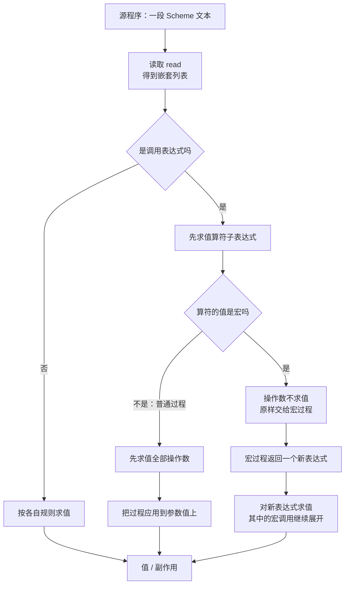

> **编者说明**：图中"求值到宏调用时才展开"这一条对应 61A Scheme 的求值器实现。真正的 Lisp 编译器通常在编译期就把整个程序展开完，展开与求值是两个分离的阶段；两者结果相同，但"什么时候展开"会影响副作用发生的时机。

| 判据 | 过程 | 宏 |
| :--- | :--- | :--- |
| 收到什么 | 参数的**值** | 操作数的**表达式** |
| 参数何时求值 | 调用前，全部求完 | 不自动求值，时机由宏体决定 |
| 返回什么 | 一个值 | 一个表达式，再由求值器处理 |
| 调用者要写引号吗 | 不写 | 不写（宏的好处）；写成过程才要写 |
| 什么时候执行 | 每次调用执行一次 | 每次出现都先展开、再求值 |
| 能否改变语言 | 不能，只影响值 | 能，等于新增一种特殊形式 |

`twice` 的收获拆成两层。简单的一层：它替调用者做了"先引用、再求值"这套手续。深刻的一层：`twice` 已经不再是过程，而是一种新的特殊形式——它不先求值参数，这意味着**宏的函数体对"什么时候求值、求值几次"有完全的控制权**。`twice` 求值两次，也可以一次都不求、或者把求值推迟到某个条件成立时。

### 7.4 check：让失败的断言说出自己

第二个例子从一个朴素的需求开始：程序里想加一些自检。用过程写很直接，但它有个缺陷：**它只知道自己失败了，不知道自己为什么失败**。屏幕上一个 `failed`，读者还得回头去数第几个测试。根源在于信息已经被丢掉了：过程收到的参数是 `#f`，那个曾经写着 `(> x 0)` 的表达式早就求值完、消失了。要说出"是哪条断言失败"，就必须在求值**之前**拿到那个表达式。

```scheme
(define (check value)
  (if value 'passed 'failed))

(define-macro (check expr)
  (list 'if expr ''passed ''failed))
```

宏体在拼一段新代码：`if` 的判断部分是原封不动的 `expr`，两个分支是两个被"双重引用"的符号。为什么是两个引号？因为生成出来的代码还要再被求值一次：`''passed` 展开成引用形式，求值时得到符号 `passed` 本身，而不是去查一个名叫 `passed` 的变量。

```scheme
(define-macro (check expr)
  (list 'if expr ''passed (list 'quote (list 'failed expr))))

scm> (check (> x 0))
(failed (> x 0))
```

讲师在这里做了一次更直接的手工剥壳：**把 `define-macro` 换成 `define`**，同一个函数体立刻变回普通过程，要真正运行，调用者得自己写引号挡住求值、再写 `eval` 求值结果。展开出来的那段代码是可以逐字读的：

```scheme
(if (> x 0) 'passed '(failed (> x 0)))
```

### 7.5 for 宏：把 map 包成新语法

第三个例子是"造语法"。讲师的开场只有两句："Scheme 没有 `for` 语句。现在它有了。"


```scheme
scm> (for x '(2 3 4 5) (* x x))
(4 9 16 25)
scm> (map (lambda (x) (* x x)) '(2 3 4 5))
(4 9 16 25)
```

第一版用 `list` 一层层拼：

```scheme
(define-macro (for sym vals expr)
  (list 'map (list 'lambda (list sym) expr) vals))
```

```scheme
(define-macro (for sym vals expr)
  `(map (lambda (,sym) ,expr) ,vals))
```

两段代码展开出的表达式完全相同，差别在可读性：准引用版里，生成结果的括号数量与嵌套形状**直接写在源码里**。

真正值得注意的是同一个模板里三个洞的"求值时机"完全不同：

| 洞 | 填进去的是什么 | 展开后由谁处理 | 求值次数 |
| :--- | :--- | :--- | :--- |
| `,sym` | 调用者写的占位符号 `x` | 落在 `lambda` 的参数位，只接受符号，不会求值 | 0 |
| `,expr` | 表达式 `(* x x)` | 落在 `lambda` 的函数体，每个元素求值一次 | 列表长度次 |
| `,vals` | 表达式 `'(2 3 4 5)` | 落在 `map` 的第二个参数，求值一次得到列表 | 1 |

宏里可以混着三种成分——**会求值的**、**永远不会被求值、只是一个占位符号的**、以及**对每个元素各求值一次的**。这第三种是最新的东西：以前写过程时，"参数在什么时候被求值"根本不是一个可以讨论的问题，现在它成了宏作者的设计选择。

课件最后留了一个问题：为什么不把它定义成"值不需要加引号"的版本？讲师没有在课上展开。

> **编者说明**：答案是"可以，但代价很大"。把生成代码里的 values 位置改成带引号的字面量，`(for x (2 3 4 5) (* x x))` 就真的能跑，但这样一来 values 只能是"能直接写成列表数据的字面量"：`(for x lst (* x x))` 与 `(for x (list 1 2) (* x x))` 都会失效。标准写法要求调用者写引号，正是因为引号在**调用点**就把"这是数据"标清楚了。

### 7.6 trace：一次调用的追踪

第四个例子换了问题：想看一个递归过程执行时每一层调用了什么。这个问题在课程前面用 Python 做过，工具是装饰器（decorator）。

```python
def trace(fn):
    def traced(n):
        print(f'{fn.__name__}({n})')
        return fn(n)
    return traced

@trace
def fact(n):
    if n == 0:
        return 1
    return n * fact(n - 1)
```

> **编者说明**：字幕只口述了这个装饰器的工作方式（"定义一个同返回值的新版本、打印函数名与参数、再调用原函数"），课件没有这一页。

输出和 Python 版几乎一样，但**分离关注点没了**。在 Python 里，`fact` 的定义里一个字都不提追踪，`trace` 的定义里一个字都不提阶乘。在这里，"被追踪的 fact"是手写的，写它的人必须知道递归要落回 `fact` 这个名字。

要做成通用的，第一件事是把"存名字、重定义、调用、还原"四件事**装进一个表达式**。Scheme 的容器是 `begin`：

```scheme
(begin
  (define original fact)
  (define (fact n)
    (print (list 'fact n))
    (original n))
  (define result (fact 5))
  (define fact original)
  result)
```

为什么这件事必须由宏来做？因为整个过程要在 `(fact 5)` 被求值**之前**动手：装上打印层、调用、再拆掉。如果写成一个过程，参数 `(fact 5)` 在进入过程体之前就已经求值完了，打印层根本没机会存在。

```scheme
(define-macro (trace expr)
  (define operator (car expr))
  `(begin
     (define original ,operator)
     (define ,operator (lambda (n)
                         (print (list ',operator n))
                         (original n)))
     (define result ,expr)
     (define ,operator original)
     result))
```

讲师在这里插了一段"先跑一遍错的"的演示。第一次运行，打印确实发生了，但屏幕上出现的不是 `(fact 5)`，而是 `fact` 这个**过程对象**。病灶在那个 `'`：如果写成 `(list ,operator n)`，展开结果是 `(list fact 5)`，位置上的 `fact` 会被求值成过程，于是打印出过程对象。加上引号之后，展开结果变成 `(list 'fact 5)`，打印出来就是符号本身。要打印的是 `fact` 这个**符号**，而不是 `fact` 这个**过程对象**。

Scheme 版比 Python 版更强的差别在于**追踪的对象**：Python 的装饰器决定的是"这个函数从此以后是否被追踪"，答案在 `def` 那一刻就固定了；Scheme 的 `trace` 宏决定的是"这一次调用是否被追踪"，同一段程序里可以这一次追踪、下一次不追踪，还可以追踪完自动恢复。

| 判据 | Python 装饰器 | Scheme 的 trace 宏 |
| :--- | :--- | :--- |
| 作用对象 | 函数对象 | 一条调用表达式的源码 |
| 生效范围 | 整个函数，永久 | 这一次调用 |
| 何时决定 | `def` 时（写代码时） | 每次调用时 |
| 能否中途切换 | 不能，除非重写函数 | 能，随时可以切回未追踪 |
| 引入的新名字 | 局部函数 `traced`，不外泄 | 全局 `original`、`result`，会留在全局帧 |
| 出错时指向哪里 | 原函数体 | 展开后的代码 |

### 7.7 代价：宏在源码层面工作

> **编者说明**：这类"宏引入的名字与调用者的名字相互干扰"的问题，术语叫卫生性（hygiene）。真正的 Lisp 实现给宏提供 `gensym` 一类的工具：每次展开生成一个绝不会与用户名字冲突的新符号。61A 的 Scheme 没有 `gensym`，所以课上这个 `trace` 宏严格来说是不卫生的——它只是恰好在一个只用到 `fact` 的环境里工作。

宏的收益，说到底只有一条：**语法**。`for`、`check`、`trace` 都不能让程序算出以前算不出的值，它们让意图写得更直接。判断该不该用宏，问的是"这里缺的是一种语法，还是一个函数"。

### 7.8 练习：fact-expr 与 repeat 的两版展开

课件留了三道练习，课堂上没有展开。


第一道要求用准引用重写"返回 n 的阶乘表达式"的过程：

```scheme
(define (fact-expr n)
  (if (<= n 1) 1 `(* ,n ,(fact-expr (- n 1)))))
```

两个空分别填 `,n` 与 `,(fact-expr (- n 1))`。第一个洞用逗号，是因为 `n` 是形参，要换成调用时的那个数；第二个洞用逗号，是因为要**递归调用** `fact-expr` 拿到下一层表达式，而不是把 `(fact-expr (- n 1))` 这棵树原样留在结果里。基的情况返回数 `1`，被填进洞里时自然变成 `(* 2 1)`。


```scheme
(define (repeated-expr n expr)
  (if (zero? n) nil (cons expr (repeated-expr (- n 1) expr))))

(define-macro (repeat n expr)
  (cons 'begin (repeated-expr (eval n) expr)))
```


第三道要求换一种展开方式：不再把 `expr` 复制 `n` 份，而是生成一个递归过程。

```scheme
(define (repeated-expr n expr)
  `((define (repeater k)
      (if (= k 1) ,expr (begin ,expr (repeater (- k 1)))))
    (repeater ,n)))

(define-macro (repeat n expr)
  (cons 'begin (repeated-expr (eval n) expr)))
```

回顾 §1.14 那个用过程写的 `repeat`：它接受一个 k 和一个过程，靠递归调用完成重复。两个 `repeat` 名字相同、效果相似，差别却是本质的——过程版拿到的是**过程**，所以它只能在运行时一遍遍调用；宏版拿到的是**表达式**，所以它可以把这段代码复制 n 份、也可以生成一个循环。**这就是"用过程抽象"与"用语法抽象"的分界：前者改变值怎么流动，后者改变代码长什么样。**

## 工程定律与设计清单

*(参考时间: 00:17:39 – 00:21:19｜Lecture 28；00:22:57 – 00:24:42｜Lecture 29；00:42:06 – 00:47:51｜Lecture 30；00:26:05 – 00:29:45｜Lecture 31；00:30:43 – 00:32:48｜Lecture 32；00:14:57 – 00:18:04｜Lecture 33；00:25:13 – 00:28:51｜Lecture 34)*

下面九条是可以背下来、在考场与设计讨论里直接用的判据。每条后面的一句话是理由，理由比结论更重要。

- **语法有几种表达式，求值函数就有几条分支。** 分派表不是实现细节，而是语言定义的镜像；漏掉一条分支，就是漏掉一种语法。
- **特殊形式的"特殊"体现在求值顺序上，不体现在写法上。** `quote` 完全不求值，`if` 只求一个分支；把它们实现成"先求全部子表达式"的解释器，连 `(if #t 1 (/ 1 0))` 都过不去。
- **过程 = 代码 + 出生环境。** `LambdaProcedure` 的三个字段里，`env` 是唯一看不见却决定一切的字段；词法作用域不是约定，而是"新帧的父帧取自过程对象"这一行代码。
- **绑定落在当前帧，查找沿父帧向上。** 这两条一起解释了遮蔽与全局帧的地位；`define` 永远不往父帧写，`lookup` 永远先看本地。
- **解释器的两块骨架是 eval 与 apply 的相互递归。** 两边各有基本情况，递归才终止；写解释器时先画出这两条边，再往盒子里填分支。
- **能省的语法在读入阶段省掉。** `'x` 展开成 `(quote x)`，`(define (f x) ...)` 展开成 `(define f (lambda (x) ...))`，宏调用展开成普通表达式。核心求值器认识的形状越少，它就越小、越容易验证。
- **错误在懂它的那一层处理，回显集中在最外层。** `calc_apply` 知道"这个运算符要几个参数"，REPL 只知道"这句话没法算"；把 `raise` 撒在实现层、把 `except` 收在循环层，用户看到的错误才一致。
- **尾调用的判据是"调用之后还有没有话要说"。** 算实参需要帧，收返回值也需要帧；尾调用恰好是后者为空的调用。空间账要分开算：数据结构本身的开销，与控制流的开销。
- **宏改变的是代码怎么生成，不是值怎么计算。** 判据是"这里缺的是一种语法，还是一个函数"；宏的代价是卫生性与错误定位，收益是让意图直接写进源码。

## 模块知识总览（Mermaid mindmap）

*(参考时间: 00:00:02 – 00:00:23｜Lecture 28；00:00:41 – 00:02:11｜Lecture 29；00:14:31 – 00:20:33｜Lecture 30；00:20:07 – 00:24:10｜Lecture 31；00:06:48 – 00:11:01｜Lecture 32；00:01:11 – 00:02:25｜Lecture 33；00:05:26 – 00:07:09｜Lecture 34)*

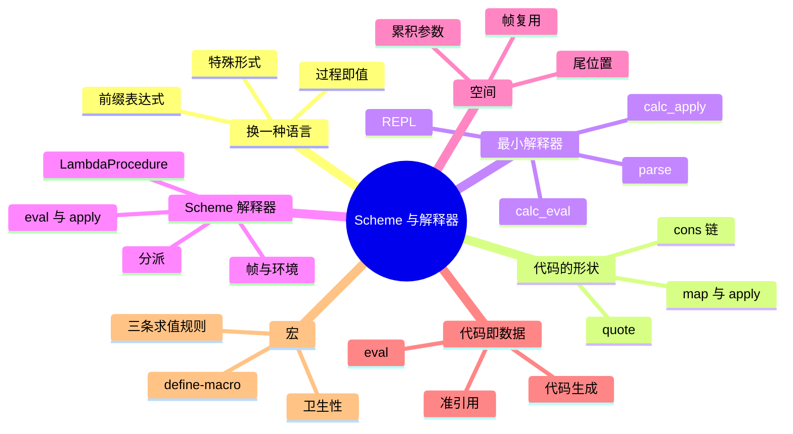

如果只有二十分钟，建议这样读：先看 §1.3 的前缀记法、§3.6 的 `calc_eval`、§4.11 的八步路径，再看 §5.4 的尾位置与 §7.3 的三条宏规则。五处合起来不到二十页，但覆盖了"语言怎么被实现"与"语言怎么被扩展"这两个必答问题。

## 出处与许可

*(参考时间: 00:00:02 – 00:00:23｜Lecture 28；00:00:01 – 00:00:11｜Lecture 34)*

本模块依据以下材料整理：UC Berkeley CS61A（Structure and Interpretation of Computer Programs，Fall 2024）Lectures 28–34 的课堂录像与 B 站英文原声字幕；六份官方课件 `27-Scheme_1pp.pdf`（15 页）、`28-Scheme_Lists_1pp.pdf`（13 页）、`29-Calculator_1pp.pdf`（15 页）、`30-Interpreters_1pp.pdf`（14 页）、`31-Programs_as_Data_1pp.pdf`（9 页）、`32-Macros_1pp.pdf`（11 页），正文 77 张插图均为其逐页渲染图（Lecture 32 为选修专题，官方无课件，故无插图）。课程主页为 `cs61a.org`，教材为 John DeNero 编写的 *Composing Programs*，Project 4 的 `scheme.py` 骨架与 `ucb` 模块随课程分发。

课程与课件的版权归 UC Berkeley CS61A 教学团队所有；本文是面向中文读者的二次整理，用于学习与教学讨论，不替代原课程。凡讲师口述与课件画面里没有的内容，均以 `编者说明` 标出，包括：Lisp 与 Scheme 的历史背景、`car`/`cdr` 的词源、动态作用域的现代用例、元循环求值器这一术语、`do_if_form` 的示意实现、`calc_apply`/`read_eval_print_loop` 的重建版本、尾调用的实现手段（帧复用与 trampoline）、`gensym` 与卫生性、以及六道讨论题的解答。这些补充如果与官方材料冲突，以官方材料为准。

排版上，各章开头的时间锚点取自字幕中对应段落的真实起止时间，跨讲章节按讲次拆段；`mermaid` 图与表格为本文自制，用于替代课堂上的手绘环境图、盒针图与交互式演示。文中代码按课件画面逐字誊写（含课件原有的缩进与注释），录像中现场敲出的代码按字幕口述复原，差异处已在正文标注。

## 附：本模块幻灯片索引

*(参考时间: 00:00:02 – 00:31:11｜Lecture 28；00:00:00 – 00:24:42｜Lecture 29；00:00:01 – 00:47:51｜Lecture 30；00:00:02 – 00:29:45｜Lecture 31；00:00:00 – 00:32:48｜Lecture 32；00:00:00 – 00:18:04｜Lecture 33；00:00:01 – 00:28:51｜Lecture 34)*

| 页 | 讲次 | 内容 | 出现位置 |
| :--- | :--- | :--- | :--- |
| 1 | lec28 | 标题页：Scheme | §0.1 |
| 2 | lec28 | 公告页：Announcements | §0.4 |
| 3 | lec28 | 分节页：The Scheme Programming Language | §1.1 |
| 4 | lec28 | 表达式的四种形态：基本表达式与组合 | §1.2 |
| 5 | lec28 | 定义过程：没有 `return`，值取最后一个表达式 | §1.6 |
| 6 | lec28 | Python 与 Scheme 的调用表达式、`and` 短路 | §1.7 |
| 7 | lec28 | 没有 `for`/`while`：用递归实现迭代 | §1.8 |
| 8 | lec28 | 分节页：Writing Scheme | §1.9 |
| 9 | lec28 | 练习：`a-plus-abs-b` 的算符位置填空 | §1.9 |
| 10 | lec28 | 分节页：Lambda Expressions | §1.10 |
| 11 | lec28 | `lambda` 语法、两种等价定义、算符可为组合 | §1.10 |
| 12 | lec28 | What Would Scheme Do：两道 `lambda` 应用题 | §1.10 |
| 13 | lec28 | 分节页：More Special Forms | §1.11 |
| 14 | lec28 | `cond` 与 `begin`：`if-elif-else` 的两种写法 | §1.11 |
| 15 | lec28 | `let`：临时绑定与 Python 赋值的行为差异 | §1.12 |
| 1 | lec29 | 标题页：Scheme Lists | §0.1 |
| 2 | lec29 | 公告页：Announcements | §0.4 |
| 3 | lec29 | 分节页：Turtle Graphics | §1.14 |
| 4 | lec29 | Drawing Stars：`star` 过程与五角星 | §1.14 |
| 5 | lec29 | 分节页：Lists | §2.1 |
| 6 | lec29 | `cons`/`car`/`cdr`/`nil` 与盒针图 | §2.1 |
| 7 | lec29 | List Construction：三条构造路径的六组例子 | §2.3 |
| 8 | lec29 | 递归构造：`split` 第一版 | §2.4 |
| 9 | lec29 | 递归构造第二版：用 `let` 一次返回两段 | §2.4 |
| 10 | lec29 | 分节页：Symbolic Programming | §2.5 |
| 11 | lec29 | 引用：`quote`、符号与组合上的引用 | §2.5 |
| 12 | lec29 | 分节页：List Processing | §2.6 |
| 13 | lec29 | 四个内置列表处理过程与 `beats`/`rhythm` | §2.6 |
| 1 | lec30 | 标题页：Calculator | §0.1 |
| 2 | lec30 | 公告页：Announcements | §0.4 |
| 3 | lec30 | 分节页：List Processing | §2.7 |
| 4 | lec30 | 四个内置列表过程（下一讲重放） | §2.7 |
| 5 | lec30 | `cons-count` 练习与盒针图 | §2.7 |
| 6 | lec30 | 分节页：Exceptions | §3.1 |
| 7 | lec30 | `reduce`：把序列两两组合成一个值 | §3.2 |
| 8 | lec30 | 分节页：Scheme-Syntax Calculator | §3.4 |
| 9 | lec30 | Calculator 语法：数字、调用表达式与 Pair 表示 | §3.4 |
| 10 | lec30 | Calculator 语义：四个运算符与 61 的求值树 | §3.5 |
| 11 | lec30 | 分节页：Evaluation | §3.6 |
| 12 | lec30 | `calc_eval` 实现与语言语义逐行对照 | §3.6 |
| 13 | lec30 | `calc_apply`：四个运算符与四种组合方式 | §3.7 |
| 14 | lec30 | 分节页：Interactive Interpreters | §3.8 |
| 15 | lec30 | Read-Eval-Print Loop 的六个步骤 | §3.8 |
| 1 | lec31 | 标题页：Interpreters | §0.1 |
| 2 | lec31 | 公告页：Announcements | §0.4 |
| 3 | lec31 | 分节页：Lab 10 Review（录音前） | §4 |
| 4 | lec31 | 操作数求值与 Pair 表示 | §4.2 |
| 5 | lec31 | 分节页：Interpreting Scheme | §4.2 |
| 6 | lec31 | 解释器结构：Eval 与 Apply 的基本情况与递归 | §4.7 |
| 7 | lec31 | 分节页：Project 4 | §4.7 |
| 8 | lec31 | Project 4 的 Pair 表示与两个求值函数 | §4.9 |
| 9 | lec31 | 讨论题：define 表达式的符号，两种格式 | §4.8 |
| 10 | lec31 | 分节页：Special Forms | §4.1 |
| 11 | lec31 | Scheme 求值：三类表达式、四种组合模板 | §4.1 |
| 12 | lec31 | 分节页：Lambda Expressions | §4.5 |
| 13 | lec31 | lambda 求值为用户定义过程与三个字段 | §4.5 |
| 14 | lec31 | 帧与环境：父帧、`lookup`/`define`、g 与 f1 | §4.6 |
| 1 | lec33 | 标题页：Programs as Data | §0.1 |
| 2 | lec33 | 公告页：Announcements | §0.4 |
| 3 | lec33 | 分节页：Programs as Data | §6.1 |
| 4 | lec33 | 表达式即列表：`list` 构造、`eval` 求值 | §6.1 |
| 5 | lec33 | 讨论题：自动化简嵌套的 `*` | §6.5 |
| 6 | lec33 | 讨论题：按求值完成顺序打印子表达式 | §6.5 |
| 7 | lec33 | 分节页：Quasiquotation | §6.6 |
| 8 | lec33 | `quote`/`quasiquote`/`unquote` 与 `make-add-lambda` | §6.6 |
| 9 | lec33 | 讨论题：用准引用写 `fact-expr` | §6.8 |
| 1 | lec34 | 标题页：Macros | §0.1 |
| 2 | lec34 | 公告页：Announcements | §0.4 |
| 3 | lec34 | 分节页：Quasiquotation | §7.1 |
| 4 | lec34 | 准引用定义、开洞例子与 `make-add-lambda` | §7.1 |
| 5 | lec34 | 讨论题：用准引用生成阶乘表达式 | §7.8 |
| 6 | lec34 | 分节页：Macros | §7.3 |
| 7 | lec34 | `twice` 宏、三条求值规则 | §7.3 |
| 8 | lec34 | 讨论题：`repeat` 与 `repeated-expr` 填空 | §7.8 |
| 9 | lec34 | 讨论题：`repeat` 的递归写法 | §7.8 |
| 10 | lec34 | 分节页：For Macro | §7.5 |
| 11 | lec34 | `for` 宏的 `list` 版、准引用改写与引号之问 | §7.5 |

六份课件合计 77 页，每页在正文出现恰好一次；页号按各自讲次独立编号，因此表中出现六组从 1 开始的页码。Lecture 32 是选修专题，官方没有配套课件，故不在此表中。
