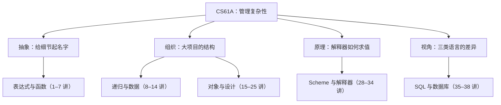
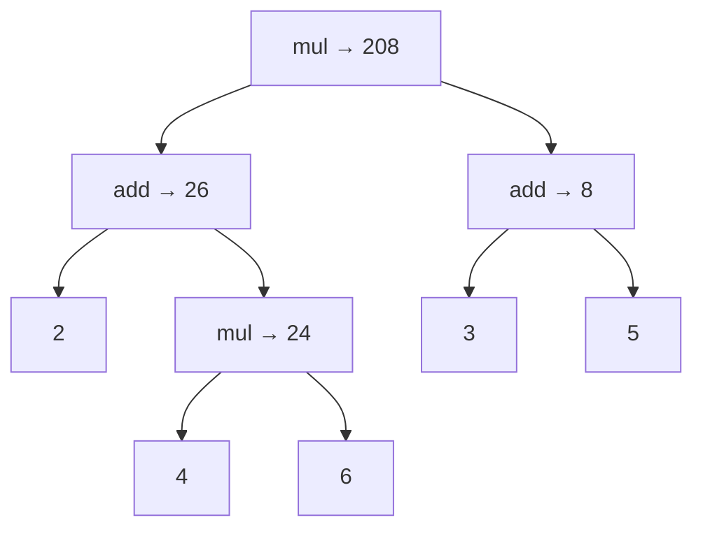

> **课程**：UC Berkeley CS61A · Structure and Interpretation of Computer Programs（Fall 2024）
> **本讲**：Lecture 1 ｜ 13:29 ｜ B 站分 P 1 ｜ [原视频](https://www.bilibili.com/video/BV1sy411z7nA?p=1)
> **课件**：`01-Welcome_1pp.pdf`（22 页，官方 PDF，逐页渲染图见正文插图）
> **字幕**：B 站英文原声字幕；本笔记是中文书面化重构，非逐句翻译
> **版权**：课程与课件版权归 UC Berkeley CS61A 教学团队；本文为学习用途的二次整理

## 本讲速览

- **已掌握**：能在某门语言里写出一行能跑的代码，知道 `+` 与括号是数学里的运算符。
- **本讲主线**：
    - 两套并行班次为什么必须靠录像对齐，以及视频、教科书、现场课三者的分工；
    - 数学几百年来为每种运算发明了各自的记号，而函数调用记号 `f(x)` 是它们的统一形式；
    - 解释器如何只靠"求值算子、求值操作数、施加函数"这三步反复执行，算出嵌套表达式的值；
    - 表达式树把"208 是怎么来的"画成一张图，并交代"参数永远是值"这条铁律。
- **关键结论**：调用表达式不需要背优先级，括号结构本身就是求值顺序；同一套求值程序可以无限次地套用到更复杂的嵌套上。

*(参考时间: 00:00:00 – 00:00:12｜Lecture 1)*

## 1. 两套班次，一份共同的教学内容

*(参考时间: 00:00:12 – 00:00:28｜Lecture 1)*


Fall 2024 的 CS61A 同时开了两套班：John DeNero 与 Rao 教授各带一套。两套班共用同一批作业、同一份考卷——既然作业与考试完全一致，讲授内容就不能出现口径差异。整门课的技术形态正是由此决定的：**把最标准化的部分录成视频、两套班共用；现场课再各自展开**。

DeNero 的说法很直接：做法是发布讲课视频（就像本讲这一支），在两套班之间共享；到了现场课，两位讲师各自更深入地做一些例题、讨论做题时该想什么，但课程的核心内容是通过这些视频传达的。

### 1.1 为什么"对齐"要靠录像

同一份作业、同一份考卷，意味着差异只可能出现在讲授环节。要把这个差异压掉，有两条路：一是两位讲师逐字协同备课，二是让所有人看同一支录像。前者成本随讲师人数线性增长、且难以验证一致性；后者一次录制、可反复回放、可逐年修订，代价则是现场课的即时性被部分让渡——学生必须自己管理观看进度，问题也只能留到课堂或论坛上问。这门课选择了后者，并用"现场课只复习最重要的部分"来回收一部分现场价值。

讲师也顺手把这件事说成好处：两套班次不是负担，而是"两倍的师资投入"（twice as many faculty involved），对一整个学期是更好的体验。

### 1.2 讲师团队

课件第 2 页是本学期与 Data C88C 共享的教学团队，右侧是 CS61A / Data C88C 的卡通标志。三位讲师的分工与答疑时间如下。


| 姓名 | 分工与研究 | 答疑时间与地点 |
|---|---|---|
| John DeNero | 2011 年起每年至少教一次 CS61A；研究语言模型以及人们如何使用它们 | 周二 13:00–15:00，Warren 101B |
| Shm Almeda | 计算机系博士生，研究人机交互；Art/Tech | 周一 15:00–16:00，地点待定 |
| Jedi Tsang | Data C88C 共同讲师（与 DeNero 搭档），本学期在 61A 做若干次客座讲座；政治学 + 计算机 2023 届，EECS 硕士 | 周四 13:00–15:00，地点待定 |

这张表值得记住的地方不是人名，而是**答疑时间是公开承诺的固定资源**：每周有几个小时，任何人都可以直接去找讲师问问题，不需要预约。

### 1.3 客座讲师的研究：计算伦理教育

第 3 页是 Jedi Tsang 的研究简介，被放在"讲师团队"之后，用来交代一位客座讲师关心什么。


页面上给出的定义是：计算伦理（computing ethics）指理解我们所创造的技术如何影响社会，以及——这一点更关键——社会价值如何优先支持某些技术的发展。近期研究围绕 CS195（计算机技术的社会影响）这门课展开，核心问题是"学生在乎吗？怎样才能让他们在乎？"，右侧折线图按周统计两类编码在课程材料中出现的频率（文化胜任力代码与文化立场代码）。

> **编者说明**：这一页在本讲 13:29 的录像中没有对应讲解，内容按课件原文整理。图中折线读数为按周统计的频率，课件未标注单位与统计口径，此处不作进一步解释。

## 2. 视频先行：核心内容都在录像里

*(参考时间: 00:00:28 – 00:00:55｜Lecture 1)*


"你被期望在看现场课之前先看完这些视频。"第一个星期的第一次课是例外——刚开始，什么都不必预习；但从下一次起，正规节奏是：先看视频，再进课堂，这样才跟得上。

### 2.1 三层内容的分工

课件第 5 页把课程材料拆成三层，并明确了各自的权重。


| 判据 | 视频 | 教科书 | 现场课 |
|---|---|---|---|
| 覆盖范围 | 全部课程内容 | 与视频内容高度重合 | 只复习最重要的部分，不是全部 |
| 定位 | 必看，在课前 | 简洁而有用，可精读查阅 | 例题演练与解题策略讨论 |
| 节奏 | 每支 5–10 分钟，可暂停重看 | 自定进度 | 每周一、三、五 |
| 缺席的代价 | 跟不上课堂 | 缺少另一种更精确的表述 | 缺少即时反馈与例题示范 |

三层的分工有一条容易忽略的含义：**现场课是故意不覆盖全部内容的**。课件原文写的是"复习视频里最重要的内容（但不是全部）"，这不是遗漏，而是设计——现场时间有限，应该花在视频做不到的事情上：例题、卡点、策略。

### 2.2 教科书与视频的关系

教科书 `composingprograms.com` 被描述为"写得简洁而有用"，内容与视频非常相似。相似不是冗余：视频是线性播放的，讲完就过去了；教科书可以跳读、可以回查一个术语的精确表述。两者配合的方式是"视频建立直觉、教材校准措辞"。

## 3. 短片、歌单与练习闭环

*(参考时间: 00:00:55 – 00:01:49｜Lecture 1)*


每一讲的视频在 YouTube 上是一个播放列表，第一支通常是公告（就像这一支），其余几支进入课程内容。单支时长通常在 5 到 10 分钟之间，但一天的正课有时会配好几支；今天是特例，本讲之后只有一支内容视频，往后的常规是四五支。

还有一件事讲师特意提前说明：这些视频不全是今年录的。课程内容每次更新，只会重录其中一部分，所以"如果你发现我在某些视频里比现在年轻，原因就是这个"。这句话看似闲笔，实际上在告诉学生：**视频是有版本的**，看到风格变化不必惊讶。

> **编者说明**：本讲录像只有 13:29，是学期初的公告片，只讲了开头两分钟的组织方式与后半段的 Expressions 两段。官方课件共 22 页，其中第 6–18 页的练习安排、讨论课流程、选课建议与课程政策，在这支短片里没有逐页展开；以下几节按课件原文整理，本章的时间标注取本讲中与该主题对应的真实视频段落。

### 3.1 练习闭环：解题是学会解题的方式

第 6 页的第一句就是整门课的教学法声明：**解题是学会解题的有效方式**（Solving problems is an effective way to learn how to solve problems）。这句话说的是方法，而不是口号——它直接决定了课表长什么样。

- **Lab**：周一/周二，出席是硬性要求（大班 mega section 除外）。
- **Discussion**：周三/周四/周五，同样要求出席。
- **两者共同的作用**：为每周的作业（homework）与 4 个较大的编程项目做准备。
- **Office hours**：一对一随到随问的作业答疑，从下周开始；"office hours"是加州对答疑时段的习惯叫法。

为什么练习环节要占掉这么多课时？因为"看懂一段代码"和"写出这段代码"调用的是两种不同的能力。前者只需要识别，后者需要检索、组合、调试。课表把后者固定在每周的固定时段，代价是学生的时间被课表绑住，收益是"看懂"到"能写"之间那段最容易放弃的路，有人陪着走。

### 3.2 讨论课到底长什么样

第 7 页是一组自嘲式对照照片：左边是"期望"（一圈学生围着小桌讨论，一位讲师站在白板旁），右边是"现实"（一间坐满人的大教室）。


照片下方的目标写得很克制：提供一个好的环境，让人通过练习与讨论学会解决问题。"我见过加州学生的小组做出惊人的事情"——这是讲师对讨论课的期待，也是它存在的理由。

第 8 页给出讨论课的具体组织方式。


- 分组：每组 6–7 人，有组号、教室与时间；一间教室里通常有 2–5 个组，要认准自己那一组。
- 带领者：大多数讨论课有助教在场，其余通过 Zoom 房间接入助教。
- 材料：一张写满例题的工作表，附若干说明，供小组一起做。
- 重点：不是把这几道题做完，而是学会解**同类**问题。
- 计分：讨论题不计分，不必全部做完。
- 装备：自带笔记本电脑或平板。

这几条里最关键的是第四条与第五条的组合：不计分 + 不必做完，才能把注意力从"做完"移到"学会"。一旦计分，讨论就会退化成抄答案。

### 3.3 提问渠道

第 9 页只有页面正中一个大问号，下面列出三条渠道（Ed 又分私帖与公帖两种用法）。


| 渠道 | 适合的问题 | 注意 |
|---|---|---|
| Ed 私帖 | 涉及自己代码、成绩等隐私的问题 | 能触达全体助教与讲师 |
| Ed 公帖 | 概念疑问、题目思路 | 全体学生可见，别人也能受益 |
| `denero@berkeley.edu` | 只有讲师本人能处理的事 | 别惊讶讲师会让你把问题贴到 Ed 上 |
| `cs61a@berkeley.edu` | 课程事务 | 会分发到几位助教手里 |

> **编者说明**：课件只写到"别惊讶我会让你去 Ed 上提问"，没有解释原因。合理的解释是公开提问可以让一份回答服务全班，但这属于编者的推测，不是课堂原话。

## 4. 这门课在讲什么、该不该选、有哪些规矩

*(参考时间: 00:01:51 – 00:02:02｜Lecture 1)*

课程政策与选课建议是这一讲课件里篇幅最大、但教学价值最容易被低估的部分。它们回答的是同一个问题：这门课到底想把你训练成什么样的人。

### 4.1 三条主线

第 10 页把课程内容概括成三条，前两条各自展开成子条目。


- **关于管理复杂性**：掌握抽象（mastering abstraction）；复杂程序的组织技术。
- **关于编程入门**：完整理解 Python 基础；用大项目演示如何管理复杂性；计算机如何解释编程语言。
- **关于不同种类的语言**：Python、Scheme 与 SQL。

前两条是课程的两大主题：一条讲"怎么把程序写得不失控"，一条讲"怎么把程序写出来、并让机器执行它"。第三条是贯穿全课的视角——同一套计算思想在三种语言里的不同长相。抽象是手段，项目是检验，解释器是原理，多语言是视角。



> **编者说明**：上图的分支与讲次区间是编者按课程网站公布的章节结构整理的课程地图，课件第 10 页本身只有三行文字（前两行各带子条目），没有这张图。

### 4.2 该不该选这门课

第 11 页是分节页，第 12 页给出课纲里的原话。


- CS61A **没有正式的编程类先修要求**，但是……
- 完全没有编程经验来上这门课，通常会相当吃力；
- 大多数 61A 学生已有可观的编程经验；
- 没有编程经验的学生，通常要花更多时间完成作业，最终成绩也倾向于偏低。

课纲还给了建议页 `cs61a.org/articles/advice/`。这段话的措辞值得注意：它没有设门槛，只是把代价讲清楚——"没有先修要求"不等于"零基础友好"，中间差的是每周多出来的那几个小时。

### 4.3 两条替代路径

对零基础或目标不同的学生，课件给出了两门替代课。


| 判据 | CS 61A | Data C88C | CS 10 |
|---|---|---|---|
| 适合谁 | 已有一定编程经验 | 想以 CS 为目标、同时上 Data 8 | 完全没有编程经验 |
| 内容覆盖 | 4 个单元全部 | 4 个单元中的 3 个 | 编程入门 + Python 基础 |
| 项目数量 | 4 个 | 2 个 | 无大项目 |
| 是否含"程序运行程序" | 含 | 省略，另外省略部分高级 Python 主题 | 不含 |
| 是否足够接 CS 61B | 是 | 是 | 为 61A / C88C 做准备 |

CS10 的定位是"零基础的第一门课"：由伯克利开发的图形化积木编程环境（页面右侧可以看到积木式脚本编辑器），现在被世界各地的课程与在线学习者使用；课程为 61A 与 Data C88C 打基础，更多信息在 `cs10.org`。

Data C88C（原名 CS 88）的全名是 Computational Structures in Data Science：基于 61A，但只覆盖 4 个单元中的 3 个——2 个项目而不是 4 个，足够继续上 61B，省略了"程序如何运行其他程序"这个单元以及部分高级 Python 主题。它原本是为同时修 Data 8 的学生设计的，现在已独立开课；名额已满，但如果需求足够会考虑扩容。

比较这三门课，真正的判据不是"哪门更容易"，而是"你缺的是经验还是时间"：缺经验选 CS 10，缺时间选 C88C，两者都不缺才直接上 61A。

### 4.4 课程政策的两条主线

第 15 页是分节页，第 16 页把政策压成两个词。


- **Learning**：怎么学，包括作业、协作、评分与截止时间的规则。
- **Community**：怎么共处，包括尊重与骚扰举报。

细节都在 `cs61a.org/articles/about/`。后面的两页分别展开这两条主线里最容易出问题的地方。

### 4.5 协作边界：什么算学术不端

第 17 页是关于协作的，态度很明确：**合作是被高度鼓励的**，但边界必须清楚。


被鼓励的部分：

- 什么都可以和同学讨论，向同学学习；
- 有些项目允许结对完成。

构成学术不端的行为：

- 不要看别人的代码。例外只有三种：实验课上、项目搭档之间、以及你已经独立解出这道题之后。
- 不要把答案告诉别人。可以指出哪里错了、说明怎么改，或者举一个相关的例子。
- 不要请 ChatGPT 之类的工具替你写代码。
- 抄袭项目答案会让人挂掉这门课。

| 行为 | 是否允许 | 判据 |
|---|---|---|
| 和别人讨论思路、一起画草图 | 允许 | 代码仍由自己写 |
| 看搭档的代码（项目结对） | 允许 | 双方是同一份提交的作者 |
| 在自己解出之后看别人的写法 | 允许 | 独立完成在前 |
| 把自己（或别人的）代码发给同学 | 不允许 | 对方跳过了思考 |
| 让 AI 直接生成提交用的代码 | 不允许 | 产出不是自己的 |

这套边界有一个统一的判据：**代码有没有经过你自己的思考**。所以"已经解出之后再看"是允许的——那时你看的是别人的写法，而不是答案。

### 4.6 反对骚扰与歧视

第 18 页换了一个话题，但仍在 Community 这条主线上。


- 针对特定性别、种族或民族的贬损言论不可接受。
- 伯克利社区原则（Berkeley Principles of Community）写道：确认每一个人的尊严，努力维护一个不容忍歧视与仇恨的公正社区。
- EECS 系使命写道：多元、公平与包容是电气工程与计算机科学系的核心价值，系的卓越只能由认同这些价值的教师、学生与职员共同实现。
- 举报渠道：想匿名但希望讲师知道，用 `denero.org/feedback.html`；想通报给系里，用 EECS Student Climate & Incident Reporting Form，也可以直接联系 Susanne Kauer。

## 5. 表达式：把一次计算写下来

*(参考时间: 00:02:04 – 00:03:10｜Lecture 1)*


课程行政讲完，进入正题。"Okay, on to course content. We're going to talk about expressions."

第 20 页给出定义，这一定义在本课程里会被反复引用：

> 表达式描述一次计算，并求值得到一个值。
> （An expression describes a computation and evaluates to a value.）

### 5.1 表达式不是计算机科学的发明

讲师特意先退一步：表达式不是计算机科学专有的东西。数学家描述"怎么把不同的数组合起来"已经有很长时间，并且为此发明了一整套记号：

- 两个数相加：在两个数中间写一个加号；
- 除法：完全是另一套——把一个数写在另一个数上面；
- 开平方：把数放进"一个小房子"里；
- 取一个角的正弦：写 `sin`。不是 `sign`，`sign` 写起来太长，就 `sin`。

这些说法带着玩笑，但指向一个严肃的事实：**每一种运算都长成了它自己方便的样子**。加号是横向的，除法是纵向的，开方是包围式的，三角函数是前缀式的。人类读得懂，因为人类记住了每一套约定。

### 5.2 一张满是记号的页面

第 20 页把这些记号并排画了出来，中间那个 `f(x)` 被一个浅灰方框圈住——这就是本讲的转折点。


页面上出现的记号依次是：`6/23`、`sin π`、`log₂ 1024`、`2¹⁰⁰`、`7 mod 2`、`Σ` 求和、`√3493161`、`C(69,18)`、`|−1869|`、`lim`。它们描述的计算各不相同，写法也各不相同。

| 记号 | 描述的计算 | 统一写成函数调用 |
|---|---|---|
| `6/23` | 两数相除 | `truediv(6, 23)` |
| `sin π` | 取角的正弦 | `sin(pi)` |
| `log₂ 1024` | 以 2 为底的对数 | `log2(1024)` |
| `2¹⁰⁰` | 幂运算 | `pow(2, 100)` |
| `7 mod 2` | 取余数 | `mod(7, 2)` |
| `Σ` 从 1 加到 100 | 求和 | `sum(range(1, 101))` |
| `√3493161` | 开平方 | `sqrt(3493161)` |
| `C(69,18)` | 组合数 | `comb(69, 18)` |
| `｜−1869｜` | 绝对值 | `abs(-1869)` |
| `lim` | 极限 | 没有对应函数 |

> **编者说明**：表格第三列的函数名与写法是编者补充的，用来演示"统一成函数调用"之后长什么样；课件第 20 页只画了左边这些数学记号，并用灰框标出了 `f(x)`。极限不是可以一次算完的运算，因此没有直接对应的函数——这一点也是编者的说明。

## 6. 函数调用记号：一个形式覆盖所有形式

*(参考时间: 00:03:20 – 00:03:52｜Lecture 1)*

框住 `f(x)` 的用意紧接着被讲明：函数调用记号是对上面所有记号的**泛化**（a generalization over all of the others），而且它是唯一需要的形式。

于是计算机科学家不再用上下标、不再用竖线、不再用"小房子"，而是把一切都写成函数调用：

- `f(x)`：一个函数，一个参数；
- `f(x, y)`：一个函数，两个参数，依此类推。

这个转变带来的收益不止是"好看"：

- **规则集变小**：解释器只需要实现一种表达式的求值，不必为加法、除法、开方各写一套规则；
- **优先级消失**：括号的嵌套结构本身就说明了谁先算，不需要背"先乘除后加减"；
- **元数可变**：同一个函数名后面可以接两个参数，也可以接五个。


第 21 页把这一点写成了一句断言：**所有表达式都可以使用函数调用记号**。断言不能只靠嘴说，所以页面下方写着 (Demo)——接下来打开解释器验证它。

## 7. 解释器：表达式进去，值出来

*(参考时间: 00:03:56 – 00:07:52｜Lecture 1)*


启动方式是在终端里输入 `python3`，得到一个"很新版本"的语言解释器。解释器提供一个提示符（prompt）：它等你输入一个表达式，然后把值显示出来。

```python
>>> 2000 + 15
2015
```

这是最朴素的一对：一个表达式，一个值。输入的表达式里有两个值（`2000` 与 `15`），由加法把它们组合起来；显示出来的 `2015` 就是组合的结果。讲师顺手把 Python 称作"一个相当强大的计算器"：可以连乘多个数、可以用括号嵌套、可以做除法、还有专门的幂运算记号（把"三次方"这种上标记号降级成 `**`），末尾还能再接着加。

### 7.1 调用表达式的形态

```python
>>> max(2, 4)
4
>>> max(1, 2, 3, 4, 5)
5
```

调用表达式的形态是：先写要调用的函数名（这里是 `max`），再在括号里写出"给出参数的那些表达式"，用逗号分隔。看到"某个函数 + 括号 + 逗号分隔的其他表达式"，就知道这是一个调用表达式。

第一行说明它接受两个参数，第二行说明它接受五个——参数个数不是固定的，这正是记号泛化的好处之一。

### 7.2 算子本身也是函数

```python
>>> from operator import add, mul
>>> add(2, 3)
5
>>> mul(2, 3)
6
```

`+` 号是写在两个表达式之间的，而 `add` 是一个**函数**。它不是随时可用的，得先写一行 `import` 语句把它取过来；讲师把这一步称为"只是小小的不便"，因为只写一次就够了。取来之后，`add(2, 3)` 就是一次普通的调用表达式，`mul(2, 3)` 也是。

这一小段的分量比它看起来重：它证明了"加法"并不是语法里不可替代的东西，它只是一个函数值。

### 7.3 调用表达式可以嵌套

```python
>>> add(2, mul(4, 6))
26
>>> mul(add(2, mul(4, 6)), add(3, 5))
208
```

第二行是这样构造出来的：先"把 2 加到 4 乘 6 的结果上"，本来打算就此停下，但还说过要再乘点什么——于是乘上"3 加 5 的结果"，得到 208。

### 7.4 为什么不待见中缀写法

中缀写法把运算符夹在两个表达式中间，`2 + 3 * 4` 就是典型。用中缀，"生活就没那么简单了"：必须知道乘法先于加法，才能读懂这个表达式会怎么求值。而优先级规则是**记在脑子里的约定**，不是表达式自身携带的信息。

调用表达式没有这个问题：嵌套结构本身告诉你在算哪个先乘、哪个后加。

所以讲师表了态：这门课非常偏向调用表达式（we're very pro-call expression），并且想弄明白它到底是怎么工作的。这句话是本讲后半段的引子——从"能写"转向"怎么算"。

> **编者说明**：以上代码块中的 `>>>` 提示符与输出，是编者按字幕复述整理的；字幕明确给出的值只有 `2015`、`max(2, 4)` 得 `4`、`max(1, 2, 3, 4, 5)` 得 `5`、`add`/`mul` 得 `5`/`6`、嵌套式得 `208`（其中间值 `26` 也在字幕里出现过）。`**`、`/`、括号等写法是讲师演示过的那几种运算在 Python 中的形式，具体数值未在字幕中出现的不予补写。

## 8. 调用表达式的解剖与求值程序

*(参考时间: 00:07:59 – 00:09:47｜Lecture 1)*

先用一次"解剖"把各部分命名清楚。

- 调用表达式里一定有括号；
- 整个调用表达式内部还含着别的表达式；
- 开括号之前的全部内容，叫**算子子表达式**（operator sub-expression）；
- 括号内用逗号分隔的那些表达式，叫**操作数**（operands）；
- 所谓"子表达式"，意思只是"一个表达式里面的表达式"；
- 算子与操作数本身也是表达式——只不过是很简单的表达式：`3` 求值得到 3；`add` 求值得到那个把两个数相加的函数。

| 术语 | 含义 | 在 `mul(add(2, mul(4, 6)), add(3, 5))` 中 |
|---|---|---|
| 表达式 expression | 描述一次计算的写法 | 整行就是一个表达式 |
| 子表达式 sub-expression | 表达式内部的表达式 | `add(2, mul(4, 6))` |
| 算子子表达式 operator | 开括号之前的部分，求值得到函数 | `mul` |
| 操作数子表达式 operand | 括号内逗号分隔的表达式 | 两个 `add(...)` |
| 参数 argument | 操作数求值得到的值 | `26` 与 `8` |
| 值 value | 表达式求值的结果 | `208` |

### 8.1 三步求值程序

调用表达式的求值方式始终一样，它是一套**求值程序**（evaluation procedure）：

1. 求值算子子表达式，得到一个函数；
2. 按顺序求值各个操作数子表达式，得到各个参数；
3. 把这个函数作用在这些参数上，得到整个表达式的值。

换成讲师的原话：先求值算子和各个操作数子表达式（就按这个顺序），然后从算子得到函数、从操作数得到参数，再把函数作用到参数上。总之——**先把所有子表达式求值完，再施加函数**。

### 8.2 为什么这件事值得细讲

只为了把 2 和 3 加起来，走这三步显得小题大做。讲师给出的理由是：**同一套求值程序可以被反复使用很多次**，用来求值复杂得多的嵌套表达式。编程语言之所以能工作，正是因为它"一遍又一遍地、按程序化方式"施加这些求值程序。

这句话里有两个词需要留意。"程序"（procedure）意味着它是一条可以机械执行的规则，不需要临场判断；"反复"意味着它可以套在自己身上——这正是后文表达式树、也是更后面的递归的起点。

## 9. 表达式树：一次 208 的完整解剖

*(参考时间: 00:09:52 – 00:13:25｜Lecture 1)*

回到那个嵌套式。Python"像变魔术一样"直接说出 208。魔术要拆开看。

### 9.1 一步一步走

1. 最外层是 `mul(...)`，是调用表达式。先求值算子：得到乘法函数。
2. 第一个操作数是 `add(2, mul(4, 6))`，也是调用表达式。没关系，有现成的程序——再套一遍。
3. 这一层先求值算子 `add`，得到加法函数；再求值操作数 `2`，得到 2。
4. 另一个操作数是 `mul(4, 6)`，还是调用表达式。再套一遍：求值 `mul` 得到乘法函数，`4` 与 `6` 得到 4 和 6；这次所有操作数都求值完了，施加乘法：`24`。
5. 现在 `add(2, mul(4, 6))` 的所有操作数都有值了（2 与 24），施加加法：`26`。这是第一个操作数的值。
6. 还剩第二个操作数 `add(3, 5)`：求值得到加法函数、3 和 5，施加加法：`8`。
7. 两个操作数都成了值（26 与 8），施加最外层的乘法：`208`。

### 9.2 树形图

把这七步画出来，就是**表达式树**（expression tree）——它是"计算机内部在求值这个嵌套表达式时发生的一切"的图示。



树上的每个节点都是一个（子）表达式，把一棵子树替换成它的值，就是求值走的一步：`mul(4, 6)` 这棵子树先变成 `24`，`add(2, 24)` 再变成 `26`。

> **编者说明**：表达式树是讲师在演示过程中现场画出来的，不是课件的一页；上面的树与箭头上的中间值是编者按字幕叙述的求值顺序重画的，结构与讲师描述一致。

### 9.3 两条要记住的观察

**其一，求值顺序保证"在正确的时间拿到正确的信息"。** 必须先知道左边是 26、右边是 8，最后那一步乘法才有东西可乘。顺序不是风格问题，而是信息依赖问题：父节点要等子节点算完。

**其二，参数永远是值。** 讲师在最后专门强调这一点：传给函数的东西是值，不是表达式。参与最后那次乘法的，是值 26 与值 8，而不是 `add(2, mul(4, 6))` 这串字符；26 乘 8 得到 208，就是整个表达式的值。

这两条观察合起来，可以看成一句话：求值是把一棵表达式树收缩成一个值的过程，而收缩的顺序由树的结构唯一决定。

> **编者说明**：表达式树的深度决定了解释器需要递归多少层。CPython 默认的递归层数上限约为一千层，因此超深嵌套的表达式会抛出 `RecursionError`；这一点本讲未涉及，属于后续课程与工程实践中的补充知识。

## 小结

*(参考时间: 00:12:10 – 00:13:25｜Lecture 1)*

- **统一记号是为了让规则变少**：函数调用记号不是审美偏好，它把"加法、除法、开方各有各的写法"压成一种写法，于是解释器只需要一套求值规则，使用者也不需要背优先级。
- **求值程序只有三步**：求值算子得到函数、求值操作数得到参数、把函数施加到参数上。复杂表达式不是特例，只是这套程序被反复套用。
- **括号结构即求值顺序**：判别谁先算，看嵌套深度而不是运算符表；父节点依赖子节点的值，所以先算子、后算父。
- **参数是值，不是表达式**：调用发生时，传进去的一定是已经求值的结果；这条纪律在后面的高阶函数与环境模型里会反复出现。
- **表达式树是通用语言**：任何嵌套求值都能画成一棵树，树的形状给出了求值依赖；把子树替换为其值，就是求值的一步。
- **课表本身就是教学法**：视频负责定义与演示，现场课负责例题与策略，Lab 与讨论课负责把"看懂"变成"写出"——三层各司其职，取代任何一层都会掉内容。

## 附：本讲幻灯片索引

*(参考时间: 00:00:00 – 00:13:25｜Lecture 1)*

| 页 | 内容 | 出现位置 |
|---|---|---|
| 1 | Welcome to CS 61A 标题页 | §1 |
| 2 | 讲师团队与答疑时间 | §1.2 |
| 3 | 客座讲师的研究：计算伦理教育 | §1.3 |
| 4 | About the Course 分节页 | §2 |
| 5 | 视频、教科书与现场课的分工 | §2.1 |
| 6 | 练习环节：Lab、讨论、作业与项目 | §3 |
| 7 | 讨论课的期望与真实 | §3.2 |
| 8 | 讨论课的组织方式 | §3.2 |
| 9 | 提问渠道 | §3.3 |
| 10 | 课程的三条主线 | §4.1 |
| 11 | Should you take CS 61A 分节页 | §4.2 |
| 12 | 课纲中的选课提醒 | §4.2 |
| 13 | CS 10：面向零基础 | §4.3 |
| 14 | Data C88C：CS61A 的精简版 | §4.3 |
| 15 | Course Policies 分节页 | §4.4 |
| 16 | 政策的两条主线 | §4.4 |
| 17 | 协作与学术不端 | §4.5 |
| 18 | 反对骚扰与歧视 | §4.6 |
| 19 | Expressions 分节页 | §5 |
| 20 | 各种表达式记号，`f(x)` 被框出 | §5.2 |
| 21 | 断言：所有表达式都能写成函数调用 | §6 |
| 22 | Demo：在解释器里验证 | §7 |
