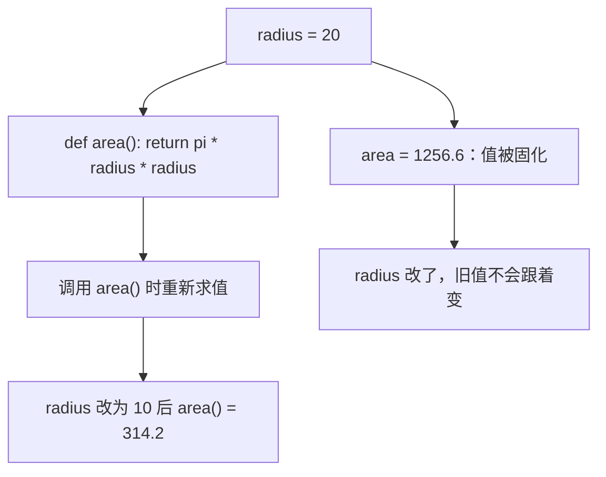
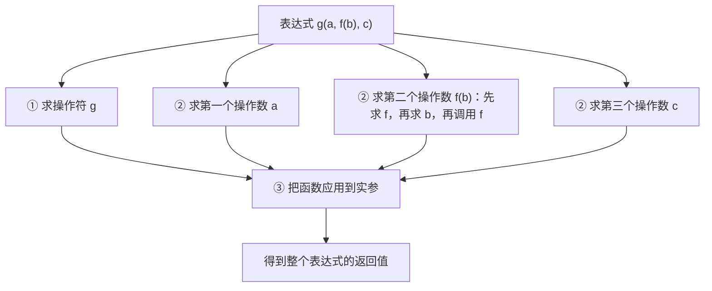
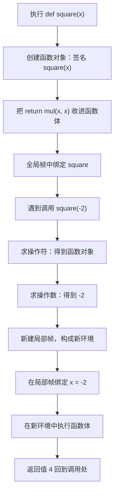
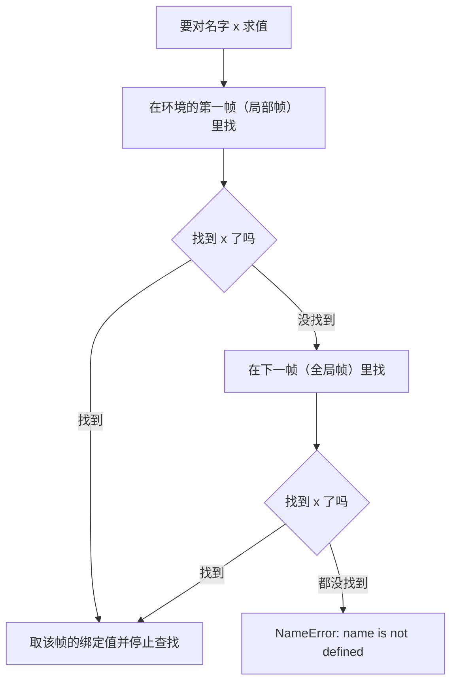
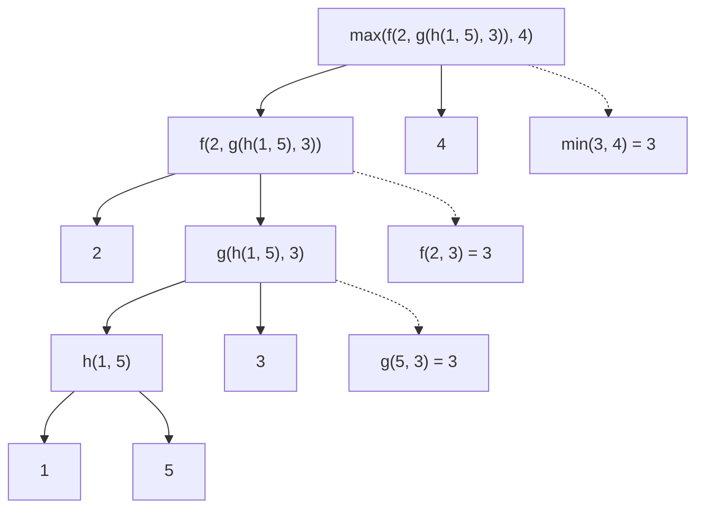
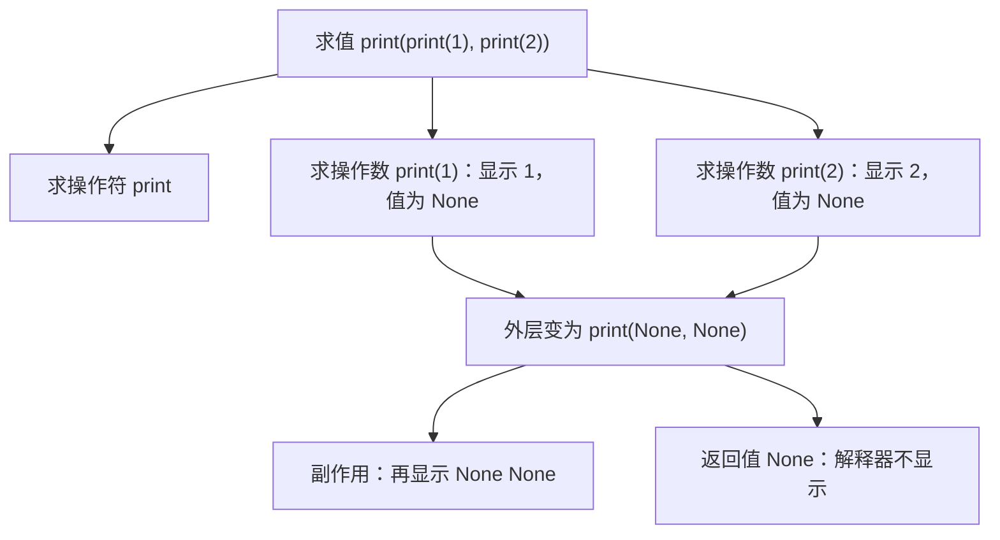
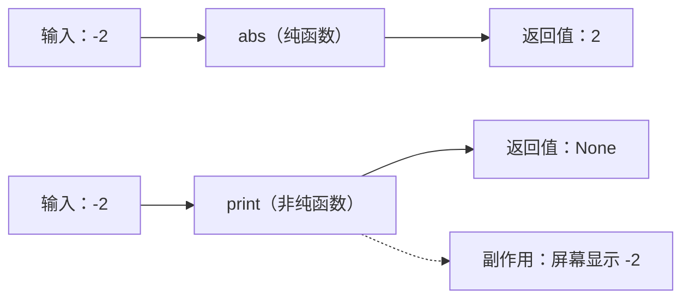

> **课程**：UC Berkeley CS61A · Structure and Interpretation of Computer Programs（Fall 2024）
> **本讲**：Lecture 2 ｜ 40:20 ｜ B 站分 P 2 ｜ [原视频](https://www.bilibili.com/video/BV1sy411z7nA?p=2)
> **课件**：`02-Functions_1pp.pdf`（18 页，官方 PDF，逐页渲染图见正文插图）
> **字幕**：B 站英文原声字幕；本笔记是中文书面化重构，非逐句翻译
> **版权**：课程与课件版权归 UC Berkeley CS61A 教学团队；本文为学习用途的二次整理

## 本讲速览

*(参考时间: 00:00:00 – 00:00:13｜Lecture 2)*

- **已掌握**：Python 可以当计算器用；`>>>` 后面敲一个表达式就会显示它的值；`max`、`abs`、`pow` 是内置函数；`from math import pi` 能把常数取进来。
- **本讲主线**：
    - 名字只有三条来源——`import`、赋值语句、`def` 语句；赋值只保存"值"，不保存"表达式"。
    - `def` 执行时只创建一个函数对象（签名 + 被收起来的函数体），函数体一行都不执行。
    - 调用用户自定义函数 = 新开一个局部帧 + 在帧里绑定形参 + 在新环境中执行函数体。
    - 名字求值 = 在当前环境（一串帧）里由近及远查找，找到即停。
    - 屏幕上出现的东西可能只是副作用；`print` 的返回值是 `None`，`None` 不会被自动显示。
- **关键结论**：理解一切嵌套调用的钥匙是求值顺序——先求操作符，再从左到右求操作数，最后才"应用"；函数体每次被调用都重新求值，这正是它能替代"过期变量"的原因。

## 1. 开课前：作业安排与"尽早动手"的理由

*(参考时间: 00:00:14 – 00:01:10｜Lecture 2)*

这一讲的录像是给 Lecture 2 准备的课前材料。按课程安排，学生应当先看完这些视频，再到课堂上把这些主题学得更细。所以在进入函数之前，先处理课程事务。

**作业节奏**。Homework 1 会在本周五（8 月 25 日）发布，下周四截止。作业之所以放得这么早，理由很直接："把课上学的知识拿来解题"本身就是这门课的核心，练得越早越好。讲师给的建议是：作业一发布就先看一眼，能做的先做；卡住不必惊慌，这是常态——下周可以到答疑时间（office hours）现场找人帮忙，也可以在 Ed 讨论区发帖，或者约几个同学组学习小组一起讨论。这些途径都要花时间，所以开始得越早，截止前可用的时间越多，跟上课程节奏的可能性越大。


这套安排意味着视频与课堂的分工：视频负责把概念讲清楚，课堂负责把它们用起来。后面的内容会反复回到"用起来"这个标准——每一条规则都要能解释一段真实的交互记录，而不只是背下来。


## 2. 名字与赋值：Python 的记忆从哪里来

*(参考时间: 00:01:13 – 00:05:48｜Lecture 2)*

### 2.1 名字不会凭空存在

π 是不是现成的？在交互式解释器里敲 `pi`，得到的是一句报错：

```python
>>> pi
NameError: name 'pi' is not defined
```

这不是 Python 不认识 π，而是它不认识 `pi` 这个名字。绝大多数名字默认不可见，必须先导入。`from math import pi` 是一条语句，含义就是"把 `pi` 这个名字变得可用"：

```python
>>> from math import pi
>>> pi
3.141592653589793
```

导入之后，`pi` 就能和其他值任意组合。同一个导入语句也能把函数拿进来，例如正弦函数 `sin`：

```python
>>> from math import sin
>>> sin(pi / 2)
1.0
```

这里有一个容易被忽略的事实：讲师并没有告诉 Python"π 等于三点一四"，`pi` 的值是它自己查到的。内置函数与内置名字都遵循这条规则——它们存在于解释器里，但要以名字的形式被引用。

> **编者说明**：上面的交互记录按讲师演示复述，输出值取 Python 3 的实际结果；讲师口头只说"我得到 1"，未逐位念出浮点数。

### 2.2 赋值语句：先求值，再绑定


内置名字不够用时，就要自己造名字。赋值语句的形状是左边一个名字、右边一个表达式：

```python
radius = 10
```

左边的名字可以任意发明，右边的表达式可以是任何东西。Python 的处理方式是：先求右边表达式的值，再把那个值绑定到左边的名字上。所以此刻 `radius` 绑定的值是 `10`，`2 * radius` 就是 `20`。

已经绑定的名字还能用来绑定别的名字。一条语句里同时绑定多个名字也是合法的：

```python
>>> radius = 10
>>> area, circumference = pi * radius * radius, 2 * pi * radius
>>> area
314.1592653589793
>>> circumference
62.83185307179586
```

到这里，`area` 与 `circumference` 分别绑定了半径 10 的圆面积与周长。关键在于接下来发生的事：把 `radius` 改成 20，`area` 会跟着变吗？

```python
>>> radius = 20
>>> area
314.1592653589793
```

不会。`area` 仍然是 314，也就是 10 × 10 × π，而 `radius` 已经是 20 —— 两者"失去同步"。原因在于赋值保存的是**值**，不是**表达式**：求值过程把 `pi * radius * radius` 压缩成一个数 314.159…，只有这个数被绑定到 `area`；"`area` 曾经是用 `radius` 定义的"这件事，没有被记录在任何地方。

课件第 4 页给出了同一现象的最小版本：


```python
>>> x = 2
>>> y = x + 1
>>> y
3
>>> x = 5
>>> y
3
```

`y` 是 3 而不是 6，因为 `y` 记住的是"3"，不是"x 加一"。这张幻灯片同时用划掉的两行 `1 + 2 = x`、`x - 1 = 2` 强调：赋值语句的等号不是数学等号，它没有对称性，也不能反解。

### 2.3 名字也可以指向函数

赋值语句的右边不限于数字。内置函数 `max` 本身也是一个值，可以被赋值：

```python
>>> f = max
>>> f(1, 2, 3)
3
```

这里有三层东西需要分清：`f` 是一个名字，`max` 也是一个名字，而它们指向的是同一个"函数"——真正干活的东西，它接受若干实参并给出最大值。一个函数对象可以同时拥有两个名字，`f(1, 2, 3)` 与 `max(1, 2, 3)` 完全等价。

名字还能被重新绑定，代价是旧绑定彻底消失：

```python
>>> max = 7
>>> f(1, 2, max)
7
```

`f` 仍然指向原来的 `max` 函数，所以 `f(1, 2, 7)` 得到 7（这正是讲师说的"我没有破坏原来那个函数，只是让 `max` 变成别的意思"）。但如果此刻想恢复 `max` 的原有含义，手上恰好还有一个名字 `f`：

```python
>>> max = f
>>> max(1, 2, 3)
3
```

最后介绍运算符的"函数版本"。常见的二元运算符在 `operator` 模块里都有对应的函数名：

```python
>>> from operator import add, mul
>>> add(3, 4)
7
>>> mul(3, 4)
12
```

`add` 与 `+`、`mul` 与 `*` 做的是同一件事，只是前者可以像普通函数一样被传递和赋值——这个性质在后面讲高阶函数时才会真正发挥作用。

至此，绑定名字的三条途径已经齐了，它们的差别值得整理成一张表：

| 判据 | `import` 语句 | 赋值语句 | `def` 语句 |
|---|---|---|---|
| 名字从哪来 | 模块或解释器里已有的名字 | 自己发明的名字 | 自己发明的名字 |
| 绑定的是什么 | 已有的值或函数对象 | 右侧表达式求出的值 | 新建的函数对象 |
| 能否覆盖旧绑定 | 能 | 能 | 能 |
| 典型例子 | `from math import pi` | `radius = 10`、`f = max` | `def square(x): ...` |

> **编者说明**：`add(3, 4)` 与 `mul(3, 4)` 的输出是 Python 3 的确定行为，讲师在演示中只说"现在我能用 `add` 和 `mul` 这两个名字了"，未念出结果。

## 3. 定义函数：把一段计算变成名字

*(参考时间: 00:05:54 – 00:08:30｜Lecture 2)*

### 3.1 为什么值得停下来看一眼

在讲语法细节之前，讲师特意让课堂"欣赏一下这个时刻"。第一天说过，这门课的主题是抽象；而定义函数是抽象工具里最有力的那一件。

抽象的定义是：把复杂的东西取个名字，当成一个整体来用，不必关心它的全部细节。赋值语句是抽象的第一种形态——它把一个值命名。但它只能命名一个"已经算好的结果"，一旦依赖的东西变了，结果就过期了，正如上一节 `area` 与 `radius` 的失同步。

函数定义是更强的抽象：它绑定的不是一个简单的值，而是一整个表达式（或语句序列）。名字背后不再是"数"，而是"算这个数的过程"，于是每次使用这个名字时，细节才真正展开。

### 3.2 `def` 语句的解剖

定义函数的通用形状是：

```text
def <name>(<formal parameters>):
    <body>
```

`def` 是 Python 的关键字；紧跟的是函数名；括号里列出**形参**（formal parameters），它们是将来接收实参值的名字；冒号之后换行缩进，缩进的部分是**函数体**。最常见的情形，函数体只有一句 `return` 加一个返回表达式。

第一行中 `def` 与冒号之间的部分叫**函数签名**（function signature）。它最重要的职责是说明这个函数要几个实参：每个形参将来都会与一个实参值配对。函数体则是第一行之后所有缩进的代码，它规定函数做什么；最简形式里，它描述一个计算过程，而这个过程会在**每次调用时重新求值**。

### 3.3 第一个函数：square

```python
def square(x):
    return x * x
```

有了 `square`，就能像用内置函数一样用它：

```python
>>> square(3 + 4)
49
>>> square(square(3))
81
```

`square(3 + 4)` 先算出 7 再平方；`square(square(3))` 则是"对 3 的平方再平方"。自定义函数与内置函数在使用上没有区别——这正是抽象的目的：调用者只看签名与返回值。

函数可以调用刚刚定义好的函数，形成一层薄薄的复用：

```python
def sum_squares(x, y):
    return square(x) + square(y)
```

```python
>>> sum_squares(3, 4)
25
```

返回表达式里的 `square(x) + square(y)` 也可以写成 `add(square(x), square(y))`，两者等价。`sum_squares(3, 4)` 会先得到 9 与 16，再相加得 25。

### 3.4 用函数解决"失去同步"的问题

回到 `radius` 与 `area` 的老问题：怎样才能让面积始终跟着半径走？办法是把"算法"写成函数，而不是把"算好的数"绑给名字：

```python
def area():
    return pi * radius * radius
```

`area` 现在是一个函数，要通过调用表达式使用它——这个调用表达式只是没有操作数：

```python
>>> radius = 20
>>> area()
1256.6370614359173
>>> radius = 10
>>> area()
314.1592653589793
>>> radius = 1
>>> area()
3.141592653589793
```

每当 `radius` 变化，`area()` 都会重新读一次 `radius` 的当前值再计算。讲师把这一点总结为本讲的第一个重要区别：**函数与普通名字的差别在于，它的返回表达式在每次被调用时都会被重新求值**——也就是每次它出现在调用表达式中时。



这张图把两种"命名"放在一起对比：左边是赋值得到的一次性快照，右边是函数得到的延迟计算。后者的代价是每次调用都要重做一遍计算，收益是永远不会过期。

## 4. 表达式求值模型：操作符、操作数与嵌套调用

*(参考时间: 00:08:31 – 00:09:56｜Lecture 2)*

### 4.1 四类表达式

录像在这里切回课件，做了一次小结：这门课关心的是"表达式如何求值成值"。

表达式目前只有四类。前三类是**原始表达式**：数字（更准确地说，数字字面量）、名字、字符串。字符串表示文本，本讲只顺带一提，后面专门讲。第四类是**调用表达式**，形状是：一个操作符，一对括号，括号里是用逗号分隔的操作数：

```text
square(3 + 4)
```

三个事实让调用表达式比看上去灵活：操作数可以一个都没有（`area()` 就是合法调用）；操作数可以是另一个调用表达式（`square(square(3))`）；操作符本身也可以是一个表达式（`f` 只是名字，它求值得到一个函数对象）。

| 判据 | 形态 | 例子 | 求值得到 |
|---|---|---|---|
| 数字字面量 | 直接写出的数 | `42` | 这个数本身 |
| 名字 | 一个标识符 | `radius` | 该名字在当前环境中的绑定值 |
| 字符串 | 引号包围的文本 | `"Go Bears"` | 这个字符串 |
| 调用表达式 | 操作符加括号与操作数 | `square(3 + 4)` | 函数返回的值 |

### 4.2 求值顺序

求值一个调用表达式只有三步，但顺序不能乱：

1. 求操作符，得到一个函数对象。
2. 从左到右求每个操作数，得到实参值。
3. 把这个函数应用（apply）到这些实参值上，得到返回值。



"从左到右"这一条在本讲后半段会有戏剧性的后果：当操作数本身带有副作用（例如 `print`）时，求值顺序就直接决定了屏幕上先出现什么。第 8 节会看到，`print(print(1), print(2))` 的输出顺序完全由这条规则决定。

### 4.3 一道用来卡住人的题

规则讲完，讲师放出一道题，用的还是上一节的绑定规则，只是名字之间互相覆盖：

```python
f = min
f = max
g, h = min, max
max = g
max(f(2, g(h(1, 5), 3)), 4)
```

题干说答案是 1、2、3、4、5 中的一个，并要求暂停录像自己算。先别急着往下翻——这道题的难点不在函数调用，而在于每个名字此刻到底绑着谁：`max` 已经被重新绑定，`f` 也被覆盖过一次，`g` 与 `h` 则是在第三条语句里同时绑定的。

> **编者说明**：课件没有为这道题单独出页，视频里以口述方式给出。上面的代码按讲师念出的绑定顺序与逐步求值过程复原为等价表达式，在 Python 3 中运行结果为 3，与讲师公布的答案一致。

## 5. `def` 的执行过程与函数调用的三步法

*(参考时间: 00:10:00 – 00:19:29｜Lecture 2)*

### 5.1 定义函数时究竟发生了什么

`def` 是一条两行的语句，它定义一个新函数。这条语句的执行过程固定为三步：

1. 创建一个新函数，它的签名就是第一行写下的签名。
2. 把这个函数的函数体设为第一行之后所有缩进的代码。
3. 在当前帧里，把 `def` 语句给出的名字绑定到这个新函数上。

第 2 步的措辞是本讲最关键的地方之一：它说的是"把函数体设为……"，而**不是**"执行函数体"。所以执行 `def square(x): return mul(x, x)` 时，一次乘法都没有发生。函数体只是被"收起来"（讲师用的词是 squirreled away，意思是藏到一个安全的地方），要等到函数被调用才展开。

讲师在这里插了一段题外话：squirreled 是英语里最长的单音节词，还说"我喜欢松鼠"。这个比喻值得留下，因为它精确地表达了 `def` 的行为——函数体是**被储存**的代码，不是**被运行**的代码。

### 5.2 调用用户自定义函数

函数之所以有用，是因为能调用。调用（apply）用户自定义函数同样是一个固定三步：

1. 增加一个局部帧（local frame），形成一个新环境。
2. 在这个帧里，把函数的形参绑定到实参。
3. 在这个新环境中执行函数体。

对照上一节，可以看到 `def` 与调用各自负责一半工作：`def` 只负责"造"，调用负责"跑"。

| 阶段 | 触发时机 | 三件事 | 副作用 |
|---|---|---|---|
| 执行 `def` | 遇到 `def` 语句那一次 | 建函数对象、装入函数体、绑定函数名 | 不执行函数体，不做任何计算 |
| 调用函数 | 每次求值到调用表达式 | 建局部帧、绑定形参、执行函数体 | 函数体真正运行，可能产生返回值 |

### 5.3 在环境图里看一次完整调用

课件第 5 页是"环境图"这一节的分节页，紧接着的两页把刚才的三步法落到了具体的画面上：


演示用的代码只有四行：

```python
from operator import mul
def square(x):
    return mul(x, x)
square(-2)
```

讲师逐行讲解了求值过程。第一行把 `mul` 绑定到内置的乘法函数。第二行定义 `square`：创建函数（签名是 `square(x)`）、把 `return mul(x, x)` 收进函数体、把名字 `square` 绑定到全局帧——注意此时仍然没有任何乘法发生，因为函数体还没被碰过。第三行与第二行同属一条 `def` 语句，不单独执行。第四行才是调用表达式，它才真正启动三步法：求 `square` 得到函数对象，求 `-2` 得到 -2，然后把函数应用到 -2 上——新开一个局部帧、把 `x` 绑定到 -2、在新环境里执行 `return mul(x, x)`，于是 `mul(-2, -2)` 得到 4，返回值 4 回到调用处。


这张截图上的注解值得逐个读过去：

- **内置函数**（built-in function）与**用户自定义函数**（user-defined function）画法几乎一样，唯一区别是自定义函数会把形参 `x` 写出来——因为它马上要用到。
- **局部帧**是三步法第 1 步的产物。帧的标题用了函数原来的名字 `square`，这只是一个方便追踪的标签，讲师明确说它"不那么重要"。
- 真正重要的是帧内那条绑定：形参 `x` 与实参值 -2。
- 帧内还画了 **Return value 4**。这不是名字与值的绑定，而是环境图里的一种注解，用来记录"这次求值的过程中返回了什么"。



### 5.4 签名为什么重要


上一条的局部帧不是随便画的，它的形状完全由签名决定：`square` 这个名字用来给帧起标题，`x` 是帧里那条绑定的名字。换句话说，**函数签名包含了构造局部帧所需的全部信息**。这也解释了规范问题——为什么每次调用 `square`，帧里都恰好有一个 `x`：因为签名里只有一个形参。

> **编者说明**：课件把这条规则标为"version 1"，因为后续课程（条件表达式、高阶函数、嵌套定义等）会扩展它。就本讲而言，三步法已经足够解释全部演示。

## 6. 名字查找：环境是帧的序列

*(参考时间: 00:19:33 – 00:23:42｜Lecture 2)*

### 6.1 为什么需要环境

上面三步法有一个隐含前提：函数体里的名字要到哪去找？第 3 步说"在新环境中执行函数体"，这个新环境指的是"局部帧 + 全局帧"这一串。

规则是：每一个被求值的表达式都在某个环境的上下文中求值。原因是环境就是解释器的记忆，它维护名字与值之间的对应关系——环境知道每个名字是什么意思。到目前为止，当前环境只有两种可能：

- 只有全局帧（global frame）一个；
- 一个局部帧，后面跟着全局帧。

注意"后面跟着"这个说法本身带有顺序信息。

### 6.2 两句话

讲师说这是"今天要讲的最重要的两件事"：

1. **环境是一串帧（a sequence of frames）。** 帧是名字与值之间的绑定，也就是环境图里的那些方框；环境是这些方框的序列。
2. **一个名字求值的结果，是当前环境中最早的那个"含有该名字的帧"里绑定的值。** 翻译成操作步骤：从序列头部开始逐帧查找，第一次找到就停下。

在 `square` 的函数体里查找一个名字，先看局部帧；找不到，再看全局帧。内置名字（例如 `max`）也在全局帧里——只是为了让图保持简单，环境图里不画出来。




### 6.3 多层帧：同一张图不等于同一个环境


课件第 9 页把"序列"讲得更细：一个序列由"第一个帧"和"序列的剩余部分"组成；全局帧永远是查找的最后一站。图里画了 `f1`、`f2`、全局帧三层，旁边一行字点破了最容易犯的错误：**虽然三个帧画在同一张图里，它们未必在同一个环境中**。环境是"某次求值时的帧序列"，图是"整个程序生命周期里出现过的所有帧"——两者不是一回事。

### 6.4 用同名形参验证查找规则

规则听起来抽象，讲师用一次"故意捣乱"的演示把它钉住了。上一次用的是 `x` 作形参，这次换一个别人不用的名字，偏偏就用函数自己的名字：

```python
from operator import mul

def square(square):
    return mul(square, square)

square(-2)
```

`square` 既是函数名，又是形参名。这样还能工作吗？能，结果是 4。原因要看调用时的环境：执行 `def` 之后，全局帧里 `square` 绑定着函数对象；调用时新建局部帧，帧标题仍然叫 `square`（那只是标签），帧里绑定的是 `square = -2`（形参）。执行函数体 `mul(square, square)` 时，`mul` 最后在全局帧找到；而 `square` 在**局部帧里就已经找到**，于是查找停止，根本不会走到全局帧——全局帧里那个函数对象此时"看不见"。

同一个标识符在两层帧里指向完全不同的东西，这不是 bug，而是"最早找到即停"这条规则的直接推论。它同时说明：不是函数名被破坏，而是更近的那层绑定遮住了更远的那层。

| 查找位置 | 顺序 | 里面有什么 | 本讲的处理 |
|---|---|---|---|
| 局部帧 | 第 1 站 | 形参、函数体内新绑定的名字 | 找到即停 |
| 全局帧 | 第 2 站 | 模块级赋值、`def` 出来的函数名 | 找到即停 |
| 内置名字 | 图中未画 | `max`、`abs`、`print` 等 | 课件简化画进全局帧 |

> **编者说明**：真实 Python 的内置名字存放在 `builtins` 模块的命名空间中，查找时作为全局帧之后的一层（即常说的 LEGB 中的 B）。课件为了画图简单，把它并进 global frame，本讲后续都沿用这一简化。

## 7. 环境图：把解释器的求值过程画出来

*(参考时间: 00:23:48 – 00:32:46｜Lecture 2)*

### 7.1 为什么要画图

环境图是追踪"Python 解释器在执行程序时到底在干什么"的工具。讲师强调了一句容易被当成比喻的话：**环境是真实存在的东西**——它是解释器记录"名字是什么意思"的方式，是保存名字与值之间绑定的记忆；画图只是把这个真实结构显式化。

接着是一段关于学科气质的评论：计算机科学家的大量工作，就是画一些"方框和指向别的方框的箭头"的图，这是这门学科很大的一部分，所以不妨从现在开始练。

### 7.2 图的读法

一张环境图分两半：左边是代码，右边是帧。代码是普通的 Python 代码，上面有箭头指示执行到了哪里；帧记录名字与值之间的绑定。

- 灰色的箭头表示"刚刚执行过"；
- 红色的箭头表示"下一条要执行"，也就是还没发生。

代码部分由语句和表达式组成：7.3 节那次演示里，第一步是 `import` 语句，第二步是赋值语句；帧里则是名字与值成对出现。

然后是本节最重要的一条约束：**在同一个帧里，名字不能重复，一个名字至多绑定一个值。** 前面把 `max` 重新绑成 7 时，旧绑定就这样永久丢失了——这条约束不是风格建议，而是解释器数据结构的直接后果。

讲师预告：这些图会越来越复杂，但也越来越必要，因为当许多名字以各种方式重复出现时，必须能追踪它们到底指什么。

### 7.3 让工具替画图

环境图不需要手画。讲师演示了 Online Python Tutor 的网页界面：把代码粘进去，点击 Visualize execution，左边出现代码、右边出现帧；按前进按钮逐行执行，就能看到每一步的后果。

演示代码是两行：

```python
from math import pi
tau = 2 * pi
```

第一步是 `import` 语句，把 `pi` 绑定到它的值；第二步是赋值语句，把 `tau` 绑定到 `2 * pi` 的结果。讲师给的建议非常实用：**当一段程序的行为让人困惑时，就把它粘进 Python Tutor 里**，它会展示执行过程中到底发生了什么。

### 7.4 赋值语句的执行规则

环境图画清楚之后，就能精确地说赋值语句做什么了：它改变帧里名字与值之间的绑定。


课件第 11 页用三行代码说明规则：

```python
a = 1
b = 2
b, a = a + b, b
```

执行完前两行，全局帧里 `a` 是 1、`b` 是 2，红色箭头停在第三行。赋值语句的执行规则有两条：

1. 从左到右求等号右边的**所有**表达式。
2. 把等号左边的所有名字绑定到这些结果值上（在当前帧里）。

按这条规则，先求 `a + b` 得 3、再求 `b` 得 2；然后才做绑定：`b` 绑到 3、`a` 绑到 2。第二步的绑定顺序并不影响结果，因为右侧的值在第一步就已经全部算完了——这正是 `b, a = a + b, b` 能一次写对的原因：右边用到的都是旧值，不存在"先改了 `b`，再算 `a + b`"的陷阱。


| 判据 | 常见误解 | 实际规则 |
|---|---|---|
| 求值时机 | 边算边绑，逐个赋值 | 先把右侧全部求成值，再统一绑定 |
| 求值顺序 | 从右到左或随意 | 严格从左到右 |
| 绑定目标 | 覆盖右侧同名变量的旧值 | 右侧用的是旧值，绑定发生在之后 |
| 变量交换 | 需要临时变量 | `a, b = b, a` 一步完成 |

### 7.5 回到那道题

规则齐备，可以正面处理第 4 节留下的问题了。讲师把它整个放进 Python Tutor 里逐帧观察。

第一条 `f = min`：`f` 指向内置的 `min`。第二条 `f = max`：`f` 改为指向 `max`，由于一个名字至多一个值，`f` 与 `min` 的旧绑定"就这样没了"。第三条 `g, h = min, max`：`g` 指向 `min`，`h` 指向 `max`。讲师在这里提醒了一个容易忽略的事实：`min` 函数只有一个，`max` 函数也只有一个，只是 `max` 这个函数对象现在有两个名字（`f` 和 `h`），`min` 有一个名字（`g`）。第四条 `max = g`：先求 `g` 得到 `min` 函数，再把名字 `max` 绑到它上面——于是"`max`"这个名字现在指的是取最小值的函数。

内置名字 `min`、`max` 平时不画进环境图（否则图会被塞满），只有当它们被重新绑定时才画出来，而这正是刚刚发生的事。

最后那个大表达式：

```python
max(f(2, g(h(1, 5), 3)), 4)
```

按第 4 节的规则，先求操作符 `max`——此刻它指的是取最小值的函数；再从左到右求两个操作数。

第一操作数是 `f(2, g(h(1, 5), 3))`，它自己又是一个调用表达式，于是递归地"先求操作符，再求操作数"：

- 操作符 `f` 指向 `max`；
- 第一个操作数是 2；
- 第二个操作数 `g(h(1, 5), 3)`：先求 `h(1, 5)`，`h` 指向 `max`，得 5；再调用 `g`（指向 `min`），`min(5, 3)` 得 3；
- 现在调用 `max(2, 3)`，得 3。

第二操作数是 4。最后调用那个"叫 `max` 但实际是 `min`"的函数：`min(3, 4)` 得 3——整个表达式的值。



| 步骤 | 子表达式 | 求值结果 | 依据 |
|---|---|---|---|
| 1 | `h(1, 5)` | 5 | `h` 仍指向 `max` |
| 2 | `g(5, 3)` | 3 | `g` 指向 `min` |
| 3 | `f(2, 3)` | 3 | `f` 指向 `max` |
| 4 | `max(3, 4)` | 3 | 名字 `max` 已被绑到 `min` |

答案 3。这道题的价值不在算术，而在它把三件事压进了五行代码：名字可以被重新绑定、重绑定会丢掉旧绑定、求值顺序决定了每一步看到的是哪个绑定。

## 8. `print` 与 `None`：返回值与副作用的分野

*(参考时间: 00:32:49 – 00:40:18｜Lecture 2)*


### 8.1 看着一样，其实不同

在交互式解释器里敲一个表达式，它会显示这个表达式的值。敲 `print(-2)`，屏幕上也会出现 `-2`。看起来一样，但发生的其实是两件不同的事。

先看字符串：

```python
>>> "Go Bears"
'Go Bears'
>>> print("Go Bears")
Go Bears
```

直接求值时看到的是带引号的字符串值——它是字面量本身的表示；`print` 之后引号消失，因为 `print` 显示的是内容而不是表示。差异在 `None` 上更明显：

```python
>>> None
>>> print(None)
None
```

直接求值 `None`，屏幕上什么都不出现；`print(None)` 却会打出 `None`。原因是交互式解释器有一条规则：它会自动显示输入表达式的值，而 `None` 是特例——作为表达式的值，它不被显示。

`print` 还能一次显示多个值，中间用空格分隔，也可以直接打印 `None`：

```python
>>> print(1, 2)
1 2
>>> print(None, None)
None None
```

### 8.2 嵌套 `print`

把 `print` 套进 `print` 里，结果会让很多人猜错：

```python
>>> print(print(1), print(2))
1
2
None None
```

猜对了吗？讲师让观众先想三秒再公布答案。理解这个输出，要用第 4 节的求值顺序，再加上一条关于 `print` 的事实：它总是返回 `None`。

1. 求操作符 `print`，得到函数。
2. 求第一个操作数 `print(1)`：它本身是调用表达式——求操作符 `print`、求操作数 1、应用。应用时产生**副作用**：屏幕显示 1；这个子表达式的**值**是 `None`（`print` 总是返回 `None`）。
3. 求第二个操作数 `print(2)`：同理，屏幕显示 2，值 `None`。
4. 现在外层调用变成 `print(None, None)`：应用时显示 `None None`，返回值仍是 `None`。
5. 整个表达式的值是 `None`，而交互式解释器不会自动显示 `None`，所以最后没有额外输出。

屏幕上先出现的 `1` 和 `2` 是在求操作数的过程中产生的——讲师的意思是：它出现在那里，并不是因为它充当了哪个表达式的值，而是因为 `print` 干的事就是让东西出现。这就是**副作用**：不是值，只是调用带来的行为。



### 8.3 `None` 是什么

`None` 表示"没有"：它标记某个函数没有返回任何东西。Python 里叫 `None`，别的语言里有别的叫法。规则是：**没有显式 `return` 的函数，返回值就是 `None`**。

```python
def does_not_square(x):
    x * x
```

这个函数体里只有一句 `x * x`，没有 `return`。调用 `does_not_square(4)` 不会得到 16：

```python
>>> does_not_square(4)
>>> sixteen = does_not_square(4)
>>> sixteen
>>> sixteen + 4
TypeError: unsupported operand type(s) for +: 'NoneType' and 'int'
```

调用确实执行了——4 乘了 4——但乘出来的值没有被返回，函数返回的是 `None`。而 `None` 作为表达式的值不被显示，所以前三个提示符后面都什么也看不到；最后一行报错，因为那个 `+` 试图把 `None` 与整数 4 相加：把一个"什么都没有"与一个整数相加，Python 做不到。错误信息里 `NoneType` 就是 `None` 的类型，`int` 是整数的类型。

> **编者说明**：`does_not_square` 在课件与字幕中是讲师的现场演示，未出现在幻灯片上；上面的报错文本取自 Python 3 的实际输出。

### 8.4 纯函数与非纯函数

到这里可以给函数分类了。**纯函数**（pure function）只返回值；**非纯函数**（non-pure function）除了返回值还有副作用。

`abs` 是纯函数：它计算实参的绝对值，`abs(-2)` 得到 2，而且它做的**唯一**一件事就是返回 2。讲课的演示里用"一根封闭的管子"来画它：进去一个值，出来一个值，中间没有别的事情发生。`pow` 也是纯函数，只是管子有两个入口、一个出口。

`print` 完全不同。它接收输入，也返回一个值（`None`），但它不是封闭系统：除了返回值，它还有副作用——把传进去的东西显示出来。传进 -2，屏幕显示 -2，返回值是 `None`。副作用根本不是值，它只是"调用之后发生的事"。



`print` 与 `abs`、`pow` 的差别就在这里，而嵌套 `print` 之所以有趣，也正是因为外层调用会看到内层的副作用序列。

| 判据 | 纯函数 | 非纯函数 |
|---|---|---|
| 是否有返回值 | 有，且是唯一产物 | 有（常常是 `None`），但不是全部 |
| 是否改变外部世界 | 不改变 | 会产生可观察的变化 |
| 典型例子 | `abs`、`pow`、`square` | `print` |
| 重复调用同一实参 | 每次都得到同样的值 | 返回值相同，副作用每次都发生 |
| 能否安全地重组 | 可以随意嵌套、交换顺序 | 顺序改变会改变输出 |

| 判据 | 交互式显示 | `print` |
|---|---|---|
| 触发者 | 解释器自动显示表达式的值 | 函数被调用时的副作用 |
| 字符串的表现 | 带引号，例如 `'Go Bears'` | 不带引号，例如 `Go Bears` |
| `None` 的表现 | 不显示 | 显示为 `None` |
| 表达式的值受影响吗 | 不受影响 | 不受影响 |

## 小结

- 读赋值语句时，先在脑子里把等号右边**全部**求成值，再谈绑定；`b, a = a + b, b` 之所以能一次写对，靠的就是这两步分开。
- 看到 `def`，只承认"造了一个函数对象"，绝不要在脑子里执行函数体。函数体是被收起来的代码，调用时才展开。
- 每次调用记住三件事：新开局部帧、在帧里绑形参、在新环境里执行函数体。返回值不是绑定，只是这次求值的产物。
- 名字求值从最近的帧开始，找到即停；因此形参与函数同名不会出错，而重绑定会永久丢掉旧绑定。
- 屏幕上的东西可能是副作用。区分"值"与"显示"，再去判断一段代码到底返回了什么；`None` 代表"没有返回值"，而且它不会被自动显示。
- 卡住时把代码粘进 Python Tutor 逐帧走一遍；环境图是这个学科最常用的推理工具之一。

## 附录：课堂未展示的幻灯片

`02-Functions_1pp.pdf` 的最后 6 页属于 Small Expressions（小表达式）主题。本讲录像在 `print` 与 `None` 处结束（00:40:18），这 6 页没有被讲解，因此按课件画面整理如下。

> **编者说明**：本附录不是课堂讲述内容的转写，而是对课件第 13–18 页画面的整理与解释；凡属推断的部分都单独标出。录像若另有续篇，应以续篇的讲法为准。

### 附.1 问题的设定


课件从 Discussion 0 的一道题说起：假设只能调用三个函数——`f(x)` 把整数减一，`g(x)` 把整数翻倍，`h(x, y)` 把两个正整数的十进制数字拼起来（`h(789, 12)` 得 78912，`h(12, 789)` 得 12789）。


**定义**：小表达式（small expression）是只由 `f`、`g`、`h`、数字 `5` 和括号组成的调用表达式，这些成分可以重复使用。例如 `h(g(5), f(f(5)))` 求值为 103——`g(5)` 是 10，`f(f(5))` 是 3，拼起来是 103。

问题：求出值等于 2024 的最短小表达式。"最短"有两种读法，课件把它们并列摆出：**调用次数最少**，还是**写出来字符数最少**？两种度量并不总是同步，所以课件把每个解的调用次数与字符数都算了出来（见附.3）。

右侧还有一个更口语的版本：手里只有 5，可以减一、翻倍、把两个数粘起来，怎么走到 2024？课件顺手给出三条基线尝试：`5 → 10 → 20`（翻倍两次）、`5 → 4 → 3 → 2`（减一三次）、`5 → 4`（减一一次）。这三行不是解法，而是"先弄清动作效果"的探路。

同一页右下角列出了有效解题的三步：**理解问题、想出主意、把主意变成解**。这句话是整节的方法论主题。

| 函数 | 语义 | 例子 | 注意 |
|---|---|---|---|
| `f(x)` | 减一 | `f(5)` = 4 | 可以低于 1，此时不能再参与拼接 |
| `g(x)` | 翻倍 | `g(5)` = 10 | 增长快，容易跳过目标 |
| `h(x, y)` | 拼接十进制数字 | `h(10, 12)` = 1012 | 顺序有意义，且要求两个数都是正数 |

### 附.2 搜索：把"试试看"变成算法


课件用两张图说明"搜索"这个策略：左边是国际象棋的初始局面，右边是从旧金山到伯克利的一段驾车路线（18 分钟、13.9 英里）。

> **编者说明**：课件只给了两句结论，没有逐图解释这两张图。按常见的搭配推断，左图代表"在大量走法中挑最好的"，右图代表"在大量路线中挑最短的"，是两个日常的搜索场景。

页面的结论只有两句：一种常见策略是"试一堆选项，看哪个最好"；计算机程序可以靠重复简单操作来评估大量备选方案。这两句话把一个看似需要灵感的问题，转化成了可以交给机器执行的枚举。


于是就有了"计算的方法"：先枚举所有含 3 次函数调用的小表达式，再枚举 4 次的，再枚举 5 次的，以此类推。课件第 16 页把 3 次与 4 次调用的结果铺了一整页，每一行是"表达式 → 值"。几条可以手算验证：

- `f(f(f(5)))` → 2：连减三次；
- `g(f(f(5)))` → 6：先减两次得 3，再翻倍；
- `f(g(f(5)))` → 7：先减一得 4，翻倍得 8，再减一；
- `g(g(g(5)))` → 40：连翻三次；
- `h(5, g(5))` → 510：`g(5)` 是 10，与 5 拼成 510。

注意这些枚举里有大量重复劳动：每多一层调用，候选数量就成倍增长。这也解释了为什么这一页的结果要靠程序生成，而不是手写。

### 附.3 最先命中的解


第 17 页给出了第一批命中 2024 的表达式，共 15 条：1 条 7 次调用的解，加上 14 条 8 次调用的解。

| 表达式 | 值 | 调用次数 | 字符数 |
|---|---|---|---|
| `g(h(g(5),g(g(f(f(5))))))` | 2024 | 7 | 24 |
| `g(g(f(f(f(f(h(5,g(5))))))))` | 2024 | 8 | 27 |
| `g(h(g(5),g(f(f(g(f(5)))))))` | 2024 | 8 | 27 |
| `f(h(g(g(5)),h(f(f(f(5))),5)))` | 2024 | 8 | 29 |

第一条值得拆开看：`f(5)` 是 4，再 `f` 一次是 3，`g(3)` 是 6，`g(6)` 是 12，于是 `h(10, 12)` 得到 1012（`g(5)` 是 10），最后 `g(1012)` 得 2024。整条路径只用 7 次调用、24 个字符。

第 2、3 条同为 8 次调用 27 个字符，第 4 条虽然也是 8 次调用，却要 29 个字符——调用次数相同并不意味着写法一样长，这正是题目要把"调用次数"与"字符数"两种度量并列的原因。

### 附.4 支撑这一切的代码


最后一页把上面整套搜索写成程序，并在代码旁标注了它用到的课程主题：Functions、Control、Higher-Order Functions、Objects、Representation、Sequences、Mutability、Iterators、Generators、Recursion、Tree Recursion、Containers。页脚那句 **By Midterm 2, you can do this** 是全学期的路线图——到第二次期中时，这些工具都该在手上了。

代码分三块。第一块是三个目标函数：

```python
def f(x):
    return x - 1

def g(x):
    return 2 * x

def h(x, y):
    return int(str(x) + str(y))
```

`h` 的实现值得注意：先把两个整数转成字符串、拼接、再用 `int` 转回来，于是"拼接数字"这件事被拆成了两次表示转换。

第二块用类表示"表达式"这个数据结构——一个数节点和一个调用节点：

```python
class Number:
    def __init__(self, value):
        self.value = value

    def __str__(self):
        return str(self.value)

    def calls(self):
        return 0

class Call:
    """A call expression."""
    def __init__(self, f, operands):
        self.f = f
        self.operands = operands
        self.value = f(*[e.value for e in operands])

    def __str__(self):
        return f'{self.f.__name__}({",".join(map(str, self.operands))})'

    def calls(self):
        return 1 + sum(o.calls() for o in self.operands)
```

`Number` 与 `Call` 都有 `value`、`__str__`、`calls` 三个成员：`value` 是求值结果，`__str__` 把表达式写回成 `g(h(5,5))` 这样的字符串，`calls` 递归地数调用次数。`Call.__init__` 里那一行 `f(*[e.value for e in operands])` 直接调用目标函数算出值，因此建节点的同时就把值算了。

第三块是枚举，用生成器把它写成递归：

```python
def smalls(n):
    if n == 0:
        yield Number(5)
    else:
        for operand in smalls(n - 1):
            yield Call(f, [operand])
            yield Call(g, [operand])
        for k in range(n):
            for first in smalls(k):
                for second in smalls(n - k - 1):
                    if first.value > 0 and second.value > 0:
                        yield Call(h, [first, second])
```

`n` 是"还允许用几次调用"。基例 `n == 0` 只产出数字 5；否则对每个 `n-1` 层的子表达式套一次 `f` 或 `g`，再用两层循环把剩下的调用次数分给 `h` 的两个操作数（`k` 与 `n-k-1`），并且只拼接两个正数。这正好是本讲"函数调用 = 新帧 + 绑形参 + 执行体"的规模化应用：每个 `yield` 出来的节点都是对 `f`、`g`、`h` 的一次真实调用。

最后是主驱动：

```python
result = []
for i in range(9):
    result.extend([e for e in smalls(i) if e.value == 2024])
```

从 0 次调用枚举到 8 次，把所有值等于 2024 的表达式收集起来——按 `i` 递增的顺序收集，自然就得到"调用次数从少到多"的榜单。

> **编者说明**：课件这一页只展示代码，没有展示运行输出，也没有展示"调用次数与字符数"是怎么统计的。上面关于 `smalls` 递归结构的解释，是对代码本身的逐行解读，不是课堂讲述内容；`range(9)` 与第 17 页的榜单（最多 8 次调用）一致，可以看作对该解读的一个侧证。

## 附：本讲幻灯片索引

| 页 | 内容 | 出现位置 |
|---|---|---|
| 1 | 标题页 Functions | §1 |
| 2 | Announcements 分节页 | §1 |
| 3 | Assignment Statements 分节页 | §2 |
| 4 | 赋值语句语义与 `x`、`y` 演示 | §2 |
| 5 | Environment Diagrams 分节页 | §5 |
| 6 | 调用自定义函数的全局帧与局部帧 | §5 |
| 7 | 函数签名决定局部帧的形状 | §5 |
| 8 | 名字查找规则 | §6 |
| 9 | 三层帧序列与环境的关系 | §6 |
| 10 | Multiple Assignment 分节页 | §7 |
| 11 | 多重赋值的执行规则 | §7 |
| 12 | Print and None 分节页 | §8 |
| 13 | Small Expressions 分节页 | 附录 |
| 14 | 小表达式定义与 2024 问题 | 附录 |
| 15 | 搜索：棋盘与路线类比 | 附录 |
| 16 | 枚举 3、4 次调用的结果 | 附录 |
| 17 | 最先命中 2024 的表达式 | 附录 |
| 18 | 枚举小表达式的完整代码 | 附录 |
