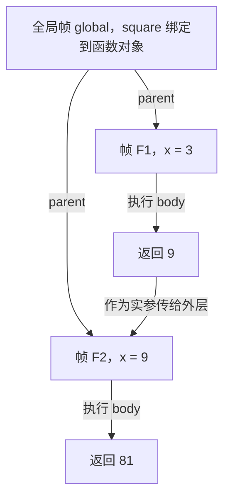
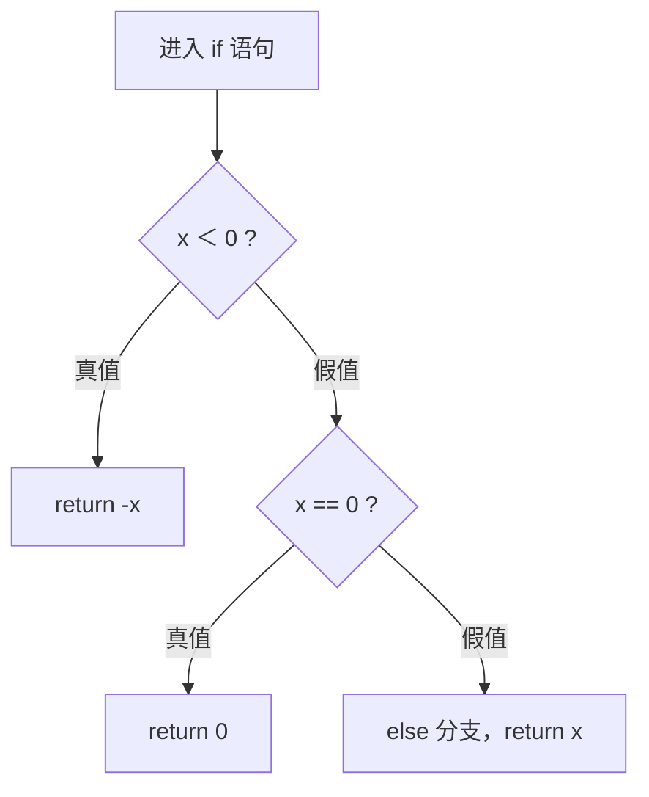
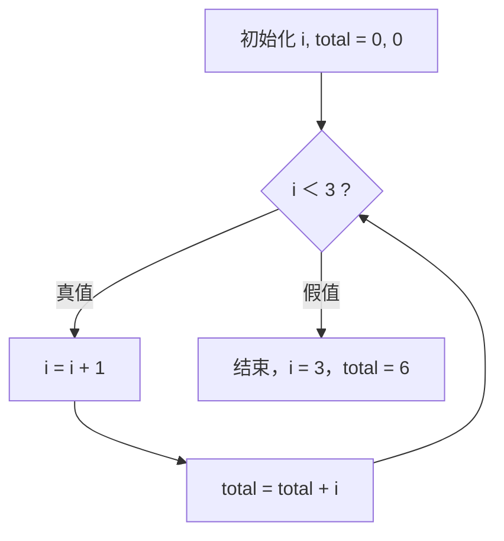

> **课程**：UC Berkeley CS61A · Structure and Interpretation of Computer Programs（Fall 2024）
> **本讲**：Lecture 3 ｜ 32:21 ｜ B 站分 P 3 ｜ [原视频](https://www.bilibili.com/video/BV1sy411z7nA?p=3)
> **课件**：`03-Control_1pp.pdf`（13 页，官方 PDF，逐页渲染图见正文插图）
> **字幕**：B 站英文原声字幕；本笔记是中文书面化重构，非逐句翻译
> **版权**：课程与课件版权归 UC Berkeley CS61A 教学团队；本文为学习用途的二次整理

## 本讲速览

- **已掌握**：`def` 语句的四个部件（函数名、形参、body、return 表达式）、调用表达式的求值顺序、形参与实参的对应，以及“表达式在环境中求值”这条基本假设。
- **本讲主线**：
    - 一次调用会留下两样东西：**返回值**（一个可以继续参与计算的值）与**副作用**（真实发生了的事），而 `print` 的返回值是 `None`。
    - 用环境图复盘函数的一生：`def` 创建函数对象、调用创建帧、帧沿父指针串成环境。
    - 运算符只是内置函数的简写；`//` 与 `%` 给出精确的商和余数。
    - 复合语句由 header 与 suite 组成；`if/elif/else` 只执行其中一个 suite，`while` 反复执行同一个 suite。
    - 控制流的本质：**默认自上而下，`if` 与 `while` 是“不按默认走”的两类理由**。
- **关键结论**：**表达式有值，语句做事情**。判断一个调用“结果是什么”之前，先看它有没有 `return`，再看它顺手做了什么。

*(参考时间: 00:00:02 – 00:00:16｜Lecture 3)*


## 1. 返回值与副作用：一次调用留下的两样东西

*(参考时间: 00:00:17 – 00:00:32｜Lecture 3)*


上一讲已经把调用表达式的求值顺序和环境讲清楚了。本讲要补上的是同一个动作的另一面：一次函数调用除了给出一个**值**，还可能**在这里留下别的痕迹**。这两件事在中文里都容易被叫作“结果”，但在 Python 里它们是两条完全独立的通道，混淆它们会产生课程早期最常见的一类错误。

先看“值”这条通道。`abs(-2)` 的值是 2：这个 2 不是一个只能看不能用的数字，它可以被放进任何需要值的位置，比如 `abs(-2) + 1` 得 3，`abs(-2) * 10` 得 20。`pow(2, 100)` 也一样，它的值是 2 的 100 次方，Python 的大整数没有固定位宽，所以这里得到的是一串精确的 31 位数字：1267650600228229401496703205376。像 `abs`、`pow` 这样的函数**只返回值**，别的什么都不做，它们被称为**纯函数（Pure Functions）**。

再看“副作用”这条通道。`print(-2)` 执行时，屏幕上确实出现了一个 `-2`，但那个 `-2` 不是这次调用的值：它是**副作用（side effect）**。按课件上的定义，副作用不是一个值，而是“调用函数作为后果发生的任何事情”。这句话带来的直接后果是：屏幕上那个 `-2` 你拿不到、传不走、也不能乘 2。如果你写 `print(-2) + 1`，Python 会报错，因为 `print(-2)` 的值是 `None`，`None + 1` 无意义。


`None` 是 Python 里表示“什么都没有”的那个值，`print` 的返回值就是它。于是“打印”与“返回”的关系可以一句话概括：**打印出去的是副作用，返回回来的是值，`print` 只做前者**。有副作用的函数叫**非纯函数（Non-Pure Functions）**。

| 判据 | 纯函数（Pure） | 非纯函数（Non-pure） |
| :--- | :--- | :--- |
| 返回值 | 由实参决定的一个值 | 常常是 `None`（也可能有值） |
| 副作用 | 没有 | 有：打印、改动外部状态、读写文件等 |
| 能否嵌入更大表达式 | 能，`abs(-2) + 1` 合法 | 形式上能，但组合的是“求值顺序”，不是“值的组合” |
| 重复调用的代价 | 可以任意重复，结果不变 | 每重复一次，副作用就再来一次 |
| 本讲例子 | `abs`、`pow` | `print` |

> **编者说明**：`None` 在交互式解释器里有一条特别容易踩的显示规则——解释器只回显“不是 `None`”的表达式值。因此 `>>> print(1)` 只显示一行 `1`，而 `>>> None` 什么都不显示。这条规则使“函数没有输出”和“函数返回 `None`”在屏幕上看起来一样，调试时应当用 `print(f(...))` 之外的方式（例如先绑定到名字再查看）来区分二者。`print(print(1))` 会先打印 `1`、再把内层调用的 `None` 打印成 `None`，是观察这条规则的直接实验。

### 1.1 三种 `h(x)`：把“打印”与“返回”拆开看

课件给出一个很短但信息量很大的练习：实现一个函数 `h(x)`，它先打印、再返回 `f(x)` 的值。三种写法都“看起来对”，实际行为不同。


```python
def h(x):
    return print(f(x))        # (A)


def h(x):
    print(f(x))               # (B)
    return f(x)


def h(x):
    y = f(x)                  # (C)
    print(y)
    return y
```

三者的差别可以逐条列出：

- **(A)** 先把 `f(x)` 算出来交给 `print`，`print` 打印它并返回 `None`，于是 `h` 直接把 `None` 返回出去。屏幕上是对的，值是错的——这是最典型的“看起来没问题”的错误。
- **(B)** 先打印 `f(x)`，再**重新求值一次** `f(x)` 并返回。屏幕上对，值也对，但 `f` 被调用了两次。
- **(C)** 只求值一次 `f(x)`，把结果存进 `y`，打印 `y`，返回 `y`。屏幕上对，值也对，`f` 只被调用一次。

课件接着问了一个更尖锐的问题：**什么样的 `f` 会让 (B) 与 (C) 的行为不同？** 如果 `f` 是纯函数，两者返回值相同、打印内容相同，只差一次多余的计算，肉眼看不出来；差别只在 `f` 非纯、或者 `f` 的返回值依赖调用次数时才暴露。课件在这一页标了 (Demo)，但本讲的字幕没有录到这段演示，下面用一个能自己跑通的 `f` 补上。

> **编者说明**：最省事的反例是把 `f` 取成 `print` 本身。此时 (B) 会先执行一次 `print(print(2))`（内层打印 `2`、外层打印 `None`），再执行 `return f(2)`（又打印一次 `2`），屏幕上是三行；而 (C) 只有 `2` 与 `None` 两行。这个例子说明 (C) 的价值不只是“省一次计算”，而是“副作用只发生一次”——在副作用世界里，重复求值本身就是可观察的行为差异。

> **编者说明**：本节结论以课件第 3–5 页的原文为准。本讲字幕从“多个环境”的回顾开始，这三页的口述内容不在字幕中（第 5 页的 (Demo) 同样没有对应录音），因此 `None` 的显示规则、`print(print(1))` 与 `f = print` 两个示例都是编者为补足推理而写的。

## 2. 函数的一生：def、调用与多个环境

*(参考时间: 00:00:33 – 00:10:13｜Lecture 3)*


要理解“副作用发生在什么时候”，得先精确知道“函数是什么时候被创建的、body 是什么时候被执行的”。讲师用一页课件把上一讲的全部词汇压缩成一张图：`def` 语句、调用表达式、调用（应用）三个动作，各自产生什么。


### 2.1 一条 `def` 语句的解剖

```python
def square(x):
    return mul(x, x)
```

`def` 语句是一个跨多行的整体。它有函数名 `square`，有**形参（formal parameter）** `x`——形参是“参数的占位名字”，不止一个时用逗号分隔；`def` 行之后所有缩进的部分是 body，这里只有一条 `return` 语句，但 body 可以有多行；`return` 后面的 `mul(x, x)` 是**返回表达式（return expression）**。

关键点在于：**`def` 语句被执行时，只是创建了一个新函数，并把名字绑定到当前帧上**。讲师特意强调，定义完 `square` 之后，他“还没有把任何东西乘起来”，因为函数还没有被调用。函数对象是对“怎么算”的描述，不是算出来的结果。

### 2.2 调用表达式与“应用的三步”

调用发生在调用表达式上：`square(2 + 2)`。这里的 operator 是名字 `square`，它的值是刚才创建的函数对象；括号里是 operand，本身也是一个表达式 `2 + 2`，求值得到 4，这个 4 才是**实参（argument）**。

求值规则是固定的：先求 operator 和 operand，得到函数与实参值，再把这个函数**应用到**这些实参上。讲师用一张“管子图”描述“应用”这个动作：函数签名装在一根管子里，实参从左边进去，返回值从右边出来，中间发生了什么被管子挡住了。把管子打开，就是三步：

1. 创建一个新帧（new frame）；
2. 把形参绑定到实参——这里 `x` 绑定到 4；
3. 在新环境里执行 body，算出 4 乘 4 得 16，这就是调用表达式的值。

嵌套调用只是把这三步再来一遍。对 `square(square(3))`，operator 是 `square` 函数，operand 本身又是调用表达式，于是先求内层：新建帧、绑定 `x = 3`、执行 body 得 9；再把这个 9 当作外层调用的实参，新建帧、绑定 `x = 9`、执行 body 得 81。**一个函数，两次调用，两个帧**——这正是“同一个函数可以有很多次调用，每次调用都有自己的局部帧”的最简证据。

### 2.3 环境是帧的序列

**环境（environment）是一个帧的序列**。在还没有 `def`、没有用户自定义函数的时候，环境只有 global frame 这一帧；一旦开始调用用户自定义函数，就出现了“局部帧 + 全局帧”的多帧环境。每个帧都记着自己的父帧（parent），而 global frame 没有父帧，它永远是一个环境的最后一帧。

于是“从某一帧出发，沿着父指针一直往上走”就能唯一确定一个环境。`square(square(3))` 的环境图里一共有三个环境：只有 global 的环境；`F1` 后面跟 global 的环境；`F2` 后面跟 global 的环境。**没有任何一个环境同时包含三个帧**，但每一个帧都能确定一个环境。



讲师在这里说了一句分量很重的话：**没有环境，名字就没有意义**。`mul`、`x`、`square` 这些字符串本身什么也不是，是环境给了它们值。由此得到名字求值的完整规则：**一个名字的值，是“当前环境里最早出现该名字的那个帧”中绑定的值**。注意“当前环境”四个字——同一个名字在不同环境里可以有不同含义，因为每个帧都可以给出不同的绑定。

在 `F2` 里求值 `mul(x, x)` 时，要查两个名字。查 `x`：先看当前环境的第一帧 `F2`，找到了，所以 `x` 是 9。查 `mul`：先看 `F2`，没有；再沿父指针看 global，找到了乘法函数。讲师特意补了一句：这里最终落在 global，但 `F2` **确实**先被查过——“最早出现的帧”说的是查找顺序，不是结果落点。

### 2.4 同名不同义：缩进决定求值环境

```python
def square(square):
    return mul(square, square)
```

这个定义里，函数名和形参名都叫 `square`。讲师明说“我不建议你这么写”，但它能干净利落地证明一件事：`square(4)` 真的得到 16。原因在于两处 `square` 在**不同的环境**里求值。

顶格书写的调用表达式 `square(4)` 在 global 里求值，它的 operator 查到的是全局帧里那个平方函数；而 `return` 那一行是缩进的，属于函数 body，在“以新的局部帧 `F1` 开头、后面跟 global”的环境里求值。于是 body 里的 `square` 先在 `F1` 里查找，找到的是绑给 4 的形参，因此 `mul(square, square)` 就是 `mul(4, 4)`。global 里那个同名绑定从头到尾没被用到——查找只认“最早的帧”。

| 事件 | 在哪个环境发生 | 产生什么 |
| :--- | :--- | :--- |
| 执行 `def square(x): ...` | 语句所在的帧（这里是 global） | 新的函数对象，名字 `square` 绑定到它 |
| 求值 `square(2 + 2)` 的 operator 与 operand | 调用表达式所在的帧（global） | 函数对象，以及实参值 4 |
| 应用函数 | 新建的局部帧 `F1`，父帧是 global | 形参绑定 `x = 4`，body 求值，返回值 16 |
| 在 body 里查 `mul` | 从 `F1` 出发沿父链找到 global | 内置乘法函数 |

缩进在这里不只是排版：**缩进标记了代码在哪个环境里运行**，而环境决定了名字查到哪个值。这条联系在本讲后面讲 `if` 的 clause 时会再次用到——`elif` 的 header 和 `if` 的 suite 属于同一条语句，它们的缩进层级决定了它们各自在什么位置被求值。

## 3. 运算符是内置函数的简写

*(参考时间: 00:10:17 – 00:13:43｜Lecture 3)*

讲了这么多函数调用，讲师回头补一个一直没用正式语言解释过的东西：`+` 和 `*` 这样的运算符究竟怎么工作。答案是“现在还不讲”：精确机制相当复杂，课程后面才会展开。当前只需要把它们**看成内置函数的简写**——`2 + 3` 就是 `add(2, 3)`，`3 * 4` 就是 `mul(3, 4)`，所以 `from operator import add, mul` 之后可以直接写函数调用形式。

中缀写法并不是没有代价的：它自带优先级规则，`*` 先于 `+`。要把 `2 + 3 * 4 + 5` 翻成调用表达式，必须自己把优先级“算”进去，得到 `add(add(2, mul(3, 4)), 5)`。括号可以覆盖优先级：`(2 + 3) * (4 + 5)` 先把两个加法做掉，再把 5 和 9 相乘，对应的调用形式是 `mul(add(2, 3), add(4, 5))`。

讲师接着把话题一转：“加法和乘法就先说到这儿，说点正经的：除法。”这句玩笑背后是一个真实的设计问题——除法在 Python 里有两种。

| 表达式 | 等价的函数调用 | 值 | 说明 |
| :--- | :--- | :--- | :--- |
| `2 + 3` | `add(2, 3)` | `5` | 中缀运算符即函数调用 |
| `3 * 4` | `mul(3, 4)` | `12` | `*` 的优先级高于 `+` |
| `5 / 3` | `truediv(5, 3)` | `1.6666666666666667` | 真除法，结果是浮点近似 |
| `5 // 3` | `floordiv(5, 3)` | `1` | 整除，只给“除得进几次” |
| `5 % 3` | `mod(5, 3)` | `2` | 取余，剩下多少 |
| `2013 // 10` | `floordiv(2013, 10)` | `201` | 抹掉个位 |
| `2013 % 10` | `mod(2013, 10)` | `3` | 取出个位 |

为什么要专门有整除和取余？因为**它们是精确的**。`5 / 3` 得到的是一个近似值，本该有无限多个 6，浮点数只能给出有限位；而“3 最多进 5 一次，剩 2”这个描述是精确的：`5 // 3` 是 1，`5 % 3` 是 2。课程后面要反复“拆数字”（取个位、取十位、判断整除），精确的商与余数是标准工具，所以这两个运算符值得单独记住。

## 4. 一次返回两个值

*(参考时间: 00:13:44 – 00:14:41｜Lecture 3)*

Python 允许一条赋值语句同时给多个名字赋值，函数也可以**同时返回多个值**。讲师给的动机很具体：做除法时，商和余数往往都要，分开算两次不如一次拿回两个。

```python
from operator import floordiv, mod


def divide_exact(n, d):
    return floordiv(n, d), mod(n, d)
```

`return` 后面用逗号并列两个表达式，调用方也用逗号并列两个名字接收：

```text
>>> q, r = divide_exact(2013, 10)
>>> q
201
>>> r
3
```

于是 `q` 绑定 201、`r` 绑定 3。讲师提到这个技巧“在项目里会用到一次”，说明它不是语法糖式的炫技，而是后续作业里处理“商与余数”这类成对结果的标准写法。

> **编者说明**：`return a, b` 在 Python 里实际返回的是一个**元组（tuple）**，`q, r = ...` 是把这个元组解包到两个名字上。元组是后面的内容，这里只需要知道“多个返回值”背后仍然只有**一个**返回值，只不过那个值是个容器。

## 5. 从交互式到源文件：执行不等于有输出

*(参考时间: 00:14:45 – 00:17:36｜Lecture 3)*

前面所有实验都在交互式解释器里做。交互式适合试想法，但要写“能留下来的东西”，得写进文件。讲师现场用的是 Vim，同时提醒编辑器有很多选择，Lab 1 里有一份概览。

把代码敲进文件之后，最反直觉的一点是：**文件里的代码不会自己执行**。写下的 `def` 不会立刻生效，写下的表达式不会立刻求值，只有明确要求 Python 执行这个文件时才会发生。讲师的 `ex.py` 一开始是这样：

```python
"""Our first Python source file."""

from operator import floordiv, mod


def divide_exact(n, d):
    return floordiv(n, d), mod(n, d)
```

讲师在写的过程中发现漏了 `import`，于是回头补上——这个小插曲本身就是“源码在运行前不会被检查”的证据：写错的、漏写的代码安静地躺在文件里，直到被执行才可能报错。

然后执行 `python3 ex.py`。屏幕上一片安静。为什么？因为文件里只有一条 `def` 语句，它做的全部事情是创建函数并把名字 `divide_exact` 绑上去，除此之外不产生任何输出。

再加一行 `q, r = divide_exact(2013, 10)` 并重新执行，仍然没有输出——赋值语句绑定名字，同样不打印。直到加上 `print('quotient is', q, 'the remainder is', r)`，才终于看到结果。

这段演示把第 1 节的两条通道又摆了一遍：**文件被执行，不等于屏幕上出现东西**；屏幕上出现东西，只可能来自某个函数的副作用（这里是 `print`）。这也解释了为什么初学者的程序“跑起来没反应”——不是没运行，而是没有副作用。

更常见的用法不是把 `print` 写满文件，而是先执行文件、再进入交互式：

```text
$ python3 -i ex.py
>>> q
201
>>> r
3
>>> divide_exact(2013, 10)
(201, 3)
```

`-i` 让 Python 先执行整个文件，然后停在提示符前。此时文件里定义的名字都活在 global 帧里：`q`、`r`、`divide_exact` 都可以直接查看和调用。这种“文件负责定义、交互式负责探索”的分工，是后面所有作业的默认工作方式。

## 6. docstring、doctest 与默认值

*(参考时间: 00:17:43 – 00:21:08｜Lecture 3)*

写进文件的函数不该只有名字和 `return`。惯例是在 `def` 行下面第一条语句的位置放一段字符串，说明这个函数做什么，这段字符串叫 **docstring**。它同时服务两类读者：人类读者，以及能读懂它的工具。

```python
def divide_exact(n, d):
    """Return the quotient and remainder of dividing n by d.

    >>> q, r = divide_exact(2013, 10)
    >>> q
    201
    >>> r
    3
    """
    return floordiv(n, d), mod(n, d)
```

docstring 里有一个约定：用全大写字母（`N`、`D`）指代形参。讲师说这不是硬性要求，但课程项目里就是这么写的，因为它能让“文档里的 N”和“代码里的 n”一眼对上。

更有意思的是 docstring 里那段 `>>>` 开头的文字。**它整段只是一个字符串，不是 Python 代码**：执行函数时它什么也不做。但它记录的是一次“应当发生的交互式会话”，而 `doctest` 模块可以照着这段记录真的跑一遍：

```text
$ python3 -m doctest ex.py
```

全部通过时没有任何输出。想看细节就加 `-v`，它会逐条报告：尝试把 `q, r` 赋值为 `divide_exact(2013, 10)` 的结果，期望这一行之后没有输出（确实没有）；然后求值 `q` 得到 201，求值 `r` 得到 3。讲师逐句念了这份输出，用来强调“测试是**照抄**文档里的会话，不是另写一套”。

故意写错时输出会很扎眼：

```text
**********************************************************************
Failed example:
    r
Expected:
    2
Got:
    3
```

一长串星号加一句“Failed example”，足以让人立刻知道错在哪里。讲师建议写作业时顺手跑一遍 doctest——它把“文档里的例子”变成了可执行的检查，成本几乎为零。

最后是**默认值（default value）**：

```python
def divide_exact(n, d=10):
    ...
```

讲师特别声明，`d=10` **不是赋值语句**：它是写在形参后面的“默认值占位”。含义是——如果调用时没有实参绑定给 `d`，就把 10 绑上去。于是 `q, r = divide_exact(2013)` 会自动补上除数 10，得到 201 和 3。

> **编者说明**：默认值只在 `def` 执行的那一刻求值一次，之后每次调用都复用同一个对象；因此把可变对象（例如列表）写成默认值，会在多次调用之间共享状态，产生难以察觉的 bug。本讲只用到整数默认值，不会遇到这个问题，但这个“只求值一次”的时机值得记住。

## 7. 什么是 Control：语句、复合语句与 suite

*(参考时间: 00:21:16 – 00:23:06｜Lecture 3)*


到目前为止，**语句（statement）**只出现过两种：赋值语句和 `def` 语句。一般地说，语句是解释器执行的一个动作——把一个名字绑定到一个值、定义一个函数等等。语句与表达式最根本的区别是：表达式求值得到值，语句执行产生动作。

语句可以只占一行，也可以跨很多行。跨多行的那种叫**复合语句（compound statement）**，结构固定：一个 header，后面跟一组缩进的语句；中间还可以有用于续接的 header，各自再跟一组缩进的语句。术语在这里要精确：

- **clause（子句）**：一个 header 加上它后面那组缩进的语句；
- **suite（语句组）**：那个 clause 里缩进的一整组语句；
- 第一个 header 决定这条语句的**类型**，所以看到开头就知道正在读的是什么语句；
- header **控制**它后面的 suite——这句话是理解 `if` 与 `while` 的全部钥匙。

`def` 就是复合语句：它的 header 是 `def square(x):`，它的 suite 就是函数体，课程里习惯叫 body。

执行一个 suite 的规则很简单：**先执行第一条语句，然后除非被要求另做，否则继续执行剩下的**。讲师念这条规则时，“除非被要求另做”是重点。到这一讲为止，所有代码都遵循这个默认：调用函数就从 body 第一行往下走，走到结尾或撞到 `return` 为止。


但真实程序很少这么听话。课件停在两个问题上：哪些函数会**提前结束**？哪些函数会**不按顺序执行**？前者是“看情况决定返回哪一行”，后者是“同一段代码要执行很多次”。这两类需求，正好对应本讲剩下的两个复合语句：条件语句与循环语句。

## 8. 条件语句：只会执行一个 suite

*(参考时间: 00:23:09 – 00:25:54｜Lecture 3)*

先写一个需要“看情况”的函数：求绝对值。做法是看 `x` 与 0 的关系——小于 0 时绝对值是 `-x`，等于 0 时是 0，大于 0 时就是 `x` 本身。

```python
def abs_value(x):
    """Return the absolute value of x."""
    if x < 0:
        return -x
    elif x == 0:
        return 0
    else:
        return x
```

`elif` 是 `else if` 的缩写，读作“否则，如果”。第三个 clause 用 `else` 兜住剩下的全部情况——既然前两种都没成立，那么 `x` 只能大于 0，直接返回 `x`。载入文件后测试：`abs_value(-2)` 得 2，`abs_value(0)` 得 0，`abs_value(3)` 得 3。讲师补了一句：内置的 `abs` 一直都在，写这个只是举例。

这个函数的 body 只有**一条**语句，而这条语句包含**三个 clause**：三个 header（`if`、`elif`、`else` 各一行），三个 suite（每个 suite 只有一条 `return`）。


条件语句的执行规则同样只有一句：**按顺序考虑每个 clause，求值它的 header 表达式；若得到一个真值，就执行该 clause 的 suite，并跳过剩下的所有 clause**。由此得到条件语句最本质的性质：**只有一个 suite 会被执行**。这与“两条并列的 `if`”截然不同——后者是两条独立的语句，两个条件都会被测试，两个 suite 都可能执行。

语法上：`if` clause 必须有，`elif` 可以有零个或多个，`else` 可以有零个或一个，且必须在最后。最简形式只有 `if`；常见的三档是 `if` + `elif` + `else`。

### 8.1 三种写法的差别

课件把三种写法并排放，用 `x = 10`、`x = 1`、`x = -1` 三个输入各跑一遍：

| 写法 | `x = 10` 的输出 | `x = 1` 的输出 | `x = -1` 的输出 |
| :--- | :--- | :--- | :--- |
| 两条独立的 `if`：`if x > 2` 与 `if x > 0` | `big` 和 `positive` 两行 | `positive` | 什么都不打印 |
| 一条语句两个 clause：`if` + `elif` | `big` | `less big` | 什么都不打印 |
| 一条语句三个 clause：`if` + `elif` + `else` | `big` | `less big` | `not pos` |

第一行最能说明问题：`x = 10` 同时满足 `x > 2` 和 `x > 0`，两条独立语句各执行一次，于是打印两行。换成 `if` + `elif` 之后，第二个条件根本不会被测试——第一个 suite 执行完就直接跳出整条语句。这不是“优化”，而是语义差别：**`if/elif` 表达的是“互斥的若干情况”，两条 `if` 表达的是“彼此独立的若干条件”**。



代价也要说清楚：`if/elif` 后面的条件在第一个真值出现后就永远不被测试，所以如果条件之间有重叠、又确实希望都执行，就必须写成多条独立语句；反过来，如果写成 `if/elif` 却把顺序搞错（例如把小范围条件放在大范围条件后面），后面那个 clause 就变成死代码。

## 9. 布尔上下文：George Boole 只关心真假

*(参考时间: 00:25:57 – 00:27:40｜Lecture 3)*

“若得到一个真值”这句话里藏着一个概念：**布尔上下文（Boolean context）**。它是代码里的一个位置，你可以在那里放任意表达式，但这个位置只关心“这个值是真还是假”，不关心值本身是什么。讲师把 George Boole 请出来当这个概念的看守人：Boole 是逻辑学家，也是计算机科学的早期奠基人之一，为了表示尊重，“把他放大一点”。

按这个概念重新数一遍 `abs_value` 的 header：`if x < 0` 和 `elif x == 0` 各是一个布尔上下文，`else` 那个 header 不是——它没有条件可求。`while` 语句的 header 也是布尔上下文。每当执行流到达这些位置，Boole 就检查一次：这个表达式的值是真值还是假值？

Python 里的**假值**包括：`False`、`0`、空字符串 `''`、以及 `None`。其余一切值都是**真值**——包括非零数、非空字符串、函数对象等等。讲师说明这里还有更多细节，课件给了阅读材料的链接，本讲不展开。

这套约定的好处是它把“判断”与“比较”解耦：header 里不必写 `(x < 0) == True` 这种冗余形式，任何表达式都能直接放在布尔上下文里，由真假性决定走向。

> **编者说明**：布尔上下文里最常用的三个连接词是 `and`、`or`、`not`。`and` 与 `or` 采用**短路求值**：`A and B` 先求 `A`，若 `A` 是假值就不再求 `B`、直接返回 `A`；`A or B` 若 `A` 是真值就不再求 `B`、直接返回 `A`；`not A` 把真值变假值。短路不只是省计算，它还会改变副作用的发生次数，因此 `x != 0 and 1 / x > 2` 在 `x = 0` 时不会除以零。课件与字幕在本讲都没有展开这三个连接词，此处作为编者补充列出，供写条件表达式时参考。

## 10. while 与质因数分解：把 suite 重复执行

*(参考时间: 00:27:38 – 00:32:19｜Lecture 3)*

**迭代（iteration）**的意思是重复。让同一条语句重复很多次的最直接工具是 **`while` 语句**：它也是一个复合语句，body 里放的是“要重复执行的东西”，重复的条件写在 header 里。


课件列出三条必须想清楚的事：

- **需要几个名字，它们分别是什么意思？** 循环几乎总是围绕几个会变的量展开，先把它们的含义说清楚，代码才写得对。
- **`while` 的条件最终必须变成假值**，语句才会结束——除非 body 里有 `return` 提前退出。这是“能不能停机”的入门版本：条件永远为真的循环会一直转下去。
- **条件一旦求值，整个 body 都会被执行**。body 执行到一半时条件可能已经“不再成立”了，但循环不会中途回头检查，它会先把这一轮走完。

### 10.1 逐步追踪

讲师的演示是把 1、2、3 加起来：

```python
i, total = 0, 0
while i < 3:
    i = i + 1
    total = total + i
```

执行规则是：求值 header 的表达式；若为真值，执行整个 suite；然后回到第一步。把这条规则一层层展开，就是下面这张表：

| 轮次 | 求值 `i < 3` | 执行 `i = i + 1` 后 | 执行 `total = total + i` 后 |
| :--- | :--- | :--- | :--- |
| 1 | `0 < 3` 为真 | `i = 1` | `total = 0 + 1 = 1` |
| 2 | `1 < 3` 为真 | `i = 2` | `total = 1 + 2 = 3` |
| 3 | `2 < 3` 为真 | `i = 3` | `total = 3 + 3 = 6` |
| 4 | `3 < 3` 为假 | 不执行 | 不执行 |

执行完这三轮，`i` 是 3、`total` 是 6，正好是 1 + 2 + 3。讲师的原话是“一瞬之间，我们其实已经算了不少东西”。

两处细节值得单独拿出来：

- **赋值语句右边用的是“执行前”的值**。第一轮里 `i = i + 1` 的右边读到的是 0，所以 `i` 变成 1；紧接着 `total = total + i` 读到的 `total` 是 0、`i` 已经是 1，所以 `total` 变成 1。两条语句的顺序因此至关重要，交换它们会得到不同的结果。
- **第三轮里 `i` 已经被改成 3，但 body 没有中断**。课件的批注写得很直白：“即使 `i` 被设成 3，这一行仍然会执行”——`total = total + i` 用的是 3，得到 6。讲师强调，程序不会在执行到一半时回头检查 header，因为“整个 suite 还没执行完”。这也是为什么循环结束后的 `i` 是 3 而不是停在 2。



> **编者说明**：把“每一轮结束时 `total` 等于 1 加到 `i`”当作**循环不变量**来陈述，可以把它当成验证循环正确性的模板：初始化后它成立；每轮开始时它成立、执行完 body 后它仍然成立；循环结束时它配合条件为假，就给出了结论 `total = 1 + 2 + 3`。课件与字幕都没有使用“循环不变量”这个词，这里作为编者补充的学习方法给出。

### 10.2 例题：质因数分解


循环最适合处理“规模未知、但每轮都在缩小”的问题，质因数分解就是一个标准例子。每个正整数 `n` 都有一组**质因数**：乘积等于 `n` 的那些质数。课件给的例子是 8 = 2 × 2 × 2、9 = 3 × 3、10 = 2 × 5、11 = 11、12 = 2 × 2 × 3。注意 11 这一项——质数的质因数就是它自己。

问题于是变成两个：怎样判断一个数能否被另一个数整除（`%` 给出答案），以及按什么顺序拆。课件给的思路是：**找出 `n` 的最小质因数，用它除一次，对商重复同样的动作**。858 的分解链写在课件上：

```text
858 = 2 * 429 = 2 * 3 * 143 = 2 * 3 * 11 * 13
```

把这条链拆成循环的每一轮，就是一张会终止的表：

| 轮次 | 当前的 `n` | 最小质因数 `k` | 下一轮的 `n` | 这一轮得到的因子 |
| :--- | :--- | :--- | :--- | :--- |
| 1 | 858 | 2 | 429 | 2 |
| 2 | 429 | 3 | 143 | 3 |
| 3 | 143 | 11 | 13 | 11 |
| 4 | 13 | 13 | 1 | 13 |

四轮之后 `n` 变成 1，`while n > 1` 的条件不成立，循环结束。循环变量 `n` 每轮都在变小，这正是“条件最终会变成假值”的一种结构性保证。

> **编者说明**：这段字幕在 `while` 的追踪讲解结束后就终止了，课件第 13 页标注的 (Demo) 没有出现在字幕里。下面这版实现是编者补写的，只用于演示两个 `while` 如何配合——一个不断缩小 `n`，一个找出当前 `n` 的最小质因数，不是课堂原文：

```python
def smallest_prime_factor(n):
    """Return the smallest prime factor of n (n > 1)."""
    k = 2
    while n % k != 0:
        k = k + 1
    return k


def print_prime_factors(n):
    """Print the prime factors of n in non-decreasing order."""
    while n > 1:
        k = smallest_prime_factor(n)
        n = n // k
        print(k)
```

按上表逐轮代入，`print_prime_factors(858)` 会依次打印 2、3、11、13。这里 `print` 的副作用正是输出本身，函数本身不需要返回值——又一次回到第 1 节的两条通道。

## 小结

- **把“值”和“事”分开看**：读任何一次调用，先问“它的值是什么”，再问“它顺手做了什么”。`print` 的值是 `None`，它做的是打印；`return print(...)` 把副作用留在屏幕上、把 `None` 交回去。
- **重复求值是可观察的行为**：只要函数带副作用，把 `f(x)` 写两遍与只算一次、存进名字再用，就不是“等价写法”。存值再使用，是让副作用只发生一次的最便宜手段。
- **环境决定名字的含义，缩进决定环境**：`def` 创建函数并绑定名字，调用创建帧，帧沿父指针串成环境；名字取“当前环境里最早出现它的帧”中的值。同名不同义的例子说明，读代码时要先确定这一行在哪个环境里求值。
- **默认自上而下，“除非被要求另做”**：复合语句 = header + suite，header 控制 suite。`if/elif/else` 的全部内容是“按顺序测试 header，第一个真值的 suite 执行完就跳过其余”；`while` 的全部内容是“header 为真就整段 suite 再来一遍”。
- **循环要能停，且要整段执行**：条件最终必须变成假值（除非 body 里有 `return`）；条件一旦求值为真，body 一定走完，中途不会回头复查——这正是 `i` 被改成 3 之后 `total` 仍然要加上 3 的原因。
- **精确工具要认准**：`//` 与 `%` 给出精确的商与余数，`/` 给出浮点近似；拆数字、判整除优先用前两者。

*(参考时间: 00:32:15 – 00:32:19｜Lecture 3)*

## 附：本讲幻灯片索引

*(参考时间: 00:00:02 – 00:32:19｜Lecture 3)*

| 页 | 内容 | 出现位置 |
| :--- | :--- | :--- |
| 1 | 标题页 Control | 本讲速览 |
| 2 | Announcements | 本讲速览 |
| 3 | Print and None 分节页 | §1 |
| 4 | 纯函数与非纯函数对照 | §1 |
| 5 | Print Then Return 的三种实现 | §1 |
| 6 | Multiple Environments 分节页 | §2 |
| 7 | 用户自定义函数的生命周期 | §2 |
| 8 | Control 分节页 | §7 |
| 9 | What is Control：提前返回与乱序执行 | §7 |
| 10 | 条件语句的三种写法 | §8 |
| 11 | While 语句与三条注意事项 | §10 |
| 12 | 质因数分解分节页 | §10 |
| 13 | 质因数分解例题与 858 的分解链 | §10 |
