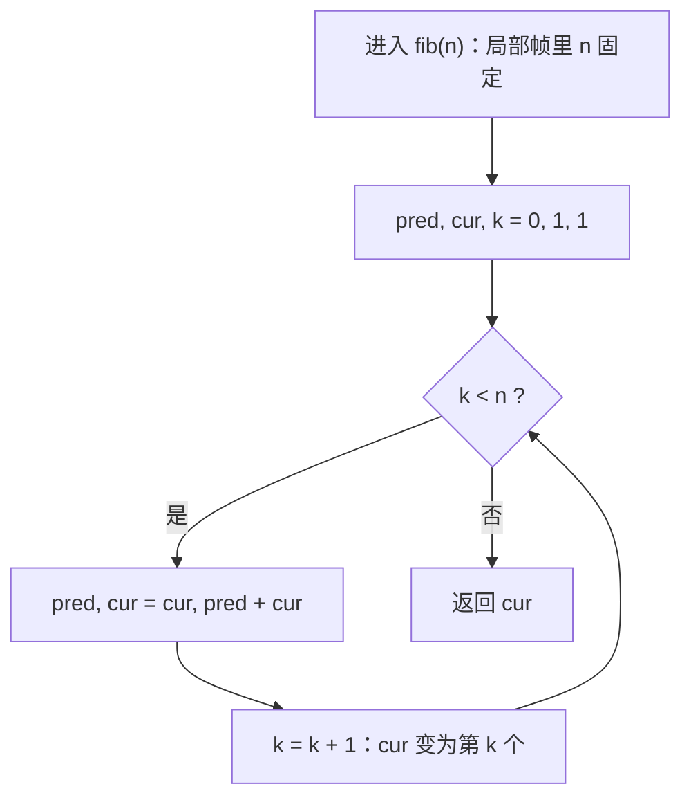
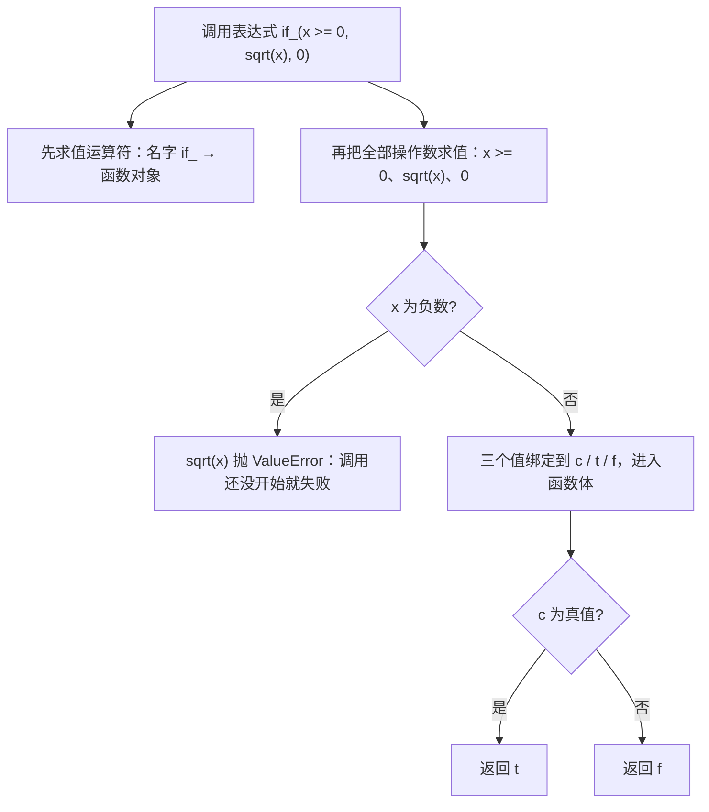
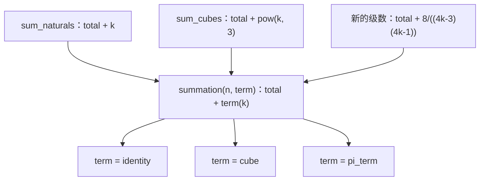
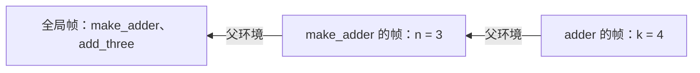

> **课程**：UC Berkeley CS61A · Structure and Interpretation of Computer Programs（Fall 2024）
> **本讲**：Lecture 4 ｜ 42:53 ｜ B 站分 P 4 ｜ [原视频](https://www.bilibili.com/video/BV1sy411z7nA?p=4)
> **课件**：`04-Higher-Order_Functions_1pp.pdf`（12 页，官方 PDF，逐页渲染图见正文插图）
> **字幕**：B 站英文原声字幕；本笔记是中文书面化重构，非逐句翻译
> **版权**：课程与课件版权归 UC Berkeley CS61A 教学团队；本文为学习用途的二次整理

## 本讲速览

*(参考时间: 00:00:00 – 00:42:51｜Lecture 4)*

- **已掌握**：表达式求值规则、`def` 语句与函数对象、call expression 的求值顺序、环境图（帧与父环境）、`while` 循环、纯函数与副作用。
- **本讲主线**：
    - 迭代的样板：斐波那契用 `pred`、`cur`、`k` 三个量描述循环状态，设计的第一步是问"必须持续跟踪哪些信息"。
    - 控制语句为什么不可被函数替代：`if_` 函数要求先求值全部实参，因而无法跳过任何一个分支。
    - 短路求值：`and` / `or` 把"选择性执行"做进了表达式层面。
    - 把函数当参数：`area(r, shape_constant)` 只泛化了"数"，`summation(n, term)` 才泛化了"过程"。
    - 把函数当返回值：`make_adder` 的内层 `adder` 通过父环境记住外层形参 `n`。
    - 收束：函数是一等公民（first-class value），因此才有比"函数"高一层的高阶函数（Higher-Order Function）。
- **关键结论**：抽象的实质是把"骨架"留在函数体里、把"差异"变成参数；差异既可以是一个数值，也可以是另一个函数。

## 1. 开场：作业、项目与期中

*(参考时间: 00:00:00 – 00:01:41｜Lecture 4)*

本讲一开始是课程节奏的交代，其中三条时间线会直接影响接下来两周的学习安排。


第一个截止项是本周四的作业；同时 Project 1 已经放出。项目虽然要到第一次期中之后才截止，但讲师反复强调"早点开始"，因为项目的分阶段设计（checkpoint）就是为了防止所有人把工作堆到最后一周。


Checkpoint 的时间是 9 月 5 日，也就是下周二。它只占整个项目评分里的一分，所以错过并不会显著影响成绩；但它要求的是"第一阶段已经跑通"，这一分买的是进度安全，而不是正确性。用讲师的说法，这一分只是为了让第一阶段按时完成、好让整份项目能在期中之后顺利收尾。

期中考试在 9 月 11 日傍晚进行。安排成傍晚有两个原因：其一，两个教学班（两个 offering）共用同一份卷子，需要把所有人分散到校园里的多个考场；其二，期中当天不排课，学生因此拿回一段可用于复习的时间。考试形式是纸笔作答，座位由系统分配，考生按通知到指定教室即可。

| 事项 | 时间 | 要点 |
|---|---|---|
| 本次作业 | 本周四截止 | 与期中复习节奏绑定，尽量不拖 |
| Project 1 发布 | 本周 | 期中之后才截止，但要求立即开始 |
| Project 1 Checkpoint | 9 月 5 日（下周二） | 只值 1 分；作用是锁住"第一阶段已完成" |
| 第一次期中 | 9 月 11 日傍晚 | 当天不排课；两班同卷、分考场、指定座位、纸笔 |

最后一条公告针对卡住的同学：有随到随问的 office hours（drop-in office hours），核心助教成员会到场答疑，"你不是一个人"这句话是这一页幻灯片的全部文案。


## 2. 迭代的样板：用 while 算斐波那契

*(参考时间: 00:01:43 – 00:09:07｜Lecture 4)*

### 2.1 一个"人人见过"的数列

斐波那契数列从 0 和 1 开始，此后每一项都是前两项之和：0 加 1 得 1，1 加 1 得 2，1 加 2 得 3，依此类推，很快就长得很大。讲师特意澄清了一段历史：斐波那契并没有发明这个数列，在他之前很久就有人讨论并描述过，只是他在西方世界把它推广开来，于是这个名字就留了下来。

数列中的每个数都与它的下标绑定，而下标采用从 0 开始的约定：$F_0 = 0$、$F_1 = 1$、$F_2 = 1$、$F_3 = 2$、$F_4 = 3$、$F_5 = 5$。因此"第五个斐波那契数"是 5，尽管它在这串数字里排在第六个位置——这只是下标约定，不是错误。

这个数列之所以被反复引用，是因为它带着一种视觉上"特别平衡"的几何性质：把边长分别为斐波那契数 2、3、5、8、13、21、34……的正方形拼贴在一起，再沿这些正方形的交点画一条螺旋线，就得到一条不断扩张的黄金螺旋，人眼看上去相当和谐。这类螺旋也常被人在自然界里"寻找"，课上展示的那张卷心菜照片，就是有人认为自己发现了黄金螺旋的证据。

### 2.2 设计迭代函数：先问要跟踪哪些量

从数列转到代码，讲师给出的方法论只有一句，但它是本讲后半程所有推理的地基：**设计一个迭代函数时，最重要的问题是——为了完成这次迭代，必须持续跟踪哪些信息。**

对斐波那契而言，下一项由"前一项"与"当前项"相加得到，所以至少要跟踪这两个数；同时还要知道"当前项是第几个斐波那契数"，否则无法判断何时停止。这三个量分别落在 `pred`、`cur`、`k` 三个名字上，其中 `k` 的语义非常明确：**`k` 记录了此刻 `cur` 里装的是第几个斐波那契数。** 随着循环推进，`k` 与 `cur` 一起变化，`k` 始终在给 `cur` 做标注。

> **编者说明**：下面这段 `fib` 在课堂上是讲师现场敲进编辑器演示的（课件里没有对应的一页），此处按讲解中给出的初值、循环条件与更新顺序还原，变量名与叙述一致。

```python
def fib(n):
    """Compute the nth Fibonacci number, for n >= 1."""
    pred, cur = 0, 1
    k = 1
    while k < n:
        pred, cur = cur, pred + cur
        k = k + 1
    return cur
```

循环体里只做两件事，而这两件事的顺序不能颠倒：先把 `pred` 更新为旧的 `cur`、把 `cur` 更新为"旧 `pred` 加旧 `cur`"（Python 的元组赋值会同时用旧值计算右侧，因此这一行不会互相污染），再把 `k` 加一。循环条件是 `k < n`，因为每轮 `k` 恰好加一，循环结束时必然有 `k == n`，此时 `cur` 里装的就是第 n 个斐波那契数。

以 `fib(5)` 为例，在 `fib` 的局部帧里，`n` 从一开始就是 5 并且永不变；`pred`、`cur`、`k` 每轮结束后都会被重新绑定，讲师的做法就是把每次执行完 `k = k + 1` 之后的取值列出来：

| 阶段 | `k` | `pred` | `cur` | `k < n` |
|---|---|---|---|---|
| 进入函数 | 1 | 0 | 1 | 真 |
| 第 1 轮结束 | 2 | 1 | 1 | 真 |
| 第 2 轮结束 | 3 | 1 | 2 | 真 |
| 第 3 轮结束 | 4 | 2 | 3 | 真 |
| 第 4 轮结束 | 5 | 3 | 5 | 假（退出） |

四轮之后 `k` 等于 `n`，循环条件为假，语句体不再执行，函数返回 `cur`，也就是 5，即第 5 个斐波那契数。这条跟踪表也解释了那句"最重要的问题"：环境图里真正在变动的只有三个名字，而它们之所以存在，完全是由"下一项依赖前两项"这个递推关系决定的。



### 2.3 一处改动，两种边界行为

讲到这里，讲师给出一个课堂讨论题：如果把函数体开头的三行改成 `pred, cur = 1, 0` 和 `k = 0`，这个新的定义与原来的定义"一样"还是"不一样"？

答案是：它**仍然正确**，对所有 $n \ge 1$ 给出的结果都与旧版相同，而且它比旧版**更好**——因为它还能正确计算第 0 个斐波那契数。

```python
def fib(n):
    pred, cur = 1, 0
    k = 0
    while k < n:
        pred, cur = cur, pred + cur
        k = k + 1
    return cur
```

当 `n` 为 0 时，程序走到 `while` 时 `k` 与 `n` 都是 0，循环体一次也不执行，直接返回 `cur` 的初值 0，正是第 0 个斐波那契数。旧版在这里会出错：它以 `pred, cur = 0, 1` 起步，`n = 0` 时同样不进循环，却返回 1。

代价出现在另一头。`n = 5` 时，新版从 `k = 0` 起步，循环体要执行 **5** 次而不是 4 次，`cur` 依次取 0、1、1、2、3、5，最终结果仍是 5。也就是说，这处改动把"边界上更正确"换成了"多做一次循环"：

| 检查项 | 旧版：`pred, cur = 0, 1`，`k = 1` | 新版：`pred, cur = 1, 0`，`k = 0` |
|---|---|---|
| `n = 0` 的结果 | 1（错，应为 0） | 0（正确） |
| `n ≥ 1` 的结果 | 正确 | 正确 |
| `n = 5` 的循环次数 | 4 | 5 |
| 初值语义 | 从"第 0 与第 1 项"开始，但漏算第 0 项 | 把"第 0 项"交给 `cur` 的初值承担 |

这个讨论题的教益不在于"哪种写法更快"，而在于**初值的语义选择会改变边界行为**；判断两个定义是否"一样"，必须逐个输入去看，而不是只看中间结果。

## 3. 控制语句为什么不能被函数替代

*(参考时间: 00:09:08 – 00:15:57｜Lecture 4)*

### 3.1 if 语句到底做了什么

`if` 与 `while` 这类控制语句（control statement）与函数的根本差别在于：它们决定**代码的哪些部分被执行、被执行多少次**，而函数只负责计算出一个值。既然函数已经这么强，能不能干脆用函数实现同样的控制？讲师先假设可以，再让这个假设失败。

先复习 `if` 语句的执行规则：多个子句按顺序逐一考察；考察一个子句时，先求值它 header 里的表达式；如果该值为真值，或者是 `else` 子句，就执行它的语句体，并跳过其余所有子句。所以 `if` 的 header 表达式只决定"执行 if 套件还是 else 套件"，两者永远只选一个，绝不会都执行。

### 3.2 假设有一个 if_ 函数

顺着这个规则，可以设想一个"if 函数"：它接收三个参数——条件、条件为真时的值、条件为假时的值，然后返回其中一个。Python 里没有这个函数，但它可以自己写出来：

```python
def if_(c, t, f):
    if c:
        return t
    else:
        return f
```

有了它，理论上就不必再写 `if`、冒号和缩进，只要在需要分支的地方调用 `if_` 即可。但讲师立刻指出问题所在：**call expression 的求值规则与条件语句的求值规则完全不同。**

### 3.3 失败现场：real_sqrt

为了把差别暴露出来，课堂上写了一个计算"实数部分平方根"的函数：输入可以是正数也可以是负数。对正数，`x` 的实数部分就是它的平方根，可以直接用内置的 `sqrt`；对负数，比如 $\sqrt{-4} = 2i$，整个结果都是虚数，实数部分为 0。此时**不能**把负数交给 `sqrt`，因为它的值域里没有虚数。

```python
from math import sqrt

def real_sqrt(x):
    """Return the real part of the square root of x."""
    if x >= 0:
        return sqrt(x)
    else:
        return 0
```

这个版本工作正常：`real_sqrt(16)` 得到 4.0，`real_sqrt(-16)` 得到 0。后一种情况下，`sqrt(x)` 这个表达式根本没有被求值，因为语句把它整个跳过了。

接着把它改写成调用 `if_` 的一行版本：

```python
def real_sqrt(x):
    return if_(x >= 0, sqrt(x), 0)
```

运行结果是崩溃。原因不在 `if_` 的定义有错，而在求值顺序上：求值 `if_(x >= 0, sqrt(x), 0)` 时，解释器先求值运算符 `if_` 得到函数对象，然后**把三个操作数全部求值**，再把三个值依次绑定到 `c`、`t`、`f`。当 `x` 为 −16 时，第二步求值 `sqrt(x)` 就已经抛出 `ValueError`（`math domain error`），函数体一行都还没执行。

```text
>>> real_sqrt(16)
4.0
>>> real_sqrt(-16)
ValueError: math domain error
```

### 3.4 根本原因：调用表达式不允许跳过

结论由此得出：**调用表达式不能跳过其中任何一部分的求值**，所有部分永远在函数被调用之前就求完；而控制语句恰恰天生具备"执行一部分、跳过另一部分"的能力。这就是编程语言里必须有控制语句、而不能只留下函数的理由。

| 判据 | `if` 语句 | `if_` 调用表达式 |
|---|---|---|
| 分支的选择时机 | 求值 header 之后，只执行被选中的套件 | 函数体内按 `c` 的取值返回，但全部实参已先求值 |
| 未被选中的分支 | 完全不求值（可安全包含 `sqrt(x)` 这类危险表达式） | 必先求值，非法输入会当场报错 |
| 求值顺序 | 惰性：按需执行 | 严格：运算符与全部操作数先求值 |
| 失败模式 | 只可能在被执行的分支里失败 | 任一操作数失败即整体失败 |



## 4. 短路求值：写在表达式里的控制

*(参考时间: 00:15:59 – 00:21:07｜Lecture 4)*

### 4.1 and 与 or 的求值规则

Python 里也有"允许解释器跳过某些子表达式"的表达式，最典型的是逻辑运算符 `and` 与 `or`，它们的行为叫短路求值（short-circuiting）。

对 `left and right`：先求值左子表达式；若它是假值，整个表达式就取这个假值，**右子表达式根本不求值**；否则求值右子表达式，整个表达式的值就是右值。

对 `left or right`：先求值左子表达式；若它是真值，整个析取式已经为真，可以直接取左值收工；否则求值右子表达式，并取右值。

需要注意，这里的值不必是 `True` / `False`：Python 中每个值要么是真值要么是假值，所以 `2 and 3` 的结果是 3（左值真，于是返回右值），`0 and 3` 的结果是 0（左值假，右值不求值），`2 or 3` 是 2，`0 or 3` 是 3。

| 表达式 | 左操作数 | 整个表达式的值 | 右操作数是否求值 |
|---|---|---|---|
| `a and b` | 假值 | `a` 本身 | 否 |
| `a and b` | 真值 | `b` | 是 |
| `a or b` | 真值 | `a` 本身 | 否 |
| `a or b` | 假值 | `b` | 是 |

### 4.2 用短路挡住会崩溃的子表达式

第一个例子来自上一节的遗留问题：怎样判断某个 `x` 的平方根"很大"，同时又不希望负数让程序崩溃。答案是让 `x > 0` 先接受检验：

```python
from math import sqrt

def has_big_sqrt(x):
    """Return whether x has a big square root."""
    return x > 0 and sqrt(x) > 10
```

`has_big_sqrt(1)` 返回假（平方根为 1，没有超过 10），`has_big_sqrt(1000)` 返回真，`has_big_sqrt(-1000)` 返回假——而关键在于它**没有崩溃**：传入 −1000 时，`x > 0` 已经是假值，`and` 立刻把整个表达式判为假，`sqrt(-1000)` 这个会抛异常的子表达式从未被求值。这正是 `if_` 函数做不到的事，而现在它由表达式自身完成了。

### 4.3 浮点数的下界与"合理的数"

第二个例子更绕，但更能说明短路的实用价值。在 Python 里，`1` 除以一个足够大的数会得到 0.0，因为浮点数有一个能表示的最小非零规模，比它更小的结果只能舍入成 0。比如 $10^{100}$ 还小得可以，$10^{1000}$ 就太大了：`1 / 10**1000` 直接得到 `0.0`，精度全部丢失。

> **编者说明**：讲师的表述是"能表示的数只有这么小"。从实现角度说，这属于浮点数的下溢（underflow）：绝对值小于最小正规数（约 $10^{-308}$）的结果会落入非正规数区间，再小就被舍入为 0，具体行为由 IEEE 754 双精度格式决定。这一层术语课上没有展开，此处补出以便对照。

于是可以定义一个"合理的数"：它不是大到 `1 / n` 会变成 0 的地步。最直觉的写法是 `1 / n != 0`，但只要传入 `n = 0` 就会崩溃（除以零），而 0 明明是一个非常合理的数，只是不适合拿来做"取倒数"这个测试。用 `or` 把两种可接受情形并起来就能修好：

```python
def is_reasonable(n):
    """Return whether 1/n is non-zero."""
    return n == 0 or 1 / n != 0
```

`is_reasonable(0)` 返回真；`is_reasonable(10)` 返回真；`is_reasonable(10**100)` 仍然返回真，因为它的倒数 `1e-100` 还没有被舍入掉。只有把指数推到荒谬的量级（例如 $10^{10000}$），倒数才会塌成 0，函数返回假。全部测试都没有崩溃，包括 `n = 0` 的那一次：`n == 0` 已经是真值，`or` 随即收工，`1 / n` 从未被求值。

### 4.4 为什么这算"控制"

讲师把它称为"一种形式的控制"，理由是它完成的正是控制语句的工作：决定哪些子表达式被求值、哪些被跳过。而且这不是 Python 独有的技巧，很多语言都提供同样的短路语义。至此本讲已经积累了三种"选择性执行"的手段——控制语句、短路运算符，以及接下来要登场的主角：把函数本身当作值来传递。

## 5. 把重复抽掉：设计准则与面积公式的泛化

*(参考时间: 00:21:07 – 00:27:12｜Lecture 4)*

### 5.1 课件上的三页：描述函数与设计准则

在进入高阶函数之前，课件插入了三页"如何设计函数"的内容：一页分节页、一页描述函数的术语、一页设计准则。

> **编者说明**：本讲录像从开课公告直接跳到斐波那契的 `while` 演示，没有逐条讲解这三页；但这一章以及收尾部分反复援引的两条准则——"一个函数承担一个职责"与"不要重复自己"——正是这两页的内容（字幕中在 00:25:18 与 00:42:37 两次被引用）。此处按官方课件的顺序与原文补出，下一小节起回到录像的叙述。


描述一个函数有三个层次，课件用 `square` 作例子：函数定义域（domain）是它可能接受的全部输入集合，对应 `x is a number`；值域（range）是它可能返回的全部输出集合，对应"`square` 返回一个非负实数"；而纯函数的行为（behavior）是它在输入与输出之间建立的关系，对应"`square` 返回 x 的平方"。用关系描述而不是用过程描述，正是后面能放心替换实现的前提。


```python
def square(x):
    """Return X * X."""
    return x * x
```

设计准则只有两句，但足够支撑整个 CS61A 的函数设计：**给每个函数恰好一个职责，同时让它能适用于许多相关的情境**；以及 **DRY（Don't Repeat Yourself）——一个过程只实现一次，但可以执行很多次**。课件用内置的 `round` 展示"一个职责、多种情境"：`round(1.23)` 得 1，`round(1.23, 1)` 得 1.2，`round(1.23, 0)` 得 1，`round(1.23, 5)` 得 1.23——同一个"四舍五入"的职责，通过一个可选参数覆盖了不同的精度需求。

> **编者说明**：课件上的 `round(1.23, 0)` 显示为 `1`，这是 Python 2 时代的输出；在 Python 3 中该表达式返回浮点 `1.0`。`round(1.23)` 与 `round(1.23, 1)` 的输出在两个版本中一致。


### 5.2 高阶函数的第一个形态：把差异变成参数

课件的下一页是本讲的正式分节页。讲师对高阶函数的定位是：它是语言的一个特性，让我们能"按应有的方式"设计函数——表达非常通用的计算方法。


具体做法是：**先把模式找出来，再定义函数，让它的参数去填补那些使模式具体化的位置。** 最朴素的例子是几何图形的面积。正方形、圆、正六边形，各自的"相关长度"分别是边长、半径、边长，而三个面积公式是：

- 正方形：$r^2$
- 圆：$\pi r^2$
- 正六边形：$\dfrac{3\sqrt{3}}{2} r^2$

把三个公式并排看，共同结构是 $r \times r$，剩下的分别是 1、$\pi$、$\dfrac{3\sqrt{3}}{2}$——一个只与形状有关的常数。先按最直白的方式实现：

```python
from math import pi, sqrt

def area_square(r):
    return r * r

def area_circle(r):
    return r * r * pi

def area_hexagon(r):
    return r * r * 3 * sqrt(3) / 2
```

`area_hexagon(10)` 得到约 259.8（略小于 260，符合预期）。但同一个函数也接受 `-10`，并返回同样的正数，这显然不对：长度不可能是负的。

修复手段是断言语句（assert statement）：后面跟一个在布尔语境里求值的表达式，若它的值为假，就把一条错误消息打印给运行程序的人。`assert 3 > 2` 恒为真，什么都不会发生；`assert 3 > 4` 则抛出 `AssertionError` 并带上消息。

```python
from math import pi, sqrt

def area_square(r):
    assert r > 0, 'A length must be positive'
    return r * r

def area_circle(r):
    return r * r * pi

def area_hexagon(r):
    return r * r * 3 * sqrt(3) / 2
```

讲师的处置很传神：先只给 `area_square` 加上断言，然后自嘲说，本来可以把这一行复制粘贴到另外两个函数里，但那样就成了"重复自己"——"我不该重复自己，John 说的"。

> **编者说明**：这里的 John 指 John DeNero，CS61A 教材《Composing Programs》的作者，也是这门课早年的主讲；这层背景课上没有展开。

问题在于同样的检查要在三个函数里各写一遍，而"三个函数里粘贴同一行"恰好违反了 DRY。于是把共同的部分抽出来：共同骨架是"边长平方乘以形状常数"，差异是那个常数，那就把它做成参数。

```python
def area(r, shape_constant):
    assert r > 0, 'A length must be positive'
    return r * r * shape_constant

def area_square(r):
    return area(r, 1)

def area_circle(r):
    return area(r, pi)

def area_hexagon(r):
    return area(r, 3 * sqrt(3) / 2)
```

`area_hexagon(10)` 的结果与改写前完全一致；而 `area_hexagon(-10)` 现在会抛出 `AssertionError: A length must be positive`，因为断言只写了一份，却对三个函数同时生效。讲师自己承认，`area(r, shape_constant)` 这种签名并不直观，必须靠文档说明第二个参数是什么——这是抽象的第一笔代价：**复用换来了可读性的下降**，需要用命名与文档补回来。

这一版的局限也很清楚：被参数化的是"数"。而三个求和公式的差异并不落在数上，它落在表达式上，这就需要把参数从"值"升级为"过程"。

| 判据 | 改前：三个独立函数 | 改后：`area(r, shape_constant)` |
|---|---|---|
| 共同骨架 | 各写一遍 `r * r` | 只写在 `area` 里一次 |
| 差异所在 | 三个常数散落在三处 | 一个常数参数 |
| 参数校验 | 三处 `assert` 重复 | 一处 `assert` 覆盖全部 |
| 新增一种形状 | 复制整段函数 | 只写一行调用 |
| 代价 | 重复、易漏改 | 函数签名不再自解释，需要文档 |

## 6. 从 sum_naturals 到 summation：把"算哪一项"变成参数

*(参考时间: 00:27:14 – 00:37:10｜Lecture 4)*

### 6.1 三个求和，一份骨架

接下来换成三个数学式。第一式是自然数求和：$\sum_{k=1}^{5} k$ 是 1 加 2 加 3 加 4 加 5 的简写，结果 15。第二式是立方和：$\sum_{k=1}^{5} k^3$，结果 225。第三式看起来古怪得多，是若干项的连加，少算几项时和为 3.04；项数越多，它越逼近圆周率 $\pi$。

三个式子的区别只有一个：每一项怎么算。第一式的每项是 $k$，第二式是 $k^3$，第三式是一个更复杂的分式；除此之外，它们都是"从 1 到 5 逐项相加"。也就是说，这里既有通用的计算过程，又有具体到某一式的成分，而这个成分**不是数，是表达式**。

先老老实实写两遍：

```python
def sum_naturals(n):
    """Return the sum of the first n natural numbers.

    >>> sum_naturals(5)
    15
    """
    total, k = 0, 1
    while k <= n:
        total, k = total + k, k + 1
    return total


def sum_cubes(n):
    """Return the sum of the first n cubes of natural numbers.

    >>> sum_cubes(5)
    225
    """
    total, k = 0, 1
    while k <= n:
        total, k = total + pow(k, 3), k + 1
    return total
```

两个函数的循环骨架一模一样：`total` 存累计和，`k` 存下一个待加的下标，循环条件 `k <= n`，每轮把累计和与下标同时前推，最后返回 `total`。唯一的区别是 `total + k` 与 `total + pow(k, 3)`。两处测试都通过，但它们几乎逐字重复，这正是 DRY 要消除的东西。

### 6.2 用函数填补那个空位

既然差异是一段"由 k 算出这一项"的计算，就把它写成函数，并把这函数作为参数传进去。先准备两个具体的项计算：

```python
def identity(k):
    return k


def cube(k):
    return pow(k, 3)
```

再写通用版本，它的第二个形参 `term` 用来接收"怎样算每一项"：


```python
def summation(n, term):
    """Sum the first n terms of a sequence.

    >>> summation(5, cube)
    225
    """
    total, k = 0, 1
    while k <= n:
        total, k = total + term(k), k + 1
    return total
```

课件对这一页做了四处标注，正好构成理解高阶函数的最小闭环：

- `cube` 是"只有一个参数的函数"，它的名字**不叫** `term`——`term` 是形参，`cube` 是实参传进来的那个函数。
- `def summation(n, term)` 里的 `term` 是一个形式参数，它将被绑定到一个**函数**上。
- 调用 `summation(5, cube)` 时，`cube` 这个函数对象是作为**参数值**被传进去的。
- 循环体里的 `term(k)` 真正调用的，就是 `term` 此刻绑定的那个函数。

执行 `summation(5, cube)` 时，`total` 依次累加的是 `cube(1)` 到 `cube(5)`，也就是 1、8、27、64、125，和为 225——与课件的标注 `0 + 1 + 8 + 27 + 64 + 125` 对得上。函数体内的 `term(k)` 是一个标准的调用表达式：先求值运算符 `term`（在当前帧里找到它绑定的函数对象），再求值操作数 `k`，然后调用。区别只在于"绑定到 `term` 的东西"是由调用者决定的，`summation` 自己并不知道那是什么。

于是两个重复的函数可以各自缩成一行，测试依旧全部通过：

```python
def sum_naturals(n):
    """Return the sum of the first n natural numbers.

    >>> sum_naturals(5)
    15
    """
    return summation(n, identity)


def sum_cubes(n):
    """Return the sum of the first n cubes of natural numbers.

    >>> sum_cubes(5)
    225
    """
    return summation(n, cube)
```

讲师对此的总结是：`summation` 是"函数取另一个函数作参数"的例子，所以它本身是一个高阶函数。这里值得停一下，看清"抽象层次提高"的确切含义——**被抽掉的不再是一个数，而是一整段计算**；`summation` 只承诺"逐项累加"这件事，把"每一项是什么"完全交给外部，因此它对未来任何形状的项都开放。

### 6.3 再把第三种求和接进来

第三个式子正好用来验收。它需要一个项函数，课件的写法是借用 `operator` 模块里的 `mul`：

```python
from operator import mul

def pi_term(k):
    return 8 / mul(4 * k - 3, 4 * k - 1)

print(summation(1000000, pi_term))
```

> **编者说明**：`operator` 模块把 Python 的运算符包装成普通函数，`mul(a, b)` 等价于 `a * b`；用它可以把"乘法"当作值来传递，也省掉了手写括号。这个模块在字幕中只以 `from operator import mul` 一句出现，课上没有展开。

求和一百万项后得到 3.141592。这不是精确的 $\pi$，而是一个近似值——讲师特意补了这句，因为程序给出的位数看起来太像答案本身，容易让人误以为算出了精确值。无论如何，第三种"项"在没有修改 `summation` 一行代码的情况下就被接进了同一套骨架，这正是把过程参数化带来的收益。

| 求和 | 每一项 $f(k)$ | 传给 `summation` 的 `term` | 结果 |
|---|---|---|---|
| 自然数之和 $\sum_{k=1}^{n} k$ | $k$ | `identity` | 15（n = 5） |
| 立方和 $\sum_{k=1}^{n} k^3$ | $k^3$ | `cube` | 225（n = 5） |
| 逼近 $\pi$ 的级数 | $\dfrac{8}{(4k-3)(4k-1)}$ | `pi_term` | 3.141592（n = 10⁶） |



### 6.4 课件页：Program Design 的三个词

紧接着的一页课件给出三个词：模块化（Modularity）、抽象（Abstraction）、关注点分离（Separation of Concerns）。它们是对前面所有工作的命名——`summation` 是一个可独立替换的模块，`term` 是它对外暴露的唯一抽象边界，而"怎么累加"与"累加什么"被彻底分到了两边。


> **编者说明**：这一页在录像中没有对应的独立讲解段落，它后面那页"二十一点游戏"的现场演示（见附录）也没有发生；讲师在求和演示之后直接进入"函数作为返回值"。三个词的落点因此由本章内容承担，而非课堂原话。

## 7. 函数作为返回值：make_adder 与父环境

*(参考时间: 00:37:12 – 00:41:56｜Lecture 4)*

### 7.1 让函数生产函数

本讲最后一个例子换方向：不是把函数传进去，而是把函数**返回出来**。


设想需要一个"加 3"的函数和一个"加 2000"的函数。逐个手写是重复劳动，更好的办法是写一个"造加法器"的函数：它接收一个数 `n`，返回一个新函数，那个新函数接收 `k` 并返回 `k + n`。


```python
def make_adder(n):
    """Return a function that takes one argument k and returns k + n.

    >>> add_three = make_adder(3)
    >>> add_three(4)
    7
    """
    def adder(k):
        return k + n
    return adder
```

课件在这一页做了四处标注：`make_adder` 是"一个返回函数的函数"；`>>> add_three = make_adder(3)` 这一行让名字 `add_three` 被绑定到**一个函数**；`def adder(k)` 是"出现在另一个 `def` 语句内部的 `def` 语句"，因此 `adder` 这个名字落在 `make_adder` 调用的**局部帧**里，而不是全局帧；`return k + n` 里的 `n` 不是 `adder` 的形参，而是外围函数 `make_adder` 的形参，内层函数可以引用它。

结构上必须分清两条 `return`：`return k + n` 属于 `adder` 的函数体，返回的是一个数；`return adder` 属于 `make_adder` 的函数体，返回的是一个**函数对象**——注意没有括号，所以它不是"调用 `adder`"，而是"把 `adder` 这个函数本身交出去"。

### 7.2 帧与父环境：新函数为什么会"记住" 3

`add_three = make_adder(3)` 这一行做了三步：调用 `make_adder`，产生一个以 `n = 3` 为局部变量的帧；在这个帧里执行 `def adder`，创建一个函数对象，它的**父环境**就是这个帧；然后把这个函数对象返回，并让全局帧的 `add_three` 指向它。

此后 `add_three(4)` 又创建一个新帧，其中 `k = 4`，而这个帧的父环境**不是全局帧，而是当年创建 `adder` 时所在的那个 `make_adder` 帧**。因此 `k + n` 里的两个名字各有着落：`k` 在本地帧里找到，`n` 沿父环境链上溯一层找到 3。把这条链画出来（箭头方向是"父环境"）：



| 名字 | 出现在 | 查找路径 | 结果 |
|---|---|---|---|
| `k` | `adder` 的函数体 | 本地帧 → 上一层 | 4 |
| `n` | `adder` 的函数体 | 本地帧（无）→ 父环境 | 3 |
| `make_adder` | 模块顶层调用处 | 全局帧 | 函数对象 |
| `adder` | 返回语句 | `make_adder` 的帧 | 函数对象 |

讲师用一句直觉描述概括了这件事：这个被创建出来的函数"记得 3 是它要加的那个数"。所谓"记得"，在环境模型里就是父环境链的指针——函数对象携带的不仅有代码，还有它定义时所在的环境。

> **编者说明**：本讲没有给出正式的盒针图（environment diagram），上面这张流程图只是把"帧—父环境"的指针关系画出来示意，帧内的其余名字从略。另外，"函数对象携带其定义环境"这一机制在教材中称为闭包（closure），课上只用了"记得"这个直观说法，没有使用该术语。

### 7.3 运算符本身也可以是一个调用表达式

一个常被忽略的细节是：`make_adder(1)(2)` 何以成立。这在语法上是"调用表达式的运算符又是一个调用表达式"——外层调用的运算符是 `make_adder(1)`，操作数是 `2`。

求值顺序与普通 call expression 完全一致：先求值运算符 `make_adder(1)`，得到 `n = 1` 的函数对象；再求值操作数 `2`；然后把前者应用到后者，得到 3。课堂上的现场演示用 `make_adder(2000)(13)` 做了同一件事，结果是 2013；也可以拆成两步，先用 `make_adder(2000)` 得到一个函数并绑到名字上，再拿它去调用 13，两种写法的值相同，差别只在于中间那个函数是否需要一个名字。

讲师由此给出的判断标准其实很宽：**运算符可以是任何求值结果为函数的表达式，操作数可以是任何求值结果为任意值的表达式**——这正是"函数是普通值"的直接推论。

> **编者说明**：这种"一次只吃一个参数、返回一个继续吃参数的新函数"的风格，教材里叫柯里化（currying），`make_adder` 是它的最小样例；教材后文会给出通用的 `curry` 函数与 `compose` 组合函数，本讲录像未涉及。另外，Python 的匿名函数 `lambda` 可以等价改写上面的定义（`add_three = lambda k: k + 3`，或 `make_adder = lambda n: lambda k: k + n`），课上同样没有讲到，此处仅作对照，正文代码仍以课件为准。

## 8. 一等公民与高阶函数的定义

*(参考时间: 00:41:57 – 00:42:11｜Lecture 4)*

把两个方向的例子放在一起，结论就浮现出来了：在本讲的语言里，**函数是一等公民（first-class value）**——它们可以像其他任何值一样作为参数传入（`summation` 的 `cube`），也可以作为返回值交出（`make_adder` 的 `adder`）。而**高阶函数就是做这两件事之一的函数：接收另一个函数作参数，或者返回一个函数**。

> **编者说明**：课上只点了"作参数"与"作返回值"两条。严格地说，一等公民还意味着函数能被赋值给名字、能存进数据结构、能作为另一个函数的局部值；这些性质在后续讲次（尤其是把函数存进列表、字典时）会自然出现。

| 判据 | 普通函数 | 高阶函数 |
|---|---|---|
| 参数是什么 | 数值、字符串等数据 | 数据，或另一个函数 |
| 返回值是什么 | 数据 | 数据，或一个函数 |
| 表达能力 | 一次具体的计算 | 一类计算方法的模板 |
| 复用方式 | 复制代码后改动 | 传入不同的函数即得到不同行为 |
| 本讲例子 | `area_square`、`identity` | `summation`、`make_adder` |

## 小结

*(参考时间: 00:42:14 – 00:42:51｜Lecture 4)*

- **迭代先定状态**：动手写循环之前，先问"为了完成这次迭代必须持续跟踪哪些量"，`fib` 的三个名字不是随手起的，而是递推关系的直接投影。
- **边界行为由初值的语义决定**：把 `fib` 的起点从 `(0, 1, k=1)` 改成 `(1, 0, k=0)`，中间结果不变却修好了 `n = 0`，代价是多一次循环——比较两个定义是否相同，必须逐个输入去看。
- **控制语句存在的理由是不可跳过性**：调用表达式要求全部实参先求值，所以 `if_` 函数挡不住 `sqrt(-16)`；凡是"不该被求值的那一半"，只能交给语句或短路运算符。
- **短路求值是表达式层面的控制**：`and` / `or` 返回的是操作数本身而非布尔值，正好可以用来守卫危险子表达式（`x > 0 and sqrt(x) > 10`、`n == 0 or 1 / n != 0`）。
- **抽象的做法是留下骨架、参数化差异**：差异是数时得到 `area(r, shape_constant)`，差异是过程时得到 `summation(n, term)`——后者才是高阶函数。
- **返回值是函数时，行为由父环境决定**：`make_adder` 的 `adder` 能算出 `k + n`，靠的是它的父环境仍然是那个 `n = 3` 的帧。
- **一个函数一个职责、不要重复自己**：这两条准则在本讲被两次引用，它们也是判断"该不该引入高阶函数"的实用尺子——重复出现的那部分该被抽走，变化的维度该被提成参数。

## 附录：课堂未展示页与幻灯索引

*(参考时间: 00:00:00 – 00:42:51｜Lecture 4)*

课件里还有一页"二十一点游戏"，在本讲录像中没有对应的讲解或演示。


页面列出规则：两名玩家轮流把 1、2 或 3 加到当前总和上；总和从 0 开始；一旦总和达到或超过 21 游戏立即结束；**最后一个加数的人输**。下方是"有些状态是好的，有些状态是坏的"的示意图：箭头从 19、18、17 指向 20，再从 20 指向 21，右侧还有省略号。

> **编者说明**：这一页在录像中没有被讲到，属于课件里为"程序设计与策略"预留的演示页。按图面可读出的大意是：总和停在 20 时，轮到谁谁就只能把总和推过 21 从而输掉，因此 20 是对手必须避开的状态；而 19、18、17 都能一步把总和送到 20，于是把对手推进坏状态就成了目标。这是对图形的客观解读，不是课堂原话；本讲的正文与小结都不依赖这页内容。

| 页 | 画面内容 | 出现位置 |
|---|---|---|
| 1 | 标题页 Higher-Order Functions | §1 |
| 2 | Announcements：作业、项目与期中 | §1 |
| 3 | Office Hours：You Should Go! | §1 |
| 4 | Designing Functions 分节页 | §5.1 |
| 5 | Describing Functions：定义域 / 值域 / 行为 | §5.1 |
| 6 | A Guide to Designing Function：一个职责与 DRY | §5.1 |
| 7 | Higher-Order Functions 分节页（转入函数作参数） | §5.2 |
| 8 | Summation Example：`term` 形参与四处标注 | §6.2 |
| 9 | Program Design：模块化 / 抽象 / 关注点分离 | §6.4 |
| 10 | Twenty-One Rules：规则与好坏状态（本讲未演示） | 附录 |
| 11 | Functions as Return Values 分节页（现场演示） | §7.1 |
| 12 | Locally Defined Functions：`make_adder` 逐行标注 | §7.1 |
