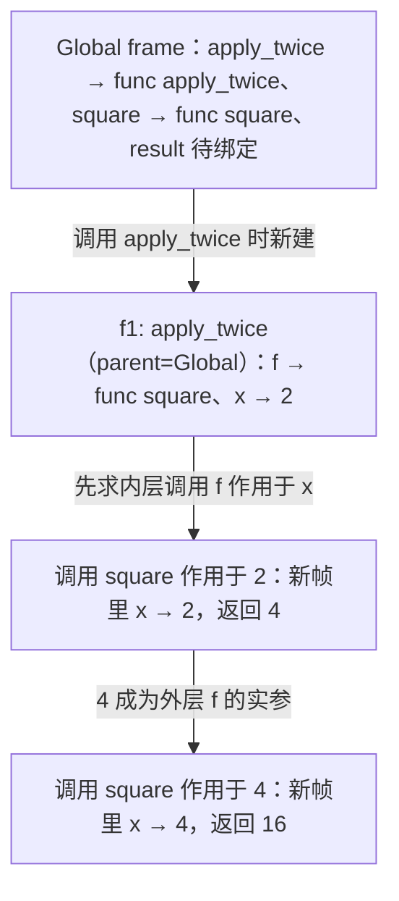
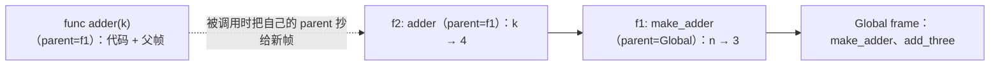
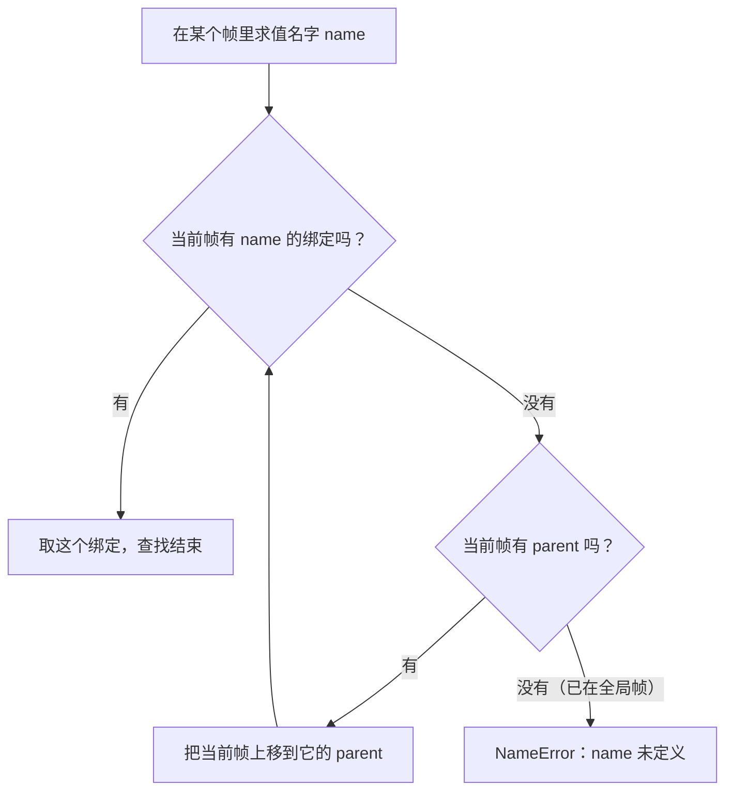
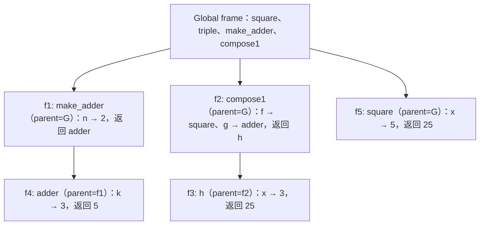

> **课程**：UC Berkeley CS61A · Structure and Interpretation of Computer Programs（Fall 2024）
> **本讲**：Lecture 5 ｜ 36:42 ｜ B 站分 P 5 ｜ [原视频](https://www.bilibili.com/video/BV1sy411z7nA?p=5)
> **课件**：`05-Environments_1pp.pdf`（11 页，官方 PDF，逐页渲染图见正文插图）
> **字幕**：B 站英文原声字幕；本笔记是中文书面化重构，非逐句翻译
> **版权**：课程与课件版权归 UC Berkeley CS61A 教学团队；本文为学习用途的二次整理

## 本讲速览

- **已掌握**：表达式与调用表达式的求值顺序、`def` 语句、高阶函数能接收或返回函数（Lecture 4），以及环境图的起步画法——一个全局帧、一个局部帧、若干名字绑定。
- **本讲主线**：
    - 用环境图解释高阶函数：函数本身是值，可以被绑定到名字，也可以被当作实参传进另一个函数。
    - 嵌套 `def` 带来一个新事实——**函数有父帧**，而父帧不一定是全局帧。
    - 归纳出四条父帧规则与一套画图五步法，把"照着 Python Tutor 抄图"变成"自己手推"。
    - 用反例划出作用域边界：为什么 `y` 明明就在隔壁帧里，`g` 却看不到它。
    - 综合案例 `compose1`、`lambda` 表达式与 `def` 的异同、以及柯里化（Currying）。
- **关键结论**：一个函数值 = 代码 + 它被创建时的当前帧；一次调用 = 新建帧 + 抄父帧 + 绑形参；名字查找 = 从当前帧沿 `parent` 链向上，第一个命中的绑定胜出，走完全链仍没有就是 `NameError`。

*(参考时间: 00:00:00 – 00:36:40｜Lecture 5)*

## 1. 开课通知与 warm-up：`print`、`None` 与 `or` 的求值

*(参考时间: 00:00:00 – 00:01:44｜Lecture 5)*


本讲开课时交代的几件事，决定了接下来两周的节奏。


**Hog 项目已经放出**，其中各个 checkpoint 下周二截止；**Homework 2** 也已经放出，下周四截止。这两份作业正好用来练上一讲刚讲过的高阶函数——动手写比看视频有用得多。

周一放假，讲师会额外放出一段可选内容：一个比较长的例子，用来说明"在一个真实的、更长的程序里，人为什么真的会需要高阶函数"。这段视频不看也不影响后续学习，它并不针对考试，纯粹是有意思。下周三与周五是两堂复习课，作用是帮助梳理已经学过的内容；至于**期中考试的范围，就是到目前为止（含本讲）你已看过的所有视频**，看完本讲，考试所需的知识就齐了。

考试在 11 号，教学团队会争取在 12 号批完卷子发回：因为 13 号是选课与退课的截止日，不少学生希望在那之前知道自己在课上到底学得怎么样，所以目标是在 12 号周二把期中卷发回。讲师对此的提醒很直接——眼下最好的备考方式，就是把手头这一堆作业认真做完。

### 1.1 复习一页：`print` 的返回值是 `None`


在切入环境图之前，课件用一页复习把"值"这件事再钉一遍。`print` 是一个只产生副作用、不返回有用值的函数：它把实参显示到屏幕上，然后返回 `None`。这一点在环境图里尤其重要，因为环境图追踪的是"值和绑定"的流动，而不是屏幕上的字符；屏幕上出现的每一行，都是某次调用产生的副作用，与那次调用的返回值没有关系。

与此配套的是 Python 的假值清单：`False`、`0`、空字符串 `''`、以及 `None`。课件在这份清单后写了一句 "more to come"，提醒学生假值集合还会扩充，不要把它当成固定不变的四项。

> **编者说明**：以下 §1.2 的内容对应课件第 4 页。在可用的字幕里，讲师从课程通知直接跳到了环境图正题，这一段 warm-up 没有留下逐句口播记录，因此本节严格按课件画面上的代码、批注与求值规则复原，不掺入字幕之外的说法。

### 1.2 真题演练：一条长表达式里的 `None` 传播链

课件搬出了 Fall 2022 CS 61A Midterm 1 的第 1 题：一条把三个 `print` 与一个 `or` 嵌套在一起的长表达式，问它究竟打印出什么。

```python
s = "Knock"
print(print(print(s, s) or print("Who's There?")), "Who?")
```

要拆解它，只需要一条规则——`<left> or <right>` 的求值：

1. 先求值子表达式 `<left>`。
2. 如果结果是真值 `v`，整个表达式就求值为 `v`，右侧不碰。
3. 否则，整个表达式求值为子表达式 `<right>` 的值。

注意规则里没有出现 `True` / `False`。`or` 返回的是**某个操作数本身的值**，而不是一个布尔判断结果——这正是这类题目的全部难点。


按表达式树自内向外拆：

1. `print(s, s)` 先执行：屏幕打印 `Knock Knock`，它的返回值是 `None`。
2. `or` 的左边是 `None`（假值），短路不成立，于是求右边 `print("Who's There?")`：屏幕打印 `Who's There?`，返回值同样是 `None`。整个 `or` 表达式的值因此是右边那个 `None`。
3. 中间层 `print(...)` 收到这个 `None` 并把它打印出来：屏幕出现第三行 `None`。课件在这里贴了一张批注——"This None is passed to print!"，因为读者最容易忘记的就是"上一步的值会变成下一步的实参"。这一层 `print` 自己也返回 `None`。
4. 最外层 `print(..., "Who?")` 收到两个实参：刚传上来的 `None` 与字符串 `"Who?"`，于是打印末行 `None Who?`。

整条表达式的输出是：

```text
Knock Knock
Who's There?
None
None Who?
```

> **编者说明**：这条表达式本身的值仍然是 `None`。若在交互式解释器里直接求值它，屏幕上还会额外回显一个 `None`；作为脚本文件运行则不会，这就是"打印出来的东西"与"表达式的值"最容易混淆的一处。

## 2. 高阶函数的环境图：`apply_twice` 的三步调用

*(参考时间: 00:01:47 – 00:07:17｜Lecture 5)*

讲师给出了本讲的总纲，也是理解环境图用途的关键一句：**环境图存在的全部理由，就是为了描述高阶函数是怎么工作的**。前面几讲讲环境、讲盒针图，都不是为了折磨人，而是因为只有它能精确回答"函数被传来传去的时候，名字到底指向什么"。

好消息是：**已有的规则一条都不用改**。高阶函数并不需要补丁，它只是"函数也是值"这件事的自然推论。


### 2.1 `apply_twice`：把函数连续作用两次

```python
def apply_twice(f, x):
    return f(f(x))

def square(x):
    return x * x

result = apply_twice(square, 2)
```

`apply_twice` 接收一个函数 `f` 和一个单参数 `x`，然后把它作用两次：`f(f(x))`。它之所以是高阶函数，理由很朴素——它的实参里有一个本身是函数。

还需要一个具体的函数供它使用，于是有了熟面孔 `square`。运行这段文件后，`square(3)` 当然是 9；而 `apply_twice(square, 3)` 会先平方得到 9，再平方一次得到 81。课上先用 3 演示，随后画图时换成了 2，因为 2 平方两次得到 16，算起来更省事。

调用写法值得多看一眼：`apply_twice(square, 2)` 里被求值的是两个**值**——一个是 `square` 这个名字所指向的函数对象，一个是数字 2；不是"函数名"，也不是"函数调用"。

### 2.2 环境图逐帧

执行完两个 `def` 之后，全局帧里只多了两个名字，各自绑定到一个函数对象，此时**什么都还没被平方**，因为函数体一次都没执行。真正的工作发生在第三行。




把同一张图摊成缩进结构，帧与绑定一目了然：

- **Global frame**
    - `apply_twice` → `func apply_twice(f, x) [parent=Global]`
    - `square` → `func square(x) [parent=Global]`
- **f1: apply_twice [parent=Global]**
    - `f` → `func square(x) [parent=Global]`（一个函数**值**，不是一次调用）
    - `x` → `2`
    - 函数体 `return f(f(x))` 在此环境里执行
- **f2: square [parent=Global]**，`x` → `2`，返回 `4`
- **f3: square [parent=Global]**，`x` → `4`，返回 `16`

### 2.3 "施加一个用户定义函数"永远是三步

讲师把这条流程讲成了一段可以直接背下来的话：

1. 创建一个新帧，本题里它被命名为 `f1`，专门用于执行 `apply_twice` 的函数体。
2. 把形参绑定到实参：`f` 绑到 `square` 函数对象，`x` 绑到 `2`。
3. 在这个新帧开头的环境里执行函数体，也就是求值 `f(f(x))`。

接着是求值顺序：要算 `f(f(x))`，必须先弄清楚操作符 `f` 是什么、操作数 `f(x)` 又是什么。内层 `f(x)` 本身是一个调用表达式，于是再去查 `f`——它在 `f1` 里命中，值是会平方的那个函数，所以这里实际发生的是 `square(2)`，返回 4。这个 4 顺着成为外层 `f` 的实参，`square(4)` 返回 16，最终绑定到全局名字 `result`。

名字查找的规则在这里第一次被明确说出：**当前环境是从局部帧开始、后接全局帧的一串帧**；查一个名字，先看第一个帧，没有再看第二个，以此类推，直到找到为止。本题里 `f` 恰好就在第一个帧里，所以一步命中。

## 3. 嵌套 `def` 与父帧：函数为什么能记住数据

*(参考时间: 00:07:20 – 00:16:30｜Lecture 5)*

上一讲出现过 `make_adder`，本讲要把它彻底拆开。讲师先抛出一个听上去有点诡异的现象：调用 `make_adder(3)` 得到的不是一个数，而是一个**会加 3 的函数**；这个函数里似乎"装着"一个数据 3。

```python
def make_adder(n):
    def adder(k):
        return k + n
    return adder

add_three = make_adder(3)
add_three(4)
```

`make_adder` 的职责是**造函数并返回**，它自己并不做加法。载入之后可以现场造函数：`add_three = make_adder(3)`，于是 `add_three(4)` 是 7、`add_three(5)` 是 8、`add_three(6)` 是 9。问题就来了——一个函数怎么会带着数据？

### 3.1 逐帧跟踪

`def make_adder` 只是造出一个函数值，函数体并不执行。真正开始画图是在 `make_adder(3)` 被调用时。


1. 调用 `make_adder(3)`，新建局部帧 `f1: make_adder [parent=Global]`，形参 `n` 绑到 3。
2. 进入函数体，第一条语句是 `def adder(k)`。它在**当前帧**——注意，是 `f1` 而不是全局帧——创建新函数值 `func adder(k) [parent=f1]`，并把名字 `adder` 绑定到这个值。
3. 此刻的尴尬之处：`f1` 里有了 `adder`，但从全局帧出发没有任何路径能引用到它。
4. 执行 `return adder`。`return` 做的事，是把局部帧里的信息带回"当初调用这个函数的那个帧"；具体到本题，就是回到全局帧中正在求值 `make_adder(3)` 这个调用表达式的位置。
5. 返回值就是 `f1` 里的那个 `adder` 函数对象，它随即被普通的赋值语句绑定到全局名字 `add_three`。同一个函数对象因此有了两个名字：`f1` 里的 `adder` 与全局帧里的 `add_three`，这是完全合法的。
6. 调用 `add_three(4)`：新建帧 `f2: adder [parent=f1]`，`k` 绑到 4。**它的父帧不是全局帧**，而是 `f1`。
7. 求 `k + n` 时的当前环境是 `f2 → f1 → Global`：`k = 4` 在 `f2` 命中，`n = 3` 在 `f1` 命中，得 7。

关键的一步是第 6 步：`make_adder` 早就返回了，可 `f1` 并没有消失。原因很直白——调用 `add_three` 时创建了一个帧（`f2`），它的 `parent` 指向 `f1`；而 `f1` 里存着 `n`。



> **编者说明**：这种"函数对象带着定义时的环境、从而记住外层名字"的现象，教材与后续课程里通常称为**闭包（closure）**。本讲的口播没有使用这个词，讲师只描述了机制；此处补上术语，方便与后面的高阶函数章节对上号。

### 3.2 四条父帧规则

课件把上面的推理压缩成四条，值得逐条背下来：

- 每个用户定义函数都有一个父帧，通常是全局帧。
- 函数的父帧是**它被定义（被创建）时所在的那个帧**。
- 每个局部帧都有一个父帧。
- 帧的父帧 = 被调函数的父帧（也就是抄过来的那个标注）。

最后一条正是画图时最容易错的地方：帧的 `parent` 不是"谁调用了我"，而是"我所属的函数当年出生在哪里"。

### 3.3 为什么要有父帧

讲师在这里做了一次自问自答，把设计动机讲透了。

**为什么函数需要父帧？** 因为只有记下"出生地"，调用它的时候才写得出正确的帧 `parent`。**为什么帧需要父帧？** 因为它决定了"当前环境"这条链怎么走——求值 `k + n` 时，环境链从 `adder` 的帧开始，接上它的父帧 `f1`，再接上全局帧；查 `n` 时第一帧没有，就得去第二帧找。

反过来看，这也解释了一个操作性结论：画一个调用帧所需要的一切——函数名（帧标题）、父帧标注、形参——**全都记在函数值上**。只要知道调的是哪个函数，就知道该怎么把它的帧画对。

> **编者说明**：课件与讲师的口头说明里都把 `Global frame` 缩写为 `G`，理由很实际——一屏放不下。缩写不影响语义，但同一张图里要统一。

### 3.4 画图五步法

课件给出一张"如何画环境图"的清单，把定义与调用两件事分开写。这里把它整理成可以直接照做的五步。


1. **扫一遍顶层代码，只造值不执行体**。每遇到 `def`（或 `lambda`），创建函数值；函数体要等到被调用时才执行。执行完两个 `def`，图里应当只有名字和函数值，没有任何一次调用。
2. **函数值写全三段**：`func <name>(<形参>) [parent=<标签>]`。`parent` 填**定义时的当前帧**，而不是调用时的帧。标签用 `f1`、`f2` 这样的编号，因为同一个函数可能有很多个帧，写函数名就分不清是哪一个。
3. **在当前帧绑定名字**。`def` 会自动完成这件事；`lambda` 只造值，名字要由外面那句赋值语句给出（详见 §6.3）。
4. **发生调用时，按固定顺序建帧**：新建局部帧，标题写被调函数的（内在）名字；把函数值上的 `parent` 抄成帧的 `parent`；把形参逐个绑到实参。
5. **在以新帧开头的环境里求值函数体**。查名字从当前帧开始，沿 `parent` 一级一级向上，直到全局帧；第一个命中的绑定就是答案，全链都没有就报 `NameError`。函数返回时，值被交回调用处，绑定到等号左边的名字或成为上层表达式的一部分。

| 场景 | 函数值的 `[parent=…]` | 调用帧的 `[parent=…]` | 能否读到外层局部名 |
|---|---|---|---|
| 顶层 `def`（全局帧里定义） | Global | Global | 只能读全局名 |
| 嵌套 `def`（在 `f1` 里定义） | `f1` | `f1` | 能，`f1` 里的绑定都可见 |
| 嵌套函数的返回值被再次调用 | `f1`（抄自函数值） | `f1` | 能，`n` 仍然有效 |
| 两个并列的顶层函数互相调用 | Global | Global | 不能，看不到调用者的局部帧 |

## 4. 局部作用域：`y` 明明在那里，为什么找不到

*(参考时间: 00:16:32 – 00:19:13｜Lecture 5)*

为了把"父帧决定一切"这件事推到极端，讲师做了一个反例实验：把嵌套定义彻底拆掉，改写成两个并列的顶层函数。

```python
def f(x, y):
    return g(x)

def g(a):
    return a + y

f(1, 2)
```

这次调用会报错，错误的大意是"`y` 未被定义"。它真正想说的是：在 `g` 里，求值 `return a + y` 的时候，找不到 `y` 的任何值。

画面上一眼就能看出荒谬之处：`x` 绑到 1、`y` 绑到 2，都在 `f` 的帧里摆着；调用 `g` 正是执行 `f` 的函数体；进入 `g` 之后 `a` 绑到 1。所有的值都在，`y` 就在"旁边"的帧里，可程序偏偏说它不存在。

答案只有一句：**那个帧不在当前环境里**。当前环境由 `g` 的局部帧与全局帧两段组成；查 `y` 时先看 `g` 的帧——没有；再看全局帧——也没有；于是报错。

由此得到环境的正式定义：**环境是一个帧的序列**。调用一个顶层函数（内部没有 `def` 套 `def`）所产生的环境，就是一个局部帧后面跟着全局帧。也正因如此，`f` 函数体里的 `y` 是彻底私有的——`g` 的函数体没有任何办法引用它。



把这条链和 `make_adder` 对照，两讲的差别就只剩一个词：**嵌套**。`adder` 的函数体之所以能引用 `n`，是因为它是在 `f1` 里定义的，所以它调用时新建的帧把 `f1` 当作父帧。`g` 的函数体之所以引用不到 `y`，是因为它是在全局帧里定义的，它的帧链里根本没有 `f` 的帧。

> **编者说明**：这个现象在语言设计里叫**词法作用域（lexical scoping）**——名字解析只取决于函数在哪里被定义。另一种可能的设计是动态作用域：若按"谁调用我"来决定父帧，`g` 就能看到调用者 `f` 的帧，`y` 会是 2。Python、Scheme 与现代主流语言都选择词法作用域，因为只有它能让代码的行为在阅读时就被确定，而不必追踪运行时的整条调用栈。

## 5. 大例子：`compose1` 与两条长度为 3 的环境链

*(参考时间: 00:19:17 – 00:24:25｜Lecture 5)*

本讲的压轴案例是函数复合（composition）——用一个高阶函数把两个单参函数拼成一个新函数。

```python
def square(x):
    return x * x

def triple(x):
    return 3 * x

def compose1(f, g):
    def h(x):
        return f(g(x))
    return h
```

`compose1` 接收两个各自只吃一个参数的函数，在体内定义 `h(x)`，其体是 `f(g(x))`，然后返回 `h`。数学上这就是 $(f \circ g)(x) = f(g(x))$：先做 `g`，把结果交给 `f`。

现场演示了三组：

- `squipple = compose1(square, triple)`，作用于 5：先三倍得 15，再平方得 **225**。
- `tripare = compose1(triple, square)`，作用于 5：先平方得 25，再三倍得 **75**。顺序一换，结果完全不同——这正是复合不满足交换律的直观体现。
- 还能把 `square` 与 `make_adder(2)` 复合起来：得到一个"先加 2 再平方"的函数，作用于 3 得 $(3+2)^2 = 25$。

> **编者说明**：讲师给这第三个混合函数起了一个由 `square` 与 `adder` 拼成的绰号，字幕把发音转写成了 "squatter"，按同一套 `squipple` / `tripare` 的构词法，它应当是 `squadder`。此处按构词法书写，不影响语义。

### 5.1 一个调用表达式里套着两次调用

真正值得画图的是把上面这一切塞进一个表达式的写法：

```python
compose1(square, make_adder(2))(3)
```

求值顺序如下。

1. 先求操作符 `compose1`——很简单，全局帧里的一个函数。
2. 再求第一个实参 `square`——也很简单。
3. 但第二个实参本身是一个调用表达式 `make_adder(2)`，这里必须"先做完一次调用"。它打开 `f1: make_adder [parent=G]`，`n` 绑到 2，返回 `adder` 函数。于是 `compose1` 的第二个实参是**一个函数对象**，而不是数。
4. 现在可以调用 `compose1(square, adder)`：打开 `f2: compose1 [parent=G]`，`f` 绑 `square`、`g` 绑 `adder`；体内定义 `h`（`func h(x) [parent=f2]`）并返回它。
5. 外层表达式还有最后一个括号，于是用 3 调用刚返回的 `h`：打开 `f3: h [parent=f2]`，`x` 绑 3。
6. 求 `f(g(x))`：先算内层 `g(3)`，`g` 在 `f2` 里查出是 `adder`，于是打开 `f4: adder [parent=f1]`，`k` 绑 3；`k + n` 在 `f4 → f1 → G` 链上算出 `3 + 2 = 5`。
7. 再把 5 交给 `f`：`f` 在 `f2` 里查出是 `square`，打开 `f5: square [parent=G]`，返回 25。



讲师最后点出的观察是：这里存在**两个不同的环境，每个长度都是 3**，它们接力算出了 25——`f3 → f2 → G` 负责执行 `h` 的体并找到 `f`、`g`、`x`；`f4 → f1 → G` 负责执行 `adder` 的体并找到 `k`、`n`。两条链共享同一个全局帧，却在中间各自挂着自己那一层。

## 6. `lambda` 表达式：匿名函数与 `def` 的面面对决

*(参考时间: 00:24:28 – 00:32:36｜Lecture 5)*


前面所有函数都是 `def` 出来的，都有名字。这一节要问：能不能用**赋值语句**把一个函数绑到名字上，就像 `x = 10` 那样？

```python
x = 10
square = x * x
```

结果 `square` 不是函数，而是 100。原因不神秘：赋值语句会先求值右边，而 `x * x` 求出来是个数，于是绑上去的就是这个数。

那就换个思路：让右边变成"一个求值结果为函数的表达式"。`lambda` 关键字正是为此存在。

```python
square = lambda x: x * x
```

这次 `square` 真的是函数了，`square(4)` 得 16。

### 6.1 语法与读法

`lambda x: x * x` 整体是一个**表达式**。读法是："一个以 `x` 为形参、返回 `x * x` 之值的函数。"

它有两种常见用法：其一，像上面那样立刻绑定一个名字，以便日后引用；其二，直接把它当作操作符使用，在同一个表达式里调用掉：

```python
(lambda x: x * x)(4)      # 16
```

这种写法看起来别扭，但在高阶函数场景里极为自然——因为它省掉了"先起个名字、再用一次"的步骤。

### 6.2 三条限制

- **没有 `return` 关键字**。冒号后面直接写返回值表达式。这是该语法的一个怪癖，初学时极易踩到。
- **函数体只能是单个表达式**。因此 `lambda` 造出来的永远是"很简单的函数"——它只能计算一个表达式。
- **不能包含语句**。想在函数体里写 `while`、想写多行逻辑，就必须退回 `def`。这是 `lambda` 相对 `def` 最实质的局限。

讲师顺带提了一句语言层面的观察：`lambda` 在 Python 里其实不算常见，日常更常用 `def`；但在一些语言里它是根本性的构造，而另一些长期没有它的语言，也正因为人们意识到它的好用而纷纷补上。

### 6.3 面对面：`lambda` 与 `def` 到底差在哪

课件把两种写法并排放在一起做"对决"。结论是：**两者几乎完全一样**。同样的定义域、同样的值域、同样的行为；创建函数时父帧的规则也一模一样——都是"定义处的当前帧"。

| 判据 | `square = lambda x: x * x` | `def square(x): return x * x` |
|---|---|---|
| 语法身份 | 表达式（expression），求值即得函数对象 | 语句（statement），执行时完成两件事 |
| 谁创建函数 | `lambda` 关键字创建，函数一开始**没有名字** | `def` 创建函数并同时绑定名字 |
| 谁绑定名字 | 外层赋值语句 `square = …` 负责绑定 | `def` 自己完成绑定 |
| 内在名字 | 无，显示为 `λ`（回显为 `<lambda>`） | `square` |
| 函数值的父帧 | 定义处的当前帧 | 定义处的当前帧（完全相同） |
| 能否写多条语句 | 不能，只能一个表达式 | 能，可含 `while` 等任意语句 |
| 环境图外观 | 帧里 `square` → `func λ(x) [parent=…]`，调用帧标题为 `λ` | 帧里 `square` → `func square(x) [parent=…]`，调用帧标题为 `square` |
| 典型用途 | 当场传给高阶函数的临时小函数 | 要复用、要文档字符串、逻辑较长的函数 |

唯一称得上"差异"的是**内在名字（intrinsic name）**——也就是直接回显这个函数值时看到的名字。`def` 出来的函数回显为 `<function square>`，`lambda` 出来的回显为 `<function <lambda>>`，因为它诞生时根本没有名字，名字是随后那句赋值给的。

```python
>>> square = lambda x: x * x
>>> square
<function <lambda> at 0x...>
>>> def square(x):
...     return x * x
...
>>> square
<function square at 0x...>
```

> **编者说明**：回显中的地址每次运行都会变，此处以 `0x...` 省略；要紧的只是尖括号里那一段名字。

这个微小的差别会影响画图：`lambda` 版本的环境图里，函数值写成 `func λ(x) [parent=G]`，调用它的帧标题也写 `λ`，而不是 `square`。名字 `square` 仍然出现在帧里（那是赋值语句留下的绑定），它才是求值时真正被查找的对象；`λ` 只是一个标签，用来分辨"这是哪个帧"。讲师对此的评价是"差异微不足道"，但它确实对应着一个事实：`def` 出来的函数在创建的那一刻就有名字，`lambda` 出来的要等赋值语句结束才有。

### 6.4 演示片段里的两则追踪练习

课件第 9 页的页脚附了两个 Python Tutor 链接，其代码骨架值得拿来练手——两则都在考"父帧到底是谁"。

第一则：

```python
def apply_twice(f, x):
    return f(f(x))

x = 3
result = apply_twice(lambda y: x * y, 2)
```

`apply_twice` 的帧里有 `x → 2`，全局帧里有 `x → 3`。那个 `lambda` 是在**模块层**写的，它的父帧是全局帧，所以它体内的 `x` 查到的是全局的 3，而不是 `f1` 里的 2。于是 `f(2) = 3 * 2 = 6`，`f(6) = 3 * 6 = 18`，`result` 为 18。若按"谁调用我"来定父帧，答案会变成 2 乘 2 再乘 2——这正好是词法作用域与动态作用域的分水岭。

第二则：

```python
bear = -1
oski = lambda print: print(bear)
bear = -2
oski(abs)
```

形参名 `print` 遮蔽了内建函数：调用 `oski(abs)` 时，局部帧里 `print` 绑到 `abs`。函数体里的 `bear` 不在局部帧，就沿父帧链找到全局帧；而全局的 `bear` 此刻已被改成 -2，于是实际执行的是 `abs(-2)`，结果是 2。

> **编者说明**：这两段代码来自课件第 9 页页脚打印的 Python Tutor 链接（`#code=` 部分是经过 URL 编码的源码），讲师是在现场直接运行它们，因此字幕里没有逐句讲解。上面的推演严格依据环境图规则，未引入课件之外的事实。

## 7. 柯里化（Currying）：把多参函数拆成单向管道

*(参考时间: 00:32:44 – 00:36:40｜Lecture 5)*

讲师的收尾方式是"老传统"：前两讲都实现过 `make_adder`，这一讲再实现一次，但这次改用 `lambda`。

```python
def make_adder(n):
    return lambda k: n + k
```

效果与嵌套 `def` 版本完全一样，只是省掉了一个中间名字。于是可以写出这样的表达式：

```python
make_adder(2)(3)      # 5
```

注意它的形状——**操作符本身就是一个调用表达式**。`make_adder(2)` 先返回一个"会加 2"的函数，紧跟的 `(3)` 立刻把它作用在 3 上。要真正拿到一个数，必须调用两次。

对照一下就明白了：`add` 是一个普通函数，一次接两个参数，直接返回它们的和。

```python
from operator import add

add(2, 3)             # 5
```

> **编者说明**：`from operator import add` 这行导入是 CS61A 一贯的用法，字幕里讲师只说"`add` 是一个接收两个参数、返回它们之和的函数"，没有念出导入语句。

`make_adder` 与 `add` 之间的关系不是巧合，而是一条普遍的对应：**一边是"只吃一个参数、返回函数"的函数，另一边是"一次吃多个参数、直接给答案"的函数**。这条关系可以用代码写出来，于是有了 `curry2`。

```python
def curry2(f):
    def g(x):
        def h(y):
            return f(x, y)
        return h
    return g
```

名字里的 2 表示"传进来的 `f` 吃两个参数"。逐层看：`curry2` 定义 `g`（吃一个参数）并返回它；`g` 定义 `h`（吃另一个参数）并返回它；`h` 才真正调用 `f(x, y)`。调用链因此变成三层。

```python
m = curry2(add)
add_three = m(3)
add_three(4)          # 7
```

`m` 就是"柯里化版的 `add`"，它的行为与 `make_adder` 一模一样。

### 7.1 再压一层：嵌套 `lambda`

上面三个 `def` 其实可以压缩成一行：

```python
curry2 = lambda f: lambda x: lambda y: f(x, y)
```

读法是"接收 `f`，返回一个接收 `x` 的函数，后者返回一个接收 `y` 的函数，最内层返回 `f(x, y)`"。这与 `def` 版本在环境图上等价，只是函数值都记为 `λ`，帧标题也全是 `λ`。

| 判据 | `add(x, y)` 双参函数 | `make_adder(n)` / 柯里化后的 `m(3)` |
|---|---|---|
| 一次接几个参数 | 两个 | 一个，分两次给 |
| 中间产物 | 无 | 一个仍携带着 `n` 的函数对象 |
| 拿到答案要几次调用 | 一次 | 两次 |
| 能否部分应用 | 不能 | 能，`m(3)` 就是部分应用 |
| 返回值类型 | 数 | 函数（最后一层才返回数） |
| 依赖哪个外层帧 | 只需全局帧 | 依赖 `n` 所在的帧 |

### 7.2 术语与一段小历史

讲师给出的定义是可直接引用的：**柯里化是把多参数函数变换成一个单参数高阶函数、后者返回一个继续接收其余参数的函数的过程。**

名字的来历有个反转：柯里化并不是 Haskell Curry 发现的，而是 Moses Schönfinkel 先发现的；后来 Haskell Curry 重新发现并把它推广开来，所以有人觉得它本该叫 "Schoenfinkeling"。

## 小结

*(参考时间: 00:00:00 – 00:36:40｜Lecture 5)*

- **先建值、后执行体**：`def` 只做两件事——造函数值、在当前帧绑名字；函数体要等被调用时才跑。看到 `def` 就往图里加一个函数值，不要加帧。
- **函数值 = 代码 + 父帧**：父帧记的是"出生地"，这是函数能记住外层数据的唯一原因，也是闭包的全部机制。
- **调用的三步永远不变**：新建帧、抄 `parent`、绑形参。帧的 `parent` 抄自被调函数值上的标注，绝不抄调用者的帧。
- **名字查找是链式搜索**：当前帧 → `parent` → … → 全局帧，第一个命中者胜出；走完全链仍没有就是 `NameError`。
- **作用域由定义位置决定**：顶层并列的 `g` 看不到 `f` 的 `y`；只有嵌套定义才让内层函数获得外层局部名。
- **帧标签用 `f1`、`f2`，不要用函数名**：同名函数会有多个帧，编号才能指得清楚。
- **`lambda` 是"造函数的表达式"**：体只能是一个表达式，要写语句就回退到 `def`；两者除内在名字外完全等价。
- **柯里化的价值是"部分应用"**：把 `f(x, y)` 拆成 `g(x)(y)`，让中间状态挂在函数对象上，可以被反复复用。

## 附：本讲幻灯片索引

*(参考时间: 00:00:00 – 00:36:40｜Lecture 5)*

| 页 | 内容 | 出现位置 |
|---|---|---|
| 1 | 标题页：Environments | §1 开头 |
| 2 | Announcements 过渡页 | §1 |
| 3 | Print and None Review 过渡页 | §1.1 |
| 4 | 期中真题 Q1：`or` 求值与 `None` 的传播 | §1.2 |
| 5 | Environments for Higher-Order Functions 过渡页 | §2 开头 |
| 6 | `apply_twice` 的环境图 | §2.2 |
| 7 | 嵌套 `def` 的环境图与四条父帧规则 | §3.1 |
| 8 | 如何画环境图（定义与调用的规则清单） | §3.4 |
| 9 | Lambda Expressions（Demo）过渡页 | §6 开头 |
| 10 | Environment Diagram Practice 过渡页 | 附录 |
| 11 | 期中真题 Q2 的环境图完整标注 | 附录 |

## 附录：课堂未展示的幻灯片

*(参考时间: 00:36:17 – 00:36:40｜Lecture 5)*

> **编者说明**：课件末尾的第 10、11 页是一组练习：一页分节页、一页期中真题 Q2 的完整标注环境图。本讲录像在柯里化的定义与那则"Schönfinkeling"轶事处收束，字幕中没有对应的讲解段落，故本节锚点取录像的最后一个段落（紧邻练习段起点）。下面的推演严格依据课件左侧代码与右侧已标注的帧图逐帧复原。

练习题目要求找出"使 `f(y)(lambda z: z - y + 10)` 不为 0 的最大正整数 `y`（小于 10）"。


课件把这段代码的意图写成三行注释：`# Find the largest positive y below 10`、`# for which f(y)(lambda z: z - y + 10)`、`# is not 0.`。为免行首的 `#` 被渲染器当成标题，这三行移到代码块外引用，其余代码逐字保留。

```python
def f(x):
    """f(x)(t) returns max(x*x, 3*x)
    if t(x) > 0, and 0 otherwise.
    """
    y = max(x * x, 3 * x)
    def zero(t):
        if t(x) > 0:
            return y
        return 0
    return zero

y = 1
while y < 10:
    if f(y)(lambda z: z - y + 10):
        max = y
    y = y + 1
```

第一轮迭代（`y = 1`）的完整推演：

1. 全局帧里 `y → 1`，`while` 条件成立。求 `f(y)`：新建 `f1: f [parent=G]`，`x → 1`。
2. 在 `f1` 里执行 `y = max(x * x, 3 * x)`。`max` 在全局帧里查到内建函数；`1 * 1 = 1`、`3 * 1 = 3`，于是 `f1` 里 `y → 3`。**它与全局帧的 `y = 1` 是两个互不相干的绑定**——同名，不同帧。
3. 执行 `def zero(t)`：在**当前帧 `f1`** 里创建 `func zero(t)（parent=f1）`，并把名字 `zero` 绑在 `f1`。函数体此时不执行。
4. `return zero` 把函数值交回全局帧，进入 `if` 条件里的第二次调用 `f(1)(lambda z: z - y + 10)`。那个 `lambda` 写在模块层的第 17 行（课件编号），所以它的父帧是全局帧：`func λ <ln 17>(z)（parent=G）`。
5. 新建 `f2: zero（parent=f1）`，`t → λ`。执行 `if t(x) > 0`：`x` 沿 `f2 → f1` 查到 1，于是调用 `λ(1)`，新建 `f3: λ <ln 17>（parent=G）`，`z → 1`；求 `z - y + 10` 时 `z` 在本帧得 1，`y` 沿 `f3 → G` 查到全局的 1，得 `1 - 1 + 10 = 10`。
6. 回到 `f2`：10 > 0 成立，执行 `return y`。`y` 在 `f2` 里没有，沿 `f2 → f1` 查到 `f1` 的 `y = 3`，`zero` 返回 3，条件为真。
7. 执行 `max = y`。这一行在模块层，于是在**全局帧**里把名字 `max` 绑到 1——它遮蔽了内建的 `max` 函数。随后 `y = y + 1`，`y` 变成 2。
8. 第二轮 `y = 2 < 10`，求 `f(2)`：新建 `f4: f [parent=G]`，`x → 2`。执行体第一行 `max(x * x, 3 * x)` 时，`max` 在全局帧里已经是整数 1，调用它便触发 `TypeError`。课件右侧 `f4` 的 Return Value 留空，对应的正是这一刻。


| 帧 | 何时创建 | 关键绑定 | 它证明了什么 |
|---|---|---|---|
| `f1: f` | 第一次 `f(1)` | `x → 1`、`y → 3` | `zero` 的父帧是这里，不是全局帧 |
| `f2: zero` | `zero(λ)` | `t → λ` | 返回的是 `f1` 里的 `y = 3` |
| `f3: λ <ln 17>` | `t(1)` 触发 | `z → 1`、返回 10 | `λ` 的父帧是 `G`，所以它读到的 `y` 是全局的 1 |
| `f4: f` | 第二次 `f(2)` | `x → 2` | 全局 `max` 已被改写，函数体崩在这里 |

这道题把本讲的全部要点一次考完：同名不同帧、局部帧的父帧抄自函数值、`lambda` 的父帧取决于它写在哪里、以及重新绑定全局名字带来的连锁后果。
