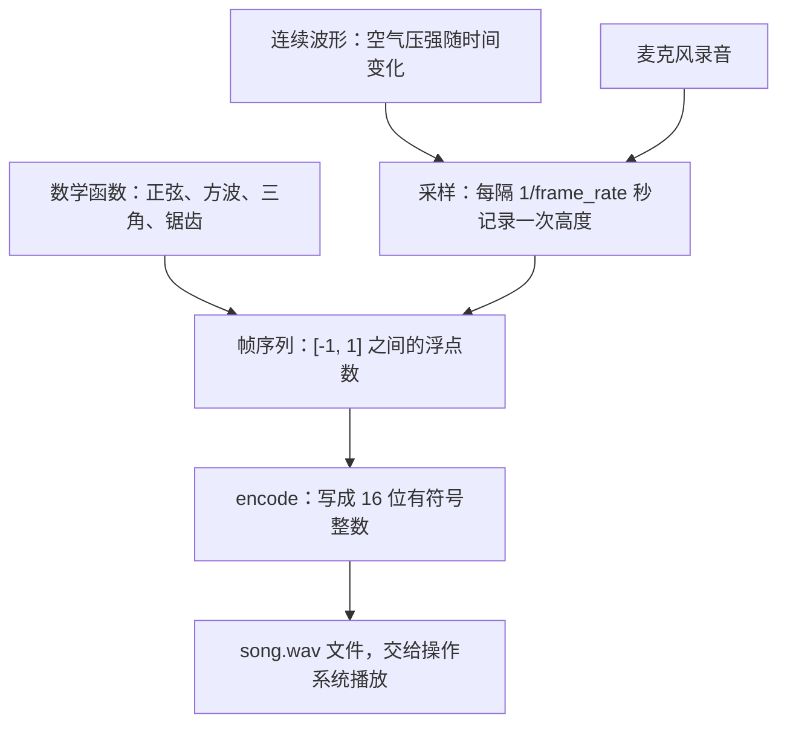
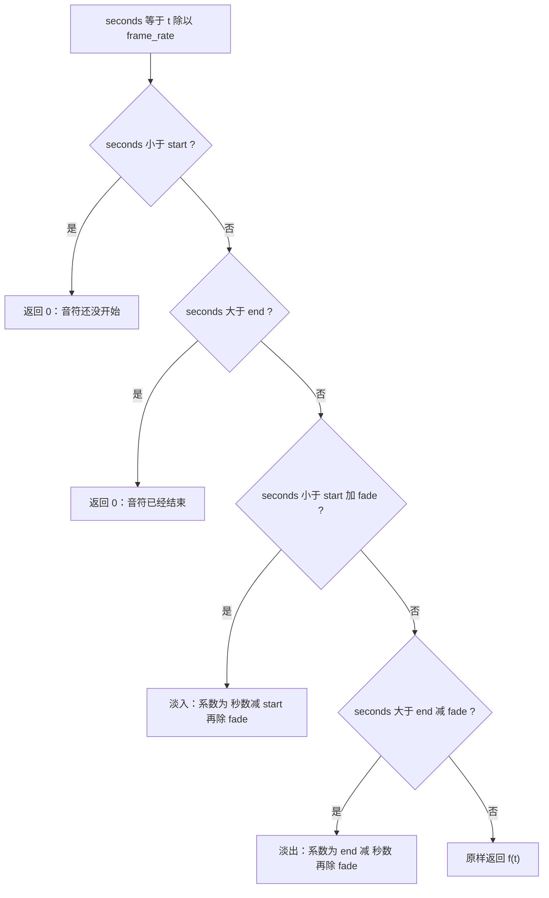
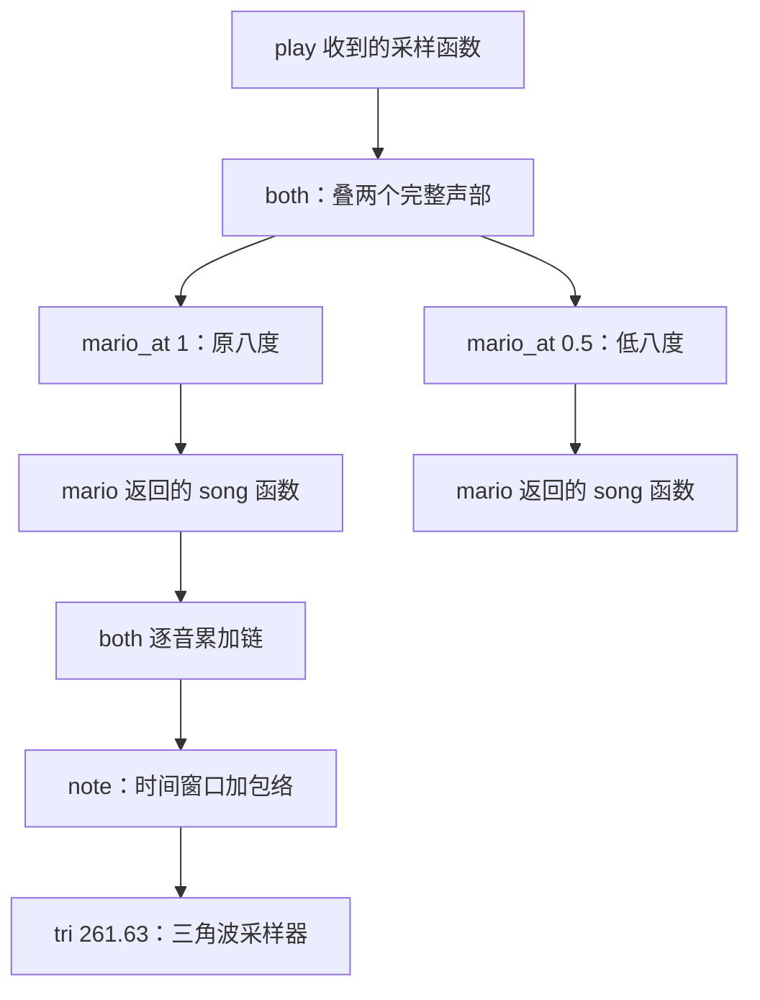

> **课程**：UC Berkeley CS61A · Structure and Interpretation of Computer Programs（Fall 2024）
> **本讲**：Lecture 6 ｜ 14:36 ｜ B 站分 P 6 ｜ [原视频](https://www.bilibili.com/video/BV1sy411z7nA?p=6)
> **课件**：无官方课件（选修专题，`pdf_pages = 0`）；正文改用代码块、公式与表格承接原属幻灯片的图示
> **字幕**：B 站英文原声字幕（14:36，157 段）；本笔记是中文书面化重构，非逐句翻译
> **版权**：课程与课件版权归 UC Berkeley CS61A 教学团队；本文为学习用途的二次整理

## 本讲速览

*(参考时间: 00:00:01 – 00:00:12｜Lecture 6)*

- **已掌握**：函数是一等值（可传参、可返回）、`lambda` 与闭包、`make_adder` 这类返回函数的高阶函数（Higher-Order Function），以及"名字绑定到值、函数绑定到父环境"的环境图读法。
- **本讲主线**：
    - 一段声音就是"时间 → 振幅"的函数，于是"合成声音"被翻译成"构造函数"；
    - 用帧率 `frame_rate` 把连续函数离散成帧序列，写进 `.wav` 文件；
    - 用 `tri` 造单个波形，用 `both` 把两个波形相加得到和弦，用 `note` 把波形切进时间窗口并补上淡入淡出；
    - 用时间指针 `z` 与 `both` 的反复累加，把整首曲子折叠成**一个**函数；
    - 用 `mario_at(octave)` 把频率倍率参数化，一行代码完成移调。
- **关键结论**：整首曲子在被 `play` 逐帧调用之前并不是数据，而是一个**尚未求值的函数**。这种"描述"与"求值"的分离，正是高阶函数真正值钱的地方。

## 1. 问题的来处：为什么要"在函数空间里"工作

*(参考时间: 00:00:13 – 00:00:27｜Lecture 6)*

学生最常问的问题是：高阶函数到底有什么用？`make_adder` 很可爱，但既然最后还是要算出 `x + y`，为什么不直接把 `x` 和 `y` 相加，而要先绕一圈造出函数、再调用它得到一个数？

讲师没有正面辩论，而是换了一条更硬的证据路线：构造一个比平时稍长的例子，里面定义**一堆**函数，让整个程序**一直待在函数空间里**，直到程序最后一步才把函数变成具体的数值。这个例子就是生成声音——把一段音乐写成一个 `.wav` 文件。

选择声音而不是继续用加法，是有讲究的。加法里"函数"看起来是多余的中间层，因为一步就能算完；声音合成则相反，任何一段音乐都不可能一步算完：它需要波形、需要多个声部、需要节奏、需要移调，每一项都天然是一个"数值到数值"的变换。当这些变换全部被写成函数时，组合它们只需要写函数调用，而不需要写任何框架代码。

本讲后文出现的每一个新函数——`tri`、`both`、`note`、`mario_at`——都只做同一件事：接受函数或数字，返回**一个新函数**。整个程序里只有 `play` 会真正"去问值"。可以用一张表把这两种写法摆在一起：

| 判据 | 立刻求值：直接算 `x + y` | 函数空间：`add(x)` 返回 `lambda y: x + y` |
|---|---|---|
| 结果什么时候产生 | 调用的一瞬间 | 直到最后一刻才被求值 |
| 能参与的组合 | 只能与数值打交道 | 可以与任意其它函数组合 |
| 参数结构能否复用 | 不能，每次重写 | 能，闭包记住先前绑定的名字 |
| 表达复杂结构的能力 | 随规模线性膨胀 | 与音乐结构同构，几乎不增长 |
| 调试方式 | 直接看返回值 | 挑几个点抽样求值再观察 |
| 本讲的实例 | 手算一个音高 | `tri` → `both` → `note` → `play` 的整条流水线 |

## 2. 声音如何变成数字：波形、采样与 WAV

*(参考时间: 00:00:28 – 00:01:57｜Lecture 6)*

要做这件事，先要有一个能落地声音的文件格式。讲师选的是 **WAV**（`.wav`）：它是编码声音的标准格式，如今用得不多，因为文件很大——它**完全不压缩**。缺点正是优点的另一面：不带压缩意味着格式极简，简到程序可以自己在文件头写上几个字段，然后一个字节一个字节地把声音灌进去。

声音的物理形态是一条**波形（waveform）**：空气压强随时间连续起伏，波形在任意时刻都有一个高度，叫作**振幅（amplitude）**。连续的东西计算机存不下，于是有了**采样（sampling）**：只在一些特定的时刻记录波的高度，把连续曲线变成一串点。讲师特意点明屏幕上那些圆点就是样本，并感谢 Wikipedia 提供了那张示意图片。

采样要多密才够？判断标准不是数学上的精确，而是"人耳觉得这个声音是对的"。讲师的说法是要取足够多的样本，才能把波形结构逼近到听起来舒服的程度。这里他给了两个量级：一是每秒上万个点，二是随后 2 秒的曲子要调用采样函数两万多次。

> **编者说明**：字幕里讲师说成了"每分钟一万一千个采样"，但从后文"要调用两万多次"反推，显然是指**每秒**。课程演示文件里帧率取 `frame_rate = 11025`，2 秒即 22050 帧，与"两万多次"完全吻合。

波的来源有两种。一种是现实世界录音，把麦克风收到的压强变化采成帧；另一种是**按数学函数从零生成**——这正是本讲的做法，因为只有后者才需要写出函数。数学上最常用的几种基础波形是：三角波（triangle）、正弦波（sine）、方波（square）、锯齿波（sawtooth）。它们在各种电子音乐里都被大量使用。讲师选择了三角波做演示，理由很直接：他觉得三角波的听感比另外三种都好。

| 波形 | 一个周期内的形状 | 由什么参数决定音高 | 讲师的处理 |
|---|---|---|---|
| 正弦波（sine） | 平滑地升到峰、再平滑地降回谷 | 频率 | 未使用 |
| 方波（square） | 在两个极值之间瞬间跳变 | 频率 | 未使用 |
| 三角波（triangle） | 匀速升到峰，再匀速降回谷 | 频率 | 采用，理由是听感最好 |
| 锯齿波（sawtooth） | 匀速上升到峰后瞬间跌回谷底 | 频率 | 作为三角波的中间产物使用 |

> **编者说明**：上表第二列只是这四种波形的数学定义，讲师只点了名字并说明它们在电子音乐中都有用途，没有逐个播放比较音色。真正被使用的那种波形（三角波）在 3.6 节展开。

把整条管线画出来，就是"连续波形 → 离散帧 → 编码 → 文件"三段：



## 3. 波形即函数：`tri`、帧率与采样器

*(参考时间: 00:01:58 – 00:05:26｜Lecture 6)*

### 3.1 先认识三个标准库工具

讲师没有逐行敲代码，只交代了这个演示依赖的三个零件。第一个是 `wave` 模块，负责打开与写入 `.wav` 文件，讲师说"有一个完整的模块专门处理 wave，你可以去读"。第二个是 `struct` 模块，负责把整数按 WAV 文件要求的字节格式编码。第三个是 `math.floor`，向上取整的反面——它把一个数舍入到"小于该值的最大整数"，后面的三角波公式要靠它把相位折回一个周期内。

```python
from wave import open
from struct import Struct
from math import floor

frame_rate = 11025
```

### 3.2 帧率：把连续时间切成帧

`frame_rate` 是**采样率**，它回答一个很朴素的问题：每秒记录多少次"这一刻波形有多高"。这个数不能太小，否则耳朵会听出阶梯；也不必过大，因为超过人耳分辨能力的精度只是在浪费磁盘。演示取 11025，即每秒 11025 帧。

一旦有了帧率，"时间"这件事就被拆成了两个坐标：帧号 `t` 是**离散的整数**，秒数 `t / frame_rate` 是**连续的时间**。后面所有函数都在两者之间来回换算——`tri` 收帧号，`note` 把帧号换回秒来判断音符边界。这个换算关系是整个程序设计的地基，值得单独记住。

### 3.3 `encode`：把振幅写成两个字节

```python
def encode(x):
    """Encode float x between -1 and 1 as two bytes."""
    i = int(16384 * x)
    return Struct('h').pack(i)
```

讲师在这里说了一句很有意思的话：这一段"我建议你不要读"，当然你非要读也可以。它的全部工作就是把 `[-1, 1]` 之间的浮点振幅线性放大成整数，再打包成两个字节。真正需要记住的不是位运算细节，而是**契约**：进来的数必须落在 `[-1, 1]`，出去的字节序列是 WAV 能接受的格式。

> **编者说明**：系数 16384 是 $2^{14}$，对应 16 位有符号整数上限 32767 的一半左右，故意留了一倍余量。这不是随手取的——多声部叠加后总振幅可能超过 1（见 5.4 节），留余量可以避免整数溢出后再被截断。字幕中讲师说这部分"可以去查 Python 文档"，函数体本身没有逐字念出，此处按课程演示文件补全。

### 3.4 `play`：一个只负责"何时问"的循环

```python
def play(sampler, name='song.wav', seconds=2):
    """Write the output of a sampler function as a wav file."""
    out = open(name, 'wb')
    out.setnchannels(1)
    out.setsampwidth(2)
    out.setframerate(frame_rate)
    t = 0
    while t < seconds * frame_rate:
        sample = sampler(t)
        out.writeframes(encode(sample))
        t = t + 1
    out.close()
```

三行 `set...` 是写文件头：单声道、每个样本 2 字节、帧率 11025。循环里做四件事：问 `sampler(t)` 要这一帧的高度、编码成字节、写进文件、把帧号加一。循环条件是 `t < seconds * frame_rate`，也就是"整首曲子一共有多少帧"——讲师的说法是"从歌的开头出发，走遍全部 `t`，也就是秒数乘以帧率那么多帧"。

这段代码最值得注意的是它**不知道**的事。它不知道 `sampler` 是三角波还是和弦，不知道它是一个闭包还是一层层嵌套的高阶函数调用，也不知道这个函数写得对不对。它只依赖两个约定：参数是一个**函数**，返回值落在 `[-1, 1]`。这正是控制反转（inversion of control）的教科书式例子：把"值从哪里来"的决定权交给调用者，`play` 只保留"何时问、问几次、怎么存"的职责。

换句话说，`play` 是这一讲的**求值器**：它负责把描述变成数据，而所有设计都发生在别处。

### 3.5 采样器的契约：`[-1, 1]` 是什么意思

讲师手绘了一条波形，然后说明如果要把那条波合成出来，采样器在相邻几帧上给出的数值可能是 `0`、`1/2`、`1`、`3/4`、`1/2`、`2/3`……这就是"样本"的直观含义：每一帧只有一个数，它告诉声卡此刻振膜该推到多远。

为什么统一用 `[-1, 1]` 而不是别的刻度？

- `0` 表示静音、`±1` 表示振幅上限，这个约定让"音量"变成可以独立提取的乘数，波形的**形状**与**响度**因此解耦；
- 归一化之后，同一个波形函数可以原封不动地换一个振幅使用，不必关心声卡实际的位深；
- 多个波形相加时，是否超出范围可以立刻从数值上看出来。

这个契约也是整讲的"接口卡"：只要遵守它，任何函数都是一个合法的声音。

### 3.6 三角波：一个周期要多少帧

讲师提出的问题是：三角形的采样值怎么算出来？答案是先要知道两件事——**频率**决定音高，**振幅**决定音量。剩下的就是一个"相当直接"的公式：算出三角波重复一次需要多少个时间步，也就是一个周期占多少帧，然后按这个周期把时间折回去。

记帧率 $f_r$、音高频率 $f$，则一个周期的帧数为


$$
p = \frac{f_r}{f}
$$


用 $p$ 把帧号折成一个锯齿相位，再取绝对值折回，就得到三角波：


$$
s(t) = \frac{t}{p} - \left\lfloor \frac{t}{p} + \frac{1}{2} \right\rfloor,\qquad s \in \left(-\tfrac{1}{2}, \tfrac{1}{2}\right]
$$


$$
\tau(t) = 2\,\left|2\,s(t)\right| - 1,\qquad y(t) = A\,\tau(t)
$$


`saw_wave` 就是 $s(t)$：它匀速上升、到边界处突然跌回去，是锯齿波。`abs` 把锯齿的负半段翻上来，变成来回折返的形状（这就是为什么 $s$ 与 $-s$ 的绝对值相同）。最后乘上振幅 $A$，输出的范围恰好是 $[-A, A]$。

```python
def tri(frequency, amplitude=0.3):
    """A continuous triangle wave."""
    period = frame_rate / frequency
    def sampler(t):
        saw_wave = t / period - floor(t / period + 0.5)
        tri_wave = 2 * abs(2 * saw_wave) - 1
        return amplitude * tri_wave
    return sampler
```

这个函数是一个典型的**波形工厂**：它接受两个数字（频率、振幅），返回一个采样函数。频率与振幅被闭包记住，之后每次被 `play` 调用，都只是用记在环境里的 `period` 和 `amplitude` 算出一个数。

> **编者说明**：字幕只描述了三个步骤（先造锯齿波、取绝对值、乘振幅），没有逐字念出表达式。上面的写法取自课程演示文件，并与讲师 00:05:49–00:06:07 现场打印的数值形态核对过：$t = 0$ 时 $s = 0$、$\tau = -1$，输出 $-0.3$，正是他屏幕上出现的第一个数。

把前几个关键相位代进去，就能看到这条曲线为什么"看起来像三角形"：

| 帧号 $t$ | 相位 $t/p$ | 锯齿 $s(t)$ | 折叠 $\tau(t)$ | 输出（$A=0.3$） |
|---|---|---|---|---|
| `0` | 0 | 0 | -1.00 | -0.30 |
| `0.25p ≈ 11` | 0.25 | 0.25 | 0.00 | 0.00 |
| `0.5p ≈ 21` | 0.5 | -0.5 | +1.00 | +0.30 |
| `0.75p ≈ 32` | 0.75 | -0.25 | 0.00 | 0.00 |
| `1p ≈ 42` | 1 | 0 | -1.00 | -0.30 |
| `1.5p ≈ 63` | 1.5 | -0.5 | +1.00 | +0.30 |

从表里能看出三角波的节奏：第 0 帧到半周期从 $-0.3$ 匀速升到 $+0.3$，半周期到一周期再匀速降回 $-0.3$。斜率是常数，这正是"三角"二字的来源。

### 3.7 音高：C 是 261.63 赫兹

讲师补了一行常数，把抽象的频率钉到一个具体的音上：中央 C 的频率是 `261.63`。他的解释很朴素——"这只是现代世界给乐器调音的一个事实"。有了它，`tri(261.63)` 就不再是一个抽象波形，而是钢琴上的那个 C。

> **编者说明**：261.63 Hz 对应十二平均律下的 C4（以 A4 = 440 Hz 为基准）。相等音程对应**频率的固定倍数**而不是固定差值，所以升高一个八度是频率乘 2，升高一个半音是乘 $2^{1/12}$——7.5 节的移调正是踩在这条性质上。字幕只念出了 C 的频率，下面代码里另外两个音按同一张十二平均律表补足。

```python
c_freq, e_freq, g_freq = 261.63, 329.63, 392.00
```

## 4. 第一次发声：100 帧的三角波与 `song.wav`

*(参考时间: 00:05:31 – 00:06:30｜Lecture 6)*

在把整首歌播出来之前，讲师先做了一件看起来多余的事：把三角波打印出来看。写法就是三段：

```python
t = 0
while t < 100:
    print(c(t))
    t = t + 1
```

100 帧在 11025 Hz 下只有约 9 毫秒，短到完全听不出形状；但它正好够看两三个周期。C 的周期是 $11025 / 261.63 \approx 42$ 帧，100 帧约 2.4 个周期，于是屏幕上会依次出现：

- 从 `-0.3` 开始（这就是振幅，讲师特意指出"因为那是我的振幅"）；
- 一路升到 `0`（约第 11 帧）；
- 继续升到 `+0.3`（约第 21 帧，半个周期）；
- 再落回 `-0.3`（约第 42 帧，一个周期）；
- 之后重复，又升到 `+0.3`。

这个输出与 3.6 节的表格完全对应。如果公式写错了（比如 `floor` 里的偏移少写一个 `0.5`，或者忘了取绝对值），打印出来的形态立刻会变成单调上升或只有半边的锯齿。这就是函数式程序的调试方式：结果不落地，就用**抽样求值**去看它——挑几个点问值，比盯着代码猜有效得多。

确认形态之后，`play(c)` 会生成 `song.wav`。讲师用操作系统打开这个文件，播放，听到的是 C 的三角波——一个持续 2 秒的、稳定到有点无聊的单音。

他对这个结果的评价是整讲的转折点："现在我能播放一个声音了，它听起来就是一段平平的音，但这是一个可以继续加工的东西。"单音之所以"平"，是因为它是一个与时间无关的周期函数；而音乐恰恰需要时间上的**变化**——变化来自叠加、来自窗口、来自移调，这些全都是函数之间的运算。

## 5. 和弦：声音函数的加法

*(参考时间: 00:06:33 – 00:07:48｜Lecture 6)*

### 5.1 两个音同时响，在数学上意味着什么

第二个问题是：让两个音同时发声是什么意思？讲师给出的推理只有一句，但很关键：需要一个函数，它能同时"播放"某个 `f` 和某个 `g`，而 `f`、`g` 本身都是函数；那么这个新函数就是"给定 `t`，返回 `f(t)` 与 `g(t)` 之和"的函数。

物理上这几乎不需要辩护：同一时刻两个声源推同一块空气，总压强是两者之和，于是振幅相加。数学上的好处是它把"合奏"这件复杂的事，压缩成一次加法运算。

> **编者说明**：上一句的物理依据是声学里的叠加原理（superposition）。讲师在字幕中只给出了结论——"同时播放 `f` 和 `g`，就是返回 `f(t) + g(t)`"——没有展开为什么可以相加，这一句因果是补充的。

```python
def both(f, g):
    return lambda t: f(t) + g(t)

play(both(tri(c_freq), tri(e_freq)))
```

播放的结果是 C 与 E 同时响，一个最简单的二度和音。

### 5.2 `return` 的必须是函数

讲师当场提醒了一句："别忘了返回一个函数。" 这句话点出了一个具体的错误模式。如果顺手写成

```python
def both(f, g):
    return f(t) + g(t)        # 错误：t 从哪来？
```

程序连运行都做不到，因为 `both` 的函数体里根本没有 `t`——它的形参是 `f` 和 `g`，两个**函数**，不是数字。`t` 必须由返回出去的那个新函数在**被调用时**引入，`lambda t:` 干的正是这件事。

这个细节把"函数是一等值"的两层含义区分开了：函数可以作为参数传进来，也可以作为返回值送出去；而返回出去的那个函数，还会把被调用时才出现的参数一起接住。`both` 因此是一个**组合子**（combinator）：它不做计算，只负责把两个函数接线成第三个函数。

`both` 还有两个性质值得记住，它们不是讲师讲的，但解释了为什么这个写法这么好用：

- **结合律**：`both(both(f, g), h)` 与 `both(f, both(g, h))` 的每一帧输出都是 $f(t) + g(t) + h(t)$，声音完全相同。所以多个声部怎么分批合并都对，程序的形状可以随编排习惯伸缩。
- **可交换**：`both(f, g)` 与 `both(g, f)` 输出相同，因为实数的加法可交换。

> **编者说明**：结合律成立还有一个前提——参与合并的都是**纯函数**，同样的 `t` 总是给出同样的值。本讲的采样函数确实满足这点（`tri` 与 `note` 都不改变外部状态），所以可以放心重排。如果某个采样函数带有副作用（比如内部计数），结合律就会在"调用顺序"这个细节上失效。

### 5.3 为什么不用帧数组

到这里可以顺手回答一个自然的问题：既然最终要的是 22050 个数，为什么不直接算一个列表存起来，非要用函数？可以对照着看：

| 判据 | 帧数组 `[y(0), y(1), …]` | 采样函数 `lambda t: …` |
|---|---|---|
| 计算时机 | 构造时全部算完 | 每帧被调用时才算 |
| 未知长度的组合 | 必须先知道长度才能建表 | 任意组合，长度由 `play` 决定 |
| 叠加两个声部 | 逐元素相加，需要等长 | 直接 `f(t) + g(t)`，无需对齐 |
| 截取一个音符 | 切片，越界要特殊处理 | 在函数里判断秒数，返回 `0` |
| 复用成本 | 每种时长都要重算一遍 | 同一个函数可被任意多次、任意区间取用 |

数组是"已经算完的声音"，函数是"知道怎么算的声音"。前者损失了结构信息，后者把它保住了——所以 `note` 可以在**任何**波形上开时间窗，而 `both` 可以把**任何**两段声音叠起来。

> **编者说明**：这也是第 1 章"一直待在函数空间里"那句话的实质内容。代价同样真实：函数版本无法随机访问（没有 `y[500]` 这种写法），调试只能靠抽样求值，性能上也少了向量化批处理的机会。取舍点在于：这一讲的程序里，组合次数远多于求值次数，所以延迟求值划算。

### 5.4 振幅预算与削波

`both` 之后，总振幅是两个波形之和。每个 `tri` 的振幅是 `0.3`，两个叠起来最大 `0.6`，还留在 `[-1, 1]` 里，所以听感干净。但如果叠四个、八个声部，或者把振幅调到 `0.8`，总和就会越过 `1`：

- `encode` 会把它当成更大的整数，超出 16 位范围后**溢出**，产生刺耳的爆音；
- 即使不溢出，超过满刻度的部分也会被设备**削波**（clipping），波形顶部被压平，音色变脏。

所以在真实合成里，声部数量与单声部振幅要一起算预算。本讲整个流程用 `0.3` 做默认振幅，正是给"再多叠一层"留了空间。

> **编者说明**：削波与溢出的区别、以及"总振幅不超过 1"的经验法则，是音频工程里的通用常识，讲师没有展开；这里把它放在 `both` 之后，是因为只有出现加法才需要这个预算。

## 6. 音符与包络：`note` 的时间窗口与淡入淡出

*(参考时间: 00:07:49 – 00:10:56｜Lecture 6)*

### 6.1 从"一直响"到"响一段"

`tri` 生成的音会一直响下去，而音乐是由一段一段的音符构成的。讲师的下一个动作是定义一个函数：它接受某个声音 `f`，只让 `f` 在 `start` 到 `end` 之间发声，两个端点都以**秒**为单位。做法是再造一层：

```python
def note(f, start, end):
    """Play f for a fixed duration."""
    def sampler(t):
        seconds = t / frame_rate
        if seconds < start:
            return 0
        elif seconds > end:
            return 0
        return f(t)
    return sampler
```

注意第一行 `seconds = t / frame_rate` 的作用：外界用秒说话，`play` 用帧号说话，`note` 就是那个翻译层。讲师的原话是"先把 `t` 表示成秒，也就是 `t` 除以帧率"，然后判断这个秒数是否落在区间里——小于起点返回 `0`，大于终点返回 `0`，否则老老实实调用 `f(t)`。

把 `c` 做成一个四分音符（`0` 到 `0.25` 秒）之后，听到的是"大段静音加开头一个小蜂鸣"。这是因为 `play` 默认播 2 秒，而音符只占前 1/4 秒。想听两个音，就把两个 `note` 叠起来：

```python
song = both(note(c, 0, 0.25), note(e, 0.5, 1))
```

C 在开头响四分音符，E 从半秒处开始响半秒。这一次听起来"有点像样了"，但也暴露了新问题。

### 6.2 爆音：阶跃为什么会被听见

讲师听到的第二个版本"每个音的开头和结尾都有点刺，几乎像刮擦"。这不是错觉，也不是扬声器的问题，而是波形本身在边界处发生了**跳变**：

- 音符开始的那一帧，输出从 `0` 瞬间跳到 `f(t)` 的某个非零值；
- 音符结束的那一帧，又从非零值瞬间跳回 `0`。

理想的阶跃在频域里包含无穷多的高频分量，扬声器振膜来不及跟随这种突变，于是发出"咔"的一声——工程师管它叫 click 或 pop。讲师把这件事的重要性抬得很高："让每个音听起来是对的，是做音乐很重要的一部分。"

> **编者说明**：字幕里讲师只描述了听感（"刺"、"像刮擦"），"阶跃包含高频分量、振膜跟不上"是根据听感补出的机制，也是采样合成里最常见的 artifact（伪影）之一，同类的还有直流偏移与量化噪声。解决方向不止一种——包络、抖动、过采样都可以；本讲选的是最朴素也最有效的一种：把边界的跳变抹成斜坡。

### 6.3 用淡入淡出把边界抹平

修法是在每个音符的开头和结尾各加一小段淡入/淡出（fade），讲师先按 `0.01` 秒（一个百分之一秒）来设计：让振幅在那段时间里线性地从 `0` 升起来，结尾再线性地降下去。

```python
def note(f, start, end, fade=0.01):
    """Play f for a fixed duration, with a short fade in and out."""
    def sampler(t):
        seconds = t / frame_rate
        if seconds < start:
            return 0
        elif seconds > end:
            return 0
        elif seconds < start + fade:
            return (seconds - start) / fade * f(t)
        elif seconds > end - fade:
            return (end - seconds) / fade * f(t)
        return f(t)
    return sampler
```

两个新增分支各自乘上一个系数：

- 淡入段：$\dfrac{\text{seconds} - \text{start}}{\text{fade}}$，从 `0` 线性升到 `1`；
- 淡出段：$\dfrac{\text{end} - \text{seconds}}{\text{fade}}$，从 `1` 线性降到 `0`。

这个乘数序列有一个专门的名字：**包络（envelope）**——它不是波形本身，而是包在波形外面、随时间变化的一层振幅控制。波形决定音色，包络决定这个音怎么开始、怎么结束。

四个区间的判定顺序不能随便换。下图是必须按这个顺序走过的判定链：



| 秒数所在区间 | 返回 | 音乐含义 |
|---|---|---|
| `seconds < start` | `0` | 还没轮到它 |
| `seconds > end` | `0` | 已经结束 |
| `start ≤ seconds < start + fade` | 线性乘子 × `f(t)` | 起音（fade in） |
| `end - fade < seconds ≤ end` | 线性乘子 × `f(t)` | 收音（fade out） |
| 其余 | `f(t)` | 音符的稳态部分 |

### 6.4 淡入淡出到底多长

为了让人**听出**差别，讲师先把 `fade` 调到 `0.1` 秒——这时听到的是每个音都明显地"渐强渐弱"，像被人用手拧了旋钮。然后他又把 `fade` 改回极短：

- 听感上，音符像是"马上就开始了"，起音依旧果断；
- 技术上，斜率的量级被压到很小，振膜跟得上，爆音消失；
- 最终效果是"两个干净利落的蜂鸣"。

这个来回调整解释了 `fade=0.01` 这个默认值的来历：它足够短，短到不改变音符的性格；又足够长，长到能抹掉边界的阶跃。参数不在数学里，而在听觉里——这也是音频工程和纯数学不一样的地方。

> **编者说明**：这个写法有一个隐含限制。判定的顺序是"先淡入分支、后淡出分支"，如果某个音符的时长比 `2 * fade` 还短（本例中即短于 0.02 秒），两个斜坡会重叠，淡入分支先命中、淡出分支永远轮不到，音符就在满振幅处被硬生生截断，爆音又回来了。真正要写极短的音符时，要么缩小 `fade`，要么让淡入系数取两者中较小的那个 $\min\left(\dfrac{\text{seconds} - \text{start}}{\text{fade}}, \dfrac{\text{end} - \text{seconds}}{\text{fade}}\right)$。讲师在演示里用的最短音符是八分之一秒，远大于阈值，所以没有碰上这个问题。

## 7. 编曲：把一整首歌折叠成一个函数

*(参考时间: 00:10:57 – 00:14:07｜Lecture 6)*

### 7.1 一个时间指针 `z` 加一个不断累加的 `song`

有了 `tri`、`both`、`note`，编曲就只剩记账。讲师引入一个变量 `z` 记住"现在走到歌的第几秒"，从 `0` 开始；每放一个音，`song` 就被替换成"原来的歌加上这个音"：

```python
z = 0
song = note(c, z, z + 1/4)              # 第一个音：C，四分音符
z = z + 1/4
song = both(song, note(e, z, z + 1/8))  # 接着一个 E，八分音符
z = z + 1/8
song = both(song, note(g, z, z + 1/4))      # G，四分音符
z = z + 1/4
song = both(song, note(low_g, z, z + 1/4))  # 低八度的 G
```

关键在 `song` 这个变量始终保存**一个函数**，而不是音频数据。每执行一次 `both`，不过是把旧函数用一层新的 `both` 包起来，形成一条越来越深的组合链——直到最后交给 `play`，它才被逐帧求值。

> **编者说明**：字幕记录的是讲师逐音推进的过程与时值记账，屏幕上逐行敲出的完整音符序列没有被逐字念出，上面这段按他描述的节奏整理成等价写法，重点是 `z` 指针与 `song = both(song, …)` 的累加模式，而非音符的绝对准确。他现场核算过总量："三个四分音符加两个八分音符正好凑成一整秒"，与循环上限 `seconds * frame_rate` 对齐。

### 7.2 休止符不是函数，是块空地

这套设计里，"休止"处理得很轻：既然没被 `note` 覆盖的时间段自动是 `0`，那么休止只需要**不动 `song`、只把 `z` 往后推**。讲师的做法是先放一个八分音符的 E，再前进一个八分音符而不放任何音——"一个八分音符后面跟一个八分休止符"。

这体现了一个接口设计上的优点：`note` 用"区间外返回 `0`"定义了沉默，于是"沉默"不需要是一个对象，它只需要没有人说话。反过来，如果一开始就把音频做成帧数组，静音就得靠一段填零的数组来表示，长度与位置都要人工对齐。

### 7.3 低八度的 G：把频率减半

曲子需要一个低音。讲师的处理只有一句：**把频率减半**。`tri(g_freq / 2)` 就是比 G 低一个八度的 G。

这个操作之所以是"除以二"而不是"减去某个数"，来自 3.7 节提到的那条性质：音程在频率上是**倍数**关系，一个八度恰好是 2 倍。所以降八度除以 2，升八度乘以 2，两者互为反操作。

### 7.4 包成函数：`mario(c, e, g, low_g)`

到这里，整首歌已经能播放了，但它是写死的：频率是外部那几个常量，换一个调就得改一堆数字。讲师于是把整段编排包进一个函数，让它接收四个音符函数——`c`、`e`、`g`、`low_g`——并返回生成好的 `song`。

这一步在方法上是纯粹的：**把自由变量提成参数**。同一个函数就重复可用很多次。此处的自由变量是频率，提成参数之后，复用方式立刻变成"换一套音高再生成一遍"。

### 7.5 `mario_at(octave)`：让倍率成为参数

讲师接着又加了一层：

```python
def mario_at(octave):
    c, e = tri(octave * c_freq), tri(octave * e_freq)
    g, low_g = tri(octave * g_freq), tri(octave * g_freq / 2)
    return mario(c, e, g, low_g)
```

四个局部名字按传入的 `octave` 缩放频率，然后交给 `mario` 生成整首曲子。讲师强调了他自己的参数约定：`octave` 是**倍率**而不是音名——"如果 `octave` 说高一个八度，就写 `2`，它把所有频率乘以 2；如果想降一个八度，就除以 2，或者乘以 1/2"。

于是移调变成了一行调用：`mario_at(1)` 是原来的调，`mario_at(1/2)` 是低了一个八度的同一首曲子。旋律、节奏、包络完全不变，因为它们写在 `mario` 里，与频率无关——这正是一次干净的重构：**变的部分参数化，不变的部分不要碰**。

### 7.6 叠起来：两个八度的同一首歌

最后一步是把两个八度的版本同时播放：

```python
play(both(mario_at(1), mario_at(1/2)))
```

`both` 在这里的角色从"和弦"升级成了"声部"：它叠的不再是两个音，而是两整首曲子。讲师在播放之前的自评是——既然一切都表示为函数，函数就可以按任何方式组合。

整首曲子的结构因此是一棵树，而 `play` 只接触树根：



树的每一层都只是"返回一个函数"，没有任何一层产生音频数据。数据只在最下面 `play` 的 `while` 循环里出现，一帧一帧地被问出来。

### 7.7 三种算子的分工

回顾整条流水线，全部音乐上的概念都被压缩到了三个高阶函数上：

| 判据 | `both(f, g)` | `note(f, start, end)` | `mario_at(octave)` |
|---|---|---|---|
| 输入 | 两个采样函数 | 一个采样函数加时间区间 | 一个倍率数字 |
| 输出 | 一个新的采样函数 | 一个新的采样函数 | 一整首曲子（采样函数） |
| 对应的音乐概念 | 同时发声、和弦、声部叠加 | 音符的时值与包络 | 移调、八度 |
| 变量维度 | 声部 | 时间 | 频率 |
| 结构代价 | 常数 | 常数 | 包住整首歌 |

三者的共同点是：都**不改动**原来的函数，只在外层套一个新的。这种"不修改、只组合"的风格，让每一种效果都可以独立推理——调整包络不会影响旋律、换八度不会影响节奏。

## 小结

*(参考时间: 00:14:11 – 00:14:34｜Lecture 6)*

讲师收尾时说的那段话，其实就是对开头问题的回答：这就是用计算机做音乐的方式——定义函数，用一个由 `both` 与 `tri` 搭出来的精巧函数把各种东西组合在一起，最后把这个函数交给 `play`；`play` 在每一个 `t` 上调用它，把结果写进文件，于是就有了歌。回到 `make_adder` 的疑问：`add(x)` 与 `both(f, g)` 是同一种能力的两种尺度，前者只在一个数上体现，后者在整首曲子上体现。

可迁移的方法论：

- **先分清"描述"与"求值"两段**。整讲所有设计都发生在描述阶段，只有 `play` 的循环属于求值阶段；把这条分界线画出来，复杂系统就有了可推理的结构。
- **寻找领域里的"闭合算子"**。同时发声是加法，于是有 `both`；音符是时间窗，于是有 `note`；移调是频率倍率，于是有 `mario_at`。好的算子让新需求变成组合旧算子，而不是新写一段代码。
- **参数化"会变的部分"，别碰"不变的部分"**。`mario` 接收四个音符函数、`mario_at` 接收一个倍率，两级参数化各自只负责一个维度。
- **接口的接缝处最容易出问题**。爆音不在波形公式里，也不在采样率里，而在"从静音切到发声"的那一帧上；包络就是给接缝加的一段缓冲。
- **结果不落地，就用抽样求值去观察**。打印 100 帧就能验证三角波的公式，比读十遍代码更快；延迟求值的代价是"看不见结果"，回报是"可以任意组合"。
- **契约比实现重要**。`play` 只要求"一个接受帧号、返回 `[-1, 1]` 的函数"，整个音乐系统都建立在这一句约定上。

## 附：本讲幻灯片索引

本讲是选修专题，官方没有配套课件（`pdf_pages = 0`），因此没有幻灯片页可供索引，也没有任何 `slide_*.png` 被引用。这一节是自检附录，不对应视频里的任何时段，故不设时间锚点。正文中原本属于幻灯片的图示（采样示意、波形叠加、包络形状、组合树）已改用公式、对照表与 Mermaid 图表达；唯一无法用文字替代的是讲师屏幕上那张来自 Wikipedia 的采样示意图，正文已在第 2 节用文字与流程图复述其结构。
