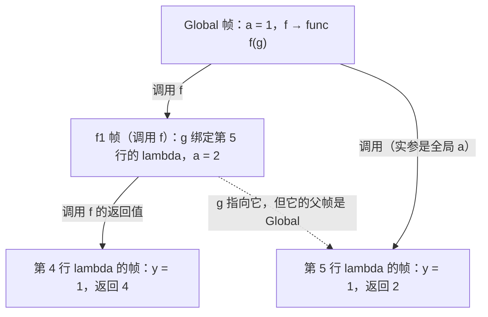
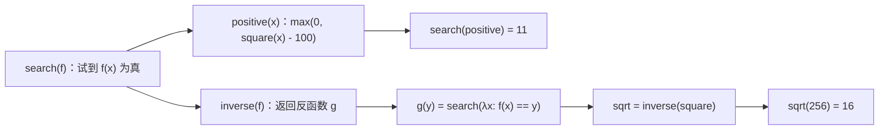
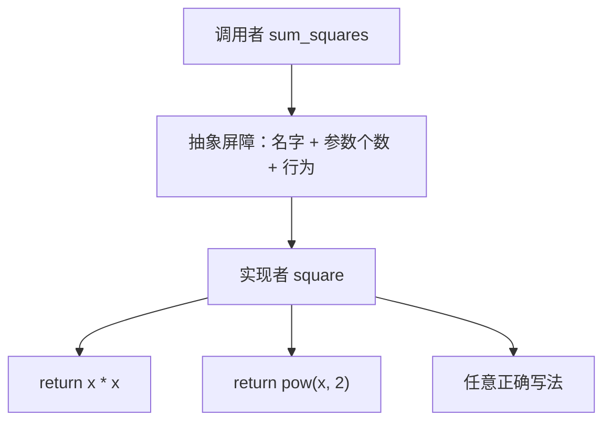

> **课程**：UC Berkeley CS61A · Structure and Interpretation of Computer Programs（Fall 2024）
> **本讲**：Lecture 7 ｜ 30:05 ｜ B 站分 P 7 ｜ [原视频](https://www.bilibili.com/video/BV1sy411z7nA?p=7)
> **课件**：`06-Functional_Abstraction_1pp.pdf`（16 页，官方 PDF，逐页渲染图见正文插图）
> **字幕**：B 站英文原声字幕；本笔记是中文书面化重构，非逐句翻译
> **版权**：课程与课件版权归 UC Berkeley CS61A 教学团队（教材 Composing Programs 依 CC BY-NC-SA 4.0 发布）；本文为学习用途的二次整理

## 本讲速览

- **已掌握**：环境图三件套（帧、父帧、沿父帧查名字）；函数是值，可以当参数与返回值；`if` 与 `while` 的条件判据；`def`、`return` 的基本用法；Hog 项目里"掷一次骰子"的零参数函数。
- **本讲主线**：
    - lambda 表达式"出生"在哪一帧，父帧就是哪一帧，于是决定它看到哪一个 `a`；
    - `return` 只做一件事——给调用表达式一个值，一旦执行，本次调用结束；
    - 用 `while True` 加 `return` 把"找一个满足条件的整数"写成高阶函数 `search`，再用它定义反函数与平方根；
    - 函数抽象的契约只有"几个参数"和"什么行为"两条，实现怎么算、内部叫什么，调用者不该知道；
    - 名字不影响程序对错，只影响程序能不能被人读；
    - 语法错误、运行时错误、逻辑错误各有各的发现机制，traceback 要读整条调用链。
- **关键结论**：父帧在函数被创建时确定（词法作用域），所以内层函数总能看到外层的局部变量，哪怕外层早就返回了——这就是闭包。

*(参考时间: 00:00:00 – 00:02:20｜Lecture 7)*

## 1. 考前一周：课程安排与课件上的复习页

*(参考时间: 00:00:05 – 00:02:20｜Lecture 7)*

本讲的前两分钟不讲新知识，而是把接下来十天的日程摆清楚：两份作业、一个项目的 checkpoint、一场期中考试。这些日期决定了这一周时间该花在哪里，也解释了为什么课件前半叠是复习页而不是新内容。


### 1.1 作业、项目与期中的时间线

Homework 2 在周四截止。Hog 项目下周三才截止，但在下周二之前交可以拿到提前提交分（early submission point）；更需要盯住的是 phase one——本周二之前跑通才有 checkpoint。讲师说 checkpoint 只占一分，但一分也是分，值得拿，所以建议今天就把 phase one 做完。

期中是重头戏：Midterm 1 在下周一晚上，纸笔考试。往年的卷子全部公开，格式与往年（尤其是往年秋季学期）一致。考场上随卷发一份纸质的学习指南（study guide），内容就是从课程视频里截出来的幻灯片：各类表达式与语句的求值、执行规则，一张环境图的示例，`min`、`max`、`abs`、`pow` 这些内置函数的行为，以及一张更大的环境图。指南要提前翻一遍，考试时才知道东西在哪。

除指南外允许带一张纸、正反两面笔记（one-page, two-sided sheet of notes）；讲师建议在纸上写自己觉得有用的例子，而不是抄定义。晚上 8:00 到场找座位、领卷，8:10 开考。考试范围到 Lecture 5 为止，本周的课只是那批材料的练习。下周一停课，下周没有 lab，但本周的 lab 照常。把本周的 lab、discussion、Homework 2 和 Hog 做完之后，再掐时间做一套近年的真题，准备就差不多了。


> **编者说明**：课件第 3–8 页是本讲的复习与练习块（零参数函数、骰子、高阶循环、条件表达式、一道 Fall 2022 真题、真值表）。本段录像的语音只覆盖了两分钟的公告就转入 lambda，没有逐页展开这六页；下面按课件画面与课程材料补全，凡属课件之外的推理都会标出来，可以当作"讲师没讲但页面要求你会"的部分来读。

### 1.2 零参数函数：把"掷一次"变成一个值

第 3 页是一张分节页，标题是 `Zero-Argument Functions`，正文只有一行 `(Demo)`。


零参数函数没有任何形参，调用它只写一对空括号，返回值就是"掷了一次"的结果：

```python
import random

def six_sided():
    return random.randrange(1, 7)   # 1 到 6 的整数，具体写法不止一种
```

表达式 `six_sided` 的值是一个函数对象，`six_sided()` 的值才是一个点数。这对括号不是装饰：少了它，拿到的是"骰子"这件工具本身，而不是这次掷出来的结果。把它写成函数而不是常量，是因为每次调用都该重新掷一次——同一个表达式、不同结果，这正是需要函数而不是值的场合。

零参数函数在 Hog 项目里是策略的一部分：`repeats(20, six_sided)` 这样的调用把骰子作为参数传进去，处理函数就不必知道点数从哪来。测试时换一颗"每次都是 6"的假骰子，输出立刻变成确定的，逻辑是否正确一眼可验。

### 1.3 骰子函数与 repeats

下一页给了具体的任务：实现 `repeats`，返回 `n` 次掷骰中出现"相邻重复"的次数。示例是一串 20 次的结果，下划线标出 5 处相邻相同（3 3、2 2、2 2、4 4、5 5），所以 `repeat(20, six_sided)` 期望得到 5。


```python
def repeats(n, dice):
    count = 0
    previous = 0
    while n:
        outcome = dice()
        if previous == outcome:
            count += 1
        previous = outcome
        n -= 1
    return count
```

逐行读：`previous` 记住"上一颗骰子"，`outcome` 是"这一颗"；两者相等就记一次，然后无论相等与否都把 `previous` 更新成这一颗。`n -= 1` 负责倒数，`while n:` 用真值判断——`n` 减到 0 就为假，循环结束。

画面右侧是执行到中途的一个帧：`f1: repeats [parent=Global]`，`n = 20`，`dice` 一栏画着箭头指向一个函数对象，`count = 0`，`previous` 一栏的 `0` 被划掉，`outcome = 5`，`Return value` 还空着。也就是说这一帧停在第一轮 `outcome = dice()` 之后：掷出 5，与初值 0 不等，`count` 仍是 0。这个帧同时说明了两件事：形参 `dice` 里装的是函数对象，所以调用 `dice()` 才是在掷骰；`previous` 会被就地改写，环境图里同一个格子的值随时间变化。

三个设计细节值得停下来看：

1. `previous = 0` 是哨兵值（sentinel）。骰子只会出 1–6，永远不会等于 0，所以第一次比较必定为假，不会凭空多算一次。如果骰子可能掷出 0，这个初值就是错的，正确做法是让 `previous` 先取 `None`，或者把第一轮单独处理。
2. `previous = outcome` 在 `if` 外面、且无条件执行。它记录的是"上一颗骰子"，不是"上一次重复"；写进 `if` 里就会漏掉不重复的那些步。
3. `while n:` 依赖真值而不是 `n > 0`。两种写法在这里等价（`n` 是非负整数），但前者把"0 是假值"这条规则用上了；一旦 `n` 可能变成负数，两者就不再等价。

课件正文写的是 `repeat(20, six_sided) -> 5`，代码头写的却是 `def repeats(n, dice)`。一处名词单复数的不一致不影响程序，但它正好接上后文的命名话题：名字是写给人看的，同一个东西在一页纸上叫两个名字，读的人就要多花一次力气。

### 1.4 高阶循环：循环写在返回的函数里

第 5 页又是一个分节页，标题 `Higher-Order Loops`，配一行 `(Demo)` 和页面底部一个很长的 pythontutor 链接。


所谓"高阶循环"，指的是循环的边界由外层调用的参数决定，而循环体本身写在返回的函数里：

```python
def reprint(n):
    def a(word):
        k = n
        while k:
            print(word)
            k -= 1
    return a

reprint(2)('hey')
```

`reprint(2)` 返回的是 `a`，此时 `n` 已经不在任何活动帧里了，但 `a` 仍然记得它；`a('hey')` 打印两次 `hey`，返回值是 `None`。这里提前出现了一次"函数记住外层变量"的现象——它正是第 2 章要画清楚的东西，只是眼下还不需要画图。

> **编者说明**：这一页投影上只有标题、`(Demo)` 和链接，上面这段代码是从页面底部那个 pythontutor 链接里还原出来的，不是投影正文；讲师的现场演示内容没有出现在本段录像的字幕里。

### 1.5 条件表达式：`if` 的表达式版本

第 6 页是 `Conditional Expressions Practice`，同样只有标题。


条件表达式的形式是

```text
<consequent> if <predicate> else <alternative>
```

例如 `x if x >= 0 else -x` 与 `abs(x)` 等价。它和 `if` 语句的差别在于身份：`if` 是语句，执行它不产生值；条件表达式是表达式，一定产生一个值，因此可以出现在赋值右边、函数实参、以及 `lambda` 的函数体里。

两条硬规则要记住：`else` 分支不能省（表达式必须有值，不能不生产），而且两个分支只会有一个被求值，所以两边最好返回同类型的值。还有一条用法上的理由：`lambda` 的函数体只能是一个表达式，要写判断就只能用条件表达式，`if` 语句放不进去。

### 1.6 一道真题：`(3 and 4) - 5`

第 7 页直接贴了一道 Fall 2022 期中第一题的小问，画面上只有表达式本身：`(3 and 4) - 5`。


`and` 不是"把两边变成布尔再与"的运算。它的求值规则是：从左到右求值，遇到第一个假值就把它原样返回，全部为真则返回最后一个操作数的值。3 是真值，于是继续求 4，返回 4；`4 - 5` 得 `-1`。同理 `0 and 4` 返回 `0`，`'' or 'x'` 返回 `'x'`，`and` 与 `or` 返回的始终是操作数，而不是 `True`/`False`。

> **编者说明**：这一页只给了表达式，没有给答案；上面的求值过程是按 Python 的 `and` 语义推出来的，课件上没有写。

### 1.7 真值表：哪些值算真

第 8 页把"真值"单独列成一页，因为后面所有的 `while`、`if`、`and` 都靠它：


| 判据 | 表达式 | `bool(x)` | 说明 |
| --- | --- | --- | --- |
| 零 | `bool(0)` | `False` | 整数零是假 |
| 非零 | `bool(-1)` | `True` | 负数只要不是零就是真 |
| 浮点零 | `bool(0.0)` | `False` | 与整数零同理 |
| 空格串 | `bool(' ')` | `True` | 长度为一，非空即真 |
| 空串 | `bool('')` | `False` | 空序列是假 |
| 布尔假 | `bool(False)` | `False` | 原样返回 |
| 无返回值 | `bool(print('fool'))` | `False` | 先打印 `fool`，再判断 `print` 的返回值 `None` |

结论可以压成一句：假值只有 `False`、`None`、数值零、空字符串（以及空容器），其余一律为真。注意最后一行：`print` 先产生副作用（屏幕上多出 `fool`），它的返回值是 `None`，`bool` 判的是 `None`。副作用与返回值是两件事，这一点在第 3 章的 `return` 里还会再出现一次。

## 2. 环境图里的 lambda：父帧在函数出生时就已经确定

*(参考时间: 00:02:21 – 00:07:32｜Lecture 7)*

公告讲完，讲师只说了一句 "Good luck"，就把环境图摆了上来。问题很具体：下面这段程序打印什么？


```python
a = 1
def f(g):
    a = 2
    return lambda y: a * g(y)

f(lambda y: a + y)(a)
```

答案不是 6 也不是 3，而是 4。要算对这个 4，必须回答一个只有环境图能回答的问题：`a` 在这五行里出现了五次——第 1 行与第 3 行各写一次，第 4 行读一次，第 5 行读两次——每一次读的到底是哪一个 `a`。

规则只有一条，讲师把它放在最前面：

**lambda 函数的父帧，就是求值这个 lambda 表达式时所在的那一帧。**

这条规则不看谁调用它、不看它被传给了谁，只看它在源码里的位置。

### 2.1 先看每个子表达式在哪里求值

- 第 5 行的 `lambda y: a + y`：它是 `f(...)` 的实参，而这一整行没有任何缩进，所以它在全局帧里被求值 → 这个函数对象的父帧是 Global。
- 第 5 行末尾的 `(a)`：同样是全局表达式的一部分，读的是全局的 `a`，即 1。
- 第 4 行的 `lambda y: a * g(y)`：它在 `f` 的函数体里，缩进一层，所以它在 `f` 被调用时新建的帧里被求值 → 父帧是那一帧，而那一帧里 `a` 是 2。

"没有缩进就在全局帧里求值"是判断父帧最快的办法：源码的缩进结构就是帧的嵌套结构。

> **编者说明**：这条规则在语言实现里叫词法作用域（lexical scope）。另一种设计叫动态作用域（dynamic scope），父帧取"调用发生的那一帧"，那样本例里的 `g` 会看到 `a = 2`，结果变成 `2 * (2 + 1) = 6`。Python 与 Scheme 都用词法作用域，所以下面所有推理都以"创建时的帧"为准。

### 2.2 一步一步画出来



1. 执行 `a = 1`，Global 帧里出现 `a = 1`。
2. 执行 `def f(g)`，Global 帧里出现 `f`，指向一个函数对象（它的父帧是 Global）。
3. 求值表达式 `f(lambda y: a + y)(a)` 的 operator：它本身又是一个调用 `f(...)`。要调用 `f`，先求它的实参——第 5 行的 lambda 在全局帧里被求值，得到的函数对象父帧是 Global，此时全局的 `a` 还是 1。
4. 调用 `f`：新建帧 `f1`，父帧 Global；形参 `g` 绑定到刚才那个函数对象；开始执行 `f` 的函数体。
5. 执行 `a = 2`：这是赋值语句，在当前帧 `f1` 里新建名字 `a`，值为 2。全局的 `a` 没有被改动，只是被遮蔽了（shadowed）。
6. 执行 `return lambda y: a * g(y)`：这个 lambda 在 `f1` 里被求值，所以它的父帧是 `f1`；它作为 `f` 的返回值回到全局。
7. 现在外层调用 `... (a)` 有了函数，也有了实参：实参是全局 `a`，值为 1。调用那个返回的 lambda：新建帧，父帧 `f1`，`y = 1`。
8. 执行它的函数体 `a * g(y)`：当前帧没有 `a`，沿父帧找到 `f1` 里的 `a = 2`；当前帧也没有 `g`，沿父帧找到 `f1` 里的 `g`，它指向第 5 行那个 lambda。
9. 调用 `g(1)`：新建帧，父帧是 Global（因为那个函数对象记着 Global），`y = 1`；执行 `a + y`，当前帧没有 `a`，沿父帧找到全局的 `a = 1`，得 2。这个 2 就是 `g(1)` 的值。
10. 回到第 8 步：`a * g(y)` 即 `2 * 2`，得 4。这就是整个表达式的值。

对照讲师在课上念的行号可以确认每一步：返回的 lambda 是 "the lambda on line 4"，实参 lambda 是 "line five"，两者的父帧分别是 `f1` 与 Global。

两个结论值得背下来：

- **参数传递不改变父帧。** 第 5 行的 lambda 明明是被 `f1` 作为实参接进去的、也只能通过 `g` 访问到，但它的父帧仍然是创建它的 Global。它"住在" `f1` 里，却"看得见"全局。
- **返回之后帧不消失。** `f` 已经返回，`f1` 里也没有代码在跑了，但第 4 行那个 lambda 一直抓着 `f1`，所以 `a = 2` 还在；等到它被调用时，`a` 仍然取 2。函数对象抓着它的父帧，这条链子就叫闭包（closure）。

### 2.3 lambda 与 def 是同一件事的两种写法

第 10 页给的命题很硬："任何含 lambda 表达式的程序，都能改写成只用 `def` 语句的程序。"


```python
>>> (lambda f: lambda x: f(f(x)))(lambda y: y * y)(3)
81
```

```python
>>> def twice(f):
...     def g(x):
...         return f(f(x))
...     return g
>>> def square(y):
...     return y * y
>>> twice(square)(3)
81
```

两段程序的帧结构与求值顺序完全同构：外层调用把 `f` 绑成 `square`（或那个 lambda），内层返回的函数把 `x` 绑成 3，函数体做两次 `f` 的调用，`3 * 3 = 9`，`9 * 9 = 81`。区别只在语法层面：

| 判据 | `lambda` 表达式 | `def` 语句 |
| --- | --- | --- |
| 身份 | 表达式，可以出现在任何需要值的位置 | 语句，只能单独成行 |
| 函数体 | 只能是一个表达式 | 可以有多条语句、循环、`return` |
| 名字 | 不绑定名字，除非赋给变量 | 在当前帧里绑定名字 |
| 创建时机 | 被求值时创建函数对象 | 执行到这条 `def` 时创建函数对象 |
| 可调试信息 | `__name__` 是 `<lambda>` | `__name__` 是函数名 |
| 适合场合 | 一次性、内联、作为参数或返回值 | 需要复用、需要文档字符串、需要递归自引用 |

"能改写"不等于"该改写"。`twice` 这种要被反复调用的东西写成 `def` 更好读；而 `f(lambda x: f(x) == y)` 这种传进去就再也不会被单独提到的判断，写成 lambda 反而把重点留在参数位置上。

### 2.4 一道真题：`funsquare` 的六个候选实现

第 11 页是 Fall 2022 期中第 4(a) 题：`funsquare` 接受一个单参数函数 `f`，返回一个单参数函数 `f2`，使得对任意 `x`，`f2(x)` 与 `f(f(x))` 行为相同。


```python
>>> triple = lambda x: 3 * x
>>> funsquare(triple)(5)   # 等价于 triple(triple(5))
45
```

六个候选可以按"签名"和"在哪个帧里求值"两把尺子筛一遍：

| 候选 | 返回的是什么 | 合格 | 理由 |
| --- | --- | --- | --- |
| A | `f(f)` 的值 | 否 | 把函数对象当参数传给 `f`，`triple` 会去乘一个函数，直接报错；返回的也不是函数 |
| B | 一个零参数 lambda | 否 | 调用 `funsquare(triple)(5)` 时多给了一个实参，参数个数不对 |
| C | 一个单参数函数 `g` | 否 | 函数本身没错，但 `funsquare` 的签名多了 `x`，`funsquare(triple)` 就已经报错 |
| D | `lambda x: f(f(x))` | 是 | 一个参数、返回函数，且 `f` 在 `funsquare` 的帧里，内层 lambda 的父帧正是那一帧 |
| E | `f(f(x))` 的值 | 否 | 签名多一个参数，且返回的是值不是函数 |
| F | `def g(x): return f(f(x))` 后返回 `g` | 是 | 与 D 同构，只是用 `def` 写 |

答案落在 D 与 F，它们与第 10 页的 `twice` 是同一个形状。A、B、E 错在把"返回函数"做成了"调用函数"或"返回零参数函数"；C 错在签名。这道题考的其实不是 lambda，而是"返回值应该是一个还没被调用的函数"。

### 2.5 一个陷阱：`snap` 与 `chat`

第 12 页是 Spring 2020 期中第一题，两行代码，两个问题：


```python
>>> snap = lambda chat: lambda: snap(chat)
>>> snap, chat = print, snap(2020)
```

页面上有两处 *What is displayed here?*：第一处问第二行执行完显示什么，第二处问随后调用 `chat()` 显示什么。

第二行是多重赋值，规则是右边全部求值完再统一绑定。右边 `print` 是内置函数，`snap(2020)` 则要调用第一行那个 lambda：新建帧，`chat = 2020`，父帧 Global；函数体 `lambda: snap(chat)` 在这一帧里被求值，于是内层 lambda 的父帧是这一帧，它记住了 `chat = 2020`。求值结束，才开始绑定：全局 `snap` 变成 `print`，全局 `chat` 变成那个内层 lambda。

然后 `chat()` 被调用：新建帧，父帧是 `snap(2020)` 那一帧，函数体是 `snap(chat)`。当前帧里两个名字都不在，沿父帧找：`chat` 在第一层就找到 2020；`snap` 要找到 Global，而那里现在是 `print`。于是执行 `print(2020)`，屏幕上是 `2020`。

这里同一个函数体里的两个名字，绑定时机完全不同：`chat` 是形参，闭包在创建时就把 2020 记死了；`snap` 是全局名，直到调用那一刻才去查，查到的是被改写后的 `print`。环境图上看得很清楚——前者来自父帧里的一格，后者一路查到 Global 才落地。

> **编者说明**：这一页只写了 "What is displayed here?"，没有给答案；上面的推导与结论 `2020` 是编者按环境图规则补的（在 Python 里实跑可以复核）。两个容易踩的点：一是赋值右侧先求值、绑定在后，所以 `snap(2020)` 里的 `snap` 还是原来那个 lambda；二是 `snap` 与 `chat` 的取名方式让人以为它们都从全局取，实际上 `chat` 被内层 lambda 的父帧挡住了。

## 3. 调用表达式与 return：一个值怎么从函数体里出来

*(参考时间: 00:07:35 – 00:10:20｜Lecture 7)*

### 3.1 调用表达式做了什么

第 13 页是一张分节页，标题 `Call Expressions`，它把第 2 章用到的机械步骤正式列一遍。求值一个调用表达式 `f(x)` 分四步：

1. 求值 operator，得到一个函数对象；
2. 求值每个 operand，得到实参；
3. 调用：新建一个帧，父帧就是"那个函数对象记着的父帧"，把形参绑定到实参；
4. 在新环境里执行函数体，直到遇到 `return` 或函数体结束。


第三步是全部关键：**新帧的父帧不是"调用发生的那一帧"，而是"函数对象自己记着的父帧"**。第 2 章那个表达式的值是 4，原因就在于 `g` 记着 Global 而不是 `f1`。

### 3.2 名字在哪里被绑定

第 14 页把"绑定名字"归成三条途径：

- 赋值语句（如 `y = x`）在当前帧里绑定名字；
- `def` 语句在当前帧里绑定名字；
- 调用表达式在新建立的局部帧里绑定名字（绑的是形参）。


同一页下方的例子把三条都用上了：

```python
h = lambda f: lambda x: f(f(x))
h(abs)(-3)
```

第一行是赋值语句，`h` 绑在 Global；第二行 `h(abs)(-3)` 是嵌套调用：第一次调用新建帧，`f = abs`；第二次调用再新建一帧，`x = -3`，函数体 `f(f(x))` 在这一帧里求值，`f` 沿父帧找到 `abs`，`abs(-3) = 3`，再 `abs(3) = 3`，结果是 3。

| 帧 | 父帧 | 绑定 |
| --- | --- | --- |
| 全局帧 | 无 | `h` → 那个两层 lambda |
| `h(abs)` 的帧 | Global | `f = abs`；返回值是 `lambda x: f(f(x))` |
| 内层函数调用的帧 | `h(abs)` 的帧 | `x = -3`；正在求值 `f(f(x))` |

课件下方是同一件事的三栏对照。左栏是上面的两行代码 `h = lambda f: lambda x: f(f(x))` 与 `h(abs)(-3)`；中栏是两次嵌套调用后内层帧的内容：`f = abs`、`x = -3`、正在求值 `f(f(x))`；右栏是另一种写法 `h = lambda f: f(f(x))`，只有一个形参，`x` 不在任何调用帧里，必须来自全局——只要在调用 `h(abs)` 之前全局已经有 `x = -3`，`abs(abs(-3))` 照样得 3。

三栏的对照点是一句话：**参数个数决定新帧里有几格名字，其余的都必须沿父帧找**。左栏把 `x` 做成形参，右栏让它留在全局，两种写法结果相同，但帧里的内容不同。表格比图片少一点直觉，但查起来快：想知道一个名字在哪一帧，先找它被赋值/被绑定的位置。

### 3.3 return 到底做了什么

`return` 只有一个职责：**给调用表达式一个值，并结束这次调用**。执行到它时，控制权回到"求值那个调用表达式的帧"，被调用的帧连同里面的局部名字一起退场，调用表达式从此有了值。

四条推论：

- 一次调用只会执行一个 `return`。到达第一个就结束，后面即使还有 `return` 也不会执行。
- 函数体走到末尾还没遇到 `return`，这次调用的值就是 `None`。
- `return` 后面可以跟任意表达式，先求值再返回；`return None` 与 `return` 等价。
- `return` 结束的是整个函数，`break` 只跳出当前循环。要提前收工时，`return` 比"设一个标志再层层判断"干净。

第 7 章的 `TypeError` 会从反面证明第二条：少写一个 `return`，函数就悄悄返回 `None`，错误要等到别处才炸。

### 3.4 例：打印数字，直到遇到 d

下一个例子把 `while` 和 `return` 拼在一起：给定非负整数 `n` 和数字 `d`，从个位开始打印，直到打印出 `d` 就停。`34567` 与 `5` 应该打印 `7`、`6`、`5`，然后结束。

```python
def end(n, d):
    """Print the digits of N in reverse order until D is found."""
    while n > 0:
        last = n % 10
        n = n // 10
        print(last)
        if last == d:
            return None
```

`n % 10` 取最后一位，`n // 10` 砍掉最后一位，两个动作合起来就是"把 n 拆成最后一位和其余部分"。打印之后检查是否等于 `d`，是就 `return None` 立刻结束整个函数；否则继续下一轮。

用一个变量记下所有数字再统一返回是另一种写法，但那样就丢掉了这个例子的要点：**循环的出口可以在循环体内部被发现，而 `return` 是把它带出函数的唯一通道**。如果写成 `break`，函数还会继续执行 `break` 之后的语句；写成 `return`，函数当场结束。

> **编者说明**：这段代码不在课件上，讲师是现场敲的；字幕只给了口述流程（"while n 大于 0，拆出最后一位打印，遇到 d 就返回 None"）。字幕里那句 "End of 3, 4, 5, 6, 7 is all the digits…" 其实是调用 `end(34567, 5)` 被听错的结果，函数名由此可以确定。函数体与文档字符串按口述与课程风格复原，`return None` 按讲师口头说的写；单独写 `return` 效果相同。

### 3.5 return 与 while 的分工

`while` 负责"重复到条件不成立"，`return` 负责"提前结束、并交出结果"。两者组合出三种常见形状：循环正常跑完再在末尾 `return`（`repeats`）；循环条件永远为真、靠 `return` 退出（下一章的 `search`）；循环里发现特殊情况就提前 `return`（本例）。三种形状的区别只在"出口在哪、由谁决定"，值得在写循环之前先想清楚属于哪一种。

## 4. 用暴力搜索写函数：search 与反函数

*(参考时间: 00:10:22 – 00:15:27｜Lecture 7)*

### 4.1 把"试到满足条件为止"写成函数

这一章从一个看起来毫无用处的函数开始：

```python
def search(f):
    x = 0
    while True:
        if f(x):
            return x
        x += 1
```

它从 0 开始逐个整数试，第一个让 `f(x)` 为真值的 `x` 就是答案。`while True` 是一个故意的死循环：循环本身不知道要找多久，退出条件藏在循环体里，由一个 `return` 完成——这正是 3.5 节说的第二种形状。

先配一个最简单的判据：

```python
def is3(x):
    return x == 3
```

`search(is3)` 返回 3。此时它确实没什么用，不过是一个用循环写的常数。真正的价值在于：`search` 不知道自己在找什么，它只知道"给我一个判据函数，我试到它说真为止"。

### 4.2 换一个判据，就换一个问题

把判据换成"平方减去 100 之后取非负"：

```python
def positive(x):
    return max(0, square(x) - 100)
```

`max(0, ...)` 把负值压成 0，于是 `positive` 永远非负。`2`、`3`、`4`、`10` 都得到 0，因为它们的平方减 100 不是正数；`11` 得到 21，因为 `121 - 100 = 21`。`search(positive)` 于是返回 11。

11 与 100 的平方根只差一：搜索停在"第一个让结果为正的整数"，而 `10 * 10` 恰好等于 100，减完是 0，0 是假值，所以 10 被跳过。这不是 bug，而是"阈值搜索"的标准行为——判据是 `> 0` 而不是 `>= 0`，边界点自然被排除在外。

仅仅把判据从"是否等于 3"换成"是否为正"，`search` 就从玩具变成了"找一个数的平方根附近"的工具。这就是高阶函数的用法：把变化的部分（判据）做成参数，把不变的部分（逐个试）写成函数。

### 4.3 反函数：一次写、到处用

要做到精确，把判据换成"函数值等于目标值"：

```python
def inverse(f):
    def g(y):
        return search(lambda x: f(x) == y)
    return g

sqrt = inverse(square)
```

`inverse` 接受任意一元函数 `f`，返回它的反函数 `g`：`g(y)` 去找那个满足 `f(x) == y` 的整数。取 `f` 为 `square`，就得到一个平方根函数——`sqrt(256)` 得 16，`sqrt(4)` 得 2，与 `square(16) = 256`、`square(2) = 4` 正好互逆。



这段不到十行的代码值得单独说一句：平方能开方，立方也能开方，任何"把整数映到整数"的函数都能免费得到反函数，而 `search` 只写了一次。这就是抽象带来的**同构问题归一化**——表面上不同的问题（找平方根、找立方根、解 `f(x) = y`）被归约成同一个形状，写一次、到处用。

代价也要说清楚。这个 `sqrt` 只对完全平方数有效：`sqrt(2)` 会一直试下去，因为不存在整数 `x` 使 `x * x == 2`，`search` 永远不会返回。它还是线性扫描，`sqrt(10**6)` 要试一百万次。要一个真正能用的平方根，得看教材里牛顿法（Newton's method）那一节；但在"够用就好"的场合，几行代码换来一个正确的概念演示，划算。

### 4.4 更短的版本

讲师最后问：`search` 还能不能更短？答案是可以：

```python
def search(f):
    x = 0
    while not f(x):
        x += 1
    return x
```

"只要 `f(x)` 还是假值就加一，出了循环再返回"——把 `if` 与 `return` 挪到了循环条件里。

| 判据 | 版本 A（循环里判断） | 版本 B（条件里循环） |
| --- | --- | --- |
| 循环条件 | `while True` | `while not f(x)` |
| 出口 | 循环体里的 `return` | 循环结束后统一 `return` |
| 可读性 | 一眼看出"找到就返回" | 更短，但把"找"藏进了条件 |
| 死循环风险 | 判据永不为真时死循环 | 同上，风险相同 |
| 适合场合 | 找到之后还要做别的事 | 只为了拿到那个值 |

两个版本语义相同，B 少两行。讲师给的建议比这段代码更值钱：一个函数写完，不妨盯着它看一会儿，看逻辑还有没有可以化简的地方——这不是为了少打几个字，而是因为更短的版本往往把"真正在重复什么"暴露得更清楚。

## 5. 函数抽象：调用者需要知道什么

*(参考时间: 00:15:28 – 00:17:32｜Lecture 7)*

### 5.1 定义

讲师给的定义很干脆：**函数抽象，就是给一段计算过程起个名字，然后把这个过程当成整体来引用，不去关心它内部怎么实现。**

```python
def square(x):
    return x * x

def sum_squares(x, y):
    return square(x) + square(y)
```

`sum_squares` 的 body 里调用了 `square`。问题不是"它能不能跑"，而是"它到底需要知道 `square` 的什么，才能正确地用它"。

> **编者说明**：字幕把这个函数名记成了 "some squares"，按发音与课程惯例应是 `sum_squares`；讲师也只用口述说明了它的 body "调用了 `square`"，没有逐字给出函数体。上面这个两参数平方和是讨论用的最小例子，不影响后面的四个问题。

### 5.2 四个问题

| 需要知道吗 | 问题 | 结论 | 理由 |
| --- | --- | --- | --- |
| 要 | `square` 接受几个参数？ | 一个 | 不知道参数个数就无法构造调用，这是唯一的硬接口 |
| 不要 | 它的 intrinsic name 是 `square` 吗？ | 不需要 | intrinsic name 只供人检查函数；只要当前环境里 `square` 这个名字指向某个函数就够 |
| 要 | 它算的是平方吗？ | 要 | 抽象的全部价值在行为契约，不知道行为就没法用 |
| 不要 | 它是用 `mul(x, x)` 算的吗？ | 不需要 | 任何正确实现都能让 `sum_squares` 继续工作 |

讲师把第三条与第四条对立起来讲，是因为初学者最容易把两者混在一起：**需要知道"它做什么"，不需要知道"它怎么做"**。前者是契约，后者是实现。

为了证明第四条，`square` 可以被换成任意等价的写法——用内置的 `pow(x, 2)` 重写一遍，或者某种古怪但正确的算法；甚至可以把它绑到一个新函数上（`square = lambda x: pow(x, 2)`），只要行为对，`sum_squares` 一行都不用改。用户定义还是内置，对调用者没有区别。

### 5.3 抽象屏障

把"调用者知道什么、不知道什么"画成一条线，就是抽象屏障（abstraction barrier）：



屏障的意义是**允许两边独立演化**。实现者可以改算法、改内部辅助函数、改性能，只要行为不变，屏障上的调用者不受影响；调用者可以改用法、改组合方式，只要遵守契约，实现者也不受影响。一旦调用者越过屏障去依赖实现细节（比如假设 `square` 内部一定调用了 `mul`，于是自己也不写 `x * x` 而写 `mul(x, x)`），两边就被焊死在一起，改任何一边都要同时改另一边。

这条线在工程上的名字叫"接口"，在本课程里的名字叫"函数签名加文档字符串"。判断有没有越过屏障，有一个简单的测试：**把实现整段换掉，调用者要不要改？** 要改，说明依赖泄漏了。

### 5.4 案例：Twenty-One 里的策略函数

第 15、16 页是 Twenty-One 项目的演示页，正好可以当作抽象屏障的实例。


游戏规则四句话：两名玩家轮流行动；每次可以给当前总数加 1、2 或 3；总数从 0 开始；总数达到或超过 21 时游戏结束，**把总数推过 21 的那位玩家输**。

页面下半部分的箭头图是一棵倒着长的状态树：`20`（红）一步就通到 `21+`；`19`、`18`、`17`（绿）各自都能一步走到 `20`；`16`（红）无论加 1、2 还是 3 都只能落到 17–19；`15`、`14`、`13`（绿）又能走到 `16`；再往左是 `12`（红）。红绿交替，是因为"轮到谁走"在交替。

> **编者说明**：这一页只画了图，没有解释颜色。按规则推：站在 20 的人加 1、2、3 都会让总数达到或超过 21，而推过 21 的人输，所以 20 是"轮到就输"的坏状态；站在 19 的人加 1 就能把对手送到 20，所以 19 是好状态。于是红 = 轮到谁走谁输，绿 = 一步能走到红。`12`、`16`、`20` 同色，正说明这个游戏有周期为 4 的节奏。


第 15 页只给了标题 `Twenty-One Environment Diagram`，没有画完的图。要画的程序在下一页的链接里：

```python
def play(strategy0, strategy1, goal=21):
    n, who = 0, 0
    while n < goal:
        if who == 0:
            n = n + strategy0(n)
            who = 1
        elif who == 1:
            n = n + strategy1(n)
            who = 0
    return who

def two_strat(n):
    return 2

def noisy_strat(who, s):
    def strat(n):
        choice = s(n)
        print('Player', who, 'added', choice, 'to', n, 'to reach', choice + n)
        return choice
    return strat

play(noisy_strat(0, two_strat), noisy_strat(1, two_strat))
```

`play` 对策略的要求只有两条：接受当前总数、返回一个要加进总数的数（按游戏规则是 1、2 或 3）。它不知道 `two_strat` 永远加 2，也不知道 `noisy_strat` 会打印——这正是 5.2 节那四个问题的答案。`noisy_strat` 则是一个包装器（wrapper）：它接受任意策略 `s`，返回一个新策略 `strat`，新策略做同样的事，只是顺带打印一行。把 `two_strat` 换成人类玩家的输入函数、换成随机策略、换成一个会记仇的策略，`play` 一行都不用改。

环境图里有六类帧：

| 帧 | 父帧 | 里面的名字 |
| --- | --- | --- |
| Global | 无 | `play`、`two_strat`、`noisy_strat` |
| `noisy_strat(0, two_strat)` 的帧 | Global | `who = 0`、`s = two_strat`；返回值 `strat`（父帧是本帧） |
| `noisy_strat(1, two_strat)` 的帧 | Global | `who = 1`、`s = two_strat`；返回值另一个 `strat` |
| `play(...)` 的帧 | Global | `strategy0`、`strategy1`、`n`、`who`、`goal = 21` |
| `strat(n)` 的帧 | 对应的 `noisy_strat` 帧 | `n`（当前总数）、`choice` |
| `two_strat(n)` 的帧 | Global | `n`；返回 2 |

两个 `strat` 的父帧不同，是这张图最值得看的地方：它们由两次不同的 `noisy_strat` 调用创建，所以一个记得 `who = 0`，另一个记得 `who = 1`，打印出来才是"Player 0"和"Player 1"。同一段代码、两个闭包、两份状态——第 2 章的规则在这里变成了可见的输出：

```text
Player 0 added 2 to 0 to reach 2
Player 1 added 2 to 2 to reach 4
Player 0 added 2 to 4 to reach 6
...
```

两个人都用 `two_strat` 时，总数每次加 2，走到 22 时结束（第 11 步是玩家 0 走的，推过了 21，所以玩家 0 输）。`play` 退出循环时 `who` 已经被翻到另一位，所以它返回的是赢家。

> **编者说明**：这一页的代码没有印在幻灯片正文里，而是挂在页面底部那个 pythontutor 链接的查询串中；上面按链接内容还原，`play(noisy_strat(0, two_strat), noisy_strat(1, two_strat))` 的输出是在 Python 里实际跑出来的形状。本段录像的字幕没有讲到 Twenty-One，所以这一小节整体属于按课件补全的案例。

### 5.5 什么时候该抽一层函数

把这一讲用到的例子排在一起，"该不该抽一层"的判据就浮出来了：

- **同一段计算出现第二次**。斜边的表达式在 `if` 与赋值里各算一次，就该给它一个名字（第 6 章）；`square` 被 `sum_squares` 调用两次以上，就不该内联成 `x * x`。
- **这段计算需要被替换**。骰子要能换成假骰子（测试），`square` 要能换成 `pow`（对比），策略要能换成 `noisy_strat`（日志）。凡是"将来可能换"，就值得把它变成参数或函数。
- **这段计算需要被延迟**。`search(lambda x: f(x) == y)` 里的判据不是现在就求值，而是等 `search` 试到某个 `x` 时才求值。要延迟，就得把计算包成函数。
- **调用者不该知道实现**。`sum_squares` 不该知道 `square` 用乘法还是幂；`play` 不该知道策略会不会打印。知道得越少，改得越自由。
- **这段逻辑需要一个能自我解释的名字**。`take_turn` 比 `play_helper` 更能说明"它在做什么"，名字本身就是文档。
- **这段逻辑需要被单独测试或单独调试**。把它抽出来，才能给它自己的输入输出；第 7 章那个"错误发生在 `h`、报错却指向 `g`"的例子，根源就是 `h` 没有被当成一个独立单元来看。

> **编者说明**：以上六条是把本讲散落的例子归纳成的判据，讲师没有逐条列出。反过来也要提醒：只有一处调用、且看不出第二种实现时，抽出来只会多一层跳转，读代码的人要跑两个地方才能拼出全貌——抽象也有成本，成本是间接层与阅读时的来回跳转。

## 6. 名字是写给人看的

*(参考时间: 00:17:32 – 00:23:07｜Lecture 7)*

### 6.1 名字不影响对错，影响组合

名字选什么，程序的结果不会变；但名字决定别人读不读得懂，也决定这段代码能不能被组合进更大的程序。讲师的原话是：名字对程序的正确性通常没有影响，但对"组合"、对"别人能不能读懂"影响很大。

三条原则：名字要传达被绑定值的**意义或用途**；值的细节（是数字还是字符串、单位是什么）最好写进函数的文档字符串，而不是挤进名字；函数名通常要传达**效果**（`print` 表示有输出）、**行为**（`triple` 表示三倍）或**返回值**（`abs` 表示绝对值），三种都是合理的取名角度。

### 6.2 五组改写

| 判据 | 不要这样写 | 这样写 | 理由 |
| --- | --- | --- | --- |
| 布尔值 | `true_false` | `rolled_one` | 名字该说"代表哪件事实"，而不是"值是布尔" |
| 缩写 | `d` | `dice` | 单字母在大程序里无处可查 |
| 调用关系 | `play_helper` | `take_turn` | 按"做了什么"命名，而不是"被谁调用" |
| 类型 | `my_int` | `num_roles` | 类型从值上看得出，名字要写用途 |
| 易混字符 | `l`、`I`、`O` | `k`、`i`、`m` | 某些字体下与 1、0 难分 |

第二行与第三行是同一个道理的两个方向：`d` 太短，读者要去猜；`play_helper` 太长而且说的是关系不是功能。`take_turn` 之所以更好，还因为它暗示"这个函数不只属于 `play`"——别的函数也可以调用它，因为它的名字描述的是行为，不是归属。

### 6.3 哪些值值得起名

不必给每个中间值都起名，复合表达式本来就是为此存在的。但有两种情况应该起名：

第一种是**同一个复合表达式反复出现**。直角三角形斜边要在 `if` 里算一次、在赋值里再算一次，就该先算好存进一个名字，再在两处引用它。好处不只是短：将来要改算法（比如换成 `math.hypot`），只改一处。

第二种是**表达式长到人读不动**。二次公式 `(-b + (b*b - 4*a*c) ** 0.5) / (2*a)` 这样的一行，读者要花时间才能看出结构；把判别式 `b*b - 4*a*c` 抽成 `discriminant`，两个根立刻变得可读。拆分的判据是"这段子表达式有没有独立含义"，而不是"这一行有没有超过 79 个字符"。

### 6.4 长名字与短名字

名字可以长，只要它在解释代码在做什么。`average_age = sum(ages) / len(ages)` 比"一个晦涩的表达式加一句注释"更好：注释会过期，名字不会，而且名字在调用处就能看见。

反过来，短名字甚至单字母也可以，前提是它代表的是**泛型量**：`abs(x)` 里的 `x` 可以是任何实数；循环里的计数变量；数学公式里的参数；包装泛型函数时的形参。这些位置上，`x` 比 `the_input_value` 更清楚，因为它不携带任何多余的暗示。

### 6.5 约定与自由

有些字母的用法已经形成了跨语言的惯例：`i`、`j`、`k`、`n` 常用作整数与计数，`x`、`y` 常用作实数，`f`、`g`、`h` 常用作函数。遵守这些惯例，读者能少想一步。

但讲师最后特意补了一句：这些都只是实用建议，不必背，也不必遵守；写程序是创造性活动，只要程序对别人可理解，怎么做都行。约定之所以值得学，只是因为它让"大家理解得更快一点"。

## 7. 三类错误与 traceback 的读法

*(参考时间: 00:23:09 – 00:30:03｜Lecture 7)*

### 7.1 三种错误，三种发现机制

| 判据 | 何时被发现 | 典型例子 | 谁发现 |
| --- | --- | --- | --- |
| 语法错误（syntax error） | 程序开始执行之前 | 括号不配对、`1 / * y`、`def` 缺冒号 | Python 解释器 |
| 运行时错误（runtime error） | 执行到出错的那一行时 | `None - None`、除以零、类型不匹配 | Python 解释器，附 traceback |
| 逻辑错误（logical error） | 永远不会自动发现 | 少写一步、条件写反、返回错的值 | 只有测试 |

语法错误是"形式不对"：每个左括号都要有右括号，`+` 必须夹在两个表达式中间，不能出现在开头。运行时错误是"执行不下去了"：解释器在执行中发现某条指令无法完成，于是打印一份 traceback，报告出错时程序正在做什么、该看哪一行。逻辑错误最麻烦：程序从头到尾跑通，只是结果是错的，唯一的发现手段是写测试，并确认测试真的描述了预期行为。

### 7.2 语法错误：报出来的行不一定是要改的行

讲师现场敲了一段三层调用的代码：

```python
def f(x):
    return g(x - 1)

def g(y):
    return abs(h(y) - h(1 / y))

def h(z):
    return z * z

print(f(12))
```

先在第 5 行敲出一个 `1 / * y`。Python 在执行之前就拒绝了它：

```text
  File "ex.py", line 5
    return abs(h(y) - h(1 / * y))
                            ^
SyntaxError: invalid syntax
```

`^` 指着 `*`。这类错误最好修，因为位置准。

麻烦的是另一种。假设第 5 行漏掉了最后那个右括号（`abs(...` 没有闭合），Python 报的是**第 7 行**：

```text
  File "ex.py", line 7
    def h(z):
        ^
SyntaxError: invalid syntax
```

第 7 行本身没有任何问题。真正的原因在第 5 行：`abs(` 没有闭合，解释器认为自己还停在那次调用里面，于是把后面出现的 `def` 当成"调用参数里出现了语句"来拒绝——函数定义不能出现在一次未完成的调用中间。讲师的说法是：报出来的这一行，只是解释器**第一个能够发现**问题的地方。

> **编者说明**：上面这段报错是讲师现场看到的样子（报 `line 7`）。较新的 CPython（3.10 起）对未闭合括号会直接给出 `SyntaxError: '(' was never closed` 并指向开括号所在行；报错位置随版本变化，但"报出来的行不一定是真正要改的行"这条经验不变。遇到这种错误，先往**上**看几行，找括号、引号、缩进。

### 7.3 运行时错误：traceback 从最内层往外读

把 `h` 的 `return`（第 8 行）删掉，`h` 就变成了：

```python
def h(z):
    z * z
```

它算出了平方，然后丢掉，函数返回 `None`。程序能跑，跑到第 5 行才炸：

```text
Traceback (most recent call last):
  File "ex.py", line 10, in <module>
    print(f(12))
  File "ex.py", line 2, in f
    return g(x - 1)
  File "ex.py", line 5, in g
    return abs(h(y) - h(1 / y))
TypeError: unsupported operand type(s) for -: 'NoneType' and 'NoneType'
```

`TypeError` 的意思是"对不能做运算的东西做了运算"。这里两个操作数都是 `None`，而 `None` 只有一个值，所以等价于写了 `None - None`。

读法很固定：**从最内层（最后一块）开始**。最后一块说"第 5 行，`g` 里"，那里的 `h(y) - h(1 / y)` 拿到了两个 `None`。但真正的毛病在第 8 行——`h` 少了 `return`。traceback 给出的是"发现问题的位置"，不是"造成问题的位置"，这两者经常不在一处。

倒着往上看，还能读出整条调用链：最外层是第 10 行的 `print(f(12))`，它要 `f(12)` 的值，于是调 `f`；第 2 行的 `f` 要 `g(11)` 的值，于是调 `g`；第 5 行的 `g` 调了两次 `h`，两次都得到 `None`，相减时炸掉。这条链正是 3.1 节那四步的逆过程。

### 7.4 第二个例子：除以零，问题在调用点

修好 `h` 之后换个实参：`print(f(1))`。这次报的是

```text
Traceback (most recent call last):
  File "ex.py", line 10, in <module>
    print(f(1))
  File "ex.py", line 2, in f
    return g(x - 1)
  File "ex.py", line 5, in g
    return abs(h(y) - h(1 / y))
ZeroDivisionError: division by zero
```

还是第 5 行，但错的原因完全不同：`f(1)` 让 `x = 1`，`g` 收到 `y = 0`，于是 `1 / y` 变成 `1 / 0`。第 5 行本身没有错，它对 `y = 0` 没有办法；该改的是第 10 行的实参，或者给 `g` 加一条保护。

这就是 traceback 的第二条经验：**同一个报错行可以对应完全不同的病因**。要分清"这一行做错了"和"这一行被喂了错的东西"，靠的是读完整条调用链——从最外层看这个值是怎么一步步变成 0 的。

### 7.5 逻辑错误：只能靠测试

第三类错误连 traceback 都没有。程序跑完了，结果不对，没有任何提示。唯一的办法是写测试，用已知输入去比对已知输出；测试没过，才说明"行为与预期不符"。讲师没有在课上展开测试，但把方向说清楚了：这类错误不会自己暴露，只能靠测试盯住。

### 7.6 读 traceback 的三条经验

- 先看最后一行，确定错误类型（`SyntaxError`、`TypeError`、`ZeroDivisionError`），类型决定了该找什么。
- 再看最后一块，确定"发现位置"；然后往上看整条链，确定"值是从哪里来的"。
- 语法错误往上看几行找括号；运行时错误别急着改报错那一行，先问"这一行收到的值对不对"。

## 小结

- 判断一个函数的行为，先问"它在哪一帧里被创建"，而不是"它在哪里被调用"；父帧在创建时确定，之后不再改变。
- 算不清名字从哪来时，把帧和箭头画出来：每个调用一个新帧，每个函数对象一根指向父帧的线，名字沿父帧查。
- 一次调用只执行一个 `return`，它的作用是给调用表达式一个值并结束本次调用；走完函数体还没 `return`，值就是 `None`。
- 把变化的部分做成参数，不变的部分写成函数：`search` 只写一次，`is3`、`positive`、`inverse(square)` 都成了它的实例。
- 抽象的契约是"参数个数 + 行为"，实现方式在屏障另一边；判断有没有越界，就看换掉实现之后调用者要不要改。
- 命名先回答"它代表什么/做什么"，再考虑长度；重复出现的复合表达式和长到读不动的表达式值得一个名字，泛型量可以用单字母。
- 读 traceback 从最内层往外读：最内层是"发现问题的位置"，最外层才是"值是从哪里进来的"。
- 三类错误里，语法错误与运行时错误由解释器报告，逻辑错误只能由测试发现。

## 附：本讲幻灯片索引

| 页 | 内容 | 出现位置 |
| --- | --- | --- |
| 1 | 标题页 Functional Abstraction | §1 |
| 2 | Announcements：作业与期中 | §1.1 |
| 3 | Zero-Argument Functions（分节页） | §1.2 |
| 4 | Dice Functions：`repeats` 与环境帧 | §1.3 |
| 5 | Higher-Order Loops（分节页） | §1.4 |
| 6 | Conditional Expressions Practice（分节页） | §1.5 |
| 7 | Fall 2022 Midterm 1 Question 1 | §1.6 |
| 8 | True and False Values | §1.7 |
| 9 | Lambda Expressions Practice（分节页） | §2 |
| 10 | Lambda and Def | §2.3 |
| 11 | Fall 2022 Midterm 1 Question 4(a) | §2.4 |
| 12 | Spring 2020 Midterm 1 Question 1 | §2.5 |
| 13 | Call Expressions（分节页） | §3.1 |
| 14 | Assigning Names to Values | §3.2 |
| 15 | Twenty-One Environment Diagram（分节页） | §5.4 |
| 16 | Twenty-One Rules | §5.4 |

录像的语音顺序是"公告 → lambda 环境图 → 调用与 return → search → 抽象 → 命名 → 错误"。课件第 3–8 页是考前的复习与练习页（零参数函数、骰子、高阶循环、条件表达式、真题、真值表），第 15–16 页是 Twenty-One 项目的演示页，这两组页面在本段录像里没有逐句讲解，正文按课件画面与课程材料补全，并在相应位置标出哪些解释属于编者补充。
