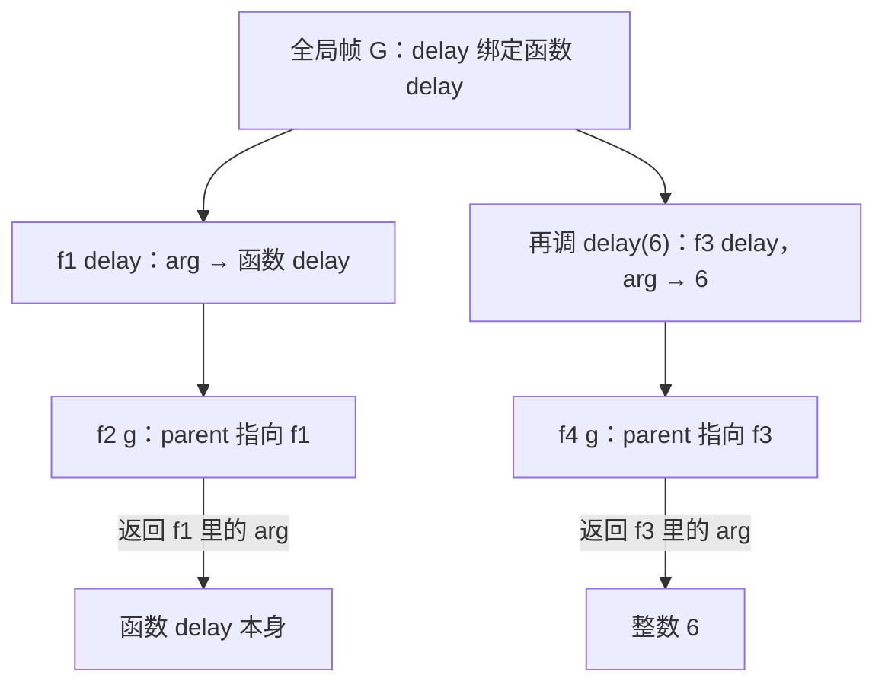
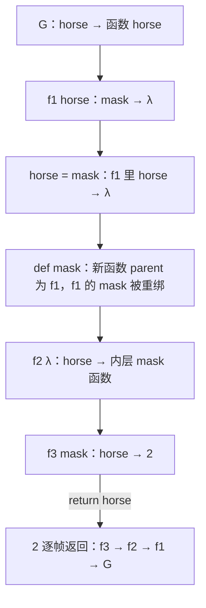
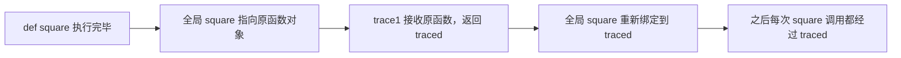

> **课程**：UC Berkeley CS61A · Structure and Interpretation of Computer Programs（Fall 2024）
> **本讲**：Lecture 8 ｜ 34:16 ｜ B 站分 P 8 ｜ [原视频](https://www.bilibili.com/video/BV1sy411z7nA?p=8)
> **课件**：`07-Function_Examples_1pp.pdf`（14 页，官方 PDF，逐页渲染图见正文插图）
> **字幕**：B 站英文原声字幕；本笔记是中文书面化重构，非逐句翻译
> **版权**：课程与课件版权归 UC Berkeley CS61A 教学团队；本文为学习用途的二次整理

## 本讲速览

- **已掌握**：调用表达式的求值顺序、`def` 只造函数不执行体、高阶函数可以接收与返回函数、环境图里帧与父帧的画法（Lecture 2–7）。
- **本讲主线**：
    - 用四道历年真题练习"推断交互式输出"：`print` 的返回值、`delay`、`pirate`、以及 `horse` 与 `mask` 互换的那道题。
    - 四道题表面在问输出，实际都在问同一件事：某个名字在**当前这一刻**指向哪个帧里的哪个值。
    - 一套可复用的函数实现流程：读描述 → 核对例子 → 读模板 → 给名字标值 → 写代码 → 回验。
    - 以 `remove_digit` 为例，完整走一遍"三次错误尝试 → 找到正确位权"的推导。
    - 装饰器（decorator）：`@trace1` 与 `square = trace1(square)` 完全等价。
- **关键结论**：值、副作用、名字绑定是三样东西；屏幕上出现的每一行都是副作用，与表达式的值无关；实现函数时，先在纸上把一个具体例子的每个名字标上值，再动键盘。

*(参考时间: 00:00:01 – 00:34:11｜Lecture 8)*

> **编者说明**：本讲课件 `07-Function_Examples_1pp.pdf` 与录像内容并不完全重合。录像的主线是真题演练、函数实现流程与装饰器；课件另含 Twenty-One 演示、柯里化与牛顿法（最后一组页面标为 OPTIONAL），这几组页面在录像中没有对应的口播段落，统一放到文末 `附录` 按画面复原，并在各处标明来源。正文凡引用录像之外信息的段落，均以"编者说明"或"编者补充"标注。

## 1. 开课通知：期中考试与复习建议

*(参考时间: 00:00:01 – 00:01:53｜Lecture 8)*


本讲开场先把下周的安排钉死：**周一考试**，因此周一没有课，下周也没有实验（lab），唯一的活动是晚上那场考试。考试 20:00 开始入场，20:10 正式开考；中间这十分钟并不浪费，它用来让人坐定、发纸质试卷，这套流程在伯克利的考场里几乎每次都要花掉这么久。


为什么第一场期中要安排得这么早？原因有两个。一是要在**选课与退课截止日（add-drop deadline）**之前把批好的卷子发回，学生如果发现这门课与预期不符，还来得及调整课表；二是尽早给出一次反馈，让每个人知道自己目前到底跟不跟得上。换句话说，这场考试的第一功能是体检，不是筛选。

分数结构也支撑这个判断。课程有一条 **exam recovery policy**：只要期末考得好，最多可以把第一次期中丢掉的 90% 分数拿回来；而且 midterm 1 本身的分值就低于 midterm 2 与期末。所以它不是一场高风险考试。

那么它考什么？一半是对语言本身的理解——这段代码为什么这样跑；一半是用学过的工具解题。midterm 1 的题目只使用课上已经讲过的内容，多学一些 Python 并不会带来优势，反而容易把简单题写复杂。三项硬技能被明确点名：

- 会画环境图（environment diagram）；
- 能预测 Python 的行为，也就是"这段代码会打印什么、值是什么"；
- 能实现函数，把一段文字描述变成可运行的代码。

备考建议同样具体：把 lab 里的 optional questions 做完，把 discussion 的题过一遍，homework 与 project 的题同理。最后一条最重要，也最容易被忽略——**考前睡够**。解题很依赖清醒程度，睡够了，同一道题会容易得多。

至于本讲本身：大部分时间用来一起走历年真题；另外有一小块关于 **decorators（装饰器）** 的内容，讲师明确说不会考，但它是高阶函数的一个自然延伸，也是真实代码里常见的写法，所以值得现在讲。

## 2. 交互式输出：先分清"值"与"屏幕"

*(参考时间: 00:01:54 – 00:04:28｜Lecture 8)*


历年卷子里最常见的题型叫 **what would Python print**：给出几行代码，问在交互式解释器里输入某个表达式会看到什么。它和"这个表达式的值是多少"是**两个不同的问题**，而绝大多数失分都来自把两者混为一谈。

### 2.1 三条规则

- `print` 永远返回 `None`。它的工作是把实参显示出来，显示这件事是**副作用（side effect）**，不是返回值。
- `print` 显示多个实参时，用空格把它们分隔开。
- 交互式解释器只在表达式的值**不是** `None` 时回显它；值是 `None` 就什么都不显示。想看到 `None`，必须显式地把它 `print` 出来。

讲师的固定开场是给一个最小环境，后面几个例子都会用到它：

```python
def square(x):
    return x * x

from operator import add, mul
```

然后开始问：`5`、`print(5)`、`print(print(5))` 各自会显示什么，值又是什么。

### 2.2 从 `5` 到 `print(print(5))`

`5` 求值为 5，回显也是 5。这一步没有争议。

`print(5)` 求值为 `None`，但调用过程中把 5 显示了出来。于是屏幕上看到的是 5，而表达式的值仍是 `None`——正因为值是 `None`，解释器不会再额外回显一个 `None`。

`print(print(5))` 是一条嵌套的调用表达式。按调用表达式的求值规则：先求值操作符 `print`，再求值操作数 `print(5)`。求值操作数的过程会打印 5 并得到 `None`；接着把外层 `print` 作用在这个 `None` 上，于是又显示一行 `None`；整条表达式的值仍然是 `None`。屏幕上是两行：

```text
5
None
```

把三种情况并排放，差别一目了然：

| 表达式 | 屏幕上出现 | 表达式的值 |
|---|---|---|
| `5` | `5` | `5` |
| `print(5)` | `5` | `None` |
| `print(print(5))` | `5` 与 `None` 两行 | `None` |

> **编者说明**：交互式解释器"不回显 `None`"是 CPython 的 `sys.displayhook` 决定的，属于解释器行为，不是 `print` 的特性。同一个表达式写在脚本文件里运行，屏幕上只会出现 `print` 产生的那些行，不会有回显；这也是"在 REPL 里试"与"跑脚本"结果不同的常见原因。考试里问的"interactive output"，默认指 REPL。

这道题的价值在于建立一个条件反射：看到 `print` 就同时问两件事——它打印了什么，它返回了什么。后面三道题会把这条反射用到极致。

## 3. `delay`：把一次求值推迟到下一次调用

*(参考时间: 00:04:31 – 00:09:19｜Lecture 8)*

第二道题是一个只有五行的函数，却是整个 CS61A 里最重要的模式之一：

```python
def delay(arg):
    print('delayed')
    def g():
        return arg
    return g
```

`def` 里面套 `def`，再把内层函数返回出去——这个形状会在后面的递归、装饰器、乃至解释器里反复出现。它之所以能工作，靠的是一条规则：**函数被创建时，它的父帧就是当时的第一帧（当前帧）**。所以 `g` 的父帧是 `delay` 的帧，`g` 里出现的 `arg` 会沿父帧链找到 `delay` 的形参；等到 `g` 被调用时，`delay` 早就返回了，但那个帧还在，因为 `g` 一直指向它。

讲师给的描述是：`delay` 是一个"接收任意参数、返回一个零参数函数"的函数，而被返回的那个函数会把当初传进来的东西交出来。

### 3.1 拆开 `delay(delay)()(6)()`

这是一整条调用表达式，操作符本身又是调用表达式，所以必须先算出操作符，才能做最外层那次调用。括号从左往右一层层剥：

1. `delay(delay)`：新建帧 `f1: delay`，形参 `arg` 绑定到函数 `delay` 本身；打印 `delayed`；返回 `g`（父帧 `f1`）。
2. 紧跟的 `()`：调用 `g`，新建 `f2: g`（父帧 `f1`），返回 `f1` 里的 `arg`，也就是函数 `delay`。
3. `delay(6)`：再新建 `f3: delay`，`arg` 绑定 6；打印 `delayed`；返回新的 `g`（父帧 `f3`）。
4. 最后的 `()`：调用这个 `g`，返回 `f3` 里的 `arg`，即 6。

把这两次调用产生的四个帧按父子关系摆出来：



屏幕上是两行 `delayed`，然后回显 6：

```text
delayed
delayed
6
```

整条表达式的值是 6。注意最后一个 6 是**回显**，不是 `print` 打印的——因为它不是 `None`。

### 3.2 换成 `print(delay(print)(4))`

同一个形状，把参数换成函数本身，难度立刻上一个台阶：

1. `delay(print)`：打印 `delayed`，返回一个"会把 `print` 交出来"的 `g`。
2. `g()`：交出 `print` 函数。
3. `print(4)`：显示 4，返回 `None`。
4. 外层 `print` 收到 `None`，把它显示出来。

```text
delayed
4
None
```

值是 `None`，所以不再有额外的回显。前一道题的主语是数字，这一道题的主语是函数；但求值顺序、帧的父子关系、"打印"与"返回值"的分工，一字未变。

### 3.3 这个例子真正教的东西

`delay` 是最小的"延迟"模型：它把值存进函数对象的父帧里，直到有人调用才交出来。它当然不是完整的惰性求值（lazy evaluation）——编者补充：真正的惰性求值还要缓存结果、避免重复计算——但它把机制暴露得足够干净：**闭包不是语法糖，是"函数记得自己出生在哪"这件事的直接后果**。

## 4. `pirate`：形参遮蔽让外层名字永久失效

*(参考时间: 00:09:22 – 00:13:30｜Lecture 8)*

第三道题把 `delay` 的结构原样搬过来，只改内层函数的体：

```python
def pirate(arg):
    print('matey')
    def plunder(arg):
        return arg
    return plunder
```

讲师特意强调了一句：它与 `delay` 的差别**不是名字不同，而是内层 `def` 语句说的东西不同**。这句话值得抄在笔记上——函数的行为由体决定，名字只影响可读性。

### 4.1 `plunder` 不延迟

`plunder` 的体只有一句 `return arg`，所以 `plunder(2)` 立刻就是 2，没有任何延迟。更关键的是：`plunder` 的形参**也叫 `arg`**。名字查找永远从当前帧开始，于是在 `plunder` 的帧里查 `arg` 会立刻命中形参，**永远走不到** `pirate` 帧里的那个 `arg`。外层绑定因此在这条路径上不可达。

结果是 `pirate` 的真实语义被压缩成一句话：无论传什么进来，它都返回**恒等函数（identity function）**——一个把实参原样返回的函数。

### 4.2 两个调用

先看 `add(pirate(3)(square)(4), 1)`：

1. `pirate(3)` 打印 `matey`，返回 `plunder`；
2. `plunder(square)` 返回 `square`——不是 3，也不是 `pirate` 帧里的 `arg`；
3. `square(4)` 得 16；
4. `add(16, 1)` 得 17。

屏幕上先出现 `matey`，再回显 17。

再看 `pirate(pirate(pirate))(5)(7)`，从最里层往外拆：

1. `pirate(pirate)` 打印 `matey`，返回一个恒等函数；
2. `pirate(<恒等函数>)` 再打印一个 `matey`，返回另一个恒等函数；
3. `<恒等函数>(5)` 返回 5；
4. `5(7)` 触发 `TypeError: 'int' object is not callable`。

报错发生在最后一步，而不是更早。表达式在求值过程中不做类型检查，只有当 5 真的被放到操作符的位置上、Python 试图调用它时，问题才暴露出来。

### 4.3 `delay` 与 `pirate` 的对照

| 判据 | `delay` | `pirate` |
|---|---|---|
| 内层函数返回什么 | 外层帧里的 `arg` | 自己的形参 `arg` |
| 调用内层函数的瞬间 | 拿到外层帧里存着的值 | 拿到这次传进来的实参 |
| 外层 `arg` 是否可达 | 可达，且是唯一通道 | 不可达，被同名形参遮蔽 |
| 每次调用是否打印 | 打印 `delayed` | 打印 `matey` |
| 实际语义 | 延迟求值的最小模型 | 恒等函数 |

两段代码的骨架完全一样，差别只在"内层函数体内写的是谁"。这正是环境图存在的理由：只看代码，`arg` 这个词在两处长得一样；只有画出帧，才知道它各自指向哪里。

### 4.4 补充练习：Lab 02 Q2 里被重新绑定的全局名字


> **编者说明**：本页来自课件，录像的字幕里没有对应的讲解段落。课件把这段代码分三块排布，下面按 REPL 的行序把它们拼成一段，逐步推演输出；结论严格按环境图规则得出，不引入课件之外的设定。

```python
def cake():
    print('beets')
    def pie():
        print('sweets')
        return 'cake'
    return pie

def snake(x, y):
    if cake == more_cake:
        return chocolate
    else:
        return x + y

chocolate = cake()
chocolate
chocolate()
more_chocolate, more_cake = chocolate(), cake

snake(10, 20)
snake(10, 20)()

cake = 'cake'
snake(10, 20)
```

逐条推演：

1. `cake()` 打印 `beets`，返回内层函数 `pie`，于是 `chocolate` 指向这个 `pie`。
2. 单独求值 `chocolate`，显示 `<function cake.<locals>.pie at ...>`——函数对象用"外层函数名 + `<locals>` + 内层函数名"来标注，这是 Python 给闭包内函数起的限定名。
3. `chocolate()` 打印 `sweets`，返回字符串 `'cake'`。
4. `more_chocolate, more_cake = chocolate(), cake` 的右边从左到右求值：先算 `chocolate()`，打印 `sweets`，值 `'cake'` 绑给 `more_chocolate`；再算 `cake` 这个名字，此刻它仍是**函数对象**，绑给 `more_cake`。
5. `snake(10, 20)` 判断 `cake == more_cake`：两者此刻指向同一个函数对象，条件为真，返回 `chocolate`（也就是 `pie` 函数）。
6. `snake(10, 20)()` 在返回的函数上再调一次：打印 `sweets`，得 `'cake'`。
7. 执行 `cake = 'cake'`，全局名字 `cake` 被重新绑定成字符串。
8. 再求 `snake(10, 20)`：`'cake' == <函数>` 为假，走 `else`，返回 `10 + 20 = 30`。

这道小题的三个考点与第 5 章 `horse` 那则例子完全同源：`==` 比较的是**值**（函数对象相等意味着同一个对象）；`more_cake` 保存的是改名之前的值，之后重绑 `cake` 不会回头修改它；而 `snake` 体内那个 `cake` 每次调用都要重新查一遍全局帧，所以它看到的是新值。

## 5. `horse` 与 `mask`：同名不同帧的极限案例

*(参考时间: 00:13:32 – 00:19:08｜Lecture 8)*

第四道题是讲师自称"自己出过的最喜欢的题之一"：

```python
def horse(mask):
    horse = mask
    def mask(horse):
        return horse
    return horse(mask)

horse(lambda horse: horse(2))
```

它的全部难点不在语法，而在于 `horse` 与 `mask` 这两个名字在不同帧里指不同的东西。做题的人必须时刻记住三件事：现在在哪个帧、这个名字在这个帧里绑的是什么、返回时要回到哪里去。

### 5.1 全局帧的初始状态

模块层执行完之后，全局帧里有两样东西：

- 名字 `horse` 绑定到函数 `horse`，它的父帧是全局帧；
- 调用表达式里那个 `lambda horse: horse(2)` 在模块层被创建，父帧同样是全局帧，作为实参传进 `horse`。

### 5.2 逐帧推演

1. 调用 `horse(λ)`：新建 `f1: horse`（父帧 `G`），形参 `mask` 绑定到 λ。
2. 执行 `horse = mask`：赋值语句永远修改**当前帧**，于是在 `f1` 里把名字 `horse` 绑到 λ。
3. 执行 `def mask(horse)`：`def` 有先后两步。第一步，创建新函数 `mask`，父帧是**当前帧 `f1`**；第二步，在 `f1` 里把名字 `mask` 重新绑定到这个新函数。同一个帧里一个名字只能有一个值，原来指向 λ 的那个绑定被覆盖，此后就查不到了。
4. 执行 `return horse(mask)`：此刻 `f1` 里的 `horse` 是 λ，`mask` 是刚定义的内层函数，所以这次调用是"λ 作用在内层 `mask` 上"。
5. 新建 `f2: λ`（父帧 `G`），形参 `horse` 绑定到内层 `mask` 函数。λ 的体是 `horse(2)`，于是用 `f2` 里的 `horse` 去调用，也就是调用内层 `mask`。
6. 新建 `f3: mask`（父帧 `f1`），形参 `horse` 绑定 2。体内 `return horse` 返回 2；这个 2 沿 `f3 → f2 → f1 → G` 一路作为返回值传回去。

三个帧的来历可以画成一条链：



| 帧 | 由什么创建 | 关键绑定 | 它证明了什么 |
|---|---|---|---|
| `f1: horse` | `horse(λ)` | `mask → λ`，随后 `horse → λ`，再随后 `mask → 内层 mask` | 赋值与 `def` 都只改当前帧 |
| `f2: λ` | `return horse(mask)` 里的 `horse` | `horse → 内层 mask` | λ 的父帧是 `G`，与它被谁调用无关 |
| `f3: mask` | λ 体内 `horse(2)` | `horse → 2` | 内层 `mask` 的父帧是 `f1`，但它只用到形参 |

最终结果是 2，而且不报错。这道题把"同名不同帧"推到了极限：同一个源码里，`horse` 先后指三个不同的东西（全局函数、λ、整数 2），`mask` 也先后指两个（λ、内层函数）。能一路跟下来，说明环境图的规则已经内化。

### 5.3 复盘：三个动作

- **`def` 是两步**：造函数（父帧 = 当前帧），再在当前帧绑名字。画图时先画函数对象，再把箭头指过去。
- **赋值只改当前帧**：`horse = mask` 改的是 `f1` 里的 `horse`，不是全局那个。
- **名字查找从当前帧出发**：沿父帧链往上走，第一个命中的绑定胜出；函数值上标的父帧，是它被**创建**时所处的帧，不是它被**调用**时所处的帧。

## 6. 从描述到代码：`remove_digit` 的五步流程

*(参考时间: 00:19:10 – 00:29:20｜Lecture 8)*


真题的另一半是"实现一个函数"：给一段文字描述、几个例子、一个可能带空格的模板，要求在纸上写出能跑的代码。讲师给了一套流程，它的价值在于让"思考时间"变成"有效的思考时间"，而不是盯着空白发呆。

### 6.1 题目与例子

`remove_digit(n, digit)`：`n` 是非负整数，`digit` 是 0 到 9 的一位数字；返回由 `n` 中所有**不等于** `digit` 的数字组成的新整数，数字的先后顺序不变。

- `remove_digit(231, 3)` 返回 `21`；
- `remove_digit(243132, 2)` 返回 `4313`——去掉所有的 2，剩下的 4、3、1、3 保持原来的相对顺序。

### 6.2 五步流程

- **读描述**，先弄清"要实现什么"，而不是"怎么写循环"。
- **核对例子**，并挑一个最简单的作为主例。核对不是形式主义：技术描述很容易有歧义，例子是唯一能校准理解的东西。如果你读描述时以为结果应该是别的数，而例子给出了另一个数，那就是理解偏了，必须当场修正。
- **读模板**。模板有帮助就用它；如果模板让人更糊涂，就先按自己的想法写，写对之后再改造成模板的形状——有一份能跑的代码，对齐模板只是机械工作。
- **在写代码之前，把主例里每个名字标上具体的值**，包括输入、输出，以及你打算新引入的中间变量。
- **写代码、跑主例、确认返回的东西对**（类型对、值对），最后用其他例子回验，尤其是更长、更容易漏掉分支的那个。

### 6.3 模板

录像里给出的模板骨架大致是这样（下划线处留空）：

```python
def remove_digit(n, digit):
    kept, digits = 0, 0
    while n > 0:
        last = n % 10
        n = n // 10
        if last != digit:
            ...
    return kept
```

> **编者说明**：录像里模板的留空是以口头方式描述的，字幕没有逐字念出每一行。上面这段按讲师口述整理：`kept` 与 `digits` 一起初始化为 0；每轮循环先把 `n` 的最后一位取到 `last`，再把这一位从 `n` 上切掉（`n % 10` 与 `n // 10` 是 CS61A 反复使用的取位模式）；然后判断这一位要不要保留。`...` 是待填的语句。

模板本身透露了意图：`kept` 负责攒结果，`digits` 负责记"已经攒了几位"。后者不是凭空出现的变量，它的存在暗示结果要按位权拼装。

### 6.4 把例子标上去

选 `n = 231`、`digit = 3`，期望返回 21。先在纸上写下每个名字的值：`kept = 0`、`digits = 0`。

- 第一轮：`n = 231`，`last = 1`，`n` 变成 23。`1 != 3`，保留 1。
- 第二轮：`n = 23`，`last = 3`，`n` 变成 2。`3 == 3`，跳过。
- 第三轮：`n = 2`，`last = 2`，`n` 变成 0。`2 != 3`，保留 2。
- 循环结束，`kept` 应当是 21。

### 6.5 四次尝试

第一次尝试，最直觉的写法：

```python
kept = kept + last
```

第一轮得 1，第二轮得 3。数字被当成了和，位权完全丢失。

第二次尝试，把旧结果往左推一位：

```python
kept = kept * 10 + last
```

第一轮 `0 * 10 + 1 = 1`；第二轮 `1 * 10 + 2 = 12`。12 不是 21——因为数字是从右往左取出来的，先取到的 1 是低位，却被推到了高位，顺序反了。

第三次尝试，把新数字放大：

```python
kept = kept + last * 10
```

第一轮得 10，第二轮 `10 + 20 = 30`。位权写死成 10，只对第二位有效。

第四次尝试，让位权跟着"已保留位数"走：

```python
kept = kept + last * 10 ** digits
digits = digits + 1
```

第一轮：`1 * 10 ** 0 = 1`，`kept = 1`，`digits = 1`。第二轮跳过 3。第三轮：`2 * 10 ** 1 = 20`，`kept = 21`。得到 21。

| 写法 | 前两轮的结果 | 失败原因 |
|---|---|---|
| `kept = kept + last` | 1，然后 3 | 把数字当成和来加，位权丢失 |
| `kept = kept * 10 + last` | 1，然后 12 | 后取到的低位被放到高位，顺序反了 |
| `kept = kept + last * 10` | 10，然后 30 | 位权写死为 10，只有第二位是对的 |
| `kept = kept + last * 10 ** digits` | 1，然后 21 | 正确：位权随已保留位数增长 |

讲师对这段推导的总结值得记住：这一类问题里总有"一个发明的瞬间"——这里就是"用 10 的 `digits` 次幂把当前位放到正确的位置上"。但只要结构（循环取位、条件判断、累加）搭对了，发明只需要发生在两三行里，而且可以用例子一步步试出来。

### 6.6 用更长的例子回验

主例只用了三位数，容易漏掉分支。换成 `remove_digit(243132, 2)`，逐位走一遍：

| 取出的末位 | 是否保留 | `digits`（保留后） | `kept` |
|---|---|---|---|
| 2 | 否 | 0 | 0 |
| 3 | 是 | 1 | 3 |
| 1 | 是 | 2 | 13 |
| 3 | 是 | 3 | 313 |
| 4 | 是 | 4 | 4313 |
| 2 | 否 | 4 | 4313 |

结果 4313，与题目给的例子一致。再用"不删任何数字"的极端情形检查一遍：`remove_digit(231, 4)` 应当原样返回 231，因为每一位都被保留——1 占个位、3 占十位、2 占百位，正好复原。这类"边界例子"能抓出 `digits` 初始值写错（从 1 开始会让所有位权都高一位）、或者循环条件写成 `n >= 0` 导致死循环这类问题。

### 6.7 另一种思路：先当成小数

讲师还提到一条完全不同的路：不要想着拼整数，先让 `kept` 每次除以 10，于是 231 去掉 3 的过程中会得到 `2.1`；最后再乘以 10 的（`digits - 1`）次幂，把小数点挪回去，并四舍五入成整数。这个方案也能得到正确答案，只是要处理浮点误差，可读性也差一些。

它的意义不在于"又一种解法"，而在于说明：**同一个问题往往不止一个正确答案**。但无论走哪条路，都绕不开那个必须自己发明的策略（这里是位权），而结构化的流程保证你在正确的方向上花时间。

### 6.8 课件第 8 页：`nearest_prime` 与 docstring


> **编者说明**：录像在这一段用的例子是 `remove_digit`，而课件第 8 页印的是 Fall 2022 Midterm 1 第 3(b) 题的一个变体 `nearest_prime`。两题考的是同一套流程，页面右侧的清单只是把讲师口述的流程拆得更细：读描述、核对例子、读模板、给名字标值、写代码、检查返回值、再用其他例子验证。下面按课件原文誊写题目、docstring 与骨架；录像没有讲过这道题的完整解法。

题目：实现 `nearest_prime(n)`，`n` 是大于 5 的整数，返回离 `n` 最近的素数；如果两个素数离 `n` 一样近，返回较大的那个。假设 `is_prime(n)` 已经实现。

```python
def nearest_prime(n):
    """Return the nearest prime number to n.
    In a tie, return the larger one.

    >>> nearest_prime(8)
    7
    >>> nearest_prime(11)
    11
    >>> nearest_prime(21)
    23
    """
    ___
    while True:
        if ___:
            ___
        if ___:
            k = -k
        else:
            ___
```

这里的 `___` 是课件上的空格，不是代码。骨架的用意不难猜：从某个偏移量出发，反复试探 `n` 两侧的邻近整数，直到命中素数；`k = -k` 这一行说明偏移量会在中途改变符号。至于空格具体怎么填，课件把它留给了学生。

值得单独讲的是那段 `"""..."""`。它是 **docstring（文档字符串）**：函数体里的第一个字符串字面量，`help()` 会原样显示它。其中以 `>>>` 开头的几行是 **doctest**——把交互式会话直接写进文档，每一行 `>>>` 后面跟表达式，下一行跟期望的回显。这不是装饰：`doctest` 模块可以找出这些片段并真正执行它们，把"文档里的例子"变成"会自动失败的测试"（编者补充：`python -m doctest -v 文件名.py` 即可运行）。

doctest 的价值在于它强迫作者先回答"什么叫对"。写实现之前先把 `nearest_prime(8)` 该返回 7 写下来，等于先钉住了规格；而一旦实现跑偏，例子会立刻报错。它的局限也要知道：比较的是**文本**，所以返回字符串 `'7'` 与返回整数 `7` 都过不了对方的例子，这恰好是"返回类型必须正确"的机器化检查。

> **编者说明**：下面是编者按骨架思路补全的一份实现，仅用于说明解法，不属于课堂内容。

```python
def nearest_prime(n):
    k = 0
    while True:
        if is_prime(n + k):
            return n + k
        if is_prime(n - k):
            return n - k
        k = k + 1
```

三个细节决定它能不能过例子。`k` 从 0 开始，于是 `n` 本身是素数时第一轮就返回——这正对应 doctest 里 `nearest_prime(11)` 返回 11。先查 `n + k` 再查 `n - k`，于是距离相等时返回的是较大的那个，满足"平局取大"。`k` 在循环末尾递增，否则一旦两个分支都没命中就会永远停在同一轮。

## 7. 装饰器：把函数交给函数，再绑回原名

*(参考时间: 00:29:21 – 00:34:11｜Lecture 8)*

最后一段内容不在考试范围内，但它是本讲所有工具的一次汇合。先准备两个普通函数：

```python
def square(x):
    return x * x

def sum_squares_up_to(n):
    total, k = 0, 1
    while k <= n:
        total, k = total + square(k), k + 1
    return total
```

`sum_squares_up_to(5)` 是 1 + 4 + 9 + 16 + 25 = 55。

### 7.1 `trace` 的效果

课上演示的 `trace` 是课程代码里提供的一个装饰器。给 `square` 加上它之后，每次调用都会先打印一行"正在调用"，返回时再打印一行；给 `sum_squares_up_to` 也加上之后，一次求和会把内部每一次 `square` 调用都显示出来。讲师的说法是：可以看到"所有发生过的工作"。

它的实现并不神秘。下面自己写一个只支持单参数函数的版本 `trace1`：

```python
def trace1(fun):
    def traced(x):
        print('calling', fun, 'on argument', x)
        return fun(x)
    return traced
```

逐行读：`trace1` 接收一个函数 `fun`；内部定义 `traced`，它只接一个参数（所以叫 `trace1`）；`traced` 先打印，再把 `x` 交给 `fun`，并把 `fun` 的返回值**原样返回**；最后把 `traced` 交出去。`traced` 的父帧是 `trace1` 的帧，所以它记得 `fun` 是哪个函数——这正是它能"包住任意函数"的原因。

### 7.2 用 `@` 使用它

```python
@trace1
def square(x):
    return x * x
```

此后 `square(12)` 会先打印 `calling <function square ...> on argument 12`，再回显 144。

给两个函数都加上：

```python
@trace1
def square(x):
    return x * x

@trace1
def sum_squares_up_to(n):
    total, k = 0, 1
    while k <= n:
        total, k = total + square(k), k + 1
    return total
```

这时 `sum_squares_up_to(5)` 的输出变成一棵调用树：先是 `sum_squares_up_to` 自己被调用，接着 `square` 依次被 1 到 5 调用，最后是 55。原本藏在循环里的五次调用，被一层包装显形了。

### 7.3 等价的显式写法

```python
square = trace1(square)
```

`@trace1` 写在 `def square` 上方，与这一行**完全等价**，执行顺序是：

1. 先执行 `def square`，全局帧里的 `square` 指向原函数；
2. 再把同一个名字重新绑定到 `trace1(原函数)` 的返回值（也就是 `traced`）上。

这两步可以用一条箭头链表示：



从这一刻起，全局帧里已经没有任何名字指向原函数了——它只活在 `traced` 的父帧里，被 `fun` 这个名字牵着。这和 `delay`、`pirate` 的机制是同一件事，只是方向反了过来：前面是"把值藏进闭包等着取"，这里是"把函数藏进闭包包起来"。

### 7.4 为什么要发明 `@`

既然 `square = trace1(square)` 也能工作，为什么 Python 还要提供 `@`？讲师给了三条理由：

- 少打字，尤其是同一个函数上要叠好几个装饰器的时候；
- 装饰信息写在函数定义处，读代码的人一眼就能看到"这个函数被谁处理过"，而不必往下翻找赋值语句；
- 还有一条更现实的原因：并不是所有 Python 程序员都理解高阶函数，但装饰器的"魔法"人人都能看懂。

> **编者说明**：装饰器可以叠加，多个 `@` 从最靠近 `def` 的那个开始、由下往上依次应用；被包装后的函数通常还会用 `functools.wraps` 保留原函数的名字与文档字符串，否则 `square.__name__` 会变成 `traced`，`print(square)` 也会显示 `<function trace1.<locals>.traced ...>`。这两点都不在本讲范围内，写出实现时会遇到。

## 小结

*(参考时间: 00:00:01 – 00:34:11｜Lecture 8)*

- **屏幕上的每一行都是副作用**：`print` 显示实参、返回 `None`；REPL 只回显非 `None` 的值。问"输出是什么"之前，先问"值是什么"。
- **嵌套 `def` 造出闭包**：内层函数的父帧是**定义它的那个帧**，不是调用它的帧；这就是它能在函数返回之后仍然记得外层变量的原因。
- **形参同名会遮蔽外层名字**：名字查找永远从当前帧开始，所以外层绑定可能永远不可达——`pirate` 因此退化成恒等函数。
- **`def` 是两步、赋值只改当前帧**：造函数（父帧 = 当前帧）再绑名字；`horse = mask` 改的是局部帧里的 `horse`，不是全局那个。
- **环境图要标三样**：帧的父帧、每个名字的箭头、函数对象的参数与父帧。同名不同帧是这类题唯一真正的难点。
- **实现函数先在纸上跑一个例子**：给每个名字标上值，再写代码；主例应当简单到能用脑子跟完，回验要用更长的例子。
- **位权问题的通用形状是 `kept + last * 10 ** digits`**：先想清楚"这是第几个被保留的位"，位权自然出现；三次错误尝试的方向（加、乘旧值、乘固定 10）都错在同一个地方。
- **装饰器是 `f = deco(f)` 的语法糖**：它把"包装函数"这件事搬到定义处，让高阶函数从技巧变成可读的声明。

## 附：本讲幻灯片索引

*(参考时间: 00:00:01 – 00:34:11｜Lecture 8)*

| 页 | 内容 | 出现位置 |
|---|---|---|
| 1 | 标题页：Function Examples | §1 |
| 2 | Announcements 过渡页 | §1 |
| 3 | Call Expressions 分节页 | §2 |
| 4 | Lab 02 Q2：`cake`、`pie`、`snake` 的输出推断 | §4.4 |
| 5 | Twenty-One Environment Diagram 分节页 | 附录 A |
| 6 | Twenty-One 规则与胜负状态图 | 附录 A |
| 7 | Function Implementation Practice 分节页 | §6 |
| 8 | `nearest_prime` 模板与实现流程清单 | §6.8 |
| 9 | Currying 分节页 | 附录 B |
| 10 | 柯里化：`make_adder` 与 `add` 的普遍对应 | 附录 B |
| 11 | Newton's Method（OPTIONAL）分节页 | 附录 C |
| 12 | 牛顿法背景：零点与平方根 | 附录 C |
| 13 | 牛顿法迭代：切线与更新公式 | 附录 C |
| 14 | 用牛顿法求 √2 的交互式结果 | 附录 C |

## 附录：课堂未展示的幻灯片

*(参考时间: 00:34:08 – 00:34:11｜Lecture 8)*

> **编者说明**：本讲课件第 5、6、9–14 页在录像中没有对应的口播段落——录像在装饰器的动机处收束。以下按课件画面复原：规则、公式与交互式会话逐字取自页面正文；页面页脚印有 Python Tutor 链接，其中的源码经解码后用于补全演示代码；凡课件没有给出函数体的地方，均以"编者补充"标出。

### A. Twenty-One：把策略写成函数


Twenty-One 是一个双人游戏，规则只有四条：

- 两名玩家轮流行动，每轮可以把当前总数加 1、加 2 或加 3；
- 总数从 0 开始；
- 总数达到或超过 21 时游戏结束；
- 最后加数的人输。


页面下半部分的状态图是本讲的精华。绿色数字表示"轮到谁走谁赢"，红色表示"轮到谁走谁输"：

- **20 是红色**。轮到你时总数已经是 20，无论加 1、2 还是 3，总数都会达到或超过 21，而最后加数的人输，所以你必输。
- **16 是红色**。从 16 出发只能走到 17、18、19；而 19 可以加 1 到 20、18 可以加 2 到 20、17 可以加 3 到 20——对手总能把必败位还给你。
- 依此类推。把这张图往左推下去，规律是 **4 的倍数是必败位**（12、16、20……），其余是必胜位。总数从 0 开始，而 0 是 4 的倍数，所以在双方都不犯错的前提下，先手必败。

课件页脚的 Python Tutor 链接里给出了演示代码（编者按链接源码整理）：

```python
def play(strategy0, strategy1, goal=21):
    n, who = 0, 0
    while n < goal:
        if who == 0:
            n = n + strategy0(n)
            who = 1
        elif who == 1:
            n = n + strategy1(n)
            who = 0
    return who

def two_strat(n):
    return 2

def noisy_strat(who, s):
    def strat(n):
        choice = s(n)
        print('Player', who, 'added', choice, 'to', n, 'to reach', choice + n)
        return choice
    return strat

play(noisy_strat(0, two_strat), noisy_strat(1, two_strat))
```

`play` 是高阶函数：它的两个参数不是数字，而是**策略**——"给定当前总数，返回这一轮加几"的函数。变量 `who` 始终表示"下一个该动的人"；循环退出时，刚加完数的人已经把总数推过线，所以 `who` 就是赢家。

`noisy_strat` 也是高阶函数：它接收一个策略 `s`，返回一个包装过的新策略；新策略在决策时打印过程，再原样返回 `s` 的选择。`who` 与 `s` 都留在 `strat` 的父帧里，这是闭包最实用的形态——**给已有函数加一层日志，而不改它的代码**。

两个玩家都采用"永远加 2"时，输出是 11 行（编者按代码推演，录像未展示）：

```text
Player 0 added 2 to 0 to reach 2
Player 1 added 2 to 2 to reach 4
Player 0 added 2 to 4 to reach 6
Player 1 added 2 to 6 to reach 8
Player 0 added 2 to 8 to reach 10
Player 1 added 2 to 10 to reach 12
Player 0 added 2 to 12 to reach 14
Player 1 added 2 to 14 to reach 16
Player 0 added 2 to 16 to reach 18
Player 1 added 2 to 18 to reach 20
Player 0 added 2 to 20 to reach 22
```

`play` 返回 1：玩家 0 被迫把总数推到 22，玩家 1 获胜。这与状态图的结论一致——20 是必败位，谁把总数停在 20，谁就把失败留给了自己。

### B. Currying：把多参数函数拆成单向管道


课件在函数实现之后插了一页柯里化回顾，代码只有两行：

```python
def make_adder(n):
    return lambda k: n + k
```


两个表达式都得到 5，但求值路径不同（`add` 来自 §2 的 `from operator import add, mul`）：

```python
make_adder(2)(3)   # 5
add(2, 3)          # 5
```

`make_adder(2)` 返回一个"还差一个参数"的函数，第二个括号才是真正做加法的那一刻；`add(2, 3)` 则一次拿齐两个参数直接给答案。页面把这种对应关系写成一句话：**柯里化（Currying）是把多参数函数变换成单参数高阶函数的过程**，后者返回一个继续接收其余参数的函数。

这条对应可以写成代码（编者补充）：

```python
def curry2(f):
    def g(x):
        def h(y):
            return f(x, y)
        return h
    return g
```

`curry2(add)(2)(3)` 同样得到 5。它与 Lecture 5 讲过的柯里化是同一件事，课件在此只是复习：多参数与"一次一个参数"之间没有本质鸿沟，只差一层闭包。

### C. Newton's Method：用切线逼近零点


课件最后四页是一段标着 **OPTIONAL** 的选修内容：用牛顿法（Newton's Method）求方程的根。它不属于考试范围，但它是"函数作为参数"最漂亮的应用之一——整个算法接收一个函数，反复调用它，直到结果足够好。


先定义对象。函数 `f` 的**零点（zero）**是满足 `f(x) = 0` 的输入 `x`。以 `f(x) = x² − 2` 为例，它的正零点在 `x ≈ 1.414213562373095`，也就是 √2。一般地，`f(x) = x² − a` 的正零点就是 √a——于是"求平方根"这件事被翻译成"解方程 `x² = a`"，再翻译成"找零点"。这就是牛顿法的应用场景：算平方根、立方根，乃至任何能写成 `f(x) = 0` 的问题。


方法本身出奇地简单。给定函数 `f` 和一个初始猜测 `x`，重复做三步：

1. 算出猜测点上的函数值 `f(x)`；
2. 算出该点切线的斜率 `slope(f, x)`；
3. 把 `x` 更新为切线与 x 轴的交点：`x - f(x) / slope(f, x)`。

几何上，这是在用一条切线代替曲线：切线与 x 轴的交点通常比原来的猜测更接近真正的零点。当 `f(x) = 0`（或足够接近 0）时停止。写成公式就是


$$
x_{k+1} = x_k - \frac{f(x_k)}{f'(x_k)}
$$


以 `f(x) = x² − 2`、初值 `x = 1` 为例，四轮就把误差压到了小数点后十多位：

| 轮次 | `x` | `f(x)` | `f'(x)` | 下一轮的 `x` |
|---|---|---|---|---|
| 0 | 1.0 | -1.0 | 2.0 | 1.5 |
| 1 | 1.5 | 0.25 | 3.0 | 1.4166666666666667 |
| 2 | 1.4166666666666667 | 0.006944444444444642 | 2.8333333333333335 | 1.4142156862745099 |
| 3 | 1.4142156862745099 | 6.007304882871267e-06 | 2.8284313725490198 | 1.4142135623746899 |

表中的 `f'(x)` 一列按解析导数 2x 计算，便于手算核对；课程里用的是 `slope(f, x)` 这个数值近似。收敛速度是牛顿法最惊人的地方（编者补充：在零点附近它是二次收敛，每一轮的有效数字大约翻倍），四轮就够用了。


最后一页把抽象落到使用现场：

```python
f = lambda x: x*x - 2
find_zero(f)
```

回显 `1.4142135623730951`，与 `math.sqrt(2)` 的最后一位都相同。函数在这里是纯粹的实参：`find_zero` 不关心传进来的是平方、三次方还是别的什么，它只负责按牛顿法把猜测推向零点。

> **编者说明**：课件只给出 `find_zero(f)` 的调用与 `slope(f, x)` 这个名字，没有给函数体。下面是一份与页面语义一致的实现，供对照阅读，不属于课件内容。

```python
def slope(f, x, dx=1e-8):
    return (f(x + dx) - f(x)) / dx

def find_zero(f, guess=1.0, tolerance=1e-12):
    x = guess
    while abs(f(x)) > tolerance:
        x = x - f(x) / slope(f, x)
    return x
```

`slope` 用差商近似导数：取一个极小的 `dx`，用两点连线的斜率冒充切线斜率，这正是"不需要解析求导"的关键。用这份实现求 `x² − 2` 的零点会得到 `1.414213562373095`，与课件第 12 页标出的零点完全一致；课件第 14 页回显的 `1.4142135623730951` 多出最后一位，这一位的差别来自导数被近似以及浮点舍入，而不是算法本身。真实代码还需要给循环加一个迭代次数上限，否则遇到不收敛的函数会永远转下去。
