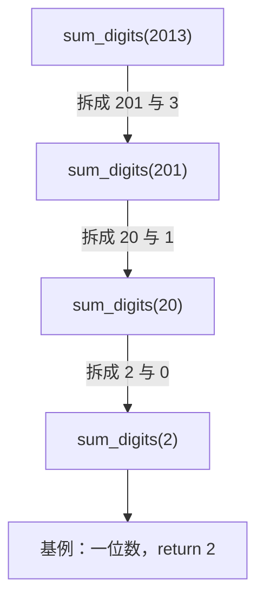
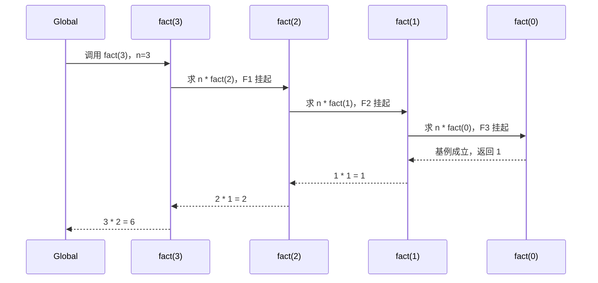
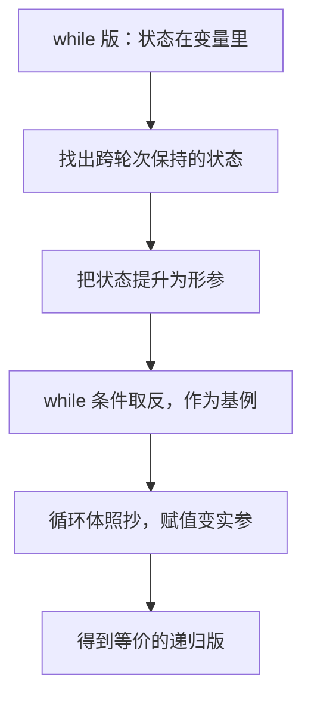

> **课程**：UC Berkeley CS61A · Structure and Interpretation of Computer Programs（Fall 2024）
> **本讲**：Lecture 9 ｜ 37:49 ｜ B 站分 P 9 ｜ [原视频](https://www.bilibili.com/video/BV1sy411z7nA?p=9)
> **课件**：`08-Recursion_1pp.pdf`（11 页，官方 PDF，逐页渲染图见正文插图）
> **字幕**：B 站英文原声字幕；本笔记是中文书面化重构，非逐句翻译
> **版权**：课程与课件版权归 UC Berkeley CS61A 教学团队；本文为学习用途的二次整理

## 本讲速览

*(参考时间: 00:00:00 – 00:00:02｜Lecture 9)*


- **已掌握**：`def` 与调用表达式的求值顺序、形参与实参、用环境图复盘一次调用的生命周期；`if` 与 `while` 两种控制结构，以及"表达式有值、语句做事情"这条分工。
- **本讲主线**：
    - 环境模型允许函数体引用自己的名字；`print_all` 说明"提到自己"与"调用自己"是两件不同的事。
    - 递归函数的骨架：**基例**直接算，**递归情形**把问题换成更小的同类问题再调用自己。
    - 环境图把递归摊成一组互不覆盖的帧：同一个函数被调用多次，但每次的 `n` 属于不同的帧。
    - 迭代是递归的特例，因此两者之间有固定配方可以翻译：跨轮次的状态变成形参，赋值变成实参。
    - 正确性靠**信仰之跃**：先验基例，再把递归调用当成"已经正确的函数抽象"来使用。
- **关键结论**：写递归只需要回答两个问题——"最小的问题长什么样"与"怎样把问题变简单一点"；剩下的记账工作交给调用帧。

## 1. 开课公告：项目、期中与后半程

*(参考时间: 00:00:03 – 00:03:48｜Lecture 9)*


本讲以一段事务性通知开场，内容指向同一件事：课程已经进入中段，而后面还有一大半内容。三项通知按紧急程度排列——作业、期中、选课。

Hog 项目周三截止。今天完成可以拿到提前提交的奖励分；延期请求在 24 小时以内系统自动批准，更长的需要人工审核。讲师给出的建议是按截止日期完成、最好提前完成：奖励分只是表面理由，真正的理由是这门课的内容层层叠加，拖欠一个项目会把后面几周的实验和作业一起拖住。

期中刚结束，讲师补了三点说明。第一，作为一个整体，这次成绩不错。第二，课程有一条叫 **exam recovery** 的政策（写在 syllabus 里）：如果期末考得好，可以拿回第一次期中最多 90% 的分数——"期中没考好"不是终点，学期结束前把材料真正学会仍然有机会补回来。第三，考试有时会提供有用的信息：它可能说明需要改变学习方式，也可能说明这门课并不是最合适的选择。每个人在教育上的路径不同，这也不是 Berkeley 唯一的好课。

如果决定换课，与本课程重叠度最高的是 Data C88C：它大致覆盖 CS61A 四个单元中的三个，但铺满一个学期；目前接近满员，若有等候名单可能会扩容。CS10 也还有少量空位。换不换由学生自己判断，有疑问可以发在 Ed 上、找 core staff 或直接给讲师写信。

决定留下的人，建议只有一句：**别掉队**（TLDR, don't fall behind）。对分数不满意，最有用的做法是跟上甚至超前于课堂——看讲座视频、认真参与 lab 与 discussion、用 homework 与 project 反复练习学过的概念，这样到考试时才谈得上"擅长解题、熟悉语言规则、没有太多意外"。反过来，考得好的人也不该现在松劲：这门课的大部分内容还在后面，而且来得很快；历史上不少学生看着第一次期中的分数觉得"我没事"，休息一段时间，到第二次期中就被打了个措手不及。对所有学生都一样：按时完成作业，并且在任务发布时就开始，而不是在截止那天开始。

## 2. 自引用：函数体里可以写出自己的名字

*(参考时间: 00:04:03 – 00:09:50｜Lecture 9)*


环境模型有一个不太显眼但很关键的推论：**函数体里可以引用函数自己的名字**。这不是语法特权，而是求值时机的自然结果。

执行 `def` 语句时，真正发生的事情只有一件：函数体被"收起来"（讲师用的词是 squirreled away），等待将来的调用，body 里的表达式一句都不求值。等到函数真的被调用、body 开始执行时，全局帧里早就有这个名字了，而且它已经绑定到一个函数对象。名字查找沿环境链走，取到的正是这个函数自己。

```python
def print_all(k):
    print(k)
    return print_all

print_all(1)(3)(5)
```

`print_all(1)` 先打印 1，然后把 `print_all` 这个名字查出来当作返回值。返回值是函数对象，于是紧跟其后的 `(3)` 就是对这个函数的又一次调用，打印 3；再一个 `(5)`，打印 5；表达式结束。

值得强调的是：这个函数**提到了自己，但没有调用自己**，所以它不会永远跑下去。调用多少次完全由外层的调用表达式 `print_all(1)(3)(5)` 决定，输出就是三次调用的实参。这个例子说明"自引用"本身是无害的；危险的是"在 body 里无条件地再次调用自己"——那才是无限递归的写法，后面要讲的基例正是用来掐断它的。

### 2.1 `print_sums`：让每一帧记住"到目前为止的和"

第二个例子要难一点：写一个函数，打印**到目前为止的累加和**。它不能返回 `print_all`（那个函数已经不存在了），而是返回一个在 body 里定义的内部函数 `next_sum`。


```python
def print_sums(n):
    print(n)
    def next_sum(k):
        return print_sums(n+k)
    return next_sum

print_sums(1)(3)(5)
```

`n` 是到目前为止的和，`k` 是下一个数；求和发生在 `n+k` 这个表达式里——`print_sums` 自己只负责打印，`next_sum` 负责把两段接起来。执行 `print_sums(1)(3)(5)` 打印三行：1、4（即 1 + 3）、9（即 1 + 3 + 5）。课件另给了一行更长的例子：`print_sums(3)(4)(5)(6)` 打印 3、7（3 + 4）、12（3 + 4 + 5）、18（3 + 4 + 5 + 6）。

环境图把这件事讲得比文字更清楚。`f1` 是 `print_sums(1)` 的帧：`n` 绑定 1，帧里还定义了一个函数 `next_sum`，它的父环境是 `f1`；`f1` 的返回值就是这个 `next_sum` 函数对象。`f2` 是 `next_sum(3)` 的帧，只有 `k = 3`，父环境是 `f1`，所以 `n+k` 里的 `n` 要到 `f1` 里去找，得 1，加起来是 4，再用 4 调用 `print_sums`，产生 `f3`。`f3` 里 `n = 4`，同样返回一个新的 `next_sum`（父环境 `f3`）；这个 `next_sum` 被 `(5)` 调用后产生 `f4`，`k = 5`，父环境 `f3` 里 `n = 4`，`4 + 5 = 9`，于是 `f5` 里 `n = 9`，打印 9。

课件右侧画了三个 `next_sum` 函数对象，它们**不是同一个对象**，区别只在父环境分别指向 `f1`、`f3`、`f5`。父环境决定了"到目前为止的和"是多少——这就是闭包在环境图里的样子。讲师由此总结：`print_sums` 的帧里只看到累计和 1、4、9，`next_sum` 的帧里只看到被直接传进来的 3 和 5，各司其职。

| 判据 | `print_all` | `print_sums` |
| :--- | :--- | :--- |
| 返回什么 | 函数自己，同一个函数对象 | 在 body 里新定义的 `next_sum` |
| 状态存在哪 | 无处保存，所有调用共用全局帧 | 每次调用生成一个新帧，`n` 就是累计和 |
| 新函数的父环境 | 不适用 | 调用 `print_sums` 的那一帧（`f1`、`f3`、`f5`） |
| 打印什么 | 本次调用的实参 | 本次调用的累计和 |
| 谁决定调用次数 | 外层调用表达式 | 外层调用表达式（返回值继续被调用） |

> **编者说明**：讲师在字幕里用的词是 memorize（记住），意思是把中间结果记在实参里、随调用往下传；这和计算机科学里常说的 memoization（缓存历史求值结果以免重复计算）不是一回事，不要在笔记里混用这两个词。前者是"手动传账本"，后者是"自动查账本"。

### 2.2 课堂练习：两个互相返回函数的函数

字幕在 00:09:50 处直接转向"递归函数"，没有讲解课件第 5 页。这一页是一个"最后一行打印什么"的思考题：


```python
def add_next(n):
    print(n)
    return lambda f: subtract_next(n + f)

def subtract_next(n):
    print(n)
    return lambda f: add_next(n - f)

add_next(2500)(500)(1000)(24)
```

课件的答案是 **2024**。`add_next` 与 `subtract_next` 都不调用自己，而是各自返回一个 lambda，lambda 里再调用**对方**；真正决定链往哪里走的是调用表达式后面挂的那串实参。

> **编者说明**：这一页的内容没有出现在字幕里，下面的推导是编者按课件代码逐步代入得到的，不是课堂原文。`add_next(2500)` 打印 2500，返回的 lambda 被 500 调用后执行 `subtract_next(3000)`，打印 3000；它的返回值被 1000 调用后执行 `add_next(2000)`，打印 2000；再被 24 调用后执行 `subtract_next(2024)`，打印 2024。四行输出依次是 2500、3000、2000、2024，最后一行正是 2024。这个练习的价值在于：**"函数返回函数、函数调用对方"完全可以不经过递归写出有状态的调用链**，递归只是把这条链的构造过程收进了函数体内部。

## 3. 递归函数：基例与递归情形

*(参考时间: 00:09:52 – 00:17:00｜Lecture 9)*


递归函数（recursive function）的定义只有一句：**body 里调用自己的函数**，可以直接调用，也可以间接调用。执行一个递归函数的 body 时，可能需要再次应用同一个函数——这句话初看像循环定义，但环境模型里"每次调用一个新帧"让它落了地：同一个函数对象被应用多次，每次应用有自己的帧。

递归并不只属于计算机科学。讲师举的例子是 **Sierpinski 三角形**：一个 Sierpinski 三角形由三个更小的 Sierpinski 三角形拼成，定义里出现了被定义的东西本身。艺术、自然、数学里到处都是这种自相似结构，递归函数只是把这种描述方式搬进了程序。

### 3.1 从一个具体问题出发：数字之和

第一个完整例子是求一个正整数的**数字之和**：2013 的答案是 2 + 0 + 1 + 3 = 6。为什么要专门给这件事写函数？讲师给了两个理由。

其一是整除性：整数 A 能被 9 整除，当且仅当它的数字之和也能被 9 整除。其二是输入校验：信用卡号很长，人手工输入总会出错，所以每个卡号里都有一位**校验位（checksum digit）**——16 位卡号的第 16 位并不是账户号的一部分，而是由其余 15 位计算出来的；如果这一位和重新计算的结果对不上，就说明号码输错了。真实的校验算法比"把各位相加"稍复杂（本讲后半会给出 Luhn 算法），但训练从最简单的数字之和开始。

约束是：**不许用 `while`**。数字之和本来一个循环就能写完，禁掉循环之后，剩下的路只有递归。

### 3.2 三步推导

第一步，造一块积木：把正整数拆成"除最后一位之外的部分"和"最后一位"。前者用整除 10 得到，后者用对 10 取余得到。

```python
def split(n):
    """Split positive n into all but its last digit and its last digit."""
    return n // 10, n % 10
```

`2013` 经 `split` 得到 `(201, 3)`。这一步之所以关键，是因为它把一个多位数换成了"去掉最后一位的数"与"最后一位"两部分，而前者就是一个更小的、同一类的问题。

第二步，把问题接起来：如果已经会求 201 的数字之和，那么 2013 的数字之和就是它的结果再加 3。注意这里**不能**写 `sum_digits(n)`——那等于把同一个问题原样再问一遍；要问的是关于 `201` 的问题，一个更小的问题。

第三步，找最小情形：一位数不需要拆，`n < 10` 时数字之和就是它自己，7 的答案就是 7。这个情形不需要任何递归调用就能直接算出来，它是整条链的出口。

三步合起来就是代码：

```python
def sum_digits(n):
    """Return the sum of the digits of positive integer n."""
    if n < 10:
        return n
    else:
        all_but_last, last = split(n)
        return sum_digits(all_but_last) + last
```

`sum_digits(2013)` 的展开可以画成一棵调用树：每一层都把实参的位数减一，直到只剩一位。



树往上长，答案往下传：`sum_digits(2)` 返回 2；`sum_digits(20)` 得到 2 + 0 = 2；`sum_digits(201)` 得到 2 + 1 = 3；`sum_digits(2013)` 得到 3 + 3 = 6。每一层的 `last` 都被留在了那一层的帧里，等子调用返回后才加进去。

> **编者说明**：本讲课件只有 11 页，`split`、`sum_digits`、`fact`、`fact_iter`、`luhn_sum`、`sum_digits_iter` 这些函数都是讲师在编辑器里现场敲出来的，课件上没有对应的代码页。正文中的代码按字幕逐句还原（例如 `split` 由"整除 10"与"对 10 取余"两句话还原为 `n // 10, n % 10`），docstring 与空行是编者为了可读性补的，不属于课堂画面。

### 3.3 递归函数的解剖

课件把递归函数拆成两个部件，这个划分值得背下来。

- `def` 行与普通函数一样：一个函数名、一组形参。
- 紧接着通常是一个条件语句，用来检查**基例（base case）**。基例是问题的极简版本——这里就是"只有一位数"的情形，求和是平凡动作，直接 `return n`。
- 如果不在基例里，说明问题还复杂（`n` 有多位），进入**递归情形（recursive case）**，它的求值需要递归调用。
- 递归调用的实参必须是**更简单的问题**：从 2013 出发，下一次只需要处理 201。位数变少，就更接近基例。

| 判据 | 基例（base case） | 递归情形（recursive case） |
| :--- | :--- | :--- |
| 何时进入 | 条件命中"最简单的那类问题" | 条件没命中 |
| 如何求值 | 直接算出并返回，不含递归调用 | 含至少一个对自己的调用 |
| 实参规模 | 最小（`n < 10`，一位数） | 严格小于当前问题（`201` 之于 `2013`） |
| 在整体中的角色 | 提供已知答案，终止递归 | 把大问题换成小问题 |
| 本例写法 | `if n < 10: return n` | `sum_digits(all_but_last) + last` |

### 3.4 为什么递归一定停得下来

递归能终止，靠的是两个条件同时成立。第一，**每次递归调用的实参都严格变小**：`sum_digits` 里位数每次少一位，`fact` 里 `n` 每次减一。第二，问题存在一个**不能再小的下界**：正整数不会无限变小，一位数就是尽头。两者合在一起，任意合法的输入最多经过有限层就落进基例，链条自动断开。

反过来说，只要破坏第一条，递归立刻变成死循环。把递归情形写成 `sum_digits(n)`（实参没有缩小），`n < 10` 永远不成立，函数就会一直调用自己。

> **编者说明**：Python 不会真的"永远"跑下去——解释器对调用深度有上限（CPython 默认约 1000 层），越过就抛 `RecursionError: maximum recursion depth exceeded`。这个上限同时也解释了后面要讲的"递归的空间代价"：每一层未返回的调用都占着一个帧。

> **编者说明**：课程教材在讲完这一节之后还给了两个练习：`is_even` / `is_odd` 用互递归判断奇偶（`is_even(n)` 返回 `is_odd(n - 1)`，`is_odd` 反之，两者都在 `n == 0` 处收口），以及 `count_partitions` 统计把一个正整数拆成若干正整数之和的方案数。它们与 `sum_digits` 的差别在于**递归调用不止一次**，因此更值得用"实参是否严格变小"这条判据逐条检查：分支再多，只要每个分支都在更小的问题上，终止性就不受影响。

## 4. 环境图里的递归：`fact` 的帧是怎样展开又收回的

*(参考时间: 00:17:03 – 00:23:22｜Lecture 9)*

环境图是理解递归最好的工具。换一个例子：阶乘（factorial），$n! = n \times (n-1) \times \cdots \times 1$。

```python
def fact(n):
    if n == 0:
        return 1
    else:
        return n * fact(n - 1)

fact(3)
```

`fact(3)` 应该是 $3 \times 2 \times 1 = 6$。讲师在 Python Tutor 里一步一步走完了这个过程，值得逐帧复述，因为递归的全部机制都藏在这几步里。

1. `fact(3)` 在全局帧里被调用，创建 F1，`n` 绑定 3。3 不等于 0，所以要算 `n * fact(n - 1)`。
2. 先算乘号左边，得 3；再算右边 `fact(n - 1)`，其中 `n - 1` 是 2。这一步需要调用 `fact` 本身，而 F1 的 `return` 语句还没执行完，于是 F1 **挂起**，等子调用的结果。
3. 创建 F2，`n` 绑定 2。2 不等于 0，同样要算 `n * fact(n - 1)`；右边需要 `fact(1)`，F2 挂起。
4. 创建 F3，`n` 绑定 1。1 不等于 0，右边需要 `fact(0)`，F3 挂起。
5. 创建 F4，`n` 绑定 0。`0 == 0` 成立，命中基例，直接返回 1。这是整条链上第一个真正的返回值。
6. 回到 F3：`fact(n-1)` 的值是 1，`n` 是 1，`1 * 1 = 1`，F3 返回 1。
7. 回到 F2：`n` 是 2，`2 * 1 = 2`，F2 返回 2。
8. 回到 F1：`n` 是 3，`3 * 2 = 6`，F1 返回 6。整个表达式 `fact(3)` 的值是 6。

进入是逐层下坠，返回是逐层回升，方向正好相反：最后被调用的 F4 最先返回，最先被调用的 F1 最后返回。把执行到最深处的瞬间定格，四个帧同时活着：

| 帧 | 绑定的 `n` | 还没算完的表达式 |
| :--- | :--- | :--- |
| F1（`fact`，父环境 Global） | 3 | `3 * fact(2)` |
| F2（`fact`，父环境 Global） | 2 | `2 * fact(1)` |
| F3（`fact`，父环境 Global） | 1 | `1 * fact(0)` |
| F4（`fact`，父环境 Global） | 0 | 无：基例，直接 `return 1` |

这个"下坠—回升"的过程用序列图画出来更直观：



### 4.1 从这张图能读出的四件事

- **同一个函数被调用多次**。F1 那次调用来自全局帧，F2、F3、F4 这三次都来自 `fact` 内部。
- **不同帧负责保存不同调用各自的实参**。这就是为什么同一个函数被多次调用、甚至一层套一层地调用，计算机也不会混淆——求值模型给每次调用准备了独立的帧。
- **`n` 的值取决于当前环境**。图里有四个 `n`，分别属于四个帧；任何含 `n` 的表达式在不同环境里可能算出不同的东西。读递归代码时，"这个 `n` 是哪一层的"比"这个 `n` 等于几"更重要。
- **每次调用都在解更小的问题**。`n` 一路递减，到了 0 就只剩一句 `return 1`，工作量比 `n` 为 1 时更少，依此类推。

### 4.2 递归的空间代价

讲师在停在最深处的截图上补了一句关键的观察：这时正在从最后一次调用返回，但**前面几个调用都还没返回**。这句话就是递归的代价来源——每一个挂起的调用都必须保留自己的帧，因为里面存着还没用完的 `n` 和还没做完的乘法。

于是 `fact(n)` 在到达基例的瞬间，内存里同时存在 $n+1$ 个帧（全局帧加上 $n$ 层调用）；这些帧要等链往回走时才逐个释放。递归的深度就是空间的量级：一层一层的帧叠起来，形如一座栈。

> **编者说明**：课件与字幕没有使用"调用栈（call stack）"这个词，也没有给出 $O(n)$ 的复杂度记号；上面这两句是编者按环境图的语义补的术语与量级。Python 的调用深度上限（约 1000 层）正是这类空间开销的限制，所以对特别深的递归，实际工程中常改写成迭代——这也是本讲最后一节要讲的翻译配方。

## 5. 递归与迭代：同一个阶乘的两种写法

*(参考时间: 00:23:25 – 00:26:20｜Lecture 9)*

同一件事可以用循环做。迭代版的阶乘需要两个变量：一个记住"乘到现在的积"，一个记住"下一个要乘进来的数"。

```python
def fact_iter(n):
    total, k = 1, 1
    while k <= n:
        total = total * k
        k = k + 1
    return total
```

`total` 是到目前为止的阶乘，`k` 是下一个要乘进去的数；只要 `k` 不大于 `n`，就把 `k` 乘进 `total`，再把 `k` 加一。循环结束时 `total` 就是 $n!$。按讲师的描述，`k` 依次取 1、2、3、4……，逐个乘进去。

递归版只有一句数学定义：$n!$ 在 $n = 0$ 时是 1，否则是 $n$ 乘以 $(n-1)!$。写成公式：


$$
n! = \begin{cases} 1 & n = 0 \\ n \cdot (n-1)! & n > 0 \end{cases}
$$


迭代版对应的则是连乘：


$$
n! = \prod_{k=1}^{n} k
$$


两个公式都对，但长得不一样。讲师的原话是：递归版不仅解释起来花的时间更少，写出来的字符也更少，而且别人读这段代码时逻辑更容易跟上。

差异在**名字的数量**上最明显。`fact_iter` 里有四个名字：`n`、`total`、`k`、`fact_iter`；`fact` 里只有两个：`n` 和 `fact`。多出来的两个名字是"记账"的成本：`total` 记结果，`k` 记进度。递归版把记账工作交给了帧——进度由调用的深度表示，中间结果由各层挂起的表达式表示。

| 判据 | 递归 `fact` | 迭代 `fact_iter` |
| :--- | :--- | :--- |
| 需要的名字 | `n`、`fact` 两个 | `n`、`total`、`k`、`fact_iter` 四个 |
| 状态存在哪 | 帧里：每层一个 `n` 和一段未完成的乘法 | 变量里：`total` 与 `k` 每轮被改写 |
| 对应的数学定义 | $n! = n \cdot (n-1)!$，$0! = 1$ | 连乘 $\prod_{k=1}^{n} k$ |
| 代码长度 | 四行 | 六行 |
| 读起来像什么 | 定义本身 | 一台机器的操作步骤 |
| 空间代价 | 深度为 $n$ 时同时存在 $n$ 个帧 | 只多两个变量，与 $n$ 无关 |

这张表也解释了讲师的判断：**迭代是递归的一个特例**。循环能表达的东西，递归都能表达（多花一些帧）；递归能表达的东西，循环不一定能直接表达（比如后面树形结构的遍历）。所以在两者之间翻译时，"递归 → 迭代"通常更难，"迭代 → 递归"反而有固定套路。

## 6. 信仰之跃：怎样相信一个递归函数是对的

*(参考时间: 00:26:23 – 00:28:50｜Lecture 9)*

基例一眼就能验证：`fact(0)` 直接返回 1，符合 $0! = 1$ 的定义。可是凭什么相信 `n` 取其它值时它也对？讲师在这里放了一张照片：他的朋友 Kevin 坐在一座很高的悬崖边上——写下一个递归函数时，感觉就是这样。

信任是可以按步骤建立的，只有三步。

1. **验证基例**。这一步让后面轻松：至少有一批输入的正确性已经确定。`n == 0` 时函数的行为是对的。
2. **把 `fact` 当成函数抽象（functional abstraction）**。看到 `fact(n - 1)` 这次调用时，不要去推演它内部怎么跑；只想它**应该做什么**——对任何 `n`，它返回 $(n-1)!$。这是把实现细节抽象掉，只留契约。
3. **在这个假设下验证当前这一层**。`fact(n)` 返回 `n * fact(n-1)`；如果第 2 步的假设成立，那么这次调用返回的就是 $n \cdot (n-1)!$，而这正是 $n!$ 的定义。

拿具体数字走一遍：$4!$ 是不是等于 $4 \times 3!$？是，$24 = 4 \times 6$。一般化的说法是：**先假设函数对递归调用里那个更简单的情形是正确的，再验证"若简单情形正确，则当前问题也正确"**。讲师把它概括成一句话——先证明它对于 `n - 1` 工作正常，再由此说明它对于 `n` 工作正常。

> **编者说明**："如果 P(n−1) 成立则 P(n) 成立，且 P(0) 成立，则对所有 n 成立"就是数学归纳法的结构。数学课上的归纳证明、写代码时的抽象屏障、这里的信仰之跃，其实都在用同一套"分层假设"的推理方式：先钉住一个已知正确的最小情形，再证明"只要下一层是对的，这一层就也对"。课程把这条策略命名为 recursive leap of faith（递归的信仰之跃），名字本身不是数学术语，但它描述的正是上面这三步。

这条策略的实际用法是**写代码之前先用它检查代码**：写完递归函数，先问基例是否覆盖了所有最小输入，再问递归调用是否真的作用在更小的问题上，最后问"假设子调用返回正确答案，本层的组合运算是否给出正确答案"。三问都过，函数基本就是对的；任何一问过不去，错误一定在那一层。

## 7. 互递归与 Luhn 算法

*(参考时间: 00:28:55 – 00:33:43｜Lecture 9)*

**互递归（mutual recursion）**指的是两个不同的函数互相调用。前面说过递归可以间接发生，这里就是间接发生的样子。它正好用来实现本讲开头提到的信用卡校验。

课件引用的是 Wikipedia 对 Luhn 算法的描述：从最右边那位（校验位）开始向左；每隔一位把数字翻倍；如果翻倍的结果大于 9，就把这个乘积的各位数字相加；最后把所有数字求和。

先用 `1 3 8 7 4 3` 走一遍。从右往左，位置交替：不翻倍、翻倍、不翻倍……

| 从右数第几位 | 原数字 | 本位的操作 | 计入总和的数 |
| :--- | :--- | :--- | :--- |
| 1（最右，校验位） | 3 | 不翻倍 | 3 |
| 2 | 4 | 翻倍，4 × 2 = 8 | 8 |
| 3 | 7 | 不翻倍 | 7 |
| 4 | 8 | 翻倍，8 × 2 = 16 > 9，再算 1 + 6 | 7 |
| 5 | 3 | 不翻倍 | 3 |
| 6 | 1 | 翻倍，1 × 2 = 2 | 2 |
| 合计 | 6 位 | — | 30 |

$2 + 3 + 7 + 7 + 8 + 3 = 30$，是 10 的倍数，所以这个号码通过校验。**有效的信用卡号，其 Luhn 和一定是 10 的倍数。**

这个算法能抓住两类错误。第一类是单个数字打错：数字一变，和几乎必然不再是 10 的倍数。第二类是相邻两位**对调**（transposition）：把 4 和 7 换个位置，绝大多数情况下结果同样不再是 10 的倍数。人类手工输入长号码时最容易犯的正是这两类错误，所以校验位值得存在。

代码与 `sum_digits` 几乎同构，只是每处理一位就要换一个函数：

```python
def luhn_sum(n):
    if n < 10:
        return n
    else:
        all_but_last, last = split(n)
        return luhn_sum_double(all_but_last) + last

def luhn_sum_double(n):
    all_but_last, last = split(n)
    luhn_digit = sum_digits(2 * last)
    if n < 10:
        return luhn_digit
    else:
        return luhn_sum(all_but_last) + luhn_digit
```

`luhn_sum` 处理"不翻倍"的位：把最后一位原样加上去，剩下的交给 `luhn_sum_double`。`luhn_sum_double` 处理"要翻倍"的位：先算 `luhn_digit = sum_digits(2 * last)`——注意它直接复用了第 3 节的积木，16 交给 `sum_digits` 就得到 7——然后把这一位加进去，剩下的交回给 `luhn_sum`。两个函数互相调用，形成交替的接力。

基例可以出现在两个函数里，也可以只出现在其中一个里；这个例子里两个都有（各自判断 `n < 10`）。讲师用两个小例子检查：`luhn_sum(2)` 是 2；`luhn_sum(32)` 里 3 被翻倍成 6，6 不大于 9，加上 2 得 8。拿一个有效的 MasterCard 号码去跑，得到的 Luhn 和是 10 的倍数，比如 20。讲师顺带开了一个玩笑：如果觉得手算太麻烦，也可以把卡号发给他，他帮忙校验。

> **编者说明**：字幕里出现的 "LUN algorithm"、"Lund sum" 是语音识别把 Luhn 听错了，正确拼写是 Luhn（IBM 的 Hans Peter Luhn 提出的校验和算法）；正文统一写作 Luhn。课件中那张"有效 MasterCard 号码"的说明是"号码本身不生效，但落在 MasterCard 使用的号段内"，只用于演示算法，不是真实可用的卡号。

## 8. 从迭代到递归：把状态变成参数

*(参考时间: 00:33:46 – 00:37:46｜Lecture 9)*


有时需要把递归函数改写成迭代（比如为了绕开深度限制），这件事偏难，但并非无章可循；反方向——把 `while` 改写成递归——几乎可以照搬，因为**迭代是递归的特例**。两个方向的线索是同一组：**那些跨越每一轮循环保持下来的状态**。讲师把这条线索说成一句配方：找出迭代中每一轮都要维护的状态，把它们作为实参传下去。

先看"递归改迭代"。以 `sum_digits` 为例，观察每次递归调用传进去的是什么、返回的是什么，这两个线索就指明了迭代版需要给哪些东西起名字：传进去的是"还没求和的数字"（形参 `n`），返回的是"目前累计的部分和"。

```python
def sum_digits_iter(n):
    digit_sum = 0
    while n > 0:
        n, last = split(n)
        digit_sum = digit_sum + last
    return digit_sum
```

`digit_sum` 记住部分和，`n` 记住还剩哪些数字没处理；每轮把 `n` 拆小、把 `last` 加进 `digit_sum`，循环结束时返回 `digit_sum`。

再反过来，把这个迭代版翻译成递归版：两个跨轮次变化的状态 `n` 与 `digit_sum` 直接变成两个形参；`while n > 0` 取反得到基例 `n == 0`；循环体照抄，只是把两处赋值换成递归调用的实参。

```python
def sum_digits_rec(n, digit_sum):
    if n == 0:
        return digit_sum
    else:
        n, last = split(n)
        return sum_digits_rec(n, digit_sum + last)
```

对照着看，配方是机械的：

| 迭代版的部件 | 递归版的对应物 |
| :--- | :--- |
| `while n > 0:` | `if n == 0: return digit_sum`（条件取反） |
| 循环前的初始化 `digit_sum = 0` | 初始调用 `sum_digits_rec(n, 0)` |
| 循环体里的 `n, last = split(n)` | 递归调用的第一个实参 `n` |
| `digit_sum = digit_sum + last` | 递归调用的第二个实参 `digit_sum + last` |
| `return digit_sum` | 基例的返回值 |

讲师把这条规律总结成一句话：**赋值变成递归调用的实参**。这个转换对几乎任何迭代实现都成立。



### 8.1 方框与金字塔：语句顺序就是输出顺序

接下来三页课件把同一套转换用在"有副作用的函数"上。


```python
def boxes_iter(k):
    """ prints out k boxes.
    >>> boxes_iter(4)
    [][][][]
    """
    while k > 0:
        print("[]", end="")
        k -= 1
    return


def boxes_r(k):
    """ prints out k boxes.
    >>> boxes_r(4)
    [][][][]
    """
    if k == 0:
        return
    else:
        print("[]", end="")
        boxes_r(k-1)
    return
```

迭代版用一个计数器 `k` 数着打；递归版把"打一个方框"和"再打 `k-1` 个方框"接起来，基例是"打 0 个方框时什么也不做"。`print` 的 `end=""` 让方框留在同一行，函数本身没有返回值，副作用就是全部的产品。


```python
def pyramid_iter(k):
    """ prints out a pyramid of k height.
    >>> pyramid(4)
    []
    [][]
    [][][]
    [][][][]
    """
    i = 1;
    while i <= k:
        print(" ") # new line
        boxes_r(i)
        i += 1
    return


def pyramid(k):
    """ prints a pyramid of k height.
    >>> pyramid(4)
    []
    [][]
    [][][]
    [][][][]
    """
    if k == 0:      # base case
        return
    else:
        pyramid(k-1)   # print a pyramid of k-1 height
        print("")      # skip a line,
        boxes_r(k)     # print out k boxes.
    return
```

迭代版从高度 1 数到 `k`，每层换行再打 `i` 个方框。递归版换了个方向想：高度 `k` 的金字塔 = 高度 `k-1` 的金字塔 + 空行 + 一行 `k` 个方框。于是代码变成三步：先递归画小的，再换行，最后打底下一整排。


倒金字塔（最宽的一排在最上面）在迭代版里要求改循环的方向：从 `k` 开始往下数，每层先打 `k` 个方框再换行。

```python
def pyramid_iter(k):
    """ prints out a pyramid of k height.
    >>> pyramid(4)
    [][][][]
    [][][]
    [][]
    []
    """
    while k > 0:    # start with k boxes
        print(" ")  # new line
        boxes_r(k)
        k -= 1      # decrement k
    return
```

递归版则只要交换最后两条语句的顺序：

```python
def pyramid(k):
    """ prints a pyramid of k height.
    >>> pyramid(4)
    [][][][]
    [][][]
    [][]
    []
    """
    if k == 0:      # base case
        return
    else:
        boxes_r(k)     # print out k boxes.
        print("")      # skip a line,
        pyramid(k-1)   # print a pyramid of k-1 height
    return
```

先打 `k` 个方框，再换行，再画高度 `k-1` 的小金字塔，输出就是最宽的一排在上面。课件在此处的批注把这个对比说得很直白：递归版**只需交换两行语句的顺序**，迭代版**必须摆弄变量**——同一件事，递归把"顺序"写在了代码里，迭代把"顺序"写在了计数器的走向里。

> **编者说明**：第 8–10 页在本次录像的字幕里没有对应讲解（00:25:47 之后字幕依次讲信仰之跃、Luhn 算法与迭代/递归互译，全程没有出现 boxes 或 pyramid 的词）。上面三页的代码与注释按课件画面逐字整理，讲解文字是编者补写的，不是课堂原话。另外，课件第 9 页的迭代版写的是 `print(" ")`（一个空格加换行），递归版写的是 `print("")`（空串加换行），两者在视觉上都表现为换行，属于课件排版上的不一致，正文保留原样。

### 8.2 讨论题：把 Twenty-One 改写成递归


课件的最后一页是一道讨论题：把 `play` 改写成不含 `while` 的递归函数，并回答两个问题——需要定义一个新的内部函数吗？为什么？基例是什么，基例返回什么？

原始版本：

```python
def play(strategy0, strategy1, goal=21):
    """Play twenty-one and return the winner.

    >>> play(two_strat, two_strat)
    1
    """
    n = 0
    who = 0  # Player 0 goes first
    while n < goal:
        if who == 0:
            n = n + strategy0(n)
            who = 1
        elif who == 1:
            n = n + strategy1(n)
            who = 0
    return who
```

跨轮次保持的状态有两个：累计点数 `n` 和当前该谁出手 `who`。按上一小节的配方，它们应该变成形参；但 `play` 的三个形参 `strategy0`、`strategy1`、`goal` 都是"规则"，不是"状态"，不能拿来记这两个值。所以**需要一个新的内部函数**，它的参数正是 `n` 与 `who`。基例则是把 `while n < goal` 取反：`n >= goal` 时游戏结束，直接返回 `who`，也就是赢家。

```python
def play(strategy0, strategy1, goal=21):
    """Play twenty-one and return the winner.

    >>> play(two_strat, two_strat)
    1
    """
    def f(n, who):
        if n >= goal:
            return who
        if who == 0:
            n = n + strategy0(n)
            who = 1
        elif who == 1:
            n = n + strategy1(n)
            who = 0
        return f(n, who)
    return f(0, 0)
```

外层 `play` 只做一件事：用初始状态 `0` 和 `0` 启动内层函数。循环变成了对 `f` 的递归调用，两处赋值 `n = ...`、`who = ...` 变成了 `f(n, who)` 的实参——正是"赋值变实参"这条规律。

> **编者说明**：这一页同样没有出现在字幕里（录像在讲完迭代与递归的翻译规律后就结束了），代码按课件画面逐字整理；上面关于"为什么需要内部函数""基例是什么"的说明，是编者按课件提出的两个问题作答，不是课堂原文。

## 小结

*(参考时间: 00:37:41 – 00:37:46｜Lecture 9)*

- **递归函数 = 基例 + 递归情形**：基例是不含递归调用、可以直接算出的最小问题；递归情形把当前问题换成更小的同类问题再调用自己。两个部件缺一，函数要么不终止，要么答不出一般情形。
- **递归调用的实参必须严格变小**：位数少一位、`n` 减一、`k` 减一——只要每一步都在缩小问题，而问题有下界，递归就一定落在基例上并终止。
- **环境图是递归的显微镜**：一次递归调用留下一个帧，帧里保存着这一层的实参和还没算完的表达式；进入是逐层下坠，返回是逐层回升。同一个 `n` 在不同帧里可以是不同的值。
- **递归的空间代价与深度成正比**：所有挂起的调用都占着帧，深度为 $n$ 就叠 $n$ 层；Python 的调用深度上限（约 1000）是它的直接限制，工程上常用迭代规避。
- **迭代是递归的特例**：递归版本只需要 `n` 与函数名两个名字，记账交给帧；迭代版本要额外维护 `total`、`k` 这类变量，但它不随规模增长而占空间。
- **信仰之跃是验证方法**：先验基例，再把递归调用当作"已经正确的函数抽象"（只需知道它该返回什么，不必推演它怎么实现），最后验证"若子调用正确，则本层组合正确"。
- **互递归只是间接调用自己**：`luhn_sum` 与 `luhn_sum_double` 交替接力，各管一半的位；基例可以出现在一个函数里，也可以两个都有。
- **翻译配方可以背下来**：找出跨轮次保持的状态 → 提升为形参 → `while` 条件取反当基例 → 循环体照抄、赋值变实参。反过来做（递归改迭代）没有通用配方，通常更难。

## 附：本讲幻灯片索引

*(参考时间: 00:00:00 – 00:37:46｜Lecture 9)*

| 页 | 内容 | 出现位置 |
| :--- | :--- | :--- |
| 1 | 标题页 Recursion | 本讲速览 |
| 2 | Announcements 公告页 | §1 |
| 3 | Self-Reference 分节页 | §2 |
| 4 | `print_sums` 的代码、输出与环境图 | §2.1 |
| 5 | 练习：`add_next` 与 `subtract_next` 交替调用 | §2.2 |
| 6 | Recursive Functions (Demo) 分节页 | §3 |
| 7 | From Iteration to Recursion 分节页 | §8 |
| 8 | `boxes_iter` 与 `boxes_r` 的基例/递归情形 | §8.1 |
| 9 | `pyramid_iter` 与递归 `pyramid` | §8.1 |
| 10 | 倒金字塔：交换两行语句的顺序 | §8.1 |
| 11 | 讨论题：`play` 的递归改写 | §8.2 |
