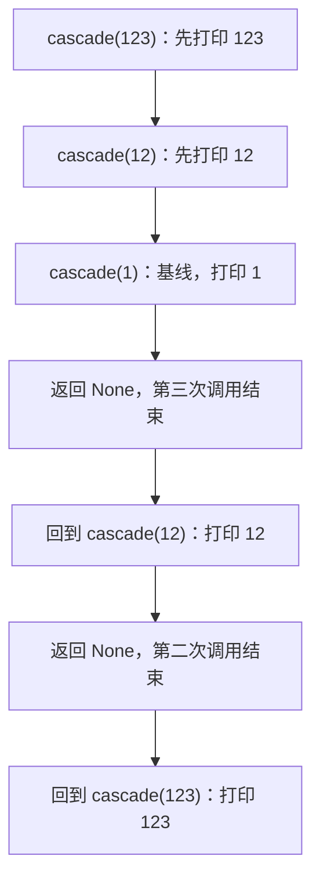
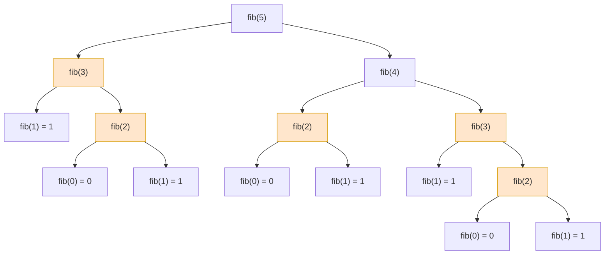
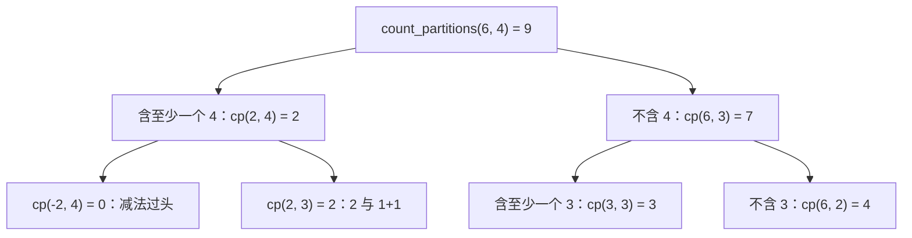

> **课程**：UC Berkeley CS61A · Structure and Interpretation of Computer Programs（Fall 2024）
> **本讲**：Lecture 10 ｜ 32:14 ｜ B 站分 P 10 ｜ [原视频](https://www.bilibili.com/video/BV1sy411z7nA?p=10)
> **课件**：`09-Tree_Recursion_1pp.pdf`（14 页，官方 PDF，逐页渲染图见正文插图）
> **字幕**：B 站英文原声字幕；本笔记是中文书面化重构，非逐句翻译
> **版权**：课程与课件版权归 UC Berkeley CS61A 教学团队；本文为学习用途的二次整理

## 本讲速览

- **已掌握**：递归函数的骨架——基线情形（base case）与递归情形（recursive case）；递归的“信仰之跃”，即假定 `f(n-1)` 已经在更简单的输入上正确，只负责用它拼出 `f(n)`（Lecture 9）；以及高阶函数可以把函数当作实参传递、也可以在函数体里返回新的函数（Lecture 4–7）。
- **本讲主线**：
    - 用 `cascade` 把“调用必须先返回”这条执行规则落到环境图上，看清递归的**时间顺序**，而不只是盯着返回值。
    - 从 `inverse_cascade` 看到一种不写在自己函数体里的递归：借高阶函数间接调用自己。
    - 给出树形递归（tree recursion）的定义——函数体里对自己发起**多于一次**调用——并用 `fib` 把调用树画出来。
    - 用 `trace` 把调用树“跑”出来，解释 `fib(35)` 为什么要算那么久：慢的不是数大，而是同一个子问题被反复重算。
    - 用 `count_partitions` 演示树递归真正的用武之地：把“选不选最大的那一块”当成二分，再把两类结果相加。
- **关键结论**：树递归 = 在递归情形里探索两个（或多个）互不相交的选择，再把子结果合并。一次调用展开成一棵树，**节点数决定时间，树高决定同时活跃的帧数**；当同一棵子树被重复展开时，指数级的浪费就出现了。

*(参考时间: 00:00:00 – 00:32:11｜Lecture 10)*

## 1. 开课通知：为什么树递归值得专门练

*(参考时间: 00:00:00 – 00:01:09｜Lecture 10)*

本讲的正题是**树形递归（Tree Recursion）**——一次调用会展开成多个子调用的递归。课件用一页标题与一页通知开场。


开课前只有一件事要交代，但它决定了接下来几天的节奏：**递归作业将在本周五发布**。这份作业分量不轻，而递归又是本周才第一次正式登场的技术，通常需要相当多的练习才能真正掌握，所以第一句建议是尽早开始。

紧接着是一段对“递归到底有什么用”的正面回应。递归的早期例子看起来往往有点小题大做——打印一串数字也好，累加一个整数也罢，写个 `while` 循环三行就能解决，为什么要绕一圈去调用自己？讲师承认这种观感，然后给出本讲要兑现的承诺：**今天出现的例子，用递归比不用递归容易得多**。这不是“递归也能做”，而是“这类问题离开递归会难写”。

判断标准也随之浮出水面：递归真正擅长的，是**把一次复杂的计算拆成两块或更多块**。这句话正好预告了本讲的标题——拆成**一块**，得到的是线性递归（每次调用只产生一次新的调用）；拆成**两块以上**，得到的就是树形递归。从一块到多块的这一步，是思维方式与代价估计的双重跃迁。

拆问题的直觉不会一蹴而就。讲师在这里给了一句相当实在的安抚：如果这些内容没有立刻变得清晰，那完全正常；许多学生都在这道坎上挣扎过，最后仍然跨了过去，需要的只是恰当的专注与投入。

## 2. 递归复习：`cascade` 里的“等它返回”

*(参考时间: 00:01:13 – 00:06:29｜Lecture 10)*


进入树递归之前，课件先退回一步做复习，复的是一件常被忽略的事：**理解递归调用的顺序**。返回值只是结果；要解释一个递归函数的行为——它先打印什么、后打印什么、什么时候才开始“往上走”——必须依靠调用顺序。

支撑这一切的只有一条执行规则：**发起一次函数调用，就必须等它返回，之后才能做别的事**。如果一次调用后面还跟着语句，那些语句只能在该调用返回之后才轮到执行。这条规则看上去是老生常谈，但在递归里它会被放大成整棵调用树的形状。

`cascade` 就是用来把这条规则具象化的例子。它接收一个正整数 `n`：如果 `n` 小于 10，直接打印它；否则先打印 `n`，再对“去掉末位之后剩下的数”（即 `n // 10`，整除会丢弃余数）递归调用自己，最后再打印一次 `n`。

> **编者说明**：本讲的 `cascade`、`inverse_cascade`、`f_then_g` 三处代码只出现在讲师现场打开的编辑器里，课件 PDF 并未收录。下面的代码按字幕口述逐句复原（先打印 `n`、再递归、再打印 `n`，基线为 `n < 10`），结构以口述为准，细节请以上机运行结果校验。

```python
def cascade(n):
    if n < 10:
        print(n)
    else:
        print(n)
        cascade(n // 10)
        print(n)
```

先看最简单的输入。`cascade(5)` 落在基线情形，屏幕上只出现一个 `5`。换成一个五位、各位数字恰好是 1 到 5 的数，输出就变成一座对称的阶梯：

```text
12345
1234
123
12
1
12
123
1234
12345
```

这九行的归属值得逐行清点。中间那个孤零零的 `1` 来自基线情形里的 `print(n)`；其余八行都来自 `else` 分支里的两个 `print(n)`——下降时每层打印一次，上升时每层再打印一次。之所以能形成漂亮的嵌套结构，原因只有一句：**所有向下的层叠都发生在最后一次打印之前**。

接下来用环境图确认这个“先下降、后上升”的过程。执行 `cascade(123)`：原始调用检查基线，不成立，于是打印 `123`。此刻屏幕上只有一行 `123`，剩下的全部要由那次递归调用产生。

递归调用 `cascade(12)` 会**先完成**，然后才轮到原始调用继续。所谓“完成”，是指它自己又打印 `12`、再调 `cascade(1)`、而 `1` 落在基线上被打印出来——至此下降到底。上升的方向则由返回值确定：第三次调用 `cascade(1)` 一路执行到函数体末尾，从未遇到 `return` 语句，于是返回 `None`。

> **编者说明**：Python 里函数体执行完却没有遇到 `return`，返回值就是 `None`。这正是此处要强调的点——递归函数不一定“返回”有意义的值，它可能只负责产生副作用。

回到第二次调用。它停在执行 `cascade(n // 10)` 那一行上，等待的值终于到手（`None`），于是继续往下执行最后一个 `print(n)`，屏幕上出现第二个 `12`。这次调用同样没有 `return`，也返回 `None`。原始调用终于可以继续，打印最后一个 `123`，然后结束。

整个过程有一个关键时刻：**第二次调用已经返回，第一次调用却还没有结束**。此时第一次调用已经打印过 `123`，也已经通过递归拿到了 `12`、`1`、`12` 这三行输出，但它自己的最后一行还没写。任何出现在递归调用之后的语句，都要等到那一刻之后才可能执行。

由此得到两条可以直接复用的观察：

- 每个 `cascade` 帧都来自一次不同的调用；只要返回值还没出现，那次调用就还没有结束，它后面的代码一律挂起。
- 一条语句放在递归调用**之前**还是**之后**，决定了它属于“下降阶段”还是“上升阶段”。三行输出各归其主：第三次调用打印了 `1`；第二次调用打印了两个 `12`，一个在 `1` 之前、一个在 `1` 之后；第一次调用先打印 `123`，最后再打印一次 `123`。

把这次调用与返回压缩成一条时间线，顺序一目了然：



## 3. 两种 `cascade`，与一个“逆 `cascade`”

*(参考时间: 00:06:31 – 00:11:06｜Lecture 10)*

`cascade` 并不是只能那样写。观察一下会发现：基线情形打印 `n`，递归情形也打印 `n`，那就把这次打印提到函数最前面，两种情形自然合并——基线情形反而没什么可做了，于是 `if` 只需要处理递归情形。

```python
def cascade(n):
    print(n)
    if n >= 10:
        cascade(n // 10)
        print(n)
```

> **编者说明**：字幕里讲师把条件说成“当 `n` 大于 10 时”，但要让这种写法与原版在边界上等价，条件应当是 `n >= 10`。原版对 `n = 10` 会打印 `10`、`1`、`10` 三行；若写成 `n > 10`，就只会打印一个 `10`，两版在 `n = 10` 处不再等价。这里按语义写作 `n >= 10`。

运行结果与原版一致，定义更短；数字再大一些，图形只会更漂亮。

那么两版哪个更好？一版把基线情形与递归情形分开写，明确告诉读者每种情况该做什么；另一版找出两者的共同点，尽量不重复自己。讲师的判断标准是条件式的：**如果两种实现同样清晰，通常选短的那个**，因为别人读起来更快。但在这个例子里，长的那一版反而更清晰——它按“先基线、后递归”的次序把两件事摊开，而这正是读递归函数的惯常顺序。所以学写递归函数时，建议照长的那一版组织代码，尽管并非必须。

两个都是递归函数，只是左边那个具有典型结构。选择时请记住一条原则：**程序首先是写给人读的，顺带才交给计算机执行**。若在两者之间犹豫，就问自己——如果这是别人写的代码，你更愿意读到哪一版。

| 判据 | 分情况版（基线 / 递归分开） | 合并版（先打印，再判断） |
|---|---|---|
| 代码行数 | 6 行 | 5 行 |
| 重复的语句 | `print(n)` 出现三次 | `print(n)` 出现两次 |
| 基线情形的处理 | 单独一支，显式写出 | 隐含在“不再递归”里 |
| 阅读理解方式 | 先看基线，再看递归 | 必须先看出两分支的共同点 |
| 讲师的取舍 | 教学与初学首选 | 同样清晰时优先更短的 |
| 潜在的边界风险 | 无 | 条件写成 `n > 10` 时 `n = 10` 少打一行 |

复习的最后一段是一个练习：写一个“逆 `cascade`”。传入 `1234` 时期望的输出是 `1`、`12`、`123`、`1234`，然后逐层缩小：`123`、`12`、`1`。换言之，先从小到大长上去，再从大到小缩回来。

讲师没有要求从零开始写，而是给了一个搭好的骨架，把难点收窄到一处：

```python
def inverse_cascade(n):
    grow(n)
    print(n)
    shrink(n)
```

`grow` 负责打印增长阶段（`1`、`12`、`123`），中间那行 `print(n)` 打印最长的那条，`shrink` 负责收缩阶段。问题于是变成：`grow` 与 `shrink` 怎么定义？

两者都与下面这个高阶函数有关。它接收两个函数 `f`、`g` 和一个数 `n`：只要 `n` 不是 0（在数字里，0 是唯一的假值），就按顺序先调用 `f`、再调用 `g`。

```python
def f_then_g(f, g, n):
    if n:
        f(n)
        g(n)
```

挑战是用它定义 `grow` 和 `shrink`：两者都是一元函数，需要自己选好 `f`、`g` 分别是谁，以及传给它们的实参是什么。讲师在这里停了几秒留出思考时间，然后给出下面这一版：

```python
def grow(n):
    return f_then_g(grow, print, n // 10)

def shrink(n):
    return f_then_g(print, shrink, n // 10)

inverse_cascade(1234)
```

```text
1
12
123
1234
123
12
1
```

`grow` 为什么是“先长后打印”？因为打印要从小到大，就必须先把更小的那些做完，所以对更小规模的那次 `grow` 必须排在 `print` 之前——于是 `f` 是 `grow`、`g` 是 `print`。`shrink` 恰好相反：先把当前最大的打印出来，再去处理小的，于是 `f` 是 `print`、`g` 是 `shrink`。顺序一换，输出的方向就整个翻了过来。

再看 `n // 10` 这一层。`f_then_g` 用**同一个** `n` 去调用 `f` 和 `g`，所以传进去的 `n // 10` 决定了“这一层处理谁”：`grow(1234)` 拿到的 `n // 10` 是 `123`，它先递归 `grow(123)`（往下还有 `grow(12)`、`grow(1)`、`grow(0)`），再 `print(123)`；打印顺序因此是 `1`、`12`、`123`，正好递增。`grow(0)` 什么都不做，因为 `f_then_g` 在 `n` 为 0 时直接跳过——`if n:` 这一行就是整个递归的刹车。

最后一个值得留意的点：`grow` 与 `shrink` **在自己体内都没有出现自己的名字**，递归是通过 `f_then_g` 发生的。递归的定义因而可以放宽一点——只要在函数体的求值过程中又调用了该函数（中间隔了几个函数都算），它仍然是递归。

## 4. 树递归：`fib` 与它的调用树

*(参考时间: 00:11:15 – 00:15:45｜Lecture 10)*


定义很短：**树形递归（tree recursion）指执行递归函数的函数体时，对该函数自己发起了多于一次的调用**。这样长出来的计算过程是树形的：有一个根，根下若干条分支，每条分支又各有更细的分支。

最典型的例子是斐波那契数列（Fibonacci numbers）——几乎每一门讲树递归的课都会覆盖它。编号从 0 开始：第 0 个数是 0，第 1 个是 1，第 2 个也是 1；此后每个数都是前两个数之和：0、1、1、2、3、5、8、13……

```python
def fib(n):
    if n == 0:
        return 0
    elif n == 1:
        return 1
    else:
        return fib(n - 2) + fib(n - 1)
```

两个基线情形（0 与 1）被直接定义，其余全部走“前两个数之和”。它之所以是树递归，只看递归情形就够：要算出 `fib(n)`，函数体里对 `fib` 发起了两次调用。

调用树因此长这样。根是 `fib(5)`；它的两个子节点是 `fib(3)`（即 `n - 2` 那一支）与 `fib(4)`（即 `n - 1` 那一支）；一路展开到全是基线的叶子：



橙色标出的是被重复展开的节点：`fib(3)` 出现了两次，`fib(2)` 出现了三次，`fib(1)` 出现了五次。整棵树一共 15 个节点，也就是 `fib(5)` 需要 15 次 `fib` 调用。

遍历的顺序也很讲究。为了算 `fib(5)` 要先算 `fib(3)`。为了算 `fib(3)` 要先算 `fib(1)`，它立刻返回 1——这是整次计算里**第一个拿到的返回值**。接着 `fib(0)`、`fib(1)` 也返回，于是 `fib(2)` 可以返回了：1 与 1 相加得 2，`fib(3)` 也随之返回 2。至此 `fib(5)` 的左半边完工，但它还不能返回，因为右半边的 `fib(4)` 一行都还没算。

右半边是一棵更大的树，它自己又要展开出一次 `fib(2)` 与一次 `fib(3)`。等这两支都返回，`fib(4)` 得 3，`fib(5)` 才能把 2 与 3 加起来，得到 5。左子树先算完、右子树后算完、最后合并——这条“左、右、合并”的次序对每个节点都成立，也正是调用树可以被逐层“爬”出来的原因。

| 判据 | 线性递归（`cascade`、阶乘） | 树形递归（`fib`、`count_partitions`） |
|---|---|---|
| 递归情形里的自我调用次数 | 至多 1 次 | 2 次或更多 |
| 计算过程的形状 | 一条链，外加下降与上升两段 | 一棵树，分支随深度展开 |
| 调用总数与输入的关系 | 线性，约 `n` 次 | 指数级，`fib` 约为 $1.618^{n}$ |
| 同时活跃的帧数（空间） | 约等于深度 `n` | 不超过树高 `n` |
| 主要难点 | 起止条件与语句顺序 | 如何把问题拆成互不相交的两部分 |
| 典型例题 | `cascade`、按位求和的 `sum_digits` | `fib`、`count_partitions`、汉诺塔 |
| 何时该用 | 每一步只有一种走法 | 每一步要在若干选择之间枚举 |

## 5. 用 `trace` 把调用树跑出来：重复的代价

*(参考时间: 00:15:48 – 00:21:02｜Lecture 10)*

先看数值。基线情形的结果都符合预期：`fib(2)` 得 1，`fib(3)` 得 2，`fib(5)` 得 5。继续往上，`fib(8)` 得 21、`fib(10)` 得 55、`fib(20)` 已经是 6765、`fib(30)` 是 832040。到 `fib(35)`，屏幕半天没有反应——讲师的原话是：它真的很努力在工作，我原以为计算机很快。

`fib(35)` 最终给出 9227465。这个数本身不算大，一次算术远用不到这么多时间；慢的是**调用**。

> **编者说明**：把每个 `fib(k)` 帧算作一次调用，调用次数满足 $T(0) = T(1) = 1$、$T(n) = T(n-1) + T(n-2) + 1$，解得 $T(n) = 2F(n+1) - 1$，其中 $F$ 为斐波那契数。下表按此式计算，用来把“感觉它慢”换成可比的数字。

| `n` | `fib(n)` 的值 | 需要的 `fib` 调用次数 | 直观感受 |
|---|---|---|---|
| 5 | 5 | 15 | 一眼能数完 |
| 10 | 55 | 177 | `trace` 还能贴满一屏 |
| 15 | 610 | 1973 | 输出行已经伸出页面 |
| 20 | 6765 | 21891 | 值仍很小，调用已两万次 |
| 25 | 75025 | 242785 | 开始明显卡顿 |
| 30 | 832040 | 2692537 | 需要等一会儿 |
| 35 | 9227465 | 29860703 | 约三千万次调用 |

要让这棵树变得可见，需要一个工具。讲师提供了 `trace`，从随项目提供的 `ucb` 模块导入。它叫**装饰器（decorator）**——写在目标函数定义的前一行、以 `@` 开头，用来改变函数的行为：调用时打印一行，返回时打印一行并带上返回值，于是“谁在什么时候被调用、又交回了什么”全都摊在屏幕上。

```python
from ucb import trace

@trace
def fib(n):
    if n == 0:
        return 0
    elif n == 1:
        return 1
    else:
        return fib(n - 2) + fib(n - 1)
```

调用 `fib(0)` 时，`trace` 给出“被调用”与“返回 0”两行，`fib(1)` 同理：基线情形的轨迹是最简单的。`fib(2)` 就不一样了：它内部先调 `fib(0)`、再调 `fib(1)`，两者分别返回 0 与 1，相加得 1，最后 `fib(2)` 返回 1。`fib(3)` 的结构更丰富：它调用 `fib(1)` 与 `fib(2)`，而 `fib(2)` 自己又带着一段完整的内部计算。

> **编者说明**：`ucb.trace` 的真实输出是带缩进的嵌套形式，每深入一层多缩进一级，用来表示“谁在等谁”。具体字符格式以随项目提供的 `ucb.py` 为准；这里只描述形状，不代为绘制，以免与真实输出不符。

到 `fib(5)`，一棵真正的树在眼前展开：先 `fib(3)`（返回 2），再 `fib(4)`（返回 3，而它本身是相当大的一摊工作量）。`fib(10)` 则要大得多——它由 `fib(9)` 与 `fib(8)` 组成，而 `fib(8)` 里还有 `fib(6)`、`fib(4)`、`fib(2)`，每一层都自带完整的递归结构。`fib(15)` 时，输出的行已经伸到页面之外，并且看不到尽头。

所以问题不在“计算机慢”，而在这棵树**重复**了。`fib` 会被同一个实参调用很多次，每一次都把同样的值重新算一遍；在 `fib(5)` 的例子里，`fib(3)` 那段计算被完整地做了两遍。理想的做法是只算一次、把结果记下来，下次直接取用——这门课后面几周会正式讲到它（在更一般的语境里，这项技术被称为记忆化，memoization）。讲师特意加了一句限定：**不要因为这一节就认为树递归一定慢**，它当然不必慢，只是这一个实现确实慢；斐波那契数列本身也有快得多的算法。

> **编者说明**：从调用树可以直接读出两个量——时间是整棵树的**节点数**（每个节点一次调用），空间是树的**高度**（同时活跃的帧最多等于深度）。`fib` 的深度只有 `n`，所以它的空间是线性的；但它把空间省下来的代价，是时间上把同一棵子树反复重算。这是后面讨论“时间换空间”时最常被引用的例子。

## 6. 计数划分：用“有没有最大的那一块”做二分

*(参考时间: 00:21:06 – 00:27:49｜Lecture 10)*


接下来这个例子在本讲里分量最重，理由是：它是一个**离开树递归就很难写**的树递归过程。前面说过递归的早期例子常显得小题大做，这一节要兑现“确实更容易”的承诺。

正整数 `n` 用**不超过 `m` 的部分**的划分数（partition），是把 `n` 写成若干个正整数之和的方法数，每个部分都不超过 `m`。讲师补了一句课件正文没写的约定：这些部分要按**递增顺序**排列。

> **编者说明**：课件里的定义只写了“sum of positive integer parts up to m”，“递增顺序”是讲师口头补充的。这条约定不能省——没有它，`2 + 4` 与 `4 + 2` 会被当成两种不同的划分，计数立刻翻倍。

`count_partitions(6, 4)` 的全部九种：

- `2 + 4 = 6`
- `1 + 1 + 4 = 6`
- `3 + 3 = 6`
- `1 + 2 + 3 = 6`
- `1 + 1 + 1 + 3 = 6`
- `2 + 2 + 2 = 6`
- `1 + 1 + 2 + 2 = 6`
- `1 + 1 + 1 + 1 + 2 = 6`
- `1 + 1 + 1 + 1 + 1 + 1 = 6`

这是穷尽列表。注意两件事：有 `2 + 4`，没有 `4 + 2`（递减顺序不算新方法）；每个部分都不超过 4，所以 `1 + 5` 不在其中——它确实把 6 拆开了，但用了超过上限的部分。课件在每种划分旁边画了一行小圆块，把“分组”画出来：两块加四块、一块一块四块……图形与文字是同一件事的两种呈现。

函数的任务只是告诉你有多少种，不要求把划分列出来，所以 `count_partitions(6, 4)` 应当返回 9。

策略是**递归分解（recursive decomposition）**：用同类问题的更简单实例来表达原问题。这里的分水岭就是 `m = 4`：

- 至少用一个 4；
- 一个 4 都不用，也就是只允许不超过 3 的部分。

这两类**互不相交**（一个含 4、一个不含 4），合起来又覆盖全部九种，所以可以分别数清再相加。

第一类更好算：既然必有一个 4，把它拿掉之后剩下的就是“用不超过 4 的部分划分 2”，即 `count_partitions(2, 4)`。九种里落在这一类的有两种——`2 + 4` 与 `1 + 1 + 4`，它们去掉 4 之后，正好是 2 的两种划分（`2` 与 `1 + 1`）。第二类是“用不超过 3 的部分划分 6”，即 `count_partitions(6, 3)`，共七种。2 + 7 = 9。

| 分组 | 具体划分 | 个数 |
|---|---|---|
| 含至少一个 4 | `2 + 4`、`1 + 1 + 4` | 2，即 `count_partitions(2, 4)` |
| 不含 4（只用不大于 3 的部分） | `3 + 3`、`1 + 2 + 3`、`1 + 1 + 1 + 3`、`2 + 2 + 2`、`1 + 1 + 2 + 2`、`1 + 1 + 1 + 1 + 2`、`1 + 1 + 1 + 1 + 1 + 1` | 7，即 `count_partitions(6, 3)` |

这两个子问题仍然是同一类问题，可以继续照同样的办法切。`count_partitions(6, 3)` 再按“用不用一个 3”分成两组：用 3 的，拿走 3 之后去数“用不超过 3 的部分划分 3”；不用的，去数“用不超过 2 的部分划分 6”。每一层都这样切下去，直到数字变成 0 或者无路可走。



树递归在这里扮演的角色可以一句话概括：**它是探索不同选择的技术**。两个选择把待计数的集合劈成两半，各自递归，最后把两半的结果**相加**——因为要统计的是所有备选。这与 `fib` 里“把两个子结果相加”是同一个动作，区别只在“选择”的含义：`fib` 选的是“前两个数”，这里选的是“用不用这个尺寸的部件”。


## 7. 写出 `count_partitions`：递归情形与三个基线

*(参考时间: 00:27:51 – 00:32:11｜Lecture 10)*

拿到递归计划之后，剩下的只是把它翻译成代码。讲师先写递归情形——也就是刚才那段推理的直接转写：

```python
    else:
        with_m = count_partitions(n-m, m)
        without_m = count_partitions(n, m-1)
        return with_m + without_m
```

两个变量名就是两个分组：`with_m` 数“至少用了一个 `m`”的情况（先把 `m` 拿掉，剩下的 `n - m` 仍可用不超过 `m` 的部分）；`without_m` 数“一个 `m` 都不用”的情况（部分上限降为 `m - 1`）。两者相加，覆盖全部且不重不漏。

接下来补基线情形。一共三条，每条都在回答“什么时候不必再往下问”：

- **`n == 0` 时返回 1**。把 0 划分出来有一种方式——什么都不加。
- **`n < 0` 时返回 0**。负数的划分不存在；走到这一步说明前面某次减法减过头了，这条路径不该被计数。
- **`m == 0` 时返回 0**。用大小为 0 的部分拼不出任何正数。

`n < 0` 这一条尤其值得停留。它不是数学上的“答案”，而是一条**剪枝判据**：递归分解时总会试探出“想用太大的部件去凑一个太小的数”这种走不通的岔路，`n < 0` 让这些岔路立刻返回 0，而不是在负数上继续展开。

> **编者说明**：这三条基线的**先后顺序**不是随意的。`n == 0` 必须排在 `m == 0` 之前：否则 `count_partitions(0, 0)` 会先撞上 `m == 0` 而返回 0，与“0 有一种划分（空和）”的约定冲突。课件正是按 `n == 0`、`n < 0`、`m == 0` 的次序排列的。

完整实现：

```python
def count_partitions(n, m):
    if n == 0:
        return 1
    elif n < 0:
        return 0
    elif m == 0:
        return 0
    else:
        with_m = count_partitions(n-m, m)
        without_m = count_partitions(n, m-1)
        return with_m + without_m
```

用一个比 6 简单一点的例子来验证：`count_partitions(5, 3)`。它的五种划分是 `1 + 1 + 1 + 1 + 1`、`1 + 1 + 1 + 2`、`1 + 2 + 2`、`1 + 1 + 3`、`2 + 3`，所以答案应当是 5。

原始调用分成两支：一支数“用不超过 3 的部分划分 2”（`count_partitions(2, 3)`），一支数“用不超过 2 的部分划分 5”（`count_partitions(5, 2)`）。

左边那支再切一次：`count_partitions(2, 3)` = `count_partitions(-1, 3)` + `count_partitions(2, 2)`。第一项是 0——想用大小为 3 的部件去凑 2 根本不可能，减法减过头，直接返回 0；第二项是 2（`2` 本身与 `1 + 1`）。所以左边得 2。

右边那支：`count_partitions(5, 2)` = `count_partitions(3, 2)` + `count_partitions(5, 1)`。前一项是 2（`1 + 2` 与 `1 + 1 + 1`，只许用不超过 2 的部分）；后一项是 1（只能用 1，`1 + 1 + 1 + 1 + 1` 唯一一种）。所以右边得 3。

2 + 3 = 5，与穷举结果一致。演示里逐步展开的正是这两条支路：用到 2 的两种、全 1 的一种、再加上前面用 3 得到的那一类，最后相加。

> **编者说明**：与 `fib` 不同，`count_partitions` 的两个子调用朝两个不同方向走——一支减小 `n`，一支减小 `m`，重复展开同一对参数的情况要少得多，所以它不会像 `fib` 那样指数爆炸。它的递归深度上限是 `n + m`（`m` 每层至多减 1，`n` 每层至少减 1），而 `n < 0` 与 `m == 0` 两条基线会提前砍掉无效分支；真正决定运行时间的是这棵树上有多少个合法的 `(n, m)` 组合。


## 小结

*(参考时间: 00:00:00 – 00:32:11｜Lecture 10)*

- **先问“调用什么时候返回”**：递归函数的输出顺序由语句放在递归调用之前还是之后决定，不理解返回值也能推出打印顺序。
- **树递归 = 递归情形里多于一次自我调用**：一次调用长成一棵树，节点数是时间、树高是同时活跃的帧数，两者要用不同的眼光估计。
- **递归的核心动作是分解**：把一个复杂计算拆成两块或更多块，每块都是同类问题的更小实例，最后把子结果合并——相加对应“统计所有备选”，按顺序执行对应“先处理完再收尾”。
- **重复的子树就是浪费**：`fib` 慢不是因为数大，而是同一个子问题被反复展开；“算一次、记下来”能把指数级压回线性。
- **基线情形要覆盖“走过头”的路径**：`n < 0` 返回 0 不是数学答案，而是一条剪枝判据；基线之间的先后顺序本身也携带语义。
- **递归不一定写在自己体内**：`grow` 与 `shrink` 通过 `f_then_g` 间接递归，只要函数体求值过程中再次调到该函数，它就是递归。
- **抽象优于追踪**：追踪只对小例子可行；写递归时真正使用的是“假定 `f` 在更简单的情形上已经正确”这条原则。

## 附：本讲幻灯片索引

*(参考时间: 00:00:00 – 00:32:11｜Lecture 10)*

| 页 | 内容 | 出现位置 |
|---|---|---|
| 1 | 标题页：Tree Recursion | §1 开头 |
| 2 | Announcements 过渡页 | §1 |
| 3 | Recursion Review 过渡页 | §2 开头 |
| 4 | 判断递归实现正确的三种办法 | 附录 §附.1 |
| 5 | 真题 `streak`：相邻数位相等 | 附录 §附.2 |
| 6 | Mutual Recursion 过渡页 | 附录 §附.3 |
| 7 | 互递归例题：填好答案的质因数计数 | 附录 §附.3 |
| 8 | 互递归例题的填空版 | 附录 §附.3 |
| 9 | 互递归：120 的质因数树圈出 15 与 5 | 附录 §附.3 |
| 10 | Tree Recursion 过渡页 | §4 开头 |
| 11 | 计数划分：`count_partitions(6, 4)` 的九种 | §6 |
| 12 | 计数划分：含 4 与不含 4 的二分 | §6 |
| 13 | `count_partitions` 完整实现 | §7 |
| 14 | 真题 `count_park`：停车方案计数 | 附录 §附.4 |

## 附录：课堂未展示的幻灯片

*(参考时间: 00:31:55 – 00:32:11｜Lecture 10)*

> **编者说明**：课件第 4–9 页与第 14 页在本讲录像中**没有对应的讲解段落**——字幕从 `cascade` 直接进入树递归正题，收尾处停在 `count_partitions(5, 3)` 的演示，全程没有出现正确性论证、`streak`、互递归与 `count_park` 的口播。按本项目规范，这类页面集中放在文末并逐页出现一次；下面的内容严格依据课件画面复原，凡属推理补足之处均单独标注。

### 附.1 判断递归实现正确的三种办法


课件把“怎么知道一个递归实现是对的”归纳成三种手段，它们的分量并不相同。

- **追踪（Tracing）**：把整个计算过程画出来。它只对很小的例子可行——`fib(5)` 的 15 次调用还能画，`fib(20)` 的两万多次就不能。
- **归纳（Induction）**：先检查 `f(0)`，再检查“只要 `f(n-1)`、…、`f(0)` 都正确，`f(n)` 就正确”。这是唯一真正构成证明的手段。
- **抽象（Abstraction）**：假定 `f` 在更简单的例子上已经正确，直接拿它来实现 `f`。这是**写**递归时实际使用的那一种，也就是课程反复强调的“递归的信仰之跃”——不必在写下递归调用的那一刻就知道它怎么工作，只需要相信它会在更小的输入上给出正确答案。

| 判据 | 追踪 Tracing | 归纳 Induction | 抽象 Abstraction |
|---|---|---|---|
| 产出什么 | 一份具体的执行记录 | 一条正确性证明 | 一段可运行的实现 |
| 适用范围 | 极小的输入 | 任意输入 | 任意输入 |
| 依赖什么 | 环境图与调用树的耐心 | 基线与“规模确实变小” | 递归调用的可信度 |
| 主要代价 | 组合爆炸，很快失效 | 需要写出不变量 | 可能掩盖错误的分解方式 |
| 在课程里的位置 | 调试与理解 | 论证 | 设计与写作 |

三者有一个共同的隐含前提：基线情形真的正确，并且每次递归调用都在朝基线靠近。缺任何一条，结构再漂亮的分支也只会得到错误的答案，或者永远回不来。

### 附.2 `streak`：把“相邻数位相等”交给下一层去查


这是 Spring 2024 期中一的一道 A+ 题：判断一个正整数的所有数位是否相同。

```python
def streak(n):
    """Return True if all the digits in positive integer n are the same.

    >>> streak(22222)
    True
    >>> streak(4)
    True
    >>> streak(2222322)  # 2 and 3 are different digits.
    False
    """
    return (n >= 0 and n <= 9) or (n > 9 and n % 10 == n // 10 % 10 and streak(n // 10))
```

两处空格分别是 `n % 10 == n // 10 % 10` 与 `streak(n // 10)`。课件的提示是：`//` 做整除、丢掉余数，`%` 做取余；`1234 // 10` 得 `123`，`1234 % 10` 得 `4`。

读法是这样：个位数（`n % 10`）与十位数（`n // 10 % 10`）如果相等，并且把个位扔掉之后剩下的数仍然是 `streak`，那么整个数就是 `streak`。基线是“0 到 9 的单个数字”，它一定成立。递归调用被放在 `and` 的右侧，所以一旦相邻两位不等，整条 `and` 就短路成 `False`，**不会再做多余的递归**——这是一个纯函数的写法，没有循环，也没有累积变量。

顺带一提，它是**线性递归**：每层只有一次自我调用，树是一条链而不是一棵树。把它放在这里，是为了说明“树”并不是递归的唯一形状——即使不产生分支，递归依然可以很自然地表达“逐个剥掉一位”的过程。

### 附.3 互递归：两个函数互相调用


互递归（mutual recursion）的定义很短：如果 `f` 调用 `g`，而 `g` 又调用 `f`，这两个函数就是互递归的。

课件用的例子是“数不同质因数”：求 `n` 有多少个**不同的**质因数。51 = 3 × 17，有两个；27 = 3 × 3 × 3，只有一个不同的质因数；120 = 2 × 2 × 2 × 3 × 5，有三个。


```python
def unique_prime_factors(n):
    """Return the number of unique prime factors of n.

    >>> unique_prime_factors(51)   # 3 * 17
    2
    >>> unique_prime_factors(27)   # 3 * 3 * 3
    1
    >>> unique_prime_factors(120)  # 2 * 2 * 2 * 3 * 5
    3
    """
    k = smallest_factor(n)
    def no_k(n):
        "Return the number of unique prime factors of n other than k."
        if n == 1:
            return 0
        elif n % k != 0:
            return unique_prime_factors(n)
        else:
            return no_k(n // k)
    return 1 + no_k(n)
```

`smallest_factor` 在课件上只印出函数头与文档字符串，完整实现藏在页面底部 Python Tutor 链接所编码的源码里：

```python
def smallest_factor(n):
    "The smallest divisor of n above 1."
    if n % 2 == 0:
        return 2
    k = 3
    while k < n:
        if n % k == 0:
            return k
        k += 1
    return n
```

互递归的味道在 `no_k` 里。它是嵌套在 `unique_prime_factors` 帧里的内层函数，因此看得见外层绑定的 `k`。逻辑分三种情况：

- 已经除到 1：没有别的质因数了，返回 0。
- `n` 已经不被 `k` 整除：`k` 这一族用完了，问题退化为“从 `n` 重新数一遍不同的质因数”，于是调用 `unique_prime_factors(n)`，由它重新找最小质因数。
- 还能被 `k` 整除：再除掉一个 `k`，继续用同一个 `k` 检查，也就是 `no_k(n // k)`——递归交给**内层函数自己**。

外层的 `return 1 + no_k(n)` 把 `k` 本身数作 1，剩下的交给 `no_k`。于是 `unique_prime_factors` 调用 `no_k`、`no_k` 又调用 `unique_prime_factors`，两个函数互相把对方当作“更简单情形”的来源。


这一页与上一页是同一段代码“作答前”的状态：三个下划线位置分别对应 `return unique_prime_factors(n)`、`return no_k(n // k)` 与 `return 1 + no_k(n)`。填空的价值在于分清**哪一次递归在问哪个问题**：`no_k` 里那句 `unique_prime_factors(n)` 是“换个质因数重新数”，`no_k(n // k)` 是“同一个质因数继续除”，两者形状相似、语义相反，写反了就会陷入死循环或多数一层。


课件右侧把 120 的分解画成一棵树：120 拆成 2 与 60，60 拆成 2 与 30，30 拆成 2 与 15，15 拆成 3 与 5；27 则是 3 与 9、9 再拆成 3 与 3。红色方框标出 `15` 这一层——它被“能不能被 2 整除”判了一次否，于是整段控制权交回 `unique_prime_factors` 重新开始；框内的小框又标出 `5`，那是新一任的 `k`。这张图把互递归的“跳出去、再跳回来”画成了树上的两次重新入框。

### 附.4 `count_park`：三步递推的期中真题


课件最后留了一道 Spring 2023 期中二第 5 题，正好用来检验本讲的模式。题意：一排停车位上，摩托车占 1 个车位（记作 `%`），汽车占相邻 2 个车位（记作 `<>`），空格记作 `.`。给定长度为 `n` 的一排车位，求停车的方案数，允许全部空着或部分空着。

```text
count_park(1)  → 2    # '.' 或 '%'
count_park(2)  → 5    # '..'、'.%'、'%.'、'%%'、'<>'
count_park(4)  → 29
```

递推的落点是**最左边那一格**。这一格有三种命运：空着、停一辆摩托车，或者作为一辆汽车的前半格。前两种都只消耗 1 格，剩下的 `n - 1` 格照原样继续；第三种一次消耗 2 格，剩下 `n - 2` 格：

```python
def count_park(n):
    if n < 0:
        return 0
    elif n == 0:
        return 1
    else:
        return count_park(n-2) + count_park(n-1) + count_park(n-1)
```

于是 `count_park(2) = count_park(0) + count_park(1) + count_park(1) = 1 + 2 + 2 = 5`；`count_park(3) = 2 + 5 + 5 = 12`，`count_park(4) = 5 + 12 + 12 = 29`，与题面给的样例吻合。

> **编者说明**：这条递推式 $f(n) = 2f(n-1) + f(n-2)$（其中 $f(0) = 1$、$f(-1) = 0$）生成的序列是 1、2、5、12、29、70……通常称为佩尔数（Pell numbers）。它比 `fib` 多一个分支，但仍属同一族：一次调用产生多次自我调用，再把结果相加。

与 `count_partitions` 对照，可以看到“分解”这一动作的两种典型形态：`count_partitions` 用**容量上限**做二分（用不用 `m`），`count_park` 用**最左端占几格**做三分（0 格、1 格、2 格），最后都归结为“把互不相交的几类方案数相加”。这也是本讲最值得带走的一条经验：树递归的难点从来不在写递归调用，而在于找到一个**把集合切成互不相交的几块**的角度。
