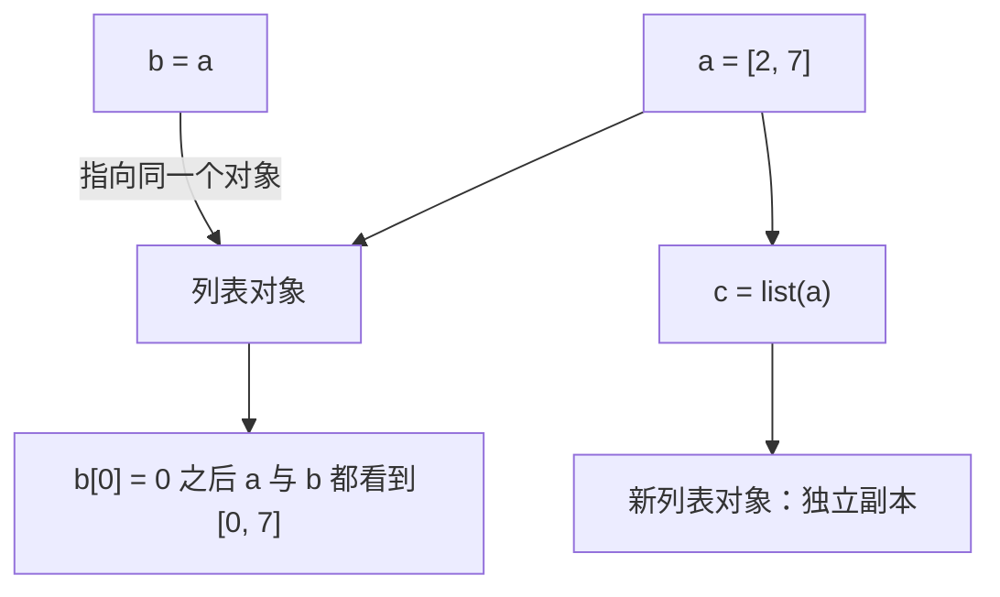
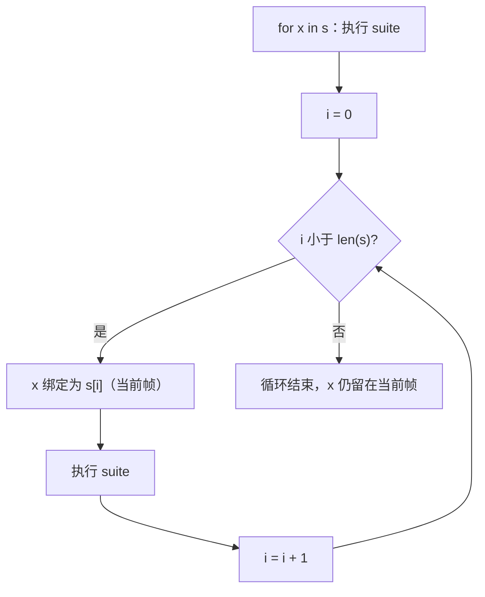
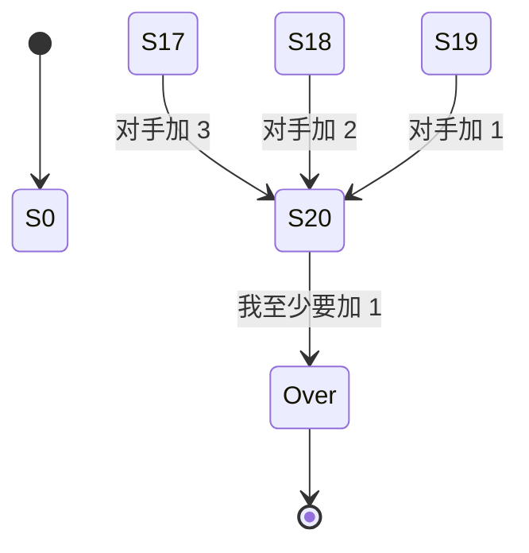

> **课程**：UC Berkeley CS61A · Structure and Interpretation of Computer Programs（Fall 2024）
> **本讲**：Lecture 11 ｜ 22:15 ｜ B 站分 P 11 ｜ [原视频](https://www.bilibili.com/video/BV1sy411z7nA?p=11)
> **课件**：`10-Sequences.pdf`（12 页，官方 PDF，逐页渲染图见正文插图）
> **字幕**：B 站英文原声字幕；本笔记是中文书面化重构，非逐句翻译
> **版权**：课程与课件版权归 UC Berkeley CS61A 教学团队；本文为学习用途的二次整理

## 本讲速览

- **已掌握**：表达式与调用表达式的求值顺序、`def` 与环境图、递归与树递归（Lecture 8–10）。到目前为止处理的数据，基本还是数字、布尔值、字符串这类"单个值"。
- **本讲主线**：
    - `list` 是 Python 的容器类型：字面量构造、下标索引、`len`、`+` 与 `*`，以及索引为什么被定义成"从开头起的偏移量"。
    - 容器可以嵌套，于是"某个值在不在容器里"变成独立问题；`in` / `not in` 只做逐元素的相等比较，不搜索子序列。
    - `for` 语句把遍历从手写索引的样板代码里解放出来，它在**当前帧**绑定循环变量，不创建新帧。
    - `range` 只靠一对整数就能给出长度与元素选择，因而同样是一个序列——**序列是能力，不是类型**。
    - 列表推导式把"映射 + 过滤"压进一个表达式，`divisors` 是它装进函数后的样子。
- **关键结论**：一个值只要支持"求长度"与"按下标取元素"，就可以被当作序列来迭代；`for`、`range`、推导式都是这条协议的语法糖，`list`、`tuple`、`str`、`range` 只是同一条协议的不同实现。

*(参考时间: 00:00:01 – 00:22:12｜Lecture 11)*

## 1. 序列的入口：`list` 字面量、索引与 `len`

*(参考时间: 00:00:01 – 00:00:53｜Lecture 11)*

`list` 是 Python 的内置数据类型（built-in data type），在整个语言里几乎无处不在：函数要返回多个结果、程序要读入一批数据、算法要维护一个待处理队列，用的都是它。本讲从最小的构造方式开始，一层层把"序列"这层抽象装起来。


构造列表用**列表字面量（list literal）**：方括号里用逗号隔开若干元素。要把它绑定到名字上，只需一条普通的赋值语句：

```python
odds = [1, 3, 5, 7]
```


> **编者说明**：本讲录像从 `list` 的内容直接开始，字幕中没有留下公告口播。课件第 2 页是这堂课的开场公告页，此处按页码顺序保留，不对公告内容作任何推测。


> **编者说明**：本讲课件的 PDF 只保留了分节页与后半程的内容页，`list` 这一段的示例是讲师现场输入的。以下代码与输出按字幕口述复原；口述没有给全的个别数值（例如嵌套列表两个内层元素的具体取值）取最小自洽示例，不改变任何结论。

拿到 `odds` 之后，取元素用**元素选择（element selection）**：方括号里写下标。查元素个数用内置函数 `len`：

```python
>>> odds[0]
1
>>> odds[1]
3
>>> odds[2]
5
>>> odds[3]
7
>>> len(odds)
4
```

这里有一处几乎所有人初次都会绊一下的地方：最后一个元素的下标是 3，而元素个数是 4。讲师给出的解释不是"Python 从 0 开始数"这种只能死记的口诀，而是一个更有用的心智模型——**下标是从开头起的偏移量（offset）**。

- 偏移 0 就是开头本身。
- 偏移 1 是开头之后第一个元素。
- 偏移 2、3 依次再往后挪两步、三步。

于是"最后一个元素的下标 = 长度 − 1"不再是一条要背的规则，而是"最后一个元素离开头有 `len - 1` 步"的直接翻译。这个模型在后面会反复兑现：§6 里 `range(-2, 2)` 的第 3 号元素是 `-2 + 3 = 1`，用的正是同一句话——起点加上偏移。把下标理解成"位置编号"，会得到一堆特例；理解成"偏移量"，得到的是一个公式。

## 2. 元素选择表达式：先算谁，再看什么

*(参考时间: 00:00:55 – 00:02:49｜Lecture 11)*

元素选择不是一个"取值符号"，而是一个**表达式**，因此它遵守前面几讲讲过的表达式求值规则。写下 `odds[2]` 时，Python 先求值方括号左边那个给出列表的表达式，再求值方括号里的下标表达式，最后拿两个值去查表。

由于两个位置都是表达式，就可以在任意一侧放任意东西，也可以把一次选择的结果拿去组合：

```python
>>> odds[3] - odds[2]
2
>>> odds[odds[3] - odds[2]]
5
```

第二行值得停一下：`odds[3] - odds[2]` 先算出 `7 - 5 = 2`，这个 2 又被当作下标，于是取到 `odds[2] = 5`。求值顺序是"先左、再内、后查表"，没有任何歧义。能这样嵌套，是因为下标位置只要求"求值出一整数"，而不要求"写成一个数字"。

字面量里的每个元素同样可以是表达式。只要两边求值出来的列表相等，两个列表就相等：

```python
>>> [1, 8, 2, 8] == [1, 4 + 4, 2, 8]
True
```

也就是说 `digits = [1, 8, 2, 8]` 与 `digits = [1, 4 + 4, 2, 8]` 绑定的是相等的值。写数字还是写算式，只影响读者能否一眼看出"这个 8 是 4 的平方"，不影响程序行为。

按下标取元素还有另一种写法：`operator` 模块里的 `getitem`，效果完全相同。

```python
>>> from operator import getitem
>>> getitem(odds, 2)
5
```

`getitem(odds, 2)` 把"下标"从语法降级成了普通实参，于是"按下标取元素"这件事本身可以被当作函数传来传去——与前面讲过的"函数即值"是同一套思路。这也解释了为什么 Python 要把运算符与函数分成两套写法：语法形式读起来短，函数形式能被组合。

组合两个列表用 `+`，重复一个列表用 `*`：

```python
>>> digits = [1, 8, 2, 8]
>>> [2, 7] + digits * 2
[2, 7, 1, 8, 2, 8, 1, 8, 2, 8]
```

`digits * 2` 先把 4 个元素复制成 8 个，`[2, 7] + ...` 再把 `2, 7` 接到前面，得到 10 个元素的列表。这里有两点必须分清。

- `+` 与 `*` 都**产生新列表**，原来的 `digits` 与 `[2, 7]` 一个元素都没变。
- `*` 复制的是**元素的引用**，对只含整数的列表看不出区别；元素本身可变时，"复制"与"共享"就有差别了（见 §3.5）。

`operator` 模块里有对应的 `add` 与 `mul`，与 `+`、`*` 等价：

```python
>>> from operator import add, mul
>>> add([2, 7], mul(digits, 2))
[2, 7, 1, 8, 2, 8, 1, 8, 2, 8]
```

### 2.5 切片：元素选择的区间版（编者补充）

> **编者说明**：本小节不在本讲口播范围内，属于官方读本对序列操作的补全。放在此处，是因为切片与元素选择共用同一个"偏移量"模型。

一次取一个元素用下标；要取连续的一段，用**切片（slicing）**，写法是 `s[start:end]`：

```python
>>> digits = [1, 8, 2, 8]
>>> digits[1:3]
[8, 2]
>>> digits[:2]
[1, 8]
>>> digits[2:]
[2, 8]
>>> digits[-1]
8
>>> digits[:]
[1, 8, 2, 8]
```

`start:end` 与 `range(start, end)` 用同一条约定：包含起点、不包含终点。`digits[1:3]` 取到下标 1、2 两个元素，长度是 `3 - 1 = 2`，与 `range` 的长度公式一模一样。省略起点默认为 0，省略终点默认到末尾，两边都省略则得到一个**新列表**（副本，见 §3.5）。负下标从末尾倒着数，`digits[-1]` 就是最后一个元素，等价于 `digits[len(digits) - 1]`。

## 3. 嵌套列表与 `in`：容器里的容器

*(参考时间: 00:02:51 – 00:05:55｜Lecture 11)*

列表的元素不必是整数，可以是任何值，包括另一个列表。

```python
pairs = [[10, 20], [30, 40]]
>>> pairs[1]
[30, 40]
>>> pairs[1][0]
30
```

这里出现了**组合表达式**：`pairs[1]` 本身是一次元素选择，结果是一个列表，紧接的 `[0]` 又在它上面做第二次选择。从左往右读，就是"先取第 1 号元素，再取那个元素的第 0 号元素"。

`pairs` 有两层：外层两个元素，每个元素又是一个两元素列表。讲师强调这正是列表的本质——**列表是一个值，它表示"其他值的集合"**。一旦承认这一点，"某个值是否出现在这个集合里"就变成一个必须回答的问题，Python 为它准备了 `in` 运算符。

```python
>>> digits = [1, 8, 2, 8]
>>> 1 in digits
True
>>> 8 in digits
True
>>> 5 in digits
False
>>> 5 not in digits
True
```

`in` 的求值过程与元素选择同构：先求值左边（要找的值），再求值右边（被搜索的容器），然后判断左边是否出现在右边。`8` 出现了两次，答案仍是 `True`——`in` 问的是"存在吗"，不是"出现几次"；要计数就得自己写循环，§4 的 `count` 正是干这个的。`not in` 是另一个运算符，含义就是 `not (x in s)`。

`in` 只做**逐元素的相等比较**，这一点有三个常见误读，讲师逐一拆掉。

- **类型必须真的相等。** `'1' in digits` 是 `False`，因为字符串 `'1'` 与整数 `1` 不相等；`in` 不会先把 `'1'` 转成数字再比。
- **它不搜索子序列。** `[1, 8] in digits` 是 `False`，尽管 `1` 与 `8` 确实相邻出现过；`digits` 的元素是四个整数，没有一个等于列表 `[1, 8]`。
- **但如果容器里真的有一个元素等于它，答案就是 `True`。** `[1, 2] in [[1, 2], [3, 4]]` 为 `True`，因为 `[1, 2]` 是外层列表的一级元素。再深一层就变成 `False`——`[1, 2] in [[[1, 2]]]` 的一级元素是 `[[1, 2]]`，不是 `[1, 2]`。

一句话：`in` 不会"钻进结构里找任何看起来匹配的东西"，它只把容器的一级元素逐个拿出来与目标比较。这个"不做递归搜索"的决定看起来省事，代价是它无法表达"任意深度地找"；那种需求只能自己写递归，而这正是第 8–10 讲练过的手艺。

| 被检验的表达式 | 结果 | 原因 |
|---|---|---|
| `1 in [1, 8, 2, 8]` | `True` | 一级元素里有整数 1 |
| `'1' in [1, 8, 2, 8]` | `False` | 字符串与整数不相等，`in` 不做类型转换 |
| `[1, 8] in [1, 8, 2, 8]` | `False` | 不搜索子序列，只比一级元素 |
| `[1, 2] in [[1, 2], [3, 4]]` | `True` | `[1, 2]` 恰好是一个一级元素 |
| `[1, 2] in [[[1, 2]]]` | `False` | 一级元素是 `[[1, 2]]`，再深一层不算 |
| `5 not in [1, 8, 2, 8]` | `True` | 等价于 `not (5 in digits)` |

复杂度上，`in` 的语义直接决定了它的代价：每次判定都是一次线性扫描，列表有 $n$ 个元素，判一次就是 $O(n)$ 次比较。把 `in` 放进另一个遍历同一个列表的循环里，整体会变成 $O(n^2)$——这是后面讲集合与字典时被反复提起的动机。

### 3.5 别名与副本：两个名字，一份数据（编者补充）

> **编者说明**：可变性与副作用要到后续讲次才正式展开。此处只用来说明"容器作为值"最容易误会的一点；代码为本笔记补充，不在本讲口播内。

赋值语句绑定的是**值**，而列表是可变对象，于是同一个列表可以被多个名字指向：

```python
a = [2, 7]
b = a
b[0] = 0
>>> a
[0, 7]
```

`b = a` 没有复制任何元素，它只是让 `b` 指向 `a` 已经指向的那个列表对象。"一个对象、多个名字"的关系叫**别名（aliasing）**。环境图里画成两个名字的箭头汇到同一个列表：



要真正得到一份独立数据，必须**复制**：`list(a)` 或 `a[:]` 都会新建一个列表，此后改 `c` 不会影响 `a`。

```python
c = list(a)
c[0] = 5
>>> a
[0, 7]
>>> c
[5, 7]
```

嵌套结构让这件事更隐蔽：`nested = [a, a]` 里两个位置指向同一个 `a`，改 `nested[0][0]` 会同时改变 `nested[1][0]`；而 `a * 2` 复制的也只是两个指向同一个 `a` 的引用，不是两份 `a`。§2 里说 `*` 复制元素引用，落点就在这里。等后续讲到可变性、浅拷贝与深拷贝，这条线索会被接上。

## 4. `for` 语句：把遍历的样板代码收进语法

*(参考时间: 00:05:59 – 00:09:44｜Lecture 11)*

序列在计算里太基础，语言设计者干脆为"遍历序列"造了一种新语句。为了说清它解决了什么，讲师先老老实实写了一遍不用它的版本：数一数某个值在序列里出现了几次。

```python
def count(s, value):
    """Count the number of times value appears in s.

    >>> count([1, 2, 1, 2, 1], 1)
    3
    """
    total, index = 0, 0
    while index < len(s):
        element = s[index]
        if element == value:
            total += 1
        index += 1
    return total
```

逐步读一遍：`total, index = 0, 0` 是多重赋值，一条语句给两个名字定初值；`while index < len(s)` 保证下标不越界；`element = s[index]` 取出当前元素；`if element == value` 决定要不要累加；`index += 1` 把下标推进一格。五步里只有 `if` 那一步是这道题真正的逻辑，其余四步纯粹是"把列表从头走到尾"的机械动作。

`total += 1` 是增强赋值语句（augmented assignment），含义是"把 `total` 重新绑定为它原来的值再加 1"。它比 `total = total + 1` 短，也更难写错；Python 里 `-=`、`*=` 等一整套运算符都有对应写法。讲师先把它用在这里，随即指出真正该被消除的东西：这段实现的主体只有 `if` 那两行，剩下的都在为"遍历"服务。而遍历如此常见，值得给它一个专门的语句。

```python
def count(s, value):
    """Count the number of times value appears in s.

    >>> count([1, 2, 1, 2, 1], 1)
    3
    """
    total = 0
    for element in s:
        if element == value:
            total += 1
    return total
```

对照着读，`for` 一行替掉了三件事：初始化下标、检查下标是否越界、每次循环末尾推进下标。代码里再也找不到 `index`，读者就不必在脑子里维护它。讲师把这个版本读成一句话：先记下"我已经见过多少次 `value`"，然后对 `s` 里的每个元素，若它等于 `value` 就把计数加一。doctest 跑出来的结果与手算一致——`1` 在 `[1, 2, 1, 2, 1]` 里出现 3 次，一条测试通过。

`while` 版本的失败模式值得记住：忘了写 `index += 1` 就是死循环；把条件写成 `index <= len(s)` 就会在下标等于长度时抛 `IndexError`；把 `total` 的初值写在循环里就会每轮清零。`for` 把这三类错误一次性移出了写作者的视野，这不是风格问题，而是把一类 bug 从"可能犯"变成"不可能犯"。

| 判据 | `while` 版本 | `for` 版本 |
|---|---|---|
| 需要显式下标变量 | 需要（`index`） | 不需要 |
| 终止条件 | 手写 `index < len(s)` | 由语句自动判断 |
| 每次推进 | 手写 `index += 1` | 由语句自动推进 |
| 循环变量绑在哪一帧 | 当前帧 | 当前帧（同样不新建帧） |
| 典型出错方式 | 忘推进则死循环；边界写成 `<=` 则越界 | 基本不存在这两类错误 |
| 适用场景 | 需要位置本身，或步长不规则 | 只需要逐个访问元素 |

## 5. `for` 的执行模型与序列解包

*(参考时间: 00:09:47 – 00:13:03｜Lecture 11)*

`for` 的语义只有三条，讲清之后就不该再有黑箱。

```text
for <name> in <expression>:
    <suite>
```

1. 求值头部表达式 `<expression>`，它必须给出一个**可迭代值（iterable）**。
2. 对序列里的每个元素：把 `<name>` 绑定到该元素，然后执行 `<suite>`。
3. 绑定发生在**当前环境的第一帧**里，不新建帧；因此循环结束后，这个名字仍然留在那一帧里。

第 1 条里"可迭代值"这个词，讲师特意留了个口子：这个术语几周后才会精确定义，眼下只要把它理解成"一个序列"就够了，之后会看到序列之外也有能迭代的东西。这个处理方式本身就值得学——先给出够用的局部定义，等工具齐了再补精确版本，比一开始就追求完备更容易让人上手。

循环变量绑在**当前帧**而不是新帧，是 `for` 与函数调用的关键差别。也就是说，循环不提供任何作用域隔离：循环结束后 `element` 仍能在函数体后面被访问，它的值是最后一个元素。环境图上表现为"当前帧多了一个绑定"，全程没有出现新框。

第 2 条则是 `for` 与 `while` 等价性的来源。把 `for` 展开成"下标初始化为 0 + 循环 + 下标加一"，语义完全不变：



这张图解释了为什么 `for` 只适用于"按下标能取到元素"的东西：展开式里同时出现了 `s[i]` 与 `len(s)`。而 `range` 恰好两项都提供（§6），所以它可以被 `for` 遍历。展开式里必须出现 `s[i]`，也解释了为什么此刻可以把"可迭代"直接理解成"序列"：后面会看到 `for` 还能遍历不放元素、也不支持下标的对象，那时的展开方式就要换一套机制。

第二个巧处在头部语法：`for` 的名字位置上可以写**多个名字**，只要序列的每个元素本身是定长的。

```python
pairs = [[1, 2], [2, 2], [3, 2], [4, 4]]
same_count = 0
for x, y in pairs:
    if x == y:
        same_count += 1
```

`pairs` 的每个元素是一对数，`for x, y in pairs` 直接把它们拆成两个名字，`x` 与 `y` 分别绑定到每一对的两个元素，而不是绑定到那一对本身。走一遍：`(1, 2)` 不等；`(2, 2)` 相等，`same_count` 变成 1；`(3, 2)` 不等；`(4, 4)` 相等，`same_count` 变成 2。这个写法叫**序列解包（sequence unpacking）**。

它与多重赋值 `x, y = pair` 完全同构：左边几个名字，右边就要求几个值，一一对应。因此它也继承了多重赋值的前提——**长度必须匹配**。拿一个二元组去配三个名字会报错；元素的长度不固定时就不能用解包，这也是讲师强调"只对定长序列有效"的原因。

## 6. `range`：用两个整数表示一串整数

*(参考时间: 00:13:05 – 00:16:37｜Lecture 11)*


`range` 是另一种序列类型：它是序列，但不是列表。它用来表示一串连续整数——准确说，`range` 能表示更一般的整数序列，本讲只处理连续递增这一种。


讲师的画法值得复述：想象一条排满整数的数轴，`range(-2, 2)` 是在这条数轴上截出**有限的一段**，从 `-2` 往右数到 `2` 之前。图上两个箭头都指向数字左侧的空隙：`-2` 落在这段区间里，`2` 则被挡在区间之外。

包含起点、排除终点，初看是个古怪的约定，但它让两件事同时变简单。

- **长度**：`结束值 − 起始值`。`range(-2, 2)` 的长度是 `2 - (-2) = 4`，数轴上正好是 `-2, -1, 0, 1` 四个。
- **元素选择**：`起始值 + 下标`。下标 0 是 `-2`，下标 3 是 `-2 + 3 = 1`。

两条公式都不需要 `+1` 或 `-1` 的修补，这正是半开区间的回报。若改成"包含两端"，长度得写成 `end - start + 1`，元素选择也得在边界上特殊处理，那个多出来的 `+1` 会散落到每一个用到它的地方。约定本身没有对错，价值在于"少一处例外"。

于是 `range` 满足序列协议：有长度，能按下标取元素。讲师据此下结论——**它有 `len` 和元素选择，所以它必须是序列，哪怕它不是列表**。这句话是本讲的枢纽：序列不是某个具体类型，而是一组能力；`list` 是这套能力的一种实现，`range` 是另一种。

想看 `range` 里到底有哪些元素，就调用**列表构造器 `list`**：

```python
>>> list(range(-2, 2))
[-2, -1, 0, 1]
>>> list(range(4))
[0, 1, 2, 3]
```

`list` 是内置函数（构造器），对一个序列调用它，就得到装着该序列全部元素的列表。`range(4)` 只给一个数时，它被当作结束值，起始值隐含为 0——这与切片省略起点的规则同源。

```python
>>> range(5, 8)
range(5, 8)
>>> list(range(5, 8))
[5, 6, 7]
```

注意第一行的回显：`range(5, 8)` 求值得到的仍是 `range` 对象，不是列表，屏幕上出现的 `range(5, 8)` 只是它的表示形式。要看到元素，必须显式调用 `list`。讲师特别强调，如果已经理解 `range` 的语义，`[5, 6, 7]` 是可以直接推出来的；调用 `list` 只是用来**确认**，而不是用来"产生"这个序列。

> **编者说明**：`range` 之所以能只由两个整数表示，是因为它不保存元素，而是每次按公式现算——长度做减法，元素做加法。这种"按需计算、不物化"的行为在 Python 里称为惰性（lazy）。它带来两个实际后果：`range(10**12)` 几乎不占内存；`range` 对象不可原地修改，也不能用 `+` 拼接另一个 `range`。这两条不在本讲口播内，属于对"不是列表"这一判断的补充。

### 6.5 四种内置序列的对照（编者补充）

> **编者说明**：本讲只展开了 `list` 与 `range`。`str` 与 `tuple` 是同一套序列协议在后续讲次的另外两个实现，这里提前并排，是为了让"序列是能力而非类型"落到实处；表中与 `str`、`tuple` 相关的行来自官方读本，不在本讲口播内。

| 判据 | `list` | `tuple` | `str` | `range` |
|---|---|---|---|---|
| 字面量写法 | `[1, 3, 5]` | `(1, 3, 5)` | `'135'` | `range(1, 6, 2)` |
| 是否可变 | 可变 | 不可变 | 不可变 | 不可变 |
| 元素类型 | 任意 | 任意 | 只能是字符 | 只能是整数 |
| `len` | 有 | 有 | 有 | 有（减法得到） |
| 下标与切片 | 有 | 有 | 有 | 有（切片仍为 `range`） |
| `+` 拼接 | 支持 | 支持 | 支持 | 不支持 |
| `*` 重复 | 支持 | 支持 | 支持 | 不支持 |
| `in` 的语义 | 元素相等 | 元素相等 | 子串匹配 | 整数相等 |
| 内存代价 | 与元素个数成正比 | 与元素个数成正比 | 与字符数成正比 | 常数，与长度无关 |
| 典型用途 | 通用容器 | 定长记录、不可变数据 | 文本处理 | 计数循环、整数序列 |

`str` 与 `list` 最容易被忽略的差别在 `in` 这一行：`'ab' in 'abc'` 是 `True`，因为字符串的 `in` 找的是**子串**；而 `[1, 2] in [[1, 2], [3, 4]]` 找的是**元素**。同样是 `in`，右边那个值的类型决定了它在问什么问题，这个差别在后续处理文本时会反复遇到。

`tuple` 的写法几乎与 `list` 一样，只是方括号换成圆括号；一旦构造就不能修改，代价是换来"不会被别人改掉"的保证（以及可以作为字典键）。这四种类型的构造、遍历、切片写法完全一致，因为它们共享同一份协议。判断一段代码是不是"面向序列"写的，只需看它有没有依赖某个具体类型的方法——只用到 `len`、下标与 `for` 的代码，换一种序列照样能跑。

## 7. 用 `range` 驱动循环：求和与"下划线"约定

*(参考时间: 00:16:38 – 00:18:35｜Lecture 11)*

`range` 最常见的用法，是给 `for` 提供一个整数序列，因为很多循环真正需要的正是一串递增的整数。

```python
def sum_below(n):
    total = 0
    for i in range(n):
        total += i
    return total

>>> sum_below(5)
10
```

`range(5)` 给出 `0, 1, 2, 3, 4`，循环把这五个数累加：`0 + 1 + 2 + 3 + 4 = 10`。整个过程没有下标，也没有 `len`——`i` 本身就是需要的数据，而不是"用来取数据的工具"。这就是 `for ... in range(n)` 与"`while` 加下标"的分工：前者遍历**值**，后者遍历**位置**。

有时循环只是要"做 n 次"，整数本身毫无用处：

```python
for _ in range(3):
    print('Go Bears!')
```

`range(3)` 有三个元素，循环体执行三次，屏幕上出现三行 `Go Bears!`。循环变量被绑定了，但循环体里从没用到它。讲师给了一条约定：**用单个下划线 `_` 当名字**，让读代码的人一眼看出"这个值我不打算用"。写成 `x` 也完全能跑，但 `x` 会让人以为它有意义，进而去找它在哪里被使用；`_` 则明确宣告"这里只是需要一个占位符"。

> **编者说明**：`_` 在 Python 里没有语法层面的特殊地位，它只是一个合法标识符；"表示不使用"是社区约定，交互式解释器还会额外用它保存上一次表达式的结果。两者互不冲突，但不要把解释器的行为当成语言语义。

### 7.5 内置聚合：`sum`、`min`、`max`（编者补充）

> **编者说明**：以下三个内置函数不在本讲口播内，属于对 §7 手写循环的标准库对照。

`sum_below` 手写了一个累加循环，而 Python 内置了 `sum`：

```python
>>> sum(range(5))
10
>>> sum([1, 3, 5, 7, 9])
25
>>> min([1, 3, 5, 7, 9])
1
>>> max([1, 3, 5, 7, 9])
9
```

`sum` 从 0 开始把元素依次相加，`min` / `max` 扫描一遍取最小 / 最大值，三者都接受任何可迭代对象，包括 `range`。它们与手写循环的关系值得记住：**先手写，是为了知道循环里发生了什么；之后用内置函数，是因为标准库版本更快也更难写错。** 另外，`sum` 要求元素能相加，`min` / `max` 要求元素能比较，喂错类型会在运行时抛错，而不会悄悄返回一个奇怪结果。

## 8. 列表推导式：把 `for` 写进表达式

*(参考时间: 00:18:38 – 00:21:13｜Lecture 11)*


列表推导式（list comprehension）是 Python 里一种强有力的**组合**形式：它从一个已有序列出发，按一个表达式算出新列表。


完整语法是：

```text
[<map exp> for <name> in <iter exp> if <filter exp>]
```

短版本省掉过滤：

```text
[<map exp> for <name> in <iter exp>]
```

四段的职责可以这样分：`<iter exp>` 给出数据源，`<name>` 是每轮的绑定名，`<map exp>` 决定"这个元素变成什么"，`<filter exp>` 决定"这个元素要不要留下"。执行时，解释器对源序列的每个元素依次绑定名字、检查过滤条件、求值映射表达式，把通过筛选的结果按原顺序装进一个新列表。

```python
odds = [1, 3, 5, 7, 9]
>>> [x + 1 for x in odds]
[2, 4, 6, 8, 10]
```

读法是"对 `odds` 里的每个 `x`，算出 `x + 1`"：1 变成 2，3 变成 4，依此类推。机制上，`x + 1` 这个表达式被反复求值，每次 `x` 绑定到不同的元素——这正是 `for` 循环在做的事，只是结果被自动收集进列表，不需要额外的收尾动作。

课件还演示了一个"把下标映射成字母"的例子：源序列是若干下标，`<map exp>` 是从字母序列里按下标取字母，拼出来的结果正是单词 `DEMO`。这个例子说明 `<map exp>` 可以是任意表达式，包括又一次元素选择——推导式并不要求映射是算术运算。

加上过滤条件，推导式就能"只保留一部分元素"：

```python
>>> [x for x in odds if 25 % x == 0]
[1, 5]
```

`25 % x` 是取余运算，`%` 叫模运算符（modulo）；`25 % x == 0` 表示 `x` 能整除 25。`odds` 里 `1` 与 `5` 满足，`3`、`7`、`9` 都不满足，于是只留下两个。注意这里 `<map exp>` 就是 `x` 本身——推导式允许"只筛不换"。

两段还能组合，先筛后换：

```python
>>> [x + 1 for x in odds if 25 % x == 0]
[2, 6]
```

不是先得到 `[1, 5]` 再加一，而是对每个通过的 `x` 直接算 `x + 1`。顺序上永远是"先过滤、后映射"，尽管 `if` 写在后面；这是语法位置与执行顺序不一致带来的常见困惑，记住"`if` 是守卫，守卫先于加工"即可。

| 组成 | 语法位置 | 作用 | 例子 |
|---|---|---|---|
| 数据源 | `<iter exp>` | 提供可迭代的序列 | `odds`、`range(2, n)` |
| 绑定名 | `<name>` | 每轮指向一个元素 | `x`、`e` |
| 映射表达式 | `<map exp>` | 决定输出元素 | `x + 1` |
| 过滤表达式 | `<filter exp>` | 决定是否保留 | `25 % x == 0` |

> **编者说明**：推导式与"`for` + 逐个收进结果列表"是等价的两种写法，后者需要列表的 `append` 方法（第 15 讲才正式讲可变性），等价的循环写法见下面的代码块。另一处容易忽略的差异在作用域：`for` 语句把循环变量绑在**当前帧**，而 Python 3 的推导式有自己的作用域，里面的 `x` 不会泄漏到外层——`[x for x in odds]` 执行完之后，外层的 `x` 仍是执行前的那个（或仍未定义）。

```python
result = []
for x in odds:
    if 25 % x == 0:
        result.append(x + 1)
```

## 9. 案例：`divisors`——把推导式装进函数

*(参考时间: 00:21:14 – 00:22:12｜Lecture 11)*

推导式本身是表达式，当然可以作为函数的返回值：

```python
def divisors(n):
    """Return the divisors of n.

    >>> divisors(1)
    [1]
    >>> divisors(4)
    [1, 2]
    >>> divisors(9)
    [1, 3]
    >>> divisors(8)
    [1, 2, 4]
    """
    return [1] + [x for x in range(2, n) if n % x == 0]
```

拆开看三处设计。

- `[1]` 单独拎出来拼在头部。1 能整除任何正整数，是"永远成立"的平凡解，把它从循环里剥离，循环就能从未必成立的 2 开始。
- `range(2, n)` 的上界取 `n` 而不是 `n + 1`，靠的正是"排除终点"：候选因子只到 `n - 1`，`n` 自己不会出现在结果里。半开区间的约定在这里直接省掉一个边界判断。
- `n % x == 0` 是全部的逻辑。没有累加、没有临时变量，函数体只有一行。

结果与手算一致：1 的因子只有 1（特殊情况）；4 有 1 和 2；9 有 1 和 3；8 有 1、2、4；12 与 18 的因子更多。列出这些是为了看出规律——**因子总是成对出现**，这也是后面优化它的入口。

> **编者说明**：试除法是 $O(n)$ 的。若 $d$ 是 $n$ 的因子，则 $n/d$ 也是，因此只需枚举到 $\sqrt{n}$，再把每个因子与它的配对一起收集。这项优化不在本讲口播内，写在这里只是提示 `divisors` 还有余地；实现它需要拼接两个列表并处理完全平方数导致的重复，属于本讲末尾的延伸练习。

## 小结

- 序列是一组**能力**而不是一个类型：有 `len`、能 `s[i]`，就足以被 `for` 遍历。`list` 与 `range` 是同一协议的两个实现，`tuple`、`str` 是另外两个。
- 下标的正确心智模型是**偏移量**。"最后一个下标 = 长度 − 1"与"`range` 第 i 个元素 = 起点 + i"是同一句话的两种写法。
- 半开区间（含起点、不含终点）让长度与元素选择都不需要 `±1` 修补，这是 `range`、切片、`range(4)` 省略起点三处共用的约定。
- 运算符要分清：`+` 拼接、`*` 重复，两者都**产生新列表**；`*` 复制的是元素引用，元素可变时就会共享。
- `in` 只做逐元素相等比较：不做类型转换、不搜索子序列、每次都是线性扫描。
- `for` 的三条语义：求值头部得到可迭代对象、逐元素绑定**在当前帧**、执行 suite；它等价于"下标初始化为 0 + 循环 + 下标加一"。
- `while` 还是 `for`，判据是"循环需要位置还是只需要值"；需要位置就用 `while` 或 `range` 加下标，只需要值就直接遍历。
- 列表推导式是"映射 + 过滤"的表达式版：`<iter>` 给数据、`<name>` 绑定、`<map>` 加工、`<if>` 守卫，守卫先于加工。
- 遇到"数一数、筛一筛、变一变"这类任务，先在纸上写 `while` 版本，再改写成 `for`，最后压成推导式——这条改写链条就是本讲的方法论。

*(参考时间: 00:00:01 – 00:22:12｜Lecture 11)*

## 附：本讲幻灯片索引

| 页 | 内容 | 出现位置 |
|---|---|---|
| 1 | 标题页 Sequences | §1 |
| 2 | Announcements 开场公告页 | §1 |
| 3 | 分节页 Lists | §1 |
| 4 | 分节页 Ranges | §6 |
| 5 | The Range Type：半开区间、长度与选择公式 | §6 |
| 6 | 分节页 List Comprehensions | §8 |
| 7 | 列表推导式语法（含短版本） | §8 |
| 8 | Example: Two Lists 配对筛选例题 | 附录 |
| 9 | 分节页 Example: Promoted | 附录 |
| 10 | First in Line：`promoted` 的两段推导式 | 附录 |
| 11 | 分节页 Example: Twenty-One | 附录 |
| 12 | Twenty-One Rules 与好坏状态 | 附录 |

*(参考时间: 00:00:01 – 00:22:12｜Lecture 11)*

## 附录：课堂未展示的幻灯片

*(参考时间: 00:18:38 – 00:22:12｜Lecture 11)*

> **编者说明**：课件第 8、10、12 页上的三道例题（Two Lists、Promoted、Twenty-One）在 22 分钟的录像里没有对应的口播与演示，录像在第 9 节的 `divisors` 之后结束。按统一规范，这些页面集中放在文末并各出现一次；下面的讲解是依据课件文字补写的思路，不是课堂原话。


题目给出两个等长且相关的列表：`xs` 是所有候选取值，`ys` 是对每个 `x` 算出来的结果，要求"挑出那些对应 `y` 小于 10 的 `x`"。

```python
xs = range(-10, 11)
ys = [x*x - 2*x + 1 for x in xs]
```

`ys` 的每一项都是 `(x - 1) ** 2`，于是"小于 10"等价于 `x - 1` 落在 $-3$ 到 $3$ 之间，答案应当是 `[-2, -1, 0, 1, 2, 3, 4]`，与课件的回显一致。要把两个列表的下标对齐着筛，最直接的写法是用下标遍历：

```python
xs_where_y_is_below_10 = [xs[i] for i in range(len(xs)) if ys[i] < 10]
```

`len(xs)` 对 `range` 也能用，`xs[i]` 也能用——这正是"`range` 是序列"的又一次兑现：同一个推导式模板，换个数据源照样成立。这一类"两个等长列表按下标联动"的问题在数据整理中极常见，代价是必须自己维护下标；更短的写法要用到 `zip` 之类的工具，那属于后续内容，而在本讲已有的工具里，下标法就是标准解法。


`promoted` 接收序列 `s` 与单参函数 `f`，返回一个元素相同、但"`f(e)` 为真"的元素全部排在前面的新列表；两组内部的相对顺序保持不变。

```python
def promoted(s, f):
    """Return a list with the same elements as s, but with all
    elements e for which f(e) is a true value placed first.

    >>> promoted(range(10), odd)  # odds in front
    [1, 3, 5, 7, 9, 0, 2, 4, 6, 8]
    """
    return [e for e in s if f(e)] + [e for e in s if not f(e)]
```

答案是两个推导式相加：第一个收集所有让 `f(e)` 为真的元素，第二个用 `not f(e)` 收集其余元素，`+` 把两段拼起来。稳定性的来源很朴素——两个推导式各自按 `s` 的原顺序产出，拼接只发生在段与段之间，组内顺序自然没有被破坏。代价是要遍历两遍 `s`，以及 `f` 会被调用 $2n$ 次；如果 `f` 很贵，这个写法就该换成一遍遍历加两个累积列表。

> **编者说明**：课件里的 doctest 假定 `odd` 已经定义，例如 `def odd(x): return x % 2 == 1`。`promoted` 本身对 `f` 没有任何限制，只要求它返回一个能被判断真假的值。


Twenty-One 的规则是：两名玩家轮流把 1、2 或 3 加到当前总数上；总数从 0 开始；总数达到 21 或更多时游戏结束；**最后加数的人输**。课件给出的关键观察是"有些状态好，有些状态坏"，并在图上点出 20 这个状态——"轮到你时，这是坏的"。



推理只有一步：轮到某人时总数若已是 20，他无论加 1、2 还是 3，总数都会立刻达到或超过 21，游戏结束，而"最后加数的人"正是他自己——所以他必输。于是 20 是**坏状态**；反过来 17、18、19 是**好状态**，因为从它们出发可以分别加 3、2、1 把 20 留给对手。沿着这条"把坏状态推给对方"的链条一直往回倒推，就能判断开局 0 是赢是输。这套"状态好坏 + 倒推"的思路是递归与动态规划的共同起点，也是本课程后面反复使用的建模方式。
