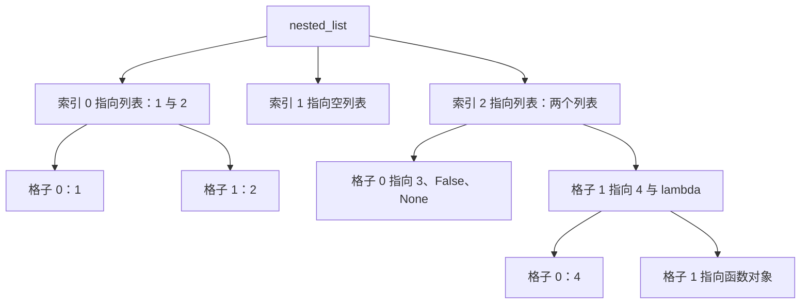
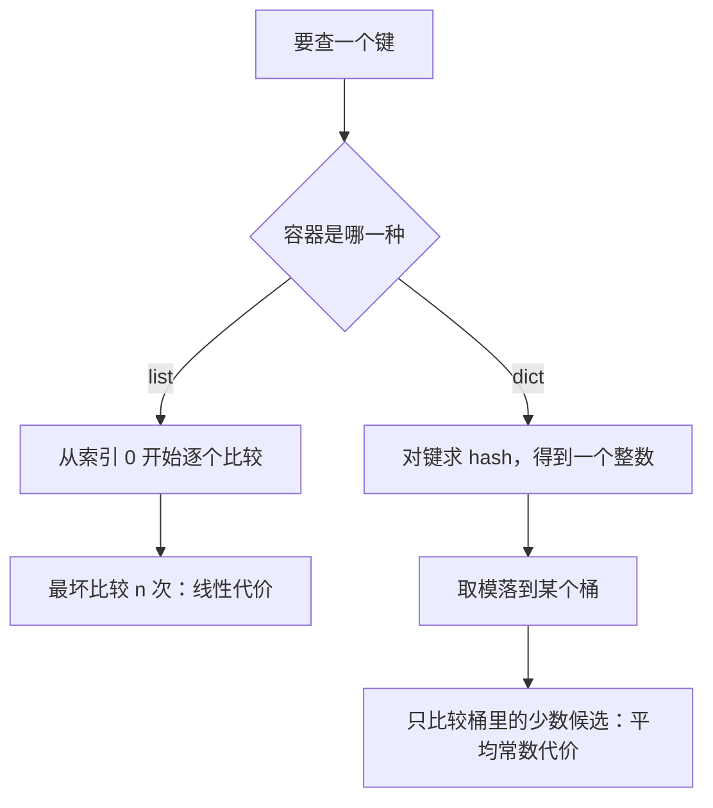
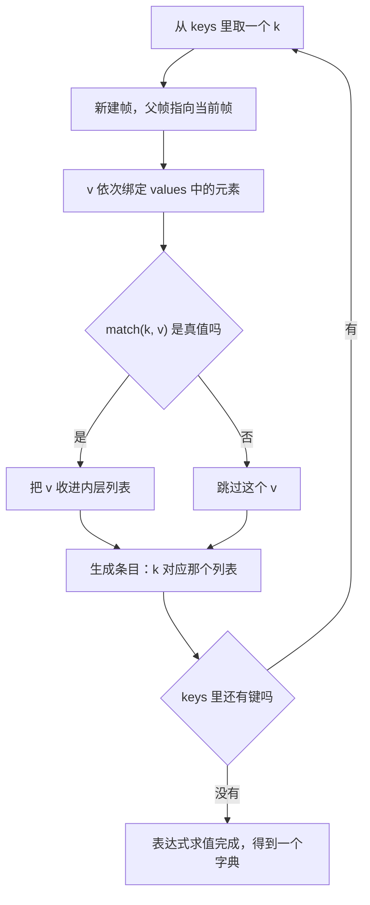
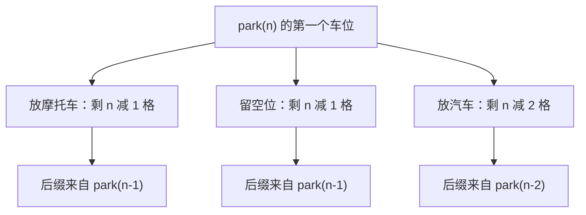

> **课程**：UC Berkeley CS61A · Structure and Interpretation of Computer Programs（Fall 2024）
> **本讲**：Lecture 12 ｜ 27:53 ｜ B 站分 P 12 ｜ [原视频](https://www.bilibili.com/video/BV1sy411z7nA?p=12)
> **课件**：`11-Containers.pdf`（16 页，官方 PDF，逐页渲染图见正文插图）
> **字幕**：B 站英文原声字幕；本笔记是中文书面化重构，非逐句翻译
> **版权**：课程与课件版权归 UC Berkeley CS61A 教学团队；本文为学习用途的二次整理

## 本讲速览

- **已掌握**：列表与 `range` 的构造、`len` 取长度、用 `for` 逐个访问元素，以及环境图里"名字绑定到值"的画法。
- **本讲主线**：
    - 容器可以装容器（闭包性质），于是需要一种记法把"什么装在什么里面"画清楚——盒指针记法。
    - 切片 `s[i:j]` 是"按 `range` 规则取子序列"的紧凑写法，并且**总是创建新值**。
    - `sum`、`max`、`all` 把"遍历一整个容器"压缩成一次调用；`max` 的 `key` 函数决定"按什么比较"。
    - 字符串是序列，但不完全是普通序列：索引返回单字符字符串，`in` 找的是连续子串。
    - 字典用键查值、只朝一个方向；键有两条硬限制（不可重复、必须可哈希），值则可以是任意东西。
    - 推导式把"对每个元素做点什么"写成一行表达式，字典推导式里还能再嵌一个列表推导式。
- **关键结论**：容器把"一份数据"变成"一批数据"；数据一旦成批，**遍历**与**查找**就成了后续所有算法的主线，而 `dict` 用空间换掉了"逐个比"的时间。

*(参考时间: 00:00:01 – 00:00:08｜Lecture 12)*


## 1. 嵌套列表与盒指针记法

*(参考时间: 00:00:10 – 00:03:26｜Lecture 12)*


上一讲把列表当作"按位置存取"的序列：有 `len`、能索引、能遍历。到了这一讲，序列开始互相嵌套，画图这件事立刻变得不平凡。讲师给出的理由是**闭包性质（closure property）**：一种组合数据值的方法满足闭包，当且仅当"用这种方法组合出来的结果本身还能用同一种方法再组合"。

这句话在列表上的具体形态是：能往列表里放元素，就应当能把那个列表再放进列表。闭包之所以重要，是因为它让**层次结构（hierarchical structures）**成为可能——层次结构由部件组成，部件本身又由更小的部件组成，如此一层层下去。现实世界里的组织方式几乎都是这个形状：文件夹里放文件夹、章节里套小节、语法树里套子树。

代价是：一旦列表能装列表，"哪个元素在哪一层"就不再是一眼看穿的事。于是需要一种专门用来追踪这种关系的记法，这就是**盒指针记法（box-and-pointer notation）**。课件只给了两条规则，却足以画出任意复杂的结构：

- 列表在环境图里画成一排**带索引标号的相邻方格**，每个元素一个格子；
- 每个格子要么直接装着**基本值（primitive value）**，要么用箭头指向一个**复合值（compound value）**。

先看最简单的例子：

```python
pair = [1, 2]
```

环境图里，全局帧中的名字 `pair` 有一条箭头指向两个相邻格子；格子角落的小数字 `0`、`1` 是索引；因为列表有两个元素，所以正好两个格子。


再看课件里那个复杂得多的例子：

```python
pair = [1, 2]

nested_list = [[1, 2], [],
               [[3, False, None],
                [4, lambda: 5]]]
```

`nested_list` 是一个三元素列表，所以画面上是三个相邻格子。它的三个元素**全都是列表**，而列表是复合值，所以三个格子里的内容都不是具体数值，而是**箭头**——指向各自被包含的那个列表。讲师在这里给出一条一般规则：列表是复合值，函数也是复合值，凡是"由多个部分组成"的东西，都用一个箭头指向对它的描绘，而不是把内容直接塞进格子。

逐个对上图里的每个箭头：

- 索引 0 指向 `[1, 2]` 这个二元素列表，两个格子里直接写着 `1` 和 `2`；
- 索引 1 指向**空列表**，画面上就是一个写着 "empty list" 的箭头，空列表没有格子；
- 索引 2 指向另一个二元素列表，而它的两个元素又是列表：格子 0 里的箭头指向 `[3, False, None]`，格子 1 里的箭头指向 `[4, lambda: 5]`。

最内层的两个列表里，`3`、`False`、`None`、`4` 都是基本值，直接写进格子。那个 `lambda: 5` 是函数，属于复合值，所以画成箭头，指向函数对象 `func λ() <line 5> [parent=Global]`。这条箭头旁边的小字很值得注意：它说的是"这个函数对象是这个列表的索引 1 处的元素，而这个列表在一个列表里，那个列表又在 `nested_list` 里"——三层包含关系，全由箭头串起来。



这张图把"层次结构由部件组成、部件又由部件组成"这句话画了出来：`nested_list` 是根，箭头是边，`nested_list` 与最内层的数值之间隔了两层。

> **编者说明**：讲师口述时把最后那个内层列表说成"索引 3 处的元素"，画面上它是索引 2——列表只有 0、1、2 三个位置。这是一处口头小口误，结构本身没有争议。

### 1.1 盒指针的两种箭头

把上面的例子读成两类关系，后面所有环境图都能这样拆：

| 箭头 | 起点 | 终点 | 表示什么 |
| :--- | :--- | :--- | :--- |
| 名字 → 值 | 帧里的名字 | 基本值、列表、函数 | 绑定（binding） |
| 值 → 组成部分 | 列表的某个格子 | 被包含的列表或函数 | 包含（containment） |

环境图之所以能同时表达"全局帧里有几个名字"和"某个列表里装了什么"，靠的就是这两类箭头叠在一起。读图时先顺着名字找到对象，再顺着格子往下一层层走，就是一次完整的结构遍历。

### 1.2 讨论题：打印结果不等于结构

课件在这里放了一道讨论题，要求画环境图并预测输出：

```python
def f(s):
    x = s[0]
    return [x]

t = [3, [2+2, 5]]
u = [f(t[1]), t]
print(u)
```

按求值顺序走一遍：`t` 的列表表达式先算出内层 `[2+2, 5]`，得到 `[4, 5]`，所以 `t` 是 `[3, [4, 5]]`。接着求值 `f(t[1])`：实参是 `t[1]`，也就是那个 `[4, 5]` 列表本身（不是副本），形参 `s` 与它绑定；`x = s[0]` 得到 4；`return [x]` **新建**一个列表 `[4]`。于是 `u` 是二元素列表：索引 0 指向新列表 `[4]`，索引 1 指向 `t` 自己。`print(u)` 打印出 `[[4], [3, [4, 5]]]`。


这道题真正想问的是最后一步：屏幕上那行 `[[4], [3, [4, 5]]]` **完全不能区分结构差异**。假如 `u` 的第二个元素是 `t` 的一份独立拷贝，打印结果一模一样，但环境图里 `u[1]` 与 `t` 是两条指向不同列表的箭头。这正是盒指针记法存在的意义——**打印文本只描述值，环境图描述结构**。

> **编者说明**：录像没有讨论这一页（字幕在盒指针讲解后直接跳到切片），环境图分析与打印结果由编者按课件代码补写。`print` 输出的方括号形式是 Python 对列表的 `repr`，与"列表在内存里的样子"不是一回事。

## 2. 切片：range 规则的紧凑写法

*(参考时间: 00:03:30 – 00:06:05｜Lecture 12)*


假设已经有了一个序列，想要其中的一段：

```python
odds = [3, 5, 7, 9, 11]
```

目标是取出 `5` 和 `7`。按位置数，它们在索引 1 和 2。最朴素的做法是把索引拿出来，再用一个列表推导式把元素搬过去：

```python
>>> [odds[i] for i in range(1, 3)]
[5, 7]
```

这里有个必须记住的细节：`range(1, 3)` 给出的是 `1` 和 `2`，**不含** `3`。切片只是这种"按 range 规则搬元素"的紧凑记法，规则完全一样：

```python
>>> odds[1:3]
[5, 7]
```

切片还有几处灵活性，正好对应 `range` 省略参数时的行为：

- 省略起点，从头开始：`odds[:3]` 取索引 0、1、2，得 `[3, 5, 7]`；
- 省略终点，走到最后：`odds[1:]` 跳过索引 0 的 `3`，得 `[5, 7, 9, 11]`；
- 两端都省略：`odds[:]` 得到原来列表的全部元素。

方括号里带一个冒号，这个记号就叫**切片操作符（slicing operator）**。它的语义与 `range` 共享同一条规则：**含下界、不含上界**。

| 表达式 | 语义 | 值 |
| :--- | :--- | :--- |
| `odds[1:3]` | 索引 1 起，到 3 之前 | `[5, 7]` |
| `odds[:3]` | 从头到索引 3 之前 | `[3, 5, 7]` |
| `odds[1:]` | 索引 1 到结尾 | `[5, 7, 9, 11]` |
| `odds[:]` | 整个列表的一份副本 | `[3, 5, 7, 9, 11]` |

紧跟着是本节最要紧的一句话：**切片总是创建新值（slicing always creates new values）**。课件用三次切片把这句话摆成了图：

```python
digits = [1, 8, 2, 8]
```

三次切片分别是 `digits[:1]` 得 `[1]`，`digits[1:3]` 得 `[8, 2]`，`digits[2:]` 得 `[2, 8]`。做完这三次切片，环境图里一共有**四个**列表：原来的 `digits` 加上三个新列表。`digits` 自己一个格子都没变——切片不是"在原名上截一段"，而是"照内容另建一份"。

这个区别在没有可变操作之前看不出后果，但它决定了后面很多行为：对切片的修改不会影响原列表，原地修改原列表也不会影响已经从它身上切下来的片段。

### 2.1 用切片做滑动窗口：double_eights

切片最实用的一种用法是把"窗口"固定成两个元素。课件给的问题是：判断列表 `s` 里是否有**两个相邻的** `8`。


第一种写法用索引往后扫描：

```python
def double_eights(s):
    """Return whether two consecutive items of list s are 8.

    >>> double_eights([1, 2, 8, 8])
    True
    >>> double_eights([8, 8, 0])
    True
    >>> double_eights([5, 3, 8, 8, 3, 5])
    True
    >>> double_eights([2, 8, 4, 6, 8, 2])
    False
    """
    for i in range(len(s) - 1):
        if s[i] == 8 and s[i + 1] == 8:
            return True
    return False
```

`range` 的上界写成 `len(s) - 1` 是有原因的：循环体里要访问 `s[i + 1]`，`i` 最大只能到 `len(s) - 2`，而 `range(len(s) - 1)` 的上界不包含 `len(s) - 1`，正好停在 `len(s) - 2`。若写成 `range(len(s))`，最后一轮会越界。

第二种写法把切片当窗口，用递归表达"逐格往右挪"：

```python
def double_eights(s):
    """Return whether two consecutive items of list s are 8.

    >>> double_eights([1, 2, 8, 8])
    True
    """
    if s[:2] == [8, 8]:
        return True
    elif len(s) < 2:
        return False
    else:
        return double_eights(s[1:])
```

`s[:2]` 就是"从头取到索引 2 之前"，也就是前两个元素；比较对象写成 `[8, 8]` 而不是 `'88'`，因为 `s` 是列表。没命中就把第一个元素丢掉，对 `s[1:]` 继续问同一个问题——窗口每次右移一格。

`elif len(s) < 2` 这条分支是递归的出口。没有它，长度为 0 或 1 的列表会一路走到 `else`，对空列表反复做 `s[1:]`（切出来仍是空列表），永不停机。位置也有讲究：它必须排在真正的判断之后，否则 `[8, 8]` 这种长度为 2 的输入还没被比较就被当成"太短"挡掉了。

| 判据 | 循环版 | 递归版 |
| :--- | :--- | :--- |
| 表达方式 | 索引 + `range` | 切片 + 自我调用 |
| 窗口怎么移动 | `i` 自增 | `s[1:]` 丢掉首元素 |
| 出口 | `return False`（循环走完） | `len(s) < 2` |
| 是否复制列表 | 不复制 | 每次切片复制一份 |

> **编者说明**：这两版解法都在课件上（已填入答案），但录像没有讲到这一页，上面对 `range` 上界、递归出口位置的解释由编者补写。另外，递归版每次 `s[1:]` 都要复制一份新列表，总代价是平方级的，而循环版只做线性次比较——课件展示两种写法是为了对比"同一问题的两种表达"，不是暗示两者代价相同。若 `s` 是字符串而非列表，窗口比较要写成 `s[:2] == '88'`。

## 3. 聚合：把遍历压成一次调用

*(参考时间: 00:06:07 – 00:09:33｜Lecture 12)*


处理容器值，绝大多数时候要做的事情是**遍历里面所有的值**。手写 `for` 循环当然可以，但 Python 内置了一批函数专门负责这件事：它们接受**可迭代（iterable）**参数，把里面的一批值"折叠"成一个值，这类操作叫**序列聚合（sequence aggregation）**。

讲师的处理方式很直接：把 Python 3 的官方文档念一遍，再解释它到底怎么用。因为文档里有一个记号需要提前说明——`sum(iterable[, start])` 里的方括号**不是让你调用时写方括号**，它是文档里表示"这个参数可选"的惯例。


```text
sum(iterable[, start]) -> value
    Return the sum of an iterable (not of strings) plus the value of
    parameter 'start' (which defaults to 0). When the iterable is
    empty, return start.

max(iterable[, key=func]) -> value
max(a, b, c, ...[, key=func]) -> value
    With a single iterable argument, return its largest item.
    With two or more arguments, return the largest argument.

all(iterable) -> bool
    Return True if bool(x) is True for all values x in the iterable.
    If the iterable is empty, return True.
```

`sum([2, 3, 4])` 得 9，这是最直白的用法。文档里那句 "not of strings" 也值得记住：`sum` 不能拿来拼字符串，它只做数字加法。

真正有意思的是 `start`。`sum([2, 3, 4], 5)` 会把 5 当成第一个加数，得到 14。为什么要留这么个参数？讲师给的动机很具体：**当你要加的东西不是数字时，必须提供一个同类型的"起点"才能开始加**。列表加法就是例子——把两个列表相加会得到一个更长的列表，所以可以直接把列表喂给 `sum`，但必须给它一个列表当起点：

```python
>>> sum([[2, 3], [4]])
TypeError: unsupported operand type(s) for +: 'int' and 'list'
>>> sum([[2, 3], [4]], [])
[2, 3, 4]
```

不加起点时，`sum` 从默认值 `0` 开始，第一步就要算 `0 + [2, 3]`，数字加列表是非法的。给了空列表作起点，第一步变成 `[] + [2, 3]` 得 `[2, 3]`，第二步 `[2, 3] + [4]` 得 `[2, 3, 4]`，于是整个可迭代被"接"成了一个列表。这就是 `start` 的本质：它不是"额外加一个数"，而是**告诉聚合器用哪种加法、从哪个单位元开始**。

`max` 有两种形态，区别在参数个数：

- 传**一个可迭代**：返回其中最大的条目，这个条目是列表里的元素本身；
- 传**两个及以上参数**：返回这些参数中最大的那个。

所以 `max(range(5))` 得 4；换成 `max(0, 1, 2, 3, 4)` 得到同样的结果——前者在一个序列里挑，后者在一串实参里挑。两种形态都还能再接受一个 `key` 函数。

| 判据 | `sum` | `max` | `all` |
| :--- | :--- | :--- | :--- |
| 接受什么 | 一个可迭代（数字） | 一个可迭代，或两个以上参数 | 一个可迭代 |
| 可选参数 | `start`：加法起点 | `key`：比较依据 | 无 |
| 折叠规则 | 逐个相加 | 保留最大者 | 逐个取 `bool` 后取"全都真" |
| 空输入 | 返回 `start` | 报错 | 返回 `True` |
| 典型用途 | 求和、拼接 | 取最优元素 | 判断"是否全部满足" |

> **编者说明**：`max` 是这三个函数里唯一没有定义空输入行为的——`max([])` 会抛 `ValueError: max() iterable argument is empty`。这不算缺陷：空集合没有最大值，返回任何"默认值"都会掩盖调用方的错误，所以 Python 选择直接报错。

## 4. key 函数：把"比较什么"作为参数传进去

*(参考时间: 00:09:34 – 00:10:39｜Lecture 12)*

`max` 的文档里写了 `key=func`，但没写它到底干什么。讲师的说法是"文档没告诉我，但我可以告诉你"：`key` 指定的函数会被**应用到每一个候选元素上**，比较是按这些**返回值**进行的；但最终返回的仍然是原来那个元素，不是函数的返回值。

他用一条抛物线演示这件事。在 `0` 到 `9` 的范围里，关心的是某个代数表达式的最大值，这条抛物线的顶点正好落在 `x = 3` 处：

```python
>>> max(range(10), key=lambda x: 7 - (x - 4) * (x - 2))
3
```

把 `x = 3` 代进去，表达式得 8；代 `x = 2` 或 `x = 4` 得 7，比 8 小；代 `x = 5`、`6`、`7` 只会更小。所以 `key` 挑出的最大"比较值"是 8，而 `max` 返回的是产生这个值的元素 `3`。这个区分是 `key` 的全部要点：

| 判据 | `max(s)` | `max(s, key=f)` |
| :--- | :--- | :--- |
| 比较的对象 | 元素本身 | `f(元素)` 的返回值 |
| 返回的对象 | 最大的元素 | 使 `f` 最大的那个元素 |
| 何时需要 | 元素之间本来就能比大小 | 元素不可比，或想换一把尺子量 |
| 例子 | `max([1, 5, 3])` 得 `5` | `max([1, 5, 3], key=lambda x: -x)` 得 `1` |

`key` 因此是一种"注入比较依据"的机制：`max` 负责遍历与保留，`key` 负责定义什么叫"大"。函数作为参数传进去，这正是高阶函数的用法——`max` 本身不知道你在比什么，它只知道怎么把"比"这个动作重复到底。

> **编者说明**：上面这行 `max(range(10), key=...)` 是按字幕口述还原的：讲师说的是"7 减去 (x 减 4) 乘以 (x 减 2)"，展开后正是 `-x*x + 6*x - 1`，顶点在 `x = 3`、值为 8，与口述的"最大值落在 3"一致。这段代码是现场敲的，没有对应的幻灯片。

### 4.1 两份相关列表：按 y 找 x

`key` 还有一种更常见的用法：手上有两份**长度相同、按位置对齐**的列表，想知道"使某一份取值最小的那个位置，在另一份里对应什么"。课件的例子是：

```python
xs = range(-10, 11)
ys = [x*x - 2*x + 1 for x in xs]
```


`ys` 是用一个列表推导式逐项算出来的，所以 `ys` 的第 `i` 个元素正是 `xs` 第 `i` 个元素的函数值。课件把两份列表都打印了出来（`xs` 从 -10 到 10，`ys` 从 121 递减到 0 再回升到 81），然后问：**写一个表达式，求出 y 最小时对应的 x**。答案是 `1`。

关键在于不能直接对 `ys` 求最小：

```python
>>> min(ys)
0
>>> min(xs, key=lambda x: x*x - 2*x + 1)
1
```

`min(ys)` 返回 `0`，那是**y 的值**，不是 x；两份列表之间没有任何自动对齐关系，`min` 只在 `ys` 内部比较。把同一个表达式交给 `key`，`min` 就会对 `xs` 的每个候选 `x` 先算出对应的 y，再保留"使 y 最小"的那个 `x`。`key` 在这里充当的是**两份列表之间的对齐通道**：

| 写法 | `min` 在比较什么 | 返回值 |
| :--- | :--- | :--- |
| `min(ys)` | `ys` 里的数值 | `0`（一个 y） |
| `min(xs, key=...)` | 每个 `x` 对应的 y | `1`（产生它的 x） |

> **编者说明**：录像没有讲到这一页，上述答案与解释由编者按课件补写。顺带一提，`x*x - 2*x + 1` 恒等于 `(x - 1) ** 2`，所以最小值在 `x = 1` 处取 0，与课件打印的 `ys` 一致。

## 5. all 与真值：一次判断"是不是全都满足"

*(参考时间: 00:10:41 – 00:12:15｜Lecture 12)*

第三个聚合函数是 `all`：它对可迭代里的每个 `x` 调用 `bool(x)`，若**全都是真值**就返回 `True`；可迭代为空时也返回 `True`。

`bool` 的作用是把一个值压成"真"或"假"。讲师复习了讲条件语句时的结论：`5` 是真值，`True` 是真值，连 `-1` 也是真值；`0` 是假值；`'hello'` 是真值，空字符串 `''` 是假值。这套约定就是**布尔上下文（Boolean context）**里的那套，只不过这一次被显式地写成了函数调用。

```python
>>> [x < 5 for x in range(5)]
[True, True, True, True, True]
>>> all([x < 5 for x in range(5)])
True
```

推导式先造出一串布尔值，`all` 再把它们聚合成一个布尔值——`all` 的职责就是回答"这一串是不是全真"。讲师还强调：传给 `all` 的不必是布尔列表，直接给它一串数字也可以，因为它会对每个元素调用 `bool`。

> **编者说明**：这里有一个非常容易踩的坑——`all(range(5))` 的结果是 `False`，因为 `range(5)` 从 `0` 开始，而 `bool(0)` 是假值。想表达"0 到 4 都小于 5"，要传的是**谓词的结果**（`[x < 5 for x in range(5)]`），不是数本身。

`min` 与 `any` 是 `max` 与 `all` 的对偶：`any` 只要有一个元素为真就返回 `True`，空可迭代返回 `False`。三个聚合函数加两个对偶，构成了"把整个容器压成一个值"的最小工具箱。

## 6. 字符串：序列里最特别的一种

*(参考时间: 00:12:18 – 00:17:12｜Lecture 12)*


讲师开场就说，字符串是他最喜欢的话题。理由是它是一种**抽象（abstraction）**：它把"到底怎么编码"这个细节藏了起来，但确实携带信息。

课件用三类例子说明"字符串能表示什么"：

- **数字**：科学计数法、带小数点的写法，全都是字符串，只是这些字符串的形状本身就在传递信息；
- **语言**：课件引了莎士比亚的一段诗——"As imagination bodies forth / The forms of things unknown, the poet's pen / Turns them to shapes and gives to airy nothing / A local habitation and a name."（想象把这些未知之物赋予形体，诗人的笔把它们变成形状，给空无一物一个住处与名字。）讲师用它把语言、计算机科学与抽象串在一起：抽象做的就是"给空无一物一个名字"这件事；字幕对这几行的识别有残缺，此处按原文校正。
- **程序**：Python 源文件本身就是字符串。

最后一点现场做过演示。下面这个字符串是一个合法的 Python 程序：

```python
curry = lambda f: lambda x: lambda y: f(x, y)
```

把它写进源文件再执行，`curry` 就定义好了；同样地，在解释器里先把这段代码当作字符串创建出来，它"只是字符串"，而**执行**这个字符串，`curry` 就出现了，接着就可以用它去 `curry` `add`，把两个数字加起来。

> **编者说明**：字幕只描述了这次演示的过程，没有记下具体输入。要复现它，需要用内置的 `exec` 执行一段字符串：先 `from operator import add`，再 `exec('curry = lambda f: lambda x: lambda y: f(x, y)')`，最后 `curry(add)(2)(3)` 得 `5`。`exec` 本身不在本讲字幕与课件中，这里仅作为复现演示的提示。

### 6.1 三种写法、换行与转义

写下一个字符串有三种方式：

- **单引号**与**双引号**完全等价。差别只在一处：双引号字符串里可以放心写撇号（`"it's"`），而单引号字符串里写撇号会提前结束字符串；
- **三引号**可以跨多行。讲师说自己常用它写 docstring，因为一旦加进 doctest，docstring 往往长到一行放不下。

字符串里也不非得是英文字符，`'你好'` 完全合法。

显示多行字符串时，屏幕上会把它挤成一行，中间用某个特殊符号表示"一行结束、下一行开始"——这个符号叫**换行符（line feed）**，写作 `\n`。反斜杠在这里的作用叫**转义（escape）**：反斜杠连同它后面那个字符，在字符序列里其实只是**一个**元素。所以 `\n` 不是"反斜杠 + n"两个字符，而是一个换行字符。

### 6.2 字符串是序列，但行为略有不同

字符串是序列，长度与元素选择的规则和列表一致，只是"元素"换了个名字叫**字符（character）**：`len('Berkeley')` 是 8，因为这个词有 8 个字母。

索引方案也一样从 0 开始，但**返回的东西和你想的未必一样**：从字符串里选出一个元素，得到的是**一个字符串**，只是这个字符串只有一个字符。讲师特意对照了列表：如果有一个数字列表，索引第 3 个元素，得到的是一个数字，而不是列表；字符串不这样——`'Berkeley'[3]` 得到的是 `'k'`，长度为 1 的字符串。

`in` 与 `not in` 在字符串上也有自己的语义：它找的不是单个字母，而是**整词、连续的一段子串**。

```python
>>> 'here' in 'where'
True
>>> [2, 3] in [1, 2, 3, 4]
False
```

第一行成立，是因为 `'where'` 里确实连续出现了 `h`、`e`、`r`、`e`；第二行不成立，是因为列表的 `in` 一次只找**一个完整元素**，而 `[2, 3]` 不是 `[1, 2, 3, 4]` 里的某个元素。讲师给出的理由很实在：处理字符串时，绝大多数情况下你关心的是整词而不是单个字母，所以语言设计成让你能直接找词。

| 判据 | 列表 `list` | 字符串 `str` |
| :--- | :--- | :--- |
| 元素是什么 | 任意值 | 单个字符 |
| `len` 统计 | 元素个数 | 字符个数 |
| `s[i]` 返回 | 第 `i` 个元素本身 | 长度为 1 的字符串 |
| `x in s` 找什么 | 一个完整的元素 | 一段连续的子串 |
| 切片 | 支持，得新列表 | 支持，得新字符串 |

所以字符串是"在许多方面像序列、但行为与其他序列略有不同"的一种特殊抽象。它不是列表的特例，也不是列表的变体，而是另一套带有自己约定的序列类型。

## 7. 字典：用键查值

*(参考时间: 00:17:14 – 00:21:29｜Lecture 12)*

字典（dictionary）是 Python 内置的数据类型，存放"键（key）+ 值（value）"的配对：键是**用来查东西的**，值是**被查出来的东西**。写法和显示形式都用花括号，键与值之间用冒号分隔：

```python
numerals = {'I': 1, 'V': 5, 'X': 10}
```

这条赋值语句用逗号分隔的三对东西建出一个新字典；逗号隔开的是"这一对"与"那一对"。在这个字典里键全是字符串、值全是数字，但这不是必须的——键和值都可以是数字或字符串。

建好之后，最常做的操作是**按键查值**。语法与列表一样用方括号，但括号里放的不是索引，而是键：

```python
>>> numerals['V']
5
>>> numerals['X']
10
>>> numerals['X-ray']
KeyError: 'X-ray'
```

`'V'` 存在，所以拿到 5；`'X-ray'` 不在里面，报错。这里有一条方向性限制必须记牢：**不能用值去查键**。想按 `5` 找出 `'V'` 是做不到的，直接写 `numerals[5]` 只会得到键错误。讲师的说法是"字典只朝一个方向走"。

字典同时也是序列，而且是**键的序列**。把它传给 `list` 就能看到所有键：

```python
>>> list(numerals)
['I', 'V', 'X']
>>> for k in numerals:
...     print(k)
I
V
X
```

想遍历值，得换一个入口：

```python
>>> numerals.values()
dict_values([1, 5, 10])
```

返回的东西长得有点怪，讲师形容它是"一个奇怪的小家伙"。它是序列的一种，但**不是列表**，做不了列表能做的全部事情；能做的事情却也很多——可以求和，可以用 `for` 一个个走。真需要列表时，把它包一层 `list` 即可。讲师用的类比是 `range`：`range` 是只与整数相关的特殊序列，`dict_values` 是只与字典相关的特殊序列。

字典还能表示比"一一对应"更复杂的结构，因为**值可以是任意复杂的东西**：

```python
d = {1: [2, 3], 3: 'three'}
```

这里的两个值一个是列表、一个是字符串，完全合法。取 `d[1]` 得 `[2, 3]`，取 `d[3]` 得 `'three'`。`len(d)` 是 2，但它描述的**不是值的总量**，而是"这个字典有两个键"——两个值本身的长度可以差很多：一个是两个元素的列表，另一个是五个字母的字符串。

> **编者说明**：字幕只讲了 `list(numerals)` 与 `numerals.values()` 两个入口。实际写代码时还有一个更常用的入口 `numerals.items()`，它成对给出 `(键, 值)`，于是可以写 `for k, v in numerals.items():`，一次拿到两边。此外 `sorted(numerals)` 按键排序、`sorted(numerals.items(), key=lambda kv: kv[1])` 按值排序，都是 `key` 与可迭代组合出的常见用法。这些不在本讲字幕与课件中，作为编者补充列出。

## 8. 键的两条硬限制

*(参考时间: 00:21:30 – 00:23:21｜Lecture 12)*

字典的键有两条限制，值得单独记住，因为它们的来源完全不同。

**限制一：键不能重复。** 写 `{1: 'first', 1: 'second'}`，得到的字典里键 `1` 只出现一次。想给一个键关联两个值，正确的做法是让这个键关联一个**列表**，把多个值装进去。

**限制二：键本身不能是列表或字典。** 用列表当键会报 `TypeError: unhashable type: 'list'`，用字典当键会得到同样的错误。

```python
>>> {[1, 2]: 'a'}
TypeError: unhashable type: 'list'
>>> {{1: 2}: 'a'}
TypeError: unhashable type: 'dict'
>>> {'a': [1, 2]}
{'a': [1, 2]}
```

讲师在这里踩了刹车：unhashable 是计算机科学里的一个重要术语，他很想现在讲清楚，但"得给 61B 留点东西"，或者让感兴趣的人自己上网查。同时他强调：**限制只针对键**。字典完全可以作为**值**，列表更可以——任何东西都可以是值。

两条限制的性质不一样，这一点是讲师特意点出的：

- **可哈希性**这条来自 Python 字典的**底层实现**，是实现压出来的约束；
- **键不重复**这条来自字典这个**抽象本身的约定**——字典的职责是"给你某个键对应的那**一个**值"，如果同一个键出现两次，就无所谓"那一个值"了，而会有两个。

于是字典的全部意义可以浓缩成一句话：**为一个键找到那一个值**。想给一个键挂多个值，就把它们装进序列里，让"那一个值"是一个容器。

### 8.1 为什么字典查找是 O(1)，列表查找是 O(n)

字幕在这里明确说 unhashable 属于 61B 的内容，所以下面这段是编者的补充，用来解释第二条限制为什么长成这样。它回答的正是本讲最该带走的性能直觉。

**列表的查找是线性的。** `x in lst` 与 `lst.index(x)` 只能从索引 0 开始，一个一个用 `==` 比较，最坏情况要看完 `n` 个元素才知道有没有。列表的元素之间没有"位置可预测"的关系，所以没有捷径。

**字典的查找是常数级的（平均）。** 字典底层是**哈希表（hash table）**：存键的时候先算 `hash(key)` 得到一个整数，把它对桶的数量取模，落到某个桶里；查的时候对同一个键再算一次哈希，直接跳到那个桶，只比较桶里的少数几个候选。于是"在 100 万个键里找一个"和"在 10 个键里找一个"平均耗时差不多。

**代价是"键必须稳定"。** 哈希表能直接跳到桶位，前提是同一个键的哈希值在它存活期间始终不变。列表和字典是**可变**的：往列表里加一个元素、改一个字典的值，内容就变了。若允许拿它当键，那么放进字典之后再修改它，它的哈希就会变，桶位失效，这个键就永远找不回来了。所以 Python 要求键必须是**可哈希的**：相等的键必须有相同的哈希值，而且这个哈希值在键存活期间不能变——对内置容器来说，这条要求就等价于"键必须不可变"。元组可以当键（不可变），但只要元组里含一个列表，整个元组也不可哈希。



| 判据 | `list` | `dict` |
| :--- | :--- | :--- |
| 按什么定位 | 位置（索引） | 键 |
| 按内容查找 | `x in lst`、`lst.index(x)`，逐个比较，O(n) | `k in d`、`d[k]`，算哈希定位，平均 O(1) |
| 增加一个元素 | `append` 摊还 O(1)（只能加在尾部） | `d[k] = v` 平均 O(1) |
| 能否作为键 | 不能（不可哈希） | 不能（不可哈希） |
| 典型用途 | 有序、按下标访问 | 关联查找、计数、建索引 |

> **编者说明**：哈希表、冲突处理与摊还分析都是 61B 的正课内容，这里只取"为什么键必须可哈希、为什么查找能到常数级"这一层结论。`set`（集合）用的是同一套机制：元素必须可哈希，去重与 `in` 判断平均 O(1)，因此它适合回答"这个值出现过没有"，而列表适合回答"这个值排第几"。空集合必须写 `set()`，因为 `{}` 是空字典。本讲字幕与课件都没有涉及 `set`。

## 9. 推导式：把循环写成一个表达式

*(参考时间: 00:23:22 – 00:25:21｜Lecture 12)*

### 9.1 列表推导式

在讲字典推导式之前，先把列表推导式的形状固定下来。它的完整形式是"一个映射表达式 + 一个迭代来源 + 一个可选的过滤条件"：

```text
[<映射表达式> for <名字> in <可迭代对象> if <过滤表达式>]
```

读法是：对可迭代对象里的每个元素，把名字绑定到它，若过滤表达式为真值，就把映射表达式的值收进新列表。


课件用一个叫 `promoted` 的题目来练这个形状：它接收序列 `s` 与一元函数 `f`，返回一个元素相同的列表，但**所有使 `f(e)` 为真的元素排在前面**，并且两组内部各自的相对顺序保持不变。


```python
def promoted(s, f):
    """Return a list with the same elements as s, but with all
    elements e for which f(e) is a true value placed first.

    >>> promoted(range(10), odd)  # odds in front
    [1, 3, 5, 7, 9, 0, 2, 4, 6, 8]
    """
    return [e for e in s if f(e)] + [e for e in s if not f(e)]
```

答案把两条推导式用 `+` 接起来：第一条按原顺序挑出所有满足 `f` 的元素，第二条按原顺序挑出所有不满足 `f` 的元素，两个新列表首尾相接。由于每条推导式都**保持原有顺序**，最终结果是"分组之后组内顺序不变"——这正是题目要求的行为。

这种写法的代价也要看清楚：它遍历了 `s` 两次，并额外造了两个列表再拼成一个。换成"一次遍历 + 两个累加容器"也能做到，但要多写三行循环。在 `n` 不大时，两条推导式是更清楚的表达。

> **编者说明**：录像没有讲这一页（字幕从盒指针开始），题目的读解与上述分析由编者按课件补写。`odd` 不在这一页定义，应当是前面讲过的奇偶判定函数；从输出 `[1, 3, 5, 7, 9, 0, 2, 4, 6, 8]` 可以看出它判定的是奇数。

> **编者说明**：推导式还有两个内置的"近亲"，本讲没有提到，但之后会反复遇到：`list(map(f, s))` 与 `[f(e) for e in s]` 等价，`list(filter(f, s))` 与 `[e for e in s if f(e)]` 等价。两者的区别在于返回类型——`map` 与 `filter` 返回的是按需计算的迭代器，要包一层 `list` 才能看到完整列表；推导式则直接给出列表。

### 9.2 字典推导式与它的求值过程

字典也可以用一个**复合表达式**现场构造出来，这就是**字典推导式（dictionary comprehension）**。要写下的东西有四样：键长什么样、值长什么样、从哪个迭代表达式取来源、以及可选的过滤条件。过滤部分是可省的，所以它有一个短版本。

讲师把求值过程拆成了四步，这四步值得逐字记住，因为它们同样适用于列表推导式，也解释了后面嵌套推导式为什么能工作：

1. 新建一个帧，父帧是**当前帧**；
2. 创建一个空的**结果字典**，它就是整个表达式的值；
3. 求值那个迭代表达式，得到一个可迭代对象；对其中每个元素，在新帧里把名字绑定到该元素；
4. 若过滤表达式求值为真值，就往结果字典里加一条：把**键表达式的值**与**值表达式的值**配成对。

整个过程在表达式"求值完成"之前就一直在往里填东西——结果容器先出现，条目后填满。这条"先有容器、后填条目"的顺序看起来很朴素，却是理解嵌套推导式的钥匙：内层推导式在**外层帧的子帧**里求值，所以它看得见外层绑定的名字。

```python
>>> {x*x: x for x in range(1, 6) if x > 2}
{9: 3, 16: 4, 25: 5}
```

`x` 依次绑定 1 到 5。`x = 1`、`x = 2` 在过滤条件处被跳过；`x = 3`、`4`、`5` 分别加入 `9: 3`、`16: 4`、`25: 5`。于是这个字典把一些平方数映射回它们的平方根。

### 9.3 切片、聚合与推导式合起来：前缀和

课件拿 2023 年春季期中第 2 题做练习，因为这题要求同时用上本节前面讲的三样工具。

**定义**：一个数字序列的**前缀和（prefix sum）**，是它前 `n` 个元素之和，其中 `n` 是某个正整数长度。

**要求**：实现 `prefix(s)`，返回 `s` 的所有前缀和，按前缀长度递增排列。


```python
def prefix(s):
    """Return a list of all prefix sums of list s.

    >>> prefix([1, 2, 3, 0, 4, 5])
    [1, 3, 6, 6, 10, 15]
    >>> prefix([2, 2, 2, 0, -5, 5])
    [2, 4, 6, 6, 1, 6]
    """
    return [sum(s[:k+1]) for k in range(len(s))]
```

两个空各填什么，可以顺着"输出里每个位置对应哪个前缀"反推：

- `k` 是前缀长度减一。长度为 `k + 1` 的前缀，正好是切片 `s[:k+1]`——切片含下界不含上界，`s[:k+1]` 取的是索引 `0` 到 `k`。把它交给 `sum` 就得到这个前缀的和，所以 **(a) 是 `sum(s[:k+1])`**；
- `k` 要取 `0, 1, ..., len(s) - 1` 才能覆盖全部长度，所以 **(b) 是 `range(len(s))`**。课件给的五个选项是 `s`、`[s]`、`s[1:]`、`range(s)`、`range(len(s))`：迭代来源必须能逐个给出整数，所以只有最后一项成立——`s` 与 `s[1:]` 给出的是元素，`[s]` 只会给出一整个列表，`range(s)` 则直接把列表交给 `range`，本身就是错的。

`prefix([1, 2, 3, 0, 4, 5])` 逐项验证：`1`、`1+2=3`、`1+2+3=6`、`6+0=6`、`6+4=10`、`10+5=15`，与 doctest 的 `[1, 3, 6, 6, 10, 15]` 一致。

> **编者说明**：这一页不在录像中，上述答案与选项分析由编者按课件补写。另外，这个写法每算一个前缀都要重新加一遍，总代价是平方级的；前缀和本可以用一次累加做到线性，代价是多维护一个运行中的和。课件选择这种写法，是因为它把切片、`sum`、推导式三样东西压进了一行。

## 10. index：字典推导式里嵌列表推导式

*(参考时间: 00:25:23 – 00:27:48｜Lecture 12)*

把推导式用起来的最好例子是 `index` 函数。它接收一串键、一串值，以及一个**两参数**的 `match` 函数，返回一个字典：对每个键 `k`，字典里那条的值是 `values` 中所有使 `match(k, v)` 为真的 `v` 组成的**列表**。

讲师读题时特意停在一句话上：当题目说"一个从键到列表的字典"，意思是字典的每条**有一个键**，而它对应的值**是一个列表**——不是"一个键对应多个值"，而是"一个键对应一个列表"。

```python
def index(keys, values, match):
    """Return a dictionary from keys k to a list of values v in values
    for which match(k, v) is a true value.
    """
    return {k: [v for v in values if match(k, v)] for k in keys}
```

答案是一行：外层是字典推导式，内层是一个列表推导式。逐块对上第 9.2 节的四步：

- **键表达式**就是 `k`——键的候选本来就在 `keys` 里给定了，几乎不需要加工。讲师说，这个 `k` 必须和 `for k in keys` 里的 `k` 一致，但字母本身随便挑，他选 `k` 只是因为题面写的是 "key"。
- **值表达式**是一个内层列表推导式 `[v for v in values if match(k, v)]`：它遍历 `values`，只留下与该键匹配的那些值，收集成列表。
- **迭代来源**是 `keys`，**过滤表达式**一个也没写（外层不需要过滤）。

内层推导式能用到的两个名字值得单独指出：`v` 是它自己绑定的，`k` 来自外层。之所以能这样写，正是 9.2 节第 1 步那条规则——字典推导式在**新建的帧**里求值，而内层列表推导式又在它的子帧里求值，查名字时沿父帧往上走，自然就找到了 `k`。讲师的原话是："因为这条列表推导式在这条字典推导式里面，这个表达式既能引用 `v`（值），也能引用 `k`（键）。"

跑一个例子：

```python
>>> index([7, 9, 11], range(30, 50), lambda k, v: v % k == 0)
{7: [35, 42, 49], 9: [36, 45], 11: [33, 44]}
```

`match` 在这里判的是"`v` 能否被 `k` 整除"，也就是"`v` 是不是 `k` 的倍数"。于是 7 对应 30 到 49 之间所有 7 的倍数，9 和 11 同理。逐条核对：7 的倍数里 `35, 42, 49` 落在区间内；9 的倍数里有 `36, 45`；11 的倍数里有 `33, 44`。



> **编者说明**：这一页的代码是讲师现场敲的，幻灯片上没有；docstring 的文字按字幕口述整理。返回值字典里键的顺序取决于 `keys` 的顺序，Python 3.7 之后字典保持插入顺序，所以输出就是 `{7: ..., 9: ..., 11: ...}` 这个次序。

## 11. 课件延伸：字符串上的树递归

*(参考时间: 00:27:49 – 00:27:51｜Lecture 12)*

录像在 `index` 函数处收尾，课件还剩下最后一节。本节内容全部来自课件第 15–16 页，不在字幕范围内，但它把"字符串当容器"与"树递归"接在了一起。


**问题设定**：一排车位可以停两类车。摩托车占 **1** 个车位，汽车占 **2** 个相邻车位。用长度为 `n` 的字符串表示 `n` 个相邻车位：`%` 表示摩托车，`<>` 表示汽车，`.` 表示空位。课件给的例子是 `'.%%.<><>'`。

**要求**：实现 `park(n)`，返回所有把车停进 `n` 个相邻车位的方案（每个方案是一个字符串）；`n` 为正整数；车位可以空着。


```python
def park(n):
    """Return the ways to park cars and motorcycles in n adjacent spots.

    >>> park(1)
    ['%', '.']
    >>> park(2)
    ['%%', '%.', '.%', '..', '<>']
    >>> len(park(4))  # some examples: '<><>', '.%%.', '%<>%', '%.<>'
    29
    """
    if n < 0:
        return []
    elif n == 0:
        return ['']
    else:
        return ['%'+s for s in park(n-1)] + ['.'+s for s in park(n-1)] + ['<>'+s for s in park(n-2)]
```

这段递归的结构，可以由"**第一个车位放什么**"完整决定。第一个车位有三种可能，每种都对应一个更小的同类问题：

- 放摩托车，占 1 格，剩下 `n - 1` 格要排；
- 留空位，占 1 格，剩下 `n - 1` 格要排；
- 放汽车，占 2 格，剩下 `n - 2` 格要排。

三个分支的答案集**互不相交**，因为每个方案的首字符不同（`%`、`.`、`<>`），所以直接拼接不会产生重复。这正是并排写三条推导式的理由：每条推导式负责给 `park(n-1)` 或 `park(n-2)` 的每个方案前面接上对应的一格（或两格）。



两个递归出口的写法值得说明，因为它们看起来"反直觉"：

- **`n < 0` 返回 `[]`**：负数格意味着"剩下的车位不够放"，这条分支上**没有任何合法方案**，所以给一个空列表——一个方案都没有。
- **`n == 0` 返回 `['']`**：零格意味着"刚好排满"，此时有且只有一个方案——什么都不再放。这个方案必须用**空字符串**表示，而不是空列表。原因在于上层要往它前面拼 `'%'`、`'.'` 或 `'<>'`；若返回 `[]`，`[前缀 + s for s in []]` 什么都不产生，所有方案都会在半路消失。

`park(2)` 由此得到 5 个方案：`'%' + park(1)` 给出两个（`%%`、`%.`），`'.' + park(1)` 给出两个（`.%`、`..`），`'<>' + park(0)` 给出一个（`<>`）。计数也满足一条递推：`f(n) = 2f(n-1) + f(n-2)`，其中 `f(0) = 1`、`f(n < 0) = 0`，于是 `f(1) = 2`、`f(2) = 5`、`f(3) = 12`、`f(4) = 29`，与 doctest 里的 `29` 一致。

> **编者说明**：课件只给了题目、空位与答案，上面关于三条分支互斥、两个出口为何那样写、以及 `f(n) = 2f(n-1) + f(n-2)` 的计数分析，都是编者补写的。这题也用到了本讲的一个隐含事实：字符串是不可变序列，`'%' + s` 每次都造出新字符串，所以递归过程中已生成的方案不会被后续拼接改写。

## 小结

- **闭包换层次**：允许容器装容器，就必须有一套能画出"谁指向谁"的记法。盒指针里只有两种箭头——名字指向值、格子指向组成部分——看懂这两类箭头，任何嵌套结构都能读。
- **打印结果不等于结构**：同一行打印文本可以对应"共享"和"复制"两种完全不同的结构。判断两个名字是不是同一个对象，要看环境图，不能看 `print`。
- **切片是复制，不是视图**：`s[i:j]` 用 `range` 的规则（含头不含尾），并且总是创建新值，原序列一个格子都不变。窗口型问题（相邻两格）可以靠切片把"移动窗口"写得很短。
- **聚合优先于手写循环**：`sum`、`max`、`all` 把"遍历整个容器"压成一次调用。`start` 是加法起点（也决定了用哪种加法），`key` 是比较依据（也决定了用什么尺子量）；两者都是"把行为作为参数注入"的实例。
- **字符串是"像序列但不一样"的序列**：索引返回长度为 1 的字符串，`in` 找的是连续子串而不是单个字符——因为处理文本时，整词比单字更常被关心。
- **字典只朝一个方向走**：键查值，不能值查键。键必须唯一、必须可哈希；前者来自字典"给出那一个值"的抽象约定，后者来自哈希表的实现要求。查找能到平均 O(1)，代价就压在"键必须稳定"这一条上。
- **推导式是一个求值过程**：新建帧 → 造空结果容器 → 逐元素绑定名字 → 按过滤条件填条目。记住这四步，才能解释"为什么内层列表推导式能看见外层的 `k`"，也才能把 `index` 那一行拆开读懂。

*(参考时间: 00:27:05 – 00:27:51｜Lecture 12)*

## 附：本讲幻灯片索引

*(参考时间: 00:00:01 – 00:27:51｜Lecture 12)*

| 页 | 内容 | 出现位置 |
| :--- | :--- | :--- |
| 1 | 标题页 Containers | 本讲速览 |
| 2 | Announcements 公告页 | 本讲速览 |
| 3 | 分节页：列表推导式示例 Promoted | §9.1 |
| 4 | Promoted：两条推导式拼接的答案 | §9.1 |
| 5 | 分节页：Strings 字符串 | §6 |
| 6 | 分节页：盒指针记法 | §1 |
| 7 | 盒指针在环境图中的表示与 nested_list | §1 |
| 8 | 讨论题：环境图与打印结果 | §1.2 |
| 9 | 分节页：切片 Slicing | §2 |
| 10 | double_eights：循环版与递归版 | §2.1 |
| 11 | 分节页：处理容器中的值 | §3 |
| 12 | 聚合三件套的官方文档 | §3 |
| 13 | 两份相关列表：按 y 找 x | §4.1 |
| 14 | 2023 春季期中题：前缀和 | §9.3 |
| 15 | 分节页：字符串上的树递归 | §11 |
| 16 | Parking：停车方案计数 | §11 |
