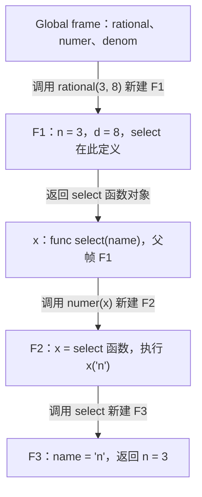
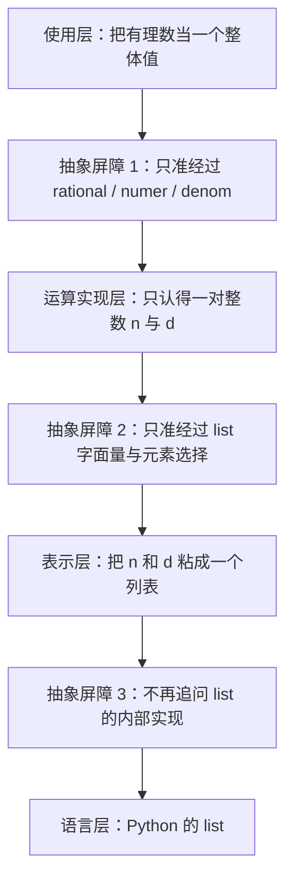
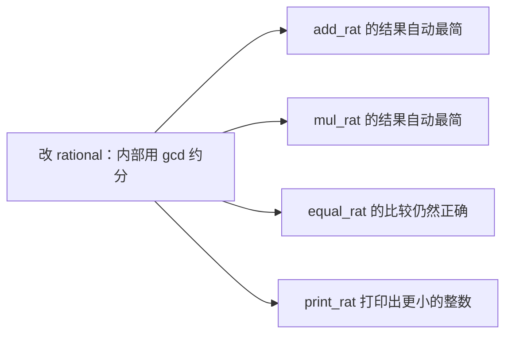

> **课程**：UC Berkeley CS61A · Structure and Interpretation of Computer Programs（Fall 2024）
> **本讲**：Lecture 13 ｜ 29:08 ｜ B 站分 P 13 ｜ [原视频](https://www.bilibili.com/video/BV1sy411z7nA?p=13)
> **课件**：`12-Data_Abstraction_1pp.pdf`（17 页，官方 PDF，逐页渲染图见正文插图）
> **字幕**：B 站英文原声字幕；片源为 29:08 的剪辑版，课件中列表与字典部分的 13 页未出现在片源里，收于文末附录
> **版权**：课程与课件版权归 UC Berkeley CS61A 教学团队；本文为学习用途的二次整理

## 本讲速览

- **已掌握**：`list` 的字面量、下标取元素与切片；函数可以作为返回值被带出外层作用域；环境图里 global 帧、局部帧与父帧如何串成一条查找链。
- **本讲主线**：
    - 有理数不能靠浮点数保真：`1 / 3` 只能给出二进制展开的有限近似，要精确就只能把分子与分母**成对**保存。
    - 一对函数构成一个抽象数据类型：`rational` 负责组合，`numer` 与 `denom` 负责拆解，三者用一条**行为条件**互锁。
    - 表示可以随便换：同一套 `add_rat`、`mul_rat`、`equal_rat`，底下用 `[n, d]` 也行，用一个携带 `n`、`d` 的闭包也行。
    - 抽象屏障把“怎么表示”与“怎么使用”隔开，每一层只准调用自己那一层的接口。
    - 越界的代码“能跑”，但在换表示的那一天会静默失效——这是本讲反复强调的失败模式。
    - 收益最后兑现：只改 `rational` 一个构造函数（改用最大公约数约分），上层一行不动，所有结果自动变成最简形式。
- **关键结论**：**判据不是“它长什么样”，而是“它的行为对不对”**。只要行为条件成立，底下的表示就可以被替换。

*(参考时间: 00:00:01 – 00:00:33｜Lecture 13)*


## 1. 行为条件：什么才算一个有理数

*(参考时间: 00:00:34 – 00:01:39｜Lecture 13)*

“数据”在程序里常被当成“某种摆在那里的东西”，本讲开头把它换成一个可以检查的命题：一个值之所以是有理数，不是因为它长成某个样子，而是因为它**表现**得像有理数。

具体写法是一条**行为条件（behavior condition）**：若 $x$ 由分子 $n$ 与分母 $d$ 构造而成，那么用两个选择器把它拆开、再做除法，必须还原出 $n/d$：


$$
x = rational(n, d) \quad \Longrightarrow \quad \frac{numer(x)}{denom(x)} = \frac{n}{d}
$$


这条等式是整讲的支点。它把三样东西绑在一起：构造函数 `rational`、两个选择器 `numer` 与 `denom`、以及选择器结果之间的一个运算（除法）。单看构造函数，只能知道“它收下两个整数”；单看选择器，只能知道“它吐出两个数”；只有把两者放进同一条等式，才构成一个可验证的定义。讲师的说法很干脆：**除非一个东西的行为像有理数，否则你并没有有理数的表示**。

反过来，这条等式也是自由的来源：只要它成立，底层怎么放这几个数就完全无所谓。本讲后半之所以能先把表示换成函数、再换回列表、最后加上约分，全部依据都在这里——判据只管行为，不管实现。

| 部件 | 本讲的名字 | 职责 | 在行为条件里的位置 |
| :--- | :--- | :--- | :--- |
| 构造函数（constructor） | `rational(n, d)` | 把两个整数合成一个有理数 | 等号左边被调用 |
| 选择器（selector） | `numer(x)`、`denom(x)` | 从有理数里取回分子、分母 | 等号分子与分母的位置 |
| 运算 | 除法 `/` | 把两个选择器的结果还原成一个比值 | 等号左边 |
| 行为条件 | `numer(x) / denom(x) == n / d` | 判定这份表示是否合法 | 整条等式 |

于是“数据抽象（data abstraction）”这个词在本讲有了可执行的含义：**用构造函数与选择器来定义行为**。行为条件被满足，这份表示就有效；被违反，它就不是有理数，只是两个恰好摆在一起的整数。

## 2. 使用层：只认得构造函数与选择器

*(参考时间: 00:01:41 – 00:02:37｜Lecture 13)*

把有理数真正用起来的那批代码——加法、乘法、相等判断、打印——构成了程序里的**使用层**。讲师在这一段的说法很直接：这些函数“对表示本身不作任何假设，只要求构造函数与选择器存在”。

屏障以下的实现，此刻是用列表把分子与分母粘成一项。上面的代码并不知情，也不需要知情。课堂演示的就是这种“无所谓”：

```text
>>> x = rational(1, 2)
>>> y = rational(3, 8)
>>> print_rat(mul_rat(x, y))
3/16
```

$x = 1/2$、$y = 3/8$，两者相乘得 $3/16$，屏幕上就是 `3/16`。这一行输出本身没什么稀奇，稀奇的是它下面那句话：**我可以换掉表示，而上面这些代码仍然工作**。这正是开篇那句“维护抽象屏障的目的是让你能改数据表示而不必重写整个程序”的具体形态。

> **编者说明**：有理数的代码在录像里是敲在编辑器中的，课件页上没有对应代码，本节与第 6 节的实现按课堂叙述整理。构造函数与选择器在叙述中被明确叫作 `rational`、`numer`、`denom`，`add`、`mul`、相等判断分别对应 `add_rat`、`mul_rat`、`equal_rat`；“打印有理数”的那个函数字幕没有给出名字，本文统一写作 `print_rat`，输出格式按“分子/分母”书写。

## 3. 换一种表示：让函数携带数据

*(参考时间: 00:02:39 – 00:05:49｜Lecture 13)*

换表示的第一步是把列表扔掉。构造函数不再返回 `[n, d]`，而是在自己内部定义一个叫 `select` 的小函数，把 `n` 与 `d` 关在里面，再把这个函数交出去：

```python
def rational(n, d):
    def select(name):
        if name == 'n':
            return n
        elif name == 'd':
            return d
    return select


def numer(x):
    return x('n')


def denom(x):
    return x('d')
```

`select` 接收一个名字：是 `'n'` 就返回分子，是 `'d'` 就返回分母，其它情况不作考虑。构造函数把它作为返回值送出，于是“一个有理数”变成了一个**函数**。选择器的写法随之改变——`numer(x)` 不再去取下标，而是**调用** `x`，把 `'n'` 当实参递进去。

再跑一遍同样的例子：

```text
>>> x = rational(1, 2)
>>> y = rational(3, 8)
>>> print_rat(mul_rat(x, y))
3/16
```

还是 `3/16`。真的换了吗？讲师自己回答了这个问题：当然换了，因为 `x` 现在是一个函数。这是一次表示上的更换，换出来的是另一种合法表示，它和旧代码配合得一样好，只不过用了一套完全不同的机制来记住分子与分母——而且**只用函数就够了，连内置的列表类型都不需要**。

### 3.1 环境图：数据藏在父帧里

为什么一个函数能“记住” `n` 与 `d`？答案在环境模型里，讲师的解释是：在一个函数内部定义另一个函数，内层函数因此能引用外层作用域里的 `n` 与 `d`；被返回的 `select` 就把这两个值**作为自己父帧的一部分**带着走了。



`x = rational(3, 8)` 时新建一帧 `F1`，`n` 绑 3、`d` 绑 8，`select` 在 `F1` 里被定义，因此它的父帧就是 `F1`；这个函数对象被返回并绑定到 `x`。之后 `numer(x)` 做的第一件事是查出 `x` 的值——那个 `select` 函数——再以 `'n'` 为实参调用它，于是又新建一帧，父帧指向 `F1`，在 `select` 的 body 里求值 `name == 'n'`，命中后返回 `n`，也就是 3。

这张图值得记住的是它的**形状**：数据不在任何一条语句里，而在一个函数对象的父帧里。名字 `n`、`d` 早已随着 `rational` 的调用结束而“离开”了活动环境，但 `F1` 因为被 `select` 的父指针指着，所以没有消失。这是前面学过的闭包第一次被当作**数据表示**来用。

| 判据 | 列表表示 | 函数表示 |
| :--- | :--- | :--- |
| 构造 | 返回 `[n, d]` | 返回闭包 `select` |
| 取分子 | `x[0]` | `x('n')` |
| 取分母 | `x[1]` | `x('d')` |
| 使用层是否要改 | 不必 | 不必 |
| 依赖的内置类型 | `list` | 只有函数 |
| 打印出来是什么 | `[1, 2]` | 一个函数对象（只显示地址） |

最后一行是这次更换的代价：有理数一旦变成函数，再想“看一眼它是什么”就不行了，屏幕上只剩一个函数对象的地址。可见性被牺牲掉，换来的是“不需要任何内置复合类型也能造出复合数据”。

## 4. 数据抽象：在表示与使用之间立一道屏障

*(参考时间: 00:06:23 – 00:07:55｜Lecture 13)*


讲到这里，讲师重新开了一个头：“一种新的抽象方法。我们开始吧。”落点是**复合值（compound value）**：程序里大多数值都是复合的，它们把不同的对象拼在一起，造出一个有几个部分的对象。

课件举的例子都很日常：一个日期由年、月、日三部分拼成；一个地理位置由纬度和经度两部分拼成。把这类东西“当成一个整体来操作”，本身就是一种抽象——否则每次用日期都要同时照看三个变量，任何一次传参都可能把年月日搞乱。

数据抽象比“打包”多走一步。它要做的是**把任何用到数据的程序切成两半**：

1. 数据**怎么表示**（how data are represented）——几个整数、一个列表、一个字典，还是几个闭包；
2. 数据**怎么被使用/操作**（how data are manipulated）——把它当成一个整体值，用命名的部件去操作它。

切开之后，两部分可以各自改动。讲师的措辞是“把程序里的关注点分开”，于是数据抽象的定义落在函数上：**数据抽象是一种方法论，由函数在“数据的表示”与“数据的使用”之间强制执行一道抽象屏障（abstraction barrier）**。

这一段还有一句流传很广的话，值得原样保留：所有程序员迟早都要和复合数据打交道，但**只有优秀的程序员会主动拥抱数据抽象，让自己的程序更模块化**——“而你很快也会成为优秀的程序员”。这不是修辞，它对应的是本讲最后那个“只改一个构造函数”的结果：模块化是能被验证的，不是口号。

## 5. 有理数这个抽象数据类型

*(参考时间: 00:07:57 – 00:09:34｜Lecture 13)*

为什么拿有理数当例子？因为它把一个真实的取舍摆在了台面上。有理数是“一个整数除以一个整数”，分子与分母都是整数；整数在 Python 里可以精确表示，所以一对整数能精确地告诉你手上是哪一个分数，比如 $1/3$。

可一旦**真的做除法**，`1 / 3` 得到的是 `0.3333333333333333`——这是二进制展开被截断后的有限近似，后面本应有无穷多个 3。讲师据此定下策略：**不除**。把分子与分母分开保存，让它们组成一个复合值，需要比较或运算时再按规则处理。

于是有了这一讲的三个函数，也就是后面一切代码的地基：

| 函数 | 签名 | 返回 | 角色 |
| :--- | :--- | :--- | :--- |
| `rational` | `rational(n, d)` | 一个有理数 $x$ | 构造函数，造出一个抽象数据类型的实例 |
| `numer` | `numer(x)` | 分子 | 选择器，取回整体的一部分 |
| `denom` | `denom(x)` | 分母 | 选择器，取回整体的另一部分 |

三个函数合起来定义了一个**抽象数据类型（abstract data type）**：一个整体值，加一套把它的部件取出来的选择器。构造函数负责“把两个部分装成一个整体”，选择器负责“把整体拆回部件”，两部分互为逆操作——讲师用的词是它们“互为补足（complements of each other）”。

> **编者说明**：SICP 与 CS61A 的部分讲义把有理数构造函数写作 `make_rat`，本讲的口述与板书一律用 `rational`，本文跟随本讲。两种写法指同一个角色：构造函数的名字本身不重要，重要的是它和两个选择器一起满足第 1 节的行为条件。

## 6. 站在抽象之上写运算

*(参考时间: 00:09:38 – 00:12:51｜Lecture 13)*

有了构造与选择，就可以写真正做算术的函数了。课上先把公式摊开：乘法是分子乘分子、分母乘分母，加法要先通分。


$$
\frac{a}{b} \times \frac{c}{d} = \frac{a \times c}{b \times d} \qquad \frac{a}{b} + \frac{c}{d} = \frac{a \times d + c \times b}{b \times d}
$$


代入具体数字核对一遍：$\frac{3}{2} \times \frac{3}{5} = \frac{9}{10}$；$\frac{3}{2} + \frac{3}{5} = \frac{3 \times 5 + 3 \times 2}{2 \times 5} = \frac{21}{10}$。两个结果与课上口算的结果一致。

公式翻成代码只有一步之遥——把“分子”“分母”换成 `numer` 与 `denom`：

```python
def mul_rat(x, y):
    return rational(numer(x) * numer(y),
                    denom(x) * denom(y))


def add_rat(x, y):
    nx, dx = numer(x), denom(x)
    ny, dy = numer(y), denom(y)
    return rational(nx * dy + ny * dx, dx * dy)


def equal_rat(x, y):
    return numer(x) * denom(y) == numer(y) * denom(x)
```

三处细节值得单独说：

- **`add_rat` 为什么先起名字**。因为分子与分母在表达式里各出现两次，`nx, dx = numer(x), denom(x)` 既避免重复调用选择器，也让公式与代码一眼对得上。`mul_rat` 里每个选择器只出现一次，所以不必起名字——这是可读性与简洁之间的取舍，讲师明确说过起名字的理由是“它们在表达式里被用到多次”。
- **`equal_rat` 为什么不能逐项比较**。`rational(1, 2)` 与 `rational(2, 4)` 是同一个数，可它们的部件是 `(1, 2)` 与 `(2, 4)`，逐项比较会得出“不相等”。正确做法是交叉相乘：`numer(x) * denom(y) == numer(y) * denom(x)`。这是行为条件在判定层面的直接应用——比的是值，不是写法。
- **这三个函数一个都没被实现**。`rational`、`numer`、`denom` 的具体代码此刻还不存在，但使用层已经完整了：因为知道“这三个函数就是访问部件与构造新值的工具”，就可以先把上层写完，之后再补实现。这是自顶向下设计在实践中长什么样。

至此，所有操纵有理数的方式都写成了对三个函数的调用。这句话反过来读更有意思：**只有三个函数是“必须知道”的**，其余全部是推论。

## 7. 抽象屏障：一层使用，三层表示

*(参考时间: 00:12:55 – 00:15:51｜Lecture 13)*

抽象屏障的作用被压缩成一句话：它把程序的不同部分隔开，使得每一部分**只需要知道这么多**。为什么要隔？因为隔开之后才能“改一处、其余部分跟着受益，却不被弄坏”。

讲师把有理数系统的开发拆成几层来讲，从上往下走：

- **使用层**：拿有理数做计算的那部分程序。这里关心的是“二分之一乘三分之一是多少”，有理数就是**一个整体数据值**，它代表某个数——至于是怎么代表的，不关心。
- **运算实现层**：造有理数、实现有理数运算的那部分程序。这里把有理数看作“一个分子与一个分母配成的一对”。它们不需要知道这对东西**具体怎么粘起来的**，但需要知道两件事：一是有理数有分子和分母、这两样能被选出来；二是把分子与分母组合起来就能造一个新的有理数。这一层只准用 `rational`、`numer`、`denom` 三个函数。
- **表示层**：真正实现这三个函数的那部分程序。它把有理数看成两个元素的列表，用列表字面量把分子与分母粘在一起，用下标取元素。
- **语言层**：列表自身又是被 Python 实现出来的。实现选择器与构造函数的人，不该再去操心列表是怎么实现的；只需要知道列表可以用字面量创建、用元素选择取出内容。



上面的图中每一道屏障，在课堂上是画成一条**非常粗的线**的。粗线的含义很硬：拿有理数做计算的那部分代码，只准用这条线以上提供的函数，不准伸手去够另一层的函数。讲师补了一句判断依据——这样写出来的程序，对“用的是哪种表示”所作的假设**尽可能少**，它服从的是程序员事先定好的抽象，而不是某个具体实现。

| 层 | 这一层把有理数看成 | 唯一允许调用 | 越界的后果 |
| :--- | :--- | :--- | :--- |
| 使用层 | 一个整体值 | `add_rat`、`mul_rat`、`equal_rat`、`print_rat` | 会绑死在某一种表示上，改表示时整段失效 |
| 运算实现层 | 分子 + 分母 | `rational`、`numer`、`denom` | 会假设底层是列表，换表示时计算结果直接出错 |
| 表示层 | 两个元素的列表 | 列表字面量、元素选择（`[n, d]`、`x[0]`） | 会假设列表内部结构，语言层改动时受牵连 |
| 语言层 | 语言提供的 `list` | 字面量与下标运算符 | 越界即等于自己重写一个列表 |

屏障还解释了“以后能做什么”。讲师在这里预告了一个具体改动：只要守住这三层，将来就可以让**每个分数都以最简形式表示**，而使用层的代码一行都不用动。这个预告在第 12、13 节会被兑现。

## 8. 一直往下：每一根粗线都是屏障

*(参考时间: 00:15:53 – 00:18:02｜Lecture 13)*

“就这些了吗？”讲师自问自答：程序里的抽象层远不止这三层，比刚才所见更低的细节还有的是。

列表本身是 Python 实现出来的东西，我们并不需要知道它内部怎么排列、怎么扩容；需要知道的只有两件事——**列表可以用列表字面量创建，可以用元素选择拆开**。因此任何实现有理数选择器与构造函数的地方，都不该去操心列表的实现。这正是第三条粗线的位置。

由此得到一条可以迁移的规则：**每一根粗线都是一道屏障；写程序时，要使用与当前任务相匹配的那一层抽象**。停得越高、越不越界，将来改动程序就越容易；反之，越界的每一处都会在改表示的那天变成需要人工排查的隐患。

## 9. 违反屏障的代价

*(参考时间: 00:18:04 – 00:20:33｜Lecture 13)*

规则听起来很抽象，讲师用一段代码把它变得很具体。先看正常的部分：`add_rat(rational(1, 2), rational(1, 4))` 应当得到 $1/2 + 1/4 = 3/4$，在当前实现下一切正常。

然后是除法。合规的写法与其它运算同构——用选择器取出部件，用构造函数造出新值：

```python
def div_rat(x, y):
    return rational(numer(x) * denom(y), denom(x) * numer(y))


def div_rat(x, y):                                  # 违规版本
    return [x[0] * y[1], x[1] * y[0]]
```

下面那个版本**不报错**，甚至在当前实现下给出正确答案。讲师的原话是：它能工作，不会抛异常，“然而我们做了一件极其错误的事”——我们违反了抽象屏障。

错在哪里，可以拆成两条：

1. **它假设了表示**。写 `x[0]` 就等于宣布“有理数是一个装着两个整数的列表”。这个假设在今天的实现下成立，在昨天和明天的实现下未必成立。
2. **它绕过了构造函数**。返回值是手写的列表，不是 `rational(...)` 造出来的值。这意味着**将来改 `rational` 的代码，这一块不会跟着变**——它压根没调用那个函数。

讲师的反应把这条规则的分量说足了：一次还不够，这里连着犯了两次；“如果我在别人的电脑上看到这样的代码，我会把电脑点着，看着它烧掉——因为违反抽象屏障的代码就该烧”。

| 判据 | 合规的 `div_rat` | 违规的 `div_rat` |
| :--- | :--- | :--- |
| 取部件的方式 | `numer(x)`、`denom(y)` | `x[0]`、`y[1]` |
| 造结果的方式 | `rational(...)` | 手写列表 |
| 假设了下层表示 | 没有 | 假设是“两个整数的列表” |
| 当前实现下能否跑通 | 能 | 能（正是危险之处） |
| 换成函数表示后 | 仍然正确 | 立刻出错 |
| 改 `rational` 后是否跟随 | 跟随 | 不跟随 |

表格最后三行是本讲的要害：**越界最坏的地方不是它错，而是它暂时对**。错误被推迟到“改表示”的那一天才暴露，而那天离写下这行代码可能已经隔了很久。

> **编者说明**：Python 不会替你把守这道屏障——它允许任何人写 `x[0]`，也不会在构造函数被替换时给出警告。屏障是**约定**，靠命名、靠代码评审、靠每隔一段时间就真的换一次表示来检验。这也是课程反复演示“换表示”的原因：只有真的换过，才知道哪些代码是守规矩的。

## 10. 成对的值：pair 与列表

*(参考时间: 00:20:36 – 00:23:56｜Lecture 13)*

把表示定成列表之前，得先说清“一对”是什么。**pair（对）**由两个值组成，它们被绑在一起，于是可以当成一个整体、一个单位来用，尽管它内部有两个部分。

表示一对东西的办法很多，本讲先用一个内置类型：列表。

```text
>>> pair = [1, 2]
>>> pair
[1, 2]
>>> x, y = pair
>>> x
1
>>> y
2
```

`[1, 2]` 是一个**列表字面量（list literal）**：方括号里放逗号分隔的表达式。它把 1 与 2 两个值收进同一个列表，因为只有两个元素，所以这一对就是一个 pair。显示这个值时，屏幕上原样印出它的内容，形状和字面量一模一样。

把整体拆回部件有两条路。第一条叫**解包（unpacking）**：`x, y = pair` 把第零个元素绑给 `x`、第一个元素绑给 `y`，于是 `x` 是 1、`y` 是 2。第二条是**元素选择运算符**：`pair[0]` 得到 1，`pair[1]` 得到 2。

两处方括号长得一样，含义不同，讲师特意区分过：字面量里的方括号**前面什么也没有**，它是在“造”一个列表；选择运算符的方括号**前面有一个表达式**，它是在“从左边那个值里取出一个元素”。第三种写法是函数形式——Python 里每个运算符都有对应的函数，元素选择对应的函数叫 `getitem`，全小写连写，位于 `operator` 模块：

```text
>>> from operator import getitem
>>> getitem(pair, 0)
1
>>> getitem(pair, 1)
2
```

| 写法 | 形式 | 结果 | 适用场合 |
| :--- | :--- | :--- | :--- |
| `x, y = pair` | 解包 | `x` 为 1、`y` 为 2 | 一次要拿到全部部件 |
| `pair[0]` | 元素选择运算符 | `1` | 只要其中一个部件 |
| `getitem(pair, 0)` | 函数调用 | `1` | 需要把“取元素”当函数传递时 |

三者之中，解包适合“一次把部件全拿到”，例如后面写 `nx, dx = numer(x), denom(x)` 这种成对赋值；下标选择则是实现 `numer` 与 `denom` 的手段——第 11 节会看到它正好落在表示层。

## 11. 用列表实现有理数

*(参考时间: 00:23:57 – 00:25:12｜Lecture 13)*

有了 pair，构造函数就有了着落。有理数是一个整数对：分子与分母。于是“造一个表示 $n/d$ 的有理数”这件事，只需要返回把 $n$、$d$ 收在一起的列表：

```python
def rational(n, d):
    return [n, d]


def numer(x):
    return x[0]


def denom(x):
    return x[1]
```

`rational` 返回 `[n, d]`，`numer` 取第零个元素，`denom` 取下标 1 的元素。三个函数合起来，就是第 5 节那张签名表的实现——注意它们的位置：**这三个函数正好落在表示层**，位于第二道屏障以下，使用层的代码完全看不到它们内部用的是列表。

讲师补了一句边界条件：列表可以装任何东西，字符串、函数、甚至别的列表都行；但在这里，`n` 与 `d` **都应当是整数**，否则“有理数”这个抽象就名不副实。抽象数据类型从来不检查这件事（Python 不会替你验证），它是使用者的责任。

## 12. 为什么 15/6 会变成 5/2

*(参考时间: 00:25:14 – 00:26:56｜Lecture 13)*

表示一旦落地，第一个“数据抽象到底有什么用”的例子就来了。回忆乘法的实现，然后算 $\frac{3}{2} \times \frac{5}{3}$：分子相乘得 15，分母相乘得 6，按代码直译应当得到 $15/6$。可课堂上的答案是 $\frac{5}{2}$。

原因是 15 与 6 不互质，它们都能被 3 整除。分子分母同乘 $\frac{1}{3}$，就得到等价而更简单的分数 $\frac{5}{2}$。加法同理：$\frac{2}{5} + \frac{1}{10}$ 交叉相乘得到 $2 \times 10 + 1 \times 5 = 25$，分母是 $5 \times 10 = 50$，于是得到 $25/50$；分子分母同乘 $\frac{1}{25}$，得到 $\frac{1}{2}$。

| 表达式 | 交叉相乘 / 相乘得到 | 分母 | 约分因子 | 结果 |
| :--- | :--- | :--- | :--- | :--- |
| $\frac{3}{2} \times \frac{5}{3}$ | 分子 15 | 6 | $\frac{1}{3}$ | $\frac{5}{2}$ |
| $\frac{2}{5} + \frac{1}{10}$ | 分子 25 | 50 | $\frac{1}{25}$ | $\frac{1}{2}$ |

为什么非要约分？讲师的回答很务实：**为了让整数尽可能小，好读、好理解**。$15/6$ 与 $5/2$ 是同一个数，但后者一眼就能看出量级；分子分母一旦随着连乘迅速膨胀，人就没法核对结果了。

于是有了一个新的要求：有理数**永远**应当以最简形式表示，也就是分子与分母是两个互质的整数（relatively prime integers）。注意这句话的措辞——不是“打印时要约分”，而是“表示本身就该是最简形式”。

## 13. 改一个构造函数，全部受益

*(参考时间: 00:26:59 – 00:29:05｜Lecture 13)*

怎么做到“永远最简”？讲师把问题倒过来看：**加法与乘法本来就是对的**，错的是 `rational` 的定义。要约分，就该在造有理数的那一刻完成——因为所有有理数都是被它造出来的。

于是一个改动就够：先导入计算最大公约数的函数（前几讲手写过，Python 也内置，本文写作 `from math import gcd`），再在构造函数里先求公约数、把分子分母各自除掉，最后才装进列表。

```python
from math import gcd


def rational(n, d):
    g = gcd(n, d)
    return [n // g, d // g]
```

`gcd` 的两条性质在这里都要用上：它是 $n$ 与 $d$ 的**公约数**，所以能整除两者（讲师的原话是“均匀地整除”，evenly divides）；它又是**最大**的那个，所以除完之后的两个数互质。代入前面的例子：$15/6$ 的 $g$ 是 3，得到 `[5, 2]`；$25/50$ 的 $g$ 是 25，得到 `[1, 2]`。

真正重要的是接下来这句：**`add_rat`、`mul_rat`、`print_rat` 一个字都不用改**——因为它们的每一个结果都是通过 `rational` 造出来的。改构造函数，所有依赖它的函数的行为一起改变。



讲师用一句话收尾：这是件好事。而它能成立的全部原因，就是前面那些代码从来没有越过抽象屏障——它们只认得三个函数名，不认得列表。


课件用最后一页把这条原则推广到了另一类数据。**少量函数在“表示”与“使用”之间强制执行一道抽象屏障**：表示是“底层用了列表、字典还是别的什么”，使用是“把数据当整体值、按命名的部件去操作”。以一条直线（仿射函数）`f` 为例——用 `slope(f)` 而不是 `f[0]` 或 `f['slope']`，用 `y_intercept(f)` 而不是 `f[1]` 或 `f['y_intercept']`。理由有两条：代码更好读、更好改；以及，将来完全可以把直线表示成两个点，而不是“斜率 + 截距”这一对，而**用到直线的代码一行都不用动**。

> **编者说明**：这一页是课件的收尾总结页，片源在讲完 `gcd` 版构造函数后就结束了，页面上的直线例子与“两个点”的说法没有对应的口述讲解，此处按课件原文转述。同理，本讲正文中“课堂演示的代码”均以编辑器画面与口述为准，课件页里没有对应代码块。

## 小结

- **用行为定义数据，而不是用形状定义数据**：构造函数、选择器、以及连接二者的那条等式，三者合起来才是一个抽象数据类型。判据是“它表现得像不像”，不是“它长成什么样”。
- **先写契约，后写实现**：`add_rat`、`mul_rat`、`equal_rat` 可以在 `rational`、`numer`、`denom` 一行都没写的时候完成。自顶向下不是风格问题，它逼你把“需要哪些操作”想清楚。
- **同一套用法，可以配多种表示**：列表、闭包、字典都行；换表示的成本，等于“越界代码的数量”，而不等于“代码总量”。
- **越界的代码暂时是对的**：`x[0]` 在下标合法的实现下永远能跑通，代价被推迟到改表示那天才结算。判断一段代码有没有越界，看的不是测试结果，而是它“假设了什么、调用了谁”。
- **屏障要一层一层立**：使用层 → 运算实现层 → 表示层 → 语言层，每一层只准调用自己那一层的接口；停得越高，改起来越容易。
- **收益要靠一次真实改动来验证**：本讲最后只改 `rational` 一个函数（加入 `gcd` 约分），上层的加、乘、比较、打印全部自动跟随——这就是抽象屏障存在的理由。

*(参考时间: 00:29:04 – 00:29:05｜Lecture 13)*

## 附录：本片未讲解的课件页（列表与字典）

*(参考时间: 00:00:01 – 00:29:05｜Lecture 13)*

> **编者说明**：B 站片源是 29:08 的剪辑版，开头直接从数据抽象的中段开始。同一份课件里更早的 13 页（第 3–15 页）属于列表操作、讨论课习题、切片练习、字符串树递归与字典，片源与字幕里都没有对应的讲解，因此按写作规范统一收在本附录，只做页面索引，不复述不存在的课堂内容。以下各段均为编者据课件画面整理。

### 列表操作与讨论课题目（第 3–7 页）


第 4 页把“一个数字列表上最重要的操作”压成四行交互：`s = [5, 7, 9, 11]` 用列表字面量造列表；`s[0]` 用元素选择取第一个元素，得 5；`s[1:]` 用切片取“剩下的全部”，得 `[7, 9, 11]`；`[3] + s` 用加法拼出更长的列表，得 `[3, 5, 7, 9, 11]`。这四行与第 10 节的 pair 操作是同一套工具，只是元素个数不同。


第 6 页是讨论课的第一题：给定一个元素全为正整数的列表，求任意个**不相邻**元素相乘能得到的最大乘积。课件的提示把“怎么找递归过程”拆成三步：先挑一个具体的例子 `s = [5, 10, 5, 10, 5]`，再把各个递归调用会返回什么逐一写下来，最后问“哪一个能帮你拼出结果”。填空题的答案是 `max(s[0] * max_product(s[2:]), max_product(s[1:]))`：要么选 `s[0]` 就一定跳过 `s[1]`，要么整体跳过 `s[0]`，两者取大。基准情形为空列表返回 1、单元素列表返回该元素。


第 7 页的 `sums(n, m)` 要求列出所有满足三个条件的列表：元素和为 `n`、每个元素都是不超过 `m` 的正整数、且没有两个相邻元素相同。课件右侧的两个反例被红笔圈出——`[1, 1, 3]` 与 `[1, 2, 2]` 都因为相邻重复而不合法。填空答案是 `[k] + rest for rest in sums(n - k, m) if rest == [] or k != rest[0]`：按首元素 `k` 分类，剩下的和被递归解决，再用 `k != rest[0]` 把相邻重复的组合过滤掉。

### 两道列表练习（第 8–11 页）


第 9 页给出两个“长度相同、位置相关”的列表：`xs = range(-10, 11)`，`ys = [x*x - 2*x + 1 for x in xs]`，要求写一个表达式，求出“对应的 `y` 最小”的那个 `x`。答案在课件上给出为 1：因为 `x*x - 2*x + 1` 就是 $(x-1)^2$，最小值 0 出现在 $x = 1$，而 `ys` 里 0 恰好出现在第 11 个位置。


第 11 页是 2023 年春季 Midterm 2 的原题：**前缀和（prefix sum）**指数列前 `n` 项之和，要求实现 `prefix(s)`，按前缀长度递增的顺序返回所有前缀和。`prefix([1, 2, 3, 0, 4, 5])` 应当得到 `[1, 3, 6, 6, 10, 15]`。填空 (a) 是 `sum(s[:k+1])`，(b) 是 `range(len(s))`——用切片把“前 k+1 项”整体交给 `sum`，正是第 4 页那四行操作里 `s[1:]` 的直接应用。

### 字符串树递归与字典（第 12–15 页）


第 13 页是字符串上的树递归题：摩托车占 1 个车位、汽车占 2 个相邻车位，`%` 表示摩托、`<>` 表示汽车、`.` 表示空位，要求 `park(n)` 返回把 `n` 个相邻车位停满（允许空位）的所有方案字符串。三个分支对应“第一个车位放什么”：放摩托则接 `park(n-1)`，放空位也接 `park(n-1)`，放汽车则接 `park(n-2)`；基准情形 `n < 0` 返回 `[]`、`n == 0` 返回 `['']`。课件算出 `len(park(4))` 为 29。


最后两页转向字典。第 14 页是分节页，页面上只剩一个字面量 `{'Dem': 0}`，示意“键 → 值”的写法。第 15 页给出**字典推导式（dictionary comprehension）**的完整语法：`{<key exp>: <value exp> for <name> in <iter exp> if <filter exp>}`，以及去掉过滤子句的简写 `{<key exp>: <value exp> for <name> in <iter exp>}`。它与列表推导式结构相同，差别只在用冒号把键表达式和值表达式分开——而“用字典表示一个复合值”，正是第 4 节所说“底层表示可以是列表、字典等等”里的另一种选择。

## 附：本讲幻灯片索引

*(参考时间: 00:00:01 – 00:29:05｜Lecture 13)*

| 页 | 内容 | 出现位置 |
| :--- | :--- | :--- |
| 1 | 标题页 Data Abstraction | 本讲速览 |
| 2 | Announcements 公告页 | 本讲速览 |
| 3 | 分节页 Manipulating Lists | 附录 |
| 4 | 数字列表上的四个基本操作 | 附录 |
| 5 | 分节页 Discussion 4 | 附录 |
| 6 | Max Product：非相邻元素最大乘积 | 附录 |
| 7 | Sum Fun：和为 n 且无相邻重复 | 附录 |
| 8 | 分节页 Min Practice | 附录 |
| 9 | 两个相关列表：最小 y 对应的 x | 附录 |
| 10 | 分节页 Slicing Practice | 附录 |
| 11 | 2023 春 Midterm 2：前缀和 | 附录 |
| 12 | 分节页 Tree Recursion with Strings | 附录 |
| 13 | Parking：停车方案 | 附录 |
| 14 | 分节页 Dictionaries | 附录 |
| 15 | 字典推导式语法 | 附录 |
| 16 | 分节页 Data Abstraction | §4 |
| 17 | 抽象屏障总结：表示 vs 使用 | §13 |
