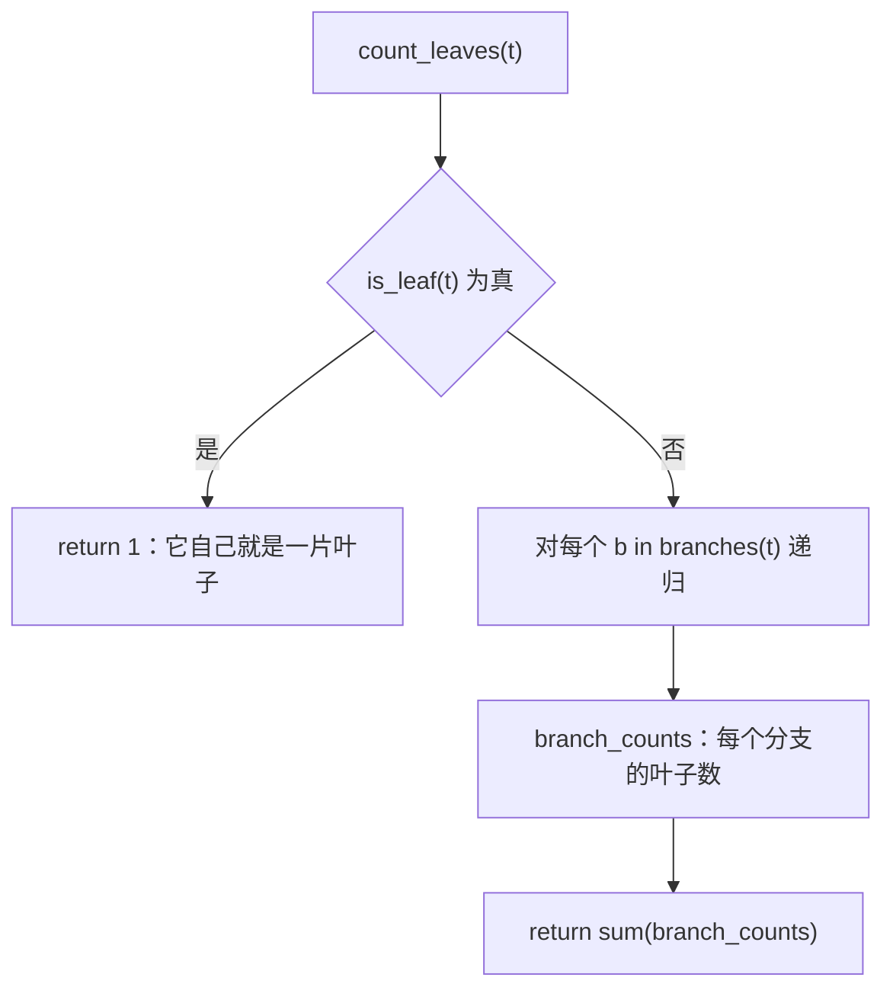
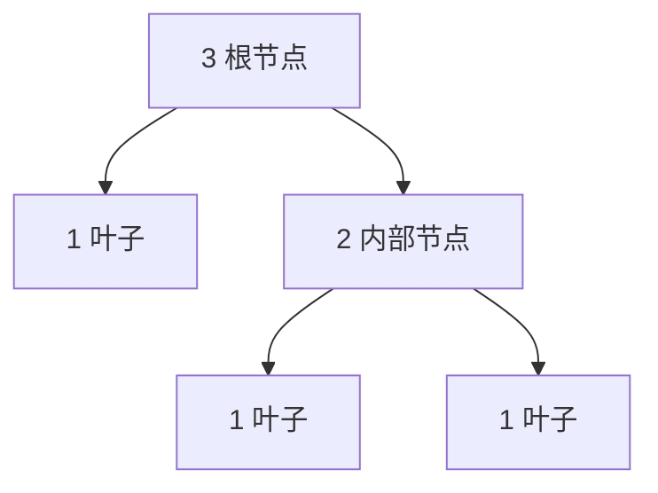
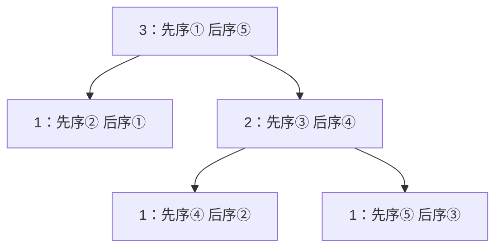
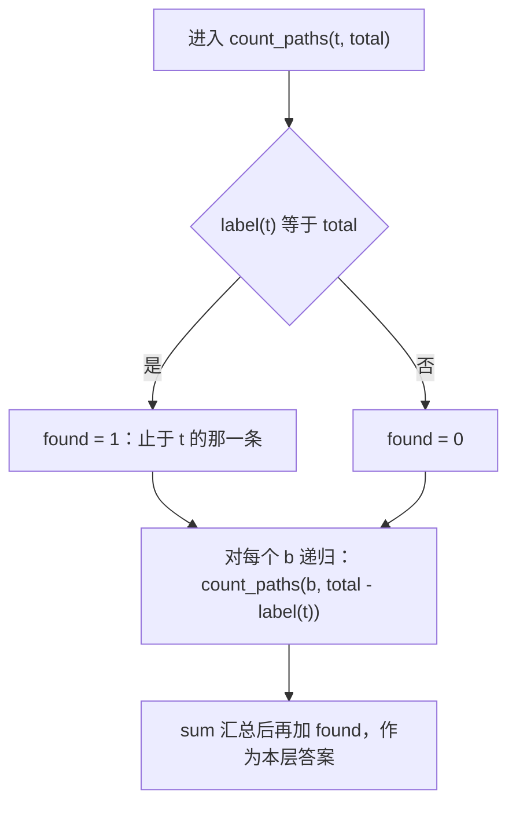

> **课程**：UC Berkeley CS61A · Structure and Interpretation of Computer Programs（Fall 2024）
> **本讲**：Lecture 14 ｜ 34:32 ｜ B 站分 P 14 ｜ [原视频](https://www.bilibili.com/video/BV1sy411z7nA?p=14)
> **课件**：`13-Trees_1pp.pdf`（14 页，官方 PDF，逐页渲染图见正文插图）
> **字幕**：B 站英文原声字幕；本笔记是中文书面化重构，非逐句翻译
> **版权**：课程与课件版权归 UC Berkeley CS61A 教学团队；本文为学习用途的二次整理

## 本讲速览

*(参考时间: 00:00:00 – 00:01:23｜Lecture 14)*

- **已掌握**：列表与字典的构造与访问、序列的索引与切片，以及数据抽象的两个视角——**表示（representation）**与**使用（use）**。
- **本讲主线**：
    - 树用递归的方式描述自己：一棵树 = 一个根标签（root label）+ 一个分支列表（list of branches），每个分支又是一棵树。
    - 用一小组函数把树封成抽象屏障：`tree`、`label`、`branches`，加上两个校验用的 `is_tree` 与 `is_leaf`。
    - 处理树的函数几乎都是树递归：叶子是基准情形，递归情形对每个分支递归一次，再把结果聚合。
    - 聚合有两种写法：加工递归调用的返回值，或把"到目前为止"作为参数带下去。
    - 数路径和、打印树这类问题，考的都是"在哪一层做决定"。
- **关键结论**：树的威力来自结构本身可递归——把 `branches(t)` 当成"若干更小的同类问题"，写出来的代码就只有一两个分支。


本讲公告集中在项目上：项目二（CATS）已经发布，篇幅与 HOG 相当，分成若干阶段，Phase 1 与 Phase 2A 需要在周四前通过检查点；整份项目下周二截止，下周一之前交完可以拿到提前提交的奖励分。之所以建议这周就把项目做完，是因为周五还会发一份不短的作业，两份任务会在同一周叠加。讲师还预告了周三的**可变性（mutability）**一讲：那一讲同样基础，介绍的是 Python 里使用极广、也极实用的特性。整门课的建议只有一句：**尽量不要落后，每天都动一点手**。这句话在本讲格外成立——树是后续课程反复使用的结构，今天卡的壳，下周会变成更大的壳。


## 1. 数据抽象与为什么树值得单开一讲

*(参考时间: 00:01:23 – 00:02:36｜Lecture 14)*


课程的前半段把函数讲完了：定义、调用、环境、高阶函数、递归。现在的位置是另一半——**内置的数据结构**。列表与字典已经用过，接下来要自己定义新的类型。树正站在这个转折点上：它由列表拼出来，却需要用一组自己写的函数把它封成一个新的抽象。


课件用一页把数据抽象压成一句话：**一小组函数，在"表示"与"使用"之间立起一道抽象屏障（abstraction barrier）**。屏障两侧各管一件事——数据**怎么表示**（底层是列表、字典还是别的东西），以及数据**怎么被操作**（当成一个有名字部件的整体来用）。

课件的例子是一条直线（affine function）。若 `f` 表示一条直线，使用者写 `slope(f)` 与 `y_intercept(f)`，而不是 `f[0]`、`f[1]`，也不是 `f['slope']`、`f['y_intercept']`。两种写法当下完全等价，差别在未来：写 `slope(f)` 的代码不知道也不关心直线是"`[斜率, 截距]` 对"、"一个 Python 函数"还是"两个点"；只要 `slope` 与 `y_intercept` 仍然成立，底层换成什么，使用方的代码一行都不用改。抽象屏障买到的东西就是两个词：**可读，可改**。

> **编者说明**：课件第 3–4 页是上一讲"数据抽象"的收尾与回顾，本讲字幕从公告直接跳到"树是表示层次关系的数据抽象"，这两页的口述内容不在字幕里；本节按课件原文重述，没有添加课件以外的例子，字幕中也没有出现直线的具体代码演示。

树值得单开一讲，课件与口述给出三层理由：

- **它会反复出现**：后续很多课程都会用到树，现在学会怎么操作它，继续学计算机科学时会一直受益。
- **它本身就是一种建模手段**：即使不继续学计算机科学，树也是"表示世界上有层次关系的东西"的通用方式。
- **它同时用上递归的两面**：课件第 6 页用递归**描述**树（分支也是树），第 11 页又说处理树要用递归——描述与处理共用同一套形状，这是树最经济的地方。

## 2. 树的两种描述：木质树与家族树

*(参考时间: 00:02:36 – 00:04:59｜Lecture 14)*


树是**表示层次关系的数据抽象**。此前已经画过树的形状，也说过计算机科学里的树是倒着长的——根在上，枝叶向下伸展。这一节补的是描述树的**词汇**：同一棵树有两套隐喻，一套递归，一套相对。


### 2.1 木质树：递归描述

第一套是**递归描述（wooden trees，木质树）**，由四条规则组成：

- 一棵**树**有一个**根标签**和一个**分支列表**。
- 每个**分支（branch）**本身也是一棵树。
- 没有任何分支的树叫**叶子（leaf）**。
- 树从**根（root）**开始。

关键在于第二条：分支是树。于是"叶子"不是另一种类型，只是"分支列表为空"的退化情形——它照样有自己的根标签，只是没有下层。课件图上那棵以 3 为根的树只有两个分支；左边分支以 1 为根，它自己又有两个分支，分别是标签为 0 与 1 的叶子；右边分支以 2 为根，同样挂着子树。

### 2.2 家族树：相对描述

第二套是**相对描述（family trees，家族树）**。它不描述"怎么构造"，而描述"某个位置在哪"：

- 树里的每一个位置叫**节点（node）**。
- 每个节点有一个**标签（label）**，可以是任意值。
- 一个节点可以是另一个节点的**父节点（parent）**或**子节点（child）**。
- 最上面的节点叫**根节点（root node）**。

顺着家族关系，还能说出**祖先（ancestors）**、**后代（descendants）**、**兄弟（siblings）**。课件把节点逐个圈出来：3 是根节点，1 与 2 是它的子节点；左边的 1 有两个子节点 0 与 1；右边的 2 也有两个子节点，其中左边那个 1 还带着一个子节点 0——一共八个节点。

两套描述是同一棵树的两种说法，对照如下：

| 判据 | 木质树（递归描述） | 家族树（相对描述） |
| :--- | :--- | :--- |
| 基本对象 | 树本身：根标签 + 分支列表 | 位置：节点 |
| 组织方式 | 递归：分支也是树 | 相对：父、子、祖先、后代、兄弟 |
| 终结概念 | 叶子 = 分支列表为空 | 没有子节点的位置（指同一批节点） |
| 标签的地位 | 根标签是树的一个部件 | 标签是节点上存的值 |
| 适合回答 | 怎么**构造**、怎么**递归处理** | 两个位置之间是什么**关系** |
| 代码里的落地 | `label(t)` 与 `branches(t)` 递归下去 | 遍历时的 `t`、`branches(t)[i]` |

两套说法常常混着用。课件末尾那句批注点的就是这种省略：**人们习惯用位置来指代标签**——"每个父节点等于它的子节点之和"（each parent is the sum of its children）。严格说这句话讲的是标签的值，但说的是"父节点的标签"。课件图上那棵树恰好满足它：3 = 1 + 2，1 = 0 + 1，2 = 1 + 1，所以它是**斐波那契树（Fibonacci tree）**——每个父节点的值都是两个子节点之和，整棵树就是斐波那契递推的图形化。

课件还用橙色虚线标出一条**路径（path）**：从根 3 出发，经过 2、1，落到标签为 0 的叶子。路径就是"从根开始、每步走向一个子节点"得到的节点序列，它可以停在叶子，也可以停在中间某个节点。

## 3. 树的接口：使用者被允许做的五件事

*(参考时间: 00:04:59 – 00:05:58｜Lecture 14)*


先立接口，再写实现，这是数据抽象的一贯顺序。**树的构造器（constructor）接收两个值**：一个根标签，和一个分支列表；**列表里的每一项都必须是一棵树**。这两条约束一定下来，"树"就成了一种可以被函数生产、也可以被函数消费的值。

课件把使用者的权限写得很死：对一棵树 `t`，**只能**做这几件事——

- 取根的标签：`label(t)`
- 取分支列表：`branches(t)`
- 取第 `i` 个分支，它是一棵树：`branches(t)[i]`
- 判断是不是叶子：`is_leaf(t)`
- 把 `t` 当成普通的**值**：`return t`、`f(t)`、`[t]`、`s = t` 等等

清单之外的动作都算越界。知道树内部是列表、直接下标到第二层，用的就是"表示"而不是"抽象"。

于是构造那棵小树时，先要回答一个必然会出现的质疑：既然构造器里用的是列表，这不算破坏抽象屏障吗？**不算**。因为"一棵树有一个分支列表"本来就是抽象的一部分——列表属于**抽象**，不属于**表示**。真正属于表示的，是"用列表的第一个元素存标签、其余元素存分支"这个决定，那是第 4 节要写的 `label` 与 `branches`。使用者只需要知道"分支是一个列表、可以按索引取"，不需要知道"标签存在下标 0"。

## 4. 实现树的抽象

*(参考时间: 00:05:58 – 00:08:44｜Lecture 14)*


表示可以任意挑，挑什么决定了 Python 把构造表达式的值打印成什么样。这里选**嵌套列表**：一棵树就是一个列表，第一个元素是标签，其余元素是分支；分支又是同样形状的列表，于是层层嵌套。

```python
def tree(label, branches=[]):
    return [label] + branches


def label(tree):
    return tree[0]


def branches(tree):
    return tree[1:]
```

三个函数各管一件事：`tree` 把标签放进一个单元素列表，再与分支列表拼接（列表相加就是拼接）；`label` 取下表 0；`branches` 用切片 `tree[1:]` 取出"剩下的全部"，得到的仍是一个列表。

> **编者说明**：`branches=[]` 是默认参数，幻灯片上的 `tree(label, branches=[])` 正是靠它把"只给一个标签"解释成"一片叶子"。Python 的默认参数在函数定义时求值一次并被所有调用共享，用可变值（如 `[]`）作默认值通常要小心；这里的 `tree` 只把 `branches` 读出来拼进一个新列表，从不原地修改它，所以不会踩到这个坑。

课件右边那棵树与它的构造表达式：

```python
>>> tree(3, [tree(1),
...          tree(2, [tree(1),
...                    tree(1)])])
[3, [1], [2, [1], [1]]]
```

读法是顺着表示走一遍：根标签 3；第一个分支是只含标签 1 的叶子，所以它在列表里是 `[1]`；第二个分支以 2 为根、带两片标签为 1 的叶子，所以是 `[2, [1], [1]]`。整棵树的表示就是 `[3, [1], [2, [1], [1]]]`——**打印出来的样子只是表示的副产品**，不是使用者关心的东西。


上面三个函数能造出树，但保证不了"造出来的都是树"：任何列表都能混进去。所以构造器要加两道校验：

```python
def tree(label, branches=[]):
    for branch in branches:
        assert is_tree(branch)
    return [label] + list(branches)
```

第一道是 `for branch in branches: assert is_tree(branch)`——逐个确认每个分支确实是一棵树，不满足就当场抛 `AssertionError`，而不是等几百行之后在某个选择器里炸掉。第二道是 `list(branches)`：先把传进来的东西**转成列表**再拼接，这样即使调用方给的是元组或其他序列，也不会拼出奇怪的结构。

判定的规则要把同一套定义反过来用：

```python
def is_tree(tree):
    if type(tree) != list or len(tree) < 1:
        return False
    for branch in branches(tree):
        if not is_tree(branch):
            return False
    return True
```

三条：类型必须是 `list`；长度至少为 1（至少要装得下一个标签）；**所有分支都必须是树**。第三条让 `is_tree` 自己变成了树递归函数——它沿着每个分支一路向下检查，"只要有一个分支不是树，整棵东西就不可能是树"。三条都过，它就是树：有一个标签，有一堆本身是树的分支。

`assert` 在这里不是装饰。它把"每个分支都是树"这条抽象约定变成**可执行的检查**：调用方一旦违反约定，错误立刻出现在犯错的那一行。

最后补一个判断叶子的函数：

```python
def is_leaf(tree):
    return not branches(tree)
```

`branches(t)` 返回空列表时，空列表是假值，`not` 把它变成真——这个函数只问一件事：这棵树有没有分支。

> **编者说明**：`is_leaf` 完全依赖"空列表为假值"这条约定，所以它只对**格式合法**的树可靠。若不先跑 `is_tree`，像 `[[]]` 这种畸形值也会被当成叶子。这是抽象屏障的代价：屏障内的函数默认输入已经在屏障内。

## 5. 用抽象：一次完整的构造与访问

*(参考时间: 00:08:45 – 00:10:34｜Lecture 14)*

有了选择器，就可以只用它们来使用树，不必回头看表示。先造一片叶子，再问它是不是叶子：

```python
>>> t = tree(1)
>>> is_leaf(t)
True
```

要给树挂分支，就把分支放进一个列表传进去——**每棵树都该有一个分支列表**，默认是空；只把一个普通值放进去会撞上 `assert`：

```python
>>> tree(1, [5])
AssertionError
```

`5` 不是树，`is_tree(5)` 看到类型不是 `list` 就返回 `False`，断言当场失败。这条错误信息就是屏障在起作用：它在构造的那一刻拦住了违规，而不是留到后面。

再叠一棵大一点的树：根标签 1，第一个分支是一棵以 5 为根、自己还带一片叶子的子树，第二个分支是一片以 6 为根的叶子。

```python
>>> t = tree(1, [tree(5, [tree(7)]), tree(6)])
>>> label(t)
1
>>> branches(t)
[[5, [7]], [6]]
>>> label(branches(t)[0])
5
>>> is_leaf(branches(t)[1])
True
```

> **编者说明**：第 5 节的这段 REPL 演示在字幕里只剩碎片——能听到根标签是 1、第一个分支"以 5 为根的子树里再放一片叶子"、第二个分支"以 6 为根的叶子"，中间那片叶子的具体值没有被念出来，这里取 7 作占位。结构与结论都以字幕为准。

这段演示要说明的正是抽象的价值：`t` 内部是一堆嵌套列表，但访问它时完全不出现 `[0]` 与 `[1:]`。问标签用 `label`，问分支用 `branches`，按索引取到一个分支，再对它取 `label`——两次调用叠起来就能走到任意一层。把 `branches(t)` 当列表用也不越界，因为抽象里就写了"树有分支列表"。

反过来看，如果某段代码写 `t[0]` 去取标签，它就把"标签在下标 0"这个表示细节焊死进了使用者代码。哪天把表示换成字典 `{'label': ..., 'branches': [...]}`，只要重写 `tree`、`label`、`branches`、`is_tree` 四个函数，处理树的代码一行都不用动；而那句 `t[0]` 会第一个坏掉。

## 6. 树递归：用函数生成一棵树

*(参考时间: 00:10:35 – 00:12:23｜Lecture 14)*


输入是树、或者输出是树的函数，往往本身就是树递归。先看"造树"这一侧：**实践中很少用构造器一棵棵手搭树，更多是让程序按规则生成**。斐波那契树是标准例子，它的每个父节点等于两个子节点之和。

```python
def fib_tree(n):
    if n <= 1:
        return tree(n)
    else:
        left, right = fib_tree(n - 2), fib_tree(n - 1)
        return tree(label(left) + label(right), [left, right])
```

> **编者说明**：`fib_tree` 的源码不在本讲课件里（讲师是在编辑器里现场写的），上面按字幕逐句还原：`n <= 1` 时返回 `tree(n)` 一片叶子；否则用两次递归调用造出左右两个分支；标签由"左树的标签 + 右树的标签"给出，两个分支装进列表交给构造器。分支顺序取左 `n-2`、右 `n-1`；若把两者调换，每个节点的子树会整体左右镜像，标签不变、形状变了——这也是这段代码里唯一可以自由选择的地方。

三段结构对应三条口述：

- **基准情形**：`n <= 1` 时，这棵斐波那契树就是一片叶子，直接用构造器造出来。
- **递归调用**：否则需要两个分支，左分支与右分支各由一次递归调用生成。
- **拼装**：标签套用斐波那契递推——取左树的标签加上右树的标签；分支放进一个列表；两者一起交给构造器。

于是 `fib_tree(0)` 与 `fib_tree(1)` 都是叶子；`fib_tree(2)` 的两个分支都是叶子，根标签是 0 + 1 = 1，得到 `tree(1, [tree(0), tree(1)])`；`fib_tree(4)` 的两棵子树标签分别是 1 与 2，根标签 3，数一数叶子，正好五片。

树的规模长得很快：`fib_tree(10)` 顶上挂着第 10 个斐波那契数，叶子却有 **89** 片，而 89 正好是下一个斐波那契数。这不是巧合。

> **编者说明**：`fib_tree(n)` 的叶子数满足 L(n) = L(n-1) + L(n-2)，且 L(0) = L(1) = 1，因此 L(n) 等于 fib(n+1)（按本讲使用的 fib(0)=0、fib(1)=1 约定），`fib_tree(4)` 的 5 片叶子与 `fib_tree(10)` 的 89 片叶子都对得上。节点总数同样是指数级的：`fib_tree` 每一层做两次递归调用，整棵树画出来的其实是朴素斐波那契递归的**调用树**。这顺带解释了两件事——为什么斐波那契树"长得飞快"，以及为什么朴素递归求 fib(40) 慢得不可接受：它在重复构造同一棵子树。

## 7. 数叶子：count_leaves

*(参考时间: 00:12:24 – 00:14:37｜Lecture 14)*


树处理函数有一个几乎固定的骨架，课件用两句话写出来：

- **处理叶子**通常是树处理函数的**基准情形**。
- **递归情形**通常对**每个分支各递归一次**，然后把结果**聚合**起来。

`count_leaves` 是最小样本：

```python
def count_leaves(t):
    """Count the leaves of a tree."""
    if is_leaf(t):
        return 1
    else:
        branch_counts = [count_leaves(b) for b in branches(t)]
        return sum(branch_counts)
```

两端都值得细看。基准情形回答"如果 `t` 只是一片叶子，它有几片叶子"——答案是 1，不是 0。递归情形先对每个分支数一遍，得到一个数字列表，再把这些数字加起来；一棵树的叶子总数，等于它所有分支的叶子数之和。

按讲师的口述再走一遍：`t` 进来，你不知道它是大树还是小树；如果它只是叶子，那答案确定，就是 1；否则对每个分支递归数叶子，把结果求和；最后**别忘了 return**。这套"先看最小情形、再假设递归调用已经正确、最后只做聚合"的推理，就是上一讲"递归的信仰之跃"在树上的具体形态。

```python
>>> count_leaves(fib_tree(4))
5
```

与前面数出来的五片叶子一致。把参数的 4 换成 10，就会得到 89。



> **编者说明**：`count_leaves` 的代价与树的**节点数**成正比——每棵子树恰好被访问一次，列表推导与 `sum` 都在本层完成，不改变总量。把它和第 6 节的 `fib_tree` 放在一起看很有意思："生成一棵树"是指数级的，"在一棵树上数叶子"是线性的，二者的差距就是树本身的大小。

### 7.1 访问顺序：先序与后序

`count_leaves` 的返回值依赖孩子，所以**必须先算完所有分支，才能得出本节点的答案**；第 10 节的 `print_tree` 恰好相反：**先处理本节点，再往下走**。这两种扫描顺序在树的语境里有固定名字。

> **编者说明**：本讲字幕没有使用"先序遍历""后序遍历"这两个术语，讲师是用"先打印标签，再对每个分支递归"这类描述表达的。下面借用标准说法，并用课件第 8 页那棵树把两种顺序写清楚，方便以后在算法课程里认出同名概念。

先把"树"与"列表表示"对齐。课件那棵 `tree(3, [tree(1), tree(2, [tree(1), tree(1)])])` 画出来是这样：



既然每个节点的孩子有先后，访问顺序就有两种：



**先序**（先处理本节点，再进分支）：先"处理" 3，然后依次进入两个分支；进入以 1 为根的叶子，处理 1，它没有分支，返回；进入以 2 为根的子树，处理 2，再依次处理两片叶子。得到 3、1、2、1、1。

**后序**（先处理所有孩子，再处理本节点）：进入 3 之后不急着处理它，先把左分支那棵叶子处理掉，再进右分支；右分支里先处理它的左叶子，再处理右叶子，然后才轮到 2；最后回到 3。得到 1、1、1、2、3。

| 判据 | 先序：先处理本节点 | 后序：先处理所有子节点 |
| :--- | :--- | :--- |
| 处理本节点的时机 | 进入节点的瞬间 | 从所有分支返回之后 |
| 状态的流向 | 往下传：`indent`、`so_far` | 往上传：子结果聚合成本层结果 |
| 本讲中的例子 | `print_tree`、带缩进的 `print_tree` | `count_leaves`、`increment_leaves` |
| 直觉 | 先宣布，再下潜 | 先取证，再上报 |

顺序不是风格问题，而是**依赖问题**：本层的答案若要用到孩子的答案，就只能后序；本层的信息若要传给孩子，就只能先序。

## 8. 叶子的标签：leaves 与 sum 的拼接技巧

*(参考时间: 00:14:38 – 00:17:15｜Lecture 14)*

讨论题：实现 `leaves`，返回一棵树**所有叶子标签**的列表。注意根标签 3 **不在**结果里，只收叶子。

```python
>>> leaves(tree(3, [tree(1), tree(2, [tree(1), tree(1)])]))
[1, 1, 1]
```

要用到一个关于 `sum` 的事实：**对"列表的列表"求和，得到的是把所有元素接起来的一个列表**，前提是给一个空列表作为起点。

```python
>>> sum([[1, 2, 3], [4]], [])
[1, 2, 3, 4]
>>> sum([[1]], [])
[1]
>>> sum([[[1], 2], [3]], [])
[[1], 2, 3]
```

前两行说明"起点是空列表"为什么不能省：不给起点时 `sum` 从数字 0 开始加，`0 + [1, 2, 3]` 会直接报类型错误。第三行说明另一件事：`sum` **只拆一层**。输入里那个 `[1]` 原封不动留在输出里，因为 `sum(..., [])` 做的是"把外层列表的每个元素接到一起"，里面还有多深，它一概不管。

所以"把整棵树 sum 一下"拿不到所有标签：树有几层嵌套，就得递归几次；`sum(..., [])` 只在每一层负责把"各分支返回的列表"接成一个长列表。

```python
def leaves(t):
    """Return a list of the leaf labels of a tree."""
    if is_leaf(t):
        return [label(t)]
    else:
        return sum([leaves(b) for b in branches(t)], [])
```

与 `count_leaves` 的差别只有两处：**基准情形返回什么**（`[label(t)]` 而不是 `1`），以及**怎么聚合返回值**（`sum(..., [])` 而不是 `sum`）。骨架一模一样。

> **编者说明**：`leaves` 的函数体不在本讲 PDF 里（讲师现场讲解，字幕提到"这里有八个选项、三二一揭晓"的互动页并不在这一版课件中），上面按口述还原：叶子处返回"只装一个标签的列表"，否则对所有分支的递归结果做 `sum(..., [])`。`sum(..., [])` 的代价是每层都要新建列表，深而宽的树上并不便宜；这是可读性与效率的常见取舍。

## 9. 写树递归函数前的四个问题

*(参考时间: 00:17:16 – 00:19:27｜Lecture 14)*


在动手写代码之前，先把下面四个问题答出来——课件把这张清单放在练习页之前：

- **会做哪些递归调用？**
- **它们返回什么类型的值？**
- **这些返回值可能是什么意思？**
- **怎样用这些返回值把当前这层的实现补完？**

四问对应递归函数的四块肌肉：定形状（调谁）、定类型（返回什么）、定语义（返回值什么意思）、定聚合（怎么拼出本层答案）。答不出来，说明还没想清楚；答得出来，代码通常只剩三四行。

以 `increment_leaves` 为例。目标：返回一棵**结构完全一样、但叶子标签都加了 1** 的新树。

```python
def increment_leaves(t):
    """Return a tree like t but with leaf labels incremented."""
    if is_leaf(t):
        return tree(label(t) + 1)
    else:
        bs = [increment_leaves(b) for b in branches(t)]
        return tree(label(t), bs)
```

四问的回答：递归调用是"对每个分支各调一次"；它们返回**树**；返回的树含义是"那个分支被改造后的样子"；把这堆新树原样交给构造器、配上**不变**的本节点标签，就得到当前这棵树的改造结果。注意 `else` 分支里的 `label(t)` 没有加 1——这个函数只动叶子。

> **编者说明**：`increment_leaves` 的源码同样不在本讲 PDF 里。字幕提到"加上 1 之后要返回一棵树，因为 `increment_leaves` 返回的就是树"以及"非叶子的标签保持原样"，函数体据此还原。

然后是那个"偷懒"的写法：如果**每个节点都被同样对待**，就不需要单独的叶子基准情形。

```python
def increment(t):
    """Return a tree like t but with all labels incremented."""
    return tree(label(t) + 1, [increment(b) for b in branches(t)])
```

一行，没有 `if`，仍然是树递归。基准情形去哪了？**藏在列表推导里**：当 `t` 是叶子时，`branches(t)` 是空列表，列表推导对空列表求值得到空列表，一个递归调用都不会发生，于是直接 `return tree(label(t) + 1, [])`——一片新叶子。

递归之所以会停，是因为每层都往树里下降一层，而叶子没有下一层。这条经验值得记住：**基准情形不一定要写成 `if`，只要递归的输入在结构上真的会变小**。

## 10. 打印树：从扁平输出到缩进的结构

*(参考时间: 00:19:28 – 00:21:29｜Lecture 14)*

下一类函数不返回值，只打印——为的是避开嵌套列表，直接看树里的值。

```python
def print_tree(t):
    print(label(t))
    for b in branches(t):
        print_tree(b)
```

先打印本节点的标签，再对每个分支调用自己；没有 `return`，因为结果全在屏幕上。`print_tree(fib_tree(4))` 会把所有标签打出来，但**看不出结构**：一行一个数字，谁是谁的父亲全靠猜。

那就让它带上缩进：

```python
def print_tree(t, indent=0):
    print('  ' * indent + str(label(t)))
    for b in branches(t):
        print_tree(b, indent + 1)
```

`'  ' * indent` 是"两个空格乘以缩进层数"，再与 `str(label(t))` 相加（字符串拼接）。根节点的 `indent` 是 0，所以最上一行不缩进；对每个分支递归时把 `indent + 1` 传下去，于是"分支的分支"会被缩进两次。打印出来的每一行，缩进层数正好等于该标签在树里的**深度**。

```text
3
  1
    0
    1
  2
    1
    1
      0
      1
```

> **编者说明**：两个版本的 `print_tree` 都是讲师在编辑器里现场写的，不在课件中，函数体按口述还原（先打印本节点标签，再对每个分支递归；缩进版把 `indent + 1` 传下去）。上面这段输出由第 6 节还原的 `fib_tree` 与这里的 `print_tree` 推出，用于说明缩进与深度的对应关系；字幕里只有"打印 `fib_tree(4)` 能清楚看到结构"这一句描述，没有逐行念出输出。

这张"横过来的树"比图形更有用：换一棵更大的树（比如 `fib_tree(5)`），仍然能一眼看出其中一支就是 `fib_tree(4)`，另一支是它的另一半。打印版是调试递归函数时最便宜的检查工具——值对不对看 `print_tree`，结构对不对看缩进。

## 11. 两种递归策略：改返回值，还是带着累加器往下走

*(参考时间: 00:21:30 – 00:24:35｜Lecture 14)*

这条主线值得单独拎出来：有的递归函数通过**加工递归调用的返回值**来构造结果；有的则把信息**作为参数传进递归调用**。两种策略在处理树时都用得上，讲师先退回到老朋友阶乘上演示。

```python
def fact(n):
    if n == 0:
        return 1
    else:
        return n * fact(n - 1)
```

`fact(4)` 得到 4 × 3 × 2 × 1 = 24。注意形状：递归调用 `fact(n - 1)` 返回一个值，本层把它**乘上 n** 再返回——返回值被加工过了。

另一种写法是把"已经乘了多少"作为第二个参数带下去：

```python
def fact_times(n, k):
    if n == 0:
        return k
    else:
        return fact_times(n - 1, k * n)
```

`k` 是"到目前为止的乘积"。基准情形返回 `k` 本身，因为此时 1 到 n 的乘子已经全部并进了 `k`。递归调用写成 `fact_times(n - 1, k * n)`，注意它的返回值**没有被加工**，直接被原样 `return` 出去。这个写法带来一条强约束：**递归调用的结果必须就是当前调用的结果**；把这条约束一路推到底，基准情形的返回值也必须等于最初那一次调用的答案。这里确实成立：

```text
fact_times(n, k) = k × n × (n - 1)!
```

其中 `k * n` 是这一层带下去的新累加器，`(n - 1)!` 由剩下的递归负责补完，两段乘起来正是 `k * n!`。

两者最本质的差别在**乘法发生的时机**。`fact` 里，走到基准情形时一次乘法都还没做，所有乘法发生在**返回的路上**——先探到底，再逐层乘回来。`fact_times` 里，乘法在**下探的路上**就做完了，走到基准情形时已经无事可做，只需把结果原样交回。

有了 `fact_times`，`fact` 也能写得只剩一行：

```python
def fact(n):
    return fact_times(n, 1)
```

`fact(4)` 仍然是 24。

| 判据 | 加工返回值（`fact`） | 带着累加器下探（`fact_times`） |
| :--- | :--- | :--- |
| 递归调用返回什么 | 一个"半成品"，本层还要改动 | 就是最终答案，原样 `return` |
| 计算发生在 | 返回的路上（自底向上） | 下探的路上（自顶向下） |
| 基准情形返回 | 定义里最小的那个量（`1`） | 累积到此刻的答案（`k`） |
| 额外的参数 | 不需要 | 需要：`k`、`so_far`、`total` |
| 树的对应物 | `count_leaves`、`leaves`、`increment_leaves` | `print_sums`、`count_paths` 的剩余和 |
| 常见错误 | 中间结果层层套着，容易想错 | 累加器的初值写错，结果全错 |

树递归里两种策略经常混着用：`count_paths` 一边把剩余和当参数往下带，一边把子树的计数聚合上来。认清"哪部分是往下传的状态、哪部分是往上传的结果"，是读懂树函数的捷径。

> **编者说明**：本节与后面两节的函数体（`fact`、`fact_times`、`print_sums`、`count_paths`）都是讲师在编辑器里现场写出的，本讲课件只保留标题与要点，因此这几段代码按字幕口述逐句还原，变量名取口述里提到的那些（`k`、`so_far`、`total`、`found`）。

## 12. print_sums：把"到目前为止"传下去

*(参考时间: 00:24:36 – 00:28:39｜Lecture 14)*

任务：对树的**每一条从根到叶子的路径**，打印这条路径上所有标签之和。先把树建起来。`tree.py` 是本讲的辅助文件，构造器与全部选择器都装在里面，一条 `import` 就能取用：

```python
from tree import tree, label, branches, is_leaf

numbers = tree(3, [tree(4), tree(5, [tree(6)])])
```

根是 3，一个分支是标签为 4 的叶子，另一个分支不是叶子、里面有 5 和 6。实现只要三行：

```python
def print_sums(t, so_far):
    so_far = so_far + label(t)
    if is_leaf(t):
        print(so_far)
    else:
        for b in branches(t):
            print_sums(b, so_far)
```

读法：进门先把本节点的标签并进 `so_far`（叶子与非叶子都做）；若是叶子，这条路径走完了，把累加值打印出来；否则带着新的 `so_far` 走进每个分支。

```python
>>> print_sums(numbers, 0)
7
14
```

7 是 3 + 4：根直接走到叶子 4。14 是 3 + 5 + 6：5 不是叶子，所以到它那里不打印，继续下到 6 才输出。

换成字符串树，把"和"换成"拼接"，同一个函数照样工作：

```python
>>> haste = tree('H', [tree('A', [tree('S'), tree('T')]), tree('E')])
>>> print_sums(haste, '')
has
hat
he
```

`has` 来自 H、A、S，走到叶子；`hat` 来自 H、A、T；`he` 来自 H 与根下那片 E 叶子。初始值从 `0` 换成空字符串 `''`，因为 `'' + 'H'` 才有意义，`0 + 'H'` 会报错。**累加器策略的可复用之处就在这里**：只要"组合"这个操作存在（数字用加、字符串用拼接），函数形状完全不变。

讲师顺带提了一个细节：那句 `so_far = so_far + label(t)` 也可以不写，直接把 `so_far + label(t)` 内联到 `print` 与递归调用里，效果一样；写成先更新再使用，只是让"新值"只算一次，读起来也更像"到现在为止的和"。

> **编者说明**：`print_sums` 只在叶子处产生输出，所以它的输出顺序既不是纯粹的节点先序也不是节点后序，而是"沿着每条根到叶的路径、在终点报一次数"；累加发生在下探的路上（第 7.1 节那张表的"状态往下传"一栏）。

## 13. 讨论题：数一数路径和等于 total 的路径

*(参考时间: 00:28:40 – 00:31:30｜Lecture 14)*

题目：给定一棵树 `t` 与一个数 `total`，返回**从根出发、到树中任意节点为止**、沿途标签之和恰好等于 `total` 的路径条数。

两个词要读准：

- **任意节点**，不必是叶子。走到一半停下来也算一条路径。
- **从根出发**。路径只有"根到某个节点"这一种，没有"中间某一段"。

按惯例先把例子画成树。题目那棵树从根 3 伸出三个分支，其中一个分支有两个孩子，其中一个孩子又有一个孩子。问"怎么加到 7"，有两条：3 + 1 + 2 + 1，以及紧挨着它的 3 + 1 + 3。问"怎么加到 4"，也有两条，而**这两条都没有走到底**——它们停在中间某个节点上，仍然算数。问"怎么加到 3"，一条是**根自己**：一条只含一个节点的路径，长度为一，也算路径；另一条是 3 + 1 + (-1)。

这个例子暴露了两件事：

- **只看根的标签就可能凑出 total**：根本身就是一条路径，所以"往下找"之前必须先在本层结一次账。
- **找到一条路径之后还得继续找**：同一个节点下面可能还有别的路径也等于 total。

第二点决定了代码的整体形状。**不能**写成"找到了就 `return 1`，否则再数下面的"——那样找到一个就收工，后面的路径全被吞掉。正确的形状是"本层找到几条 + 下面所有分支一共找到几条"，也就是 `return found + sum(...)`。讲师把这段推理说成是解这类题必须走的一步：先想清楚结构，再去想策略，最后才写代码。

## 14. count_paths 的解法

*(参考时间: 00:31:31 – 00:34:29｜Lecture 14)*

把路径分成两类：**止于当前节点 `t`** 的路径，与**止于 `t` 的某个分支之下**的路径。两类互不重叠，加起来就是全部。

```python
def count_paths(t, total):
    """Return the number of paths from the root to any node in t
    with labels summing to total."""
    if label(t) == total:
        found = 1
    else:
        found = 0
    return found + sum([count_paths(b, total - label(t)) for b in branches(t)])
```

逐段对应：

- 第一类只有一条候选——"只含 `t` 这一个节点"的路径，它正是从根走到 `t` 的那条。它等于 `total` 当且仅当 `label(t) == total`，于是 `found` 取 1 或 0。
- `found` 必须在两条分支路径上都**有值**：若 `if` 不成立又没有 `else`，`found` 就根本不存在，后面那行 `return` 会直接抛 `UnboundLocalError`。所以 `else: found = 0` 不是啰嗦，是必需的。
- 第二类路径都**经过 `t`**（因为都从根出发），它们能凑到 `total` 的前提是"下面那一段"能补上剩下的部分。于是递归的第二个实参是 `total - label(t)`，各分支的回答相加就是下面所有路径的条数。

讲师用原来的例子解释这一步：原本要找 7，就得先减掉根上的 3，再下去找一条加起来等于 4 的路径。**减法是递归的参数，加法是返回时的聚合。**



用第 13 节那棵树验算 `total = 7`：根标签 3 不等于 7，`found` 为 0，对三个分支递归，实参都是 7 − 3 = 4。进入标签 1 的分支：1 不等于 4，`found` 为 0，再往下的实参是 4 − 1 = 3；它的孩子里标签为 2 的那个继续把 3 减成 1，最终在标签为 1 的节点上 `label(t) == total` 成立，计 1；兄弟分支上标签为 3 的节点则当场计 1。两条各贡献 1，`sum` 回到根处得到 2，正好对应 3 + 1 + 2 + 1 与 3 + 1 + 3 这两条路径。

> **编者说明**：`count_paths` 的源码不在本讲 PDF 里（讲师现场写出，课件最后两页是另外两个练习）。函数体按字幕逐句复述还原：`found` 取 1 或 0、第二个实参减掉本层标签、最后用 `sum` 聚合并加上 `found`。字幕在 00:34:29 处结束，最后一句停在"沿着根节点的某条路径，再接着某个分支里的路径"。

还有一个容易忽略的点：这个算法**不剪枝**。因为标签可以是负数（例子里出现了 3 + 1 + (-1)），"剩下的 total 变成 0 或负数"并不意味着不用再往下走——路径要求的是**节点序列**，不是单调递增的和。

> **编者说明**：`count_paths` 每个节点恰好被访问一次，代价与节点数成正比，和 `count_leaves` 同阶。它同时用了两种策略：`total - label(t)` 是往下传的状态，`found + sum(...)` 是往上传的聚合——这正是第 11 节那张对照表右列的混合形态。

## 小结

*(参考时间: 00:34:23 – 00:34:29｜Lecture 14)*

- **树的定义决定写法的形状**：树 = 根标签 + 分支列表，分支也是树，零分支的树是叶子。这条递归定义让"处理一棵树"永远等于"处理一个标签 + 处理若干棵更小的树"。
- **抽象屏障靠一小组函数立起来**：`tree`、`label`、`branches`、`is_tree`、`is_leaf`。列表出现在**抽象**里（"分支是一个列表"）是合法的，出现在**表示**里（"标签在下标 0"）才需要被封起来。
- **树处理的骨架只有两句**：叶子写基准情形，递归情形对每个分支各调一次再聚合。写之前先答四问：调什么、返回什么类型、返回值什么意思、怎么用它拼出本层答案。
- **基准情形可以不写 `if`**：每个节点被同等对待时（`increment` 一行版），空的分支列表让列表推导自然不产生递归调用——前提是每层都在往树的更深处走。
- **两种策略要分清**：改递归返回值（`count_leaves`、`leaves`、`fact`）的计算发生在返回路上；带累加器往下走（`print_sums`、`fact_times`、`count_paths` 的剩余和）的计算发生在上路时。
- **本节点也是一份答案**：`count_paths` 的 `found + ...` 与练习里 `largest_label` 的 `+ [label(t)]` 是同一个教训——只往孩子身上找，一定会漏掉根这一层。
- **调试树用打印**：`print_tree` 给出值，`print_tree(t, indent)` 给出结构，缩进层数就是节点深度。
- **规模感**：`fib_tree(n)` 是指数级的（它画的就是朴素递归的调用树），而数叶子、数路径这类遍历是线性的。写树函数时先判断自己写的是"生成"还是"遍历"。

## 附录：课堂未展示的幻灯片

*(参考时间: 00:33:39 – 00:34:29｜Lecture 14)*

课件最后两页是留白的练习题，录像字幕里没有对应的讲解段落（字幕在 00:34:29 处随 `count_paths` 的解法一起结束），因此按规范收在本附录，并给出填空结果。


第一题：返回树中最大的标签。它还是同一个骨架——叶子写基准情形，其余对每个分支递归再聚合，只是聚合换成了 `max`：

```python
def largest_label(t):
    """Return the largest label in tree t."""
    if is_leaf(t):
        return label(t)
    else:
        return max([largest_label(b) for b in branches(t)] + [label(t)])
```

关键在末尾那个 `+ [label(t)]`：只对分支取 `max` 会漏掉**根本身**的标签。把本节点的标签也塞进 `max` 的候选列表，才算真的"树中最大"。这与第 14 节 `found + ...` 是同一个教训。


第二题：打印树中所有**严格大于根标签**的标签。它需要在遍历时始终读得到"根的标签"，而 `process` 会被递归调用、拿不到原始的 `t`——所以让它做内层函数，从外围作用域里读 `label(t)`：

```python
def above_root(t):
    """Print all the labels of t that are larger than the root label."""
    def process(u):
        if label(u) > label(t):
            print(label(u))
        for b in branches(u):
            process(b)
    process(t)
```

`process` 的参数是"当前要处理的子树" `u`，而比较基准 `label(t)` 来自包住它的那一层——这就是内层函数写 `t` 而不是写 `u` 的原因，也是**闭包（closure）**在树遍历里的典型用法。另外，`process` 先判断再进循环，天然是**先序**：每个节点在进入时就被检查一次，不需要区分叶子与非叶子。

> **编者说明**：这两段解答由编者按课件留白位置补写，录像中没有讲解。填空依次是：`largest_label` 为 `label(t)`、`max`、`largest_label(b)`、`[label(t)]`；`above_root` 为 `label(u) > label(t)`、`label(u)`、`u`，与课件上下划线的位置一致。

## 附：本讲幻灯片索引

*(参考时间: 00:00:00 – 00:34:29｜Lecture 14)*

| 页 | 内容 | 出现位置 |
| :--- | :--- | :--- |
| 1 | 标题页 Trees | 本讲速览 |
| 2 | Announcements 公告页 | 本讲速览 |
| 3 | Data Abstraction 分节页 | §1 |
| 4 | 数据抽象：抽象屏障与直线的例子 | §1 |
| 5 | Trees 分节页 | §2 |
| 6 | 树的两种描述与术语标注图 | §2 |
| 7 | 使用树抽象：允许的五个动作 | §3 |
| 8 | 树的实现：构造器与两个选择器 | §4 |
| 9 | 加上校验的实现：is_tree 与 is_leaf | §4 |
| 10 | Tree Processing 分节页 | §6 |
| 11 | 树处理模板：count_leaves | §7 |
| 12 | 写递归函数前的四个问题 | §9 |
| 13 | 练习：largest_label（课堂未展示） | 附录 |
| 14 | 练习：above_root（课堂未展示） | 附录 |
