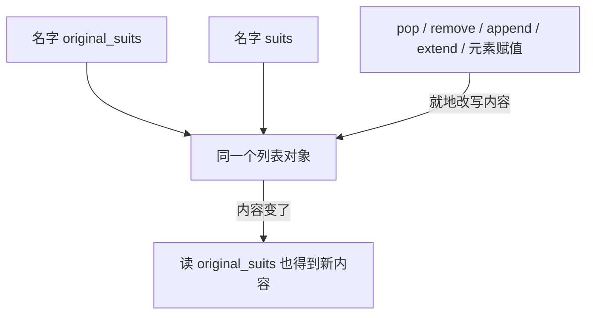
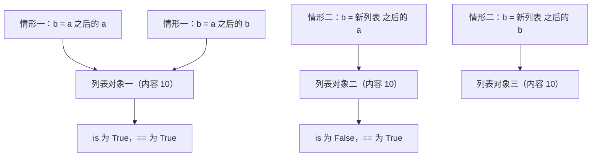
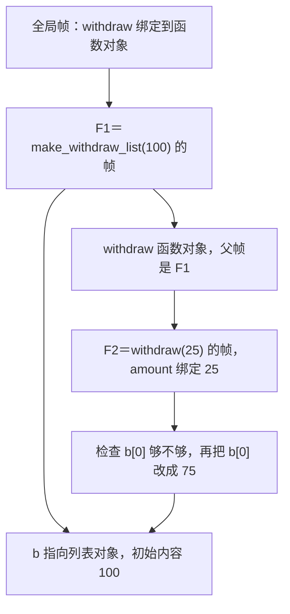

> **课程**：UC Berkeley CS61A · Structure and Interpretation of Computer Programs（Fall 2024）
> **本讲**：Lecture 15 ｜ 37:58 ｜ B 站分 P 15 ｜ [原视频](https://www.bilibili.com/video/BV1sy411z7nA?p=15)
> **课件**：`14-Mutability_1pp.pdf`（11 页，官方 PDF，逐页渲染图见正文插图）
> **字幕**：B 站英文原声字幕；本笔记是中文书面化重构，非逐句翻译
> **版权**：课程与课件版权归 UC Berkeley CS61A 教学团队；本文为学习用途的二次整理

## 本讲速览

- **已掌握**：对象是"数据 + 行为"的打包（`date` 的 `.year`、`.strftime`）；字符串方法返回新字符串；环境图里"名字→值"的箭头规则；列表、字典、元组的字面量与取元素。
- **本讲主线**：
    - 对象可以改变自己的值：同一个列表对象在不同时刻装着不同内容；
    - 一个对象可以有多个名字（aliasing），任何一次改动对所有名字都可见；
    - 复合对象除了"由哪些部分组成"，还有"它是哪一个"——`is` 判身份，`==` 判内容；
    - 参数传的是对象本身，函数内部的变异会穿透到调用者；
    - 元组、数字、字符串不可变，因此可作字典键，但对"里面的可变元素"没有免疫力；
    - 默认参数的值在 `def` 时只创建一次，可变默认值会在多次调用之间累积；
    - 把余额放进一个列表，就能让函数拥有跨调用存活的状态——可变函数（mutable function）。
- **关键结论**：一旦语言里出现"会变的对象"，"同一个东西"就不再等于"内容一样"，而只是"是它本身"；操作一个对象的副作用会沿所有别名扩散。

*(参考时间: 00:00:01 – 00:37:55｜Lecture 15)*

> **编者说明**：录像的 00:00–00:12 讲的是对象、属性、方法、字符串与字符编码，属于上一讲 Object 的收尾复习；标题为 Mutability 的新概念从 12:44 的"对象可以改变自己的值"才正式开始。本笔记保留这段复习，因为它是"对象为什么能承载状态"的前置知识，但把重心放在 12:44 之后。

## 1. 对象回顾：属性、方法与"像它代表的东西一样行为"

*(参考时间: 00:00:01 – 00:05:46｜Lecture 15)*


### 1.1 一个像日期一样行为的值

课程从一个标准库模块开始：`datetime` 表示日期与时间，其中 `date` 是一个类（class）。类本身是值，调用它就得到一个实例（instance）：`date(2015, 2, 20)` 是某一天，`date(2015, 5, 12)` 是本学期期末考试的日期。

```python
from datetime import date

today = date(2015, 2, 20)
freedom = date(2015, 5, 12)
freedom - today        # datetime.timedelta(days=81)
```

两个日期相减，得到的不是两个整数相减的结果，而是一个"间隔"：81 天。这个细节就是对象的本意——**一个对象应当像它所代表的东西一样行为**。日期会做日期该做的事：告诉你这是星期几、几月、离另一天差多久，而调用者不需要知道这些信息是怎么存起来的。

行为的主要载体是属性（attribute），用点表达式（dot expression）访问：

```python
today.year     # 2015
today.month    # 2
today.strftime('%A, %B %d')    # 'Friday, February 20'
```

`strftime` 是绑定在日期对象上的函数，也就是方法（method）：把一个格式字符串作为参数传进去，它按格式吐出文本。`%A` 是星期几，`%B` 是月份名，`%d` 是几号。

### 1.2 对象是什么：数据与行为捆在一起

讲师在这里强调了一个容易被忽略的事实：创建日期时，从来没有输入过"这一天是星期五"，也没有告诉程序 February 是 F-E-B-R-U-A-R-Y。**知道这些，本身就是"是一个日期"这件事的一部分**。对象把数据（哪一年、哪一月、哪一日）与行为（怎么格式化、怎么相减）捆在一起，形成一个抽象（abstraction）。

由此可以给出对象的定义：对象表示信息，由数据与行为共同组成；它可以表示具体的东西，也可以表示事物的性质、一次交互、一个过程。只要能访问属性，就能被建模成对象。对象的"类型"叫类；类在 Python 里是一等值，可以当参数传给函数。而围绕对象的编程方法——面向对象编程（Object-Oriented Programming）——给大型程序提供的是一个中心隐喻：**一个大程序不是一整块东西，而是一堆各自独立的对象，通过互发消息来协作**。点表达式正是为这个隐喻配的专用语法，它让"谁在做什么"在代码表面就能读出来。

在 Python 里，每个值都是对象，每个值都有属性，数字和字符串也不例外；大量数据操作其实是通过对象方法完成的。

### 1.3 函数做一件事，对象做一组相关的事

函数的设计准则是单一职责：传参进去，得到一个返回值，做好一件事就结束。对象不同，一个对象身上捆着许多相关的行为。日期不会只做一件事，它被用在无数场合，因此有多个方法，每个方法自己像一个函数，但都只对日期这一类东西有意义。

课件第 2 页是一张只有标题的公告页，按课件顺序排在这一章里：


> **编者说明**：这段录像没有公告片段，标题页之后直接进入对象回顾，因此这一页在正文里只作课程结构标记，不补写任何未发生过的通知。

## 2. 字符串对象与字符编码：从方法到码点

*(参考时间: 00:05:49 – 00:12:44｜Lecture 15)*

### 2.1 字符串方法返回的是新字符串

字符串也是对象，也有属性。对一个字符串调用 `upper`、`lower`、`swapcase`，会得到大写、小写、大小写互换的版本：

```python
s = 'hello'
s.upper()      # 'HELLO'
s.lower()      # 'hello'
s.swapcase()   # 'HELLO'
s              # 'hello'
```

关键在于最后一行：三次调用都没有改动 `s`。每个方法都基于旧字符串**返回一个新字符串**，`s` 仍然是 `'hello'`。这些方法也不属于通用函数，而是字符串专有的行为——这正是它们被做成方法而不是内置函数的原因。这条"调用不改变原值"的线索会在第 4 节与第 5 节变成两张明确的判据表：字符串与数字是不可变值，列表不是。

### 2.2 ASCII：一张 8 行 16 列的表

字符串是对文本的抽象，但它在机器里有一层数字编码，而且这层编码不属于 Python，是许多语言共用的约定。最早站住脚的标准之一是 ASCII（American Standard Code for Information Interchange）：它是一张表，规定哪个数字对应哪个字母或符号。

表的形状是 8 行 × 16 列。8 这个数字重要，因为三位二进制正好能表示 8 行；16 列则用四位表示。行与列拼起来是 7 位，能覆盖 128 个码位。

布局不是随手排的，它被设计成"按字符码排序就得到人想要的顺序"：

- 大写字母排在小写字母之前，于是按码位排序时 `A` 在 `a` 前面；
- 感叹号这类符号排在最前，波浪号排在最后，于是标点也会按一个可预期的次序落位；
- 表的中段（空格、数字、标点、大写字母）构成一个自足的可用子集：如果机器位宽不够，只取这一段仍然能写出完整的英文句子，代价是不能打小写字母——只能全大写，但总比什么都写不了强。

表的顶部是控制字符（control characters），它们是为传输与信息交换设计的，本身不显示。`LF`（line feed）是告诉对端的打印机换行；`BEL` 是让对端的打印机响一声，用来在信息交换之后引起注意。这些字符的含义大多已经过时，但少数一直活到今天。

用起来很直接：大写字母 `A` 对应 65，十六进制写作 `41`。这两个十六进制数位恰好就是它在表里的坐标——第 4 行第 1 列。把 `BEL` 连续打印很多次，终端就会响。

> **编者说明**：录像在这里用终端现场查了码位并反复打印响铃字符，画面不适合作为静态插图，故用文字转述。"中段可用子集"的具体范围是 0x20–0x5F 这 64 个码位（空格、标点、数字、大写字母），恰好能在 6 位内表示完——这是编者对讲师说法的一个精确化，讲师只做了口头描述。

### 2.3 Unicode：为所有语言准备的码点

ASCII 只服务英文。Unicode 的目标是：世界上每一种语言、每一种文字里的每一个字符，都有一个码点（code point），也就是一个能用来指代它的数字，从而在计算机之间、语言之间交换信息。当时的数据是约 109 000 个字符，分布在 93 种文字系统（script）里。

它不是把所有符号简单枚举一遍，而是按文字系统组织，并标注大小写、使用语言等信息，还支持双向显示顺序（bidirectional）：英文从左往右写，阿拉伯文从右往左写，同一个字符串里可以混排。每个字符还有名字，字母 `X` 的正式名字是 `Latin capital letter X`。

Python 直接暴露了这层结构：

```python
from unicodedata import name, lookup

name('A')                          # 'LATIN CAPITAL LETTER A'
name('a')                          # 'LATIN SMALL LETTER A'
lookup('LATIN SMALL LETTER A')     # 'a'
lookup('BABY')                     # 那个婴儿字符
```

`name` 由字符查名字，`lookup` 由名字查字符。表情符号在这套体系里只是某个文字系统里的"字母"：笑脸、雪人、足球、婴儿都有码点。具体长什么样取决于机器上的字体——同一个婴儿字符，在 Mac 上可能是某一种发型，换一台机器就换一副样子。**字形可变，码点不变**：有编码这件事是跨语言、跨平台通用的。

编码也可以直接看字节：那个婴儿字符在 UTF-8 里占四个字节，而字母 `A` 只占一个字节，值就是 65。

| 判据 | ASCII | Unicode |
| --- | --- | --- |
| 设计目标 | 服务英文与电报式信息交换 | 服务世界上所有语言与文字系统 |
| 表的形状 | 8 行 × 16 列，行 3 位、列 4 位 | 一维码点空间，按文字系统分区 |
| 覆盖范围 | 128 个码位：控制符、数字、标点、字母 | 当时约 109 000 个字符、93 种文字系统 |
| 排序约定 | 按码位排序即得可读顺序，大写在小写前 | 不约定排序，只给每个字符编号与名字 |
| 书写方向 | 只考虑从左到右 | 支持双向显示，可混排从左到右与从右到左 |
| 字符命名 | 无统一名字 | 每个字符都有名字，可双向查询 |

## 3. 对象会改变自己的值：列表变异与别名

*(参考时间: 00:12:44 – 00:16:13｜Lecture 15)*

### 3.1 今天的新观念：值可以随时间改变

前面所有内容都建立在一个隐含前提上：一个值算出来就不会变。这一节把这个前提拆掉——**对象可以在计算过程中改变自己的值**。最简单的例子是列表：同一个列表，随时间推移可以装着不同的东西。


课件这一页只有标题与一个 Python Tutor 链接，链接里的程序是就地改写一个列表：

```python
s = [3, 5, 7, 9, 11]
for i in range(len(s)):
    s[i] = s[-(i+1)]
```

> **编者说明**：这段代码出自课件链接，录像里没有逐行讲解。逐帧跑一遍会发现它并没有把列表反转：循环前半段先读右半边的原值、写进左半边；等走到后半段，右半边的原值已经被左半边的新值覆盖，被覆盖的值又被抄回右边，最终结果是对称的 `[11, 9, 7, 9, 11]`。这个"失败的反转"正好说明本节的要点：赋值是就地覆盖，右边的表达式读的是列表**此刻**的内容。

### 3.2 花色简史：两个名字，一个列表

讲师用扑克牌花色的传播史来演示列表变异。一般认为纸牌起源于亚洲，最初有三种花色：钱（coin）、索（string）、万（myriad），分别代表不同面额的货币——毕竟纸牌最经典的用途是赌博。

```python
original_suits = ['coin', 'string', 'myriad']
suits = original_suits
```

这段代码用一个赋值语句"记住"最初的花色。之后的故事就是一连串变异：纸牌经埃及传到欧洲，万贯这一门在途中丢失；索子也丢了，只剩下钱。传到西班牙时，牌需要新花色，于是有了杯（cups）、剑（swords）、棒（clubs），凑成钱、杯、剑、棒。到意大利，剑被叫做 spada，于是有了黑桃（spade）。到法国，钱和杯被红桃（heart）与方块（diamond）替换，最终成为现代美式扑克的四门花色：红桃、方块、黑桃、梅花。

上面这段叙述对应下面这串操作。其中 `pop` 总是删掉并返回最后一个元素，`remove` 可以删掉列表中任意位置的那个值，`append` 加一个元素，`extend` 一次加一串元素：

```python
suits.pop()                # 万贯丢失
suits.remove('string')     # 索子丢失，只剩钱
suits.append('cup')        # 西班牙牌加入杯
suits.append('sword')      # 与剑
suits.append('club')       # 与棒
suits[2] = 'spade'         # 意大利语把剑叫 spada
suits[0] = 'heart'         # 法国人用红桃替换钱
suits[1] = 'diamond'       # 用方块替换杯
```

> **编者说明**：课件第 3 页只给了分节标题与演示链接，没有花色演示的完整代码；上面的代码按录像里念到的名字（`original_suits`、`suits`）与操作（`pop`、`remove`、`append`、`extend`、元素赋值）复述，执行后 `suits` 为 `['heart', 'diamond', 'spade', 'club']`。

故事讲完，讲师回头去看最初那个名字：

```python
original_suits    # ['heart', 'diamond', 'spade', 'club']
original_suits == suits    # True
```

`original_suits` 是在最开头绑定的，中间改的一直是 `suits`，可它现在的内容也变了。原因很简单：**它们从一开始就是同一个对象的两个名字**，任何一次改动都同时体现在两边。讲师把这称为本课程中第一次看到"对象改变状态"——同一份东西在计算过程中换了内容，而名字的绑定关系一次都没动过。

讲师给的类比是"人"：把名字 `same_person` 绑定到某个婴儿字符上，婴儿长大，`same_person` 仍然指向同一个人，变化发生在这个对象身上，而不在绑定关系上。

在计算机科学里，**对对象的任何改动都叫变异（mutation）**。只有可变类型（mutable type）的对象才能变异，列表与字典是已经见过的两种。



### 3.3 课件补充：用 append 构建列表而不是改写它

> **编者说明**：课件接下来有四页（第 4–7 页）讲"用 append 构建列表"与"把列表当分支容器"，录像在这段没有讲到它们，而是直接进入了第 4 节的可变类型。这四页与本节相邻但方向相反：前面是用变异改写一个已经存在的列表，这里是**不断造出新列表**，`append` 只加在本次调用新建的 `result` 上。以下按课件画面与 doctest 补讲。


`sums(n, m)` 要求返回所有"和为 `n`、每个数都是 1 到 `m` 的正整数、且相邻元素不重复"的列表。doctest 把契约写死了：`sums(5, 1)` 是 `[]`（5 只能拆成 5，但 5 超过上限 1），`sums(5, 2)` 只有 `[[2, 1, 2]]`，`sums(6, 3)` 有 8 个解。

```python
def sums(n, m):
    """Return lists that sum to n containing positive numbers up to m that
    have no adjacent repeats, for n > 0 and m > 0.

    >>> sums(5, 1)
    []
    >>> sums(5, 2)
    [[2, 1, 2]]
    >>> sums(5, 3)
    [[1, 3, 1], [2, 1, 2], [2, 3], [3, 2]]
    >>> sums(5, 5)
    [[1, 3, 1], [1, 4], [2, 1, 2], [2, 3], [3, 2], [4, 1], [5]]
    >>> sums(6, 3)
    [[1, 2, 1, 2], [1, 2, 3], [1, 3, 2], [2, 1, 2, 1], [2, 1, 3], [2, 3, 1], [3, 1, 2], [3, 2, 1]]
    """
    result = []
    for k in range(1, min(m + 1, n)):  # k is the first number of a list
        for rest in sums(n-k, m):
            if rest[0] != k:
                result.append([k] + rest)  # build a list out of k and rest
    if n <= m:
        result.append([n])
    return result
```

三处填空的答案是 `min(m + 1, n)`、`sums(n-k, m)` 与 `[k] + rest`，逐条看都有理由：

- `k` 是一个解的首项，取值 1 到 `m`；同时必须小于 `n`，否则 `n-k` 会小于等于 0，递归就没有下界。两个上界取小，正好是 `min(m + 1, n)`（`range` 的右端不含）。
- 首项定成 `k` 之后，剩下要凑的是 `n-k`，上限仍是 `m`，于是对每个合法的"余下部分的列表" `rest` 递归调用 `sums(n-k, m)`。
- 拼接时用 `[k] + rest`，而不是 `rest.insert(0, k)` 或往 `rest` 里 `append`：`[k] + rest` 把 `k` 放在最前面并造出一个新列表，`rest` 本身不被改动。这里两种写法结果相同（每次递归都新建 `result`），但就地修改一个来自别的帧的值，正是本讲反复提醒的隐式副作用，`+` 把"构建"和"变异"分得干净。
- `n <= m` 时这个 `n` 自己就是一个合法解，单独补上 `[n]`；这条分支正对应 doctest 里 `sums(5, 5)` 末尾那个 `[5]`。

### 3.4 课件补充：在一棵树上补出一条路径


从"列表装数字"走到"列表装分支"，问题就变成了树上的操作：如果列表里的元素是若干棵树，对每个元素递归，得到的就是一棵新树。


题目是 `make_path(t, p)`：`t` 是一棵标签互不相同的树，`p` 是一条从根标签开始的路径（一个标签列表）；要求返回一棵与 `t` 同构、但包含 `p` 的树，并且节点尽可能少。课件给了三组目标：`make_path(t1, [3, 8, 9, 1])` 在根下新开一支 8→9→1；`make_path(t1, [3, 4, 8, 9])` 在已有的 4 号分支下续出 8→9；`make_path(t1, [3, 5, 6, 8])` 在 5→6 之后再补一个 8。三组都只在"路径走到的那一格"之后长出新节点，其余原样保留，所以返回值是节点最少的那棵。课件随后用两句话写清递归结构：

- 递归想法：`make_path(b, p[1:])` 应该是 `make_path(t, p)` 返回值里的一个分支；
- 特例：如果没有哪个分支以 `p[1]` 开头，就需要新造一个标签为 `p[1]` 的叶子。


```python
def make_path(t, p):
    "Return a tree like t also containing path p."
    assert p[0] == label(t), 'Impossible'
    if len(p) == 1:
        return t
    new_branches = []
    found_p1 = False
    for b in branches(t):
        if label(b) == p[1]:
            new_branches.append(make_path(b, p[1:]))
            found_p1 = True
        else:
            new_branches.append(b)
    if not found_p1:
        new_branches.append(make_path(tree(p[1]), p[1:]))
    return tree(label(t), new_branches)
```

`assert` 把"`p` 必须从根标签开始"这条前提写成可执行的检查；`len(p) == 1` 是递归出口，路径只剩一个标签时 `t` 本身就已经包含它。循环处理已有分支：匹配上 `p[1]` 的那一支递归下去，其余原样保留。`found_p1` 记住有没有匹配上，没有匹配就说明这条路在第 2 层就断了，于是用 `tree(p[1])` 造一个只有标签的叶子，再递归补完剩下的部分。返回值用 `tree(label(t), new_branches)` 重新装配，因此**整个函数没有修改 `t`**，只是造了一棵新树——这与 3.2 节的花色演示正好相反：那里是同一个对象被改了许多次，这里是每层都产出新对象。

## 4. 变异发生在哪里：字典、函数参数与全局帧

*(参考时间: 00:16:09 – 00:20:26｜Lecture 15)*

### 4.1 字典的增、删、改

字典同样可以变异。创建一个把罗马数字映射到数值的字典，可以先看整体，再看单个键的值：

```python
numerals = {'i': 1, 'v': 5, 'x': 10}
numerals['x']    # 10
numerals['x'] = 11
numerals         # {'i': 1, 'v': 5, 'x': 11}
```

用元素赋值改一个已有键，原来 `x` 与 `10` 之间的绑定就彻底消失了，换成 `x` 与 `11`；再查一次键，得到的是新值。元素赋值也可以用来新增条目：给一个不存在的键赋值，字典里就多了一对键值；反过来 `pop` 接收一个键，删掉整个键值对，之后再查这个键就没有东西了。

### 4.2 函数调用内部的变异

变异不只发生在顶层：**函数可以改变它作用域内任何一个可变对象的值**。先看一个会改写列表的函数：

```python
def mystery(s):
    s.pop()
    s.pop()
```

```python
four = [1, 2, 3, 4]
len(four)      # 4
mystery(four)
len(four)      # 2
```

定义函数、创建列表、调用 `mystery`。调用会新建一帧，这一帧里名字 `s` 绑定到与 `four` **同一个**列表对象；`s.pop()` 删掉的是那个对象的最后一个元素，于是 `four` 看到的世界也少了一个元素。`four` 本身的绑定没有变，变的是它指向的列表的内容；第二次 `pop` 之后它更短了。

同样的效果还能用切片赋值写出来：把从 2 号索引到结尾的那一段换成空列表，也就等于删掉它们。

```python
def mystery(s):
    s[2:] = []
```

### 4.3 零参数函数也能改

如果函数不收参数，它还能改到外面的列表吗？能——只要那个名字在它的作用域里可见。像 `four` 这样在全局帧里绑定的名字，任何函数都能查到它，于是零参数的函数也能一路 `pop` 下去：

```python
def mystery():
    four.pop()
```

全局帧对所有人开放，这条规则在环境图里一直成立；本节只是第一次拿它来解释"副作用"。

| 写法 | 是否改变原对象 | 返回值 | 说明 |
| --- | --- | --- | --- |
| `s.append(5)` | 改变 | 无新值 | 尾部加一个元素 |
| `s.extend([5, 7])` | 改变 | 无新值 | 尾部加一串元素 |
| `s.pop()` | 改变 | 被删掉的元素 | 总是删最后一个 |
| `s.remove(5)` | 改变 | 无新值 | 删掉第一个等于 5 的元素 |
| `s[0] = 9` | 改变 | 无新值 | 元素赋值，覆盖原位置 |
| `s[2:] = []` | 改变 | 无新值 | 切片赋值，可用来删一段 |
| `s + [5]` | 不改变 | 新列表 | 拼接产生新对象 |
| `s.upper()` | 不改变 | 新字符串 | 字符串方法一律返回新串 |
| `d['x'] = 11` | 改变 | 无新值 | 键已存在则改值，否则新增 |
| `d.pop('x')` | 改变 | 被删掉的值 | 删掉整个键值对 |

> **编者说明**：表中"无新值"指这些方法返回 `None`，是 Python 的规则；录像没有逐条念出返回值，但演示里这些调用都只留下副作用、没有被赋给别的名字。

## 5. 元组：不可变序列的收益与代价

*(参考时间: 00:20:30 – 00:25:56｜Lecture 15)*

### 5.1 字面量与那个必需的逗号

元组（tuple）是序列，但是不可变序列：创建之后内容不能改。它的发音在英语世界有两派，一派读得像 "too-ple"，一派读得像 "tup-ple"；讲师的说法是，这件事没有公认标准，两派唯一的共识是对方读错了。本笔记统一读作"元组"。

```python
(3, 4, 5, 6)     # 元组字面量
3, 4, 5, 6       # 不加括号也是元组
()               # 空元组
tuple()          # 空元组
tuple([1, 2, 3]) # (1, 2, 3)，任何序列都能转
(2,)             # 只有一个元素的元组
```

有两点容易踩：**括号不是必需的**，决定一个表达式是不是元组的是逗号——用逗号分隔的一串值就是元组，很多人加括号只是为了读起来清楚；**单元素元组必须留一个逗号**，`(2,)` 是"装着 2 的元组"，`(2)` 只是数字 2 加了层括号。单元素元组的写法就靠这个逗号，谈不上好看，但没有别的写法。

### 5.2 能做的操作与不能做的操作

元组支持拼接、成员判断与切片：

```python
(1, 2) + (3,)        # (1, 2, 3)
3 in (1, 2, 3)       # True
(1, 2, 3, 4)[1:3]    # (2, 3)
```

这些操作都**返回新元组**，不会改动任何一个已有元组。

因为不可变，元组是可哈希的（hashable），可以作为字典的键。列表不行：

```python
{(1, 2): 'ok'}       # 合法
{[1]: 'no'}          # TypeError: unhashable type: 'list'
```

而且这个限制会往里传一层：元组里只要藏着一个列表，整个元组就不再可哈希，同样报 `unhashable type: 'list'`。

### 5.3 不可变带来的"保护"及其边界

不可变值有实际好处：它在一定程度上被保护起来，不会被别的函数改掉。

```python
def ooze(s):
    ...

turtle = (1, 2, 3)
ooze(turtle)
turtle        # 仍然是 (1, 2, 3)
```

数字与字符串同样不可变。讲师在这里的说法是"可变的值只有列表"，而这句话的语境是刚刚比过的这一串基本值：数字、字符串、元组、列表；字典在 4.1 节已经被列为可变类型，所以这句应理解为"在这串基本序列值里，只有列表会变"。

但这种保护并不彻底。讲师明确提醒：函数改不了这个值，但下一讲会看到函数可以改变**名字 `turtle` 绑定到什么**。语言给的只是针对"对象内容"的保护，不是针对"当前环境"的保护。

### 5.4 同一个表达式，两种变化来源

一个表达式的值会变，只有两个来源：名字变了，或者对象变了。

```python
x + x
```

`x = 2` 时它是 4，`x = 3` 时它是 6——这是名字被重新绑定，从课程开头就在用。对象变异是另一条路：`x` 曾是 `[1, 2]`，`x + x` 是 `[1, 2, 1, 2]`；把列表改成 `[1, 2, 3]` 之后，同一个表达式给出 `[1, 2, 3, 1, 2, 3]`。对不可变值，第二条路不存在；但第一条路永远存在，因为名字随时可以重新绑定。

### 5.5 不可变容器里的可变元素

"不可变"只约束容器本身这一层。一个元组里装着一个列表时，元组不能被换掉，但里面的列表可以改：

```python
t = ([1, 2], 3)
t[0].append(4)
t        # ([1, 2, 4], 3)
```

元组里装的还是那两个元素，身份没变；变的是其中一个元素的内容。所以判断"这个东西会不会变"，不能只看最外层的类型，要看到里面装着什么。

| 判据 | `list` | `tuple` |
| --- | --- | --- |
| 字面量 | `[1, 2, 3]` | `(1, 2, 3)` 或 `1, 2, 3` |
| 内容能否改变 | 能：`append`、`pop`、元素赋值、切片赋值 | 不能，只能造新的 |
| 可哈希、可作字典键 | 不能，`TypeError: unhashable type: 'list'` | 能，但元组内不能含列表 |
| 空值与单元素 | `[]`、`[1]` | `()`、`(1,)`，逗号不能省 |
| 拼接与切片的产物 | 新列表 | 新元组 |
| 适合的场景 | 需要就地增删、当累积器 | 固定长度的记录、需要作键的序列 |

## 6. 同一性与相等：`is` 与 `==`

*(参考时间: 00:25:57 – 00:29:34｜Lecture 15)*


### 6.1 整体不只是部分之和

在从不修改对象的年代，一个复合对象就是它各部分的总和：一个有理数除了分子和分母，没有别的东西可说。讲师把这种观点讲成一句哲学式的话——整体不过是部分之和。

一旦允许变化，这句话就不成立了。一个复合数据对象除了"由哪些部分组成"，还有一个**身份（identity）**。同一个列表就算内容被换掉，仍然是"同一个"列表；反过来，两个内容完全相同的列表，也可能是两个不同的东西。前者说"是它"，后者只说"长得一样"。


### 6.2 两个实验

左边：`a = [10]`，然后 `b = a`。两个名字指向同一个列表，`a == b` 为 `True`。往 `a` 追加 20 之后，`a` 与 `b` 都显示 `[10, 20]`，`a == b` 仍然是 `True`。

右边：`a = [10]`，然后 `b = [10]`。两个列表内容相同，`a == b` 一开始也为 `True`。但此时往 `b` 追加 20：`a` 还是 `[10]`，`b` 变成 `[10, 20]`，`a == b` 变成 `False`。全程没有出现过 `a = ...` 或 `b = ...` 这样的重新赋值语句——它们只是曾经内容相同，从来不是同一个东西，所以一个变了，另一个不跟着变。

### 6.3 两套判据


判断"是不是同一个"有专门的运算符，写作 `is`，它的否定是 `is not`：

- `<exp0> is <exp1>`：两个表达式求值得到**同一个对象**时为 `True`；
- `<exp0> == <exp1>`：两个表达式求值得到**相等的值**时为 `True`。

由此得到一条不对称的规律：**相同的对象一定相等，相等的值不一定相同**。任何装着 `10` 的列表都等于另一个装着 `10` 的列表，但它们可能根本是两个列表。`10 is 10` 永远为真，因为两个 `10` 字面量求值得到的就是同一个整数对象。

```python
a = [10]
b = [10]
a == b        # True
a is b        # False

c = b
c is b        # True
c.pop()
b             # []，c 删的就是 b 的元素
a             # [10]，与 b、c 无关
```

`c = b` 让 `c` 真的成为 `b`：两个名字指同一个对象，从 `c` 上 `pop` 掉的东西，也就是从 `b` 上 `pop` 掉的；而 `a` 一无所知。



> **编者说明**：想在交互式环境里直接看身份，可以用 `id(a)` 与 `id(b)` 对比两个整数是否相同——`id` 返回对象在一次运行中的标识，录像没有提到这个函数。另外 CPython 会缓存小整数与部分字符串，所以 `a = 10; b = 10; a is b` 为 `True`；这是实现细节，不能当作语言保证，判断内容是否相等永远该用 `==`。

## 7. 可变默认参数：一个必须记住的陷阱

*(参考时间: 00:29:39 – 00:31:41｜Lecture 15)*

### 7.1 先看一道别名谜题

课件第 11 页把别名的规则写成一句话：**如果多个名字（直接或间接地）指向同一个可变对象，那么这个对象的改动会反映到所有这些名字的值上**。随后是一道阅读题：


```python
s = [2, 7, [1, 8]]
t = s[2]
t.append([2])
e = s + t
t[2].append(8)
print(e)
```

问：打印出哪些数字，一共几个？

> **编者说明**：录像没有现场运行这道题，下面是编者按环境图逐步推演的结果，规则全部来自本讲：`t = s[2]` 让 `t` 与 `s` 的第三个元素成为同一个列表；`t.append([2])` 就地改它；`s + t` 造出一个新列表 `e`，但 `e` 里的元素仍然共享原来的那些列表，`t` 自己就是 `e` 的第 3 个元素，而 `t` 末尾那个 `[2]` 同时也是 `e` 的最后一个元素。于是 `t[2].append(8)` 把 `[2]` 改成 `[2, 8]`，两个位置同时变化。最终 `e` 是 `[2, 7, [1, 8, [2, 8]], 1, 8, [2, 8]]`，打印出 10 个数字：2、7、1、8、2、8、1、8、2、8。

这道题的价值在于它同时用到了三层：按下标取元素（直接产生别名）、`+` 拼接（浅复制，元素仍然共享）、以及对共享元素的就地修改。

### 7.2 默认值只在 `def` 时算一次

一旦学会变异，就必须同时学会它的风险，第一条就是可变默认参数：

```python
def f(s=[]):
    s.append(5)
    return len(s)
```

```python
f()    # 1
f()    # 2
f()    # 3
```

看起来每次调用都该拿到一个空列表，然后返回 1；实际结果却一路涨到 3。原因是默认参数的值在定义函数时就被计算出来，**它属于函数值本身，而不是每次调用重新生成**。第一次调用用的是那个空列表，`append` 之后它变成 `[5]`；第二次调用时 `s` 绑定到的还是同一个列表，于是变成 `[5, 5]`，长度 2；第三次同理。

讲师把这件事讲得很直白：函数体中间对默认值做的改动，也会留到下一次调用，于是"看起来很简单的东西"每次给出的结果都不一样。第一次调用里 `s` 是空列表，被改成装着 5；下一次 `s` 还是那个列表，又被加一个。**正是因为这个变量在调用之间共享，返回值才会是 1、2、3。**

> **编者说明**：讲师第二遍复述时把追加的常量说成 3，现象与上面完全一致。要避开这个陷阱，惯用写法是用 `None` 当哨兵，在函数内部新建列表：`def f(s=None):` 然后 `if s is None: s = []`——这里正好用上第 6 节的 `is`。

## 8. 可变函数：把状态封进函数里

*(参考时间: 00:31:44 – 00:37:55｜Lecture 15)*

### 8.1 一个有状态的函数

可变值还能用来定义**可变函数**：行为随时间变化的函数。同一个参数、不同时刻调用，得到不同结果。

设想一个初始余额 100 元的银行账户，提取动作写成一个函数：参数是要取的钱，返回值是余额。先看它怎么用（实现的代码放在 8.2 节）。

```python
withdraw = make_withdraw_list(100)
withdraw(25)    # 75
withdraw(25)    # 50
withdraw(60)    # 提示余额不足
withdraw(15)    # 35
```

同一个函数、同样的参数 25，两次调用给出 75 和 50。这已经不是纯函数：调用它会产生副作用，而这个副作用改变的正是它自己的行为。

这里的"账户"就是 `withdraw` 这个函数本身。它代表着一份信息——一份**状态（state）**，即账户余额。讲师把它称为"局部的"状态：余额没有写在任何别的地方，它只存在于这个函数内部，并因此决定了函数的行为。取 60 而只剩 50 时，函数会说钱不够；取 15 则照常扣减。

### 8.2 状态存在哪里

余额存放在 `withdraw` 里，而 `withdraw` 由高阶函数 `make_withdraw_list` 创建：

```python
def make_withdraw_list(balance):
    b = [balance]
    def withdraw(amount):
        if amount > b[0]:
            return 'Insufficient funds'
        b[0] = b[0] - amount
        return b[0]
    return withdraw
```

`make_withdraw_list` 接收初始余额，第一件事是把它放进一个单元素列表 `b`。这个列表是关键：它引用在 `withdraw` 的父帧里，也就是 `make_withdraw_list` 的那一帧；因为它是可变列表，所以每次调用 `withdraw` 都可以改掉它里面的值。

> **编者说明**：录像里余额不足时讲师返回的是一句口头提示（"账户里的钱不够"），字幕没有给出精确的返回字符串；上面的代码用 `'Insufficient funds'` 代替，判断逻辑与课件演示一致。

`withdraw` 检查的是 `b[0]`，不是参数 `balance`——`balance` 是创建时传进来的原始余额，之后再也不变。钱不够就直接返回；够就改写 `b[0]`，把扣减后的余额作为返回值给出。



### 8.3 为什么这里不能用赋值

环境图走一遍：`make_withdraw_list` 收到 100，定义了 `b`（一个装着 100 的列表），又定义了 `withdraw`，它的父帧是 F1，因此函数体里能查到 `b`，也能改 `b`。函数被返回、绑定到 `withdraw`，随后以 25 调用：先确认 25 不超过列表里的 100，再把列表内容改成 75。

要注意 `withdraw` **没有**在父帧里重新绑定任何名字。Python 的赋值语句总是在当前帧里创建绑定；语言里确实有 `nonlocal` 与 `global` 语句可以写到外层帧，但这段代码一个都没用。它做的是另一件事：通过名字 `b` 找到那个列表，再改**这个列表的内容**。`b` 一直是同一个 `b`，同一个列表，变的只是列表的内容。

所以讲师总结：`withdraw` 改变的不是"这些名字绑定到什么"，而是 `b` 这个对象本身的值；用一个语言内置的可变值，就造出了一个行为可变的函数。

### 8.4 这一讲在课程主线上的位置

至此，程序里第一次出现了"函数拥有数据，而且数据会变"这种结构。它带来的困扰恰恰是它与前面所有工具都不兼容的地方：

- 环境图原本只画"名字 → 值"的箭头；只要没有变异，一个复合值就等于它的零件，画完零件就画完了整体。有了变异，"这是哪一个对象"成了图上一个必须单独标出的节点，否则读图的人无法判断两次修改打在不在同一个东西上。
- 纯函数的世界里，同一个表达式永远得到同一个值，函数可以随意替换、求值顺序可以任意调整；有了状态之后，调用的**历史**开始影响结果，`withdraw(25)` 的值取决于之前发生过什么。
- 而一旦程序习惯于"很多对象各自持有会变的内部状态、彼此发消息"，就得到了第 1 节那个面向对象的隐喻。这一讲只是把地基打出来：可变值、别名、身份、局部状态。

> **编者说明**：以上三点是编者对这一讲在课程主线上位置的梳理，讲师在录像里只讲到"用可变值造出可变函数"为止；下一讲会补上不用列表、直接用 `nonlocal` 改写外层名字的做法。

## 小结

*(参考时间: 00:37:42 – 00:37:55｜Lecture 15)*

- 判断"会不会变"先看类型：列表、字典可变，数字、字符串、元组不可变；不可变容器里装着可变元素时，整体仍会跟着变。
- 一个对象可以有多个名字；变动作用于对象，不作用于名字，所以所有别名都会看到同一份新内容。
- `is` 问"是不是同一个对象"，`==` 问"内容是否相等"；前者为真则后者必真，反之不成立。
- 参数传递传的是对象，不是副本：函数内的 `pop`、元素赋值、切片赋值会穿透到调用者的对象上。
- 需要"改一份"还是"造一份"，要显式选择：`append`/`pop` 改原对象，`+`/切片/`tuple` 造新对象。
- 默认参数在 `def` 时求值一次，可变默认值会跨调用累积；需要每次新建时用 `None` 作哨兵。
- 用可变值当容器，就能让函数拥有跨调用存活的局部状态，从而得到行为随历史变化的可变函数。
- 读带变异的代码时，先画环境图并标出哪些名字指向同一个对象，再逐步模拟每次就地改写。

## 附：本讲幻灯片索引

*(参考时间: 00:00:01 – 00:37:55｜Lecture 15)*

| 页 | 内容 | 出现位置 |
| --- | --- | --- |
| 1 | 标题页 Mutability | §1 |
| 2 | Announcements 页（录像无公告内容） | §1.3 |
| 3 | List Mutation 分节页与就地改写演示 | §3.1 |
| 4 | Building Lists Using Append：`sums` 的填空与 doctest | §3.3 |
| 5 | Building Lists of Branches 分节页 | §3.4 |
| 6 | make_path 题目与三组目标树 | §3.4 |
| 7 | make_path 的递归实现与环境图 | §3.4 |
| 8 | Mutation and Identity 分节页 | §6 |
| 9 | Sameness and Change：两组 `a`/`b` 交互 | §6.2 |
| 10 | Identity Operators：`is` 与 `==` | §6.3 |
| 11 | Mutation and Names：多层别名阅读题 | §7.1 |

录像的语音顺序是"对象与字符串回顾 → 列表变异与花色故事 → 可变类型与函数内变异 → 元组 → 同一性 → 可变默认参数 → 可变函数"。课件第 4–7 页（用 `append` 构建列表、`make_path`）与第 11 页的别名阅读题在本段录像里没有讲到，正文把它们放在课件给定的位置，按画面与课程材料补全，并在相应位置标出哪些内容属于编者补充。
