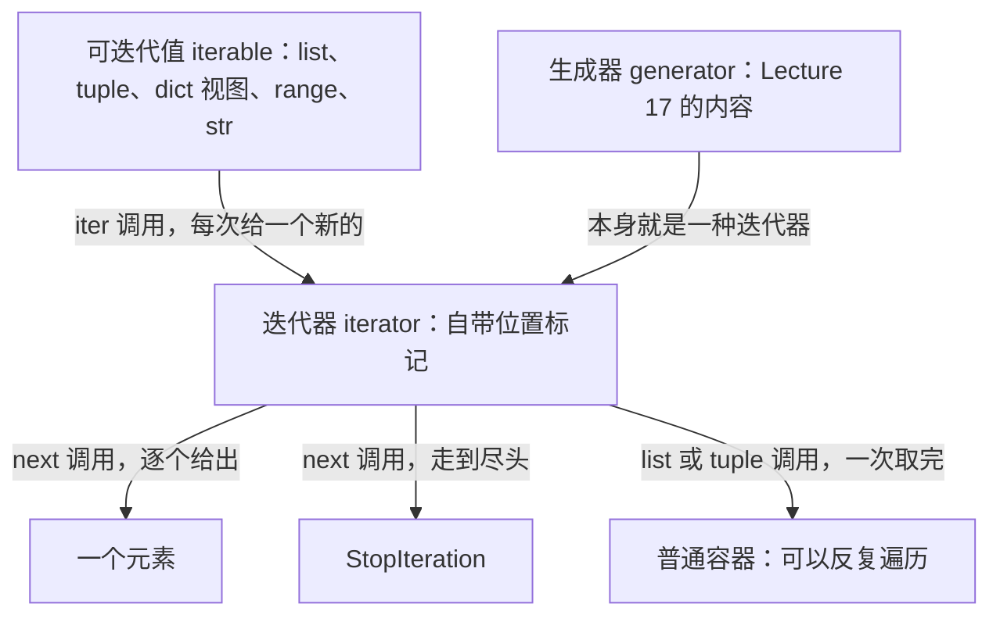
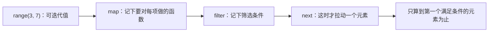
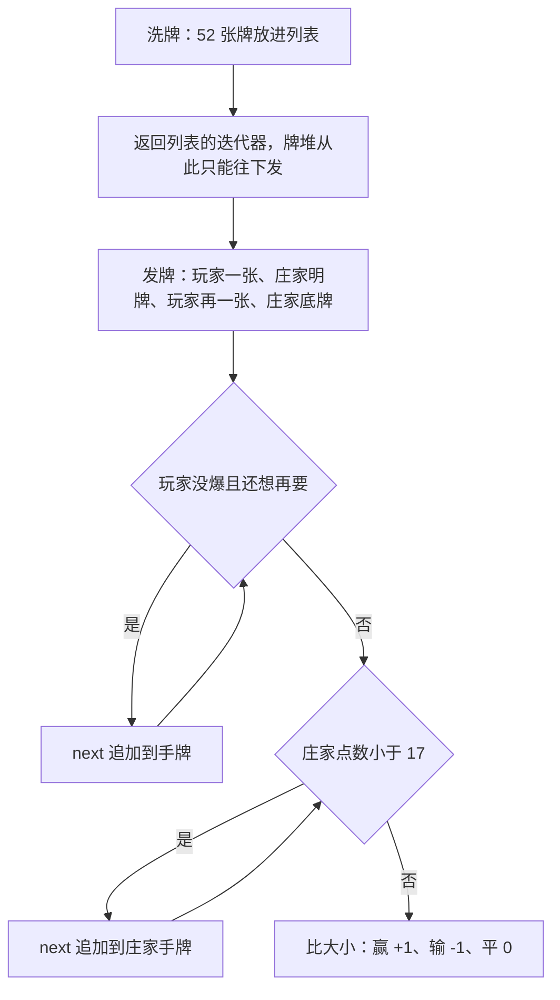

> **课程**：UC Berkeley CS61A · Structure and Interpretation of Computer Programs（Fall 2024）
> **本讲**：Lecture 16 ｜ 00:29:29 ｜ B 站分 P 16 ｜ [原视频](https://www.bilibili.com/video/BV1sy411z7nA?p=16)
> **课件**：`15-Iterators_1pp.pdf`（12 页，官方 PDF，逐页渲染图见正文插图）
> **字幕**：B 站英文原声字幕；本笔记是中文书面化重构，非逐句翻译
> **版权**：课程与课件版权归 UC Berkeley CS61A 教学团队；本文为学习用途的二次整理

## 本讲速览

*(参考时间: 00:00:00 – 00:29:27｜Lecture 16)*

- **已掌握**：列表与元组的取下标、切片、拼接；`list.pop()` 就地删除并返回最后一个元素；字典按键取值；`for` 循环能在列表或 `range` 上跑；函数是值，可以当参数、当返回值。
- **本讲主线**：
    - 容器不直接交出元素，而是交出**迭代器（iterator）**；`iter` 造出它，`next` 推动它；
    - 迭代器等于"一个序列 + 一个位置标记"，标记只往前走，走完再要就抛 `StopIteration`；
    - 同一个容器可以有几个互不干扰的迭代器，但迭代器本身是可变对象，别名会共享位置；
    - `for` 对可迭代值每次都能从头走，对迭代器只能走一遍；
    - `map`、`filter`、`zip`、`reversed` 返回的都是迭代器，算得**惰性（lazy）**：不被要求就不算；
    - 把"只要下一个"当接口，就是数据抽象：换掉背后的容器，调用者的代码不用改。
- **关键结论**：迭代器把"一段序列"和"读到了哪个位置"打包成一个可变对象；这个打包既让每个元素天然只被处理一次，也让"只能消费一次"成为必须记住的代价。


## 1. 课件开头的复习块：列表、元组与真实世界中的序列

*(参考时间: 00:00:00 – 00:00:06｜Lecture 16)*

本讲开场第一句就把结论说了：*Sequential data can be represented implicitly using an iterator*（顺序数据可以用迭代器隐式地表示）。这句结论要到第 2 章才展开；在它之前，课件先用六页把"序列"这件事回顾一遍——列表练习、元组与列表的分工、以及序列在真实程序里的三种形态。这些页面是理解迭代器的前提：只有先看清"容器给元素的方式有多少种不同"，才知道统一接口为什么值得设计。

> **编者说明**：课件第 2–7 页是本讲开头的复习块，其中元组部分在上一讲（Lecture 15，可变性）已经讲过。本段录像的音轨从第 8 页的迭代器分节页开始，这几页没有对应的讲解录音；下面按课件画面整理，凡属画面之外的推理会标出来。

### 1.1 公告页

第 2 页只有一行标题 `Announcements`，是课件里的公告分节页。按惯例，这一页处理的是作业、项目和考试的时间点，与迭代器本身无关。本段录像没有对应的公告内容，这里只作版面记录。


### 1.2 列表练习与一道期中题

第 3 页是 `List Practice` 分节页，它后面紧跟一道真题：Spring 2023 期中第二场的第一题。题面给了一个两行的辅助函数和四行赋值语句，要求推出 `silver`、`gold`、`platinum` 三个名字最后绑定的值。


```python
def chain(s):
    return [s[0], s[1:]]

silver = [2, chain([3, 4, 5])]
gold = [silver[0], silver[1].pop()]
silver[0] = 1
platinum = chain(chain([6, 7, 8]))
```

题目左下角还印着一行提醒：`s.pop()` 删除并返回 `s` 的最后一个元素——它是这题的关键，因为 `pop` 会**就地修改**列表，而切片 `s[1:]` 只是**造一个新列表**。

先算 `chain([3, 4, 5])`：返回 `[3, [4, 5]]`。于是 `silver` 绑定 `[2, [3, [4, 5]]]`——注意外面这层列表的第一个元素是数字 `2`，第二个元素是 `chain` 造出来的列表。

再算 `gold = [silver[0], silver[1].pop()]`。求值顺序是从左到右：`silver[0]` 得到 `2`；然后 `silver[1]` 取出内层列表 `[3, [4, 5]]`，对它调用 `pop()`，弹出并返回 `[4, 5]`。所以 `gold` 是 `[2, [4, 5]]`，同时 `silver` 变成 `[2, [3]]`。最后 `silver[0] = 1` 把开头的 `2` 改掉，`silver` 就是 `[1, [3]]`。

`platinum` 是嵌套调用：内层 `chain([6, 7, 8])` 得到 `[6, [7, 8]]`，外层再对它调用一次，得到 `[6, [[7, 8]]]`——第一项取下标 `0`，第二项是它的切片，于是层数多了一层。


课件把整道题画成了环境图。左侧 `Global frame` 里有四个名字：`chain` 指向右上角的函数对象 `func chain(s) [parent=Global]`；`silver`、`gold`、`platinum` 各指向一个列表。中间竖着三个 `chain` 的帧，每个帧里都有形参 `s` 和返回值 `ret val`，帧框右上角标着 `[p=G]`，表示父帧是全局帧。画面上还有两个蓝色标注框，用引线指出 **`silver[1]` 求值得到的是哪个列表**、**`silver[1].pop()` 返回的是哪个列表**——虚线框住的两个内层列表，一个有 `[4, 5]`，另一个在 `pop` 之后只剩 `[3]`。

这张图想说明的不是答案，而是"箭头指向哪"：`pop()` 没有新建列表，它改的正是 `silver[1]` 箭头所指的那个对象，所以 `silver` 和 `gold` 会同时反映这次修改。三个交互结果印证了这一点：

```python
>>> silver
[1, [3]]
>>> gold
[2, [4, 5]]
>>> platinum
[6, [[7, 8]]]
```

> **编者说明**：这道题在本段录像里没有讲解录音，上面的推导按课件画面与 `pop` 的语义补全。课件没有展开的一个细节是求值顺序——如果写成 `[silver[1].pop(), silver[0]]`，本例结果不变，但只要 `pop` 改动的是后面还要用的那个下标，顺序就会决定对错。先拆表达式、再按从左到右求值，是这类题唯一的稳妥做法。

### 1.3 元组与列表的分工

第 5 页是 `Tuples` 分节页，第 6 页是一张正反对照表：左边 `t = (1, 2, 3)`，右边 `l = [1, 2, 3]`。


对照的判据在课件上分左右两栏列出，可以整理成一张表：

| 判据 | `tuple` | `list` |
| --- | --- | --- |
| 能不能改元素 | 不可变（immutable） | 可变（mutable），可以给下标重新赋值 |
| 体积与速度 | 更小、更快 | 更大、更慢 |
| 能不能当字典的键 | 可以 | 不可以 |
| 方法数量 | 少 | 多，例如 `pop()`、`append()` |
| 取下标 | 可以 | 可以 |
| 切片 | 可以，产生新的元组 | 可以，产生新的列表 |
| 与同类相加 | 可以，产生新的元组 | 可以，产生新的列表 |

前四条是两者的差别——能不能改、体积与速度、能不能当键、方法多不多；后三条是两者共享的能力。为什么不可变的元组能当字典的键、列表不能？因为字典要靠"值的指纹"快速定位，一个可以随时被改动的对象，指纹会变，键就失效了。上一讲强调过这条联系：**可变性决定了这个值能不能被放进另一个结构里当标识**。


要注意的是"切片和相加都产生新对象"这一条对两者都成立，但含义不同：对列表来说，切片给的是一个可以继续改的副本；对元组来说，切片给的仍然是一个不可变的新元组。二者相同的部分，正是后面能"用同一套写法遍历它们"的基础。

### 1.4 真实世界中的序列

第 7 页换了视角，标题是 `Sequences (lists, tuples, dictionaries, and more) in the Real World`，把三种容器分别落在一件真实的事上。


图像是像素数据的序列。画面上给了一张彩色小图，旁边列出三个坐标上的取值：

```text
Pixel at (16, 38): (0, 128, 224)
Pixel at (17, 38): (0, 0, 0)
Pixel at (18, 38): (128, 128, 128)
```

每个像素是一个三元组，整张图就是这些三元组排成的二维结构；所谓"显示一张图"，就是把这段序列按顺序读出来。

需要"以后查回来"的数据用字典装。页面右侧列了两个例子：

```python
grades = {"george": 82, "Belinda": 78}
temp = {"high": 82, "low": 62, "humidity": 75}
```

第一个是"按人查分"，第二个是"按指标查天气值"。它们没有顺序上的意义，只有"键—值"的对应。

文件是文本的序列。读一个文件，最直接的方式就是把它读成一行一行的列表：

```python
>>> open("textfile.txt").readlines()
['first line in text file', 'second line in file', 'etc']
```

三种形态摆在一起，指向同一个问题：读像素要按下标走，读文件要按行号走，读字典要按键走——**每换一种数据，遍历的写法就得换一套**。写一个"把每个元素都处理一遍"的函数，如果它写死了 `s[i]`，那它只吃得下列表和元组；换成字典视图或 `range` 就崩了。迭代器就是为这件事准备的：只要容器能给出"下一个元素"，处理逻辑就不用关心它到底是什么。

## 2. 迭代器协议：`iter` 与 `next`

*(参考时间: 00:00:08 – 00:03:39｜Lecture 16)*

### 2.1 一个位置，而不是一份拷贝

课件第 8 页是 `Iterators` 分节页，第 9 页给出定义：**容器可以提供一个迭代器，迭代器按某种顺序提供对容器元素的访问**。这句话里有两个角色，很容易混：容器（container）是数据的所在，迭代器（iterator）是"读数据的那只手"。容器不把元素交出去，它交出一只可以不断取下一件东西的手。


讲师给的类比是位置而不是拷贝：把迭代器理解成**某个序列里的一个位置**——它给出这个位置上的元素，以及这个位置之后的全部元素。拿 `[3, 4, 5]` 举例，`iter` 造出的迭代器一开始站在最前面，`next` 取走当前元素并把位置向前推一格，于是同一个迭代器连着取三次会得到 `3`、`4`、`5`，第四次就没有东西可取了。

### 2.2 `iter` 与 `next`

两个内置函数分工明确，课件把签名直接印在页面上：

- `iter(iterable)`：返回一个迭代器，覆盖这个可迭代值的元素。
- `next(iterator)`：返回迭代器里的下一个元素。


这一页的插图正是"位置"这个类比：一个简笔画小人站在 `s = [3, 4, 5]` 前面，头顶标着 `i`，脚下的箭头标着 `next(i)`。小人每走一步，箭头就指向下一个元素。

注意两者的参数类型不一样：`iter` 收的是**可迭代值（iterable）**，容器、`range`、字典视图都算，也可以是自己造的东西；`next` 收的必须是**迭代器**。这条区分会在下一节变成一条真实的报错。

页面右侧是现场的一段交互：

```python
>>> s = [3, 4, 5]
>>> i = iter(s)
>>> next(i)
3
>>> next(i)
4
>>> u = iter(s)
>>> next(u)
3
>>> next(i)
5
>>> next(u)
4
```

逐行读：`i` 是 `s` 的第一个迭代器，取两次，位置停在 `5` 上；`u` 是对**同一个列表**另造的一个迭代器，它有自己的位置，从头开始，所以 `next(u)` 得到 `3`。接下来交替取值：`next(i)` 得到 `5`（`i` 的位置在 `5`），`next(u)` 得到 `4`（`u` 的位置在 `4`）。两个迭代器覆盖的是同一批值，但位置各自独立——讲师的原话是：`i` 不会因为又造了一个 `u`，就忘了自己走到哪。

### 2.3 走完就抛 `StopIteration`

`next` 有一个约定：**越界不是返回空，而是抛异常**。第一次取完最后一个元素之后，再要一次就会得到 `StopIteration`。这正是"到达末尾"的官方信号，`for` 循环内部就是靠捕获它来收尾的。

拿一个稍微复杂一点的例子：一个嵌套列表。这里还有一条容易踩的坑——`next` 不能直接作用在列表上：

```python
>>> next([1, 2])
Traceback (most recent call last):
  ...
TypeError: 'list' object is not an iterator
```

`next` 要的是迭代器，不是容器；必须先 `iter` 一次。转换之后一切正常：

```python
>>> t = iter([[1, 2], 3, 4, 5])
>>> next(t)
[1, 2]
>>> next(t)
3
>>> list(t)
[4, 5]
>>> next(t)
Traceback (most recent call last):
  ...
StopIteration
```

注意 `next(t)` 给出 `[1, 2]` 时，它给的是**下标 0 上的那个元素**，不是把子列表摊开。迭代器只负责"按顺序交出一个元素"，元素本身是列表还是数字，它不管。

`list(t)` 那一行是关键：它把迭代器里**剩下的**元素全部取出来装进一个列表，于是只得到 `[4, 5]`——`[1, 2]` 和 `3` 已经被前面两次 `next` 消费掉了。取完之后 `t` 就停在末尾，再 `next` 一次便是 `StopIteration`。讲师在这里说了一句后来反复用的话：**迭代器只能消费一次**。

### 2.4 别名会共享位置

迭代器是**可变对象**：`next` 不是返回一个"下一个值"，它同时还把内部的位置标记改掉了。因此两个名字绑定同一个迭代器时，它们共享同一个位置。

课件第 10 页给了一道讨论题，正好考这一点：


```python
a = [1, 2, 3]
b = [a, 4]
c = iter(a)
d = c
print(next(c))
print(next(d))
print(b)
```

先看名字之间的箭头：`b` 的第一个元素是 `a` 本身（不是拷贝），`d = c` 让两个名字指向**同一个迭代器对象**。所以 `next(c)` 打印 `1`，并把那个唯一的位置推到 `2` 上；`next(d)` 读的是同一个位置，打印 `2`。列表 `a` 从头到尾没有被改动过，遍历只是移动标记，所以最后一行打印的是 `[[1, 2, 3], 4]`。

```text
1
2
[[1, 2, 3], 4]
```

> **编者说明**：这一页的讨论题在本段录像里没有展开，上面的推理按课件画面补全。题目同时埋了两个陷阱：一是把"迭代器可变"误当成"列表可变"（`a` 其实没变），二是把 `d = c` 误当成"又造了一个迭代器"（要另造必须再调用一次 `iter(a)`，就像 2.2 节里的 `u`）。

### 2.5 协议的另一半：自己写一个迭代器

到目前为止，迭代器都是内置函数造出来的。协议的另一半是：任何对象，只要实现了 `__iter__` 和 `__next__` 两个方法，就是一个迭代器；`iter` 与 `next` 两个内置函数只是替你去调这两个方法。

> **编者说明**：本节内容是 Python 语言层的补充，本讲字幕与课件都没有涉及。放在这里是为了让协议闭合：知道 `iter`/`next` 背后约定的是哪两个方法，才能理解为什么第 9 章说"迭代器限制了能做的操作"。

```python
class Countdown:
    def __init__(self, n):
        self.n = n
    def __iter__(self):
        return self
    def __next__(self):
        if self.n <= 0:
            raise StopIteration
        self.n -= 1
        return self.n + 1
```

`__next__` 在没东西可取时**主动 `raise StopIteration`**，这是协议要求的写法；把 `self.n` 减一存在对象里，正是"位置标记"。注意 `__iter__` 返回 `self`：迭代器交给 `iter` 时返回自己，因为它已经带位置了。

## 3. 一个字典，三种视图

*(参考时间: 00:03:40 – 00:08:02｜Lecture 16)*

### 3.1 视图是可迭代值，不是迭代器

字典比列表复杂的地方在于它有三套内容：键、值、键值对。Python 的做法不是给出三份拷贝，而是给出三个**视图（view）**——盯在同一个字典上的三个窗口：

```python
>>> d = {1: 1, 2: 2, 3: 3}
>>> d[0] = 0
>>> k = iter(d.keys())
>>> next(k)
1
>>> next(k)
2
>>> next(k)
3
>>> next(k)
0
```

`d.keys()` 本身**不是**迭代器，它是一个可迭代值；要把它交给 `next`，先得 `iter` 一次。这跟列表完全一致：容器给的是"能被迭代"的资格，不是"正在迭代"的状态。`d.values()` 与 `d.items()` 同理，其中 `items` 每次给出一个二元组，键在前、值在后：

```python
>>> it = iter(d.items())
>>> next(it)
(1, 1)
>>> next(it)
(2, 2)
```

还有一个细节：`iter(d)` 和 `iter(d.keys())` 效果一样。不写 `.keys()`，直接迭代字典，走的仍然是键。讲师特意指出，Python 的设计是**字典只有一个**，键、值、对子只是同一个字典的不同读法，而不是三份数据——这解释了为什么改字典会牵连到所有视图。

### 3.2 顺序是从哪来的

上面四个 `next` 得到 `1, 2, 3, 0`，而不是某种哈希顺序。原因是字典记住了插入顺序：先建 `{1: 1, 2: 2, 3: 3}`，再插入 `d[0] = 0`，于是 `0` 排在最后。

讲师在这里补了一段版本史：**从 Python 3.6 起**，字典的顺序是插入顺序；更早的版本里，键的顺序是任意的，所以字典被定义成"无序的键值对集合"（unordered collection of key-value pairs）。现在它是有序的。

这段历史带来一条工程习惯：写库的人不能假设别人的解释器一定保持顺序。讲师的说法是，虽然例子里一律按新版 Python 的行为讲，但真正发布代码时要在心里留一行备注——顺序依赖是有版本风险的。

### 3.3 迭代中改字典

视图和迭代器都不冻结字典，这就有麻烦。如果一边迭代键、一边往字典里加东西：

```python
>>> k = iter(d.keys())
>>> next(k)
1
>>> d[4] = 4
>>> next(k)
Traceback (most recent call last):
  ...
RuntimeError: dictionary changed size during iteration
```

报错信息写得很直白：迭代期间字典大小变了。迭代器失效，不能再用来读这个字典。修法只有一个——重新造迭代器；`keys`、`values`、`items` 都一样。

但如果只是**改某个键对应的值**，迭代可以继续：

```python
>>> k = iter(d.keys())
>>> next(k)
1
>>> next(k)
2
>>> d[0] = 5
>>> next(k)
3
```

区分的依据是"形状"有没有变。键的集合没动，位置标记依然有效；一旦插入或删除键，位置就失去了意义，Python 选择直接报错，而不是给出一个可能错的结果。这是"显式失败优于静默错误"的典型取舍。

## 4. `for` 语句：可迭代值可以反复走，迭代器只能走一次

*(参考时间: 00:08:05 – 00:10:16｜Lecture 16)*

`for` 语句能迭代可迭代值，也能迭代迭代器本身，但两种情况下它的行为不一样。这一节用一个 `range` 把差别摆出来。

`range(3, 6)` 的内容是 `3, 4, 5`。对它循环两遍，两遍都能看到全部元素——因为 `range` 自己没有位置，每次循环都是重新开始。

迭代器就不一样了：

```python
>>> r = range(3, 6)
>>> ri = iter(r)
>>> next(ri)
3
>>> for x in ri:
...     print(x)
...
4
5
```

`ri` 自带一个位置，`next(ri)` 已经把 `3` 用掉了，所以循环只打印 `4` 和 `5`。而且 `for` 会把标记一路推到末尾：循环结束时 `ri` 已经耗尽，再对它循环一次什么也不会打印。

| 判据 | 可迭代值（`range(3, 6)`） | 迭代器（`iter(range(3, 6))`） |
| --- | --- | --- |
| 有没有位置 | 没有，只是一段范围的描述 | 有，标记只往前走 |
| 第一次 `for` | 依次得到 3、4、5 | 从当前位置走到末尾 |
| 第二次 `for` | 再来一遍 3、4、5 | 什么也得不到 |
| 谁推动了标记 | 没有人需要推动 | `for` 每次调用 `next` 都推一下 |
| 循环结束后 | 对象本身不变 | 停在末尾，已耗尽 |

讲师把结论压成一句话：**用迭代器做 `for`，能把所有元素走完，但走完就不能再用；用 `range` 这样的可迭代值，每次 `for` 都能从头到尾走一遍，不必担心状态被谁改掉。**

### 4.1 `for` 展开成 `while`

`for` 到底做了什么？它其实是一层语法糖：先对右边的对象调用一次 `iter`，然后反复调用 `next`，捕获到 `StopIteration` 就退出。

> **编者说明**：下面的等价展开是 Python 语言规范的常识，本讲字幕只用文字描述了"`for` 会推动标记"，没有写出等价代码。把展开写出来，是为了让"为什么第二次循环什么都没有"变成一个可以逐步验证的结论。

```python
it = iter(s)
while True:
    try:
        x = next(it)
    except StopIteration:
        break
    print(x)
```

三段结构对应三件事：`iter(s)` 造出迭代器（这一步对可迭代值和迭代器都成立，对迭代器就是拿回它自己）；`next(it)` 取值，耗尽时抛出 `StopIteration`；`except` 接住异常，跳出循环。

这个展开同时解释了三件前面见过的事。第一，`for` 循环结束后迭代器一定是耗尽的——退出条件就是 `StopIteration`。第二，`for` 不能"中途重来"，因为它没有保存任何可以回退的信息。第三，`for` 结束后再 `next` 会抛 `StopIteration`，而不是回到开头。

### 4.2 三者对照：可迭代值、迭代器、生成器

把这一讲出现的名词放在一起，关系是这样：



对应的判据可以列成表：

| 判据 | 可迭代值（iterable） | 迭代器（iterator） | 生成器（generator） |
| --- | --- | --- | --- |
| 能不能反复遍历 | 能 | 不能，只能消费一次 | 不能，只能消费一次 |
| 有没有位置 | 没有 | 有，且随 `next` 前进 | 有，由函数体的暂停点保存 |
| 能不能交给 `next` | 不能，先 `iter` | 能 | 能 |
| 能不能交给 `for` | 能，每次从头 | 能，从当前位置 | 能，从当前位置 |
| 本讲的例子 | 列表、`range`、`keys()` | `map`、`filter`、`zip`、`reversed` 的对象 | 本讲没有涉及 |

> **编者说明**：表格中的生成器一列取自下一讲（Lecture 17，Generators），本讲字幕与课件都未涉及。写在这里只是为了让读者知道"迭代器"这个位置上还有第三种东西；表中"交给 `iter` 返回自己"这一条，本讲没有讲，属于协议常识。

## 5. 惰性求值：`map`、`filter`、`zip`、`reversed`

*(参考时间: 00:10:20 – 00:12:07｜Lecture 16)*

对序列做批量处理，Python 提供了几个内置函数：它们收一个（或几个）可迭代值，返回一个**迭代器**。这一节先看它们共同的求值策略，下一节再看现场演示。

### 5.1 惰性是什么意思

课件的说法是：很多内置的序列操作返回的迭代器**惰性地（lazily）**计算结果。所谓惰性，是指**结果只在该被要求时才被计算**。解释器会把"该怎么算"准备好，但只要这个值还没被用到，它就不真的去算。

这句话要跟"立即求值"对照着才清楚。列表推导式是立即的：`[double(x) for x in l]` 在写下的那一刻就把每一项算完，并把结果放进一个新列表。`map(double, l)` 是惰性的：它返回一个对象，里面存着"要对 `l` 的每一项调用 `double`"这件事，但一个都还没调用。什么时候调用？等到有人 `next` 它。

### 5.2 四个内置函数

| 函数 | 收到什么 | 迭代器产出什么 | 什么时候停 |
| --- | --- | --- | --- |
| `map(func, iterable)` | 一个函数 + 一个可迭代值 | 每个元素经过 `func` 之后的值 | 输入耗尽 |
| `filter(func, iterable)` | 一个判定函数 + 一个可迭代值 | 使 `func` 返回真值的那些元素 | 输入耗尽 |
| `zip(a, b, ...)` | 两个或更多可迭代值 | 同下标的元素组成的元组 | 最短的那个输入耗尽 |
| `reversed(seq)` | 一个序列 | 逆序的元素 | 序列走到头 |

四条的共同点是返回迭代器，而不是列表。`map` 与 `filter` 收的是函数，所以它们是高阶函数；`zip` 收多个可迭代值，产出的是元组；`reversed` 只收有顺序的序列。

### 5.3 把迭代器变回容器

如果确实需要"全部结果"，办法是把它交给一个容器构造函数：`list`、`tuple`、`sorted`。其中 `sorted` 会先取出全部元素再排序，返回一个新的**列表**——它必然要把所有元素看一遍，所以不可能是惰性的。

这一步的代价要记住：把迭代器交给 `list` 意味着**把它跑干**。原迭代器在构造完成后就空了，之后再用它只能得到空容器。

### 5.4 一条惰性流水线

惰性的价值在流水线上才显出来。三个环节串起来，每一环都只是"记下要做什么"，一个元素都没算：



### 5.5 惰性的用处与边界

惰性最实在的好处是**按需付费**：可以先把"怎么算一大批值"写清楚，真正需要多少就算多少，不需要的部分完全不算。讲师举的场景是"只需要前几个结果"——这时立即求值会白算后面全部，惰性求值不会。

> **编者说明**：惰性求值还有一个本讲没有提的用途：处理**装不下的序列**。因为元素是一个一个算出来的，理论上可以表示无限长的序列（例如"所有自然数"），只要调用者不要求取完。这个用法在下一讲的生成器里才会真正展开，本讲的 `map`/`filter` 只能作用在已有的可迭代值上。

## 6. 演示：`map` 返回的是对象，不是列表

*(参考时间: 00:12:08 – 00:16:05｜Lecture 16)*

课件第 11 页是 `Map Function` 演示页，画面上是 `l = [2, 4, 6, 8]`、`doubler = map(double, l)`，`doubler` 上方一排方框写着 `4`、`8`、`12`、`16`，一个简笔画小人站在 `l` 前面，脚下箭头标着 `next(doubler)`，右侧是 `double` 的定义：

```python
def double(x):
    print(f"*** doubling {x} ***")
    return x*2
```


那一排方框是"还没算出来的结果"——它们画在迭代器上方，意思很明确：值存在，但还没有被计算。

### 6.1 先看一个不打印的例子

课堂上的第一个演示是把一串小写字母变成大写。用列表推导式是立即的：

```python
>>> [x.upper() for x in ['b', 'c', 'd']]
['B', 'C', 'D']
```

换成 `map` 加一个 `lambda`，效果看起来一样，但拿到的东西完全不同：

```python
>>> m = map(lambda x: x.upper(), ['b', 'c', 'd'])
>>> next(m)
'B'
>>> next(m)
'C'
>>> next(m)
'D'
```

讲师特意停下来强调：这里得到的**不是**列表 `['B', 'C', 'D']`，而是一个 `map` 对象，它是一个迭代器。三次 `next` 依次给出三个大写字母，第四次就是 `StopIteration`。也就是说，列表推导式把结果算好了放在那里，`map` 只是答应了一句"什么时候要，什么时候再算"。

### 6.2 看得见的惰性

第二个演示把 `double` 写成会打印的版本，于是惰性变成肉眼可见的东西。课件用的是 `[2, 4, 6, 8]`，课堂上换成了 `[3, 5, 7]`：

```python
>>> m = map(double, [3, 5, 7])
>>> next(m)
*** doubling 3 ***
6
>>> next(m)
*** doubling 5 ***
10
>>> next(m)
*** doubling 7 ***
14
```

关键在第一行和第二行之间：**`map` 调用完了，一行打印都没有**。`double` 一次都没被调用，只是被记了下来。第一次 `next` 的瞬间才打印 `*** doubling 3 ***` 并返回 `6`；到第二次 `next` 才轮到 `5`；第三次才轮到 `7`。

讲师用这个演示点明了对照：`double` 不是先对 `3`、再对 `5`、再对 `7` 依次执行的，它是在每次被要求时才执行一个。这就是惰性求值的定义——**函数被应用的时间点，从"调用 `map` 时"推迟到了"`next` 时"**。

### 6.3 两级流水线：只算该算的

演示的第三步把 `map` 和 `filter` 接起来：对 `range(3, 7)` 里的每个数加倍，再筛出"至少 10"的那些。

```python
>>> m = map(double, range(3, 7))
>>> t = filter(lambda y: y >= 10, m)
>>> next(t)
*** doubling 3 ***
*** doubling 4 ***
*** doubling 5 ***
10
```

造 `filter` 的时候，同样一行打印都没有——两级都只是记下要做什么。第一次 `next(t)` 才开始拉：`3` 加倍得 `6`，不满足 `>= 10`，丢掉；`4` 加倍得 `8`，也丢掉；`5` 加倍得 `10`，满足，返回。屏幕上因此出现三行打印和一个结果 `10`。

讲师对这三次打印的解读是这一节的核心：它做的**正好是为了得到下一个元素所必须做的工作量，一点不多**。继续要下一个：

```python
>>> next(t)
*** doubling 6 ***
12
```

这次只加了一次班——`6` 加倍得 `12`，满足条件。再要一个就没有了：

```python
>>> list(t)
[]
```

`range(3, 7)` 只到 `6`，`6` 已经是最后一个。

如果一开始就要全部结果，写法是把它交给 `list`：

```python
>>> list(filter(lambda y: y >= 10, map(double, range(3, 7))))
*** doubling 3 ***
*** doubling 4 ***
*** doubling 5 ***
*** doubling 6 ***
[10, 12]
```

同一条流水线，四次打印一次不少——因为 `list` 必须跑到迭代器耗尽。讲师把这叫"把过程跑到干（to exhaustion）"：答案拿到了，工作也全做了。

## 7. 惰性的收益与两个陷阱

*(参考时间: 00:16:12 – 00:17:11｜Lecture 16)*

### 7.1 惰性买到的自由

惰性最直接的好处是表达上的：可以先把"一大批值该怎么算"写下来，至于算不算、算多少，交给调用方决定。不需要的部分，一个都不会算。这跟"先把所有结果算好放在那里等人来拿"是两种成本结构——前者按使用量付费，后者按定义量付费。

### 7.2 陷阱一：迭代器不等于容器

代价也随之而来。最常见的错误是拿迭代器和列表直接比相等：

```python
>>> t = [1, 2, 3, 2, 1]
>>> t == reversed(t)
False
```

`reversed(t)` 返回的是一个"列表反向迭代器对象"，不是列表。`==` 比较的是两个对象，一个列表和一个迭代器，答案当然是 `False`——哪怕 `t` 正读反读都一样。讲师的说法是：把 `==` 用在列表和迭代器之间，永远得到 `False`，想比较就得**先变成同一种东西**。

```python
>>> list(reversed(t)) == t
True
```

但这里还有一个陷阱：`reversed` 返回的迭代器只能用一次。

```python
>>> r = reversed(t)
>>> list(r) == t
True
>>> list(r)
[]
```

第二次 `list(r)` 得到空列表，因为第一次已经把 `r` 消费干净了。想再取一遍，必须重新调用 `reversed(t)`。这跟第 2 章"迭代器只能消费一次"是同一条规律，只是这次代价藏在一次看不见的 `list` 调用里。

### 7.3 陷阱二：`all` 只走了第一步

课件第 12 页有一道讨论题，把"惰性"和"短路"叠在一起：


```python
x = all(map(print, range(-3, 3)))
```

页面顶部先给了一条定义：`all(s)` 会遍历 `s`，直到遇到一个假值，或者走到末尾。然后问：求值这个表达式时会打印什么。

答案只有一行：

```text
-3
```

`x` 的值是 `False`。课件自己列了四步理由：第一，`print(-3)` 显示 `-3` 之后返回 `None`；第二，`None` 是假值；第三，`all([None, ...])` 对任何后续内容都是 `False`；第四，`map` 迭代器**根本不需要走到 `-3` 之后**。

把这个链条按时间顺序排一遍就更清楚：`map(print, range(-3, 3))` 造出来时一行都不打印；`all` 开始要第一个元素，`map` 才调用 `print(-3)`，屏幕上出现 `-3`，同时 `map` 产出的值是 `None`；`all` 看到 `None` 是假值，立即返回 `False`，不再要下一个元素。于是 `map` 迭代器停在第一个元素之后，后面的 `-2`、`-1`、`0`、`1`、`2` 从未被计算。

> **编者说明**：这一页的讨论题在本段录像里没有展开，上面的逐步推进按课件画面补全。它值得单独记一条：**惰性 + 短路是一对放大器**——`all` 少走一步，`map` 就少算一步；反过来，如果调用方要求"全部结果"，惰性也救不了，`list` 会把它推到底。

## 8. `zip` 与回文判定

*(参考时间: 00:17:13 – 00:20:54｜Lecture 16)*

### 8.1 `zip` 的三条规则

`zip` 返回一个"同下标元组"的迭代器。它的规则一共三条，后两条最容易记错：

```python
>>> list(zip([1, 2], [3, 4]))
[(1, 3), (2, 4)]
```

同下标的元素配成对，这是第一条。第二条是长短不等时的处理：

```python
>>> list(zip([1, 2], [3, 4, 5]))
[(1, 3), (2, 4)]
```

多出来的 `5` 被丢掉了。讲师的说法是：`zip` 只迭代**能配上的部分**，多余的跳过。第三条是它可以接两个以上的输入：

```python
>>> list(zip([1, 2], [3, 4], [5, 6, 7]))
[(1, 3, 5), (2, 4, 6)]
```

三个输入给出三元组，每个位置从各自的序列里取一个，长度由最短的那个决定。

### 8.2 回文：一次失败的尝试

有了 `reversed`，判断回文看起来是一行的事：正着读和反着读一样。`31413` 是回文，`31415` 不是——因为首尾的 `3` 和 `5` 对不上。题目还要求它能用在任何序列上，不只是列表；讲师顺手提了一个他喜欢的书名，恰好是回文（加上空格就不是了）。

最直觉的写法是：

```python
def palindrome(s):
    return s == reversed(s)
```

它**永远返回 `False`**，测试一个都过不了。原因跟 7.2 节一模一样：右边是一个列表反向迭代器对象，左边是一个列表，两者不相等。讲师现场演示了这一点：`[1, 2, 3]` 反过来的结果是"列表反向迭代器对象"，它里面装着 `3`、`2`、`1`，但它本身不是那个列表。

想取出里面的值，就得 `list` 一次。但这里要小心：**`list` 两次会得到空列表**，因为第一次就把迭代器用完了。

### 8.3 两种可行的写法

第一种是把两边都变成列表再比：

```python
def palindrome(s):
    return list(s) == list(reversed(s))
```

`list(s)` 和 `list(reversed(s))` 都是新造的列表，比较的是内容，测试通过。这里 `reversed(s)` 只出现一次；就算写成两次结果也对（每次调用都会新建一个迭代器），只是白多走一遍。

第二种写法用 `zip` 把序列和它的反向配成对，再逐对判断是否相等：

```python
def palindrome(s):
    return all([a == b for a, b in zip(s, reversed(s))])
```

`zip(s, reversed(s))` 给出 `(1, 3)`、`(2, 2)`、`(3, 1)` 这样的同下标对（以 `[1, 2, 3]` 为例），列表推导式把每一对变成 `True` 或 `False`，`all` 再问"是不是全为真"。这里所有对都相等，所以是回文。

两种都通过测试。讲师的问题是：哪个更好？他自己的回答是**两个都行**，但第二种有一个可扩展性上的优势：它把"比较两个元素"这件事暴露成了一个可以替换的动作。现在用的是相等，如果要改成"相差不超过某个容差"、"忽略大小写之后相等"，改的只是列表推导式里那一个比较符——第一种写法做不到这一点，因为它把整个序列的比较交给了 `==`。

> **编者说明**：常见的第三种写法是切片反转 `s == s[::-1]`，本讲没有提到。它更短，但要求 `s` 支持切片（列表、元组、字符串可以），而且会复制一份；`zip` 版对"任意序列"更宽容。另外要说明的是，`zip` 版会把 `n` 对元素全部比较一遍，即使前半段已经出现不匹配；如果改成生成器表达式配合 `all`，还能顺带获得短路的效果——这是下一讲的内容。

## 9. 什么时候该用迭代器

*(参考时间: 00:20:56 – 00:22:38｜Lecture 16)*

课件的这一节没有新语法，只回答一个问题：明明有列表，为什么要绕一层迭代器。讲师的答案有三层，最后一层带代价。

### 9.1 对数据表示几乎不做假设

处理迭代器的代码——通过 `next` 取、通过 `for` 走、偶尔用 `iter` 造——对"数据长什么样"几乎不做假设。这意味着把背后的数据从列表换成元组、换成 `map` 对象、换成 `d.keys()` 视图，调用方的代码一行都不用改。

讲师把这直接叫作**数据抽象**（data abstraction）的想法：只要把一个东西当作"可迭代值"或"迭代器"来用，不去关心它到底是什么，那么数据表示变了，代码照样工作。附带的好处是社会性的——别人的数据格式再奇怪，只要它能被迭代，你的函数就能用。

### 9.2 打包带来的两件事

迭代器把"一个序列"和"序列里的一个位置"打包成了同一个对象。这在把它传来传去时特别方便：不管传到哪个函数手里，位置都跟着走。

由此得到两个性质。第一，**每个元素只会被 `next` 返回一次**：某个函数把迭代器往前推了，后面任何函数再 `next` 都是接着走，不会重复拿到同一个值——这天然保证了"每个元素只处理一次"。第二，**能做的操作被限制成了"取下一个"**：拿到迭代器的函数没法在下标上乱改序列，它能做的只有往前走。讲师说这在他看来是好事：不用操心某个函数偷偷改了序列，唯一的改动就是位置前移。

### 9.3 代价

| 维度 | 用迭代器 | 用具体容器 |
| --- | --- | --- |
| 对数据表示的假设 | 只有"能取下一个" | 要知道它是列表、元组还是字典 |
| 换表示要不要改代码 | 不用 | 要改 |
| 位置由谁保存 | 迭代器自己 | 调用方自己传下标 |
| 每个元素处理几次 | 天然一次 | 可能重复 |
| 能做的操作 | 只有取下一个 | 全部，包括修改 |
| 能不能回头 | 不能 | 能 |
| 能不能重复遍历 | 不能 | 能 |

代价全在右列的反面：不能索引、不能 `len`、不能回头、不能重复遍历、不能直接改内容。选哪种，取决于这段代码是"只想把元素过一遍"，还是"需要反复看、随机看、边看边改"。前者的场景远多于后者，这就是迭代器值得单独成一讲的原因。

## 10. 案例：二十一点与一副只会变少的牌堆

*(参考时间: 00:22:39 – 00:29:02｜Lecture 16)*

### 10.1 规则与发牌

二十一点（Blackjack）的目标是**在不爆的前提下尽量接近 21 点**，一张一张要牌。点数规则是：数字牌按面值，J、Q、K 算 10，A 可以算 1 也可以算 11，按持牌人的需要选。

发牌的次序是固定的：先给每位玩家一张，再给庄家一张**明牌（up card）**，面朝上；然后每位玩家再拿一张，庄家再拿一张**底牌**，扣着不让人看。之后玩家决定继续要牌（hit）还是停手（hold），庄家则按固定公式行动——通常"点数不到 17 就必须继续要牌"，具体细节各家赌场略有不同，但规则是公开的，所以庄家并不在做决策，只是在执行政策。

课堂上走过的一手是：玩家 16 点，觉得庄家可能有 20 点，于是再要一张，拿到 21 点——不爆，而且是最高分。玩家停手。庄家翻开底牌，13 点；按政策必须继续，拿到一张 A，于是有两种算法：24 或 14。24 爆了，只能按 1 算，那就是 14；还不到 17，再要一张，变成 24，爆了，庄家输，玩家赢一美元。

### 10.2 牌堆就是迭代器

牌怎么来？把 52 张牌做成一个列表，用内置的 `random.shuffle` 洗牌，然后**返回这个列表的迭代器**。

```python
def make_deck():
    cards = new_deck()            # 52 张牌，具体的构造略去
    random.shuffle(cards)
    return iter(cards)
```

这一步是整个案例的关键设计。牌堆给了迭代器之后，调用方只能 `next` 拿下一张，**不可能拿到重复的牌**——列表本身没有"发过"的概念，迭代器有。要牌就是一直从顶上抽，直到抽完为止；而一局二十一点里抽不完一副牌。

发牌因此变成了四次 `next`：玩家的手牌列表以"下一张"开始，接着取庄家的明牌，再给玩家加一张，最后给庄家一张底牌——这张不放进"玩家能看到的信息"里。讲师特意强调了这个不对称：轮到玩家时，玩家只看得到庄家的明牌，看不到底牌；明牌和底牌就是庄家手牌里"露出来的一张"和"藏着的一张"。

### 10.3 玩家的策略与庄家的政策

发牌与回合的骨架写在一起是这样：先四张牌，然后是一个"想不想要"的循环。

```python
player_cards = [next(deck)]
up_card = next(deck)
player_cards.append(next(deck))
dealer_cards = [up_card, next(deck)]

while score(player_cards) <= 21 and strategy(up_card, player_cards):
    player_cards.append(next(deck))
```

策略是一个函数：根据庄家的明牌和自己的手牌，返回 `True` 表示还想要，返回 `False` 表示停手。讲师把它设计成参数，就是为了让"策略"和"游戏规则"分开——换一套打法不用改游戏逻辑。

庄家的回合不需要策略，只需要政策：点数不到 17 就要牌。

```python
while score(dealer_cards) < 17:
    dealer_cards.append(next(deck))
```

`score` 负责处理三种牌：J、Q、K 查一张字典得 10；数字牌不在字典里，就把牌面本身当数字用；如果最后总和**小于等于 11**，说明手上有一张 A 还没按 11 算，就把它从 1 换成 11（这样 11 能变成 21）。

最后比大小：玩家爆了输一美元，庄家爆了赢一美元，都没爆就比较点数——相等算平（0），少则输（-1），多则赢（+1）。

> **编者说明**：课件里没有二十一点的流程图，也没有对应的源代码页；下面的 Mermaid 图按讲师口述的规则与次序整理，本节代码同样按口述复写，函数名与判据写法属于编者整理，不是原始教学代码。原始实现里还有一个细节：为了批量跑一千局而不刷屏，讲师用一个不打印的函数顶替了 `print` 这个名字，让同一套代码在两种模式下运行。



### 10.4 一千副牌之后

讲师给自己写了一套"基本策略"：没到 11 点就继续要牌；庄家明牌小就等着看；庄家明牌大（7、8、9、10）就先确认自己有没有到 17。

现场打了几手，有输有赢：15 对庄家 17 输一美元；18 对 21 又输一美元；有一次庄家明牌是 3，他没要牌，庄家自己爆了，赢一美元。手气看起来不错。

然后他把这套策略跑了一千局，只把每局的 `+1`、`-1`、`0` 加起来。结果是：输的次数比赢的次数多出六十几次，换一次跑是七十五次，再换是九次、十次；偶尔也有一千局里赢的比输的多。

讲师对这个结果的总结是这一讲最后一句正经话：在赌场规则下，确实存在偶尔赢多输少的时候，但它不常发生——**赌场就是靠这种不常发生赚钱的**，哪怕赌客觉得自己在赢。

## 小结

*(参考时间: 00:29:15 – 00:29:27｜Lecture 16)*

- 容器给元素，迭代器给位置：`iter` 把可迭代值变成迭代器，`next` 把它往前推一格，走完抛 `StopIteration`。
- 同一个容器可以有几个独立位置的迭代器；同一个迭代器的两个名字共享位置，因为迭代器是可变对象。
- 迭代器只能消费一次，`list(iterator)` 拿到的是"剩下的"元素；想再取一遍，重新 `iter`。
- `for` 是 `iter` + 反复 `next` + 捕获 `StopIteration` 的语法糖；对可迭代值每次都能从头走，对迭代器只能走一遍。
- 字典有键、值、键值对三种视图，都是可迭代值；顺序是插入顺序（Python 3.6 起），迭代期间改变字典大小会让迭代器失效。
- `map`、`filter`、`zip`、`reversed` 返回的都是迭代器，算得惰性；要全部结果就交给 `list`、`tuple`、`sorted`，代价是把迭代器跑干。
- 惰性 + 短路会互相放大：`all(map(print, range(-3, 3)))` 只打印 `-3`，因为第一个 `None` 就让 `all` 停下了。
- 别拿迭代器和列表比 `==`：那是在比两个不同的对象，答案永远是 `False`；先统一成列表再比。
- 把"只要求下一个"当接口，就是数据抽象；代价是失去索引、长度、回退与重复遍历。

## 附：本讲幻灯片索引

*(参考时间: 00:00:00 – 00:29:27｜Lecture 16)*

| 页 | 内容 | 出现位置 |
| --- | --- | --- |
| 1 | 标题页 Iterators | 本讲速览 |
| 2 | Announcements 公告页 | §1.1 |
| 3 | List Practice（分节页） | §1.2 |
| 4 | Spring 2023 Midterm 2 Question 1：`chain` 与环境图 | §1.2 |
| 5 | Tuples（分节页） | §1.3 |
| 6 | Tuples vs. Lists 对照 | §1.3 |
| 7 | Sequences in the Real World | §1.4 |
| 8 | Iterators（分节页） | §2.1 |
| 9 | `iter` 与 `next`，两个独立位置 | §2.2 |
| 10 | Discussion Question：别名与位置 | §2.4 |
| 11 | Map Function 演示：`doubler` | §6 |
| 12 | Discussion Question：`all` 与 `map` | §7.3 |

课件第 2–7 页是本讲的复习块（公告、列表练习与一道期中题、元组对照、真实世界中的序列），第 8 页起才进入迭代器。本段录像的音轨从第 8 页开始，因此前六页与两道讨论题（第 10、12 页）没有讲解录音，正文按课件画面与上一讲内容补全，并在相应位置标出了哪些推理属于编者补充。
