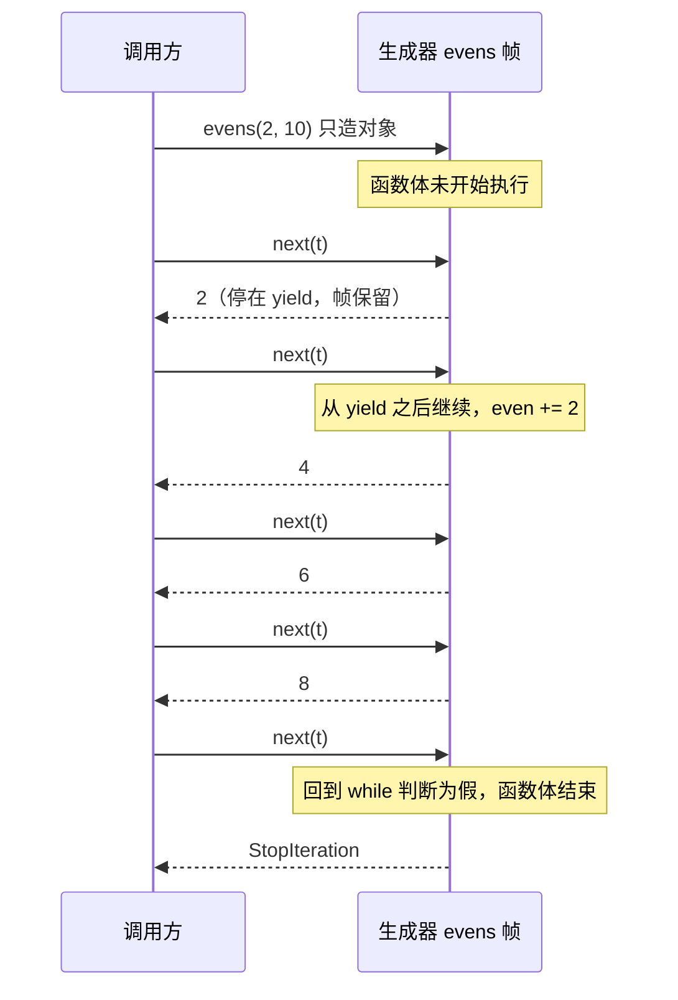
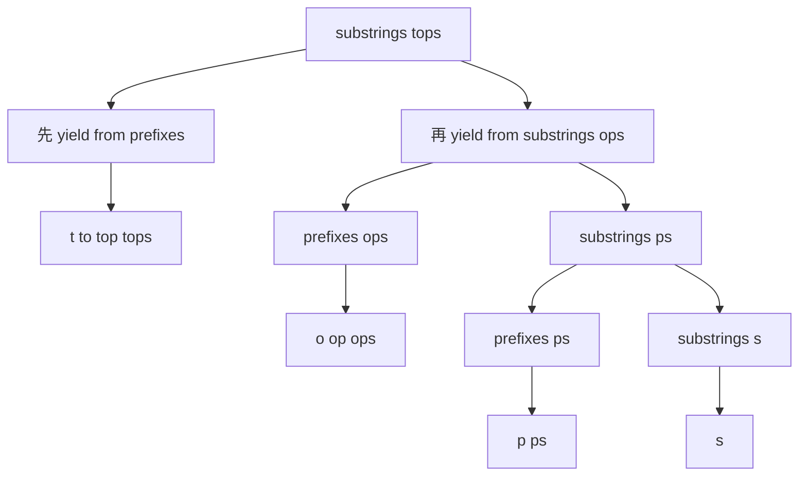

> **课程**：UC Berkeley CS61A · Structure and Interpretation of Computer Programs（Fall 2024）
> **本讲**：Lecture 17 ｜ 17:13 ｜ B 站分 P 17 ｜ [原视频](https://www.bilibili.com/video/BV1sy411z7nA?p=17)
> **课件**：`16-Generators_1pp.pdf`（11 页，官方 PDF，逐页渲染图见正文插图）
> **字幕**：B 站英文原声字幕；本笔记是中文书面化重构，非逐句翻译
> **版权**：课程与课件版权归 UC Berkeley CS61A 教学团队；本文为学习用途的二次整理

## 本讲速览

- **已掌握**：可迭代（iterable）与迭代器（iterator）的区别，`iter` 与 `next` 的用法，`map`、`filter`、`zip`、`enumerate` 这些内置迭代器；用树递归处理 `tree`/`label`/`branches`；`partitions` 的计数版递归。
- **本讲主线**：
    - 生成器函数用 `yield` 交出值，调用它得到的是一个生成器对象，不是一次调用的结果；
    - `next` 推动生成器执行到下一个 `yield`，然后把它**连帧带局部变量**一起挂起；
    - 因为每次只算一个，生成器天然是惰性的：没人要的值永远不算；
    - `yield from` 把另一个迭代器的输出整段委托进来，是递归生成器的连接器；
    - 同一个 `partitions` 递归，用"拼列表"写和用"交元素"写，差别不只是短，而是能不能提前停。
- **关键结论**：`yield` 不是"返回一个值再结束"，而是"交出一个值并停在原地"；生成器的价值在于把"生产"和"消费"的时间解耦，从而让无限序列和"只要前几个"这两种需求同时成立。

*(参考时间: 00:00:01 – 00:00:24｜Lecture 17)*

## 1. 课件前半：迭代器复习、map 对象与树练习

*(参考时间: 00:00:01 – 00:00:23｜Lecture 17)*

`16-Generators_1pp.pdf` 一共 11 页，但结构并不均匀：第 3 页到第 7 页是上一讲迭代器与树的复习块，第 8 页才是本讲真正的新内容分节点，最后两页是一道练习与一次无限序列的演示。录像的开头只有 23 秒，全部用来讲项目与作业，随后直接进入生成器；也就是说，第 3 至第 7 页在这段录音里没有被口头展开。


三件事需要记住：Project 2 周二截止，但如果周一交，能拿到一个提前提交加分（early submission point）；周一和周二都安排了答疑时间，用来处理项目里的问题；Homework 4 很短，内容是上一周的变异（mutation）与树，周四截止。讲师特意强调 Homework 4 "pretty short"，意思很清楚——它不该占用本周的主要时间，项目才是重点。


> **编者说明**：本节第 3 至第 7 页的内容在本段录音中没有对应语音，它们属于课件保留的复习与练习块。下面按页面原文补出，并把页面上的代码逐字誊写；凡属页面之外、为讲清来龙去脉而补充的推理，另行标注。

### 1.1 可迭代与迭代器：一次遍历的两半

课件把两个概念并列写了定义。可迭代（iterable）是"任何能遍历的序列"——判据是能对它调用 `iter()` 并拿回一个迭代器；迭代器（iterator）是"允许遍历任何可迭代序列的东西"——判据是能对它调用 `next()` 并拿回序列里的下一项。这两句话互为镜像，抓住的其实是同一件事的两半：可迭代负责"有什么"，迭代器负责"到哪了"。


页面上的三组例子分别换了三种容器：

```python
t = (1,2,3)
i = iter(t)
next(i)

l = ["John", "Jedi", "Shm"]
e = enumerate(l)
next(e)

d = {"apples": 1, "pears": 2}
m = map(lambda x: "yummy " + x, d)
next(m)
```

`i = iter(t)` 把元组变成迭代器，`next(i)` 得到 `1`；`e = enumerate(l)` 得到的是"下标—元素"配对的迭代器，`next(e)` 得到 `(0, 'John')`；`m = map(lambda x: "yummy " + x, d)` 作用在字典上，遍历到的是**键**，所以 `next(m)` 得到 `"yummy apples"`。页面右侧还留了一个小框，列出 `zip()`、`filter()`、`reversed()`——它们和 `map`、`enumerate` 一样，都是"调用之后不是给你结果，而是给你一个能逐个吐结果的机器"。

| 判据 | 可迭代（iterable） | 迭代器（iterator） |
|---|---|---|
| `iter()` 能否作用于它 | 能，返回一个迭代器 | 能，通常返回自身 |
| 能否直接 `next()` | 不能，`list`、`tuple` 没有 `__next__` | 能，每次推进一格 |
| 进度存在哪里 | 没有进度，只是一堆元素 | 存在对象内部，看不见 |
| 第二次遍历的结果 | 和第一次一样，从头的元素开始 | 空的，进度已经用完了 |

这张表最后一行是本讲真正的伏笔：迭代器有"进度"这种私有状态，而进度一旦存在对象里，写的人就得自己维护它。生成器要解决的正是"谁来维护进度"这个问题。

### 1.2 map 对象：一个会记住进度的迭代器

课件用 `map` 把"迭代器有进度"这件事画成了画：四个方框写着 `4 8 12 16`，下面一个蓝色小人标着 `doubler`，箭头 `next(doubler)` 指向左边，输入是列表 `[2, 4, 6, 8]`。


```python
def double(x):
    print(f"*** doubling {x} ***")
    return x*2

l = [2, 4, 6, 8]
doubler = map(double, l)
```

关键在于 `doubler = map(double, l)` 这一行**不会打印任何东西**。`map` 只是把函数和列表记下来，等到 `next(doubler)` 被调用，才取一个元素、调一次 `double`、打印一行 `*** doubling 2 ***`、返回 `4`。四个方框就是"已经算出来、正在等你去取"的四个值；蓝色小人就是那个被保存在对象里的进度。

把 `double` 写成带 `print` 的函数，是为了让惰性**可见**：如果 `map` 是立即求值的，那么创建 `doubler` 的瞬间就该出现四行打印。实际只在你伸手要的时候才出现一行，这就是惰性（lazy）的现场证据。

> **编者说明**：`map` 在 Python 3 中返回迭代器，在 Python 2 中返回列表，这是本讲全部讨论成立的前提。课件与课程都按 Python 3 讲授。

### 1.3 map() 练习：把三元组逐项相加

第 5 页是一道小题：给定一个三元组列表 `p` 和一个三元组 `edit = (a, b, c)`，返回一个 `map` 对象，使得每个元素的第一项加 `a`、第二项加 `b`、第三项加 `c`。


```python
def add_to_each(p, edit):
    """
    Given a list, p, of 3-element tuples: [(x1, y1, z1), (x2, y2, z2), ...]
    And an edit tuple (also 3 elements) = (a, b, c),
    return a map object where
    a is added to each x-value,
    b to each y-value, and
    c to each z-value.

    >>> list(add_to_each([(0, 0, 0), (1, 1, 1)], (10, 10, 10)))
        [(10, 10, 10), (11, 11, 11)]
    >>> list(add_to_each([(1, 2, 3), (1, 1, 1)], (10, 20, 30)))
        [(11, 22, 33), (11, 21, 31)]
    """
    return map(lambda x: ( x[0] + edit[0], x[1] + edit[1], x[2] + edit[2] ), p)
```

页面上 `x[0] + edit[0]`、`x[1] + edit[1]`、`x[2] + edit[2]` 三个表达式被画了下划线，因为它们是这道题唯一需要想的部分。`lambda x:` 的 `x` 是 `p` 里的一个三元组，`edit` 不写在参数表里而是直接从外层拿——这是闭包（closure）在起作用：`lambda` 的父帧是 `add_to_each` 的帧，`edit` 就躺在那一帧里。

返回的是一个 `map` 对象而不是列表，所以 `list(...)` 必须由调用者套上；`p` 有多长，加法就做多少次，而且是一次一个。第 1.2 节的"进度存在对象里"在这里变成了工程上的好处：中间结果不落地。

### 1.4 分节页：Tree Practice

第 6 页是一张分节页，只有居中的 `Tree Practice` 两个词。它把课件从"迭代器"这个主题切换到"树的递归"，为下一页的真题腾出位置。


分节页本身没有内容，但它提示了一件事：接下来这道题用的是树的递归，而不是迭代器。真正的衔接在下一页之后——树递归的写法和生成器的写法，本讲会在 `partitions` 那里正面对撞一次。

### 1.5 exclude：把被排除节点的孩子接到祖父上

第 7 页是 Spring 2023 期中 2 的第 4(a) 题。题目要求实现 `exclude(t, x)`：返回一棵树，保留 `t` 的根节点，以及所有标号不等于 `x` 的非根节点；结果里一个节点的父节点，是它在原树上最近的、没有被排除的祖先。


```python
def exclude(t, x):
    """Return a tree with the non-root nodes of tree t labeled anything but x.

    >>> t = tree(1, [tree(2, [tree(2), tree(3), tree(4)]), tree(5, [tree(1)])])
    >>> exclude(t, 2)
    [1, [3], [4], [5, [1]]]
    >>> exclude(t, 1)  # The root node cannot be excluded
    [1, [2, [2], [3], [4]], [5]]
    """
    filtered_branches = map(lambda y: exclude(y, x), branches(t))
    bs = []
    for b in filtered_branches:
        if label(b) == x:
            bs.extend(branches(b))
        else:
            bs.append(b)
    return tree(label(t), bs)
```

页面右侧画了三棵小树，从原树到结果树的过程一目了然：原树的根是 `1`，两个分支是 `2`（下挂 `2`、`3`、`4`）与 `5`（下挂 `1`）。调用 `exclude(t, 2)` 时，标号为 `2` 的那个节点被摘掉，它下面那棵标号 `2` 的叶子一起消失，而 `3`、`4` 被提升一级，直接挂到根上，于是得到 `[1, [3], [4], [5, [1]]]`。第二个例子排的是 `1`：根节点不能排除，所以根留下，但非根的 `1`（`5` 的孩子）被摘掉。

三个下划线分别是 `exclude(y, x)`、`label(b) == x`、`bs.extend(branches(b))`。它们对应三个判断：

1. `map(lambda y: exclude(y, x), branches(t))`——先把每个分支排干净，得到"候选孩子"的迭代器；
2. `if label(b) == x`——候选孩子本身是要被排掉的那个标号；
3. 于是不能 `append` 它，而要 `extend` 它的孩子：`extend` 把一个序列的元素逐个接上，而 `append` 是把整个序列当成一个元素塞进去。

页面上还留着当年的得分率：`exclude(y, x)` 一行 37% 的人写对，`label(b) == x` 一行 30%（四选一），`extend` 与 `branches(b)` 那一组合只有 24% 的人写对，而整题全对的比例是 20%。最难的恰好是第 3 步：`append` 与 `extend` 只差一个词，但一个是"挂一棵树"，一个是"把一棵树的树枝掰下来挂上去"，而题目要的正是后者。

## 2. 生成器函数：yield 是"交出"而不是"返回"

*(参考时间: 00:00:24 – 00:02:00｜Lecture 17)*

第 8 页又是一个分节页，居中的 `Generators` 标记本讲的正题开始。从这里到第 11 页，四页里塞进了生成器的定义、一道真题和一次无限序列的演示。


讲师给的第一句定位是：生成器是一种特殊的迭代器，就像 `map` 对象也是一种特殊的迭代器。特殊之处在于它由**生成器函数**产生；而生成器函数看起来和普通函数一样，唯一的结构差别是它用 `yield` 而不是 `return` 来给值。判据也很干脆：**函数体里只要有 `yield`，它就是生成器函数。**

### 2.1 plus_minus：两个 yield，两次返回值

最小的例子只有两行函数体：


```python
>>> def plus_minus(x):
...     yield x
...     yield -x

>>> t = plus_minus(3)
>>> next(t)
3
>>> next(t)
-3
>>> t
<generator object plus_minus ...>
```

`t = plus_minus(3)` 得到的是 `<generator object plus_minus ...>`，一个生成器对象，不是一个数。`next(t)` 第一次得到 `3`，第二次得到 `-3`——两个 `yield` 语句都被执行了，一个函数体里出现两次返回，这在普通函数里是不可能的。第三次 `next(t)` 没有第三个 `yield` 可等，函数体执行完，抛出 `StopIteration`，迭代结束。

页面下半部分把定义拆成四句，每句都值得单独记：

1. 生成器函数是**用 `yield` 交出值而不是用 `return` 返回**的函数；
2. 普通函数只返回一次，生成器函数可以 `yield` 多次；
3. 生成器是**调用生成器函数时自动创建**的迭代器；
4. 生成器函数被调用时返回一个生成器，这个生成器遍历该函数的各次 `yield`。

第 3 句里的"自动"是重点。如果要自己写一个迭代器，得定义一个类、实现 `__iter__` 和 `__next__`、自己保存进度、自己抛 `StopIteration`；而写生成器函数时这些活全由 Python 代劳，写的人只需要在"该交出一个值"的地方写 `yield`。

| 判据 | 普通函数 | 生成器函数 | 生成器对象 |
|---|---|---|---|
| 调用一次得到什么 | 返回值 | 一个生成器对象 | —— |
| 函数体的执行时机 | 调用时立刻执行完 | 调用时一行都不执行 | 每次 `next` 推进一段 |
| 能交出几个值 | 至多一个 | 任意多个 | 逐个取出 |
| 结束信号 | `return` 或执行到底 | 执行到底 | `StopIteration` |
| 是谁的迭代器 | 不是 | 不是 | 是，可直接交给 `for` |

这张表里"调用时一行都不执行"是最反直觉的一格，也是第 3 章要展开的全部内容。

## 3. 执行模型：yield 把函数停在原地

*(参考时间: 00:02:02 – 00:04:21｜Lecture 17)*

有了 `plus_minus` 的定义，下一个问题是：`next` 到底做了什么？课件没有画执行过程，讲师用 `evens` 这个例子把它讲清楚了。任务是：给定整数起点 `start` 与终点 `end`，返回一个只遍历偶数的迭代器，并且第一个偶数必须是不小于 `start` 的那个偶数。

> **编者说明**：从本节开始的演示代码（`evens`、`a_then_b`、`countdown`、`prefixes`、`substrings`、`partitions`）出自讲师的现场演示，没有对应的课件页面，因此按字幕口述整理成可运行的形式，并在每处说明它与口述的对应关系。

### 3.1 evens：一个只会产出偶数的迭代器

```python
def evens(start, end):
    even = start + (start % 2)
    while even < end:
        yield even
        even += 2
```

第一行 `even = start + (start % 2)` 算的是"不小于 `start` 的最小偶数"：`start` 是偶数时 `start % 2` 为 `0`，加 0 就是自己；`start` 是奇数时余 1，加 1 就到下一个偶数。第二行到第四行是一个 `while` 循环，循环体里先 `yield even` 把这一个偶数交出去，然后 `even += 2` 前进到下一个偶数。

调用 `evens(2, 10)` 得到 `2`、`4`、`6`、`8`，然后 `StopIteration`；调用 `evens(1, 10)` 也是从 `2` 开始，一路到 `8`，不包含 `10`。注意 `end` 是开区间，这跟 `range` 的习惯一致。

### 3.2 调用方与生成器的交替：时序图

讲师把执行过程拆成三步来说：创建生成器时，函数体**根本没有开始执行**；直到 `next` 被调用，函数体才开始跑，并且一直跑到遇到 `yield` 为止，那个值就作为迭代器的下一个元素交出去；此时**执行暂停在 `yield` 上，但记住了这次函数执行的全部环境**，以便下次 `next` 能接着往下跑。下一次 `next` 做的第一件事是给 `even` 加 2，回到 `while` 判断，再交出下一个偶数。



这张时序图里，左列与右列不会同时活动：`next` 是一次"交棒"，生成器跑到 `yield` 就把棒交回来，自己停在原地等下一次。普通函数的调用是"进去—出来"的一次往返，中间不需要外部再叫一次；生成器的调用是"叫一次—跑一段—停—再叫"的循环。

| 第几次 `next` | 生成器执行到哪里 | 交出的值 | 帧里 `even` |
|---|---|---|---|
| 1 | 首次启动：算 `even = 2`，停在第一个 `yield` | `2` | 2 |
| 2 | 从 `yield` 之后继续：`even += 2`，判 `while`，停在 `yield` | `4` | 4 |
| 3 | 同上 | `6` | 6 |
| 4 | 同上 | `8` | 8 |
| 5 | `even += 2` 得 10，`while` 判假，函数体走完 | 抛 `StopIteration` | 10 |

### 3.3 局部变量为什么活得过 yield

`yield even` 把值交出去之后，到 `even += 2` 真正执行之间，隔着一次 `next` 调用，但 `even` 的值没有丢，这正是"环境被保留"的直接后果。用环境图的语言说：调用 `evens(2, 10)` 创建了一个生成器帧，帧里有 `start`、`end`、`even` 三个局部名字；函数体暂停时，这个帧没有被销毁，它被挂在生成器对象上；下一次 `next` 恢复执行，仍然在这个帧里读写 `even`。

这一点和模块级的"循环 + 全局变量"写法有本质差别。假使把 `evens` 写成一个普通函数、用全局变量记住 `even`，那么两个 `evens` 调用会互相踩到对方的进度；而生成器帧是**每个生成器对象一份**的：

```python
def evens(start, end):
    even = start + (start % 2)
    while even < end:
        yield even
        even += 2

a = evens(2, 10)
b = evens(2, 10)
next(a)      # 2
next(a)      # 4
next(b)      # 2，b 有自己的帧，不受 a 影响
```

两个生成器各自持有一个帧，各自有一个 `even`，互不干扰。这条性质是后面 `partitions` 能写成递归形式的技术前提：每一层递归调用都会新建一个生成器帧，各层的局部变量天然隔离。

### 3.4 同一个迭代器的另一种写法：迭代器类

要看清生成器省掉了什么，最好的办法是用上一讲的迭代器类把 `evens` 重写一遍。

> **编者说明**：下面的类按上一讲的迭代器协议写成，用于对照，不属于本讲的课件内容。

```python
class Evens:
    def __init__(self, start, end):
        self.even = start + (start % 2)
        self.end = end

    def __iter__(self):
        return self

    def __next__(self):
        if self.even >= self.end:
            raise StopIteration
        value = self.even
        self.even += 2
        return value
```

两段代码做的事完全相同，但知识的负担不同：

| 判据 | 迭代器类 `Evens` | 生成器函数 `evens` |
|---|---|---|
| 进度存在哪里 | 实例属性 `self.even` | 生成器帧里的局部变量 `even` |
| 谁来记住"执行到哪" | 写的人，得把循环拆成"取一个—存状态—下次接着" | Python，帧里连代码位置一起保存 |
| 结束怎么表示 | 手写 `raise StopIteration` | 函数体走完自动抛 |
| 代码量 | 约 12 行，还得写 `__init__` 与 `__iter__` | 5 行 |
| 嵌套循环怎么办 | 每层循环都得摊平成状态机 | 直接写嵌套 `while`/`for` |

最后一行是要害。用类写迭代器，状态必须能用若干字段表达；一旦算法是"外层循环里套内层递归"，人就不得不手工把调用栈压平成一堆字段。生成器允许**在任意语句位置暂停**，所以嵌套结构的代码可以原样保留。这不是代码风格问题，而是"能写出来"与"写不出来"的区别。

### 3.5 惰性：没人要就不算

讲师对生成器的价值给了一句总结：可以布置任何计算，而这个计算是**惰性执行**的；有人要下一个元素，就继续算到下一个 `yield` 为止；如果没人把元素全部要走，那就不必把所有东西都算完，停在原地等下一次需要。

这句话把生成器从"语法糖"提升成了一种控制手段。普通函数是"你给我参数，我把全部答案给你"；生成器是"你给我参数，我给你一张提货单"。提货单上每一格什么时候兑现，由调用方决定。第 8 章会用 `partitions` 说明这件事在真实规模下值多少时间。

## 4. yield from：把一整段输出委托出去

*(参考时间: 00:04:22 – 00:07:19｜Lecture 17)*

生成器函数返回生成器，但在执行过程中它们常常还要**处理迭代器**——这是常态而不是例外。Python 3.3（2012 年发布）为此加了一条语句 `yield from`：让当前生成器把另一个迭代器里的所有元素逐个交出去。

### 4.1 a_then_b：两个 for 与两行 yield from

任务：实现 `a_then_b(a, b)`，接收两个可迭代对象，先交出 `a` 的全部元素，再交出 `b` 的全部元素。直白的写法是两个 `for`：

```python
def a_then_b(a, b):
    for x in a:
        yield x
    for x in b:
        yield x
```

更短的写法是两行 `yield from`：

```python
def a_then_b(a, b):
    yield from a
    yield from b
```

讲师说这两种写法"完全等价"，并且可以把 `yield from` 直接理解成 `for` 语句的简写：遍历 `A` 里的所有元素并把它们 `yield` 出去。它唯一多给的东西是**省掉了一个名字**——`for x in a` 里的 `x` 在 `yield from a` 中不需要存在，而这个名字除了当临时变量之外没有任何用处。省掉一个无意义的名字，代码就少一层噪音。

### 4.2 countdown：递归生成器与一个典型错误

第二个例子要求写一个从 `k` 倒数到 1 的生成器。既然倒数结构天然是递归的，就用递归写：

```python
def countdown(k):
    if k > 0:
        yield k
        yield from countdown(k - 1)
```

`k` 大于 0 时，先交出 `k`，再用 `yield from` 把 `countdown(k - 1)` 的全部输出接上。`list(countdown(3))` 得到 `[3, 2, 1]`。

讲师在这里专门演示了写错的样子：如果把 `yield from countdown(k - 1)` 写成 `yield countdown(k - 1)`，语法上完全合法，但语义完全不同——`yield` 会把右边的表达式**原样**交出去，而 `countdown(k - 1)` 的值是一个生成器对象。于是 `list(countdown(3))` 得到的是 `[3, <generator object countdown ...>]`：第一个元素对，第二个元素是一个生成器对象，而预期的是数字 `2`。

要修复它，就得把那个子生成器的元素逐个取出来再交出去：

```python
def countdown(k):
    if k > 0:
        yield k
        for x in countdown(k - 1):
            yield x
```

而这段 `for` 加 `yield` 的循环，正是 `yield from` 的展开形式。也就是说，`yield from` 不只是"省一个名字"，它在递归结构里承担的是**展平**：把子生成器的流接到当前生成器的流上，而不是把子生成器本身当作一个元素。

讲师随后给这个例子加了一个"不然呢"式的追问：如果在最后说一句 blast off 会不会更好玩？于是在 `else` 分支里加一句 `yield`：

```python
def countdown(k):
    if k > 0:
        yield k
        yield from countdown(k - 1)
    else:
        yield 'Blast off!'
```

`for k in countdown(3): print(k)` 于是打印 `3`、`2`、`1`，最后一行是 `Blast off!`。这个改动很小，但它顺带说明了一件事：生成器函数可以在**多个出口**各自交出一个值，而普通函数只能在一个出口返回一次。

### 4.3 yield 与 yield from 的分工

| 判据 | `yield` | `yield from` |
|---|---|---|
| 交出什么 | 右边表达式**本身**，一个值 | 右边迭代器里的**每个元素**，逐个交出 |
| 一次交出多少个 | 恰好一个 | 0 个、1 个或多个，取决于对方 |
| 递归时的效果 | 交出去的是子生成器对象，形成嵌套 | 把子生成器的输出接到当前流上，形成一条流 |
| 等价写法 | —— | `for x in it: yield x` |
| 典型错误 | `yield countdown(k - 1)` | —— |

记住第 3 行：`yield` 是"点"，`yield from` 是"线"。递归生成器里几乎所有把子生成器当值交出去的错误，都是把线当成了点。

## 5. 递归生成器：前缀、子串与停车位

*(参考时间: 00:07:20 – 00:08:47｜Lecture 17)*

`countdown` 展示了"递归 + `yield from`"的骨架，接下来两个例子把这个骨架用到字符串上，并给出一个不平凡的输出顺序。

### 5.1 prefixes：先交出短的，再交出全长

任务：交出字符串 `s` 的所有前缀。定义是递归的——`s` 非空时，它的前缀等于"`s` 去掉最后一个字符之后的所有前缀"，再加上 `s` 自己：

```python
def prefixes(s):
    if s:
        yield from prefixes(s[:-1])
        yield s
```

注意顺序：`yield from prefixes(s[:-1])` 写在 `yield s` **之前**。因此 `list(prefixes('both'))` 得到 `['b', 'bo', 'bot', 'both']`——短的先出，长的后出。如果把这两行对调，得到的就是 `['both', 'bot', 'bo', 'b']`，同样合法，但不是题目要的顺序。生成器的输出顺序完全由 `yield` 的书写位置决定，这一点和递归函数里"先打印还是后打印"是同一件事。

再看一眼 `if s` 这个条件：空串没有前缀，于是 `prefixes('')` 什么都不交，返回一个空的生成器。递归因此在空串处自然终止，不需要额外的 `return`。

### 5.2 substrings：前缀按位置错开

有了前缀，子串就好写了：`s` 的所有子串等于"`s` 的所有前缀"加上"`s[1:]` 的所有子串"。因为任何子串要么从第一个字符开始（那就是前缀），要么从后面某个位置开始（那就落在 `s[1:]` 里）。

```python
def substrings(s):
    if s:
        yield from prefixes(s)
        yield from substrings(s[1:])
```

`list(substrings('tops'))` 得到 `['t', 'to', 'top', 'tops', 'o', 'op', 'ops', 'p', 'ps', 's']`。讲师逐段念了一遍：先是 `tops` 的全部前缀 `t, to, top, tops`，然后是 `ops` 的全部前缀 `o, op, ops`，然后是 `ps` 的前缀 `p, ps`，最后是 `s`；这些合起来正好是全部子串。



这张图里每一层的分工都一样：左边交"从本层第一个字符开始"的那些子串，右边把问题缩小一个字符继续。树的高度是字符串长度，最坏情况下时间与"子串个数乘平均长度"同阶——用生成器的写法不会让复杂度变好，但可以让**只取前几个**的调用提前结束。

### 5.3 park：一道真题的练习页

课件第 10 页是 Spring 2023 期中 2 的第 5(b) 题，题目本身很漂亮：一排 `n` 个停车位，摩托车占 1 格，用 `%` 表示；汽车占相邻 2 格，用 `<>` 表示；空位用 `.` 表示。要求实现生成器函数 `park(n)`，交出所有可能的停车方案。


```python
def park(n):
    """Yield the ways to park cars and motorcycles in n adjacent spots.

    >>> sorted(park(1))
    ['%', '.']
    >>> sorted(park(2))
    ['%%', '%.', '.%', '..', '<>']
    >>> len(list(park(4)))  # some examples: '<><>', '.%%.', '%<>%', '%.<>'
    29
    """
```

> **编者说明**：这一页在本段录音里没有被讲到，它属于课件的练习页。下面按"第一格怎么放"的分类讨论给出一种实现，并在正文里说明它与本讲机制的关系；代码属于编者补充，不是课堂演示。

用生成器写这道题，关键是想清楚"第一个位置有哪几种处理方式"：要么空着，要么停一辆摩托车，要么停一辆汽车。前两种都消耗 1 格，第三种消耗 2 格：

```python
def park(n):
    if n == 0:
        yield ''
    if n >= 1:
        for rest in park(n - 1):
            yield '.' + rest
            yield '%' + rest
    if n >= 2:
        for rest in park(n - 2):
            yield '<>' + rest
```

`n == 0` 时交出一个空串，代表"排满了"；`n >= 1` 时把第一格分别放成 `.` 与 `%`，再把剩下 `n - 1` 格的所有方案接在后面；`n >= 2` 时把前两格放成 `<>`，再接上剩下 `n - 2` 格的方案。`sorted(park(2))` 得到 `['%%', '%.', '.%', '..', '<>']` 五项，`len(list(park(4)))` 得到 29，与页面的 doctest 一致。

这个例子值得和 `countdown` 对照：`countdown` 只有一个递归分支，`park` 有三个，而每个分支里都要把"当前的选择"贴到"剩下的方案"前面。写成列表版当然也可以——每一层返回一个字符串列表、再做三次拼接——但那正是第 6 章要拆掉的写法。生成器版本里，"贴到前面"就是 `yield '.' + rest` 这一行，不需要任何容器。

## 6. partitions：同一个递归的三种外壳

*(参考时间: 00:08:56 – 00:13:27｜Lecture 17)*

`partitions` 是本讲最重的一段例子：把一个整数的拆分（partition）全部列出来。讲师先回顾了计数版，再写列表版、字符串版，最后用 `yield` 重写一遍——四段代码解决的是同一个递归，差别只在"用什么装结果"。

### 6.1 问题的形状

定义：正整数 `n` 用不超过 `m` 的部件（part）做拆分，就是把 `n` 写成若干个不超过 `m` 的正整数之和，并且按递增顺序排列。例如 `6` 用不超过 4 的部件拆分，可以是 `2 + 4`，可以是 `3 + 3`，也可以是 `1 + 2 + 3`；`1 + 1 + 4`、`2 + 2 + 2` 等等也都算，但因为规定了最大部件是 4，所以不会出现含 5 的拆法。

拆分个数的经典递归是三个分支：如果 `n` 恰好等于 `m`，那就是一种拆法；如果 `n < 0` 或者 `m == 0`，那就没有拆法；否则一种拆法包含 `m`，一种不包含 `m`，两者相加。讲师把前两个分支合并了一下：`n < 0` 与 `m == 0` 都返回"没有"，而"恰好等于"这种情况可以由 `n - m` 变成 0 时的"空拆分"自然产生。合并之后，递归只剩两个出口。

### 6.2 从"数个数"到"列出它们"

讲师的说法是：从前数的是拆分的**个数**，现在要构造拆分**本身**，"which sounds more interesting"。目标输出是一个列表的列表，比如 `[[2, 4], [3, 3], ...]`；如果拆不出来，这个列表就是空的。

把计数版改成列表版，要动的地方只有"返回值"：计数版返回一个整数，列表版返回一个列表。于是"一种拆法"变成"一个只含一个元素的列表"，"没有拆法"变成空列表，而"包含 `m` 的拆法"则要在一批已有的拆分上逐个贴上 `m`。

### 6.3 列表版：用什么装

```python
def partitions(n, m):
    if n == 0:
        return [[]]
    if n < 0 or m == 0:
        return []
    with_m = [p + [m] for p in partitions(n - m, m)]
    without_m = partitions(n, m - 1)
    return with_m + without_m
```

五行有效代码，五件事：`n == 0` 时返回一个"空拆分"，它是贴 `m` 的种子；`n < 0` 或 `m == 0` 时返回空列表；含 `m` 的那批拆分用列表推导式构造，`p + [m]` 把 `m` 接到每个已有拆分的末尾，保证递增顺序；不含 `m` 的那批直接把 `n` 与 `m - 1` 递归下去；最后用 `+` 把两个列表接成一长条。

`list(partitions(6, 4))` 得到 9 个拆分，前三个是 `[2, 4]`、`[1, 1, 4]`、`[3, 3]`。这个顺序不是随手写的：递归先走 `with_m` 分支（因为推导式写在前面），所以所有含 4 的拆分排在前面；在每个分支内部，又是按 `m` 从大到小排列。

讲师在这里停了一下，问了一个体验层面的问题：如果想要的不是 `[2, 4]` 这样的列表，而是 `'2 + 4'` 这样的字符串呢？于是有了字符串版。

### 6.4 字符串版：装的东西变了，操作的形状没变

```python
def partitions(n, m):
    if n == 0:
        return ['']
    if n < 0 or m == 0:
        return []
    with_m = [p + ' + ' + str(m) if p else str(m)
              for p in partitions(n - m, m)]
    without_m = partitions(n, m - 1)
    return with_m + without_m
```

逻辑一个字都没变，但代码里多了两处别扭：种子从 `[]` 变成了 `''`；拼接从 `p + [m]` 变成了 `p + ' + ' + str(m)`，而且当 `p` 是空串时会多出一个前导的 ` + `，只好补一个 `if p else str(m)` 的分支。

这两处别扭不是偶然的。**列表版的拼接天然是"贴一个元素"，字符串版的拼接是"插入一段分隔符"**——后者本身没有错，但它要求写代码的人一直惦记"当前装的东西是不是空的""分隔符该放在哪边"。而这类"怎么装"的细节，跟"拆分有哪几种"这个真正的问题毫无关系。

讲师对整段的评价是：all of this is possible using lists, but a lot of list manipulation。三处列表操作——构造单元素列表、列表推导、两个列表相加——每一处都在处理容器，而不是在处理拆分。

## 7. 用 yield 重写：只交出元素

*(参考时间: 00:13:29 – 00:15:28｜Lecture 17)*

同一段递归用生成器写，会长成另一个样子。

### 7.1 一行一行改写

```python
def partitions(n, m):
    if n > 0 and m > 0:
        if n == m:
            yield str(m)
        for p in partitions(n - m, m):
            yield p + ' + ' + str(m)
        yield from partitions(n, m - 1)
```

逐行读。最外层是 `if n > 0 and m > 0`：只有当 `n` 还是正的、`m` 还没减到 0，也就是还有希望往下走时，才继续；否则函数体什么都不交，自然结束——这就是"没有拆法"的那个出口，不必再单独写一行 `return []`。

第二段是"恰好配平"的情况：`n == m` 时，`m` 自己就是 `n` 的一个拆分，于是 `yield str(m)`。注意这里交出的是**字符串本身**，不是"装着字符串的列表"；对比列表版的 `[[m]]`，容器这一层被整个拿掉了。

第三段是"包含 `m`"：对 `n - m` 用不超过 `m` 的部件拆出来的每一个 `p`，把 `m` 接到后面交出去。列表版在这里写的是列表推导式，生成器版在这里写的是一个普通的 `for` 加 `yield`——讲师的原话是"no list comprehension necessary"，因为在生成器函数里，"对每个元素做点什么"这件事本身就是循环，不需要再用推导式包一层。

第四段是"不包含 `m`"：`n` 用不超过 `m - 1` 的部件拆出来的所有拆分，全部都是 `n` 用不超过 `m` 的部件拆出来的拆分，所以一句 `yield from` 直接接上。

最后是返回值的处理：这个函数没有 `return`，`return` 在这里也不起任何作用。讲师说得很直接——"what do I return? Nothing at all. I'm finished."。最外层那句 `if n > 0 and m > 0` 的作用只是"没法继续时什么都别交"，而"什么都别交"对一个生成器来说就是"自然结束"。

`list(partitions(60, 50))` 会得到约 96.6 万个拆分，与讲师说的"差不多一百万个"对上。

### 7.2 两种写法的对照

| 判据 | 列表版 | yield 版 |
|---|---|---|
| 每一层返回什么 | 一个列表的列表 | 不返回，直接交出元素 |
| "贴一个 `m`"怎么写 | `p + [m]`，先造容器再拼接 | `yield p + ' + ' + str(m)`，直接交出 |
| 空结果怎么表示 | `return []` | 一行都不交 |
| 有没有中间容器 | 每层都有一个新列表，递归越深列表越多 | 没有列表，只有生成器帧 |
| 能否提前停止 | 不能，`return` 之前必须把整棵树走完 | 能，调用方不再 `next` 就停 |
| 代码行数 | 8 行，其中 3 行在处理容器 | 7 行，全部在处理拆分 |

最后一行不是文字游戏。列表版的 8 行里有 3 行（`[[]]`、`[]`、`p + [m]`）是在回答"结果装成什么样"；yield 版的 7 行全部在回答"拆分怎么长"。讲师把这一点说得比较客气："I just think about the elements as opposed to how to put them into lists and combine lists."

## 8. 收益与边界：按需计算、无限序列与开销

*(参考时间: 00:15:30 – 00:17:10｜Lecture 17)*

### 8.1 六十与五十：九十六万个答案只要十个

讲师用一组规模对比收尾。`partitions(60, 50)` 一共要考虑几乎一百万种可能（讲师报出的数字是 966,000），把全部结果列出来要等一会儿。但如果只要"随便给我几个例子"，调用方 `next` 十次就拿到十个，速度极快——因为生成器只算到第十个 `yield` 就停了，剩下的九十多万条从来没有被构造过。

这条收益只属于 `yield` 版的实现。列表版必须把 966,000 个拆分**全部**建完，才可能让你看到第一个——`return` 之前没有任何东西交得出来，所以"只看前十个"这个需求在列表版里根本不存在，调用方只能先付全款。

讲师给的判断标准因此很实用：如果一个问题有很多种可能，而你只需要其中几个，生成器写法不只是更好写、更好读，而且**跑起来可能快得多**。这里"可能"两个字是准确的——快慢取决于你要的那几个出现在枚举顺序的什么位置；如果要的是最后几个，两边都要走完全程，生成器的优势就只剩内存。

### 8.2 无限序列：惰性从优化变成前提

当序列本身是无限长的时候，惰性不再是一种优化，而是唯一的可能。课件最后一页把 `while True` 和 `yield` 放在一起，给出了斐波那契生成器。


```python
def fib_generator():
    """
    A generator that yields the Fibonacci sequence indefinitely.
    (The Fibonacci sequence starts with 0 and 1, and each subsequent number
    is the sum of the previous two.)

    >>> fib = fib_generator()
    >>> next(fib)
    0
    >>> next(fib)
    1
    >>> next(fib)
    1
    >>> next(fib)
    2
    >>> list(next(fib) for i in range(0,10)) # list the next 10 fibonacci numbers
    [3, 5, 8, 13, 21, 34, 55, 89, 144, 233]
    """
    a, b = 0, 1
    while True:
        yield a            # Yield the current Fibonacci number
        a, b = b, a + b    # Prepare the next Fibonacci numbers
```

`a, b = 0, 1` 是两个相邻的斐波那契数；`while True` 是一个永不结束的循环；循环体里先 `yield a` 交出当前的数，再用 `a, b = b, a + b` 把窗口往前挪一格。`next(fib)` 连叫四次，依次得到 `0`、`1`、`1`、`2`；接下来十次得到 `3` 到 `233`。

这段代码里没有任何"终止条件"，因为它本来就不该终止——`while True` 不会死循环，唯一的理由是循环体里有一个 `yield`，每一轮都把控制权交回调用方一次。**没有 `yield` 的 `while True` 是死循环，有 `yield` 的 `while True` 是一个无限序列的定义**，这是本讲最值得记住的一对对照。

> **编者说明**：课件与录音之外，无限生成器还有两个常被引用的例子：标准库 `itertools.count` 从某个数开始无限递增，`itertools.cycle` 把一个序列无限重复；CS61A 教材里还有一个 `primes()`，用 `while True` 反复尝试下一个整数并 `yield` 出其中的素数。它们与 `fib_generator` 是同一个模式：循环不设终点，`yield` 负责把控制权交还调用方。这些内容不属于本讲课堂材料，列在这里是为了说明"无限序列"不是斐波那契的特例。

### 8.3 生成器的代价

生成器不是免费的，代价至少有三处，理解它们才知道什么时候不该用。

> **编者说明**：下面的三点是对本讲内容的延伸，课堂与课件都没有逐条展开，属于编者补充的工程注意事项。

第一是**一次性**。生成器是迭代器，迭代器的进度只有一份，遍历完就空了；第二次 `for` 循环会什么都不做。需要多轮遍历时，要么重新调用生成器函数拿一个新对象，要么先 `list(...)` 落地——而后者又把惰性优势抹掉了。这也是为什么 `add_to_each`、`evens` 这些函数返回的是迭代器而不是列表：调用方必须自己决定"要不要一次全要"。

第二是**无法随机访问**。生成器只能从头一个个取，没有下标、不能切片、不能 `len`。凡是需要"取第 `k` 个""倒着遍历""按长度分组"的地方，生成器都不合适。

第三是**每次 `next` 都有额外开销**。恢复一个生成器帧、在 `yield` 两侧做上下文切换，比直接执行一段循环慢；把一个本身很短的计算写成生成器，换来的可能只是更慢的执行。惰性真正的收益发生在"整批计算里只用得上一部分"的场合，而不是"每个元素都一定会被用到"的场合。

把这三条和前面的收益放在一起，判断顺序就清楚了：**先问"是不是只需要一部分结果"，再问"是不是无限"，最后才问"写法是否更短"**。三个问题的答案都是"是"，生成器就是对的工具。

## 小结

*(参考时间: 00:16:36 – 00:17:10｜Lecture 17)*

- **`yield` 是暂停不是返回**。执行停在 `yield` 上，帧（含全部局部变量）被保留；下一次 `next` 从 `yield` 之后那一行继续。理解生成器的所有困难都集中在"帧活着、代码停在中间"这一点上。
- **判断一个函数是不是生成器函数，只看函数体里有没有 `yield`**。调用它得到的是生成器对象，函数体一行都没跑；`next` 才启动，跑完自动抛 `StopIteration`。
- **`yield` 交出一个点，`yield from` 接上一条线**。递归生成器里把子生成器直接 `yield` 出去，是本节最典型的错误：交出去的是生成器对象，而不是它的元素。
- **生成器与迭代器类是同一件事的两种写法，区别在"谁能暂停在任意语句位置"**。嵌套循环和递归结构用类写要手工压平状态，用生成器可以原样保留。
- **输出顺序由 `yield` 的书写位置决定**。`prefixes` 里 `yield from` 与 `yield` 谁先谁后，决定了短前缀在前还是长前缀在前；同一个递归，换一下顺序就是一个新函数。
- **惰性是收益也是约束**。966,000 个答案里只要十个时，生成器只算十个；但它一次性、不可随机访问、每次 `next` 都有切换成本，需要多次遍历或随机访问时应改用列表。

## 附：本讲幻灯片索引

*(参考时间: 00:00:01 – 00:17:10｜Lecture 17)*

| 页 | 内容 | 出现位置 |
|---|---|---|
| 1 | 标题页 Generators | §1 |
| 2 | Announcements：Project 2 与 Homework 4 | §1 |
| 3 | 复习：可迭代与迭代器 | §1.1 |
| 4 | map 对象与 next 的推进 | §1.2 |
| 5 | map() 练习 add_to_each | §1.3 |
| 6 | 分节页 Tree Practice | §1.4 |
| 7 | Midterm 2 真题 exclude | §1.5 |
| 8 | 分节页 Generators | §2 |
| 9 | 生成器函数与生成器对象 | §2.1 |
| 10 | Midterm 2 真题 park | §5.3 |
| 11 | 无限斐波那契生成器 | §8.2 |
