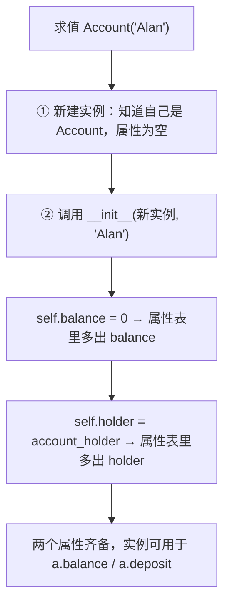
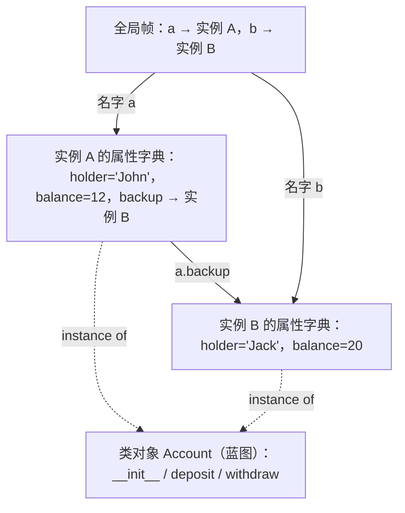
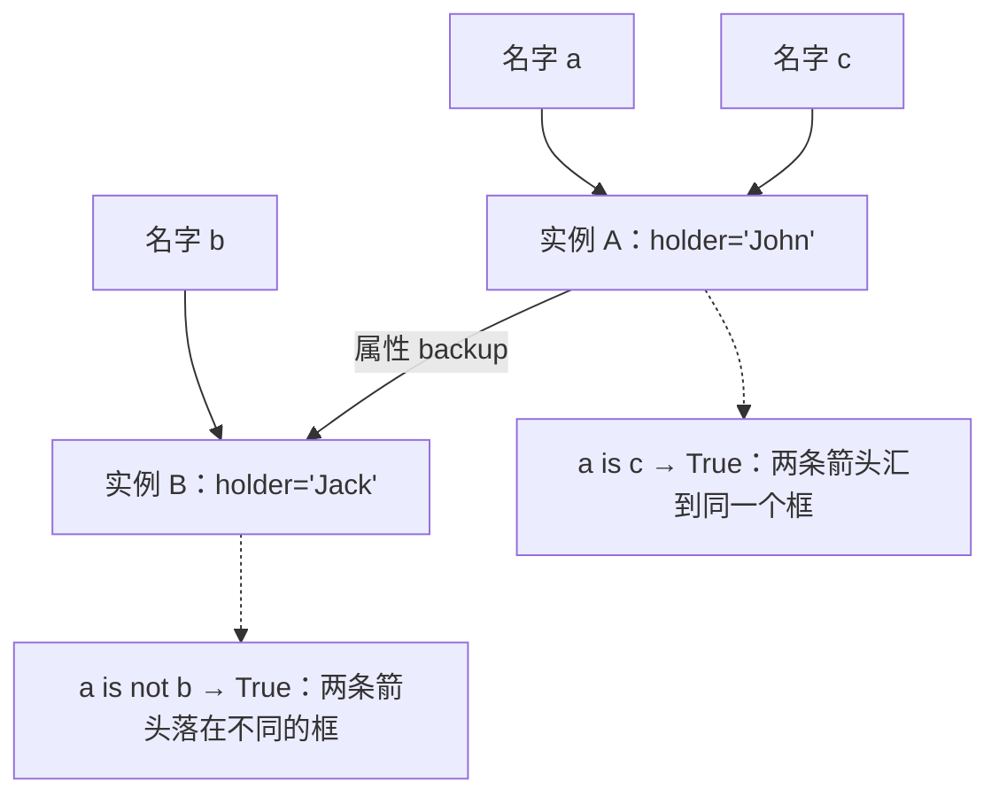
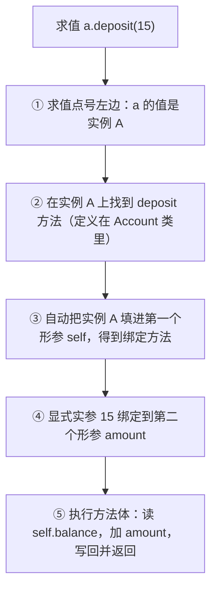

> **课程**：UC Berkeley CS61A · Structure and Interpretation of Computer Programs（Fall 2024）
> **本讲**：Lecture 18 ｜ 17:15 ｜ B 站分 P 18 ｜ [原视频](https://www.bilibili.com/video/BV1sy411z7nA?p=18)
> **课件**：`17-Objects.pdf`（7 页，官方 PDF，逐页渲染图见正文插图）
> **字幕**：B 站英文原声字幕；本笔记是中文书面化重构，非逐句翻译
> **版权**：课程与课件版权归 UC Berkeley CS61A 教学团队；本文为学习用途的二次整理

## 本讲速览

- **已掌握**：数据抽象的“构造器 + 选择器”约定、可变性（mutability）与对象身份（`is` / `is not`）、以及环境图里“名字 → 值”的绑定关系。这一讲把这三样东西合起来用一次。
- **本讲主线**：
    - 大程序必须拆成人一次能想清楚的模块；数据抽象把**信息**捆在一起，面向对象再往前一步，把**行为**也捆进去。
    - 类（class）是蓝图，实例（instance）是按蓝图造出来的对象：`Account('John')` 造实例，`type(a)` 回答“你是哪个类”。
    - 一条 `class` 语句由三段组成：类名、`__init__`（给新实例装属性）、若干方法（给行为）。
    - 方法只是定义在类里的函数；点号表达式会自动把接收者填进第一个参数 `self`，所以定义两个参数、调用只给一个。
    - 属性可以随时读、随时改、随时凭空新增；属性值可以是另一个对象，于是出现“同一个对象、两个名字”。
- **关键结论**：**函数可以被任何值调用，方法只能被“知道它”的对象调用**——`a.deposit(15)` 里的 15 只是显式实参，`a` 本身是隐式的第一个实参。

*(参考时间: 00:00:00 – 00:00:11｜Lecture 18)*


## 1. 面向对象：把信息与行为捆成一个整体

*(参考时间: 00:00:11 – 00:02:19｜Lecture 18)*


面向对象编程（Object-Oriented Programming，OOP）是今天开发大型软件时组织程序的主导范式。它对编程语言的设计影响极大：Python 与许多其他语言都内建了专门的语法与词汇来支持这套比喻。但它不是凭空出现的——它建立在已经被反复使用过的两个想法之上：**数据抽象**与**变异（mutation）**。课件把这一页标成 “Review: Mutability”，正是提醒读者：本讲要用到的零件，前面都已经造好了。

讲师的叙述从一个“故事”开始。复杂的大程序必须被组织成一个个小的模块化组件，每个组件可以单独写出来、单独测试、单独在脑子里一次想清楚；理由是人的心智容量有限，一次只能处理有限的复杂度。**数据抽象**做的正是这件事：把描述同一事物的多条信息捆成一个整体，对外只暴露构造它的方式和取出它的方式，内部的表示可以随便换。

**面向对象把这一步又往前推了一格。**它不只是把多条信息捆起来（数据抽象已经这样做），还把与这些信息相关的**行为**也捆进同一个整体里。于是“对象”表示的是世界上的某个东西，比如一个日期：它不只存放表示这个日期所需的全部信息，还能做日期该做的事，比如算出这个日期是星期几。用一句更朴素的话说，日期对象既记得自己“是哪一天”，也知道“怎样回答关于自己的问题”。

这个想法真正改变的，是“程序在做什么”的想象方式。程序不再是一长串信息、外加一堆作用在这串信息上的函数；它是一堆互相作用的对象，每个对象负责记住自己的信息。人的注意力于是可以一次只落在一个对象上——这正是“模块化”想要的效果。

由此引出三条贯穿全讲的设定：

- **每个对象有自己的局部状态（local state）**，这个状态可以随时间改变。所以面向对象常常牵扯变异，虽然变异并不是必须的。
- **当变异发生时，它不发生在某个记录全程序信息的全局列表上。**发生变化的那部分信息属于某个特定的对象；讲师特意强调这一点，因为它决定了“改一个地方会不会波及别处”。
- **每个对象应当知道怎样管理自己的局部状态**，也就是说，哪些改动是允许的、改动之后要维持什么不变量，由对象自己把关。

而人与对象打交道的入口叫**方法（method）**：它是专属于这一类对象的函数。这个定义里的“专属”两个字是关键——下一节会反复用到它。

| 判据 | 数据抽象（Data Abstraction） | 面向对象（OOP） |
| :--- | :--- | :--- |
| 捆住的是 | 只有**信息**：把一个日期的年、月、日放在一起 | 信息**加上行为**：日期还要能回答“我是星期几” |
| 谁来做计算 | 外部函数取出分量，再在函数里算 | 对象用自己的方法算，调用方只写一条点号表达式 |
| 状态在哪 | 常常分散在若干全局名字或容器里 | 每个对象各有一份局部状态 |
| 一套约定的复用单位 | 函数与“构造器/选择器”的接口约定 | 类（class）与由它造出的实例（instance） |
| 改动的波及范围 | 谁共享那个容器，谁一起被改 | 只有被点名的那个对象被改 |

> **编者说明**：数据抽象与对象的分工，常被概括成“数据 + 操作”与“数据 + 操作 + 封装”的差别。本讲并没有讨论信息隐藏、私有属性、消息传递这些术语，`Account` 的属性在 Python 里始终可以直接读写；把二者放在一张表里对照，是为了说明“面向对象 = 数据抽象 + 行为”这一句话的边界，不代表课上讲了封装机制。

## 2. 类、实例、方法：三个词的精确含义

*(参考时间: 00:02:20 – 00:03:35｜Lecture 18)*

若干个对象可能都是同一个**类（class）**的**实例（instance）**。可以有很多不同的列表，它们的行为全都一样，因为它们属于同一个类；而不同的类之间还可以互相关联。正是为了支持这套比喻，Python 内建了专门的语法与词汇。

三个词的定义可以逐条写死：

1. **类**定义某一类对象**怎样表现**——它是一份关于“能做什么、怎么做”的说明。
2. **对象**是某个类的一个**实例**。
3. 也就是说，每个对象都有一个**类型**，那个类型就是它的类；并且对象一旦被创建，它就永远属于这个类。

第三点是很容易被忽略的硬约束：类不是对象的一个“标签”，可以中途撕下来换一个，而是对象身份的一部分。

接着是**方法**。方法是**在对象上用点号表达式调用的函数**。讲师给的例子是一个列表 `s` 和调用 `s.append(5)`：`append` 就是方法，它被作用在列表 `s` 上、带着实参 5 被调用，结果是 5 进入 `s` 的末尾。

```python
s = [0, 1, 2]
s.append(5)          # append 是方法；这个调用把 5 追加进 s
```

方法与函数的分界线在这里：**函数通常定义在全局帧里，可以作用于任何值；方法则专属于某个对象。**不能对任何东西都调用 `append`——它对数字、对字符串都没有意义——但可以在 `s` 上调用它，因为 `s` 知道怎样 append。“知道”这个词在这里不是修辞：这份知识保存在 `s` 所属的类里。

| 判据 | 函数（function） | 方法（method） |
| :--- | :--- | :--- |
| 定义在哪 | 模块顶层，名字绑在全局帧 | `class` 语句内部，成为类的一部分 |
| 第一个形参从哪来 | 就是第一个实参，逐个对上 | `self`，由点号左边那个对象自动填入 |
| 能作用在谁身上 | 任何值，只要类型要求对得上 | 只有“属于这个类”的对象 |
| 调用写法 | `f(x)` | `obj.m(x)`，看起来少传一个参数 |
| 本讲的例子 | `list`、`print` 这类全局名字 | `s.append`、`a.deposit` |

> **编者说明**：`s.append(5)` 的值是 `None`，把 5 加进列表这件事是它的副作用——这与第 3 讲“返回值 vs 副作用”的判据完全一致。课件与字幕都没有讨论 `append` 的返回值，这里补上，是为了说明“方法”这个身份并不改变“函数可能只有副作用”这件事。

## 3. 内置类 `list`：行为都写在类里

*(参考时间: 00:03:36 – 00:04:46｜Lecture 18)*

先看一个内建的类：`list`。此前一直像调用函数那样调用 `list`，其实它是一个**类**。对一个可迭代对象调用 `list`，会造出一个新的列表对象。这在 Python 里是一条普遍规律：**拿一个类像函数那样调用，就是在创建该类的一个新实例。**列表的实例当然就是列表，比如一个装着 0、1、2 的列表。

```python
>>> s = list(range(3))
>>> s
[0, 1, 2]
>>> type(s)
<class 'list'>
>>> list
<class 'list'>
```

问 `s` 的类型，看到的是 `list` 这个类；这与直接敲一个 `list` 得到的结果是同一个东西。这一点很值得停下来看一眼：`type(s)` 给出的不是某个具体列表，而是**那个描述所有列表行为的类**。

于是“为什么列表能这样用”有了统一的答案。关于列表的一切都由 `list` 类规定：它有哪些方法、`+` 与 `*` 作用在列表上是什么含义、下标赋值与下标读取怎样工作，以及最基础的一条——**开头的元素是第 0 个，而不是第 1 个**。最后这条看起来像是语言设计者的口味问题，其实是一项必须被某处固定下来的约定，而固定的地方就是类。

这也解释了“蓝图”这个比喻的准确含义：单个列表只记住自己的元素；而“列表能做什么、下标从几开始”这套知识只有一份，放在类里，全体实例共享。

> **编者说明**：上面这段交互式会话的具体回显（`[0, 1, 2]` 与 `<class 'list'>`）按 CPython 的实际输出补全；字幕只描述了讲师看到的现象——“它是 `list` 类，和直接敲 `list` 得到的结果一样”，课件没有给出这段回显。把回显写出来，是为了让读者能照着敲一遍。

## 4. 定义自己的类：`Account` 的信息与行为

*(参考时间: 00:04:46 – 00:07:43｜Lecture 18)*


除了使用内建的类，还可以**定义自己的类**，再创建它的实例，从而造出新的对象类型。一个类描述它的实例的行为——这句话在这里第一次被兑现。

案例是银行账户。要把与账户有关的信息捆在一起：账户余额 `balance` 与开户人 `holder`；还要把与账户有关的行为捆在一起：往里面存钱 `deposit`、从里面取钱 `withdraw`。这两组东西，按第 1 节那个对照，本该分成“一份记录余额与开户人的数据”加“两个作用在它上面的函数”；现在它们被收进同一个对象。

分工是明确的：**所有银行账户都必须有 balance 和 holder**，所以“给每个新造出来的账户实例装上这两个属性”这件事，必须由 `Account` 类来负责。这不是风格问题，而是“新实例刚被造出来时是一张白纸”这一事实的直接后果——第 5 节会把这条推理走完。


课件这一页把上面两句“Idea”直接落到交互式会话上。第一行用到了 `Account` 类（假定它已经定义好），创建一个新的账户实例：

```python
>>> a = Account('John')
>>> a.holder
'John'
>>> a.balance
0
>>> a.deposit(15)
15
>>> a.withdraw(10)
5
>>> a.balance
5
>>> a.withdraw(10)
'Insufficient funds'
```

这个实例的持有者是 John：查它的 `holder` 属性，看到的就是 `'John'`。那么“为什么这个名字叫 holder”这种问题，答案不在调用处，而在类定义里——名字是类定义的一部分，下一页会看到。这里先接受抽象：**任何账户都可以用点号表达式访问它的 `holder` 与 `balance`**，这两个名字叫**属性（attribute）**，它们属于对象 `a`，而 `a` 是 `Account` 类的一个实例。

第二句 Idea 讲的是行为：**所有银行账户共享一个 `withdraw` 方法和一个 `deposit` 方法**。它们可以有不同的余额、不同的开户人，但“往一个银行账户里存钱”这件事，对哪个账户都是同一件事。所以上面那段会话里 `a.deposit(15)` 得到 15（原本是 0），`a.withdraw(10)` 得到 5，再 `a.withdraw(10)` 则拿到字符串 `'Insufficient funds'`。存取两个方法都会改动 balance，并返回改动之后的余额（或余额不足的提示）。

这里第一次出现“局部状态”的完整含义。**局部（local）指的是：这个 balance 专属于对象 `a`。**不写点号表达式就指不到它；也正是因为它挂在对象上、通常由对象的方法来改，所以“谁在什么时候改了这个值”这个问题有一条清晰的答案。

课件紧接着补了一句很重要的放宽：**方法可以有任意复杂的行为，你可以把它写成任何你想要的函数。**比如取钱可以先查一下余额够不够，不够就返回字符串 `'Insufficient funds'`，并且**不动余额**。这句话提前给第 5 节的 `withdraw` 打了招呼——那里的 `if` 正是这个“检查”。

## 5. `class` 语句：`__init__`、方法与构造

*(参考时间: 00:07:44 – 00:12:31｜Lecture 18)*

`deposit` 与 `withdraw` 都是方法，而**方法就定义在对象的类里**，这里是 `Account` 类。要得到上面那些行为，需要写相当量的一段代码；讲师的处理方式是先把整段代码过一遍，再回头解释为什么它长这样。


```python
class Account:
    def __init__(self, account_holder):
        self.balance = 0
        self.holder = account_holder
    def deposit(self, amount):
        self.balance = self.balance + amount
        return self.balance
    def withdraw(self, amount):
        if amount > self.balance:
            return 'Insufficient funds'
        self.balance = self.balance - amount
        return self.balance
```

一条 `class` 语句以关键字 `class` 开头，接着是类名；然后必须说明**创建这个类的新实例时会发生什么**，这由第一条方法完成；剩下的就是普通的方法定义。

**第一段：`__init__`。**特殊方法名 `__init__` 必须这样写，包括前后各两条下划线——因为它会在每一次造出新 `Account` 时被自动调用。方法体里把新账户称作 `self`，然后给它装属性：`balance` 恒为 0，`holder` 被赋成传进来的那个值，而那个值的名字（`account_holder`）来自函数定义。注意**属性名可以与 `__init__` 内部的参数名不同**：参数叫 `account_holder`，属性叫 `holder`。这条不对称是刻意的，课上专门点了一句。

**第二段：方法。**方法看起来像函数，只是定义在类里。`deposit` 接两个参数：第一个是 `self`，它是**调用 `deposit` 的那个 `Account` 实例**——也就是 `a.deposit(10)` 里点号左边的 `a`；第二个是 `amount`。

于是出现了一个看起来别扭的事实：**调用时只给一个实参，定义时却写了两个形参。**这样安排换来的是：方法内部能拿到这个实例，从而访问它的全部属性。讲师的原话是“就好像 `a` 被赋给了 `self`”。

`deposit` 的方法体很短，但每一步都值得念出来：改变 `balance` 属性，方式是查出 `balance` 属性、加上 `amount`、再赋回去；最后返回 `balance` 属性。**`return` 语句解释了为什么 `a.deposit(15)` 会显示出 15。**没有 `return` 也完全没问题：方法照样把余额改了，只是返回值是 `None`——又一次回到“返回值”与“副作用”两条通道，方法这个身份并不豁免这条区分。

`withdraw` 稍微复杂一点：它接收一个账户（`self`）和一个数（`amount`），先检查 `amount` 是否大于 `self.balance`。注意**每一次要提到 balance，都必须用点号表达式**，因为它是属性；然后余额不够就返回 `'Insufficient funds'` 直接退出（余额不变），够才减掉、返回新余额。方法可以返回任何东西，也可以更新 `self` 的属性，或者把属性返回出去。

**第三段：一次调用做了什么。**定义了类以后再调用它，会发生两件事，课件把这两步标成 1 和 2：

- 首先，一个**新实例被创建出来**。它知道自己是 `Account`，但在属性上是一张**白纸**——除了“我是这个类”之外什么都没有。
- 然后，`__init__` 被调用，第一个实参就是这个新对象（形参一贯命名为 `self`），后面跟着调用表达式里给出的其它实参，例如作为开户人的 `'Alan'`。

把这两步摊开成一张逐帧的表，`a = Account('Alan')` 的过程是这样的：

| 时刻 | 实例的属性 | 发生了什么 |
| :--- | :--- | :--- |
| 创建后 | 空白纸 | 实例已被造出，还不知道余额与开户人 |
| 进入 `__init__` | 空白纸 | `self` 指向这个实例，`account_holder` 是 `'Alan'` |
| 执行 `self.balance = 0` | `balance = 0` | `self` 就是这个实例，于是给它挂上一个绑定到 0 的 balance 属性 |
| 执行 `self.holder = account_holder` | `balance = 0`，`holder = 'Alan'` | 再挂上 holder 属性 |
| 返回 | 两个属性齐备 | 这个实例可以被当作一个账户使用了 |



`__init__` 有时被称作**构造方法（constructor method）**，这个词在其它编程语言里也通用。而上面整串动作，全都发生在**一个**调用表达式里；走完之后就可以引用 `a` 的属性了。

> **编者说明**：Python 实现上，用户定义类的实例把属性放在一个字典里（`a.__dict__`），而方法保存在类上，所以“实例一份、方法全体共享”这句判断在实现层面是字面成立的。课件与字幕都用“属性”而不用“字典”来描述，这里的字典说法只是为了让结构图里的“属性字典”有落脚点；属性名在实例与类之间按什么顺序查找，是下一讲（Lecture 19 Attributes）的内容，本讲不涉及。

## 6. 属性的读、写与“凭空新增”

*(参考时间: 00:12:33 – 00:14:02｜Lecture 18)*

对象的属性用**点号表达式**访问与修改。已经造好一个账户之后，可以查它的 `balance`，也可以用一条属性赋值语句改它：

```python
>>> a.balance
5
>>> a.balance = 12
>>> a.balance
12
```

**已有属性的值可以在任何时刻被改。**改完之后，这个账户里就有 12 了。这里没有调用任何方法，点号赋值直接落到属性本身；换句话说，方法只是**一条更方便的修改途径**，而不是唯一途径。这一点在 Python 里很重要：类并不能强制外部只能通过方法改状态，所以“对象管理自己的局部状态”在这门课里是一条**设计约定**，靠写代码的人来维持。

接着是一条更容易被忽略的规则：**属性可以被赋值，即使它原来并不存在。**

讲师给了个更复杂的例子。`b` 是另一个账户，属于另一个开户人，余额最初是 0，随后被设成 20。然后给早先创建的 `a` 账户**新建一个叫 `backup` 的属性**，值就是 `b` 这个账户。

```python
>>> b = Account('Jack')      # 字幕未给出第二位开户人的名字，此处取占位
>>> b.balance
0
>>> b.balance = 20
>>> a.backup = b
>>> a.backup.balance
20
```

这里有两个新事实。第一，**属性的值可以是另一个对象**，比如一个账户，不必是数字。第二，**在 Python 里，新属性可以在任何时刻被加上**——不需要事先在类里声明，也不会因为类里没写过这个名字就报错。

于是最后那个表达式 `a.backup.balance` 就有意思了：`a.backup` 指的是 `b`，而它的 `balance` 是 20。**同一个账户于是有了两种指称方式：`b`，或者 `a.backup`。**这两个名字指的是同一个对象，不是两份副本——第 7 节会把这条“别名”关系讲成判据。



这张图把两个装置画在同一张纸上：一头是**环境图**的记法——名字 `a`、`b` 各自指向一个值；另一头是环境图里本来没有的那条虚线——**一个值属于哪个类**。`a` 与 `b` 是同一个类造出来的两个实例，所以它们各自有一份属性，却共享类里那份行为定义。

| 判据 | 属性（attribute） | 方法（method） |
| :--- | :--- | :--- |
| 点号后面取到的是什么 | 一个值：数字、字符串，甚至另一个对象 | 一个绑定了接收者的方法 |
| 还要不要再调用 | 不用，取到就是值 | 要加括号并给实参 |
| 存在哪 | 每个实例各自一份 | 定义在类里，全体实例共享同一份代码 |
| 能不能中途新增 | 能，任何时刻给任何实例新增 | 不能，方法随类定义固定 |
| 本讲的例子 | `a.balance`、`a.holder`、`a.backup` | `a.deposit`、`a.withdraw` |

## 7. 对象身份：`is`、`is not` 与别名

*(参考时间: 00:14:03 – 00:15:17｜Lecture 18)*

为什么要谈**对象身份（object identity）**？因为对象的属性会变、对象会变异，所以必须能分清两种情况：**两个对象碰巧属性一样**，还是**它们本来就是同一个对象**。前者改一个不影响另一个，后者改一个等于改了两个。

规则很干脆：**用户定义类的每一个实例都有唯一的身份。**`a` 账户与 `b` 账户是两个不同的账户，因为 `Account` 被调用了两次；**每一次调用 `Account` 都创建一个新实例**。只有一个 `Account` 类，但可以有无数个实例。`a` 有 balance 与 holder，`b` 也有 balance 与 holder——属性名一样，对象不一样。

判断身份用两个运算符：`is` 与 `is not`，它们检验两个**表达式**的求值结果是不是同一个对象。

```python
>>> a is a
True
>>> a is not b
True
>>> c = a
>>> c is a
True
```

`a is a` 为真，因为两边都是求值到“John 那个账户”的表达式。`a is not b` 为真：即使两者余额相同、**即使它们连开户人都一样**，它们仍然是不同的账户，因为 `Account` 被调用了两次。这两句话合起来说明：`is` 问的不是“长得像不像”，而是“是不是同一个”。

最后一条最实用：**用赋值把一个对象绑定到新名字，并不会创建新对象。**写 `c = a` 之后，`c is a` 依然为真——它们只是同一个账户的两个名字。这就是**别名（aliasing）**；它和第 6 节 `a.backup` 那条是同一件事，只不过一个由赋值造成，一个由属性赋值造成。



| 判据 | 同一个对象（别名） | 属性相同的不同对象 |
| :--- | :--- | :--- |
| 怎么造出来 | `c = a`，或 `a.backup = b` | `Account('John')` 调用两次 |
| `is` 的结果 | `True` | `False` |
| 改一个属性，另一个看到吗 | 看到，因为只有一份属性 | 看不到，各自一份 |
| 对象个数 | 1 个，2 个名字 | 2 个，2 个名字 |
| 本讲的例子 | `a` 与 `c`、`b` 与 `a.backup` | `a` 与 `b` |

> **编者说明**：判断“属性是否一样”通常要另写比较逻辑，让类自己定义什么叫“相等”；没有定义时，`==` 会退回到身份比较，于是与 `is` 得到同样的结果，但这只是特例而不是通例。本讲只讲 `is` / `is not`，没有涉及 `==`，这里刻意不展开，避免把后面的内容提前说成课堂内容。

## 8. `self` 的隐式绑定：方法为什么写成两个参数

*(参考时间: 00:15:17 – 00:17:13｜Lecture 18)*

`class` 语句里最后一块要讨论的是**方法定义**。调用方法，就是用点号表达式调用类里定义的某个方法。而**所有被调用的方法都能通过 `self` 形参访问到那个对象**，因此它们都能访问并操作对象的属性。

这正是“对象管理自己的局部状态”的机制：**对象的类描述了状态怎样变化**，比如余额怎样被更新。状态不是被外部函数随手改掉的，而是由类里写定的那段代码改的——尽管如第 6 节所说，Python 并不强制这一点。

回到 `Account` 里的 `deposit`：它接两个实参，把它们合起来算出新余额，赋给 `self.balance`。它**定义时是两个形参，但点号语法会自动提供第一个实参**。所以，为 Tom 创建一个账户再调用 `deposit`，尽管定义里写了两个参数，调用时只给一个——另一个参数就是 Tom 的这个账户，它被绑到 `self` 上。

```python
t = Account('Tom')
t.deposit(20)        # 定义两个形参，调用只给一个：20
                     # 另一个实参是 t 本身，绑到 self
```

> **编者说明**：字幕只说明“为 Tom 创建一个账户并调用 `deposit`，定义是两个参数、调用只给一个，另一个参数就是 Tom 的那个账户”，没有给出变量名与具体金额；上面的 `t` 与 `20` 是编者补足的示意，行为与课上描述一致。

把 `a.deposit(15)` 这条表达式的求值过程摊开，可以看到 `self` 是在哪一步被填进去的：



图里第 ③ 步就是“隐式绑定”的全部内容：**点号表达式不只负责“找到方法”，还负责“把接收者塞进第一个参数”。**这也解释了第 2 节表格里那一行不对称：定义两个、调用一个，缺的那个由语法补上。

最后是讲师自己提的那个反问：**那为什么不干脆定义一个 `deposit` 函数？**答案在类型上：**不同类型的对象可能有不同的存入方式。**这个 `deposit` 专属于 `Account` 类；如果有另一种类，比如一个投资基金（investment fund），往它里面“存钱”可能行为不同、代码不同，那就为那个类另写一个 `deposit` 方法。究竟用哪一个，取决于在**哪种类型的对象**上调用 `deposit`。

> **编者说明**：这段话点出了“同名方法在不同类里有不同实现”这一机制，也就是通常所说的动态派发与多态（polymorphism）的起点。本讲只把机制摆出来，没有给术语，也没有讨论继承；继承是第 20 讲的内容。这里点明术语，是为了让读者知道这条线索接向哪里。

## 小结

- **先分三段读 `class`**：类名、`__init__`（装属性）、方法（给行为）。看到一条 `class` 语句，先问“新实例有哪些属性”，再问“它有哪些方法”。
- **看到 `obj.m(x)` 就在心里补一个参数**：`m(obj, x)`。定义两个形参、调用只给一个实参，不是漏写，而是点号语法替你把接收者填进了 `self`。
- **行为写一份，状态写多份**：方法定义在类里，全体实例共享；属性挂在每个实例上，各有一份。判断“改一处会不会波及别处”，就看它改的是类还是实例。
- **属性是实例的私有账本，但这本账是开放的**：可以随时读、随时改、随时新增一个此前没有的名字，值的类型也不设限（可以是另一个对象）。开放带来的是灵活性，代价是“谁改了状态”只能靠设计约定来保证。
- **`is` 问的是身份，不是相似**：`c = a` 造的是别名而不是副本，所以 `c is a` 为真；两次调用 `Account('John')` 造的是两个对象，即使属性全同，`is` 也为假。
- **方法的真正用处在于“按类型分派”**：同样的 `deposit` 调用，落在不同类的对象上可以有不同实现；这也正是“为什么不用一个全局函数”的答案。

*(参考时间: 00:16:34 – 00:17:13｜Lecture 18)*

## 附：本讲幻灯片索引

*(参考时间: 00:00:00 – 00:17:13｜Lecture 18)*

| 页 | 内容 | 出现位置 |
| :--- | :--- | :--- |
| 1 | 标题页 Objects | 本讲速览 |
| 2 | Announcements | 本讲速览 |
| 3 | Review: Mutability 分节页 | §1 |
| 4 | Class Statements 分节页 | §4 |
| 5 | Account 实例与属性/方法的点号访问 | §4 |
| 6 | `Account` 类的完整定义与交互式演示 | §5 |
| 7 | Animation Demos by Hany Farid（署名页） | 附录 |

## 附录：课堂未展示的幻灯片

*(参考时间: 00:00:00 – 00:17:13｜Lecture 18)*


课件最后一页是动画演示的署名页（“Animation Demos by Hany Farid”）。本讲字幕在这页没有对应的讲述：课件第 6 页底部标有一处 `(Demo)`，指的是课上播放的交互式演示，而这段录音里只有对演示结果的复述（`a.deposit(15)` 得 15、`a.withdraw(10)` 得 5、再取一次得到 `'Insufficient funds'`），没有演示本身的声音。这里按课件原样收录该页，不虚构演示内容。

- 想复现这段演示，可直接把第 5 节的 `class Account` 定义贴进解释器，再依次输入 `a = Account('John')`、`a.holder`、`a.balance`、`a.deposit(15)`、`a.withdraw(10)`、`a.balance`、`a.withdraw(10)`，应当逐条得到课件上的结果。
- 演示若与本笔记的描述有出入，以课件第 5、6 页的画面为准（两页的会话内容一致，第 6 页多标了一处 `(Demo)`）。
