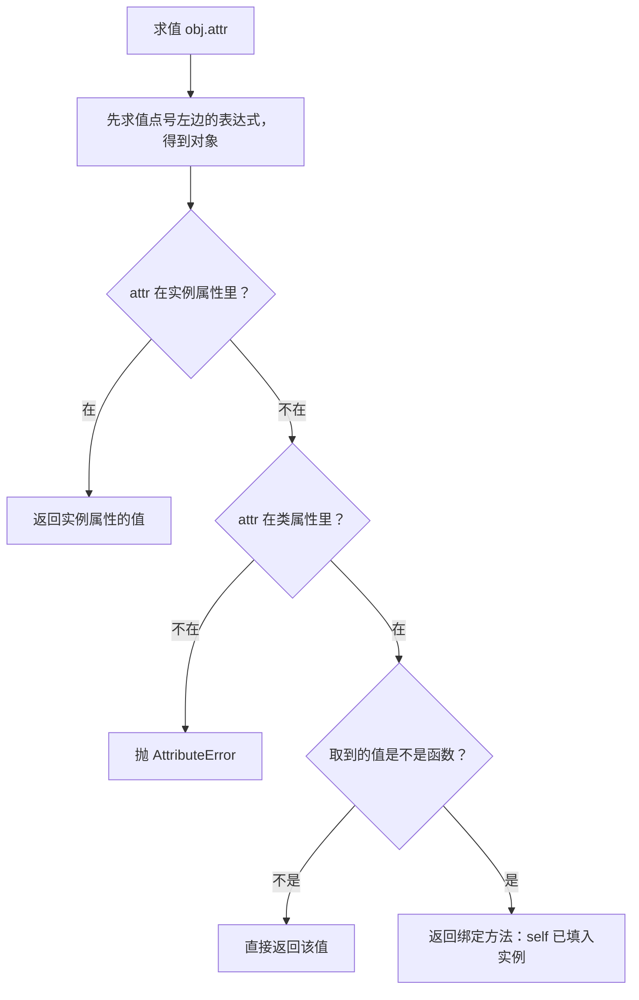
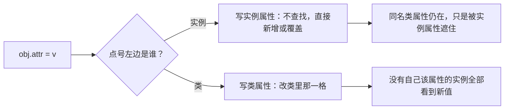
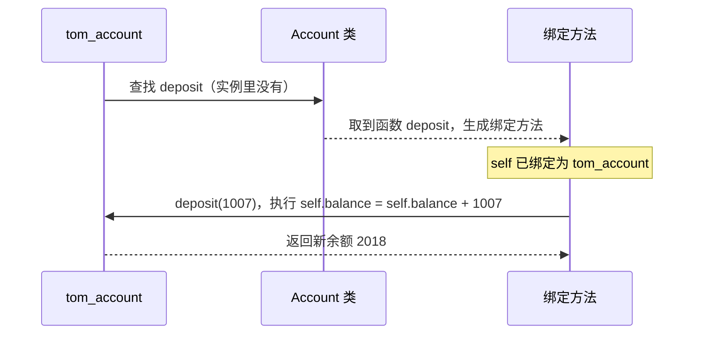

> **课程**：UC Berkeley CS61A · Structure and Interpretation of Computer Programs（Fall 2024）
> **本讲**：Lecture 19 ｜ 17:47 ｜ B 站分 P 19 ｜ [原视频](https://www.bilibili.com/video/BV1sy411z7nA?p=19)
> **课件**：`18-Attributes.pdf`（15 页，官方 PDF，逐页渲染图见正文插图）
> **字幕**：B 站英文原声字幕；本笔记是中文书面化重构，非逐句翻译
> **版权**：课程与课件版权归 UC Berkeley CS61A 教学团队；本文为学习用途的二次整理

## 本讲速览

*(参考时间: 00:00:00 – 00:01:20｜Lecture 19)*

- **已掌握**：`class` 语句与实例化（上一讲的 `Account`：`__init__`、`balance`、`holder`）；点表达式的用法（`lst.append`、`s.pop`）；函数是一等值，可以作为参数传递与返回。
- **本讲主线**：
    - 执行一条 `class` 语句时，类对象被创建、类名被绑定到当前帧，而类体里的 `=` 与 `def` 不去帧里建名字，它们成为类的属性；
    - 类属性被所有实例共享，`tom_account.interest` 看起来像实例属性，值却只存了一份；
    - 点表达式求值分四步：先求值左边、再查实例、再查类、命中函数则返回绑定方法；
    - 属性赋值从不查找：`obj.attr = v` 写实例，`Cls.attr = v` 写类，两者互不覆盖；
    - 方法调用就是把点表达式放在调用表达式的 operator 位置；绑定方法 = 函数 + 已经填好的 `self`，可以像普通函数一样交给 `map`。
- **关键结论**：读属性沿"实例 → 类"往上走，写属性只看点号左边是谁。两条规则方向相反，把它们混为一谈，正是这一带 bug 的常见来源。


本段录像只有 17 分 47 秒，开头没有任何公告环节，第一句话就是"类属性是类的属性"。课件第 2 页是惯例的公告页，但它不在本段录音的范围内，具体公告内容无从得知，这里只作为课件结构的一部分保留。


## 1. 类语句：类属性是从哪里来的

*(参考时间: 00:00:00 – 00:02:26｜Lecture 19)*

上一讲用 `class Account:` 造出了账户对象，却没有停下来问一句：执行一条 `class` 语句，解释器究竟做了什么？本讲从这个问句开始。答案分两半：语句创建出一个**类对象**（class object），并把类名绑定到执行该语句的那个帧里；而类体（suite）里每一条赋值语句、每一个 `def`，都变成这个类对象上的一个**类属性**（class attribute），不会在当前帧里留下任何名字。


### 1.1 一条 class 语句做三件事

按顺序是三件。第一，创建一个新的类。第二，把 `<name>` 绑定到"当前环境的第一个帧"——也就是执行到这条语句时最前面的那一帧，在交互式会话里就是 Global。第三，执行类体。类体的执行方式与普通 suite 没有区别，只是名字的去处变了：平时 `=` 与 `def` 会在帧里建名字，在类体里它们全部进入类，成为类的属性。讲师把这一句说得极直接：*"Normally, assignment and def would create names in frames, but that's not the case here. Instead, they all go in the class as class attributes."*


课件上的例子只是一个展示器：

```python
class Clown:
    nose = 'big and red'
    def dance():
        return 'No thanks'
```

```python
>>> Clown.nose
'big and red'
>>> Clown.dance()
'No thanks'
>>> Clown
<class '__main__.Clown'>
```

`nose` 与 `dance` 都不在 Global 帧里：`>>> nose` 会报名字未定义，而 `Clown.nose` 有值。`Clown.dance()` 之所以能跑，是因为 `dance` 是一个"存着函数"的类属性，用类去取它拿到的就是这个函数本身，后面加一对括号就是一次普通调用，返回值 `'No thanks'`。最后一行 `>>> Clown` 打印出 `<class '__main__.Clown'>`：类本身也是一个值，有类型、有地址、可以被绑定、可以被传递。

讲师特意声明这段代码"没有任何用处"（*"this code is not helpful at all"*），它的全部价值在于让人看见一条 `class` 语句执行完之后留下了什么：一堆类属性。他也提醒这类写法在实例化时会出问题——这正是第 2 章那条查找规则要解释的现象。

> **编者说明**：`Clown().dance()` 会抛 `TypeError: dance() takes 0 positional arguments but 1 was given`。原因在点表达式求值的第 4 步：用实例查找 `dance` 时命中了类里的函数，于是返回绑定方法，并把实例当作第一个实参 `self` 填进去；而 `dance` 一个形参都没声明，多出来的实例无处安放。`Clown.dance()` 之所以没事，是因为用类查找拿到的是原函数，没有绑定这一步（第 5 章）。

> **编者说明**：CPython 的实现比"进类不进帧"更细一层：类体先在一个临时的命名空间字典里执行，执行完毕后用这个字典初始化类对象，字典里的名字随之成为类的属性。所以"赋值不建名字"指的是不建在当前帧里，类体自己仍然有一份临时的名字空间。

### 1.2 类属性是共享的那一份

类属性真正的用处在于**共享**。如果所有账户的利率都相同，就没有必要在每个实例里各存一份；把利率放进类，只存一次，所有实例都通过查找看见同一个值。讲师的说法是：与其把它存进每一个被创建出来的实例，不如只在类里存一次。


```python
class Account:
    interest = 0.02   # A class attribute

    def __init__(self, account_holder):
        self.balance = 0
        self.holder = account_holder

    # Additional methods would be defined here
```

```python
>>> tom_account = Account('Tom')
>>> jim_account = Account('Jim')
>>> tom_account.interest
0.02
>>> jim_account.interest
0.02
```

对照类体的写法就能分清两类属性：`interest` 在类体里被赋值，所以它是类属性；`balance` 与 `holder` 在 `__init__` 里通过 `self.` 赋值，所以它们是实例属性。两次 `>>> tom_account.interest` 与 `>>> jim_account.interest` 输出同一个 0.02，但值的来源只有一个：类。

讲师强调的第一点是"访问处看不出来"：*"The fact that it's a class attribute is not really apparent when you access it. It just looks like it's an attribute of Tom account."* 语法上 `tom_account.interest` 与 `tom_account.balance` 长得一模一样，走的是同一条求值规则；区别只在查找停下来的时候命中的是哪一站。

第二点是"它不在实例里"：*"It's important that the interest attribute is not part of the instance, it's part of the class. It's just the lookup procedure that gave us access to it, even though it was part of the class."* 这句话是整讲的枢纽——它同时解释了第 3 章的两个现象：为什么 `Account.interest = 0.05` 能一次改掉所有"没有自己利率"的账户，以及为什么给 Jim 单独设过利率之后，Tom 看到的仍然是类里那份。

第三点是代价。每个实例复制一份共享值，在对象很多时是纯粹的浪费；类属性把这份成本压到一次。反过来说，一个类属性一旦被某个实例"写"过，这个实例就有了自己的一份，共享与特例可以共存，而这正是第 3 章要展开的机制。

> **编者说明**：`__dict__` 能把这件事看得更直接。`tom_account.__dict__` 只有 `{'balance': 0, 'holder': 'Tom'}`，`interest` 出现在 `Account.__dict__` 里；`vars(tom_account)` 与 `tom_account.__dict__` 等价。判断"某个名字到底存在哪"时，这是最快的办法。

## 2. 点表达式：一次查找要经过两站

*(参考时间: 00:02:28 – 00:05:06｜Lecture 19)*

`tom_account.interest` 与 `tom_account.balance` 写法相同，结果却来自两个地方。要把这件事说清楚，就得把"点表达式求值"这个动作拆开。讲师的开场很朴素：每当求值一个点表达式，就要为一个对象查找一个属性；点号左边给出对象，点号右边给出要查的名字。而"按名字查属性"实际上是一个要在多个地方找的过程：实例有自己的属性，类也有自己的属性，两者都能通过点表达式访问。


### 2.1 四步规则


课件把求值过程写成四条规则，顺序即优先级：

1. 先求值点号左边的 `<expression>`，它的值就是点表达式的对象。
2. 把 `<name>` 与这个对象的**实例属性**比对；若存在同名属性，返回它的值。
3. 若不存在，到对象的**类**里查这个名字，得到一个类属性的值。
4. 这个值就是整个表达式的值；除非它是函数——那就返回**绑定方法**（bound method），而点表达式的对象已经被填进 `self`。

第 2 步是"实例优先"。以账户为例，实例属性只有 `balance` 与 `holder`，其它名字都轮不到这一站。第 3 步说明别的名字也可以写在点号后面：`interest` 是这样，`deposit` 也是这样，它们都住在类里。第 4 步是"方法"这个词的由来，这里先记账，第 5 章再展开。

整条路线画出来是这样：



讲师把这条规则归入"需要背下来的机械过程"，给出的类比是环境里的名字查找：查名字要沿父帧一层层往上走，查属性要沿实例 → 类往上走。两者都不是可以自由发挥的约定，而是解释器固定的路线；记住路线，才能预测一次查找会命中哪一份值。

一个容易忽略的细节：第 4 步只在"从实例出发"时起作用。若点号左边是类本身，第 2 步没有实例属性可比，第 3 步在类里直接命中，返回的就是函数，而不是绑定方法。这个不对称在第 5 章会变成两种调用方式。

### 2.2 换个入口：getattr 与 hasattr

点表达式不是唯一的入口。内置函数 `getattr` 按名字取属性，效果与点表达式一致：

```python
>>> getattr(tom_account, 'balance')
0
```

讲师的说法是：除了写 `tom_account.balance`，也可以写"为 `tom_account` 取名为 `balance` 的属性"，两者做的是同一件事。还有 `hasattr`，它回答"这个名字是否存在"，判断范围包括实例与它的类——`interest` 并不在实例里，`hasattr` 照样返回真。讲师的原话是 *"getattr and dot expressions look up a name in the same way"*：2.1 节那条路线对 `getattr` 一字不差地适用，一次查找的结果可能落在实例属性上，也可能落在类属性上。

这里藏着一个容易犯的错：既然返回值上看不出区别，就不能靠读代码"猜"某个属性是共享还是独享。要确定，只能看它到底存在哪一份字典里，或者回想有没有人给这个实例单独赋过值。

> **编者说明**：与 `getattr` 对称的还有 `setattr(obj, 'x', v)` 与 `delattr(obj, 'x')`，分别等价于 `obj.x = v` 与 `del obj.x`。本讲没有提到它们，但把 `setattr` 理解成"名字是字符串的属性赋值"是准确的：它同样**不查找**，直接写点号左边那个对象。

### 2.3 一道没在录像里讲的讨论题

课件第 7 页是一道讨论题 *Where's Waldo?*：对下面两个类，各写一个不含引号、不含 `+` 的表达式，求值得到 `'Waldo'`。


课堂上这道题是分组做的，本段录像没有讲，课件上直接给出了答案。下面按课件答案补全推理；推理本身不在字幕里，属于编者补充。

```python
class Town:
    def __init__(self, w, aldo):
        if aldo == 7:
            self.street = {self.f(w): 'Waldo'}

    def f(self, x):
        return x + 1
```

`Town(1, 7)` 把 `w = 1`、`aldo = 7` 交给 `__init__`，条件成立，于是执行 `self.street = {self.f(w): 'Waldo'}`。字典的键 `self.f(w)` 本身就是一个点表达式加一次调用：实例里没有 `f`，查到类里命中函数，返回绑定方法，调用得到 `1 + 1 = 2`。于是实例拿到属性 `street`，值是 `{2: 'Waldo'}`。最后 `Town(1, 7).street[2]` 命中实例属性 `street`，再按键 `2` 取下标，得到 `'Waldo'`。整行没有引号，也没有 `+`。

```python
class Beach:
    def __init__(self):
        sand = ['Wal', 'do']
        self.dig = sand.pop

    def walk(self, x):
        self.wave = lambda y: self.dig(x) + self.dig(y)
        return self
```

`Beach()` 里 `sand` 只是一个局部名字，`self.dig = sand.pop` 把**列表的绑定方法**存成实例属性。`walk(0)` 建了一个闭包 `lambda y: ...` 绑到 `self.wave`，然后 `return self`——正是这个返回值让 `Beach().walk(0).wave(0)` 这种链式写法成立：第一次点表达式拿到实例本身，第二次点表达式在实例里命中刚存下的 `wave`。最后调用 `wave(0)` 时 `x` 与 `y` 都是 0，`self.dig(0)` 第一次弹掉 `'Wal'`，第二次弹掉 `'do'`，`+` 拼出 `'Waldo'`。

两个细节值得记住。其一，`self.dig` 是绑定方法，它绑定的是那个列表；`__init__` 返回后局部名字 `sand` 消失，但列表仍然活着，因为 `self.dig` 一直拉着它。其二，题目限制"不能写引号、不能写 `+`"针对的是 REPL 里那一行表达式，不是类体：`walk` 里的 `+` 属于类定义的一部分，不算违规。

## 3. 属性赋值：写在左边就不查找

*(参考时间: 00:05:08 – 00:10:46｜Lecture 19)*

前面两章讲的是"读"。写的时候规则完全不同，而且简单得多：赋值语句的左边是点表达式时，它就是一条**属性赋值语句**（attribute assignment statement），它只影响点表达式所指的那个对象的属性——点号左边是实例，就写实例属性；点号左边是类，就写类属性。讲师的原话是 *"Assignment statements with a dot expression on their left-hand side are attribute assignment statements."*


### 3.1 一次赋值不会先去找

仍以 1.2 节的 `Account` 为例：`interest` 在类体里定义，是类属性；`holder` 与 `balance` 在 `__init__` 里通过 `self.` 写，是实例属性。现在写这样一行：

```python
>>> tom_account.interest = 0.08
```

讲师把这一步拆开讲：点号左边是一个实例，所以这是一条**实例属性赋值**。求值时不会先到类里找到 `interest`、把类里那份改掉——那个想当然的解读正是误解的来源。*"This whole thing doesn't look up interest on that object and go find it in the class. Instead, we just directly assign to the attribute of the object that's here."* 实例原本没有 `interest`，赋完就有了自己的一份；类里那份一动不动。

反过来：

```python
>>> Account.interest = 0.04
```

点号左边是类，于是这条语句改的是类里那一格：`interest` 本来就在类里，改的是它的值。



读与写的差别可以列成一张表：

| 判据 | 读 `obj.attr` | 写 `obj.attr = v` |
|---|---|---|
| 是否沿类往上走 | 是，第 2 步查实例，第 3 步查类 | 否，只看点号左边 |
| 作用对象 | 命中的那一份（实例或类） | 点号左边那个对象 |
| 同名属性冲突时 | 实例优先，类的那份被遮住 | 直接写实例，不碰类 |
| 是否可能失败 | 两站都没有就抛 `AttributeError` | 总能成功，实例可以随时加新属性 |
| 对类的影响 | 永不改变 | 只有 `Cls.attr = v` 才改类 |

### 3.2 完整实验：Tom 与 Jim 的利率

课件第 15 页把整条时间线摊开，先看左半边：

```python
>>> jim_account = Account('Jim')
>>> tom_account = Account('Tom')
>>> tom_account.interest
0.02
>>> jim_account.interest
0.02
>>> Account.interest = 0.04
>>> tom_account.interest
0.04
>>> jim_account.interest
0.04
```


再看右半边：

```python
>>> jim_account.interest = 0.08
>>> jim_account.interest
0.08
>>> tom_account.interest
0.04
>>> Account.interest = 0.05
>>> tom_account.interest
0.05
>>> jim_account.interest
0.08
```

四步走完，规则就清楚了：

1. 两个实例刚建好时都还没有自己的 `interest`，两次查找都走到类，都读到 0.02。
2. `Account.interest = 0.04` 改的是类。Tom 与 Jim 都没有自己那份，再查一次就都看到 0.04。讲师借这一步否掉一个常见误解：实例**不会**在创建时把类属性"锁"进去——*"it's not the case that an instance has its class attributes locked in when it's created."* 类属性随时间变化，实例反映这些变化。
3. `jim_account.interest = 0.08` 是实例赋值。Jim 从此有了自己的一份，查找在实例那一站就停下；Tom 没有，仍读类里的 0.04。这就是银行里"某个客户拿到更高利率"的机制——讲师的原话是 specialize 一个具体实例。
4. `Account.interest = 0.05` 又改类。Tom 读到 0.05，Jim 仍读到 0.08：*"by assigning to the class, you don't erase all the special cases. They're still there."*

两类属性放在一起对照：

| 判据 | 实例属性 | 类属性 |
|---|---|---|
| 存在哪里 | 实例自己的属性字典 | 类的属性字典 |
| 谁看得见 | 只有这一个实例 | 所有实例，通过第 3 步查找 |
| 何时产生 | `__init__` 里 `self.x = ...` 这类赋值 | 类体里的 `=` 与 `def` |
| 怎么改 | `instance.x = v` | `Cls.x = v` |
| 存储代价 | 每个实例一份 | 只存一份 |
| 适合表达 | 每个对象不同的状态 | 全类共享的常量与行为（方法） |

### 3.3 可变类属性的陷阱

讲师举的 `interest` 是一个浮点数，共享一份不会出问题。把同样位置换成可变对象，共享就会变成陷阱。

> **编者说明**：下面这段不在本讲字幕里，是"类属性共享"这条规则最常见的翻车方式，列为补充。

```python
class Account:
    interest = 0.02
    tags = []            # 可变类属性：所有实例共用同一个列表

    def __init__(self, account_holder):
        self.balance = 0
        self.holder = account_holder
```

```python
>>> a = Account('A')
>>> b = Account('B')
>>> a.tags.append('vip')
>>> b.tags
['vip']
```

`b.tags` 也变成了 `['vip']`，因为 `a.tags` 与 `b.tags` 经查找得到的是**同一个列表对象**；`append` 是就地修改（mutate），没有发生任何属性赋值，所以不会像 3.2 节那样给 `a` 添一份自己的。要打断这种联系，必须真的写一次 `a.tags = ['vip']`，此时才创建实例属性。

判断标准很简单：如果某个"类属性"会被就地修改，它就不适合放在共享位置；否则所有实例看到的都是同一份变化。整数、字符串、元组这类不可变值没有这个问题，它们只能被重新赋值，而重新赋值就是写。

## 4. 方法调用：点表达式站在 operator 的位置

*(参考时间: 00:10:49 – 00:13:00｜Lecture 19)*

到此为止讲的是"访问属性"，而对象最主要的用法是**调用方法**。讲师说，在一个对象上调用方法，是与对象交互的主要方式；方法调用与普通函数调用的区别只有一处——中间有那个点。方法用点号记法调用，形式是"一个表达式、一个点、一个名字"。


### 4.1 语法与求值顺序

```text
<expression> . <name>
```

课件给了两条限制：点号左边的 `<expression>` 可以是任何合法的 Python 表达式——讲师补了一句，所以点号左边完全可能是一段复杂表达式，用来决定"在哪个对象上找方法"；点号右边的 `<name>` 必须是一个简单名字，比如 `deposit`、`withdraw`、`append`，不能是另一段表达式。整个点表达式的值，是"在左边表达式的值这个对象上、按名字查到的属性值"。

求值顺序因此也是固定的：先求值点号左边的表达式拿到对象，再在这个对象上按名字查属性。而课件真正想说的是下一句：调用表达式 `tom_account.deposit(10)` 里，**operator 位置放着的是一个点表达式**。


讲师的原话是：这整个东西就是一个普通的调用表达式，只不过点表达式作为 operator 先被求值，它给出一个"知道自己在往 Tom 账户里存钱"的方法，然后 10 才作为实参传进去。换句话说，方法调用没有专门的语法，它是普通调用表达式加上一条属性查找规则的结果；第 2 章第 4 步之所以要在"命中函数"时返回绑定方法，就是为了让 operator 位置拿到一个已经知道 `self` 是谁的值。

### 4.2 上一讲的 Account 与两次存款

讲师把上一讲的 `Account` 重新调出来演示，它只有三个方法。`__init__` 通常不直接写，创建实例时自动执行；`deposit` 与 `withdraw` 则通过方法调用表达式使用。

```python
class Account:
    interest = 0.02

    def __init__(self, account_holder):
        self.balance = 0
        self.holder = account_holder

    def deposit(self, amount):
        self.balance = self.balance + amount
        return self.balance

    def withdraw(self, amount):
        if amount > self.balance:
            return 'Insufficient funds'
        self.balance = self.balance - amount
        return self.balance
```

> **编者说明**：本讲课件只给出了属性的名单（`interest`，以及 `withdraw`、`deposit`、`__init__` 三个方法），没有印方法体。上面的方法体按上一讲（Lecture 18）课件逐字誊写。"`deposit` 返回新余额"这一点，可以从本讲课件第 13 页 `Account.deposit(tom_account, 1001)` 得到 `1011` 反推：存款前余额是 10。

讲师现场建了一个 Alan 的账户，连续存了两笔，余额累加。接着他引出关键一步：`a.deposit` 本身也是一个表达式，先把它单独取出来看看会发生什么。

```python
>>> a = Account('Alan')     # 两笔存款之后，a.balance 为 10
>>> b = Account('B')        # 第二个账户，余额 0
>>> f = a.deposit
>>> f(10)
20
>>> f(10)
30
>>> a.balance
30
>>> b.balance
0
```

> **编者说明**：录像没有念出第二笔存款的金额与第二个账户的 holder 字符串，这里只需一个占位。余额从 10 变成 30 是讲师口述的事实，两笔各 10 由此反推；`f(10)` 的返回值同为反推（`deposit` 返回新余额）。

`f` 这个名字里没有出现 `a`，但两次调用都在往 Alan 的账户里存钱：余额从 10 到 20 再到 30，而 `b` 的余额一动不动。原因是 `a.deposit` 求值得到的不是一个"需要实例才能调用"的工具，而是一个**已经绑定了** `a` 的方法——这就是第 5 章的主题。

## 5. 绑定方法：self 已经填好的函数

*(参考时间: 00:13:01 – 00:17:45｜Lecture 19)*

`a.deposit` 这个表达式的值，是一个**绑定方法**（bound method）。定义很短：一个类属性里的函数，它的第一个形参 `self` 已经被绑定到类的一个实例上。*"Bound methods are functions that are also class attributes where the self argument has already been filled in with an instance of the class."*


### 5.1 把方法当函数用

绑定方法最有用的地方是它可以直接当函数传。讲师现场写了一个 `map`：被映射的函数是 `a.deposit`，被映射的序列是 10 到 19。

```python
>>> m = map(a.deposit, range(10, 20))
>>> next(m)
40
```

> **编者说明**：`next(m)` 的 40 由"此时 `a.balance` 为 30，存 10"推出；录像里讲师只口述"第一次会存 10，然后是 11、12……"，没有念出打印值。

创建 `m` 的那一刻什么也没发生——`map` 对象是迭代器，只在被要求时才求值。第一次 `next` 才真的把 10 存进 `a`，第二次存 11，然后 12、13，一路走下去。绑定方法在这里表现得和普通函数一样，区别只是 `self` 已经填好，调用时只需传金额：*"it behaves like a function, except we've already filled in the self, and so when we call it, we only have to pass in an amount."*

一次方法调用的完整路径可以画成时序：



### 5.2 术语清点

讲完机制，讲师回头把术语过了一遍，课件用一个维恩图把它们串起来。


清单是五句话：所有对象都有属性，属性是名字与值的配对；类是对象的类型（或类别）；类本身也是对象，所以类也有属性；**实例属性**是某个实例的属性；**类属性**是实例所属的那个类的属性，但仍然可以从实例访问到。第五句后半截正是第 2 章那条查找路线带来的效果。

图的意思比清单更进一步：左圈是类属性，右圈是函数，交集写着"方法"。也就是说，"方法"并不是第三种独立的东西，它同时满足两个条件——是类属性，又是一个函数。这也解释了为什么绑定方法不需要在类里另存一份：它是查找过程在第 4 步**现场生成**的产物。

### 5.3 函数与绑定方法：两种调用方式

课件把两种取法并排放，`type` 的差别一目了然：

```python
>>> type(Account.deposit)
<class 'function'>
>>> type(tom_account.deposit)
<class 'method'>
>>> Account.deposit(tom_account, 1001)
1011
>>> tom_account.deposit(1007)
2018
```


用类查方法，得到的是函数；用实例查方法，得到的是绑定方法。两种都能调用，实参的写法不同：`Account.deposit(tom_account, 1001)` 把所有实参都写进括号；`tom_account.deposit(1007)` 只写一个，另一个（实例）在点号左边已经给出。课件上的两个标注正是这句话：函数是 all arguments within parentheses，方法是 one object before the dot and other arguments within parentheses。

| 判据 | 函数 `Account.deposit` | 绑定方法 `tom_account.deposit` |
|---|---|---|
| `type` 的输出 | `<class 'function'>` | `<class 'method'>` |
| 怎么取到 | 用类查属性 | 用实例查属性 |
| `self` 是否已填 | 未填，是普通形参 | 已绑定为 `tom_account` |
| 调用时要传几个实参 | `self` 与 `amount` 两个 | 只传 `amount` |
| 能否直接交给 `map` | 不能，缺实例 | 能，`self` 已在里面 |

最后一行是这个区别的实际后果。把 `Account.deposit` 交给 `map`，`map` 只会提供序列里的元素，实例无处可给，只能写 `lambda x: Account.deposit(a, x)` 绕过去；交给 `a.deposit` 则直接可用。讲师说这个区别重要，原因就在这里：一个是"函数"，一个是"函数加上一个对象"，后者才是能独立传走的完整行为。

## 小结

*(参考时间: 00:15:26 – 00:17:45｜Lecture 19)*

- 一条 `class` 语句做三件事：创建类对象、把类名绑定到当前帧、执行类体；类体里的 `=` 与 `def` 进类，不进帧。
- 全类共用的值放类属性，只存一份；每个对象不同的状态放实例属性。判断某个属性在哪，看 `__dict__` 比读代码可靠。
- 读属性是一条固定路线：先实例属性，再类属性；都没有就抛 `AttributeError`。`getattr` 与 `hasattr` 走的是同一条路线。
- 这条路线的第 4 步是方法的全部机制：命中函数就返回绑定方法，并把实例填进 `self`。用类查则拿到原函数，不绑定。
- 写属性不查找：`obj.attr = v` 一定写实例（没有就新增），`Cls.attr = v` 一定写类。两者互不覆盖，这正是"共享 + 特例"能共存的原因。
- 实例不会在创建时锁定类属性；改类属性，所有"没有自己那份"的实例立刻跟着变，而单独赋过值的实例保持不变。
- 方法调用没有专门语法：它是普通调用表达式，只是 operator 位置放了一个点表达式，求值得到一个知道自己作用在哪个对象上的绑定方法。
- 绑定方法可以脱离点号独立存在并传递（`f = a.deposit`、`map(a.deposit, ...)`），因为它已经把对象和函数绑在了一起。

## 附：本讲幻灯片索引

*(参考时间: 00:00:00 – 00:17:45｜Lecture 19)*

| 页 | 内容 | 出现位置 |
|---|---|---|
| 1 | 标题页 Attributes | 本讲速览 |
| 2 | Announcements 公告页 | 本讲速览 |
| 3 | Method Calls（分节页） | §4 |
| 4 | Dot Expressions：`tom_account.deposit(10)` 的结构 | §4.1 |
| 5 | Attribute Lookup（分节页） | §2 |
| 6 | Looking Up Attributes by Name：四步规则 | §2.1 |
| 7 | Discussion Question: Where's Waldo? | §2.3 |
| 8 | Class Attributes（分节页） | §1 |
| 9 | The Class Statement：`Clown` 与类属性 | §1.1 |
| 10 | Class Attributes：`interest` 被共享 | §1.2 |
| 11 | Bound Methods（分节页） | §5 |
| 12 | Terminology：类属性与函数的交集 | §5.2 |
| 13 | Methods and Functions：`type` 与两种调用 | §5.3 |
| 14 | Attribute Assignment（分节页） | §3 |
| 15 | Attribute Assignment Statements：Tom 与 Jim 的利率 | §3.2 |

录像的讲述顺序与课件页码顺序并不一致：讲师先把类语句与类属性讲完（第 8–10 页），再回头讲属性查找（第 5–7 页），接着讲属性赋值（第 14–15 页），最后才讲方法调用与绑定方法（第 3–4 页、第 11–13 页）。正文按讲述顺序组织，插图也按讲述顺序插入，所以页码在文中不连续。第 7 页的讨论题在录像里没有展开，正文按课件答案补全并标注了编者补充；第 2 页公告页同样不在本段录音范围内。
