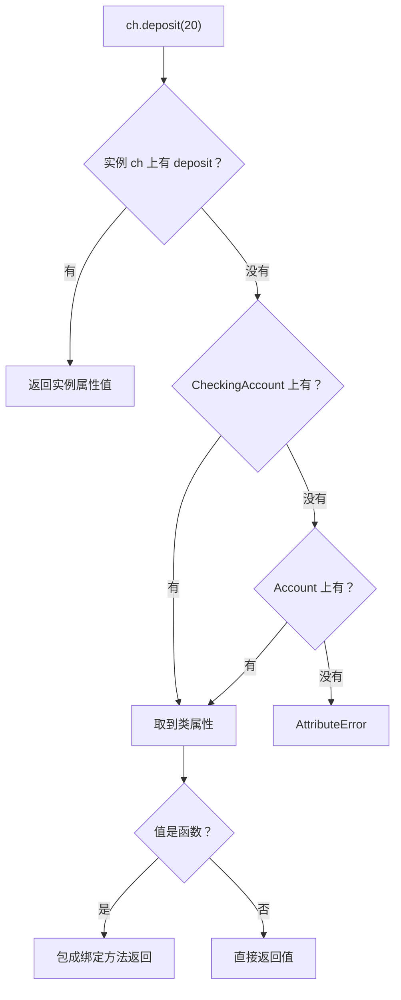
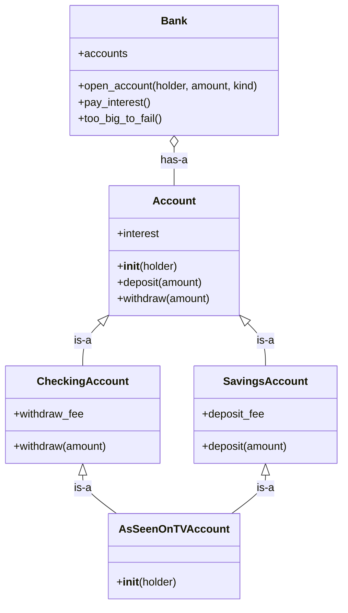

> **课程**：UC Berkeley CS61A · Structure and Interpretation of Computer Programs（Fall 2024）
> **本讲**：Lecture 20 ｜ 31:35 ｜ B 站分 P 20 ｜ [原视频](https://www.bilibili.com/video/BV1sy411z7nA?p=20)
> **课件**：`19-Inheritance.pdf`（24 页，官方 PDF，逐页渲染图见正文插图）
> **字幕**：B 站英文原声字幕；本笔记是中文书面化重构，非逐句翻译
> **版权**：课程与课件版权归 UC Berkeley CS61A 教学团队；本文为学习用途的二次整理

## 本讲速览

*(参考时间: 00:00:02 – 00:01:43｜Lecture 20)*

- **已掌握**：类与实例的区别；实例属性与类属性各自存在哪里；点表达式"先实例、后类"的两级查找；绑定方法与普通函数在调用形式上的差别；`Class.attr = value` 与 `instance.attr = value` 落在不同对象上。
- **本讲主线**：
    - 继承只解决一件事：两个类"很像，但一个更专门"，把差异写出来，其余交给基类；
    - 基类的属性并不会被复制进子类，继承体现在"查名字"的过程里；
    - 子类覆盖同名方法后，仍可用类对象取回被覆盖的版本，于是可以"先复用、再小改"；
    - 设计时要分清 is-a 与 has-a：支票账户"是"账户，银行"有"账户；
    - 多重继承下同一个名字可能有多条路径，解析顺序决定谁先被找到。
- **关键结论**：继承把重复代码压到一处，代价是子类的行为依赖基类的实现；判断能不能安全改基类，就看有没有人把它的代码抄走过。

## 1. 开场与课件前叠：属性复习十页

*(参考时间: 00:00:02 – 00:00:33｜Lecture 20)*

录像的第一句就是 "On to a new topic, inheritance"——本讲从继承直接切入，没有公告环节。课件却从一个标题页和一张公告页开始，之后接的是一叠属性复习页，最后才进入继承。按课件的顺序读，读者会先拿回属性的全部工具，再看到继承如何复用这些工具。


> **编者说明**：本段录像的语音从"继承"这一句开始，课件第 2 页（Announcements）没有对应的口头讲解；第 3–12 页是一叠"Attributes"复习页——术语、点表达式、属性赋值这几页与上一讲 `18-Attributes.pdf` 几乎逐字相同，`Transaction` 与练习两页则是这一册里新增的（上一讲的字幕中没有出现这个例子）。本段录像同样没有逐页复述这十页，下面按画面依次给出，解释以画面文字与上一讲已确立的规则为准；凡超出画面的推理，都单独标注。

### 1.1 术语：属性、函数与方法


继承的所有规则最后都落在"查名字"上，而查名字要先分清三个词：属性、函数、方法。它们不是并列关系——右图的两个圆说明，方法就是"类属性"与"函数"的交集。


- **属性（attribute）**：对象上的名字—值对，所有对象都有属性；类也是对象，所以类也有属性。
- **实例属性**：属于某个实例的那一份，每个实例各有一份。
- **类属性**：属于类的那一份，不管有多少实例，只有一个值。
- **方法（method）**：值是函数的那些类属性。这就是图里的交集：它既是类属性，又是函数。

右侧那栏是 Python 对象系统的三条事实：函数是对象；绑定方法（bound method）也是对象，它把一个函数和某个实例捆在一起、第一个参数 `self` 已经填好；对"值是函数"的类属性做点表达式，得到的不是函数而是绑定方法。

这三条事实合起来解释了一件看起来奇怪的事：同一份函数代码，写 `ch.deposit` 得到的是绑定方法（只差一个 `amount`），写 `Account.deposit` 得到的是普通函数（要自己补上实例）。后面 §3 的 `Account.withdraw(self, ...)` 就靠这条区别工作。

### 1.2 点表达式：四步求值


点表达式 `<expression>.<name>` 的求值规则只有四步，其中第二步与第三步的先后是关键：

1. 求出点号左边的 `<expression>`，它就是点表达式作用的对象。
2. 拿 `<name>` 去这个对象的实例属性里匹配；找到了，就返回它的值。
3. 没找到，就去这个对象的类里查，得到类属性的值。
4. 类属性值照原样返回，除非它是个函数——那就返回绑定方法。

第二步在第三步之前，所以**实例属性会遮蔽（shadow）同名的类属性**。这条遮蔽规则在本讲会反复出现：`CheckingAccount` 里的 `interest = 0.01` 遮蔽了 `Account` 里的 0.02；§9 那道 WWPD 题里，实例上的 `z` 遮蔽了类上的 `z`；§6 里，某个账户单独设过的手续费遮蔽了类上的 1 美元。

### 1.3 类属性：一条日志、三笔交易


页面给了两道空：一个记账用的 `Transaction` 类，`log` 是类属性（一个列表），每笔交易创建时把自己记进去。题目要求填的是 `self.prior` 与 `balance` 的返回式，并给出了两组期望结果：`ts[1].balance()` 是 17，`ts[2].balance()` 是 13。

```python
class Transaction:
    """A logged transaction.

    >>> s = [20, -3, -4]
    >>> ts = [Transaction(x) for x in s]
    >>> ts[1].balance()
    17
    >>> ts[2].balance()
    13
    """
    log = []

    def __init__(self, amount):
        self.amount = amount
        self.prior = ______________
        self.log.append(self)

    def balance(self):
        return self.amount + _________________
```


答案填在下一页里，配上一条关键的盒子图：类属性 `log` 指向一个列表对象，三个实例的 `prior` 各指向这个列表的一份**快照**。

```python
    def __init__(self, amount):
        self.amount = amount
        self.prior = list(self.log)
        self.log.append(self)

    def balance(self):
        return self.amount + sum([t.amount for t in self.prior])
```

逐笔核对：`Transaction(20)` 建好时 `log` 还是空的，快照是空列表，`balance()` 得 20；`Transaction(-3)` 快照里有前一笔的 20，于是 -3 + 20 = 17；`Transaction(-4)` 快照里有 20 与 -3，于是 -4 + 17 = 13。数字对上，说明"快照"这一步没错。

两个细节值得停下来说：

第一个是 `self.prior = list(self.log)` 里的 `list(...)`。它复制的不是指针而是内容。如果写成 `self.prior = self.log`，`prior` 与 `log` 就是同一个列表对象，后面每来一笔交易都往这个列表里追加，早先那几笔交易的历史会跟着变——第一笔交易的 `balance()` 会从 20 变成 17、再变成 13，历史被未来的事件改写。快照买的是"时间点"，代价是每次创建都要复制一份长度为 n 的列表，n 笔交易总共 $O(n^2)$ 的空间。

第二个是 `self.log.append(self)` 为什么不会在实例上留下一个 `log`。这是方法调用，不是赋值：先按 §1.2 的规则查 `self.log`（实例上没有，类上有），拿到那个共享列表，再对它调用 `append`。真正被修改的是类属性指向的列表对象，实例字典里仍然没有 `log`。若写成 `self.log = self.log + [self]`，那就成了属性赋值，会在实例上新建一个 `log`，类上的那份从此被遮蔽——这是本讲最容易写错的一行。

图里还给了等价写法：`list(type(self).log)`。`type(self)` 就是"`self` 所属的类"，用 `type(self)` 而不是写死 `Transaction`，意思是子类的实例也会去查自己类的 `log`，而不是永远查 `Transaction.log`。这与 §6 第三条规则"尽量在实例上查属性"是同一个思路的两面。


下一页把快照挪到实例自己身上：先 `append` 再复制进 `self.lst`，于是快照里包含自己，`balance` 直接对整个 `self.lst` 求和。两种写法结果相同，差别在"快照是否包含自己"。

| 判据 | 第 7 页的写法 | 第 8 页的写法 |
|---|---|---|
| 快照存在哪个实例属性 | `self.prior` | `self.lst` |
| 复制与追加的先后 | 先复制类日志，再追加自己 | 先追加自己，再复制类日志 |
| 快照里是否包含自己 | 不包含 | 包含 |
| 求和的写法 | `self.amount + sum(...)` | `sum(...)` |
| 两组期望结果 | 17、13 | 17、13 |

### 1.4 属性赋值：名字落在谁身上


赋值语句左边是点表达式时，规则与求值完全不同：点号左边照常求出对象，但右边的**名字不做查找**，而是直接在那个对象上增加或修改属性。对象是实例，就得到实例属性；对象是类，就得到类属性。

`tom_account.interest = 0.08` 与 `Account.interest = 0.04` 的区别就在这句：前者只影响 `tom_account` 这一个实例，后者改的是类上的那一份，于是所有"自己没有 `interest`"的实例都会看到新值。


画面下方两列 doctest 把这件事演了五步。`jim_account` 与 `tom_account` 创建之后，两者的 `interest` 都是 `0.02`——它们没有自己的值，看到的是类属性。`Account.interest = 0.04` 之后，两者都变成 `0.04`，因为类上那一份被改掉了。接着 `jim_account.interest = 0.08` 在 `jim_account` 上新建了一份实例属性；再写 `Account.interest = 0.05`，`tom_account` 跟着变成 `0.05`，而 `jim_account` 仍然是 `0.08`：一旦实例有了自己的那一份，类属性怎么改都到不了它。

这就是 §1.2 那条"实例属性遮蔽类属性"在赋值上的对应现象：**读**的时候沿"实例 → 类"两级找，**写**的时候只落在左边那个对象上。后面理解"为什么子类能覆盖基类方法而不破坏基类"、"为什么某个账户能单独设一个手续费"，用的都是这一条。

### 1.5 练习：三个名字抢一个属性


这一页只有标题和页脚一条 pythontutor 链接，练习代码就编码在链接里。它把本节的三件事压在一段程序里：`Foo` 先是一个整数，再变成一个类；类属性在类体里被赋值，又在方法里被赋值；实例属性遮蔽类属性。

```python
Foo = 1

class Foo:
    bar = 2

    def __init__(self, baz, qux):
        self.baz = baz
        Foo.bar = qux

    def a(self, x):
        self.bar = x

a = Foo(3, 4)
b = a.a
print(a.bar)
b(5)
print(a.bar)
Foo.bar = 6
print(a.bar)
```

> **编者说明**：练习代码在课件画面里只以 pythontutor 链接的形式出现，上面是按链接中的 `code=` 参数解码后誊写的；输出由 §1.2 与 §1.4 的规则推出，不是画面上的文字。

三处输出依次是 `4`、`5`、`5`，理由各不相同：

- 执行 `class Foo` 时，类体里的 `bar = 2` 成为类属性；随后 `a = Foo(3, 4)` 调用 `__init__`，`self.baz = 3` 落在实例上，`Foo.bar = 4` 落在**类**上——注意这里用的是全局名 `Foo`，它在类定义执行完之后才指向这个类，方法体要等到调用时才查这个名字。
- `a.bar` 第一次求值：实例上没有 `bar`，于是取类上的 `4`。
- `b = a.a` 是绑定方法，`b(5)` 等价于 `a.a(5)`，执行 `self.bar = 5`，从此 `a` 有了自己的 `bar`。
- `Foo.bar = 6` 之后，`a.bar` 仍然是 `5`：实例属性遮蔽了刚被改过的类属性。

如果把最后那行 `print(a.bar)` 换成 `print(b)`，看到的会是一个绑定方法对象而不是数字——这也是 §1.1 那三条事实的直接后果。

## 2. 继承：把"特化"的差异写出来

*(参考时间: 00:00:33 – 00:01:43｜Lecture 20)*


继承是 Python 对象系统的一个特性，几乎每种语言的面向对象系统都有它。它要解决的问题很朴素：**类很少孤立存在**。有时一个类只是和另一个类相似，我们希望把这种关系表达出来，而不是让两份几乎一样的代码各写一遍。


最常见的用法是"两个相似的类在专门化程度上不同"：专门化的那个类拥有一般类的全部属性，再额外加一些特例行为。语法上只多了一对括号：

```python
class <Name>(<Base Class>):
    <suite>
```

括号里写基类（base class），类名后跟的类就是继承它的子类（subclass）。概念上，子类与基类共享全部属性；子类可以**覆盖**（override）某些继承来的属性来稍微改变行为，没改的部分保持原样。所以"用继承实现一个子类"的意思是：**只写它与基类的差异**。

这句话是本讲所有例子的模板。`CheckingAccount` 与 `Account` 的差异只有三条（利率、取款手续费、取款方法），其余全部继承；`AsSeenOnTVAccount` 与它的两个基类的差异只有一条（开户时余额是 1 美元）。子类的类体越短，说明差异被表达得越干净——如果子类里大段复制基类的代码，那通常不是继承用得不对，而是基类该拆了。

## 3. 第一个例子：CheckingAccount 与取款手续费

*(参考时间: 00:01:47 – 00:05:01｜Lecture 20)*

支票账户是账户的一种，但它有三处不同：开户时同样要给持有者，利率却比普通账户低（1% 对 2%，所以每个月拿到的钱更少）；存款行为完全一样；取款要付 1 美元手续费——讲师的原话是"银行总得从哪里赚点钱"。于是从 20 美元的账户里取 5 美元，实际剩下的是 14 美元。


```python
class CheckingAccount(Account):
    """A bank account that charges for withdrawals."""
    withdraw_fee = 1
    interest = 0.01
    def withdraw(self, amount):
        return Account.withdraw(self, amount + self.withdraw_fee)
```

`withdraw_fee = 1` 与 `interest = 0.01` 是类属性，所有支票账户共享同一份。只写 `withdraw_fee` 还不够——它只是一个数字，没有任何地方用到它；还要写一个 `withdraw` 方法，把"多扣 1 美元"这件事落到逻辑里。这就是为什么要覆盖 `withdraw`：名字与基类相同，于是支票账户的实例查到的是这一份，而不是基类那份。

### 3.1 self 是谁

方法体里反复出现 `self`，讲师特意停下来解释了一次：`self` 是"这个方法被调用的那个对象"。写 `ch.withdraw(5)` 时，`self` 绑到 `ch` 这个支票账户实例上，`amount` 是 5，`self.withdraw_fee` 得 1，于是传给基类的金额是 6。

`self.withdraw_fee` 本身也走了一遍 §1.2 的四步：`ch` 的实例属性里没有 `withdraw_fee`，于是到类里找，`CheckingAccount.withdraw_fee` 是 1。写成 `self.withdraw_fee` 而不是写 1，是为了将来能有"手续费不一样的账户"——这一条在 §6 会展开成一条设计规则。

### 3.2 为什么是 Account.withdraw(self, ...)

真正干活的还是基类那份取款逻辑。这个例子里调用的写法是 `Account.withdraw(self, amount + self.withdraw_fee)`，两个细节值得说清：

- 从类上取 `withdraw`，得到的是**函数**而不是绑定方法，所以必须自己把 `self` 补进去，作为第一个参数；
- 后面的 `amount + self.withdraw_fee` 才是这次真正要取的金额。

同一个方法如果写成 `self.withdraw(...)`，会无限递归——`self` 是支票账户实例，查到的还是这个覆盖版。基类版本必须显式写出来，或者用下一节提到的 `super()`。

下面把 `Account` 补全，才好逐行对照。课件第 10 页只给了 `interest = 0.02`、`__init__` 和一个省略号；完整写法取自上一讲，与讲师口述的"先加，再判断余额够不够，够就改余额并返回"完全一致。

```python
class Account:
    """An account has a balance and a holder."""
    interest = 0.02

    def __init__(self, account_holder):
        self.balance = 0
        self.holder = account_holder

    def deposit(self, amount):
        self.balance = self.balance + amount
        return self.balance

    def withdraw(self, amount):
        if amount > self.balance:
            return 'Insufficient funds'
        self.balance = self.balance - amount
        return self.balance
```

> **编者说明**：以上 `Account` 的完整定义来自上一讲与课件第 10 页的片段，本讲字幕只口述了 `withdraw` 的三步；代码按课程一贯的写法整理，未改动行为。

### 3.3 没写的部分

类体里没有 `deposit`，也没有 `__init__`。这不是遗漏：创建 `CheckingAccount('Tom')` 时会去找 `__init__`，本类没有，沿基类找到 `Account.__init__`，于是 `balance` 从 0 开始、`holder` 是 Tom；存款时同理，查到的是 `Account.deposit`。**未写即继承**，这正是继承省下的那部分工作。

### 3.4 课件上的第二种写法：super()

同一页右下角还给了另一种写法（画面原文）：

```python
    def withdraw(self, amount):
        return super().withdraw(amount + self.withdraw_fee)
```

> **编者说明**：讲师的口头讲解只用了 `Account.withdraw`，没有展开 `super()`；下面这段解释属于补充。`super()` 在方法内部返回一个代理对象，它从"当前类在解析顺序中的下一个位置"开始继续查找属性，并且已经替调用者把 `self` 绑好。于是 `super().withdraw` 拿到的仍是基类那份函数，却不必再手写 `self`。它与 `Account.withdraw(self, ...)` 的区别在于"认谁作基类"：前者跟着解析顺序走，后者把类名写死；多重继承时这个区别会变成实际结果的差别（见 §11）。

## 4. 类上的属性查找：基类属性没有被复制

*(参考时间: 00:05:04 – 00:05:57｜Lecture 20)*


这一页只有一句加粗的结论，却是整讲的枢纽：**基类的属性不会被复制进子类**。`CheckingAccount` 的类体里没有 `deposit`，可是 `ch.deposit` 能用，原因不在"复制"，而在"查找"。

在类上查一个名字，规则只有两条：

1. 如果这个名字是该类的属性，返回它的值；
2. 否则，如果它有基类，就到基类里查——而基类也是类，于是同一条规则递归地继续往上走。

页面下方的 doctest 把注释直接写在了结果旁边：`CheckingAccount('Tom')` 的注释是"调用 `Account.__init__`"；`ch.interest` 是"在 `CheckingAccount` 里找到"；`ch.deposit(20)` 是"在 `Account` 里找到"；`ch.withdraw(5)` 又是"在 `CheckingAccount` 里找到"。同一个实例、四种名字、两个落点，全靠查找决定。

这条规则带来三个直接后果：

- **改基类，子类跟着变**。`Account.deposit` 的逻辑一旦修改，所有没覆盖 `deposit` 的子类立刻用上新逻辑——这正是 §5 要讲的"不要复制"的技术理由。
- **覆盖不销毁原版**。`CheckingAccount.withdraw` 只是在子类里放了另一个同名属性，`Account.withdraw` 仍然原样躺在基类里，用类对象就能取回。
- **找不到才报错**。名字沿基类链一路向上都没命中，才会抛 `AttributeError`；链条有多长，查找就有多深。

## 5. 追踪：一次创建、两次存款、一次取款

*(参考时间: 00:05:58 – 00:09:56｜Lecture 20)*

本节把 §3 的代码逐行跑一遍，再回答"为什么不直接复制基类的取款代码"。

### 5.1 创建：先找 __init__

`ch = CheckingAccount('Tom')` 的第一步是求值 `CheckingAccount('Tom')` 这个调用表达式。`CheckingAccount` 是个类对象，调用它就会新建一个实例，然后自动调用 `__init__`——用 §4 的两条规则查：`CheckingAccount` 里没有 `__init__`，到 `Account` 里找到，于是 `self.balance = 0`、`self.holder = 'Tom'`。支票账户的起点金额与普通账户一样，是 0。

接下来三个表达式，三种落点：

- `ch.interest`：实例上没有，`CheckingAccount` 上有，得 0.01；
- `ch.deposit(20)`：点表达式先在实例上找 `deposit`（没有），再在 `CheckingAccount` 上找（没有），最后在 `Account` 上找到函数，包成绑定方法；调用后余额 20；
- `ch.withdraw(5)`：在 `CheckingAccount` 上找到覆盖版，转发给 `Account.withdraw(self, 6)`，余额 20 - 6 = 14。



### 5.2 复制还是复用

讲师在这里问了一个很实际的问题：既然只是"多扣 1 美元"，把基类的 `withdraw` 抄进子类改一行不是更简单吗？抄过来的版本是这样：先把 `amount` 加 1，再判断余额够不够，够就改余额并返回。

> **编者说明**：抄写版的具体代码不在课件上，讲师只口述了"加一、判断、改余额、返回"这四步；上面的描述按口述复原，不构成课件原文。

这个版本"能正确一阵子"。问题出在时间轴上：如果日后基类的 `withdraw` 改了——比如余额不足时改成抛异常而不是返回字符串，或者加了一条"单笔取款上限"——这些改动不会流到抄写过的那份子类代码里。同一个业务规则出现两个版本，早晚会分叉。

正确做法是**调用现成的实现**：`Account.withdraw(self, amount + self.withdraw_fee)`。它把"取款"这件事的唯一一份逻辑留在基类，子类只在外面加一层壳。这也是"不要重复自己"（Don't Repeat Yourself）在类层次上的版本。

| 判据 | 复制基类代码 | 显式调用 `Account.withdraw` | 调用 `super().withdraw` |
|---|---|---|---|
| 基类后来改了，子类跟不跟 | 不跟，两份逻辑分叉 | 跟，改一处生效 | 跟，改一处生效 |
| 是否写死基类名 | 不涉及 | 写死 `Account` | 不写死，跟着解析顺序走 |
| 多重继承时选中谁 | 不参与解析 | 固定在写出来的那个类 | 由解析顺序决定 |
| 主要代价 | 逻辑分叉、回归困难 | 换基类要改代码 | 需要理解解析顺序 |

### 5.3 两个账户的验证

讲师的验证很朴素：开两个账户，一个普通、一个支票，都存 100，各取 10。

```python
>>> a = Account('John')
>>> b = CheckingAccount('Jack')
>>> a.deposit(100)
100
>>> b.deposit(100)
100
>>> a.withdraw(10)
90
>>> b.withdraw(10)
89
```

两次存款结果相同，因为两者用的是同一个 `Account.deposit`；两次取款结果差 1，因为支票账户的 `withdraw` 多扣了 `withdraw_fee`。一行差异、一份共享实现，这就是继承在这个例子里买到的全部东西。

## 6. 设计继承：三条规则

*(参考时间: 00:10:00 – 00:12:46｜Lecture 20)*


课件把这一节的标题定为"Object-Oriented Design"。它给出的不是语法，而是三条判断：

**第一条，不要重复自己，尽量用已有的实现。** 这就是 §5.2 的结论。判断方法很具体：子类里出现与基类相同的语句块，就停下来想"这段是不是该留在基类"。

**第二条，被覆盖的属性仍然可以通过类对象访问。** "覆盖"是指子类里给出了与基类同名的属性——`CheckingAccount.withdraw` 与 `Account.withdraw` 同名，于是支票账户的实例调用的是子类这一份。但同名不等于替换：`Account.withdraw` 依然存在，写 `Account.withdraw` 就能拿到原版。正是这一点让"取回旧逻辑、只改一点点"成为可能。

**第三条，尽量在实例上查属性。** 这一条讲的是 `amount + self.withdraw_fee` 该写成什么。课件列了三种选择，差别在"将来谁能改"。


| 判据 | 写法 | 能不能改 | 能不能有特例 |
|---|---|---|---|
| 字面量 | `amount + 1` | 不能，改要动代码 | 不能 |
| 类名写死 | `amount + CheckingAccount.withdraw_fee` | 能改类属性 | 不能，子类或单个账户的例外都失效 |
| 实例上查 | `amount + self.withdraw_fee` | 能改类属性 | 能，实例属性与更深的子类都生效 |

第三种写法之所以最好，是因为它把"查名字"交给了运行时的规则：`self` 先看实例上有没有 `withdraw_fee`（某个账户可以单独设一个），没有就沿类链找（默认的 1）。第二种写法把类名写死，等于宣布"我永远是 `CheckingAccount`"，一旦有人再从它派生出"取款免费的 VIP 账户"，这个写死的地方就选不到新值。

> **编者说明**：第二条规则还隐含一个代价，课件没有展开：只要有人写 `Account.withdraw(self, ...)`，基类的方法签名（参数个数与含义）就变成了子类的依赖。日后给 `withdraw` 加参数，所有这样写的子类都要一起改。这是"复用实现"与"自由演进"之间永恒的张力的一个具体形态。

## 7. 继承还是组合：is-a 与 has-a

*(参考时间: 00:12:50 – 00:14:06｜Lecture 20)*


面向对象编程之所以好用，很大程度上是因为它允许把对象当成现实里的东西来想：一个支票账户就是一家银行里的一个账户，一个银行就是一个管着一堆账户的机构。**顺着这个比喻走，类的结构会自己浮出来。**

判据只有一条：两个类之间是"是"还是"有"。

- **继承表示 is-a**：支票账户**是**一种账户，所以 `CheckingAccount` 继承 `Account`，从而获得账户的全部属性。
- **组合（composition）表示 has-a**：银行**有**一组账户，所以银行里放一个账户列表作为属性。账户不会继承银行——它们的关系是"一个持有另一个"，不是"一个是另一个的特例"。

| 判据 | 继承（is-a） | 组合（has-a） |
|---|---|---|
| 关系 | 子类是基类的一种特化 | 一个对象持有另一个对象 |
| 判断句式 | "支票账户是一种账户" | "银行有一组账户" |
| 本讲例子 | `CheckingAccount(Account)` | `Bank` 里的 `self.accounts` |
| 复用的是什么 | 属性与方法的实现 | 被持有对象的行为 |
| 改动的影响面 | 改基类会波及所有子类 | 改被持有对象不影响持有者 |
| 典型误用 | 为了复用代码而继承，语义上并不是"一种" | 该用继承表达特化却套了一层包装 |

> **编者说明**：讲师在这一页只给了 is-a / has-a 这一条判据。实践中还有两条常见经验：其一，若子类只是想借用实现、语义上并不"是"基类的一种，应该改用组合；其二，继承链越深，基类改动波及的面越大，业界称之为"脆弱的基类问题"（fragile base class）。这两条不在本讲字幕与课件中。

## 8. 组合实战：Bank、利息与"大到不能倒"

*(参考时间: 00:14:08 – 00:18:37｜Lecture 20)*

课件没有给银行单独一页，这一段是白板演示。它要回答的是"如果不用继承，一个管理账户的对象长什么样"。

```python
class Bank:
    """A bank that manages a collection of accounts."""

    def __init__(self):
        self.accounts = []

    def open_account(self, holder, amount, kind=Account):
        account = kind(holder)
        account.deposit(amount)
        self.accounts.append(account)
        return account

    def pay_interest(self):
        for account in self.accounts:
            account.deposit(account.balance * account.interest)

    def too_big_to_fail(self):
        return len(self.accounts) >= 2
```

> **编者说明**：以上代码按讲师口述的要点复原（课件无 Bank 页）：构造不需要参数；`open_account` 收持有者、金额，以及一个可选的账户种类，默认开普通账户；开户时把本金存进去；`pay_interest` 遍历 `self.accounts`，按每个账户当前的余额与利率计息。命名与语句顺序是本笔记的整理。

四个要点与讲师的演示一一对应：

- **构造**：`Bank()` 不带参数。它要做的事只有一件——记住自己管着哪些账户，于是 `self.accounts` 初始化为空列表。
- **开户**：`open_account` 的 `self` 绑到银行，参数是持有者、金额，以及一个可选的账户种类。创建账户时用 `kind(holder)` 调用那个类，`kind` 传 `Account` 还是 `CheckingAccount`，就决定了新账户的利率与手续费。这一步正是"组合"的作用：银行不需要知道账户内部怎么算利息，只需要知道可以构造它。
- **记账**：新账户要加进 `self.accounts`，银行才认得它，也才谈得上"这是我们银行的账户，不是别家的"。
- **付息**：`pay_interest` 不接收额外参数，遍历所有账户，各存一笔 `balance * interest`。

演示的叙事是这样的：John 走进银行，报上名字、递上 10 美元，开了一个普通账户；朋友 Jack 只带了 5 美元，经理说可以，但只能开支票账户。于是 John 的账户利率 2%，Jack 的 1%。付息之后，John 的余额从 10 变成 10.20（多出的 20 美分就是 2% 的利息），Jack 的 5 美元变成 5.05。

```python
>>> bank = Bank()
>>> john = bank.open_account('John', 10)
>>> jack = bank.open_account('Jack', 5, CheckingAccount)
>>> bank.pay_interest()
>>> john.balance
10.2
>>> bank.too_big_to_fail()
True
```

最后一问是讲师开的玩笑：银行需不需要"大到不能倒"的保护？判据是"至少有两个账户"，而现在它管着 John 和 Jack 两个人的钱，所以答案是肯定的。

这一段真正的教学价值在于：**银行没有继承账户，程序照样工作**。`pay_interest` 只依赖 `balance`、`interest`、`deposit` 三个名字，不关心手里拿的是普通账户、支票账户还是别的什么子类。组合把"多样性"交给了对象的接口，而不是类的谱系。

## 9. WWPD：三个类与四层点表达式

*(参考时间: 00:18:44 – 00:28:33｜Lecture 20)*

到这里，属性查找的规则已经够用，讲师把它压成一道题："稍微复杂一点的例子"，并请学生暂停视频自己算。课件上有一个同类的小题，录像里放的是一道更复杂的。

### 9.1 课件上的版本：Three Attributes


```python
class A:
    x, y, z = 0, 1, 2

    def f(self):
        return [self.x, self.y, self.z]

class B(A):
    """What would Python Do?

    >>> A().f()
    [0, 1, 2]
    >>> B().f()
    [6, 1, 'A']
    _____________
    """
    x = 6
    def __init__(self):
        self.z = 'A'
```

画面右侧画了四个盒子：`A` 类里有 `x: 0`、`y: 1`、`z: 2`；`B` 类里只有 `x: 6`；`A` 实例是空的；`B` 实例里只有 `z: 'A'`。四张盒子图就是这题的全部线索。

`A().f()` 得 `[0, 1, 2]`：三个名字在实例上都没有，全部来自 `A` 类。`B().f()` 得 `[6, 1, 'A']`，三个名字三种来源——`self.x` 在实例上没有，`B` 类上有 6，于是停在 `B`；`self.y` 在实例与 `B` 上都没有，继续到 `A` 取 1；`self.z` 在实例上就有（`__init__` 设的 `'A'`），第一步就命中，根本没机会看类。

> **编者说明**：这一页是课件里的 WWPD 题；录像里讲师实际放的是下面 9.2 那道更复杂的题，课件没有对应页。两题考的是同一套规则，建议先做完这一页再进 9.2。

### 9.2 录像里的版本：a、b 与四层点表达式

录像中的题目有三个类、三条赋值语句，最后要判断四个表达式里哪一个求值为整数。

```python
class A:
    z = -1

    def f(self, x):
        return B(x - 1)

class B(A):
    n = 4

    def __init__(self, y):
        if y:
            self.z = self.f(y)
        else:
            self.z = C(y + 1)

class C(B):
    def f(self, x):
        return x

a = A()
b = B(1)
b.n = 5
```

> **编者说明**：录像里这道题只以讲师口中的代码出现，课件没有这一页；上面的代码按字幕逐句复原（`A.z = -1`、`A.f` 返回 `B(x - 1)`、`B.n = 4`、`B.__init__` 在 `y` 为真时取 `self.f(y)`、为假时取 `C(y + 1)`、`C.f` 原样返回参数），全部取值已用解释器核对过。

看这类题的方法是先建结构、再算值。执行三个 `class` 语句，得到三个类对象，依次绑定到全局名 `A`、`B`、`C`。`A` 的类属性有两个：`z` 是 -1，`f` 是一个函数；`B` 继承 `A`，另外定义 `n = 4` 与 `__init__`；`C` 继承 `B`，只覆盖 `f`。三者的函数都以全局帧为父帧，所以它们在方法体里看见的 `A`、`B`、`C` 都是全局名——这一点在 `A.f` 里那句 `return B(x - 1)` 上会派上用场。

然后是三条赋值：

- `a = A()`：`A` 没有 `__init__`，所以实例上什么属性都没有，是一块白板。
- `b = B(1)`：`B.__init__` 收到 `y = 1`，为真，于是执行 `self.z = self.f(1)`。`self` 是 `b`，`self.f` 先在实例上找（没有），再在 `B` 上找（没有），最后在 `A` 上找到，调用后得到 `B(1 - 1)`，即 `B(0)`。`B(0)` 的 `y` 是 0，为假，于是走另一支：`self.z = C(0 + 1)`，即 `C(1)`。`C` 没有 `__init__`，沿基类用 `B.__init__`，`y` 为 1，为真，于是 `self.z = self.f(1)`；这次 `self` 是 `C` 实例，`C.f` 覆盖过、直接把参数返回，于是这个 `self.z` 就是 1。
- `b.n = 5`：属性赋值只落在 `b` 这个实例上，`B.n` 仍是 4，基类更不受影响。

于是 `b` 的内部结构可以画成一棵树，每往下一层就剥掉一层 `z`：

- `b`：`B` 实例，自有属性 `n` 与 `z`
    - `n` → `5`（实例属性，遮蔽了 `B.n` 的 4）
    - `z` → `B(0)` 实例
        - `z` → `C(1)` 实例
            - `z` → `1`

四个待判断的表达式逐个算：

1. `C(2).n`：先建 `C` 实例（走 `B.__init__`，`y = 2`，`self.z` 由 `C.f` 得 2），再查 `n`：实例上没有，`C` 上没有，`B` 上是 4，于是得 4。注意这里的 `z` 是 2、`n` 是 4，两个数都在，但只有 `n` 被问到。
2. `A.z == C.z`：`a` 是没有属性的白板实例，`A.z` 得 -1；`C` 自己没定义 `z`，`B` 也没有，沿链到 `A` 得 -1。两边都是同一个类属性，两条完全不同的路径，结果相等。
3. `A.z == b.z`：左边是 -1，右边是一个 `B` 实例对象，类型不同，不等。
4. `b.z`、`b.z.z`、`b.z.z.z`、`b.z.z.z.z`：依次是 `B` 实例、`C` 实例、整数 1，再往下就出错了——1 是 `int`，它没有 `z` 属性。

所以四个选项里只有 `b.z.z.z` 求值为整数，答案是 1。这道题表面上在考"点表达式能连多长"，实际上考的还是 §4 那两条规则：每一层 `.z` 都走一遍"实例 → 类 → 基类"，而每一层都可能被某个实例属性提前截住。

## 10. 多重继承：AsSeenOnTVAccount

*(参考时间: 00:28:33 – 00:30:54｜Lecture 20)*


多重继承（multiple inheritance）是指一个子类有多个基类。Python 允许这样写，于是"两个已经很合适的基类"可以被同时复用。

先补一个储蓄账户：与普通账户的唯一区别是存款要收 2 美元手续费，所以存 10 美元，账户里只多 8 美元。

```python
class SavingsAccount(Account):
    deposit_fee = 2
    def deposit(self, amount):
        return Account.deposit(self, amount - self.deposit_fee)
```


接着是讲师编的那个银行高管的点子：利率只有 1%（少付给客户），取款收 1 美元、存款收 2 美元（多收客户），开户白送 1 美元（好让人蜂拥而至）。这个产品叫"电视购物账户"（As Seen on TV account）。它的定义短得出奇，因为两个基类已经把该有的东西都备好了：

```python
class AsSeenOnTVAccount(CheckingAccount, SavingsAccount):
    def __init__(self, account_holder):
        self.holder = account_holder
        self.balance = 1                 # A free dollar!
```



图上两处关系值得对照着看：左边那条继承树里，`AsSeenOnTVAccount` 有两条路通向 `Account`（经 `CheckingAccount`，或经 `SavingsAccount`）；右边 `Bank` 与 `Account` 之间是组合，画的是"持有"而不是"是一种"。同一个 `Account` 在这一讲里同时被两种关系用到，正好说明它们解决的是不同的问题。


看实际行为。创建时 `__init__` 是它自己的，余额直接是 1——这是那个"白送的一美元"。存 20 美元时，找到的是 `SavingsAccount.deposit`，扣掉 2 美元手续费，账户里只进 18，加上原来的 1，余额 19。取 5 美元时，找到的是 `CheckingAccount.withdraw`，多扣 1 美元手续费，余额 13。

```python
>>> such_a_deal = AsSeenOnTVAccount('John')
>>> such_a_deal.balance
1
>>> such_a_deal.deposit(20)     # SavingsAccount method
19
>>> such_a_deal.withdraw(5)     # CheckingAccount method
13
```

讲师在这里的评价是"such a deal indeed"——银行赔得很彻底。这句话对理解多重继承也有用：两个基类的行为被同时继承下来，于是"最省钱"与"最收费"的两套规则叠加在了同一个对象上，程序忠实地执行了写下来的东西，至于商业上是否合理，语言不管。

值得记下的是：`AsSeenOnTVAccount` 从 `Account` 那一侧直接继承到的东西其实只剩利率一项，而 1% 这个值又是从 `CheckingAccount` 那一支拿到的（`SavingsAccount` 没有定义 `interest`）。存款来自储蓄账户、取款来自支票账户、开户余额来自自己的 `__init__`——三个来源混在一个类里，正是下一节要处理的问题。

## 11. 歧义名字的解析顺序：先子类，后基类

*(参考时间: 00:30:57 – 00:31:33｜Lecture 20)*


到了这一页，问题终于显形：`Account`、`CheckingAccount`、`SavingsAccount`、`AsSeenOnTVAccount` 四条边围成一个菱形，同一个名字（比如 `withdraw`、`deposit`、`interest`）可能有两条甚至三条路能走到。到底先看哪一条？

讲师给的规则只有一句：**先看子类，再看基类**；多个基类时按书写顺序从左到右。这句话已经足够解释屏幕上的三个结果。

| 名字 | 解析到的位置 | 依据 | 结果 |
|---|---|---|---|
| `withdraw` | `CheckingAccount` | 基类列表里 `CheckingAccount` 排在第一个 | 取 5 扣 6，19 → 13 |
| `deposit` | `SavingsAccount` | `AsSeenOnTVAccount` 与 `CheckingAccount` 都没有，`SavingsAccount` 在 `Account` 之前被查到 | 存 20 只进 18，1 → 19 |
| `interest` | `CheckingAccount` | `CheckingAccount.interest = 0.01`，`SavingsAccount` 没有定义 | 1% |
| `holder`、`balance` | 实例自身 | 由自己的 `__init__` 赋值 | `'John'`、1 |
| `__init__` | `AsSeenOnTVAccount` | 本类定义了，不再向上找 | 写入 holder 与 balance |

`deposit` 那一行是整页最不显眼、也最容易想错的地方：`CheckingAccount` 自己没有 `deposit`，但它的基类 `Account` 有。如果查找是"一条路走到黑"的深度优先，会先撞上 `Account.deposit`，存款就该得 20 而不是 19。屏幕上给出的是 19，说明实际规则并不是"碰到基类就往里钻"。

> **编者说明**：讲师只给了"先子类、后基类"这一条，Python 3 的实际规则叫 **C3 线性化**（C3 linearization），它把每个类的解析顺序（MRO，method resolution order）算成一张列表，查找就沿这张列表从头到尾走。算 `AsSeenOnTVAccount` 时，把三个输入交给合并：`CheckingAccount` 的 MRO `[CheckingAccount, Account, object]`、`SavingsAccount` 的 MRO `[SavingsAccount, Account, object]`，以及直接基类的书写顺序 `[CheckingAccount, SavingsAccount]`。合并规则是"每次看第一个列表的表头，只要它没有出现在其他列表的尾巴里就取走它"：`CheckingAccount` 合格，先取；这时第一个列表的表头变成 `Account`，而它出现在第二个列表的尾巴里（排在 `SavingsAccount` 之后），跳过不取，改看第二个列表的表头 `SavingsAccount`，合格，取；再取 `Account`，最后是 `object`。于是整条链是 `AsSeenOnTVAccount → CheckingAccount → SavingsAccount → Account → object`。
>
> 按这张表走，`deposit` 落在 `SavingsAccount` 上，`withdraw` 落在 `CheckingAccount` 上，与屏幕上的 19 和 13 完全一致。这也说明了早期 Python 的旧式类（old-style class）那套"深度优先、从左到右"的规则为什么不合适：它会让 `Account` 排在 `SavingsAccount` 前面，从而让子类定义的方法输给祖先。C3 保证了两件事——子类永远排在它的祖先之前；基类的书写顺序在不冲突时被尽量尊重。想验证一个类实际的顺序，可以打印 `AsSeenOnTVAccount.__mro__`，或调用 `AsSeenOnTVAccount.mro()`。

> **编者说明**：由此还能接上一个本讲没有展开、但紧接着会用到的概念——多态（polymorphism）。`Bank.pay_interest` 里那句 `account.deposit(account.balance * account.interest)` 对 `Account`、`CheckingAccount`、`AsSeenOnTVAccount` 一视同仁，因为调用方只认 `deposit`、`balance`、`interest` 这三个名字，具体执行哪一份由各自动态决定。判断"某个对象算不算某种类型"可以用 `isinstance`：`isinstance(such_a_deal, Account)` 为真，因为 `Account` 出现在它的 MRO 里；`isinstance(such_a_deal, SavingsAccount)` 同样为真。这与 §7 的 is-a 是同一件事的运行时版本：写在类定义里的继承关系，决定了 `isinstance` 的答案，也决定了名字解析的路径。

## 小结

*(参考时间: 00:00:02 – 00:31:33｜Lecture 20)*

- 继承的表达力来自"只写差异"：子类的类体应当只包含它与基类不同的部分，剩下的交给查找。
- 继承是**查找规则**，不是复制：在类上查名字时，本类没有就沿基类递归向上；"基类属性被复制进子类"是一个会让人算错结果的错误模型。
- 覆盖（override）只是在子类里放了另一个同名属性，原版仍在基类；因此可以先用 `Account.withdraw(self, ...)` 或 `super().withdraw(...)` 取回旧逻辑，再在外面加一层。
- 凡是要"多扣一点、少存一点"这类差异，都应当改写成对属性的引用（`self.withdraw_fee`）而不是字面量或写死的类名，这样实例特例与更深的子类才都能生效。
- 复制基类的代码"能正确一阵子"，代价是两份逻辑会分叉；判断一段代码该不该抄，就问"基类改了以后，这里要不要跟着改"。
- 设计时先判断关系是 is-a 还是 has-a：是"一种"才继承，是"有一个"就组合；`Bank` 管账户用的是组合，`CheckingAccount` 是账户用的是继承。
- 多重继承下同一个名字可能有多条路径，解析顺序先子类后基类、多个基类从左到右；写代码时不要依赖"刚好选中了想要的那一个"，而要让每个基类的职责尽量不重叠。
- 想把一个类的行为改一点点，最贵的选择是复制，最便宜的选择是覆盖加委托；两者之间的差别，要到基类第一次被修改时才显现出来。

## 附：本讲幻灯片索引

*(参考时间: 00:00:02 – 00:31:33｜Lecture 20)*

| 页 | 内容 | 出现位置 |
|---|---|---|
| 1 | 标题页 Inheritance | §1 |
| 2 | Announcements 公告页 | §1 |
| 3 | 分节页 Attributes（复习叠开始） | §1.1 |
| 4 | 术语：属性、函数与方法 | §1.1 |
| 5 | 点表达式求值四步 | §1.2 |
| 6 | 类属性：待补全的 `Transaction` | §1.3 |
| 7 | 类属性盒子图与 `prior` 快照 | §1.3 |
| 8 | 类属性的另一种实现 | §1.3 |
| 9 | 分节页 Attribute Assignment | §1.4 |
| 10 | 属性赋值：实例还是类 | §1.4 |
| 11 | 两次赋值后的对象状态 | §1.4 |
| 12 | 分节页 Practice Attributes | §1.5 |
| 13 | 分节页 Inheritance | §2 |
| 14 | 继承的定义、语法与"只写差异" | §2 |
| 15 | Inheritance Example：`CheckingAccount` | §3 |
| 16 | 类上的属性查找 | §4 |
| 17 | 分节页 Object-Oriented Design | §6 |
| 18 | Designing for Inheritance | §6 |
| 19 | Inheritance and Composition | §7 |
| 20 | Three Attributes | §9.1 |
| 21 | 分节页 Multiple Inheritance | §10 |
| 22 | 储蓄账户与"电视购物"账户 | §10 |
| 23 | 多重继承的调用结果 | §10 |
| 24 | 菱形继承图与名字解析顺序 | §11 |

课件与录像的顺序并不一致：录像的语音从"继承"直接开始，课件却先用十页篇幅复习属性、类属性与属性赋值（其中几页与上一讲的课件重复）；录像里那道 WWPD 题（三个类、四层点表达式）在课件中没有对应页，而课件第 20 页那道 `Three Attributes` 题录像里也没有讲。正文按课件编号组织，把没有讲解的页面放在它们所属的知识位置上，并用"编者说明"交代清楚哪些内容来自画面、哪些来自口述、哪些属于补充。
