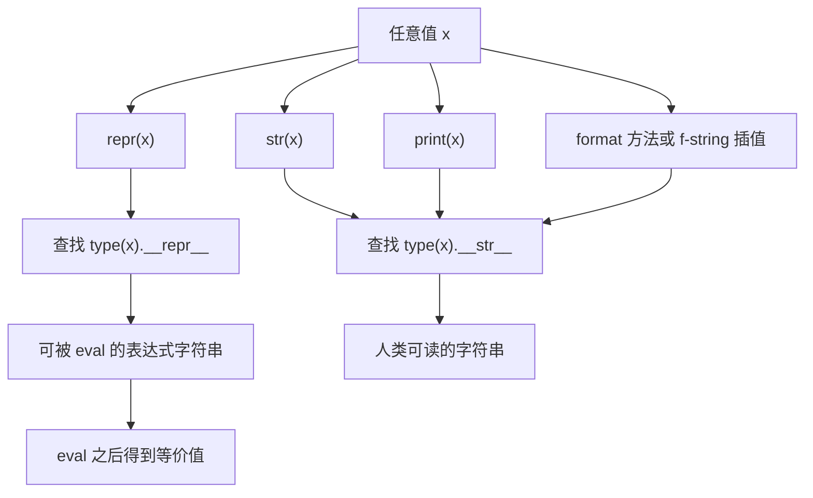
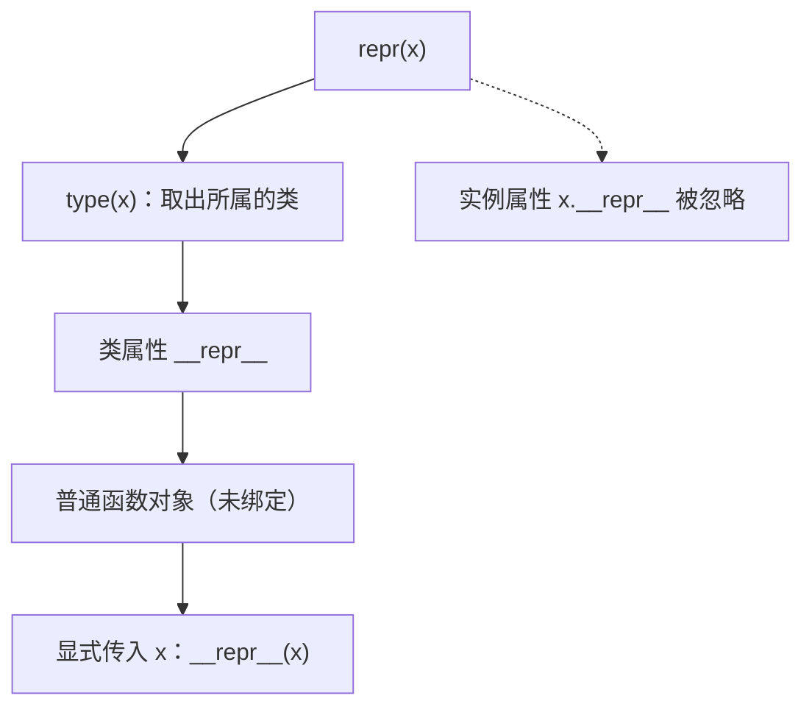
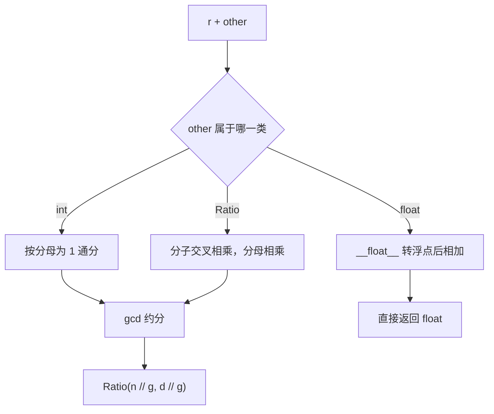

> **课程**：UC Berkeley CS61A · Structure and Interpretation of Computer Programs（Fall 2024）
> **本讲**：Lecture 21 ｜ 30:31 ｜ B 站分 P 21 ｜ [原视频](https://www.bilibili.com/video/BV1sy411z7nA?p=21)
> **课件**：`20-Representation_1pp.pdf`（11 页，官方 PDF，逐页渲染图见正文插图）
> **字幕**：B 站英文原声字幕；本笔记是中文书面化重构，非逐句翻译
> **版权**：课程与课件版权归 UC Berkeley CS61A 教学团队；本文为学习用途的二次整理

## 本讲速览

- **已掌握**：用类定义新类型、用 `__init__` 给实例绑属性、`obj.method()` 的调用语法、属性查找先看实例再看类，以及 `isinstance` 判断一个值属于哪个类。
- **本讲主线**：
    - 每个对象都有两种字符串表示：`str` 给人读，`repr` 给解释器读；后者的设计目标是“把这个字符串求值回去，得到一个等价对象”。
    - `print` 打印的是 `str`，交互式会话回显的是 `repr`；类上没有 `__str__` 时 `str` 退化成 `repr`，所以二者默认一致。
    - 内置 `repr` 几乎没有逻辑，它做的是 `type(x).__repr__(x)`——**问对象自己怎么显示**，这就是接口。
    - 特殊方法名把语法接到类上：`+` 走 `__add__` 与 `__radd__`，`bool` 走 `__bool__`，`float` 走 `__float__`；所谓运算符重载，只是用方法定义覆写语法的含义。
    - 让不同类互相运算有两条路：类型分派（type dispatching）看类型选分支，类型转换（type coercion）先把一方换成另一方的类型再算。
- **关键结论**：一个完整的类型不只装数据，还要回答两个问题——**我该被显示成什么**、**我该怎么和别的对象运算**。本讲把这两个问题都收进“接口”这一个概念里。

*(参考时间: 00:00:01 – 00:00:13｜Lecture 21)*


## 1. 回顾与开场：对象要像它表示的数据

*(参考时间: 00:00:15 – 00:00:39｜Lecture 21)*


课件的第 3、4 页是一次课前回顾：先用分节页“Expressions, Values, & Types (Classes)”把注意力拉回“表达式、值、类型”三件套，再用 Lab 6 的第二题复习类与类之间互相调用。

> **编者说明**：本讲字幕从 00:00:01 起就直接进入“对象的字符串表示”，第 3、4 页的口述部分不在字幕里。这两页的内容按课件原文整理，评述是编者所加，不是课堂原话。


这道题的场景是一套邮件系统：一个 `Client` 把 `Email` 发给它的 `Server`，`Server` 再把它投递到另一个 `Client` 的收件箱。为了实现这件事，`Server` 持有一个叫 `clients` 的字典，把客户名字映射到 `Client` 实例。

```python
class Email:
    def __init__(self, msg, sender, recipient_name):
        self.msg = msg
        self.sender = sender
        self.recipient_name = recipient_name


class Server:
    def __init__(self):
        self.clients = {}

    def send(self, email):
        # Append the email to the inbox of the client it is addressed to.
        self.clients[email.recipient_name].inbox.append(email)


class Client:
    def __init__(self, server, name):
        self.inbox = []
        self.server = server
        self.name = name
```

课件把 `send` 里那一长串属性链逐段拆开，在表达式上方排了四个方框：`Server`、`dict`、`Client`、`list`。方框的作用不是装饰，而是标出**每个子表达式求值之后是什么类型**：先得到服务器，再得到字典，再用收件人名字从字典里取出客户端，最后取出它的收件箱。一串点号之所以读得懂，是因为每一段都输出一个确定类型的对象，下一段就在这个对象上继续查找。

| 子表达式 | 求值结果 | 类型 |
| :--- | :--- | :--- |
| `self` | 正在执行 `send` 的那个服务器 | `Server` |
| `self.clients` | 名字到客户端的映射 | `dict` |
| `email.recipient_name` | 收件人的名字 | `str` |
| `self.clients[email.recipient_name]` | 收件人对应的客户端 | `Client` |
| `self.clients[email.recipient_name].inbox` | 该客户端的收件箱 | `list` |
| `…inbox.append(email)` | 把信塞进收件箱 | `None`（副作用） |

这张表把上一讲反复强调的一件事讲透了：**类型决定了你能在值上做哪些操作**。字典能按下标取值，客户端有 `inbox`，列表能 `append`；链条上任何一环的类型错了，后面的点号就点不下去。

回顾到此结束，本讲从这个比喻开始：面向对象编程里有一句话——**一个对象应当表现得像它所表示的那一类数据**。数学家写分数时用的是分数线，会计写金额时用的是两位小数，从来不会把“分子分母两个整数”直接甩给人看。对象也一样：它内部怎么存是一回事，**对外怎么呈现**是另一回事。这正是本讲的第一个方面：对象应当知道如何把自己呈现给世界，也就是产生一个代表它自己的字符串。

讲师特意说明为什么字符串值得单独占一讲：字符串是描述，它既出现在人与人交流的自然语言里，也出现在编程语言里；而且**字符串里可以装表达式**。这句话是后面所有内容的引子——如果一个字符串能装表达式，那么“生成字符串”和“生成代码”之间就只隔着一层求值。

## 2. 两种字符串表示：`str` 给人类，`repr` 给解释器

*(参考时间: 00:00:41 – 00:03:39｜Lecture 21)*


在 Python 里，这个区分不是约定俗成，而是内建在语言里的：**所有对象都产生两个字符串表示**。一个叫 `str` 字符串，设计目标是**对人可读（legible to humans）**；另一个叫 `repr` 字符串，设计目标是**对 Python 解释器可读（legible to the Python interpreter）**——换句话说，它应该是一个表达式，Python 语言里的表达式。

很多时候这两个字符串长得一模一样，因为 Python 从设计之初就是一门“人能读”的语言：不少表达式的写法，恰好就是一个人想表达同一个意思时会写下的样子。写数字 1，两种情况下都写 1，没有区别。真正有意思的是它们不一样的那些时刻。

`repr` 是一个内置函数，它的约定是：返回一个 Python 表达式形式的字符串，**对这个字符串求值，得到一个与原对象相等的对象**。讲师现场调出 `help(repr)`，文档说得更直白：它返回该对象的 canonical string representation（标准字符串表示），并且补了一句，对大多数对象类型（包括大多数内置类型）来说，`eval(repr(obj))` 会给出一个与原对象等价的对象。

```text
>>> help(repr)
Help on built-in function repr in module builtins:

repr(obj, /)
    Return the canonical string representation of the object.

    For many object types, including most builtins, eval(repr(obj)) == obj.
```

`repr` 的结果还有一个可以直接观察的身份：**它就是交互式会话里你看到的东西**。求值一个表达式，Python 在下面打印出的那一行，正是 `repr` 的返回值。例如把 12 乘以 10 的 12 次方写成一个浮点字面量：

```text
>>> 12e12
12000000000000.0
>>> print(repr(12e12))
12000000000000.0
```

屏幕上是 1 和 2，接着十二个 0，然后一个小数点和一个 0。讲师强调，把 `repr` 的结果再交给 `print`，打印出来的字符完全一样——因为结果本身就是一个字符串。这一点很容易被忽略：`repr` 不是“另一种打印方式”，它产出一个值，只是这个值恰好适合被求值。

但有些对象根本没有简单的 Python 写法。函数、类这类复合对象就是典型：写不出一个能表达“这个对象的一切”的表达式，也写不出“如何构造一个与它相等的对象”的表达式。内置的 `min` 无法用单个表达式写出来，于是 `repr(min)` 给出的是一个**代理（proxy）**：

```text
>>> repr(min)
'<built-in function min>'
```

尖括号是这条约定发出的信号——**这根本不是 Python 表达式**，只是一句人类可读的描述；“生成可求值表达式”这条路在这个对象上走不通，只好退而求其次。这个细节值得记住：`repr` 的目标是“可求值”，但不是硬性保证，而尖括号就是它承认失败时的写法。

`str` 与它相对：`str` 是内置函数，接受任意对象，返回该对象的人类可读表示；**`print` 打印出来的，正是 `str` 的结果**。课件第 6 页把这两种表示并排放，用的例子是标准库里的 `fractions` 模块：一个分数由分子和分母构造，`repr` 就是构造它的那次调用，`str` 则是人类写分数的习惯写法。

```text
>>> from fractions import Fraction
>>> half = Fraction(1, 2)
>>> str(half)
'1/2'
>>> repr(half)
'Fraction(1, 2)'
```


把两种表示按判据逐条对照，是这一讲最值得抄下来的一张表：

| 判据 | `str` | `repr` |
| :--- | :--- | :--- |
| 设计目标 | 人类可读 | Python 解释器可读 |
| 是否应为合法表达式 | 不要求 | 应当（尽量） |
| `eval` 之后得到 | 不保证 | 与原对象等价的对象 |
| 交互式会话回显 | 否 | 是（默认回显的就是它） |
| `print` 使用哪个 | 是 | 否 |
| f-string 的 `{x}` 使用哪个 | 是 | 否（需显式写 `repr(x)`） |
| `Fraction(1, 2)` 的值 | `'1/2'` | `'Fraction(1, 2)'` |
| `'Hello, world'` 的值 | `Hello, world`（无引号） | `"'Hello, world'"` |

把“值到字符串”的整条转换链画成图，`repr`、`str`、`print`、`format` 各自的位置就很清楚了：



> **编者说明**：`'...'.format(x)` 与 f-string 里的 `{x}` 走的是 `__format__`，在格式说明符为空时其默认实现返回 `str(x)`；带说明符（例如 `{:.2f}`）时由具体类型负责解释。`__format__` 属于本讲未展开的语言细节，这里只标注它在链条上的位置，不深究。另外，`repr` 失败时使用尖括号代理这一点，`min`、`max` 这类内置函数以及没有自定义表示的实例都适用，读代码时可以把它当成“这不是可求值表达式”的记号。

## 3. `str` 一侧的出口：`print` 与求真实验

*(参考时间: 00:03:39 – 00:06:08｜Lecture 21)*

为什么还需要 `str`？因为程序经常要和用户交流，人类可读的字符串有用；既然有用，就要让写程序的人能自己生成它。课件把 `Fraction` 拿进解释器跑了一遍，这一遍演示把两个函数的分工钉死了：

```text
>>> from fractions import Fraction
>>> half = Fraction(1, 2)
>>> half
Fraction(1, 2)
>>> print(half)
1/2
>>> str(half)
'1/2'
```

先看 `repr` 这一侧。`repr(half)` 给出 `'Fraction(1, 2)'`——这正是构造这个对象的调用写法，所以对它求值：

```text
>>> eval(repr(half))
Fraction(1, 2)
```

得到的**不是同一个对象**，而是一个等价的新对象：同一个类、同样的分子分母，数值相等。这正是“可求值表示”该有的效果：字符串是重新造一个等价值所需要的全部信息，别的一概不带。

再看 `str` 这一侧。`str(half)` 是 `'1/2'`，人一眼就读懂。有意思的是，`'1/2'` 恰好也是一段合法的 Python 表达式，于是：

```text
>>> eval(str(half))
0.5
```

求值成功，但得到的是一个浮点数，不是分数。讲师的原话是这只是巧合：`1/2` 之所以能被求值，是因为它碰巧符合 Python 的除法语法；它存在的目的从来不是被求值，而是被人读懂。这一个对比胜过十句定义——**`repr` 的字符串是给机器走回去的门，`str` 的字符串是给人看的路牌**。

> **编者说明**：`Fraction` 的两种表示刚好演示了两个设计原则。`repr` 写成构造调用 `Fraction(1, 2)`，保证了 `eval` 回环；`str` 写成 `1/2`，符合人类记法。标准库之所以能两者兼顾，是因为分数的内部状态只有两个整数，构造信息完整可写。反过来，一个对象如果内部状态无法用参数复现（例如它依赖构造时的外部状态），`repr` 就只能退回尖括号描述。

## 4. 字符串的自我表示：引号与 eval 链

*(参考时间: 00:06:10 – 00:08:15｜Lecture 21)*

要看清 `repr` 和 `str` 的区别，最干净的实验对象是字符串自己：它本身已经是字符串，于是“显示它”这件事被迫多处理一层引号。

```text
>>> s = 'Hello, world'
>>> s
'Hello, world'
>>> print(s)
Hello, world
>>> str(s)
'Hello, world'
>>> repr(s)
'"Hello, world"'
```

逐行读。直接在会话里求值 `s`，屏幕上是 `'Hello, world'`——带引号，因为交互式会话显示的是 `repr`。换成 `print(s)`，引号消失，只剩下字符串的内容。`str(s)` 的结果就是 `s` 本身：对一个字符串求 `str`，什么都不会改变。而 `repr(s)` 给出的是“引号套引号”——外层那对引号属于显示，内层那对引号是内容的一部分，因为 `repr` 要给出的是一个**能被求值回原字符串**的表达式。

多层 `repr` 会越套越深。讲师现场连套三层，屏幕上出现一堆反斜杠。为什么？因为每一层 `repr` 都要在自己给出的字符串里再嵌一层引号，而字符串里既可能出现单引号又可能出现双引号，Python 必须用反斜杠标明**哪一对引号真正结束了这个字符串**、哪一对只是一个字符。讲师明确说，这些转义细节不重要，重要的是那条性质：

```text
>>> r3 = repr(repr(repr(s)))
>>> eval(eval(eval(r3))) == s
True
```

**对 `repr` 的结果求值，就回到原对象**；套几层都一样，只要也求值几次。反过来，直接求值 `s` 会失败：

```text
>>> eval(s)
SyntaxError: invalid syntax
```

`Hello, world` 不是合法的 Python 表达式，所以 `eval(s)` 报错，`eval(str(s))` 同样报错，因为 `str(s)` 就是 `s`。加上引号（也就是取 `repr`）之后一切正常。这一组实验说明：`repr` 不是给字符串“加个引号好看”，它是在**补上让这段文本重新变成值所必需的那层语法**。

> **编者说明**：`eval(s)` 的具体报错文字随 Python 版本略有差别，3.10 之后常在 `SyntaxError` 后附一句“Perhaps you forgot a comma?”之类的提示，这不影响结论。另外，`eval` 只接受表达式，不接受语句；`x = 1` 这样的赋值放进 `eval` 同样报错，要执行语句得用 `exec`。

## 5. f-string：把表达式装进字符串字面量

*(参考时间: 00:08:15 – 00:12:03｜Lecture 21)*

字符串既然能装表达式，Python 就提供了直接写这种字符串的语法。**f-string** 是让字符串字面量里可以嵌表达式的特性，也是 Python 目前推荐的字符串插值（string interpolation）写法。

先把“字符串插值”这个词拆开：它指求值一个字符串字面量——引号里的一段文本——而这段文本里同时还含有表达式；这些表达式被求值，结果成为字符串的一部分。什么时候需要它？当你要构造的字符串**既有事先写好的文字，又有某个表达式的计算结果**时，就需要。

这件事用字符串拼接也能做。想把圆周率的前几位塞进一句话里，可以这样：

```text
>>> from math import pi
>>> 'pi starts with ' + str(pi) + '...'
'pi starts with 3.141592653589793...'
```

把三段字符串加起来：一段固定文本、一段 `str(pi)`、一段省略号。结果当然可以继续参与更大的表达式，比如直接交给 `print`。插值是同一件事的另一种写法，**更快、更短**：

```text
>>> f'pi starts with {pi}...'
'pi starts with 3.141592653589793...'
```

就叫 f-string，是因为引号前面有个 `f`。它的特殊之处是：花括号里的内容会被当作 Python 表达式求值，然后嵌进结果字符串。所以你只需要写出想要的文本，以及想被求值并插进去的表达式。注意嵌进去的是**圆周率的值**，不是 `pi` 这两个字符。

`f` 不能省。省掉之后它就是一个普通字符串，花括号原样保留：

```text
>>> '2 + 2 = {2 + 2}'
'2 + 2 = {2 + 2}'
>>> f'2 + 2 = {2 + 2}'
'2 + 2 = 4'
```

花括号里的表达式在**当前环境**里求值，因此它能看到此刻所有可用的名字。讲师用 `abs` 演示了这一点：

```text
>>> f'abs(-4) = {abs(-4)}'
'abs(-4) = 4'
>>> abs = float
>>> f'abs(-4) = {abs(-4)}'
'abs(-4) = -4.0'
```

同一行字面量，因为环境变了，结果就变了：第二次 `abs` 已经被绑定到内置的 `float`，于是 `abs(-4)` 得到 `-4.0`。任何合法的 Python 表达式都能放进花括号，包括带参数的调用：

```text
>>> f'{(lambda x: x + 2)(2)}'
'4'
```

讲师说，如果真想写，放一个复杂的 lambda 进去拿到 4 完全没问题，因为花括号里就是普通的表达式位置。至于引号的用法、花括号本身怎么转义，这些细节受“你在字符串里面”这一处境的限制，讲师明确说**不属于本课程要求**：它们是 Python 特有的低级细节，愿意学就自己查。他真正想留下的是一般概念——字符串字面量里嵌表达式这种机制叫字符串插值，**很多编程语言都有**，不是 Python 的专利。

> **编者说明**：上面 lambda 那一行是为把“任意表达式”演示完整而补的，讲师现场只说“可以写个复杂的 lambda 拿到 4”，没有给出具体表达式。另外，f-string 里花括号内不能直接出现反斜杠（Python 3.12 之前），这也是“细节”之一，本讲不展开。

## 6. 插值取的是 `str`，子表达式按顺序求值

*(参考时间: 00:12:03 – 00:13:14｜Lecture 21)*

插值到底用哪一种字符串表示？答案是 `str`：求值一个 f-string 字面量，得到的结果里含的是**每个子表达式值的 `str` 字符串**。用分数试一下就看见了：

```text
>>> half = Fraction(1, 2)
>>> f'{half}'
'1/2'
```

不是 `Fraction(1, 2)`。如果确实需要 `repr`，只能显式调用：

```text
>>> repr(half)
'Fraction(1, 2)'
```

第二件事更隐蔽：花括号里的子表达式，求值方式和 Python 其它任何地方**完全一样**，也就是说它们可以带副作用，而且是**按出现顺序**求值的。讲师用一个列表演示：

```text
>>> s = [9, 8, 7]
>>> f'{s.pop()} {s.pop()} {s}'
'7 8 [9]'
>>> s
[9]
```

第一个花括号弹出 7，第二个弹出 8，第三个花括号求值 `s` 时列表里只剩 `[9]`。字符串正如预期变成了 `'7 8 [9]'`。这个例子提醒：f-string 不是“纯格式化”，它是一个会执行代码的表达式，副作用发生在它求值的那一刻。

> **编者说明**：Python 的 f-string 支持转换标记，`f'{x!r}'` 等价于把 `repr(x)` 插进去，`f'{x!s}'` 就是默认的 `str(x)`。本讲字幕只提到“想要 `repr` 就调用 `repr`”，没有讲 `!r` 这个写法，此处补上仅供参考，考试与作业按课程要求写显式调用即可。

### 6.1 课件第 7–8 页：两张没有解说的插图


第 7 页是一组方块：边长按 21、13、8、5 依次递减，拼出一个黄金矩形，再用四段四分之一圆弧接出那条螺旋线。第 8 页把同一条螺旋线原样叠在一张熊的照片上，熊的轮廓被框进了同一个方阵。

> **编者说明**：这两页在课件里位于“String Representations”之后、“Class Practice”分节页之前；本讲字幕在 00:12:16 与 00:12:27 之间恰好有一段 11 秒的空档，没有与它们对应的解说。因此这里只描述画面，不推测讲师的用意，也不把这两页当成知识点。

## 7. 多态函数：`repr` 只是请对象自己显示

*(参考时间: 00:13:17 – 00:15:24｜Lecture 21)*

**多态函数（polymorphic function）**是能作用于许多不同类型数据的函数。`str` 和 `repr` 是最好的例子：你几乎可以把手边任何对象传给它们，而它们**总是应该做对**。这件事怎么可能？一个函数怎么会知道几千种类型的正确显示方式？

答案是一个反转：`repr` 并不自己去想，它**请求自己的参数把自己显示出来**。在 Python 里，这件事靠一个特殊的方法名完成：

```text
>>> repr(half)
'Fraction(1, 2)'
>>> half.__repr__()
'Fraction(1, 2)'
```

两种写法给出同样的字符串。区别在于谁在干活：调用方法时，名字 `__repr__` 是从**类**里查到的，所以真正知道“怎么把分数写成字符串”的是 `Fraction` 类，不是 `repr` 函数。`str` 一侧完全对称，只是方法名叫 `__str__`：

```text
>>> half.__str__()
'1/2'
```

讲师在这里停下来强调了一个比 `repr` 本身更重要的想法：**你可以写一个几乎没有逻辑的函数**，它唯一做的事，是按照某个固定名字去调用参数身上的方法，把决定权交还给参数。这个模式不限于 Python——任何有方法查找的语言都能这么写，任何“让数据自己回答如何处理自己”的设计都是它的亲戚。

> **编者说明**：`half.__repr__()` 这种写法在交互式会话里可用，但日常代码不必这样写——直接 `repr(half)` 更清楚。前者用于观察机制，后者用于表达意图。

## 8. 内置 `repr` 与 `str` 的真实实现

*(参考时间: 00:15:27 – 00:17:26｜Lecture 21)*

真实实现比“调用参数上的 `__repr__`”略复杂一点：**内置的 `repr` 会忽略实例属性**。也就是说，如果你在某个实例上挂了一个叫 `__repr__` 的属性，`repr` 函数不会去看它。原因不神秘：特殊方法按类型查找，实例属性天然不参与。

于是问题变成：怎么写一个函数，它取到参数所属**类**里的 `__repr__`，再把它作用在这个参数上？讲师出了一个五选一的小测，只有一个选项符合描述。正确答案的形状是：

```python
def repr(x):
    return type(x).__repr__(x)
```

拆开看三步。先用 `type(x)` 拿到参数所属的类，**这样就绕过了实例属性**——查的是类上的属性，实例上挂着什么都不影响。再取这个类的 `__repr__` 属性，因为查的是类，所以拿到的保证是类属性。最后，这个类属性是一个普通函数对象，**不是绑定方法**（绑定方法只在通过实例访问时才生成），因此必须显式把 `x` 传进去，才能让它作用在传进来的那个参数上。

`str` 的实现更麻烦一点：实例属性 `__str__` 同样被忽略；此外，**如果类上根本没有 `__str__`，`str` 就直接返回 `repr` 返回的东西**。所以默认情况下两者相同——只有当你显式让它们不同，它们才不同。

```python
class NoStr:
    def __repr__(self):
        return 'NoStr()'
```

```text
>>> str(NoStr())
'NoStr()'
```

这个类没有 `__str__`，`str` 于是退回到 `repr`。这条回退规则解释了为什么绝大多数手写类只需要实现 `__repr__` 就够了：交互式会话要它，`print` 也间接要它。



> **编者说明**：五个选项没有出现在课件页上，字幕只描述了正确答案的特征，上面的 `def repr(x)` 是按描述复原的结构演示，实际实现位于解释器内部，而且它会遮蔽内置的 `repr`，不能真的在交互式会话里先执行它再调用 `repr`。另外，若在自定义实例上设置 `t.__repr__ = lambda: 'x'`，`repr(t)` 仍然走类，这是“特殊方法按类型查找”最直接的实验。

## 9. 接口：共享的消息

*(参考时间: 00:17:28 – 00:18:49｜Lecture 21)*

到这里可以给这套机制一个正式的名字了：**接口（interface）**。

回到第一次讲面向对象时的比喻：对象之间**传递消息**，这就是它们互动的方式。语言层面的机制其实很朴素——它们只是查找属性或方法，这就是“传消息”的实现。比喻和机制在这里对上了：**传消息是比喻，查属性是动作**。

属性查找规则被特意设计成这个样子：**不同的数据类型，只要拥有同名属性，就能响应同一条消息**。一条消息（一个属性名）在许多不同的类上都存在，并且在各个类上引出各自正确、但语义相同的行为——这是一种非常有力的抽象手段。这样一组共享的消息，加上“它们各自该做什么”的规范，就叫接口。

`repr` 与 `str` 就是一个现成的接口：实现 `__repr__` 的类承诺给出 Python 可解释的字符串，实现 `__str__` 的类承诺给出人类可读的字符串。调用方只需要知道消息名和契约，不需要知道对面是分数、列表还是自己写的类。

接口不必是语言内建的（虽然这个接口是）。任何一组类，只要它们有同名方法、这些方法做相似的事，你就已经造出了一个接口——哪怕它没有写在任何文档里，只存在于几个人的约定中。

## 10. `Ratio`：给自己的类装上表示接口

*(参考时间: 00:18:52 – 00:20:36｜Lecture 21)*

看懂接口的最好方式是亲手实现一次。已经有一个内建的 `Fraction`，那就造一个类似的、名字不同的类，叫 `Ratio`，这样两者不会混淆。构造方式就是传进分子和分母。

要让 `Ratio` 能被显示，需要定义 `__repr__`，它返回一个字符串：`Ratio` 后面跟一对括号，括号里有两个“空位”，用字符串的 `format` 方法填。`self.numer` 填第 0 个空位，`self.denom` 填第 1 个。

要它同时拥有人类可读的表示，就照 `Fraction` 的样子再写 `__str__`，写成“分子除以分母”的形式。

```python
class Ratio:
    def __init__(self, numer, denom):
        self.numer = numer
        self.denom = denom

    def __repr__(self):
        return 'Ratio({0}, {1})'.format(self.numer, self.denom)

    def __str__(self):
        return '{0}/{1}'.format(self.numer, self.denom)
```

> **编者说明**：本讲没有为 `Ratio` 出课件页，上面的代码按讲师口述整理：他明确说了类名 `Ratio`、构造参数是分子与分母、`__repr__` 用 `format` 的两个空位分别填 `self.numer` 与 `self.denom`，`__str__` 照 `Fraction` 写成 `0/1` 的形状。变量名 `numer`、`denom` 沿用课程惯例。

装上这两个方法之后，两种表示立刻分家：

```text
>>> half = Ratio(1, 2)
>>> half
Ratio(1, 2)
>>> print(half)
1/2
>>> eval(repr(half))
Ratio(1, 2)
```

直接显示 `half`，得到的是能重建它的表达式；`print` 它，得到人写分数的样子。`eval` 那一行是回报：只要 `Ratio` 这个名字在环境里可用，`repr` 给出的字符串就能把对象重新造出来。

## 11. 特殊方法名与运算符重载

*(参考时间: 00:20:40 – 00:25:09｜Lecture 21)*

以双下划线开头和结尾的名字，在 Python 里是一类特殊存在：它们与内置行为绑定，形状固定，**看到前后两个下划线，就知道这个名字和内置对象系统有交互**。这类名字叫特殊方法名（special method names），是 Python 语言特有的题目。

已经见过的几个可以排成一列。`__init__` 特殊，是因为对象被构造时会自动调用它；除此之外它就是普通方法。`__repr__` 特殊，是因为它被用来产生表示对象的字符串，也是交互式会话显示值时用的那个。新出现的是 `__add__`：一个双参数方法，被调用来把一个对象加到另一个对象上。还有两个单参数方法：`__bool__` 把对象转成真或假，告诉你它的布尔值；`__float__` 试着把对象转成实数。

数字已经把这件事演示得很清楚。把 0、1、2 分别绑定给几个名字，然后 `1 + 2` 得 3；`bool(0)` 得 `False`，`bool(1)` 得 `True`。而 `bool` 给出的行为，正是把这些对象放进**布尔上下文**（比如条件语句）里时会得到的行为——同一个判断，两种写法。

整段代码可以改写成显式调用特殊方法的形式：

```text
>>> (1).__add__(2)
3
>>> (0).__bool__()
False
>>> (1).__bool__()
True
```

注意 `1.__add__` 是语法错误：点号前的整数必须加括号，否则 `1.` 会被当成浮点字面量的一部分，整个表达式就无法解析。

这里有两条可以互推的对应关系：**内置的语法与内置函数，和这些特殊方法名一一对应，真正干活的是方法**。`+` 之所以能加两个数，是因为有关 `__add__` 在背后被调用；`bool(...)` 之所以能判断真假，是因为 `__bool__` 在背后被调用。这又是一个接口：它让用户自定义的对象能接入 Python 的内建系统。**Python 因此非常可扩展**——新建一个类，只要覆写 `__add__`，这个类的实例就能用加号相加。

| 语法或内置调用 | 特殊方法名 | 参数 | 作用 |
| :--- | :--- | :--- | :--- |
| `C(...)` 构造实例 | `__init__` | `self, ...` | 初始化新实例的属性 |
| `repr(x)`、交互式回显 | `__repr__` | `self` | 返回可求值、可辨识的字符串 |
| `str(x)`、`print(x)` | `__str__` | `self` | 返回人类可读的字符串 |
| `x + y` | `__add__` | `self, other` | 左操作数是本类实例时的加法 |
| `y + x` | `__radd__` | `self, other` | 右操作数是本类实例时的加法 |
| `bool(x)`、`if x:` | `__bool__` | `self` | 真值判断 |
| `float(x)` | `__float__` | `self` | 转换成实数 |

> **编者说明**：本讲只展开了 `__add__`、`__radd__`、`__bool__`、`__float__` 四个特殊方法名。同一套机制覆盖全部运算符：`==` 对应 `__eq__`，`*` 对应 `__mul__`，`<` 对应 `__lt__`，下标取值 `x[k]` 对应 `__getitem__`。讲师把完整清单指向 Python 官方文档与 *Dive into Python 3*；上面这几个是编者补的常见项，不属于本讲内容。

于是问题变成：两个用户自定义类的实例相加时，究竟发生了什么？答案是调用 `__add__`，或者另一个叫 `__radd__` 的方法，由它真正执行加法。用讲师的话说，**这仍然是在问对象：你们俩怎么把自己加在一起？**

要让 `Ratio` 能相加，就给它加 `__add__`。加完之后，三分之一加六分之一得二分之一，既可以用加号写，也可以直接调用那个真正执行加法的方法，两种写法在 Python 里等价：

```text
>>> third, sixth = Ratio(1, 3), Ratio(1, 6)
>>> third + sixth
Ratio(1, 2)
>>> third.__add__(sixth)
Ratio(1, 2)
```

人们几乎总是用带加号的那一种，因为它好读得多。这个机制存在的**目的**就一个：让写类的人能用定义方法的语法，去覆盖两个对象之间加号的含义——这就是**运算符重载（operator overloading）**；可读性不是附赠品，而是它存在的理由。

`__radd__` 的差别很小：参数是加号**右边**的那个，而 `__add__` 的参数是左边那个。对数字来说加法可交换，两个函数写起来完全一样，谁先谁后无所谓；但完全可以设想一种不可交换的“加法”，这时 `__radd__` 就有用了。讲师没有逐一讲每个特殊方法名与内置特性的对应，他给了一份去处：Python 官方文档，以及在线书 *Dive into Python 3*。

## 12. 让 `Ratio` 真的能相加：通分与 gcd

*(参考时间: 00:25:11 – 00:26:44｜Lecture 21)*

加法本身是熟悉的分数运算：两个分数相加，分子是**第一个的分子乘第二个的分母，加上第一个的分母乘第二个的分子**；分母是**两个分母的乘积**。这套公式对 `Ratio` 同样适用。

算完还不算完。如果不约分，三分之一加六分之一会得到十八分之九——数值没错，但不是最简形式。要把这个比化成两个互质的整数，就得求分子与分母的最大公约数（greatest common divisor），再分别除下去。

```python
def gcd(n, d):
    while n != d:
        n, d = min(n, d), abs(n - d)
    return n


class Ratio:
    ...

    def __add__(self, other):
        n = self.numer * other.denom + self.denom * other.numer
        d = self.denom * other.denom
        g = gcd(n, d)
        return Ratio(n // g, d // g)
```

最大公约数在课程前面讲过。这里的写法是：只要 `n` 与 `d` 不相等，就把它们重新绑定为“两者中较小的那个”和“两者之差的绝对值”，顺序无所谓，因为两个值同时赋值；相等时，这个共同的值就是答案。

| 调用 | `n` | `d` | 循环过程 | 结果 |
| :--- | :--- | :--- | :--- | :--- |
| `gcd(12, 8)` | 12 | 8 | 12≠8 → (8, 4) → 8≠4 → (4, 4) | 4 |
| `gcd(9, 18)` | 9 | 18 | 9≠18 → (9, 9) | 9 |

代入三分之一加六分之一：分子是 1 × 6 + 3 × 1 = 9，分母是 3 × 6 = 18；`gcd(9, 18)` 得 9，于是返回 `Ratio(1, 2)`。

```text
>>> (Ratio(1, 3) + Ratio(1, 6))
Ratio(1, 2)
```

> **编者说明**：上面的 `...` 表示省略的 `__init__`、`__repr__`、`__str__`，这三段代码不在课件页上，按讲师口述整理。约分这一步还有一个附带效果：它让相等的有理数拥有统一写法，`Ratio(2, 4)` 与 `Ratio(1, 2)` 至少在运算结果里不会再同时出现。规范形式（canonical form）这个词本讲没有使用，这里只作为对“为什么要约分”的补充说明。

## 13. 类型分派与类型转换

*(参考时间: 00:26:48 – 00:30:15｜Lecture 21)*

到此为止，`__add__` 有一个隐含假设：加号右边也是一个 `Ratio`。三分之一加三分之一没问题，但三分之一加 1 呢？应该得到三分之四，可代码会去读 `other.denom`，整数身上没有这个属性。

一条办法是**检查 `other` 的类型，据此决定做什么**。如果 `other` 是 `int` 的实例，那就把它看成分母为 1 的分数：分子是 `self.numer` 乘 1 加上 `self.denom` 乘 `other`，分母就是 `self.denom`。如果 `other` 是 `Ratio` 的实例，就用上一节那套通分公式。剩下的约分与返回照旧。

```python
class Ratio:
    ...

    def __add__(self, other):
        if isinstance(other, int):
            n = self.numer * 1 + self.denom * other
            d = self.denom
        elif isinstance(other, Ratio):
            n = self.numer * other.denom + self.denom * other.numer
            d = self.denom * other.denom
        g = gcd(n, d)
        return Ratio(n // g, d // g)

    __radd__ = __add__
```

这样一来，`Ratio(1, 3) + 1` 就能算出三分之四。再补一行 `__radd__ = __add__`，反方向的 `1 + Ratio(1, 3)` 也通了——因为 `__add__` 里对 `int` 与 `Ratio` 两种情形都做了处理，右边是谁都能算。至此，“给一个用户自定义类接上加法”这件事在 Python 里就算做完了。

还有第三种情况：加号右边是浮点数，比如 0.345。这时结果不该是分数——`self.numer` 与 `other` 相加得到的不再是整数，硬造一个 `Ratio` 没有意义。另一个方案是**把已有的分数也转成浮点数**，再让两个浮点数相加。判断 `other` 是不是 `float`，如果是，就返回“把 `self` 转成浮点之后再加上 `other`”的结果。

“把 `self` 转成浮点”是什么意思？这需要自己定义，办法还是特殊方法名：

```python
class Ratio:
    ...

    def __add__(self, other):
        if isinstance(other, int):
            n = self.numer * 1 + self.denom * other
            d = self.denom
        elif isinstance(other, Ratio):
            n = self.numer * other.denom + self.denom * other.numer
            d = self.denom * other.denom
        elif isinstance(other, float):
            return float(self) + other
        g = gcd(n, d)
        return Ratio(n // g, d // g)

    __radd__ = __add__

    def __float__(self):
        return self.numer / self.denom
```

`__float__` 里只做一件事：分子除以分母。于是 `0.2 + Ratio(1, 3)` 也能得到一个合理的结果，而不是报错。



一个例子里用到了两个各有名字的策略。**类型分派（type dispatching）**：检查参数的类型来决定做什么。**类型转换（type coercion）**：把一个类型的对象转成另一个类型，以便和另一个值结合。它们是人们让不同类互相交互时最常用的两种办法；注意 `__add__` 依然是一个双参数方法，只是现在它要处理两个**不同类型**的值。

| 判据 | 类型分派 | 类型转换 |
| :--- | :--- | :--- |
| 做法 | 检查 `other` 的类型，选不同分支 | 把一方转成另一方的类型再运算 |
| 结果类型 | 通常与左操作数同类（仍是 `Ratio`） | 常常变成更“宽”的类型（这里是 `float`） |
| 本讲例子 | `Ratio(1, 3) + Ratio(1, 6)`、`Ratio(1, 3) + 1` | `Ratio(1, 3) + 0.2` |
| 适用前提 | 每种类型都有精确的运算定义 | 一方能无损地嵌入另一方 |
| 代价 | 分支数随类型数增长 | 可能损失精度（分数变浮点） |

## 14. 课堂练习：`Letter` 与 `Numbered`

*(参考时间: 00:30:17 – 00:30:28｜Lecture 21)*


课件最后三页是一组课堂练习，取自 2023 年春季学期期中考试第二题。题目恰好把本讲的两件事绑在一起：`__repr__` 决定对象被 `print` 时显示成什么，而继承让一个子类只改表示、不改行为。

> **编者说明**：本讲录像在 00:30:28 结束，字幕里没有课堂练习的讲解部分。本章依据课件第 9–11 页整理，代码与 doctest 逐字取自课件；锚点取本讲最后一段（关于类型分派与类型转换的收束）作为时间参照，不代表这段内容在录像中出现过。

(a) 实现 `Letter` 类。一封信有两个实例属性：`contents`（一个字符串）与 `sent`（一个布尔值）。每封信只能发送一次。`send` 方法打印这封信是否被发送过；如果刚发送成功，则返回一封回信——一个 `contents` 相同、但全部大写的新的 `Letter`。提示：`'hi'.upper()` 求值为 `'HI'`。

```python
class Letter:
    def __init__(self, contents):
        self.contents = contents
        self.sent = False

    def send(self):
        """A letter receives an all-caps reply.

        >>> hi = Letter('Hello, World!')
        >>> hi.send()
        Hello, World! has been sent.
        HELLO, WORLD!
        >>> hi.send()
        Hello, World! was already sent.
        >>> Letter('Hey').send().send()
        Hey has been sent.
        HEY has been sent.
        HEY
        """
        if self.sent:
            print(self, 'was already sent.')
        else:
            print(self, 'has been sent.')
            self.sent = True
            return Letter(self.contents.upper())

    def __repr__(self):
        return self.contents
```


关键在 `print(self, 'has been sent.')` 这一行。`print` 用的是 `str`，而 `Letter` 没有定义 `__str__`，于是 `str` 按上一节的回退规则去找 `repr`，`__repr__` 返回 `contents`，打印出来就是信件正文。**一个类的表示方法，同时决定了它被打印时的样子**——这就是本讲反复强调的“问对象自己怎么显示”。

逐条走一遍 doctest 的三种调用：

| 调用 | `sent` 状态 | 打印 | 返回值 |
| :--- | :--- | :--- | :--- |
| `hi.send()` | `False` → `True` | `Hello, World! has been sent.` | `Letter('HELLO, WORLD!')`，交互式会话把它显示成 `HELLO, WORLD!` |
| `hi.send()` | `True` | `Hello, World! was already sent.` | `None` |
| `Letter('Hey').send().send()` | 两次新对象，各自 `False` → `True` | `Hey has been sent.` 与 `HEY has been sent.` | 最后一封信显示 `HEY` |

(b) 实现 `Numbered` 类。带编号的信有一个 `number` 属性，等于在它之前已经构造了多少封带编号的信；这个编号要出现在它的 `repr` 字符串里。假设 `Letter` 已正确实现。

```python
class Numbered(Letter):
    number = 0

    def __init__(self, contents):
        super().__init__(contents)
        self.number = Numbered.number
        Numbered.number += 1

    def __repr__(self):
        """A numbered letter has a different repr method that shows its number.

        >>> hey = Numbered('Hello, World!')
        >>> hey.send()
        #0 has been sent.
        HELLO, WORLD!
        >>> Numbered('Hi!').send()
        #1 has been sent.
        HI!
        >>> hey
        #0
        """
        return '#' + str(self.number)
```


两处细节值得停一下。第一，`number = 0` 写在类体里，是**类属性**，所有实例共享同一个计数器；`self.number = Numbered.number` 把当前计数抄进实例属性，然后 `Numbered.number += 1` 推进计数器。如果写成 `self.number += 1`，改的是实例属性，类属性永远不动，下一封信又会拿到同一个编号——这是本讲内容与“属性查找先实例后类”的交叉陷阱。第二，子类只换了 `__repr__`，`send`、`__init__` 的行为完全继承，`super().__init__(contents)` 保证父类那部分属性照常建立。

形状与前面一致：`print` 走 `str`，`str` 回退到子类的 `__repr__`，于是屏幕上出现 `#0 has been sent.`；而交互式会话显示 `hey` 时同样走 `__repr__`，屏幕上只有 `#0`——回显只负责显示这个值，不会像 `print` 那样再补空格和后续文字。

> **编者说明**：`Numbered.number` 这种“类属性做计数器、实例属性存快照”的写法在课程项目中反复出现，值得单独记住。另外，`Letter.__repr__` 返回的 `'Hello, World!'` 并不是一个合法表达式，违反了第 2 节说的“尽量可求值”；可见可求值性是设计目标而非语法约束，题目要求的输出格式优先。

## 小结

- **两种表示是两个契约**：`repr` 承诺“求值回去得到等价对象”，`str` 承诺“人读得懂”。写自定义类时先问这两句话，再决定每个方法返回什么。
- **默认回退是有意设计**：`print` 走 `str`，`str` 在没有 `__str__` 时退回 `repr`；因此只实现 `__repr__` 的类，打印与回显会自动一致。想让两者不同，必须显式写 `__str__`。
- **多态靠“问对象”而不是“判断对象”**：`repr(x)` 的实现只是 `type(x).__repr__(x)`，语法与内置函数都把决定权转交给特殊方法，于是新类型无需改动任何内置代码就能接入系统。
- **特殊方法名是一张对照表**：`+` 对 `__add__`/`__radd__`，`bool` 对 `__bool__`，`float` 对 `__float__`，`print` 对 `__str__`。记住这张表，就记住了“语法糖背后是谁在干活”。
- **跨类型运算有两条策略**：类型分派按 `other` 的类型分支，保住精确的分数运算；类型转换把一方换成浮点，牺牲精度换取通用性。二者可以同时存在于一个 `__add__` 里，分支顺序就是优先级。
- **接口是被约定的名字**：一组类共享同名方法、共享语义，就构成接口；语言只提供查找机制，语义由写类的人保证。

*(参考时间: 00:29:54 – 00:30:28｜Lecture 21)*

## 附：本讲幻灯片索引

*(参考时间: 00:00:01 – 00:30:28｜Lecture 21)*

| 页 | 内容 | 出现位置 |
| :--- | :--- | :--- |
| 1 | 标题页 Representation | 本讲速览 |
| 2 | Announcements 公告页 | 本讲速览 |
| 3 | 分节页：Expressions, Values, & Types (Classes) | §1 |
| 4 | Lab 6 第二题：Email、Server、Client 与属性链标注 | §1 |
| 5 | 分节页：String Representations | §2 |
| 6 | 两种字符串表示的定义与 Fraction 示例 | §2 |
| 7 | 斐波那契方阵与黄金螺旋 | §6.1 |
| 8 | 黄金螺旋叠在熊的照片上 | §6.1 |
| 9 | 分节页：Class Practice | §14 |
| 10 | 期中第二题 (a)：Letter 类 | §14 |
| 11 | 期中第二题 (b)：Numbered 类 | §14 |
