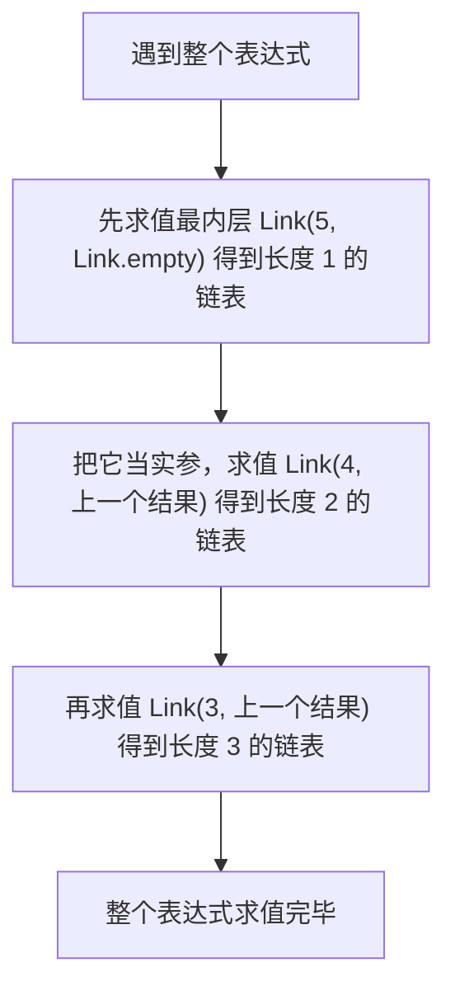
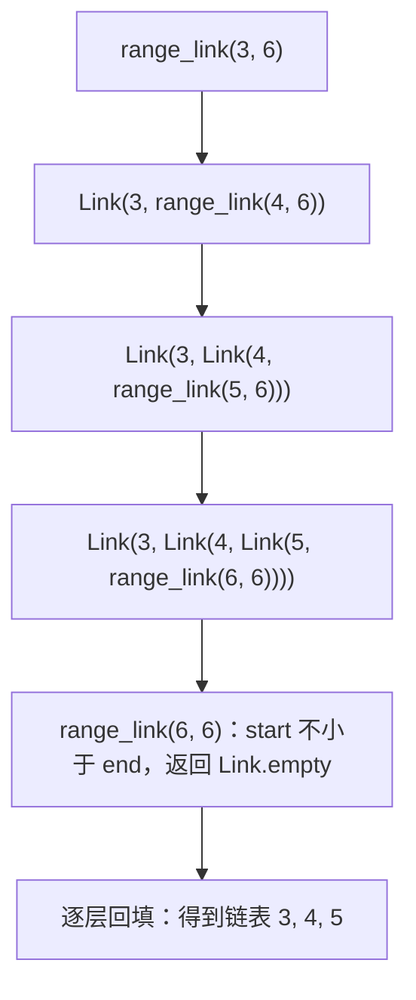
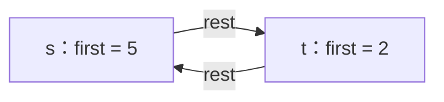
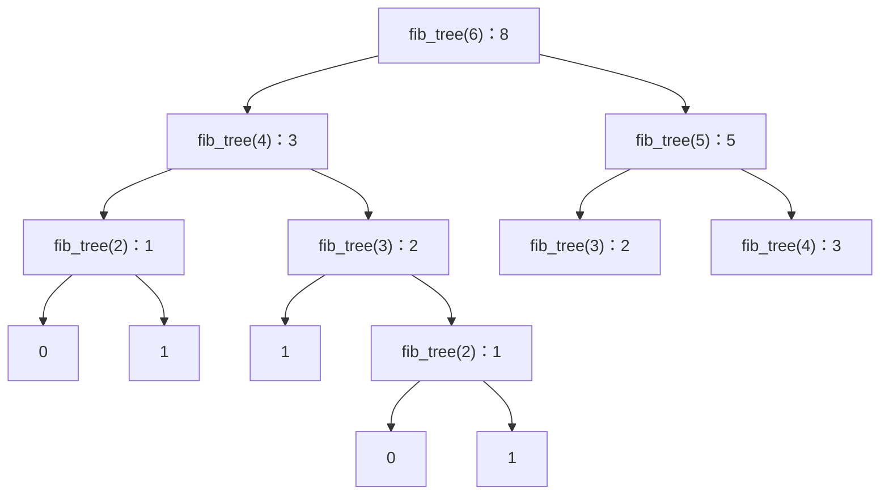

> **课程**：UC Berkeley CS61A · Structure and Interpretation of Computer Programs（Fall 2024）
> **本讲**：Lecture 22 ｜ 33:16 ｜ B 站分 P 22 ｜ [原视频](https://www.bilibili.com/video/BV1sy411z7nA?p=22)
> **课件**：`21-Composition_1pp.pdf`（16 页，官方 PDF，逐页渲染图见正文插图）
> **字幕**：B 站英文原声字幕；本笔记是中文书面化重构，非逐句翻译
> **版权**：课程与课件版权归 UC Berkeley CS61A 教学团队；本文为学习用途的二次整理

## 本讲速览

- **已掌握**：用 `class` 定义新类型、在 `__init__` 里给 `self` 绑属性；`str` 与 `repr` 两种表示的分工；树的数据抽象（`tree(label, branches)` 加 `label`、`branches`、`is_leaf` 三个选择器）；递归函数“基准情形 + 递归情形”的写法。
- **本讲主线**：
    - 链表是**一对值**：一个 `first` 加一个 `rest`，`rest` 要么是另一个链表，要么是空；一个对象把另一个对象装进自己的属性里，这就是标题里的组合（composition）。
    - 用类实现链表：`__init__` 收 `first` 与 `rest`，并用 `assert` 把“`rest` 只能是链表或空”这条不变量钉死在构造函数里，而不是留给调用者自觉。
    - 递归的数据结构天然配对递归函数：`range_link`、`map_link`、`filter_link`、`slice_link` 都是“空就返回空，否则处理第一个元素再递归处理 `rest`”。
    - 对象可以被就地修改，于是能写出只靠副作用、不返回新结构的版本：`add`、`double_link`、`insert_link`、`prune`；`rest` 甚至能指回自己，让一个三元素链表长出任意长的引用链。
    - 树是同一种组合的另一个方向：`label` 加一串子树。改用类实现后，构造函数之外不必再显式写选择器，属性名就是表示。
- **关键结论**：数据结构的形状决定处理它的函数的形状。链表与树都把“规模”编码在引用里，所以基准情形只有两个——空、叶子；把结构写进类之后，**不变量由构造函数守、显示由表示方法负责、算法只剩推进这一步**。

*(参考时间: 00:00:01 – 00:00:08｜Lecture 22)*


## 1. 内置列表的账：为什么还需要另一种序列

*(参考时间: 00:00:09 – 00:00:14｜Lecture 22)*


> **编者说明**：本讲录像从第一秒起就进入链表，课件第 3、4 页这段“列表效率”没有出现在字幕里。两页内容按课件原文整理，评述与推论由编者补写；本节锚点取开场关于“为什么讲链表”的两句，只标位置，不表示这段被讲过。

课件用一句话把内置列表的性能分成两档：**追加、按下标赋值、列表推导都很快；在开头或中间插入、切片、把两个列表相加都很慢**。快慢的差别不在“做了什么”，而在“要不要搬动已有的元素”。


页面上画的方框很说明问题：`3 5 2 9 4 2 6` 后面跟一格空白，表示末尾还有预留空间，`append` 直接写进空格里；而插入一格、切一段、或者做一次 `+`，画出来的都是**另起一排方框**，把老元素复制过去。同一个任务（造一张装平方数的表）用五种写法实现，最快与最慢相差约六千倍。

```python
def using_list_comprehension(n):
    return [k * k for k in range(n)]

def using_append(n):
    s = []
    for k in range(n):
        s.append(k * k)
    return s

def using_assign(n):
    s = [0 for k in range(n)]
    for k in range(n):
        s[k] = k * k
    return s

def using_insert(n):
    s = []
    for k in range(n):
        s.insert(0, k * k)
    return s

def using_add(n):
    s = []
    for k in range(n):
        s = s + [k*k]
    return s
```

`n = 100,000` 时的实测值：

| 写法 | 扩张手段 | 耗时 |
| :--- | :--- | :--- |
| `using_list_comprehension` | 一次性推导出新表 | 1.58 ms |
| `using_append` | `s.append(k * k)` 写在末尾空格 | 1.76 ms |
| `using_assign` | 先按长度占位，再按下标赋值 | 2.58 ms |
| `using_insert` | `s.insert(0, k * k)` 每次都挤到最前 | 1,470 ms |
| `using_add` | `s = s + [k*k]` 每次都整表复制 | 9,210 ms |

前三种都是“往后面放”，代价与元素个数成正比；`using_insert` 每次都在**开头**插入，每插一次，后面已有的元素都要整体后移一格，总代价变成平方级；`using_add` 还要额外复制整张表，于是又慢了六倍多。这张表就是本讲的动机：**如果一种序列只允许在头部生长、不允许按下标访问，它的操作代价可以完全换一副面孔**。链表正是这样一种序列——它放弃了“按下标直接跳到第 k 个”的能力，换来“在头部插入只要改一个指针”。

| 判据 | 内置 `list` | 链表 `Link` |
| :--- | :--- | :--- |
| 按下标取第 k 个 | 常数时间，靠偏移量直接定位 | 线性时间，顺 `rest` 走 k 步 |
| 在头部插入 | 线性，所有元素后移一格 | 常数，造一个节点指向旧头 |
| 在中间插入 | 线性，后半段整体后移 | 线性，先走 k 步找位置，之后只改指针 |
| 追加到末尾 | 均摊常数（`append`） | 线性，没有尾指针就得走到末尾 |
| 切片 | 有语法，但要复制那一段 | 没有下标语法，得自己写函数 |
| 两个序列拼接 | `+`，复制两边 | 只能靠共享尾巴，没有内置写法 |
| 内存布局 | 一整块连续空间，带冗余容量 | 每个节点两个字段，散落在堆上 |

这张表解释了为什么链表值得单独学：它不是“更好的列表”，而是**用随机访问换插入自由度**的另一种取舍。也解释了本讲后面几个练习为什么反复在“头部插入”和“中途插入”上做文章——那正是链表的强项与弱项的分界线。

## 2. 链表的递归定义：一个 `first`，一个 `rest`

*(参考时间: 00:00:16 – 00:04:54｜Lecture 22)*


链表在计算机科学里是基础数据结构，几乎无处不在。定义只有一句话：**一个链表要么是空的（里面什么都没有），要么是一个“第一个值”加上“序列剩下的部分”**。非空的链表把序列的首个元素放在 `first` 里，把剩下的元素放进一个**同样是链表**的对象，挂在 `rest` 上。


课件用序列 `3, 4, 5` 演示：最外层是一个 `Link` 实例，`first` 是 3，`rest` 指向另一个 `Link` 实例；第二层 `first` 是 4，`rest` 再指向第三层；第三层 `first` 是 5，`rest` 已经没有值可放了。


所以每个链表都以一个**更小的链表**作为自己的 `rest`——这条规律有一个例外，就是最末端那个空链表。这里用一个特殊值 `Link.empty` 表示“什么都不剩了”。`Link.empty` 没有 `first` 也没有 `rest`，它不代表某个元素，只代表“结束”。课件把它单列成一个类属性，因为所有空链表都是同一个东西，没必要为每个空链表都造一个实例。

理解链表的关键一步，是**不要把它想成“某个类加上某些属性名”**，而要想成一对值：某个序列的第一个元素，和这个序列剩下的部分。正因为如此，讲师把 `first` 里的元素称为**第零个元素（zeroth element）**——它将来会对应下标 0，而 `rest` 里装的就是下标 1 之后的所有元素：

- `first` 是序列的第 0 个元素，是一个普通的值（这里是整数）。
- `rest` 是序列剩下的部分，它本身又是一个链表，或者 `Link.empty`。
- 空链表是唯一的边界情形，它没有第 0 个元素。

这一步也解释了本讲的标题。**对象的属性值可以是另一个对象**；当这个“另一个对象”和外面那个对象属于同一个类时，用组合（composition）就造出了任意深度的结构。链表之所以能表示任意长的序列，靠的不是语言提供的容器，而是“对象套对象”这一个动作。

把这个结构写成表达式，就是构造函数一层层套下去：

```python
Link(3, Link(4, Link(5, Link.empty)))
```

注意不能写成 `3, 4, 5`——那会得到一个元组。必须把每一层都显式造出来：最里层是 `Link(5, Link.empty)`，往外一层是 `Link(4, 刚才那个)`，最外一层是 `Link(3, ...)`。这里有一条 Python 求值规则在起作用：**调用表达式先求值操作数，再应用函数**。要算出 `Link(3, ...)`，Python 必须先算出它的第二个操作数，而那又是一个调用，于是求值一路向内钻到底，再一层层往外造。



每调用一次 `Link` 就造出一个新实例；外层的实例必须等内层的实例造好才能存在。这个“先内后外”的顺序不是细节——它正是递归构造函数（第 5 节）能成立的原因：递归调用先把尾巴造好，再用它造头。


这种结构太常见，以致于业界有一套画法约定：把每个节点画成两个格子，一个装 `first`，一个装指向下一个节点的箭头。**指向空链表的那根箭头通常不画，改成一道斜杠**。讲师特意说明这不是任何官方记号，但世界上很多人这么画，所以值得认识。课件第 7 页把三种视图叠在一起：属性表（`first: 3` / `rest:`）、两条并排的构造表达式（`Link(3, Link(4, Link(5)))` 用默认参数省掉了 `Link.empty`）、以及底下那排带斜杠的方框。同一页给出的 `<3 4 5>` 是打印形式，与 `Link(3, Link(4, ...))` 这种构造形式是一回事的两种写法，正好对应上一讲说的 `str` 与 `repr` 两种表示。

最后一步是把结构“镜像”进实现：既然空链表就是“没有剩余”，那就让 `rest` 的默认值等于 `Link.empty`，这样构造时可以省略它。于是 `Link(3, Link(4, Link(5)))` 与上面那个写全的表达式完全等价。**默认参数不是省事的语法糖，它把数据结构的归纳规则直接写进了函数签名**：每个链表的尾巴只能是链表或空，而空是默认值。

## 3. `Link` 类：把不变量写进构造函数

*(参考时间: 00:04:57 – 00:07:13｜Lecture 22)*


要让 `Link(3, Link(4, Link(5)))` 真的求值成一个链表，需要一条 `class` 语句。整个类只有两条语句：一个类属性、一个 `__init__`。

```python
class Link:
    empty = ()      # Some zero-length sequence

    def __init__(self, first, rest=empty):
        assert rest is Link.empty or isinstance(rest, Link)
        self.first = first
        self.rest = rest
```

`__init__` 的第一个动作不是存值，而是**检查**：`rest` 要么就是 `Link.empty`，要么是一个 `Link` 实例，别的一概不接受。这条断言把第 2 节那条归纳规则变成了可执行的检查——如果哪天误把 `Link(3, [4, 5])` 传进来，程序在构造那一刻就会停下并报错，而不是等到三层调用之后、遍历到某个深处时抛出一个莫名其妙的 `AttributeError`。**错误越早暴露，越容易定位**，这是构造函数放断言的主要理由。

检查用 `is` 而不是 `==`：`rest is Link.empty` 问的是“它是不是那一个空链表对象”，而不是“它是否等于某个空序列”。链表的终止条件从来是同一个对象，身份比较才是它的本意。

`isinstance` 与 `type` 的差别在这里是有意的。`isinstance(rest, Link)` 在 `rest` 属于 `Link` 的**子类**时也为真；`help(isinstance)` 的说明是“返回一个对象是否是某个类、或者该类的某个子类的实例”。如果写成 `type(rest) == Link`，任何继承 `Link` 造出来的专用链表都会被构造函数拒绝。用 `isinstance` 意味着**系统是可扩展的**：将来写一个 `Link` 的子类来表示“有序链表”或“带缓存的链表”，同一个构造函数照样能用，这条校验也照样通过。写子类时会反复用到这种“父类的构造逻辑配子类的额外行为”的写法。

`empty = ()` 是一个设计选择。也可以专门发明一个空链表类，但讲师选了**空元组**这个零长度序列，理由很直接：空链表本来就是零长度的序列，用现成的零长度值表示它，既省事又不引入多余概念。代价是它没有 `Link` 的任何属性与方法（`first`、`rest` 都不存在），所以任何用到空链表的地方都得先判 `is Link.empty`，而不能指望调用它的方法。

课件第 8 页只列出了 `empty` 与 `__init__` 两条，`<3 4 5>` 这种打印形式来自类上另外定义的显示方法（本讲没有逐行展开）。按上一讲的规则，`print` 走 `str`、交互式会话回显走 `repr`，所以同一个链表有两种合法的长相：`repr` 给出构造式 `Link(3, Link(4, Link(5)))`，`str` 给出 `<3 4 5>`。本讲后面那些 doctest 里两种写法都出现，正是因为一个在测构造式、一个在测打印式。

## 4. 演示：构造、取值、就地修改

*(参考时间: 00:07:16 – 00:08:51｜Lecture 22)*

课件第 8 页底部标着 `(Demo)`，接下来的内容是现场敲代码。把 `3, 4, 5` 绑到名字 `s` 上，就可以逐层观察它的属性：

```python
>>> s = Link(3, Link(4, Link(5)))
>>> s.first
3
>>> s.rest.first
4
>>> s.rest.rest.first
5
>>> s.rest.rest.rest is Link.empty
True
```

取值的写法是理解链表的第二把钥匙。**没有下标，只有属性链**：要拿第 0 个元素写 `s.first`，要拿第 1 个写 `s.rest.first`，要拿第 2 个写 `s.rest.rest.first`。每一段 `.rest` 都是“往后挪一个位置”，而挪到第 3 段时拿到的是空链表——它没有 `first`，只用来回答“还有没有”。

链表可以被修改。`s.rest.first = 7` 直接改掉中间那个节点的值，整个序列就从 `3, 4, 5` 变成 `3, 7, 5`。但讲师强调，链表最常见的用法恰恰**不是**就地改值；它被设计出来主要服务的场景是“在头部加一个不同的值，造出一个和原链表相似的新链表”：

```python
>>> t = Link(0, s)      # 新链表共享了 s 的尾巴
```

这一行没有复制任何节点。`t` 是新的头，它的 `rest` 就是 `s` 本身。于是两个链表共享了后面整段结构，这叫**共享子结构（shared structure）**，是第 6 节那个“环”的前身：既然 `rest` 只是一个引用，那么让两处 `rest` 指向同一个对象是零成本的。函数式风格的程序大量依赖这一点——不改旧结构，只在其上包一层新的。

## 5. 递归处理链表：自己实现 `range`、`map`、`filter`

*(参考时间: 00:08:54 – 00:14:49｜Lecture 22)*

`range`、`map`、`filter` 都是 Python 内置的，但它们不认识链表——链表是用户自己定义的类，语言没有理由为它准备现成的处理函数。想要同等的功能，就得自己写一份，名字通常叫 `range_link`、`map_link`、`filter_link`。

先复习这三个东西在内置类型上做什么。假定有两个现成的函数：`square` 把参数平方，`odd` 判断参数是否为奇数。下面这个表达式取 1 到 5，筛出奇数，再平方：

```python
>>> list(map(square, filter(odd, range(1, 6))))
[1, 9, 25]
```

> **编者说明**：字幕在 00:09:55 附近只口述了这个表达式的三步，没有逐字念出代码；上面的写法是按口述复现的。第三步要包一层 `list` 才能看到结果，因为 Python 3 的 `map` 与 `filter` 返回的是迭代器而不是列表。

换成链表，动作一模一样，只是函数名多了一个后缀：用 `range_link` 造链表，`filter_link` 筛奇数，`map_link` 平方，最后得到一个装着 `1, 9, 25` 的链表。

三个函数都是递归函数，形状完全一致：**先问是不是空，空就收工；不空就拆出第一个元素，把剩下的部分交给递归调用。**

```python
def range_link(start, end):
    """Return a Link containing consecutive integers from start to end.

    >>> range_link(3, 6)
    Link(3, Link(4, Link(5)))
    """
    if start >= end:
        return Link.empty
    else:
        return Link(start, range_link(start + 1, end))


def map_link(f, s):
    """Return a Link that contains f(x) for each x in Link s.

    >>> map_link(square, range_link(3, 6))
    Link(9, Link(16, Link(25)))
    """
    if s is Link.empty:
        return s
    else:
        return Link(f(s.first), map_link(f, s.rest))


def filter_link(f, s):
    """Return a Link that contains only the elements x of Link s for which f(x) is a true value.

    >>> filter_link(odd, range_link(3, 6))
    Link(3, Link(5))
    """
    if s is Link.empty:
        return s
    filtered_rest = filter_link(f, s.rest)
    if f(s.first):
        return Link(s.first, filtered_rest)
    else:
        return filtered_rest
```

> **编者说明**：这三个函数的代码没有出现在课件页上，讲师是在编辑器里现场写的。上面的写法按字幕口述逐条复原（含返回值、递归调用位置），docstring 与 doctest 由编者补上，格式与前文几个函数的 doctest 保持一致，便于直接运行。

`range_link` 的基准情形不是“链表空了”，而是“`start` 已经不小于 `end`”——这里的“规模”由两个整数刻画。其余两个函数的基准情形都是 `s is Link.empty`。`map_link` 在空链表上可以直接返回 `s` 本身，也可以返回 `Link.empty`，两者是同一个东西的两种写法。`filter_link` 比 `map_link` 多一步：它先把尾部筛好存进 `filtered_rest`，再决定当前这个元素留不留；留就把它套在筛好的尾巴上，不留就直接把尾巴交出去。这个“先递归、后决定”的顺序很关键——若先决定再递归，就得在两个分支里各写一次 `filter_link(f, s.rest)`，同一份递归调用重复出现，改错一边都不会报错。



这张图把递归的展开过程摊平了：四次调用先在“向下”的方向堆起来，直到遇到基准情形才停；然后 `Link` 从最内层开始一层层往外造，最后回填成完整的链表。**递归函数在链表上的形状，恰好是链表自身的形状**——一条链，一头是基准情形，一头是结果。

跑一遍 doctest 就能确认三者能串起来：

```python
>>> s = range_link(1, 6)
>>> print(s)
<1 2 3 4 5>
>>> print(map_link(square, filter_link(odd, s)))
<1 9 25>
```

> **编者说明**：录像在 00:14:31 那一句把结果念成了“1, 9, 16”。按定义，`range_link(1, 6)` 是 1 到 5，筛出奇数 1、3、5，平方得 1、9、25；同一段演示在 00:10:09 附近也明确说过“5 的平方是 25”。笔记按计算结果写成 `<1 9 25>`。

链表的定义是递归的，处理它最自然的方式也就是递归。这一点值得记住：**看到“自己包含自己”的数据，先去找它的基准情形**——链表是空，树是叶子；找到了基准情形，递归函数的骨架也就有了。

## 6. 修改与共享：当 `rest` 指回自己

*(参考时间: 00:14:51 – 00:17:15｜Lecture 22)*

链表实例是普通对象，而用户定义的类的实例都可以被修改。用属性赋值语句，可以改掉一个 `Link` 实例的 `first` 与 `rest`。这带来一个有意思的后果：**一个链表的 `rest` 里可以装着这个链表自己**。

从一个三元素链表 `1, 2, 3` 出发，只做三次赋值：

```python
>>> s = Link(1, Link(2, Link(3)))
>>> s.first = 5
>>> t = s.rest
>>> t.rest = s
```

前两步之后，`s` 是 `5, 2, 3`，`t` 是 `2, 3`。第三步把 `t.rest` 改成 `s`，结构就闭合了：



此时问 `s.rest.rest.rest.rest.rest.first` 是多少，就得数着走。`s.rest` 是 `t`，`t.rest` 是 `s`，于是 `rest` 的个数是奇数时落在 `t` 上，是偶数时落在 `s` 上：

| 表达式 | 走了几次 `rest` | 落在哪个节点 | `.first` 的值 |
| :--- | :--- | :--- | :--- |
| `s.rest.first` | 1 | `t` | 2 |
| `s.rest.rest.first` | 2 | `s` | 5 |
| `s.rest.rest.rest.first` | 3 | `t` | 2 |
| `s.rest.rest.rest.rest.first` | 4 | `s` | 5 |
| `s.rest.rest.rest.rest.rest.first` | 5 | `t` | 2 |

答案是 2。合理的反应是：一共才三个元素，怎么会有这么多 `.rest`？答案是**结构变了**——造它的时候它只有三个元素，但 `t` 是 `s` 的一部分，改掉 `t.rest` 就改掉了 `s` 的结构。这就是为什么第 4 节说“共享子结构”值得单独记一笔：两个名字指向同一块内存时，改一处等于改两处，而且改动的大小不限于局部——它能把一条链变成一张任意形状的图。

> **编者说明**：录像在 00:17:08 复述这个表达式时多念了一次 `.rest`，与前面 00:16:23 的问法（5 次）不一致；6 次 `rest` 会落回 `s`，答案是 5。笔记按“5 次、答案 2”记录，并用上表把奇偶规律讲清楚。

这也提示了链表的一个“危险区”：**能改属性，就意味着能造出环，而环形结构会让很多递归函数永不终止**。本讲后面所有遍历函数都以 `is Link.empty` 为基准情形，一旦链上有环，这个条件就永远等不到。链表之所以“通常不改”，不只是风格偏好，也是安全边界。

## 7. 有序表的插入 `add`：递归只为副作用

*(参考时间: 00:17:18 – 00:21:44｜Lecture 22)*

接下来是链表修改的经典例子：维护一个**从小到大排列、且没有重复元素**的链表，写一个 `add(s, v)` 把 `v` 插到正确位置。约定是：如果 `v` 已经在 `s` 里，就不改动 `s`（避免重复）；无论改没改，函数都返回 `s`。

四种情形说清了所有分支。假设 `s` 是 `1, 3, 5`：

- 加 0：0 比头还小，于是造一个新节点装旧的 1（它的 `rest` 指向旧的 3、5），再把 `s.first` 改成 0、`s.rest` 指向新节点。结果 `0, 1, 3, 5`，只多了一个节点，没有重写已有的值。
- 加 3：3 已经在表里，什么都不做，原样返回。
- 加 4：走到 3 与 5 之间。把当前那个装 5 的节点**改名**成 4，再为 5 接一个新节点。结果 `0, 1, 3, 4, 5`。
- 加 6：一路走到末尾，`rest` 是空，于是把 `rest` 换成一个装 6 的新节点。

```python
def add(s, v):
    """Add v to an ordered list s with no repeats, returning modified s.

    >>> s = Link(1, Link(3, Link(5)))
    >>> add(s, 0)
    Link(0, Link(1, Link(3, Link(5))))
    >>> add(s, 3)
    Link(0, Link(1, Link(3, Link(5))))
    >>> add(s, 4)
    Link(0, Link(1, Link(3, Link(4, Link(5)))))
    >>> add(s, 6)
    Link(0, Link(1, Link(3, Link(4, Link(5, Link(6))))))
    """
    assert s is not Link.empty
    if s.first > v:
        s.first, s.rest = v, Link(s.first, s.rest)
    elif s.first < v and s.rest is Link.empty:
        s.rest = Link(v)
    elif s.first < v:
        add(s.rest, v)
    return s
```

三个分支对应三种“位置关系”：`v` 比当前头小，就地插在头前；`v` 比当前头大而后继为空，接在末尾；`v` 比当前头大且后面还有节点，往下走。**`v` 等于当前头时三个条件都不成立**，函数直接走到最后的 `return s`，这就是“不重复插入”的全部实现——它没有写任何显式的相等判断，靠的是三个条件的互补。

> **编者说明**：字幕在 00:20:45 附近把第三个条件口述成了“如果 `s.rest` 小于 `v`”，而代码里真正需要判断的是 `s.first < v`（后一种写法才能保证 `s.first == v` 时三条分支同时不成立、从而不插入重复值）。上面的代码按这一语义写成，与字幕口述的措辞不完全一致。

这个函数最值得记住的一行是递归调用 `add(s.rest, v)`：**它没有 `return`**。原因在最后那行 `return s`——每一层都返回自己，递归调用不是去算一个要返回的值，而是去**完成任务**。讲师的说法是：这次调用的目的不是算出一个值来返回，而是在 `s` 的剩余部分上把加法做掉。

这是本讲第一次出现“递归只为副作用”的写法，它和 `map_link` 那类“递归算出一个新结构”正好互补：

| 判据 | `map_link` 式递归 | `add` 式递归 |
| :--- | :--- | :--- |
| 递归调用的返回值 | 下一层的结构，必须用它拼出结果 | 没人用，丢弃 |
| 是否改动实参 | 完全不动，造新结构 | 就地改 `first` / `rest` |
| 递归的作用 | 计算 | 推进到一个位置 |
| 基准情形 | `s is Link.empty` | 找到插入点就停（不必到底） |
| 空间代价 | 新链表与原链表等长 | 只多一个新节点 |

`add` 的时间代价与插入位置有关：最坏要走到末尾，线性；但**一旦走到位置，插入本身是常数时间**——这正是第 1 节那张代价表许诺的那笔交易。

## 8. 练习组：重复插入、切片、按位插入与期中题

*(参考时间: 00:21:44 – 00:21:54｜Lecture 22)*


> **编者说明**：课件第 9–16 页是链表部分的练习页。本讲录像在 00:21:54 讲完有序插入后直接转入树，这八页没有出现在字幕里。以下按课件原文整理，代码、doctest、耗时数字逐字取自课件；推导、对照与结论由编者补写。本节锚点只标出链表讲授部分结束的位置，不代表这些页面被讲过。

### 8.1 列表版：在每个 `v` 之后再插一个 `v`


题目要求把列表 `s` 里每个等于 `v` 的元素**复制一份**，插在它后面。课件给了五个空，答案都在页面上：循环条件是“游标还没走完整个列表”，判断条件是当前位置是否等于 `v`，插入位置是 `i+1`，插入之后游标要**一次跳两格**。

```python
def double(s, v):
    """Insert another v after each v in list s.

    >>> s = [2, 7, 1, 8, 2, 8]
    >>> double(s, 8)
    >>> s
    [2, 7, 1, 8, 8, 2, 8, 8]
    """
    i = 0
    while i < len(s):
        if s[i] == v:
            s.insert(i+1, v)
            i += 2
        else:
            i += 1
```

`i += 2` 是这道题的关键。刚插入的那个副本本身也等于 `v`，如果只跳一格，下一轮就会在副本后面再插一个副本，再下一轮又插……于是无限翻倍。一次跳两格，等于**跳过刚造出来的那个副本**，只处理原始元素。

### 8.2 链表版：`double_link`

同样的任务换到链表上，代码短一截，因为不需要下标：

```python
def double_link(s, v):
    """Insert another v after each v in linked list s.

    >>> s = Link(2, Link(7, Link(1, Link(8, Link(2, Link(8))))))
    >>> double_link(s, 8)
    >>> print(s)
    <2 7 1 8 8 2 8 8>
    """
    while s is not Link.empty:
        if s.first == v:
            s.rest = Link(v, s.rest)
            s = s.rest.rest
        else:
            s = s.rest
```

写法变了三处：循环条件从“下标小于长度”变成“还没走到空链表”；取值从 `s[i]` 变成 `s.first`；推进从 `i += 2` 变成 `s = s.rest.rest`。最后这个推进有两层含义：先走到刚插入的副本（`s.rest`），再跨过它（又一层 `.rest`），等价于列表版的“跳两格”。


课件右侧的示意图画的是同一个动作：在原链表的两个 8 后面各挂一个新节点，箭头从旧 8 改指新 8，新 8 再指回原来的后继。**插入的全部工作就是改两个指针**，没有元素搬动。

### 8.3 速度对照：`cycle` 与 `cycle_link`

为了看出差别，课件准备了一个 100,000 元素的“循环序列”：下标为 i 的元素等于 `i % k`，于是序列在 0 到 k-1 之间反复打转。

```python
def cycle(k, n):
    """Build an n-element list that cycles among range(k).

    >>> cycle(3, 10)
    [0, 1, 2, 0, 1, 2, 0, 1, 2, 0]
    """
    s = []
    for i in range(n):
        s.append(i % k)
    return s


def cycle_link(k, n):
    """Build an n-element linked list that cycles among range(k).

    >>> print(cycle_link(3, 10))
    <0 1 2 0 1 2 0 1 2 0>
    """
    first = Link.empty
    for i in range(n):
        new_link = Link(i % k)
        if first is Link.empty:
            first, last = new_link, new_link
        else:
            last.rest, last = new_link, new_link
    return first
```

`cycle_link` 用了一个尾指针 `last` 记住末尾，每次把新节点挂到 `last.rest` 上再更新 `last`，于是建表是线性的——这正好印证第 1 节表里的那条“没有尾指针就等于线性追加”：**链表想要常数时间追加，必须自己维护一个指向末尾的引用**。


在这张 100,000 元素的表上做 8.1 与 8.2 的“复制”操作，结果是：

| 实现 | 结构 | 耗时 |
| :--- | :--- | :--- |
| `double(cycle(5, 100000), 3)` | 内置列表，每次 `insert` 平移后半段 | 299 ms |
| `double_link(cycle_link(5, 100000), 3)` | 链表，每次插入只改指针 | 14 ms |

差二十倍左右。原因不是“递归比循环慢”，而是**插入的代价**：列表里的 `insert(i+1, v)` 要把后面所有元素后移一格，表里有五分之一元素需要复制，那两万次插入每一次都要平移半张表；链表里每次只有两次赋值。

### 8.4 切片：`slice_link`


链表没有切片。`s[1:3]` 这种写法依赖按下标随机访问，而链表的第 3 个元素只能从头部走三步才拿到。所以要自己写一个 `slice_link(s, i, j)`，返回“从下标 i 起、取到 j 之前”的新链表。


```python
def slice_link(s, i, j):
    """Return a linked list containing elements from i:j.

    >>> evens = Link(4, Link(2, Link(6)))
    >>> slice_link(evens, 1, 100)
    Link(2, Link(6))
    >>> slice_link(evens, 1, 2)
    Link(2)
    >>> slice_link(evens, 0, 2)
    Link(4, Link(2))
    >>> slice_link(evens, 1, 1) is Link.empty
    True
    """
    assert i >= 0 and j >= 0
    if j == 0 or s is Link.empty:
        return Link.empty
    elif i == 0:
        return Link(s.first, slice_link(s.rest, i, j-1))
    else:
        return slice_link(s.rest, i-1, j-1)
```

两个整数参数分工明确：`j` 是“还要取几个”，`i` 是“还要跳过几个”。于是三种情形就出来了：

- `j == 0` 表示名额已满，或者 `s` 已经空了，没得取，返回空链表。
- `i == 0` 表示不用再跳，当前位置就是要的，于是把 `s.first` 留下，尾巴交给 `slice_link(s.rest, 0, j-1)`——注意 `i` 保持 0，因为已经进入“只取不跳”的阶段。
- `i > 0` 表示还要跳过，于是丢掉 `s.first`，把两个计数都减一继续走。

课件右侧把 `slice_link(evens, 1, 2)` 的展开写成了三行：这一层返回 `slice_link(evens.rest, 0, 1)`，它把 2 接在 `slice_link(evens.rest.rest, 0, 0)` 前面，而最内层因为 `j == 0` 直接返回 `Link.empty`。于是结果就是只含 `2` 的一个节点。这个“先跳后取”的双计数器结构，是链表上模拟下标操作的通用套路。

### 8.5 按位置插入：`insert_link`


```python
def insert_link(s, x, i):
    """Insert x into linked list s at index i.

    >>> evens = Link(4, Link(2, Link(6)))
    >>> insert_link(evens, 8, 1)
    >>> insert_link(evens, 10, 4)
    >>> insert_link(evens, 12, 0)
    >>> insert_link(evens, 14, 10)
    Index out of range
    >>> print(evens)
    <12 4 8 2 6 10>
    """
    if s is Link.empty:
        print('Index out of range')
    elif i == 0:
        second = Link(s.first, s.rest)
        s.first = x
        s.rest = second
    elif i == 1 and s.rest is Link.empty:
        s.rest = Link(x)
    else:
        insert_link(s.rest, x, i-1)
```

四个 doctest 覆盖了四种位置：插在中间（下标 1）、插在末尾（下标 4，正好等于长度）、插在头部（下标 0）、下标越界（10）。最后一次调用走到空链表，于是打印 `Index out of range`，并且不改动任何东西。

头部插入那三行是本节的精华。因为调用者手里握着的是 `s` 这个对象本身，想让“下标 0 的位置变成 `x`”，只有两条路：要么把整个表复制一遍（贵），要么**把当前节点改造成新头**——先把旧的头值与原后继打包成一个新节点 `second`，再把 `s.first` 覆盖成 `x`、`s.rest` 指向 `second`。三行的顺序不能颠倒：若先写 `s.first = x`，旧的头值就丢了，`second` 也就装错了东西。

`elif i == 1 and s.rest is Link.empty` 是一个专门的收尾分支：走到最后一个节点、还要往下放一格，说明要接在末尾。若不单独处理，下一个递归会落到空链表上，被当成越界。

### 8.6 期中真题：打印为 10 的倍数的前缀和


最后一页取自 2023 年春季学期期中考试第二卷第 (b) 问。**前缀和（prefix sum）**指序列前 n 个元素之和（n 为正长度）；题目要求打印 `s` 的所有“是 10 的倍数”的前缀和，按前缀长度从小到大。

```python
def tens(s):
    """Print all prefix sums of Link s that are multiples of ten.

    >>> tens(Link(3, Link(9, Link(8, Link(10, Link(0, Link(14, Link(6))))))))
    20
    30
    30
    50
    """
    def f(suffix, total):
        if total % 10 == 0:
            print(total)
        if suffix is not Link.empty:
            f(suffix.rest, total + suffix.first)
    f(s.rest, s.first)
```

写法上最值得注意的是那层内部函数。`f(suffix, total)` 有两个参数：`suffix` 是“还没加进去的那一段”，`total` 是“已经加出来的和”。每次调用先检查当前 `total` 是否整除 10 并打印，再判断 `suffix` 是否为空——不空就把 `suffix.first` 加进 `total`、把 `suffix` 往后挪一格，递归下去。

外层只调一次 `f(s.rest, s.first)`，把“第一个元素已经算进 `total`”这件事直接写进初始参数，于是长度 1 的前缀不会被漏掉，也不会被重复打印。对 `3, 9, 8, 10, 0, 14, 6` 走一遍：前缀和依次是 3、12、20、30、30、44、50，其中是 10 的倍数的四个恰好是 20、30、30、50，与 doctest 一致。

这道题把本讲的三件事合在一起：递归参数携带状态（`total`）、`suffix` 的长度就是递归深度、打印发生在“向下”的路上而不是回填时，所以输出天然按前缀长度递增——**递归的访问顺序就是输出的顺序**。

### 8.7 编者补充：把这些递归写成类的方法

> **编者说明**：以下内容不在本讲字幕与课件中，是把本章的递归函数改写为 `Link` 类方法的练习，用来对照“数据与行为绑定”前后的代码组织差异。

前六节里，所有处理链表的函数都写在类外面，靠属性访问来操作对象。如果把这些函数搬进类里，同一个算法会变成方法：`self` 取代了参数 `s`，调用从 `map_link(f, s)` 变成 `s.map(f)`。

```python
class Link:
    # ... empty 与 __init__ 同前 ...

    def __len__(self):
        if self.rest is Link.empty:
            return 1
        return 1 + len(self.rest)

    def __getitem__(self, i):
        if i == 0:
            return self.first
        return self.rest[i - 1]

    def map(self, f):
        if self.rest is Link.empty:
            return Link(f(self.first))
        return Link(f(self.first), self.rest.map(f))
```

三种改写各有一处“翻译”要留意。`__len__` 让 `len(s)` 可用，递归退化成“1 加尾巴的长度”；`__getitem__` 让 `s[i]` 可用，于是 `s[2]` 内部变成 `s.rest[1]`，再变成 `s.rest.rest[0]`——第 4 节手写的属性链，被一次下标调用替代了。`map` 写成方法后，递归点从 `map_link(f, s.rest)` 变成 `self.rest.map(f)`，函数名不再需要作为参数传递，因为它已经和数据结构绑在一起。

这正是本讲标题的第二层含义：**组合不只是“对象里装对象”，还包括“数据里装行为”**。同一份递归逻辑，写成外部函数时参数表里必须显式带着被处理的结构；写成方法后，结构就是 `self`，参数表只剩下“变化的那部分”（比如 `f`、`i`、`j`）。代价是耦合：算法从此只服务于这一个类，想换一种结构就得重写。

> **编者说明**：上面的 `__getitem__` 是简化版，越界时会抛 `TypeError` 而不是 `IndexError`。若要让它同时支持 `for x in s` 这种旧式迭代协议（Python 会不断调用 `s[0]`、`s[1]`……直到抛 `IndexError` 为止），越界分支必须显式 `raise IndexError`。

## 9. 树：同一种组合，换个方向

*(参考时间: 00:21:58 – 00:25:01｜Lecture 22)*

链表讲完，话题转到树。树在本课程前面已经出现过（用数据抽象实现），但它的重要性值得再讲一遍。**树和链表很像**：一棵树有一个根标签（root label）和一串分支（branches），每个分支本身又是一棵树；链表有一个首元素和剩下的部分，那部分本身又是链表。**唯一的差别是分叉数**：树的分支可以有很多个，链表的“剩余”只有一个。

| 判据 | 链表 `Link` | 树 `Tree` |
| :--- | :--- | :--- |
| 递归成分 | `first` 加 `rest` | `label` 加 `branches` |
| 后继个数 | 至多一个 | 零个或多个 |
| 基准情形 | 空链表 `Link.empty` | 叶子（没有分支） |
| 能否分叉 | 不能，只能接一条链 | 能，任意多条 |
| 遍历方式 | 只有从头到尾一种 | 先根、后根、逐层，都可以 |
| 典型用途 | 序列、栈、队列、邻接表 | 表达式、语法树、决策树、文件系统 |

课件用“木头的树”作类比：树从地里长出来，而数据结构里的树是**向下生长**的——根在最上面，分支朝下延伸。这个比喻不算严格，但它把“根”这个位置坐实了。

按递归定义描述：一棵树有一个根标签和一串分支，每个分支又是一棵树；**零个分支的树叫叶子（leaf）**。课件那张示意图的根标签是 3，有两个分支，整棵树一共五个叶子。叶子也有标签（图里是 0 和 1），只是没有分支。

树的词汇表值得过一遍，因为后面所有算法都用这些词来描述：

- **根（root）**：整棵树最上面的那个节点。每个分支也有自己的根，所以“根”是相对的。
- **节点（node）**：树中的一个位置。说“节点”时强调的是位置和它与其他节点的关系，而不是它装的值。
- **父与子（parent / child）**：3 是 2 的父节点，2 是 3 的子节点。讲师特意纠正了一种口语习惯：人们常说“2 是 3 的孩子”，严格说，**有父子关系的是节点，标签只是数字**。
- **路径（path）**：一串节点，其中每个都是前一个的父或子，也就是图上一路连过去。最常见的路径是从根到某个叶子，但也可以是别的走法。

值得留意的是“节点”与“树”的关系：每个节点本身就是一棵子树（以它为根的那棵）。所以在递归函数里，“对每个分支递归”和“对每个子节点递归”是同一件事。

## 10. 用类写树：构造函数与隐式选择器

*(参考时间: 00:25:02 – 00:27:09｜Lecture 22)*

树本来就可以用数据抽象来做。用类做，代码会短一截。一个 `Tree` 类只需要一个构造函数（外加一个判叶子的方法）：收一个标签和一张分支表（默认空），设好标签，逐个检查分支确实是树，再把分支**复制成一张新列表**存进 `self.branches`。

```python
class Tree:
    def __init__(self, label, branches=[]):
        self.label = label
        for branch in branches:
            assert isinstance(branch, Tree)
        self.branches = list(branches)

    def is_leaf(self):
        return not self.branches
```

> **编者说明**：字幕只描述了这些步骤（“设好 label、逐个检查分支是树、把分支复制成列表”），没有逐行展示代码；上面的实现按口述复原，`is_leaf` 的写法按“返回有没有分支”一句补全，不是课件原文。

`self.branches = list(branches)` 那一行有两个作用，讲师都点明了：**留一份副本**，以及**把别的序列转成列表**。若直接写 `self.branches = branches`，外面那张列表和树就共享了同一块内存，调用者在树之外往那张列表里 `append` 一个不是树的东西，树的不变量就被绕过了。复制一份，等于把“我拥有我自己的分支表”这件事落实——这和第 3 节用 `assert` 守住 `rest` 是同一种思路：**边界处的防御，换来内部不必再检查**。

和数据抽象版本并排看，差别集中在“要不要显式写出选择器”：

```python
# 数据抽象版本
def tree(label, branches=[]):
    return [label] + list(branches)

def label(tree):
    return tree[0]

def branches(tree):
    return tree[1:]

# 类版本：构造函数之后，属性名就是选择器
t.label
t.branches
```

| 判据 | 数据抽象版本 | 类版本 |
| :--- | :--- | :--- |
| 构造 | `tree(label, branches)` 返回一个整块 | `Tree(label, branches)` 返回实例 |
| 取标签 | 选择器函数 `label(t)` | 属性 `t.label` |
| 取分支 | 选择器函数 `branches(t)` | 属性 `t.branches` |
| 需要写几个函数 | 构造加两个选择器 | 只需构造 |
| 内部表示 | 自己定：拼成长列表、一对、字典都行 | 固定为属性 |
| 表示是否可换 | 换表示只改选择器，用法不变 | 换表示要改所有访问点 |
| 显示 | 另写打印函数 | 可以在类里写递归的 `__str__` |

讲师把这层差别说得很准：用数据抽象时，**必须发明一种把碎片拼成整体的办法**（课件选了 `[label] + branches` 这个长列表），然后还得写选择器把碎片再取出来；换成类，就**不必对“碎片怎么拼”做任何决定**，因为答案永远一样——每一部分是一个属性，对象的所有属性都按名字访问。“拼法”这件事被语言固定了，程序员少了一个自由，也少了一堆容易出错的选择。

代价也很清楚：数据抽象把表示藏在选择器后面，换表示只要改两个函数；类把表示暴露成属性名，`t.label` 出现在一百个地方，改名就得改一百处。**抽象给的是可替换性，类给的是省事**。

## 11. 使用 `Tree`：`fib_tree` 与递归显示

*(参考时间: 00:27:10 – 00:29:09｜Lecture 22)*

这一节用的是 `fib_tree`：每个节点的标签是它两个分支标签之和，0 与 1 是叶子。它和早先用数据抽象写过的版本一样，只是把构造与选择器换成了类。

```python
def fib_tree(n):
    if n == 0 or n == 1:
        return Tree(n)
    else:
        left, right = fib_tree(n - 2), fib_tree(n - 1)
        return Tree(left.label + right.label, [left, right])
```

> **编者说明**：`fib_tree` 的代码不在本讲这 16 页课件上，是讲师在编辑器里现场写的；讲师说明它和早先数据抽象版的写法只有两处差别——类名大写、取标签改用点号。上面的写法按口述复原，docstring 从略。

和数据抽象版本相比，改动只有两处：函数名 `tree` 变成类名 `Tree`，`label(left)` 变成 `left.label`。**算法的骨架一个字没变**——这正是讲师想说明的：面向对象的编程风格和用数据抽象的编程风格，差别没有想象中那么大。

一旦类写好，用起来就很直接。叶子只要 `Tree(1)`；要给一棵树加分支，不能只传标签值，必须传**一串树**：

```python
>>> t = Tree(3, [Tree(1), Tree(2)])
>>> t
Tree(3, [Tree(1), Tree(2)])
>>> print(t)
3
  1
  2
```

`repr` 给出的是“构造一棵等价树”的表达式，`str` 给出的是多行缩进输出：根标签在最上面，其余标签逐层缩进。讲师建议去读一读生成这两个字符串的代码——它们是递归写法的好样本：缩进量就是递归深度，逐层 `+ 1` 即可。

> **编者说明**：上面 `print` 示例里的缩进宽度按逐层两格示意；字幕只说了“根在前、其余逐层缩进”，没有给出具体宽度。

`fib_tree(6)` 的 `repr` 会非常长，满屏的括号和方括号；但 `print` 出来就能看清结构：根是 8，两个分支的根分别是 3 和 5，而 3 加 5 正好是 8。



这张图只展开了部分分支，因为再往下的结构与上面重复：每个标着 `fib_tree(n)` 的节点，左分支是 `fib_tree(n-2)`、右分支是 `fib_tree(n-1)`，标签是两者之和。**树的递归定义在这里变成了数据的递归生成**——`fib_tree` 每次调用都造一个节点，并把两个递归结果挂成分支。

树的叶子是些什么？全是 0 和 1（因为基准情形只有 `n == 0` 与 `n == 1`），而这些叶子的标签之和恰好等于 `fib(6) = 8`。这个观察马上变成下一节的两个算法。

## 12. 遍历：`leaves` 与 `height`

*(参考时间: 00:29:10 – 00:31:14｜Lecture 22)*

第一个算法把一棵树的所有叶子标签收集成一张表：

```python
def leaves(t):
    """Return a list of all the labels of the leaf nodes of t."""
    if t.is_leaf():
        return [t.label]
    else:
        all_leaves = []
        for b in t.branches:
            all_leaves.extend(leaves(b))
        return all_leaves
```

形状和链表的递归一模一样：基准情形是“这棵树就是叶子”，此时返回只含一个标签的列表；否则开一张空表，对每个分支递归，把结果**接进**（`extend`）总表。

`extend` 与 `append` 的差别在这里是致命的：`extend` 把另一个列表里的元素逐个加进来，`append` 会把整个列表当成一个元素塞进去，得到一张嵌套的列表。递归返回的是一张表，要的是“摊平拼接”，所以必须用 `extend`。

在 `fib_tree(6)` 上调用它，得到 13 个叶子，标签依次是 0、1、1、0、1、1、0、1、0、1、1、0、1，加起来正是 8——斐波那契数第 6 项。遍历顺序（先左后右）决定了这张表的顺序，而“和是多少”与顺序无关，所以这个校验只要把表相加就行。

> **编者说明**：录像只说了这些叶子的标签全是 0 与 1、加起来是 8；叶子个数（13）与上面那串顺序，是按 `fib_tree` 的递归定义展开数出来的。

第二个算法算高度：**叶子的高度是 0，一般树的高度是最长路径上的“转折次数”**。所以要“1 加上所有分支里最大的那个高度”：

```python
def height(t):
    """Return the height of a tree."""
    if t.is_leaf():
        return 0
    else:
        return 1 + max([height(b) for b in t.branches])
```

在 `fib_tree(6)` 上数一遍：到最深的叶子要经过五次转折，所以高度是 5。这个值也可以从定义推出来——对 `n >= 2`，`fib_tree(n)` 的高度恰好是 `n - 1`：`fib_tree(2)` 高度 1，`fib_tree(3)` 高度 2，一路加上去。

树上的遍历天然是递归的，因为在写代码时既不知道分支有几个，也不知道树有多深；而链表上的遍历天然是迭代的，因为只有一个方向。这就是本讲反复出现的取舍：

| 判据 | 递归遍历 | 迭代遍历（游标 / 显式栈） |
| :--- | :--- | :--- |
| 适合的结构 | 树：分支数不定、必须分头处理 | 链表：单链，`while` 一路走到空 |
| 代码形态 | 基准情形 + 对每个分支递归 | 循环 + 手动维护游标或栈 |
| 空间代价 | 调用栈深度等于树高 | 一个游标；用显式栈时与递归等价 |
| 就地修改时 | 边遍历边改容易漏掉或重复访问 | 先改再推进，顺序可控 |
| Python 中的风险 | 树太深会触发递归上限 | 只会死循环，不会爆栈 |
| 本讲的例子 | `map_link`、`leaves`、`height`、`prune` | `double_link`、`insert_link` |

判别方法可以简化成一句：**结构只有一个方向，就用游标迭代；结构会分叉，就让调用栈替你记路**。链表既能递归也能迭代，因为它的“递归”退化成了一条线；树则几乎只能递归，除非你手动拿一张栈来模拟。

## 13. 修剪 `prune`：先剪枝，再往下

*(参考时间: 00:31:26 – 00:33:14｜Lecture 22)*

最后一个例子要真正改动树的结构：**修剪（pruning）**——删掉一些子树，或者删掉某些分支的分支。题目是删掉所有根标签为 `n` 的子树。

顺序上有一个讲究。可以先把每个分支修剪干净，再决定删不删它；但既然整个分支都要删掉，**先删、再修剪剩下的**更划算——省掉了对马上要丢掉的部分做无用功。讲师的说法是：能在删除之前修剪，但既然要删掉整条分支，为什么不先删掉、只修剪留下来的？

```python
def prune(t, n):
    """Prune all subtrees whose root label is n."""
    t.branches = [b for b in t.branches if b.label != n]
    for b in t.branches:
        prune(b, n)
```

第一行是整个函数的核心：把 `t.branches` 换成一个**新列表**，里面只留标签不等于 `n` 的分支。第二行遍历“剩下的那些分支”，对每个递归调用 `prune`。

这个“先换列表、再遍历新列表”的写法值得停一下。如果在遍历原列表的同时删除元素，游标会错位，某些分支会被跳过——这是“遍历与删除混在一起”时的经典陷阱。用列表推导先造一张新表，相当于把“筛选”和“遍历”分成两步，改完之后再遍历，游标与列表始终一致。

和其他修改型函数一样，`prune` **不返回任何东西**：它的目的是删除子树，不是算出新值。这也解释了为什么最后的递归调用同样不需要 `return`——它在完成任务，不在计算值。第 7 节 `add` 里那句“递归只为副作用”，在这里又出现了一次。

## 小结

- **递归结构配递归函数**：链表与树的定义都只用到自己（`rest` 是链表、`branches` 里是树），所以处理它们的函数也只需要两种情形——**空 / 叶子**。写下基准情形，算法就成功了一半。
- **归纳规则写进构造函数**：`Link.__init__` 断言 `rest` 只能是链表或空，`Tree.__init__` 逐个断言分支是树；边界处检查一次，内部就不必到处设防。断言用 `is` 判身份，用 `isinstance` 留出子类的扩展余地。
- **组合让规模长在引用里**：一个对象把另一个同类对象装进属性，就得到任意长的序列或任意深的树。链表是一叉的特例，树是分叉的一般情形——两者只差“后继有几个”。
- **共享子结构是零成本的，也是危险的**：`Link(0, s)` 不复制任何节点，`t.rest = s` 能让一条三节的链绕成一个环。改一处等于改多处，所以遍历函数必须以 `is Link.empty` 兜底，否则环会让递归永不终止。
- **就地修改还是造新结构**：`map_link` 递增地造新链表，`add`、`double_link`、`insert_link`、`prune` 就地改指针；前者递归、返回新值，后者迭代或“递归只为副作用”、返回原对象。插入的代价决定了这个选择——链表的强项是改指针，弱项是找位置与按下标访问。
- **类取代选择器，但不取代抽象**：用类写树，少写两个选择器、还能得到一个递归的 `__str__`；代价是表示被属性名钉死，想换表示就得改所有访问点。数据抽象的可替换性与类的省事，是一条需要长期权衡的线。

*(参考时间: 00:32:51 – 00:33:14｜Lecture 22)*

## 附：本讲幻灯片索引

*(参考时间: 00:00:01 – 00:33:14｜Lecture 22)*

| 页 | 内容 | 出现位置 |
| :--- | :--- | :--- |
| 1 | 标题页 Composition | 本讲速览 |
| 2 | Announcements 公告页 | 本讲速览 |
| 3 | 分节页：List Efficiency | §1 |
| 4 | 五种建表写法与 n = 100,000 的耗时对照 | §1 |
| 5 | 分节页：Linked Lists | §2 |
| 6 | 链表结构：`first` / `rest` 节点链与 `Link.empty` | §2 |
| 7 | 链表结构：属性表、构造式与带斜杠的节点图 | §2 |
| 8 | `Link` 类：`empty`、`__init__`、`isinstance` 校验 | §3 |
| 9 | 分节页：Repeated Inserts | §8 |
| 10 | 列表版重复插入 `double` 的填空 | §8.1 |
| 11 | 链表版重复插入 `double_link` 与指针图 | §8.2 |
| 12 | `cycle` / `cycle_link` 与两种插入的耗时 | §8.3 |
| 13 | 分节页：Linked List Practice | §8.4 |
| 14 | 链表切片 `slice_link` 的递归填空 | §8.4 |
| 15 | 链表按位插入 `insert_link` 的填空 | §8.5 |
| 16 | 期中真题：打印为 10 的倍数的前缀和 | §8.6 |
