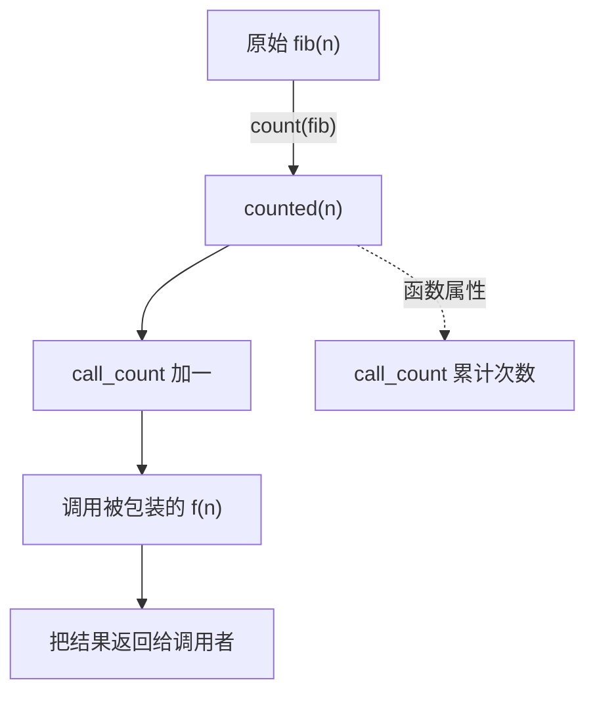
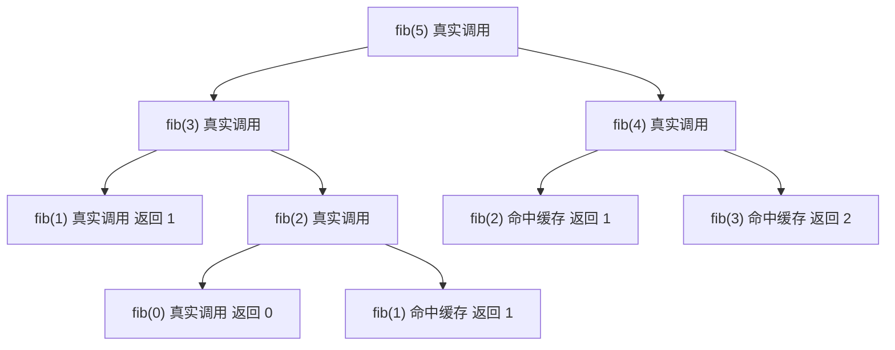
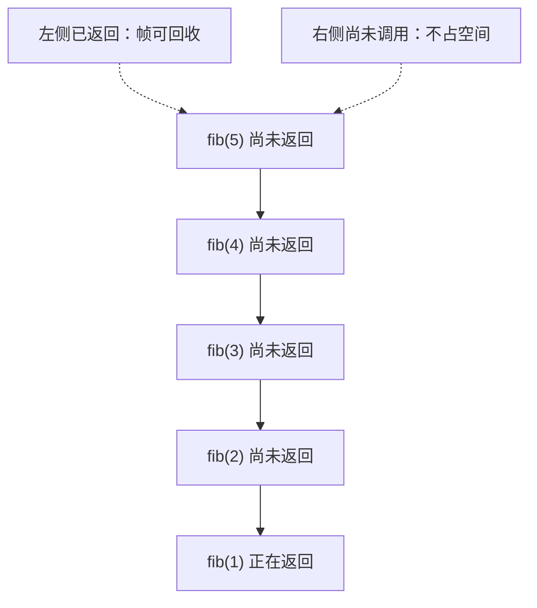

> **课程**：UC Berkeley CS61A · Structure and Interpretation of Computer Programs（Fall 2024）
> **本讲**：Lecture 23 ｜ 36:37 ｜ B 站分 P 23 ｜ [原视频](https://www.bilibili.com/video/BV1sy411z7nA?p=23)
> **课件**：`22-Efficiency_1pp.pdf`（15 页，官方 PDF，逐页渲染图见正文插图）
> **字幕**：B 站英文原声字幕；本笔记是中文书面化重构，非逐句翻译
> **版权**：课程与课件版权归 UC Berkeley CS61A 教学团队；本文为学习用途的二次整理

## 本讲速览

*(参考时间: 00:00:01 – 00:00:13｜Lecture 23)*

- **已掌握**：树递归的写法（`fib`、`fib_tree`）、把函数当作值传递、装饰器的闭包结构，以及用环境图读出一串函数调用留下的帧。
- **本讲主线**：
    - 秒表不可靠，同一段代码每次跑出来的时间都不一样；换一把尺子——数操作次数。
    - 纯递归 `fib` 的调用次数随 n 指数增长；`memo` 装饰器用字典把算过的结果存起来，把调用次数压到线性。
    - 时间可以按增长阶分类：指数 Θ(bⁿ)、二次 Θ(n²)、线性 Θ(n)、对数 Θ(log n)、常数 Θ(1)；大 Θ 给上下界，大 O 只管上界。
    - 同一个数学函数可以有不同算法的写法：`exp` 是线性递归，`exp_fast` 每层把指数减半，是对数递归。
    - 空间是另一种资源：占内存的是活动环境里的帧，`fib(20)` 同时最多只打开 20 个帧。
- **关键结论**：衡量效率要问"输入变大时工作量怎么变"，而不是"这一次跑了几毫秒"；改变增长阶（指数→线性、线性→对数）比任何常数级优化都值钱。


## 1. 先数一数：树递归的 fib 做了多少事

*(参考时间: 00:00:01 – 00:04:27｜Lecture 23)*

本讲不属于对象那一块，它要回答一个更普遍的问题：怎样估计一个程序要跑多久。讲师开场就把话题拉回最初那个树递归的例子——用递归计算斐波那契数列的第 n 项，并顺口说了句"感谢斐波那契，让这个数列这么有名"。这句玩笑点出了选择它的原因：递推本身读者早已熟悉，注意力可以全部放到"它要花多少步"上。


定义只有三行：第 0 项是 0，第 1 项是 1，其余每一项都是前两项之和。

```python
def fib(n):
    if n == 0:
        return 0
    elif n == 1:
        return 1
    else:
        return fib(n-2) + fib(n-1)
```


以 `fib(5)` 为例，调用被展开成一棵树：`fib(5)` 求和 `fib(3)` 与 `fib(4)`；`fib(3)` 先去算 `fib(1)`，那是一次真实的调用，返回 1；接着算 `fib(2)`，它展开成 `fib(0)` 与 `fib(1)`，分别返回 0 与 1，于是 `fib(2)` 返回 1、`fib(3)` 返回 2。课件把基例的返回值直接标在叶子下面，再用一条虚线按实际发生的顺序把整棵树串起来：先一路向左下到底，再逐层回到分叉点，去算右边那棵还没算过的子树。

走完这棵树就会看到一件刺眼的事：`fib(3)` 被算了两次——一次是 `fib(5)` 的左孩子，一次是 `fib(4)` 的右孩子；`fib(2)` 被算了三次；`fib(0)` 与 `fib(1)` 被反复调用。**同一棵子树被整枝重算**，正是这段代码昂贵的原因。

> **编者说明**：`fib(5)` 一共产生 15 次调用，`fib(6)` 是 25 次，相邻两项的比值很快稳定在 1.618 附近。这个数就是 §6 里"每加一个 n 就多做约 60% 的工作"的来源。

要谈"多久"，讲师的第一把尺子不是秒表，而是"函数被调用了多少次"。为了不用手数，写一个装饰器把计数自动化：

```python
def count(f):
    def counted(n):
        counted.call_count += 1
        return f(n)
    counted.call_count = 0
    return counted

fib = count(fib)
```



> **编者说明**：`count` 的代码没有出现在本讲课件上，是按讲师口述与课堂演示重构的。要点有两处：`call_count` 挂在 `counted` 这个函数对象上，而不是藏在闭包里，于是从外部读 `fib.call_count` 就能取到计数；把 `fib` 重新绑定到 `counted` 是让递归调用也走包装器的关键——`fib` 的函数体里写的是名字 `fib`，重新绑定之后这个名字指向包装器。

课堂演示的数字很直接：`fib(5)` 返回 5，`fib.call_count` 显示 15；再调一次 `fib(5)`，计数变成 30，因为它是累计的。接着算 `fib(30)`，结果是 832040，代价是 **2,692,537 次调用**（约 269 万次）。讲师提醒：这些调用里很多只是返回 0，一些返回 1，一些返回越来越大的数，直到最后拿到想要的结果。

数调用次数只是第一步。讲师说明这个例子的目的是"开始理解调用一个函数时究竟发生了什么，以及这与函数返回所需的时间有什么关系"；接下来两讲会发展出更成熟的办法来谈运行时间。

> **编者说明**：把调用次数写成递推就是 `C(n) = 1 + C(n−1) + C(n−2)`，解出来是 `C(n) = 2·F(n+1) − 1`。用它核对：n = 10 得 177，n = 20 得 21891，n = 30 得 2692537，与演示结果一致。

## 2. 记忆化：把算过的结果留在身边

*(参考时间: 00:04:29 – 00:10:47｜Lecture 23)*


记忆化（memoization）的想法一句话就能说完：**记住以前算过的结果**。需要某个值时先看看存过没有，存过就直接取，不再重算。对 `fib` 这种会反复走进同一棵子树的函数，这一句话就足以把计算量换掉一个量级。


```python
def memo(f):
    cache = {}
    def memoized(n):
        if n not in cache:
            cache[n] = f(n)
        return cache[n]
    return memoized
```

`cache` 是闭包里的一个字典，它的键是参数，值是 `f` 在该参数上的返回值——课件用一个批注框把这句话写在 `cache = {}` 旁边。`memoized` 先做成员检查：`n` 不在缓存里，才算 `f(n)` 并存进去；然后不管刚才是算出来的还是要出来的，统一 `return cache[n]`。这个写法让"第一次算"和"以后取"走同一条返回路径，差别只在要不要调用 `f`。

课件在 `return memoized` 旁边挂了第二条批注："Same behavior as f, if f is a pure function"。这是本讲与上一模块的接口：**只有纯函数才能被安全地记忆化**。纯函数对同样的参数永远返回同样的值，也不产生副作用，跳过重复调用不会改变任何可观察的结果；如果 `f` 会打印、会修改参数、会读时钟或随机数，跳过调用就少了一次副作用或少了一个不同的值，行为随之改变。

演示的效果很夸张：`fib(30)` 在记忆化之后瞬间返回，`fib(50)` 也是，`fib(300)` 同样——虽然那是个极大的数。讲师的说法是：要算 `fib(300)`，只需要 `fib(298)` 与 `fib(299)`，而这两个在记忆化版本里几乎立刻就能拿到。

> **编者说明**：严格地说，`fib(300)` 的结果有六十多位十进制数字，大整数加法本身不再是常数时间，所以"瞬间"要打个折扣。讲师关心的量是**调用次数**，不是大整数运算的位数。

记忆化到底省掉了多少次调用？讲师用套了两层的版本回答：`fib = memo(count(fib))`。外层记录"记忆化后的 `fib` 被请求了多少次"，内层记录"真正执行原始 `fib` 的次数"。`fib(30)` 的结果是外层 59 次、内层 31 次。

31 很好解释：真正需要计算的参数只有 31 个，30、29、28 一直到 0，每个值只算一次。59 需要看调用树。课件第 12 页用三种标记画了记忆化之后的 `fib(5)`：实心蓝圈是真实调用，红圈是"在缓存里找到了"，空心圈是"整枝被跳过"。




顺着这棵树走一遍：`fib(5)` 调用 `fib(3)`，`fib(3)` 调用 `fib(1)`（真实调用，返回 1），再调用 `fib(2)`（真实调用，依次算出 `fib(0)` 与 `fib(1)`）；这时 `fib(1)` 已经是第二次被请求，直接从缓存取，只计一次包装器调用，不再触发真实计算。`fib(3)` 返回后轮到 `fib(4)`，它的左孩子 `fib(2)` 在缓存里，命中即返回，于是那些 `fib(0)`、`fib(1)` 调用**根本不会发生**；右孩子 `fib(3)` 同样命中。而 `fib(4)` 与 `fib(5)` 从来没有被第二次请求，因为它们是整棵树的祖先。

用数据把这个差别钉住：

| n | 纯递归的调用次数 | 记忆化包装器的调用次数 | 真正执行 `fib` 的次数 | 调用次数之比 |
| :--- | ---: | ---: | ---: | ---: |
| 10 | 177 | 19 | 11 | 约 9 倍 |
| 20 | 21,891 | 39 | 21 | 约 560 倍 |
| 30 | 2,692,537 | 59 | 31 | 约 4.6 万倍 |

> **编者说明**：三个计数列依次对应 `2·F(n+1) − 1`、`2n − 1`、`n + 1`。`2n − 1` 来自树的形状：每个 k（2 ≤ k ≤ n）被请求两次，一次来自 k+2 的第一个孩子、一次来自 k+1 的第二个孩子，再加上最顶上的 `fib(n)`，恰好是 1 + 2(n−1)。59 与 31 这两个数与课堂上 `fib(30)` 的演示一致，其余行是编者实算。

两条曲线的形状完全不同。纯递归那一列从 177 到 21891 再到 269 万，**每加一个 n 就要乘上约 1.6**，画出来是一条向上翘的指数曲线；记忆化那一列是 19、39、59，**每加一个 n 只多 2**，画出来是一条直线。同一段递归定义，只因为外加了一个字典，就从指数掉到了线性。

代价当然有：`cache` 要把所有算过的参数存下来，空间随 n 增长。这是"时间换空间"最朴素的一例，也是 §8 讨论空间时的伏笔。

## 3. 两种指数运算：线性递归与对数递归

*(参考时间: 00:10:47 – 00:13:41｜Lecture 23)*

上一节用记忆化换掉了增长阶，这一节换的是另一种东西：**算法本身**。题目是求 b 的 n 次方。Python 已经内置了 `**`，但讲师要自己写一个递归版本，因为在写的过程里，"多一次乘法能换来什么"会被看得清清楚楚。

目标是让**多一次乘法就把指数翻一倍**。先看一个达不到目标的写法：

```python
def exp(b, n):
    if n == 0:
        return 1
    else:
        return b * exp(b, n - 1)
```

它对应数学上的 bⁿ = b·bⁿ⁻¹（n > 0 时；n = 0 时结果为 1）。定义正确，但指数每加 1 就要多一层递归、多一次乘法；把 n 翻倍，乘法次数就翻倍。

> **编者说明**：本节的两段代码没有出现在本讲课件上，是按讲师口述整理的；`square` 是他在演示中使用的辅助函数。

但 bⁿ 不是只有一个数学定义。还有一个更复杂的版本，按 n 的奇偶分成两种情况：

- n 为偶数时，bⁿ = (b^(n/2))²，先算一半指数，再把结果平方。n = 16 时，先算 b⁸，再平方得到 b¹⁶。
- n 为奇数时，退回前一个定义，bⁿ = b·bⁿ⁻¹，把 n 变成偶数。

多出来的分支换来的是问题规模的改变，实现如下：

```python
def square(x):
    return x * x

def exp_fast(b, n):
    if n == 0:
        return 1
    elif n % 2 == 0:
        return square(exp_fast(b, n // 2))
    else:
        return b * exp_fast(b, n - 1)
```

偶数分支里用 `n // 2`。讲师特意说明：这里已经知道 n 是偶数，所以地板除法给出的是精确的一半，不会丢位。奇数分支只做一次乘法并把 n 减 1，下一层必然落进偶数分支。

这个函数的**递归形状**值得单独强调：函数体里出现了两次 `exp_fast`，看上去像树递归，但任何一次调用只可能走其中一条分支，所以它是**线性递归（linear recursion）**。这正是"代码里有两个递归调用"与"计算会展开成一棵树"的区别——形状由执行路径决定，不由书写形式决定。

代价的对照可以完全用乘法次数说清楚：

| 判据 | `exp` | `exp_fast` |
| :--- | :--- | :--- |
| 递归依据 | bⁿ = b·bⁿ⁻¹ | 偶数平方，奇数退一步 |
| 递归形状 | 线性递归，每层 n 减 1 | 线性递归，每层 n 减半 |
| n 加 1 | 多 1 次乘法 | 最多多 2 次乘法 |
| n 翻倍 | 乘法次数翻倍 | 多 1 次平方 |
| 乘法次数（n = 200 / 400 / 800 / 1600） | 200 / 400 / 800 / 1600 | 10 / 11 / 12 / 13 |
| 增长阶 | Θ(n) | Θ(log n) |

> **编者说明**：表中乘法次数那一行按"`square` 记 1 次乘法、奇数分支里的 `b *` 记 1 次乘法"逐次统计，为编者实算；课堂上讲师只说快速版本"多一次乘法就能把指数翻倍"。

`exp_fast` 最多每两层把 n 缩小一半（奇数那一层只是把 n 变成偶数，下一层立刻减半），所以乘法次数随 log n 增长。n = 1024 时，慢版本要 1024 次乘法，快版本只要 11 次——指数上的差别，落到具体数字上是三个数量级。

## 4. 用秒表验证：直线与对数曲线

*(参考时间: 00:13:41 – 00:17:40｜Lecture 23)*

理论上的乘法次数是一种"计步"，课堂上还真的跑了一次秒表。讲师用的是 Jupyter notebook：它是一种常见的交互式环境，特点是能直接画出图表，所以适合做计时实验。计时则用内置的 `timeit` 模块——把同一行代码重复执行很多次，取中位数。

讲师先演示了单次计时的噪声：`2 ** 400` 第一次显示 2 毫秒，第二次只有 100 微秒，反复跑几次在 100 到 200 微秒之间跳。单次计时不可靠，必须重复取样，这就是 `timeit` 存在的理由。

`exp` 的测量结果：2²⁰⁰ 的中位耗时略低于半毫秒，2⁴⁰⁰ 略低于 1 毫秒，2¹⁶⁰⁰ 约 4 毫秒。把这些点连起来是一条直线——输入每翻一倍，时间就翻一倍，这就是**线性（linear）**。

`exp_fast` 的同一组测量是另一种形状：2¹⁶⁰⁰ 只要 0.04 毫秒，比慢版本快两个数量级；而且 200 到 400 多了约 0.002 毫秒，400 到 800 又多了约 0.002 毫秒，800 到 1600 还是约 0.002 毫秒。**每翻一倍只多一个固定的小量**，这条曲线是**对数（logarithmic）**。

| 观察 | `exp`（线性） | `exp_fast`（对数） |
| :--- | :--- | :--- |
| 2²⁰⁰ 的中位耗时 | 略低于 0.5 ms | 课堂上未单独报数 |
| 2⁴⁰⁰ 的中位耗时 | 略低于 1 ms | 课堂上未单独报数 |
| 2¹⁶⁰⁰ 的中位耗时 | 约 4 ms | 约 0.04 ms |
| 输入翻倍 | 时间翻倍 | 只多约 0.002 ms |
| 曲线形状 | 直线 | 越来越平的对数曲线 |
| 输入变 1000 倍 | 时间变 1000 倍 | 只多 10 个固定增量 |

表格最后一行值得展开：1024 = 2¹⁰，所以"输入变 1000 倍"在对数时间下只对应"多做 10 份固定工作"，而线性时间下就是实打实的 1000 倍。讲师原话是：一千倍的输入，线性要一千倍时间，对数只需要十倍的那个常数。

曲线并不光滑，会有起伏，因为计算机内部有很多细节在干扰计时。讲师特意声明：**linear 与 logarithmic 描述的是总体趋势**，即使有波动也照样这么叫。这正好接上下一节——既然看的是趋势，就该把"趋势"写成精确的数学定义。

> **编者说明**：单格计时与 `timeit` 取中位数是两种不同的测量方式，前者的绝对值（2⁴⁰⁰ 约 100–200 微秒）与后者的绝对值（2⁴⁰⁰ 略低于 1 毫秒）不能直接相比；能相比的是趋势。课堂上两套数据都出现了，这里按"单次噪声"与"重复取中位"分开叙述，不把它们混成一条曲线。

## 5. 大 Θ 与大 O：给增长阶起名字

*(参考时间: 00:17:40 – 00:21:19｜Lecture 23)*


linear、constant、quadratic 这些词都有精确的数学定义。定义的用处是：**不用真的运行程序，也能证明某个函数属于哪个增长阶**。这是计算理论的标准内容，CS61A 不展开（伯克利的后续课程会大量使用），但与之配套的记号太常见，不讲反而会造成阅读障碍。

最常用的是大 Θ（big theta）记号，五种常见增长阶各有一个写法：

- 指数增长：Θ(bⁿ)
- 二次增长：Θ(n²)
- 线性增长：Θ(n)
- 对数增长：Θ(log n)
- 常数增长：Θ(1)

常数那一行最容易让人停顿：n 去哪了？答案是 n 不在那里，因为常数增长里**增大 n 根本不影响时间**，写 n 反而是错的。讲师还顺带调侃了一句：计算机科学家真的会张口就说"big theta"。

另一套记号是大 O（big O），写法长得一样：Θ(bⁿ) 对应 O(bⁿ)，Θ(n²) 对应 O(n²)。差别在含义：**大 O 描述上界**，只说"最坏不超过这个量级"；**大 Θ 同时给上下界**，说的是"就是这个量级，不多也不少"。

| 增长阶 | 大 Θ 写法 | 大 O 写法 | 一句话直觉 |
| :--- | :--- | :--- | :--- |
| 指数 | Θ(bⁿ) | O(bⁿ) | n 加 1，时间乘一个常数 |
| 二次 | Θ(n²) | O(n²) | n 加 1，时间加 n 倍常数 |
| 线性 | Θ(n) | O(n) | n 加 1，时间加常数 |
| 对数 | Θ(log n) | O(log n) | n 翻倍，时间才加常数 |
| 常数 | Θ(1) | O(1) | n 怎么变都不影响时间 |

> **编者说明**：大 Θ 与大 O 的标准定义用的是"存在正常数 c 与 n₀，使对所有 n > n₀ 满足……"这样的量词句式；本讲没有展开，这里也不假装展开。只需要记住方向：O 是"不超过"，Θ 是"就是"。

记号要有效，还得说清楚 n 是什么。n 是输入的那个数时一切简单；但 n 也可能是序列的长度，而长度为 n 的序列有很多个，于是"跑多久"还要进一步指定是**最坏情况、最好情况还是平均情况**。讲师说这些在后续课程里会变得重要；在 CS61A 里真正要掌握的是"能认出几种常见的增长模式"。

## 6. 二次与指数：成对比较和重复子问题

*(参考时间: 00:21:19 – 00:24:52｜Lecture 23)*

增长阶描述的是一个函数**属于哪一类**，而不是它精确跑多少微秒：两个线性函数可能耗时不同，但扩展方式一样；所有对数函数都有同样的曲线形状。

**二次（quadratic）**时间的典型形态是"处理所有成对的元素"。下面这个函数数两个序列里相等的元素对：

```python
def overlap(a, b):
    count = 0
    for x in a:
        for y in b:
            if x == y:
                count += 1
    return count
```

> **编者说明**：`overlap` 的代码不在本讲课件上，是按讲师口述整理的；课堂上的例子是 `overlap([3, 5, 7, 6], [4, 5, 6, 5])`，结果为 3。

为什么是 3：`a` 里的 5 与 `b` 里的两个 5 各配成一对，`a` 里的 6 与 `b` 里的 6 配成一对，共三对。外层循环走 `a` 的每个元素，内层循环走 `b` 的每个元素，所以比较次数是 `len(a) × len(b)`；长度都是 4 时是 16 次。讲师指出的细节是：把长度从 3 加到 4，多出来的不是一次比较，而是**整整一行**——这就是二次增长的代价。

实测曲线也印证了这一点：把长度从 20 到 200 逐个测一遍并取中位耗时，长度 75 约 2 毫秒，长度 150 接近 8 毫秒，曲线向上张开，是一条抛物线。

> **编者说明**：长度翻倍而时间变成四倍，与 n² 的形状一致（150 对 75 是 2 倍长度、约 4 倍时间），讲师用"熟悉的抛物线"来形容这条曲线。

**指数（exponential）**时间更糟。未记忆化的 `fib` 每求一个 n，都要把 `fib(n−1)` 与 `fib(n−2)` 各自的整棵树重算一遍，所以 n 加 1 就要多做约 60% 的工作。课件把这件事画成逐层叠加的形状：算 `fib(3)` 要在 `fib(2)` 之上多做一片，算 `fib(4)` 要在 `fib(3)` 之上再多做一片，算 `fib(5)` 除了 `fib(4)` 还要多做另一大片。层数越多，多出来的那片越大——这就是树递归在没有记忆化时的典型行为。

> **编者说明**："约 60%"来自相邻两项调用次数之比趋近 φ ≈ 1.618，换成倍数就是每加一个 n 乘 1.6 倍左右。讲师在课堂上给的就是这个数量级，而不是严格的极限证明。

## 7. 五种增长阶的一次对照

*(参考时间: 00:24:52 – 00:29:34｜Lecture 23)*


课件把五种增长阶排成一列，每种配一句"n 变大时会发生什么"：指数增长是"n 加 1，时间乘一个常数"；二次增长是"n 加 1，时间加 n 倍常数"；线性增长是"n 加 1，时间加常数"；对数增长是"n 翻倍，时间才加常数"；常数增长是"n 怎么变都不影响时间"。讲师说这五种是分析函数时最常见的，当然还有别的，也有整套形式化系统来判定一个函数属于哪一类——那属于后续课程。

把五句话按"速度"再排一遍：指数增长极慢；二次增长慢但很常见；线性增长非常常见；对数增长很好，能扩展到很大的输入；常数增长最好，n 变大也无所谓。讲师举的常数时间例子是 Python 的字典：**字典里元素的多少不影响按键取值的时间**。为什么能做到是后续课程（哈希表）的话题，但"按键查找是常数时间"这条性质是 Python 字典的重要特征，也正是 §2 的 `memo` 选字典做缓存的原因。

讲师还给了一个把五种增长阶放到同一把尺子上的装置：用 `T(n)` 表示处理规模 n 的输入要花的时间，比较 `T(n+1)` 与 `T(n)`，用常数 a、b 掩盖所有细节。

- 指数：$T(n+1) = a \cdot b^{n+1} = b \cdot T(n)$，多出来的是一个**乘法**因子。
- 二次：$T(n+1) = a(n+1)^2 = T(n) + a(2n+1)$，多出来的是一个**与 n 成正比的加法**项。
- 线性：$T(n+1) = a(n+1) = T(n) + a$，多出来的是一个**常数**。
- 对数：$T(2n) = a \log(2n) = T(n) + a \log 2$，只有**翻倍**才多出一个常数。

> **编者说明**：上面四条等式是把讲师口述的"乘一个常数／加一个依赖 n 的项／加一个常数"写成符号形式，其中 $a(2n+1)$ 这一步展开是编者补的代数。

这四条把"增长阶"翻译成了可操作的问题：**输入每变大一点，你要付的账是乘法、是随 n 增长的加法，还是常数？** 乘比加快得可怕；同样是加，加的东西依赖 n 就仍然糟糕，只有加常数才是线性。讲师由此给出本讲的实践结论：把指数变成线性（记忆化），或者把线性变成对数（快速幂），改变的不只是快慢，而是**程序还能处理多大的问题**——规模上限变了。

| 增长阶 | n 加 1 时 | n 翻倍时 | 记号 | 本讲的例子 |
| :--- | :--- | :--- | :--- | :--- |
| 指数 | 时间乘一个常数 | 时间按平方级放大 | Θ(bⁿ) | 未记忆化的 `fib` |
| 二次 | 时间加 n 倍常数 | 时间约变 4 倍 | Θ(n²) | `overlap` 的双重循环 |
| 线性 | 时间加常数 | 时间变 2 倍 | Θ(n) | `exp` |
| 对数 | 时间加一个越来越小的常数 | 时间加固定常数 | Θ(log n) | `exp_fast` |
| 常数 | 不变 | 不变 | Θ(1) | 字典按键查找 |

课件最后一页是一道期中题，正好可以拿来当这张表的练习。


> **编者说明**：录像在 00:36:34 结束，讲师没有讲到这一页。题目与代码逐字取自课件，下面的分析与答案是编者所加。

题目定义了前缀和（prefix sum）：一个数字序列的前缀和，是前 n 个元素之和（n 取某个正的长度）。要判断 `prefix(s)` 的运行时间关于 `len(s)` 的增长阶，并假设 `append` 对任何参数都只花一步（常数时间）。

```python
def prefix(s):
    "Return a list of all prefix sums of list s."
    t = 0
    result = []
    for x in s:
        t = t + x
        result.append(t)
    return result
```

函数体里只有一个 `for x in s`：每个元素做一次加法、一次 `append`，两者都是常数时间，循环次数等于 `len(s)`。所以时间是 **Θ(n)，线性增长**。这道题的价值在于提醒一件事：判断增长阶看的是"循环嵌套了几层、每层走了多少次"，而不是"代码看起来长不长"——如果把这里的 `result.append(t)` 换成"把整个 `result` 复制一遍再加一项"，同一个循环就会变成二次的。

## 8. 空间：活动环境与同时打开的帧

*(参考时间: 00:29:37 – 00:36:34｜Lecture 23)*

时间不是唯一的资源，内存也是。讲师在这一节把问题换成：程序运行时，**内存被谁占着**？

占用来自两处。第一处是值：长列表比短列表占得多。第二处是帧（frame）：每有一个正在执行的函数调用，就有一个帧。所以要弄清楚的是——在某一时刻，同时存在多少个还没返回的调用，以及它们的环境里哪些帧必须保留。

课程由此引入两个新概念：求值过程中**哪些环境帧必须留着**，**哪些可以放手**。规则是：任一时刻存在一组**活动环境（active environments）**；活动环境里的值与帧占内存；不在活动环境里的值与帧占的内存可以被回收。Python 解释器会自动做这件事——当它确认某些信息不再需要时，就把那块空间收回来。

哪些环境算"活动"？

- 正在求值的函数调用：调用发生了但还没返回，它对应的帧就是活动的。
- 另一种情况少见得多：活动环境里某个函数的**父环境**。当函数定义在另一个函数内部时，它的父帧不是全局帧，而是那个外层函数的帧；只要还需要这个函数，就需要它的父帧，以及父环境里其余的帧。

好消息是这件事能被看见。Python Tutor 有一个"不要显示已经退出的函数"的开关，打开之后，返回过的帧会被直接删掉，屏幕上留下的就是活动帧。讲师用它跑 `fib(6)`：`fib(6)` 还没返回，帧还在；它调用 `fib(4)`，`fib(4)` 又调用 `fib(2)`，`fib(2)` 调用 `fib(0)`；`fib(0)` 返回后，它的帧从图上消失，位置被 `fib(1)` 的帧取代。帧的编号一路变化：先有 F1、F2、F3，接着 F4 被创建又在返回后消失，然后轮到 F5。`fib(4)` 算完 `fib(2)` 之后，`fib(2)` 的帧被移除，换成算 `fib(4)` 另一部分所需的 `fib(3)` 的帧。最终 `fib(4)` 的帧整个消失，只剩下最原始的 F1（`fib(6)` 还没算完）和为算 `fib(5)` 创建的那个帧；等它们也删除，`fib(6)` 返回 8。

代码里也能数出帧数。讲师写了一个高阶函数 `count_frames`，它在每次进入包装器时把"开放帧数"加一、更新历史最大值，在返回前把开放帧数减一：

```python
def count_frames(f):
    def counted(n):
        counted.open_count += 1
        counted.max_count = max(counted.max_count, counted.open_count)
        result = f(n)
        counted.open_count -= 1
        return result
    counted.open_count = 0
    counted.max_count = 0
    return counted
```

> **编者说明**：`count_frames` 的代码按讲师口述与课堂演示重构，本讲课件没有这一页。要点是 `max_count` 在进入时更新（趁帧还没退出），`open_count` 在 `f(n)` 返回之后才减一——放在返回之前就会漏掉最深的那一层。

用它包住 `fib` 再调用 `fib(20)`：算完之后 `open_count` 是 0（所有调用都返回了），`max_count` 是 20。这个 20 就是"同一时刻最多打开了多少个帧"，也就是这个函数真正需要的空间。

为什么是 20？讲师把 `fib(5)` 的调用树当作示意图：假设左边的分支都算完了、右边的分支还没开始、正要从某个 `fib(1)` 返回，此刻的活动帧就是"当前这条链上还没返回的那些调用"。最长的一条链是 `fib(5)` → `fib(4)` → `fib(3)` → `fib(2)` → `fib(1)`，长度 5。推广一步：`fib(n)` 的最长链长度就是 n，所以 `fib(20)` 最多同时打开 20 个帧。



这里藏着本讲最值得记住的一组对照：**`fib(20)` 的调用次数是两万多，但同一时刻的帧只有 20 个**。时间由调用树的节点数决定，空间由调用树的最长链决定。讲师的原话是"它不需要同时打开六千个帧，只需要几个"。

> **编者说明**：把这句话收成一条可背的判据——递归函数的**时间看节点数，空间看深度**。纯递归 `fib` 正是"时间指数、空间线性"的标本：它慢得离谱，却不会把内存撑爆。这一条是编者的总结，讲师只说了"最大帧数等于最长链"。

## 小结

*(参考时间: 00:36:23 – 00:36:34｜Lecture 23)*

- **秒表不是尺子**：单次计时会被缓存、调度、机器状态干扰，同一段代码每次都不一样；可靠的量是"操作次数随输入规模怎么变"。
- **数调用次数是最便宜的起点**：给函数套一个 `count` 装饰器，把 `call_count` 挂在函数对象上，递归调用会自动计数（前提是把函数名重新绑定到包装器）。
- **记忆化是用空间换增长阶**：`memo` 用字典把参数映射到返回值，只在未命中时调用 `f`，命中就直接返回；它只对纯函数保证行为不变。
- **同一个数学函数可以有不同的算法**：`exp` 每层把 n 减 1（Θ(n)），`exp_fast` 每层把 n 减半（Θ(log n)）；函数体里出现两个递归调用不等于树递归，看执行路径。
- **五种增长阶用"n 变化时时间怎么变"区分**：指数乘常数、二次加 n 倍常数、线性加常数、对数翻倍才加常数、常数不变；大 O 只说上界，大 Θ 给上下界。
- **空间看活动环境**：只有已调用未返回的帧（以及活动环境里函数的父帧）必须保留，其余可以回收；`fib(20)` 最多同时打开 20 个帧。时间看节点数，空间看深度。

## 附录：课堂未展示的幻灯片（课件第 3–7 页树复习）

*(参考时间: 00:00:01 – 00:36:34｜Lecture 23)*

> **编者说明**：本讲课件 `22-Efficiency_1pp.pdf` 的第 3–7 页是树（Tree）内容的复习页：第 3 页是分节页，第 4 页回顾 `Tree` 类与函数式树接口，第 5 页是练习分节页，第 6、7 页是两道树相关的题。录像从第 8 页的"Measuring Efficiency"分节页开始，这五页没有被讲授。这里按课件原页序收录，文字只描述画面内容，不回填课堂讨论。


第 4 页并排放了两套树抽象。左边是用类实现的一套：

```python
class Tree:
    def __init__(self, label, branches=[]):
        self.label = label
        for branch in branches:
            assert isinstance(branch, Tree)
        self.branches = list(branches)
```

右边是用列表实现的一套：`tree(label, branches)` 把标签与分支列表拼成一个列表，`label(tree)` 取第 0 项，`branches(tree)` 取第 1 项之后的部分。

```python
def tree(label, branches=[]):
    for branch in branches:
        assert is_tree(branch)
    return [label] + list(branches)

def label(tree):
    return tree[0]

def branches(tree):
    return tree[1:]
```


同一页还有两个 `fib_tree`，分别用两套抽象写出同一个递归：

```python
def fib_tree(n):
    if n == 0 or n == 1:
        return Tree(n)
    else:
        left = fib_tree(n-2)
        right = fib_tree(n-1)
        fib_n = left.label + right.label
        return Tree(fib_n, [left, right])
```

```python
def fib_tree(n):
    if n == 0 or n == 1:
        return tree(n)
    else:
        left = fib_tree(n-2)
        right = fib_tree(n-1)
        fib_n = label(left) + label(right)
        return tree(fib_n, [left, right])
```

两套实现的形状完全一样，只是取标签的写法从 `left.label` 换成了 `label(left)`。这页之所以出现在效率这一讲的课件里，是因为 `fib_tree(n)` 的递归结构与 §1 的 `fib(n)` 同构——区别只在于 `fib_tree` 每次还要把整棵树建出来，开销更大。


第 6 页的题目是数"双胞胎"：给一棵树，数出标签相同的兄弟节点对有几对。题目给了三个 doctest：`t1` 返回 2（标签 4 与 5 各一对），另一棵树返回 0，把 `t1` 复制三次挂到根下的一棵树返回 9（根下有三对，每个分支里再各两对）。填空后的解答是：

```python
def twins(t):
    """Count the pairs of sibling nodes with equal labels.

    >>> t1 = Tree(3, [Tree(4, [Tree(5), Tree(6)]), Tree(4, [Tree(5), Tree(5)])])
    >>> twins(t1)  # 4 and 5
    2
    >>> twins(Tree(1, [Tree(1, [Tree(2)]), Tree(2, [Tree(2)])]))
    0
    >>> twins(Tree(8, [t1, t1, t1]))  # 3 pairs of twins at the top, plus 2 in each branch
    9
    """
    count = 0
    n = len(t.branches)
    for i in range(n-1):
        for j in range(i+1, n):
            if t.branches[i].label == t.branches[j].label:
                count += 1
    return count + sum([twins(b) for b in t.branches])
```

结构上分两半：双重循环负责同一个父节点下的兄弟对（`j` 从 `i+1` 开始，保证每一对只数一次），递归部分把每个分支内部的对数加起来。顺带一提，这段双重循环在兄弟很多时是二次的——与 §6 的 `overlap` 是同一种形状。


第 7 页是 2023 年春季期中第二题的第 (b) 问：`remove(t, x)` 要删掉 `t` 里所有非根、标签等于 `x` 的节点，然后返回 `t`，并且允许调用已经写好的 `exclude(t, x)`。答案只有两行：

```python
def remove(t, x):
    """Remove all non-root nodes labeled x from t.

    >>> u = Tree(1, [Tree(2, [Tree(2), Tree(3)]), Tree(4)])
    >>> remove(u, 2)
    Tree(1, [Tree(3), Tree(4)])
    >>> remove(u, 3)
    Tree(1, [Tree(4)])
    """
    t.branches = exclude(t, x).branches
    return t
```

思路是"借一份答案，只搬分支"：`exclude(t, x)` 已经返回了一棵"去掉所有 `x` 的新树"，`remove` 只需要把新树的分支列表接到 `t` 上，就完成了原地修改；`t` 的标签（根）保持不动，符合题目"只删非根节点"的要求。课件的盒针图把 `u` 的标签、`branches` 列表、每个子树的标签与空分支列表都画了出来，用来强调"`branches` 里存的是树，不是标签"。


## 附：本讲幻灯片索引

*(参考时间: 00:00:01 – 00:36:34｜Lecture 23)*

| 页 | 内容 | 出现位置 |
| :--- | :--- | :--- |
| 1 | 标题页 Efficiency | 本讲速览 |
| 2 | Announcements 公告页 | 本讲速览 |
| 3 | 分节页：Tree Class | 附录 |
| 4 | `Tree` 类与函数式树接口、两个 `fib_tree` | 附录 |
| 5 | 分节页：Tree Practice | 附录 |
| 6 | Count Twins：数标签相同的兄弟对 | 附录 |
| 7 | 期中题 `remove`：复用 `exclude` | 附录 |
| 8 | 分节页：Measuring Efficiency | §1 |
| 9 | 斐波那契的树递归调用图 | §1 |
| 10 | 分节页：Memoization | §2 |
| 11 | `memo` 装饰器与两条批注 | §2 |
| 12 | 记忆化后的调用树：调用／命中／跳过 | §2 |
| 13 | 分节页：Orders of Growth | §5 |
| 14 | 五种常见增长阶 | §7 |
| 15 | 期中题：`prefix` 的增长阶 | §7 |
