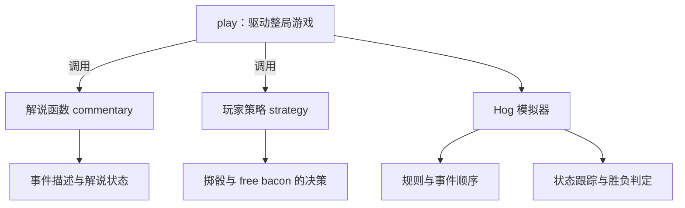
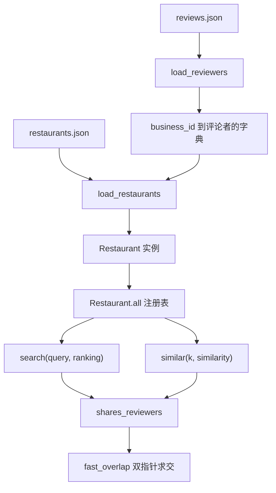
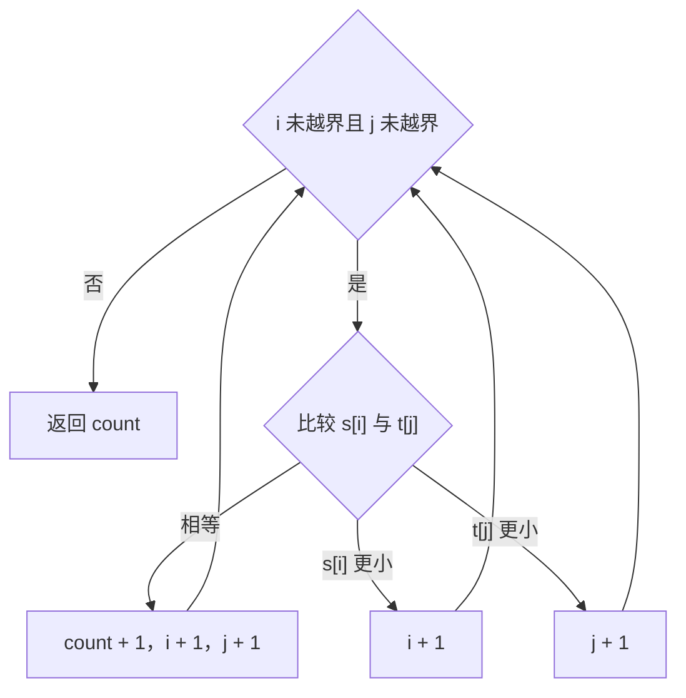

> **课程**：UC Berkeley CS61A · Structure and Interpretation of Computer Programs（Fall 2024）
> **本讲**：Lecture 24 ｜ 27:16 ｜ B 站分 P 24 ｜ [原视频](https://www.bilibili.com/video/BV1sy411z7nA?p=24)
> **课件**：`23-Decomposition_1pp.pdf`（14 页，官方 PDF，逐页渲染图见正文插图）
> **字幕**：B 站英文原声字幕；本笔记是中文书面化重构，非逐句翻译
> **版权**：课程与课件版权归 UC Berkeley CS61A 教学团队；本文为学习用途的二次整理

## 本讲速览

- **已掌握**：用类封装状态、用 `__init__` 建立实例属性、用 `__repr__` 决定对象怎么显示、`sorted` 与 `key` 参数的配合、列表推导筛选元素，以及 `Link` 这类递归数据结构的读法。
- **本讲主线**：
    - 大程序的困难在于"无法同时想清楚所有部分"，模块化设计用抽象屏障把程序切成可换进换出的部件，目标是分离关注点（separation of concerns）。
    - 分工靠"把函数当参数传进去"落地：`play` 不知道解说怎么写、策略怎么定，只管调用；模拟器不知道规则之外的任何事情。
    - 餐馆搜索把两个决策点做成参数——`ranking`（排序规则）与 `similarity`（相似度定义），于是"什么叫靠前""什么叫相似"都可以随时替换。
    - 慢的根源是三层线性叠加成二次增长；把评论者列表预先排好序，用两个指针合并式求交，一次并排走完就能算出重叠。
    - 每个模块只回答自己的问题：`similar` 不定义相似，`shares_reviewers` 不关心列表多长，`fast_overlap` 根本不知道自己在算餐馆。
- **关键结论**：分解是否成功，只用一个检验——改动一个关注点时，需要动的代码是否恰好只落在负责它的那个模块里。

*(参考时间: 00:00:00 – 00:00:07｜Lecture 24)*


## 1. 模块化设计：为什么大程序要拆

*(参考时间: 00:00:08 – 00:01:16｜Lecture 24)*


大型程序之所以复杂，不是因为某一行难写，而是因为没有人能在同一时刻把它的所有部分都想清楚。模块化设计（modular design）给出的做法是：把整个程序拆成若干**小而相当独立**的部件。

"相当独立"不等于"完全独立"——不同部件必须协作，才能产生整体行为。模块化真正保证的是：这些部件可以**换进换出**，彼此之间被各种**抽象屏障（abstraction barrier）**隔开。屏障的作用很具体：一侧的代码只要遵守对方的名字与语义约定，就不必知道另一侧是怎么实现的。

模块化设计的目标因此是**分离关注点（separation of concerns）**：程序的不同部分只对整体行为的不同侧面负责。讲师把它称为一条通用的设计原则——它鼓励程序员把处理不同关注点的代码隔离在不同位置，这样就不必一次性扛住程序的全部需求。

隔离带来的第二个好处是**可独立开发与测试**。一个模块化组件可以在明确自己该负责什么之后单独验证，而不必先让整个程序跑起来。这个好处在本讲后半段会被反复用到：从三家手工构造的餐馆到真实数据文件，每一小步都可以立刻跑一遍看结果。

> **编者说明**：课件第 2 页是公告页，画面只有标题 "Announcements"，没有内容；录像从 00:00:00 起就直接进入正题，公告部分不在字幕中，因此本节不做展开。

## 2. Hog：三个模块各管一件关心的事

*(参考时间: 00:01:19 – 00:02:39｜Lecture 24)*

课程项目 Hog 是一个掷骰子计分游戏，它被切成三个模块化组件，分工正好演示了"关注点"的含义。

模拟器（Hog game simulator）关心的是游戏规则、事件的先后顺序，以及判定胜负所需的状态跟踪。它**完全不知道**解说怎么写。

解说函数（commentary）关心的是如何描述游戏中发生的每个事件，以及生成这些描述所需的状态跟踪。它既不关心规则怎么定义，也不关心玩家实际做了什么。

玩家策略函数（player strategy）关心的是决策规则与策略参数，例如"分差达到多少时才值得去换 free bacon"这类经验数值。它同样不关心游戏怎么记分、解说怎么措辞。

三者并非没有联系：解说函数与策略函数都作为参数传给 `play`，由 `play` 在合适的时候调用。关键在于 `play` 只需要知道"这东西能被调用"，不需要知道它内部怎么运作。



这张依赖图的方向值得记住：箭头不是"谁包含谁"，而是"谁知道谁"。`play` 指向三个模块，说明它依赖它们的存在；三个模块彼此之间没有箭头，说明它们互不知情。改动解说文案时，图上只有解说那一个节点会动。

| 组件 | 关心什么 | 明确不关心什么 |
| :--- | :--- | :--- |
| Hog 模拟器 | 规则、事件顺序、比分与胜负 | 解说文案、玩家策略 |
| 解说函数 | 事件如何被描述、解说需要的状态 | 规则如何定义、玩家怎么决策 |
| 玩家策略 | 决策规则、策略参数（如换 free bacon 的分差） | 记分规则、解说形式 |

## 3. ANTS：同一套分工的放大版

*(参考时间: 00:02:39 – 00:04:37｜Lecture 24)*

ANTS 项目用的是同一个设计套路，只是部件更多。游戏模拟器由课程提供、学生不必自己写：它负责动作的先后顺序、蚁群食物总量的统计、以及游戏是否结束。但它对"蚂蚁和蜜蜂的动作究竟做了什么"一无所知。

动作函数（action functions）每个动物各有一个，各自描述这种蚂蚁或这种蜜蜂特殊在哪里。写动作函数时不必考虑动作会在什么顺序下发生、蚁群还剩多少食物、游戏是否已经结束；也不必知道地图长什么样。

地图由第三个部分负责：隧道的结构、有几条、每条多长、出入口设在哪里，以及所有蚂蚁与蜜蜂的当前位置。于是这三块可以并行推进——一块管规则与流程，一块管每种动物的个性，一块管空间。

> **编者说明**：课件第 3–14 页是两节随堂练习（增长阶配对、链表回顾），录像没有讲到；本讲第 11 章按课件页序完整整理。第 2–3 页之间没有其他课件页，因此正文这一段没有插图。

讲到这里，讲师给"分解"下了一个比平常更严格的定义：**分解不只是把长函数拆成几个小函数，还意味着程序的不同侧面、不同关注点被隔离到不同的代码位置**。判断标准也随之明确——那一部分代码应当尽可能少地知道不属于它的关注点。

由此得到一条可以直接动手检验的规则：解说函数不应该依赖游戏规则；反过来说，**如果修改游戏规则只需要修改模拟器，那么这个设计就更模块化**。规则改了，解说代码一个字都不用动，说明屏障是有效的；规则改了却要顺手改解说，说明屏障已经被打穿。

### 3.1 判据：什么时候该切出一个模块

| 判据 | 正面信号 | 反面信号（切错或没切） |
| :--- | :--- | :--- |
| 改动是否会跨模块 | 一个需求变化只落在一个模块 | 改规则要顺手改解说、改搜索要顺手改显示 |
| 能否独立测试 | 不构造整个程序就能验证 | 测一次搜索必须先把交互界面跑起来 |
| 名字能否说清关注点 | 每个函数名回答一个明确问题 | 名字里出现 "and"，一个函数同时做两件事 |
| 变化点是否真的会变 | 变化点被做成参数（`ranking`、`similarity`） | 把当前唯一选择硬编码进循环 |
| 接口成本是否值得 | 多一层传递换来可替换性 | 为一个永不变更的常量再加一层抽象 |

切分不是免费的：每多一个模块，就多一次调用、多一层需要阅读的接口、多一个可能出错的地方。判据的作用不是"能拆就拆"，而是判断这次增加的复杂度能否被替换性、可测性偿清。

> **编者说明**：这张判据表是把讲师在 00:02:39–00:04:37 给出的两条检验法（"少知道不属于自己的关注点"与"改规则只改模拟器"）扩展成清单，扩展部分属于编者整理，不是课堂原话。

## 4. 案例：先在数据上把问题问清楚

*(参考时间: 00:04:39 – 00:08:59｜Lecture 24)*

把上面的想法落到一个具体例子上：餐馆搜索（restaurant search）。数据是一批 Yelp 记录，目标是做一个能按名字里的词查找餐馆、并展示相关餐馆的程序。

每家餐馆对应一个字典，至少包含名字、Yelp 星级、价格档和 `business_id`；实际数据里还有经纬度、类别、地址、街区等字段。讲师顺手交代了取值范围：星级 1 到 5，价格档 1 到 3。`business_id` 是一串复杂而唯一的字符串，它本身对人没有意义，却是两个数据文件之间唯一的连接键。

评论是另一批字典，每条包含：这条评论针对哪家餐馆（`business_id`）、谁写的（`user_id`）、给了几星、正文，以及日期。`user_id` 不含邮箱之类的个人信息，但足以判断"两条评论是不是同一个人写的"。

课堂上展示了两条真实评论。一条关于 Cafe 3：讲师说自己刚住宿舍时那家店简直是"镇店之宝"（bomb diggity），可惜这些年质量明显下滑。另一条关于 La Cascada Taqueria，两星，吐槽写得极狠：如果想吃常温卷饼，大可买回家塞冰箱放一天、微波 45 秒再吃，何必花七美元在餐馆点一份。评论日期分别是 2012 年与 2009 年。

数据偏旧有原因：Yelp 后来停止发布包含 Berkeley 餐馆的学术数据集，新数据集里校园周边一家都没有，所以宁可继续用旧数据，也要让例题里出现学生真正会去的咖啡馆与餐馆。数据集规模是 133 家餐馆、约一千条评论。

| 字段 | 出现在餐馆文件 | 出现在评论文件 | 在本程序里的用途 |
| :--- | :--- | :--- | :--- |
| `business_id` | 是 | 是 | 唯一连接键：把评论挂到餐馆上 |
| `name` | 是 | 否 | 搜索时做子串匹配 |
| `stars` | 是（餐馆平均分） | 是（单条评分） | 餐馆侧用于默认排序，评论侧暂未使用 |
| `review_count` | 是 | 否 | 本程序不用它，改用评论者列表 |
| `user_id` | 否 | 是 | 计算"共同评论者"这一相似度 |
| `categories` / 地址 / 经纬度 | 是 | 否 | 课件数据中存在，本讲未纳入算法 |

看到数据之后，真正的工作才开始：要完成这个应用，还有一串问题没有答案。按名字查找到底意味着什么——前缀匹配、子串匹配、还是忽略大小写？两家餐馆"相关"意味着什么——离得近、评分接近、价格档接近，还是被同一批人评论？价格、星级、`business_id` 各自该被怎么使用？最后，餐馆与评论在程序里该用什么表示？

讲师的姿态是：这些问题先不一次答完，先把程序骨架写出来，把尚未决定的决策留成参数。这正是本讲的主题——把"还没想清楚的地方"变成接口。

## 5. 搜索、排序参数与 Restaurant 类

*(参考时间: 00:09:00 – 00:13:32｜Lecture 24)*

### 5.1 先写调用点

最终的目标形态是：对 `search` 传入一个词（比如 `Thai`），拿回所有泰国餐馆的列表；对列表里每家餐馆，既能看它自己，也能看它和谁相似。

第一步只写调用关系的骨架：

```python
def search(query, ranking=lambda r: -r.stars):
    """Return restaurants whose names contain query, ranked by ranking."""
    results = [r for r in Restaurant.all if query in r.name]
    return sorted(results, key=ranking)
```

匹配规则先选最朴素的一条：只要 `query` 是餐馆名字的子串就算命中，写作 `query in r.name`。这段代码写下来时还跑不起来——`Restaurant` 与 `Restaurant.all` 都尚未定义——但它已经具备了正确的形状。先写调用点、再补被调用者，是自顶向下分解的自然顺序。

### 5.2 排序规则是搜索引擎的核心关注点

讲师指出，搜索引擎最重要的关注点之一始终是**排序**：结果按什么顺序返回？字母序？距离？最热门？还是星级最高？这个决策本身就是一个模块化的机会——与其把某种排序写死在函数里，不如把排序函数作为参数传进去，返回按它排好序的结果。

模块化不是免费的，讲师把代价讲得很直白：这样设计之后，每次调用 `search` 都得自己准备一个排序函数。于是需要一个默认值：默认按星级从高到低。

`sorted` 返回的是按 `key` 函数从小到大排好的新列表，所以直接把星级当 `key`，星级最低的会排在最前；取负之后，星级最高的那家负值最小，于是排到最前，顺序正好反过来。`sorted` 另有 `reverse` 参数可用，本例没有用它。

| 维度 | 搜索的排序（ranking） | 相似度（similarity） |
| :--- | :--- | :--- |
| 回答的问题 | 结果谁排前面 | 两家餐馆有多像 |
| 函数签名 | 一个参数：某家餐馆 | 两个参数：两家餐馆 |
| 默认实现 | `lambda r: -r.stars`（星级降序） | 共同评论者人数 |
| 谁决定 | 搜索引擎设计者 | 业务方/使用者 |
| 替换的后果 | 只影响结果顺序 | 会影响"相关推荐"的整个含义 |

### 5.3 Restaurant 类：用类属性做注册表

表示一家餐馆自然用类。除了名字与星级，还需要一个地方记录"所有餐馆"——讲师选择用**类属性**而不是全局变量：

```python
class Restaurant:
    all = []

    def __init__(self, name, stars):
        self.name = name
        self.stars = stars
        Restaurant.all.append(self)

    def __repr__(self):
        return '<' + self.name + '>'
```

类属性 `all` 在类体中初始化为空表，在 `__init__` 里被填充：每创建一个餐馆实例，它就自动登记进 `Restaurant.all`。于是 `search` 里的 `Restaurant.all` 永远是最新的，不需要额外的"加载完成"步骤。

写这段代码时遇到了两个 bug，两个都很有教学价值。第一个：`__init__` 里写的是 `all.append(self)`，其中 `all` 被解析成 Python 的内置函数 `all`，而内置函数没有 `append` 属性。报错指向的是 `all`，但真正的原因是名字被更近的作用域抢走了——类属性必须写全成 `Restaurant.all.append(self)` 才能被找到。

第二个：直接打印一家餐馆，屏幕上出现的是默认的、没有信息量的表示。修法是加一个 `__repr__`，用尖括号把名字包起来，得到 `<Thai Delight>` 这样的显示。改完之后，搜索结果一眼可读。

### 5.4 用三家餐馆就能测

在还没有读任何文件之前，就可以先测一遍：

```python
thai_delight = Restaurant('Thai Delight', 2)
thai_basil = Restaurant('Thai Basil', 3)
top_dog = Restaurant('Top Dog', 5)
```

讲师给 Top Dog 打了五星并顺口称赞了一句。此时 `search('Thai')` 返回 `[<Thai Delight>, <Thai Basil>]`：两家泰国餐馆按星级降序出现，Top Dog 被正确排除。这正是第 1 节所说的可独立测试——不需要数据文件、不需要界面，一个模块就能被验证。

第三个待补的洞是 `r.similar`。讲师先只写下 docstring——"返回与 self 最相似的 k 家餐馆"——把实现留空。写不下去时先写接口，是同一套分解思路的微观版本。

> **编者说明**：本讲课件没有餐馆搜索的代码页（课件第 3–14 页全是练习），第 5–10 章的代码是按讲师现场书写与口述逐句整理的；其中 `search` 的默认参数、`Restaurant.__init__` 的参数表、以及 `sorted` 的输出格式，均以字幕描述为准，未逐字对齐某一页幻灯片。可运行的完整版本还需要课程项目的 `Link`、数据文件等外部素材。

## 6. `similar`：相似度是可替换的策略

*(参考时间: 00:13:34 – 00:16:57｜Lecture 24)*

写 `similar` 之前，先要回答"相似"这个词的含义。讲师列出了几种都说得通的判据：距离近、评分接近、价格档接近，或者——被同一批人评论，也就是说同一批人会去这两家店。最后一种最有趣，因为它把"人的行为"当成了相似性的度量。

答案不是替使用者选一种，而是把它做成参数：传入一个**相似度函数**，它接收两家餐馆，返回一个数。于是 `similar` 的关注点被彻底澄清——它不负责判断相似，只负责**按给定的相似度取出最相似的 k 家**。

练习的要求由此而来：实现 `similar`，接受正整数 `k` 和一个相似度函数 `similarity`；返回包含最相似 k 家餐馆的列表，**且不含餐馆自己**。讲师给的理由很直接：说"Thai Delight 最像 Thai Delight"是句傻话。

参考答案：

```python
def similar(self, k, similarity):
    """Return the k most similar restaurants to self."""
    others = list(Restaurant.all)
    others.remove(self)
    ranked = sorted(others, key=lambda r: -similarity(self, r))
    return ranked[:k]
```

四行代码里有四个可以展开的细节。

`others = list(Restaurant.all)` 是复制。讲师只说"others 是全部餐馆列表的副本"，原因在于下一行的 `remove` 会改动列表本身——若只是别名，注册表就会被悄悄破坏，之后再调用 `search` 就会少一家餐馆。

`remove` 接收的是元素而不是下标，所以直接传 `self`。这里没有定义 `__eq__`，对象默认按身份比较，传入 `self` 正好精确命中"当前这一家"。

`sorted` 的 `key` 必须是**一元函数**——这一点和 `max`、`min` 的 `key` 完全一致，因为它要对列表里的每个元素单独调用。于是写成 `lambda r: -similarity(self, r)`：把 `self` 提前绑进闭包，让函数只剩一个参数。取负号的理由与排序规则相同——`sorted` 从小到大排，负号让最相似的排在最前。

最后的 `ranked[:k]` 是切片。既然已经排好序，前 k 个就是答案，不需要写循环；当 k 大于其余餐馆数量时，切片自动截断。讲师在课堂上说明了这个"操纵已排序列表"的机会：排序之后剩下的工作往往只是一次切片。

## 7. 装载数据：JSON 与 `business_id` 的连接

*(参考时间: 00:16:58 – 00:21:07｜Lecture 24)*

有了类，就可以把手工创建的三家餐馆换成真实数据。餐馆文件是逐行的 JSON——JavaScript Object Notation，一种文本格式；Python 只要 `import json`，对每一行调用 `json.loads`，就得到一个字典，键包括名字、星级、类别、街区等。

```python
import json

def load_reviewers(path='reviews.json'):
    """Return a dict mapping business ID to a list of reviewer user IDs."""
    reviewers = {}
    for line in open(path):
        review = json.loads(line)
        biz = review['business_id']
        if biz not in reviewers:
            reviewers[biz] = []
        reviewers[biz].append(review['user_id'])
    return reviewers
```

这段循环的逻辑很朴素，但值得看清楚它的两个分支。若这个 `business_id` 是第一次出现，就先在字典里放一个空列表作为它的值，再把当前评论者追加进去；若已经出现过，就直接取出现成的列表追加。最终得到一个映射：`business_id` → 评论过它的所有 `user_id`。

之所以要专门建这个字典，是因为构造 `Restaurant` 时需要的是**评论者列表**，而不是评论条数——评论条数数据里本来就有（`review_count`），但"共同评论者"这个相似度要的是人。而评论文件里只有 `business_id`，没有餐馆名字，所以必须先用它把评论归到餐馆上，再在构造餐馆时反查。

```python
def load_restaurants(reviewers, path='restaurants.json'):
    for line in open(path):
        info = json.loads(line)
        biz = info['business_id']
        Restaurant(info['name'], info['stars'], sorted(reviewers.get(biz, [])))
```

`Restaurant.__init__` 因此多了一个参数 `reviewers`。这里的 `sorted(...)` 是下一章性能优化的伏笔：先把评论者列表排好序，后面的求交才能线性完成。`reviewers.get(biz, [])` 处理"某家餐馆一条评论都没有"的情况，避免 `KeyError`。

讲师演示时还出过一次小事故：讲得太投入，忘了把算好的评论者赋给变量，于是所有餐馆的评论者都是空表，搜索结果里没有任何相似项。补上赋值之后，程序立刻开始输出真实结果。

| 观察到的事实 | 数据给出的解释 |
| :--- | :--- |
| Thai Basil Cuisine 的相关餐馆是 Gypsy's Trattoria Italiano 与 Top Dog | 它们真的像吗？学生都去这几家，共享顾客 |
| Thai Noodle 2 的相关餐馆里有 La Cascada Taqueria | 同一批人既吃泰式也吃墨西哥卷饼 |
| Jasmine Thai（曾在北边，现已关门）的相关餐馆都在北边 | 共享评论者隐式编码了地理位置 |

第一次运行的结果让讲师改了措辞：把"相似"改说成"**共享评论者**"（shares reviewers with）。这不只是文案问题，它说明相似度的定义决定了结果的含义——把 `similarity` 做成参数的价值正在于此：想换一种"相关"，只需要换一个函数，其余代码一行不动。



这张图是全程序的模块依赖图，它同时给出了依赖方向：箭头总是从"调用者"指向"被调用者"。数据文件只被装载函数读取；`Restaurant` 不知道文件存在；`search` 与 `similar` 只认识 `Restaurant.all`；`shares_reviewers` 只认识两家餐馆；`fast_overlap` 只认识两个有序列表。改变任何一层的内部实现，都不会逆流影响上层。

> **编者说明**：讲师口述时把解析函数叫作 `JSON.loadString`，Python 标准库中的实际名字是 `json.loads`（从字符串解析）与 `json.load`（从文件对象解析）。另外，`load_restaurants` 与 `reviewers.get(...)` 的写法是把字幕描述整理成可运行代码时的具体化，课堂演示的原始写法可能略有差异。

## 8. 为什么慢：三层线性叠成二次

*(参考时间: 00:21:09 – 00:23:18｜Lecture 24)*

程序能用了，但太慢：搜一个 `Thai`、并把每个结果的相似餐馆都列出来，需要 0.7 秒；换成 `cafe` 更糟，要 1.7 秒——因为咖啡馆比泰国餐馆多得多。

讲师没有逐段打点计时，而是直接读代码结构。第一层：为了判断是否匹配 query，要遍历每一家餐馆，这是线性。第二层：对每家命中的餐馆都要调用 `similar`，而 `similar` 要为它遍历其余所有餐馆，这又是线性。第三层藏在相似度本身：

```python
def reviewed_both(r, s):
    return len([x for x in r.reviewers if x in s.reviewers])
```

遍历 R 的每个评论者，对每一个人再在 S 的评论者列表里做一次 `in` 查找——而列表的 `in` 本身就是一次线性扫描。于是第三层是"评论者数量 × 评论者数量"的比较，也就是**二次**。讲师的原话是：这是在比较 R 的每个评论者与 S 的每个评论者，两两配对看是否相同，慢就慢在这里。

| 层 | 每次在做什么 | 规模 | 增长阶 |
| :--- | :--- | :--- | :--- |
| 第一层 | 遍历餐馆，判断名字是否含 query | 餐馆数 n | 线性 |
| 第二层 | 对每个命中结果，遍历其余餐馆算相似度 | 餐馆数 n | 线性 |
| 第三层 | 对每对餐馆，两两比较评论者 | 评论者数 m | 二次 |
| 合计 | 三层嵌套相乘 | 以评论者长度为主导 | 二次（相对 m） |

关键问题因此变成：能不能在**线性时间**内算出"同时评论了 R 和 S 的人数"？

答案是可以，技巧只有一句话：不要只保留评论者列表，而要保留**排好序的**评论者列表，再写一个线性过程统计两个有序列表的重叠量。

## 9. 合并式求交：把重叠算成线性

*(参考时间: 00:23:19 – 00:26:44｜Lecture 24)*

### 9.1 两个指针并排走

给定两个有序、无重复的列表，要求返回同时出现在两个列表中的元素个数。做法是从两个列表的开头各放一个指针，一起向前推进；每一步比较两个当前元素，然后只推进其中一侧——或者两侧同时推进。

规则只有三条：相等，说明找到一个公共元素，计数加一，两侧都前进；左侧当前元素更小，由于右侧列表有序，右侧剩下的元素都不小于它当前的值，所以它绝不可能再出现在右侧，可以安全丢弃，只推进左侧；否则对右侧做同样的事。

用课堂上演示的那两个列表走一遍：`s = [3, 4, 6, 7, 9, 10]`，`t = [1, 3, 5, 7, 8]`。

| 步 | i / `s[i]` | j / `t[j]` | 判断与动作 | count |
| :--- | :--- | :--- | :--- | :--- |
| 1 | 0 / 3 | 0 / 1 | 1 < 3，推进 t | 0 |
| 2 | 0 / 3 | 1 / 3 | 相等，两侧同时推进 | 1 |
| 3 | 1 / 4 | 2 / 5 | 4 < 5（也小于 7、8），推进 s | 1 |
| 4 | 2 / 6 | 2 / 5 | 5 < 6（也小于 7、9、10），推进 t | 1 |
| 5 | 2 / 6 | 3 / 7 | 6 < 7，推进 s | 1 |
| 6 | 3 / 7 | 3 / 7 | 相等，两侧同时推进 | 2 |
| 7 | 4 / 9 | 4 / 8 | 8 < 9，推进 t | 2 |
| 8 | 4 / 9 | 5 / 越界 | t 走完，结束 | 2 |

结果是 2，公共元素是 3 与 7。整个过程每个元素至多被看过一次，总步数不超过两个列表长度之和。

### 9.2 实现

```python
def fast_overlap(s, t):
    """Return the number of elements in common between sorted lists s and t.

    >>> fast_overlap([3, 4, 6, 7, 9, 10], [1, 3, 5, 7, 8])
    2
    """
    i, j, count = 0, 0, 0
    while i < len(s) and j < len(t):
        if s[i] == t[j]:
            count, i, j = count + 1, i + 1, j + 1
        elif s[i] < t[j]:
            i = i + 1
        else:
            j = j + 1
    return count
```

`i` 索引 `s`，`j` 索引 `t`；循环条件是"两边都没走完"，因为只要一边走完，就不可能有新的公共元素。三个分支与上面的三条规则一一对应，`count, i, j = count + 1, i + 1, j + 1` 这一行利用元组同时赋值，把计数与两个指针一起推进。



两个指针只前进不后退，因此每一次循环至少消耗一个元素，循环次数线性。复杂度从"评论者数的平方"降为"两个列表长度之和"。

### 9.3 模块化的第二课：把"求交"从"评论者"里摘出来

实现完之后，讲师没有停在这里，而是追问了一句：这段过程是**通用的**——它不关心两个列表里装的是评论者还是别的东西。于是它应当被定义成一个独立的、通用的函数，`fast_overlap(s, t)`，只在需要算评论者重叠的地方被调用。

```python
def shares_reviewers(r, s):
    return fast_overlap(r.reviewers, s.reviewers)
```

这样一改，业务概念 `reviewed_both` 缩成一行，而 `fast_overlap` 完全不知道"餐馆""评论者"是什么。这正是第 3 节那条判据的复现：算法关注"如何在线性时间内求交"，业务关注"哪两个列表要做交集"，两者被一条清晰的接口隔开。未来若要比较两个用户共同喜欢的餐馆，同一个 `fast_overlap` 可以直接复用。

效果立刻可见：咖啡馆那一组从 1.5 秒降到 0.7 秒，约快了一倍——讲师补了一句"至少在那一次运行里"，提醒这只是单次测量。泰国餐馆那一组从 0.7 秒降到 0.5 秒。

> **编者说明**：0.7 / 1.5 / 0.5 秒这些数字是讲师现场演示时屏幕上的读数，机器与数据不同就会变，值得记的是数量级与结构变化（二次 → 线性），而非具体毫秒。另外，"预排序 + 双指针"只有在**同一个列表被反复求交**时才划算：若每个列表只求一次交，排序本身的 $O(n \log n)$ 会吃掉全部收益。课件未讨论这一点，此处为编者补充。

## 10. 收尾：让程序快到可以交互

*(参考时间: 00:26:45 – 00:27:01｜Lecture 24)*

0.5 秒意味着程序已经足够响应，可以做成可交互的形式：反复读取用户输入，搜索，然后打印结果。

```python
while True:
    query = input('Search: ')
    for r in search(query):
        print(r, 'shares reviewers with', r.similar(3, shares_reviewers))
```

循环里没有退出条件，靠提示符 `Search: ` 告诉用户"现在该打字了"。每行结果先打印餐馆本身（`__repr__` 给出的尖括号名字），再打印它的三家最相似餐馆——`similar(3, shares_reviewers)` 这个调用把第 6 章与第 9 章的两处设计接在同一行：参数 `3` 决定数量，函数 `shares_reviewers` 决定"相似"的含义。

演示时依次搜了 `Thai`、`cafe`、`coffee`，屏幕上出现 Berkeley 周边真实的餐馆列表。

整讲的落点也在这里：从"大程序难以同时想清楚"出发，经过模块划分、参数化决策、性能剖析，最后得到一个能一问一答的小程序。每一步都能单独修改、单独测试——排序规则、相似度定义、数据结构、求交算法，各自动一处，其余不动。这就是分解的可验证收益。

## 11. 课件练习页：增长阶配对与链表回顾

*(参考时间: 00:27:02 – 00:27:14｜Lecture 24)*

本讲课件共 14 页：第 1 页标题、第 2 页公告、第 3–5 页是"增长阶练习"（含一页分节页），第 6–14 页是"链表练习"（含一页分节页）。27 分钟的录像只讲了正题——餐馆搜索——并没有逐页讲这些练习。下面按课件页序整理，代码按画面逐字誊写，填空处给出课件上已经填好的答案。

> **编者说明**：本章所有题目、代码与填空答案都来自课件第 3–14 页的画面；讲解、理由与复杂度评述不在字幕中，属于编者所加。

### 11.1 五种增长阶的判据


课件先用一页分节页把练习分成两组，第一组要求把函数与它的增长阶配对。判据写在左栏，措辞比常见的教科书更强调"n 变化时时间怎么变"：

- **指数增长（exponential growth）**：n 加一，时间乘上一个常数。例子是朴素递归 `fib`。
- **二次增长（quadratic growth）**：n 加一，时间增加 n 倍常数。
- **线性增长（linear growth）**：n 加一，时间增加一个常数。
- **对数增长（logarithmic growth）**：n 翻倍，时间只增加一个常数。
- **常数增长（constant growth）**：n 增加不影响时间。


第一道题是 `search_sorted`：在一个**有序**列表里判断某个值是否存在。它每次用中点把搜索范围砍成一半，只保留可能包含目标的那一半，然后递归。

```python
def search_sorted(s, v):
    """Return whether v is in the sorted list s.

    >>> evens = [2*x for x in range(50)]
    >>> search_sorted(evens, 22)
    True
    >>> search_sorted(evens, 23)
    False
    """
    if len(s) == 0:
        return False
    center = len(s) // 2
    if s[center] == v:
        return True
    if s[center] > v:
        rest = s[:center]
    else:
        rest = s[center + 1:]
    return search_sorted(rest, v)
```

按左栏判据对号：每次递归问题规模减半，也就是说"n 翻倍只多一层递归"，所以答案是**对数增长**。

> **编者说明**：严格来说这一版还带着一次线性成本：`s[:center]` 与 `s[center + 1:]` 会复制切片，总代价是 $O(n \log n)$。要真正做到 $O(\log n)$，应当传下标区间而不是传子列表。课件只要求按"规模减半"识别增长阶，不涉及复制成本，这一点是编者补充。

### 11.2 near_pairs 与 max_sum


第二道题页给出两个函数，仍然按同一套判据配对。

```python
def near_pairs(s):
    """Return the length of the longest contiguous sequence of repeated elements in s.

    >>> near_pairs([3, 5, 2, 2, 4, 4, 4, 2, 2])
    3
    """
    count, max_count, last = 0, 0, None
    for i in range(len(s)):
        if count == 0 or s[i] == last:
            count += 1
            max_count = max(count, max_count)
        else:
            count = 1
        last = s[i]
    return max_count
```

`near_pairs` 只有一个循环：用 `count` 记当前连续重复段的长度，`max_count` 记历史最长，`last` 记上一个元素。若与上一个相同就延长，否则重新从 1 开始，每次比较后更新 `last`。n 加一只是多一次常数工作，所以是**线性增长**。注意 `count == 0` 这个条件处理了第一个元素没有 `last` 可比的边界。

```python
def max_sum(s):
    """Return the largest sum of a contiguous subsequence of s.

    >>> max_sum([3, 5, -12, 2, -4, 4, -1, 4, 2, 2])
    11
    """
    largest = 0
    for i in range(len(s)):
        total = 0
        for j in range(i, len(s)):
            total += s[j]
            largest = max(largest, total)
    return largest
```

`max_sum` 是双层循环：外层固定起点 `i`，内层从 `i` 一路累加到末尾，累加过程只需常数时间（不重新求和），所以每个起点做 n 次常数工作。总步数约为 $n + (n-1) + \cdots + 1 \approx n^2/2$，n 加一使时间增加约 n 倍常数，答案是**二次增长**。

| 函数 | 增长阶 | 一句话理由 |
| :--- | :--- | :--- |
| `search_sorted` | 对数 | 每层把区间对半砍，n 翻倍只多一层 |
| `near_pairs` | 线性 | 单层循环，每个元素常数工作量 |
| `max_sum` | 二次 | 外层定起点、内层累加，总步数约 $n^2/2$ |

### 11.3 链表记法：盒子与箭头


第二组练习关于链表。课件先以 `s = Link(3, Link(4, Link(5)))` 为例说明记法：每个 `Link` 实例是一个两格的盒子，`first` 存值，`rest` 存指向下一段的箭头；最后一段的 `rest` 指向 `Link.empty`，也就是画成斜线的空表。同一条链在纸上通常还画成方框加箭头的一维形式：`3 → 4 → 5`。

这种"盒子与指针"（box-and-pointer）记法之所以重要，是因为它把"数据在哪里"与"它指向什么"分开了：`Link(3, ...)` 这个对象本身只关心自己的 `first` 与 `rest`，链表的其余部分完全由 `rest` 那一格表示。递归处理链表的所有代码都建立在这个视图上。

> **编者说明**：`Link` 类与 `Link.empty` 由课程项目提供的模块定义，课件只画结构、不给类定义。按课程约定，`Link.empty` 是一个共享的空链表对象，判断是否为空用 `s is Link.empty`（身份比较），而不是用 `len(s) == 0` 之类的写法。

### 11.4 嵌套链表：元素本身也可以是链表


链表并不要求元素是数字。下面两条链看起来几乎一样，打印结果却不同：

```python
>>> s = Link(2, Link(3, Link(4, Link(5))))
>>> t = Link(2, Link(3, Link(Link(4), Link(5))))
>>> print(s)
<2 3 4 5>
>>> print(t)
<2 3 <4> 5>
```

区别只在第三段：`s` 的第三个元素是数字 `4`，`t` 的第三个元素是一条包含 `4` 的链表。打印时 `Link` 的 `__repr__` 递归地把自己写成尖括号里的一串元素，于是嵌套的那一条被写成了 `<4>`。绘制成图看得更清楚：`t` 的第三个盒子的 `first` 不是 4，而是指向另一个装着 4 的盒子。


再深一层：

```python
>>> s = Link(Link(8), Link(Link(4, Link(6, Link(Link(7)))), Link(5)))
>>> print(s)
<<8> <4 6 <7>> 5>
>>> s.first.first
8
>>> s.rest.first.rest.rest.first
Link(7)
>>> s.rest.first.rest.rest.first.first
7
```

读这种属性链的方法是从左往右逐段求值：`s.first.first` 先取第一段元素（它本身是一条链），再取它的 `first`，得到 `8`。`s.rest.first.rest.rest.first` 则是一路 `rest → first → rest → rest → first`，停在内层那条只装着 `7` 的链上——注意到这里返回的是**链表对象**而不是数字，所以显示为 `Link(7)`；再补一个 `.first` 才得到 `7`。属性链的每一段都可能返回"下一层"，这正是嵌套结构让人晕的地方，也是它灵活的地方。

### 11.5 length：递归与迭代的对照


很多链表处理函数既能递归写也能迭代写。课件给出一组三问与三步，作为两种思路的对照模板。

递归思路问三件事：我该做哪个递归调用？这个调用做什么、返回什么？它的结果怎么用来解决当前问题？迭代思路则是三步：先描述一个能解决问题的过程；想清楚执行这个过程需要多带哪些名字；用这些名字把过程实现出来。

同一个 `length`，两种写法：

```python
def length(s):
    """The number of elements in s.

    >>> length(Link(3, Link(4, Link(5))))
    3
    """
    if s is Link.empty:
        return 0
    else:
        return 1 + length(s.rest)
```

```python
def length(s):
    """The number of elements in s.

    >>> length(Link(3, Link(4, Link(5))))
    3
    """
    k = 0
    while s is not Link.empty:
        s, k = s.rest, k + 1
    return k
```

递归版把"长度"拆成"第一个元素算 1，再加上剩余部分的长度"，边界是空表返回 0。迭代版需要一个额外名字 `k` 充当计数器，循环条件与递归版的分支条件完全对应：只要不是空表就往前走一步。`s, k = s.rest, k + 1` 一次同时推进链指针与计数，是课程里常见的同时赋值写法。

### 11.6 构造链表：从尾部往前搭


构造链表的思路与遍历相反：先搭好后面那段，再把它接在当前元素后面。课件右上角用三行演示了这个过程——从空表开始，依次在前面"套"上 5、4、3：

```python
s = Link.empty
s = Link(5, s)
s = Link(4, s)
s = Link(3, s)
```

`range_link` 要求返回一条包含从 `start` 到 `end`（不含 `end`）的连续整数的链。递归版利用"先搭后面"的思路，先构造去掉首元素的链，再把 `start` 套上：

```python
def range_link(start, end):
    """Return a Link containing consecutive integers from start up to end.

    >>> range_link(3, 6)
    Link(3, Link(4, Link(5)))
    """
    if start >= end:
        return Link.empty
    else:
        return Link(start, range_link(start + 1, end))
```

迭代版则从尾部倒着搭：从 `end - 1` 开始，每次把当前整数套在已有的链前面，直到 `k` 小于 `start`。

```python
def range_link(start, end):
    """Return a Link containing consecutive integers from start to end.

    >>> range_link(3, 6)
    Link(3, Link(4, Link(5)))
    """
    s = Link.empty
    k = end - 1
    while k >= start:
        s = Link(k, s)
        k -= 1
    return s
```

两版的 docstring 略有出入（一版说 "up to end"，一版说 "to end"），语义相同：右端不含。迭代版必须倒着走，因为每新建一个 `Link` 只能接在已有链的**前面**；正着走只能不断修改尾部的 `rest`，那就变成下一节的可变操作了。

### 11.7 变异：append 与 pop


要**改变**一条已有链表的内容，就得给 `first` 或 `rest` 赋值——这是链表的可变操作。课件以"把 `x` 加到非空链 `s` 的末尾"为例：

```python
>>> t = Link(3, Link(4, Link(5)))
>>> append(t, 6)
>>> t
Link(3, Link(4, Link(5, Link(6))))
```

环境图说明了为什么调用后 `t` 会变：全局帧里 `t` 指向第一段；新开的 `f1: append` 帧里 `s` 起初也指向第一段，`x` 是 6。循环里反复执行 `s = s.rest`，`s` 沿链前进；走到最后一段（它的 `rest` 是 `Link.empty`）时执行 `s.rest = Link(x)`，在尾部接上装着 6 的新盒子。由于 `t` 始终指向原来的头，`t` 自然"看到"了新增的末尾。函数没有返回值，所以交互式会话里不打印任何东西。


两版实现并排：

```python
def append(s, x):
    """Append x to the end of non-empty s.
    >>> append(s, 6)  # returns None!
    >>> print(s)
    <3 4 5 6>
    """
    if s.rest is not Link.empty:
        append(s.rest, x)
    else:
        s.rest = Link(x)
```

```python
def append(s, x):
    """Append x to the end of non-empty s.
    >>> append(s, 6)  # returns None!
    >>> print(s)
    <3 4 5 6>
    """
    while s.rest is not Link.empty:
        s = s.rest
    s.rest = Link(x)
```

递归版的分支条件写在 `if` 上：只要后面还有东西，就把问题交给 `s.rest`；到了最后一段，在原地接上新盒子。迭代版把同一条件写成 `while`：只要后面还有东西就前进，退出循环时 `s` 就是最后一段。两版都是原地修改，都不返回新链——递归版虽然调用了自己，却没有把返回值组合起来，这是它与前面 `length`、`range_link` 的关键差别。


最后一个例子是 `pop`：接收一条链和一个正整数 `i`，删掉并返回下标为 `i` 的元素（约定 `s.first` 的下标是 0）。由于只支持正数，它不能删除头元素——删头需要改动外部对链的引用，那是另一个接口的问题。

```python
def pop(s, i):
    """Remove and return element i from linked list s for positive i.

    >>> t = Link(3, Link(4, Link(5, Link(6))))
    >>> pop(t, 2)
    5
    >>> pop(t, 2)
    6
    >>> pop(t, 1)
    4
    >>> t
    Link(3)
    """
    assert i > 0 and i < length(s)
    for x in range(i - 1):
        s = s.rest
    result = s.rest.first
    s.rest = s.rest.rest
    return result
```

`assert` 把前提写进代码：`i` 必须为正、且小于链长。`for` 循环走了 `i - 1` 步，于是 `s` 停在第 `i` 个元素的**前一段**——要删的是 `s.rest`。接着两行是经典的双指针改写：先把要返回的值存进 `result`，再让 `s.rest` 跳过被删的那一段，于是被删对象从链上摘除，但仍被 `result` 引用着，可以安全返回。

这组 doctest 也顺带说明了"下标会移动"：删掉下标 2 之后，原来的下标 3 变成了新的下标 2，所以第二次 `pop(t, 2)` 拿到的是 6；再 `pop(t, 1)` 拿到 4，链上只剩 `Link(3)`。

## 小结

- **分解的单位是"关注点"，不是"行数"**：把长函数切成小函数只是形式；真正的分解要让不同侧面（规则、解说、策略、地图、性能）各自封在独立代码里，靠接口通信。
- **参数化是分解最经济的手段**：`ranking` 与 `similarity` 各是一个函数参数，却让排序规则和"相似"的定义都可替换；代价是调用方要提供一个函数，于是配一个默认值。
- **依赖方向要单一**：`fast_overlap` 只认识有序列表，`shares_reviewers` 只认识两家餐馆，`Restaurant` 只认识自己的属性；箭头只朝一个方向，改动才不会连锁。
- **可独立测试是分解的直接收益**：三家手工创建的餐馆就能验证 `search`，不必等数据文件就位；先写 docstring、先跑一遍看报错，都是同一习惯。
- **性能问题要先定位再动手**：三层线性叠成二次才是真正的瓶颈；换成"预排序 + 双指针"后，咖啡馆搜索从 1.5 秒降到 0.7 秒，泰国餐馆降到 0.5 秒，程序才够快到可以交互。
- **抽象的价值在于可复用与可替换**：同一个 `fast_overlap` 可以比较任何两个有序列表；同一个 `similar` 可以配任何相似度。判据始终是那句老话——改动是否只落在一个模块里。

*(参考时间: 00:26:28 – 00:27:14｜Lecture 24)*

## 附：本讲幻灯片索引

*(参考时间: 00:00:00 – 00:27:14｜Lecture 24)*

| 页 | 内容 | 出现位置 |
| :--- | :--- | :--- |
| 1 | 标题页 Decomposition (Order of Growth & Linked List Practice) | 本讲速览 |
| 2 | Announcements 公告页 | §1 |
| 3 | 分节页：Order of Growth Practice | §11.1 |
| 4 | 增长阶判据与 `search_sorted` | §11.1 |
| 5 | 增长阶判据与 `near_pairs`、`max_sum` | §11.2 |
| 6 | 分节页：Linked Lists Practice | §11.3 |
| 7 | 链表记法与 box-and-pointer 图 | §11.3 |
| 8 | 嵌套链表：`s` 与 `t` 的打印差异 | §11.4 |
| 9 | 深嵌套链表与属性链标注 | §11.4 |
| 10 | `length` 的递归与迭代写法 | §11.5 |
| 11 | `range_link` 的递归与迭代构造 | §11.6 |
| 12 | 链表变异：`append` 的环境图 | §11.7 |
| 13 | `append` 的递归与迭代实现 | §11.7 |
| 14 | `pop`：按下标删除并返回 | §11.7 |
