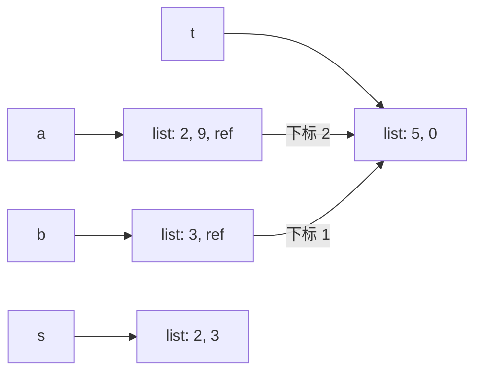
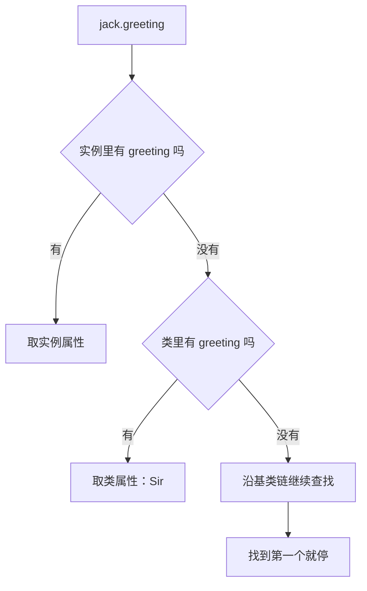
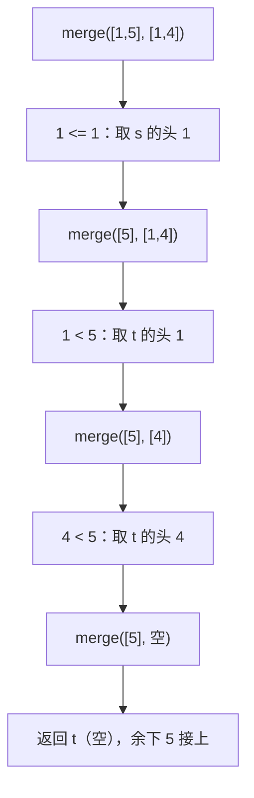

> **课程**：UC Berkeley CS61A · Structure and Interpretation of Computer Programs（Fall 2024）
> **本讲**：Lecture 25 ｜ 38:37 ｜ B 站分 P 25 ｜ [原视频](https://www.bilibili.com/video/BV1sy411z7nA?p=25)
> **课件**：`24-Data_Examples_1pp.pdf`（14 页，官方 PDF，逐页渲染图见正文插图）
> **字幕**：B 站英文原声字幕；本笔记是中文书面化重构，非逐句翻译
> **版权**：课程与课件版权归 UC Berkeley CS61A 教学团队；本文为学习用途的二次整理

## 本讲速览

- **已掌握**：列表是可变的引用值，赋值语句改的是"名字指向谁"；环境图与盒针图能同时记录名字与内容的变化。也学过类、属性查找、继承，迭代器与推导式，以及用 `Link` 表示的递归链表。
- **本讲主线**：
    - 列表操作分两类：`append`、`extend`、切片赋值改的是同一个列表对象；`+`、切片、`list()`、方括号字面量造的是新列表——但新列表里的元素仍然是旧元素的引用。
    - 别名（aliasing）意味着一次深层修改会在所有指向它的地方同时出现，盒针图是唯一可靠的记录方式。
    - 对象：属性查找先实例、后类、再基类；而属性赋值**永远**落在点号左边那个对象上，这就是"给一个实例特化属性"的机制。
    - 数据加工四件套：`map`、`filter`、推导式、聚合函数（`min`/`max`/`any`/`all`/`count`）；一行能写清，但先要想清自己遍历的是索引还是值。
    - 递归数据结构：`ordered` 用 `key` 参数把比较规则外置；`merge` 造新链表，`merge_in_place` 改旧链表，两者只差"返回新节点还是改 `rest`"。
- **关键结论**：本讲没有新语法。它练的是"先定义表示与接口，再写实现"，以及一个动作：**画出值之间的箭头，再动手写代码**。

*(参考时间: 00:00:01 – 00:00:32｜Lecture 25)*


## 1. 课件开篇：Discussion 8 与两页重叠计数

*(参考时间: 00:00:32 – 00:00:47｜Lecture 25)*

课件前几页把本讲的位置标得很清楚：第 3 页是分节页 **Discussion 8**，说明前面那段时间留给了讨论课与练习；第 4、5 页是一道链表题的完整版（快慢两种解法各一页）；从第 6 页开始才进入列表。录像从"复习列表变异"直接开始，这几页的口述部分不在字幕里。

> **编者说明**：本讲字幕从 00:00:01 起就是列表复习，课件第 3、4、5 页没有对应的口头讲解。这三页的内容依课件原文与图片整理，评述为编者所加；本章锚点取录像开头一段，只作时间参照，不代表这段内容在录像中出现过。


第 4 页的题目是**有序链表的线性时间交集**：给定两个有序、无重复元素的链表，返回同时出现在两个链表里的元素个数。课件画了两条链：3→4→6→7→9→10 与 1→3→5→7→8。答案是 2，因为只有 3 和 7 同时出现。

```python
def fast_overlap(s, t):
    if s is Link.empty or t is Link.empty:
        return 0
    if s.first == t.first:
        return 1 + fast_overlap(s.rest, t.rest)
    elif s.first < t.first:
        return fast_overlap(s.rest, t)
    elif s.first > t.first:
        return fast_overlap(s, t.rest)
```

递归版与迭代版是同一个算法，只是把循环写成递归调用。既然两边都有序，就可以让两个游标各自单向前进：相等时两个游标一起走一步并记一分；哪一边的元素更小，就把那一边往前走，因为它不可能再和另一边的任何元素相等（另一边只会更大）。任何一个链表走到空，匹配就不可能再发生，直接返回。

```python
def fast_overlap(s, t):
    k = 0
    while s and t:
        if s.first == t.first:
            k, s, t = k + 1, s.rest, t.rest
        elif s.first < t.first:
            s = s.rest
        elif s.first > t.first:
            t = t.rest
    return k
```

步数的上界是两条链长度之和：每一步至少消耗一个节点，而节点只会被消耗一次。这就是标题里"线性时间"的含义，也解释了题目为什么要求**有序**：无序的链表没有"该放弃谁"的判据，任何一次比较都不足以排除任何元素。


第 5 页把慢的写法摆出来做对照。整体思路仍然是高阶函数那一套：`count_if` 接收一个判断函数，把"要不要计数"外置；`contained_in` 是柯里化（currying）的写法，先记住链表开头，返回一个只等元素的判断函数；`overlap` 则把两者拼起来。

```python
def count_if(f, s):
    if s is Link.empty:
        return 0
    else:
        if f(s.first):
            return 1+count_if(f, s.rest)
        else:
            return count_if(f, s.rest)

def contained_in(s):
    def f(s, x):
        if s is Link.empty:
            return False
        else:
            return s.first == x or f(s.rest, x)
    return lambda x: f(s, x)

def overlap(s, t):
    "For s and t with no repeats, count the numbers that appear in both."
    return count_if(contained_in(t), s)
```

代价一眼可见：对 `s` 的每一个元素，`contained_in(t)` 都要把 `t` 从头扫到尾，于是总步数约等于两边长度之积。写起来短，跑起来贵——这正是课件右栏那张增长阶对照表想提醒的事。


| 增长阶 | 判据：n 增加 1 时 | 典型例子 |
| :--- | :--- | :--- |
| 指数增长（Exponential growth） | 时间**乘以**一个常数 | 递归版 `fib` |
| 二次增长（Quadratic growth） | 时间**增加** n 倍常数 | 对每个元素扫一遍整条链 |
| 线性增长（Linear growth） | 时间**增加**一个常数 | 两个游标同向推进 |

这张表是判断"能不能过关"的第一把尺子：同一道题，`overlap` 与 `fast_overlap` 输出相同，量级却差一个 n。后面链表那一章里，同样的取舍会以"造新链表还是原地改"的形式再出现一次。

## 2. 列表是可变的：`append` 与 `extend` 的盒针图

*(参考时间: 00:00:47 – 00:02:23｜Lecture 25)*


列表是这门课里第一个"同一块数据允许多个名字"的对象。名字可以改指别的列表，列表的内容也可以变长变短——这两件事互相独立，环境图正好把两者分开画：全局帧里是名字与箭头，堆里是带下标的盒子。

课件给的基准例子永远相同：先执行 `s = [2, 3]` 与 `t = [5, 6]`，然后每次只做一个操作。

`append` 把一个元素加到列表末尾。执行 `s.append(t)` 之后，`s` 变成三元素的列表：前两个是数字 2、3，第三个格子里装的是**箭头**，指向 `t` 原来指向的那个 `[5, 6]`。

```text
>>> s = [2, 3]
>>> t = [5, 6]
>>> s.append(t)
>>> s
[2, 3, [5, 6]]
```

这里有个必须说清的细节：第三个格子里的箭头指向的是**值**，不是名字 `t`。盒针图里那条线之所以不画到全局帧的 `t` 上，是因为 `s.append(t)` 在求值时先把名字 `t` 求值成它绑定的列表，再把那个列表放进去。列表里存的永远是值，名字只是求值过程中的一站。

于是下一步就很好理解了：`t = 0` 只是把名字 `t` 重新绑到 0，`[5, 6]` 这个列表本身没有消失，`s` 的第三个格子里那个箭头仍然指着它。`s` 还是 `[2, 3, [5, 6]]`，`t` 变成 0。**改名字不会改内容。**

`extend` 则把参数里的元素逐个搬进来。`s.extend(t)` 之后 `s` 变成 `[2, 3, 5, 6]`——四个格子，四个数字，没有嵌套。此时再执行 `t[1] = 0`，`s` 完全不受影响：`s` 装的是 5 和 6 这两个数字本身，而数字是不可变的，`t` 里那个格子换了值，也不会牵动 `s` 里的任何格子。

| 判据 | `s.append(t)` | `s.extend(t)` |
| :--- | :--- | :--- |
| 加进去的是什么 | 一个对象（一条引用） | `t` 的每一个元素 |
| `s` 的长度变化 | 加 1 | 加 `len(t)` |
| 之后修改 `t` 的内容 | 会反映到 `s` 里 | 不会（数字不可变） |
| 结构的形状 | 嵌套（列表里套列表） | 展平（一层） |
| 典型用途 | 建树、建嵌套结构 | 拼接同类序列 |

一句话记住：`append` 存的是"这个对象"，`extend` 存的是"它的元素"。选错的那一天，盒针图上会立刻显形——嵌套多了一层，或者本该共享的地方变成了副本。

## 3. 加法与切片：新列表，共享的元素

*(参考时间: 00:02:24 – 00:05:32｜Lecture 25)*

`+` 和切片都**造新列表**，但它们只复制"格子"，不复制格子里的东西。课件用一个更长的例子把这句话拆开：`a = s + [t]`，`b = a[1:]`，然后分别改 `a` 和 `b`。

第一步是 `[t]`：方括号字面量先求值成一个只有一个元素的列表，那个元素是 `t` 求值出来的 `[5, 6]`。第二步是 `s + [t]`：两个列表相加，逐格复制，得到新列表 `[2, 3, [5, 6]]`，再绑给 `a`。

```python
s = [2, 3]
t = [5, 6]
a = s + [t]
b = a[1:]
```

那个临时的单元素列表没有名字。它求值完就失去所有引用，不可达，可以当作被回收——课件特意停下来提了一句这个"漂浮的列表"，因为它正是理解"谁还在指着谁"的练习题：不是所有造出来的对象都值得记录。

`b = a[1:]` 从下标 1 切到末尾，得到新列表，两个元素：数字 3，以及 `a` 里那个指向 `[5, 6]` 的引用——指向的还是同一个列表对象，没有复制。


接着做两次修改。`a[1] = 9` 把 `a` 的第二个格子从 3 换成 9，这是一次纯粹的"改格子"。`b[1][1] = 0` 要分三步读：先取 `b` 的第一个格子（那个指向 `[5, 6]` 的引用），再取它指向的列表，再把下标 1 的格子改成 0。这一步动的是**共享的那个列表**，所以三处同时变：

| 名字 | 改之前 | 改之后 | 说明 |
| :--- | :--- | :--- | :--- |
| `s` | `[2, 3]` | `[2, 3]` | 从来没碰过 |
| `t` | `[5, 6]` | `[5, 0]` | 被 `b[1][1] = 0` 改到 |
| `a` | `[2, 9, [5, 6]]` | `[2, 9, [5, 0]]` | 第三个格子与 `t` 共享 |
| `b` | `[3, [5, 6]]` | `[3, [5, 0]]` | 第二个格子与 `t` 共享 |

课件把结果总结成"三个 0"：`t` 里的 0、`a` 深一层里的 0、`b` 深一层里的 0。三个 0 其实是同一个格子，只是有三个入口能走到它。一次 `+`、一次切片都带上了这个引用，所以改动会同时出现在三处。



这张图值得反复对照：**新列表是新的，元素里的引用是旧的**。所谓"复制"，复制的是入口，不是里面的人。

## 4. 浅拷贝、方括号字面量与切片赋值

*(参考时间: 00:05:33 – 00:06:27｜Lecture 25)*

`list()` 也是造新列表。执行 `t = list(s)` 之后，`t` 得到一个装着 2 和 3 的新列表，`t` 原来指着的 `[5, 6]` 被换掉；再执行 `s[1] = 0`，`s` 变成 `[2, 0]`，`t` 还是 `[2, 3]`。这正是上一节结论的落点：**复制一层，元素照样共享；但因为元素是数字，改名字/改格子都不会穿透。**

三种"复制一个列表"的写法完全等价，课件在第 11 页的批注里把它们并列：

```text
list(t)       # 调用构造器，逐元素复制到新列表
t[:]          # 整段切片，得到新列表
t + []        # 与空列表相加，得到新列表
```

要注意它们都是**浅**拷贝（shallow copy）：外层是新的，内层的列表还是原来那些对象。上一节的 `b = a[1:]` 就是浅拷贝，所以 `b[1][1] = 0` 才能改到 `a`。


切片赋值（slice assignment）是同一套语法里的另一件事：它把"切片选中的那段格子"整体替换成另一个列表的元素，**长度不必相等**。

```text
>>> s = [2, 3]
>>> t = [5, 6]
>>> s[0:0] = t
>>> s
[5, 6, 2, 3]
```

`0:0` 是长度为零的切片，也就是一个"缝"。缝里塞进两个元素，后面的元素整体右移——这一步是"插入"。长度不相等并不报错，列表的实现只负责搬格子。

第二步换成 `s[3:] = t`。此时 `s` 是 `[5, 6, 2, 3]`，`s[3:]` 选中最后一个格子 3，用一个长度 2 的列表替换它，得到 `[5, 6, 2, 5, 6]`。再执行 `t[1] = 0`，`t` 变成 `[5, 0]`，而 `s` 的最后一格仍是数字 6：它当初搬进来的是数字 5、6，不是引用。

| 写法 | 选中了什么 | 效果 | 长度要求 |
| :--- | :--- | :--- | :--- |
| `s[0:0] = t` | 长度为 0 的缝 | 插入 `t` 的全部元素 | 任意 |
| `s[3:] = t` | 长度为 1 的尾部 | 用 2 个元素替换 1 个 | 任意 |
| `s[1] = 9` | 单个下标 | 改一个格子，不改变长度 | 不适用 |
| `s[0:2] = []` | 长度为 2 的头部 | 删掉这两个元素 | 任意 |

方括号字面量本身也是一条"造新列表"的规则：`u = [s, t]` 求值时先算出 `s`、`t` 两个值，再装进一个新列表，于是 `u` 里装的是两个引用。

![方括号字面量：u = \[s, t\] 存的是两个引用](</attachments/cs61a-48d208956fe5d075349c6d7d.png>)

## 5. 让列表变短：`pop`、`remove` 与删除切片

*(参考时间: 00:06:30 – 00:08:06｜Lecture 25)*

会加长就要会缩短。课件说这几种操作"直白得不值得画环境图"，于是只列表：

- `pop` 删掉并返回**最后一个**元素。`t = s.pop()` 之后 `s` 只剩 `[2]`，`t` 绑到被弹出的 3；原来那个 `[5, 6]` 再没有任何名字指着它，就此失联。
- `remove` 删掉**第一个等于参数**的元素。`t.extend(t)` 让 `t` 变成 `[5, 6, 5, 6]`，`t.remove(5)` 只删掉最前面那个 5，剩 `[6, 5, 6]`；全程 `s` 是 `[2, 3]`，一动没动。
- 切片赋值可以删除：给切片赋一个空列表，等于把那段格子整段拿掉。`s[0:1] = []` 把 `s` 变成 `[3]`；`t[0:2] = []` 把 `t` 清空成 `[]`。

```text
>>> s = [2, 3]
>>> s[0:1] = []
>>> s
[3]
>>> t = [5, 6]
>>> t[0:2] = []
>>> t
[]
```


`pop` 与 `remove` 的区别不只是"从哪头删"，还有"按什么删"：`pop` 按位置删一个，`remove` 按值找到第一个再删一个。列表里有重复值时，`remove` 只动最前面那一个——这是二者最容易被混淆的地方。

## 6. 列表套列表与自引用：`[[...]]` 是怎么印出来的

*(参考时间: 00:08:08 – 00:10:02｜Lecture 25)*

把前面的规则叠起来，就能造出越来越奇怪的形状。课件先给一个温和的版本：

```python
t = [[1, 2], [3, 4]]
list(t)
t[0].append(t[1:2])
print(t)
```

三行分别做三件事。`list(t)` 造了一个外层的新列表，但没人接住它——和上一章那个漂浮的单元素列表一样，立刻不可达。`t[1:2]` 是切片，造出新列表，里面只有一个元素：指向 `[3, 4]` 的引用。这里写 `1:2` 而不是 `1` 是关键：`t[1]` 就是 `[3, 4]` 本身，`append` 进去只多一层；而 `t[1:2]` 的结果仍然是列表，再 `append` 就多出两层——结果里那个 `[[3, 4]]` 就是这么来的。`t[0].append(...)` 把这个包装塞进 `t[0]` 的末尾。

```text
>>> t = [[1, 2], [3, 4]]
>>> list(t)
[[1, 2], [3, 4]]
>>> t[0].append(t[1:2])
>>> t
[[1, 2, [[3, 4]]], [3, 4]]
```

结果里那个 `[[3, 4]]` 有点绕：`t[1:2]` 是一个"装着一个引用"的列表，被 `append` 进 `t[0]` 之后，它就变成 `t[0]` 的第三个元素；所以 `t[0]` 是 `[1, 2, [[3, 4]]]`——最内层的 `[3, 4]` 是原来的子列表，外面那层是切片造出来的包装。

![列表套列表：t\[0\].append(t\[1:2\]) 的结果](</attachments/cs61a-a1fa7b31d8c9760aa0b4a120.png>)

最后是自引用。`t = [1, 2, 3]` 之后，用切片赋值把"整段元素"换成一个包含 `t` 自己的列表：

```text
>>> t = [1, 2, 3]
>>> t[1:3] = [t]
>>> t
[1, [...]]
>>> t.extend(t)
>>> t
[1, [...], 1, [...]]
```

`t[1:3] = [t]` 把下标 1、2 的格子换成"一个指向 `t` 的引用"，于是 `t` 变成了 `[1, t]`：它包含自己。课件在这里说了一句关键的话：**这不会让 Python 爆炸**——引用是循环的，但对象只有一个，谁也不需要无限复制。

`t.extend(t)` 再把 `t` 的所有元素搬到自己末尾。此刻 `t` 的元素是"数字 1"和"一个指向 `t` 的引用"，所以搬完之后是 `[1, 引用, 1, 引用]`，一共四个元素。打印时 Python 不能把引用一层层展开（那会无限递归），于是用 `[...]` 表示"这里绕回了已经打印过的列表"。

> **编者说明**：上面两段交互式输出是标准 `repr` 行为；录像里讲师只在屏幕上展示了结果并说"看起来像这样"，字幕没有逐字给出这行文本。`[...]` 不是省略号语法，而是解释器对循环引用的一种保护性显示。

这一章结束在讲师的一句提醒上：**从代码直接跳到最终结果是很困难的**，不画一张盒针图，几乎不可能算对。这不是技巧问题，而是这类题唯一可靠的解题工序。

## 7. 对象系统复习：先实例、后类、再基类

*(参考时间: 00:10:04 – 00:17:46｜Lecture 25)*

列表之后轮到对象。这一节复习的是 Fall 2014 期中第二题那套 `Worker` / `Bourgeoisie` 的代码，课件上没有这一页，是课上现场画的。

> **编者说明**：`Worker` / `Bourgeoisie` 不在本讲 PDF 的 14 页里，录像中是现场书写并画环境图讲解的。下面的代码按字幕描述与这道期中题的通行版本誊写，用于对照环境图；下表的结果与台词取自字幕，标点（如台词里的逗号）字幕未逐一给出，按原题写法补全。

```python
class Worker:
    greeting = 'Sir'

    def __init__(self):
        self.elf = Worker

    def work(self):
        return self.greeting + ', I work'

    def __repr__(self):
        return Bourgeoisie.greeting


class Bourgeoisie(Worker):
    greeting = 'Peon'

    def work(self):
        print(Worker.work(self))
        return 'I gather wealth'
```

课件的类比是这场戏的骨架：`Worker` 是干活的工人，见面称 "Sir"；`Bourgeoisie` 是资产阶级——按讲师的说法，他们拥有生产资料，不自己干活，靠雇佣工人搜刮财富，所以他们的 `work` 只是"指挥工人干活"，然后说一句 "I gather wealth"。为了让这个比喻渗进代码，`Bourgeoisie.work` 调用 `Worker.work(self)` 打印工人的台词，再返回自己那句。

第一条规则是**属性查找的顺序**：在一个实例上按名字找属性，先找实例属性，再找类属性，再找基类属性。类属性就是这样被"继承"下来的。



第二条规则是**属性赋值的方向**：`jack.greeting = "Ma'am"` 永远赋给点号左边的那个对象，也就是 `jack` 自己。它不会去改类属性，也不会在类上新建什么。

把初始化走一遍：

- `class` 语句的语句体立刻执行，于是有了类 `Worker`，带一个类属性 `greeting = 'Sir'`。
- `Bourgeoisie` 继承 `Worker`，自己有 `greeting = 'Peon'`，没有覆盖别的。
- `jack = Worker()` 先造实例，再把它交给 `__init__`；`self.elf = Worker` 让 `jack.elf` 指向**类本身**。
- `john = Bourgeoisie()` 在 `Bourgeoisie` 上找不到 `__init__`，于是沿基类找到 `Worker.__init__` 并应用，`john.elf` 同样是 `Worker` 类。
- `jack.greeting = "Ma'am"` 在 `jack` 上新建实例属性；从此 `jack` 自称 "Ma'am"，别的 `Worker` 仍称 "Sir"。

于是一串表达式都能算了。表格第二列是结果，第三列是原因：

| 表达式 | 结果 | 为什么 |
| :--- | :--- | :--- |
| `Worker().work()` | `'Sir, I work'` | 实例没有 `greeting`，查类得 `'Sir'` |
| `jack` | 显示 `Peon` | `__repr__` 返回 `Bourgeoisie.greeting`，与 `self` 无关 |
| `jack.work()` | `"Ma'am, I work"` | `self.greeting` 先查到实例属性 |
| `john.work()` | 打印 `Peon, I work`，返回 `'I gather wealth'` | 用基类方法算台词，再返回自己那句 |
| `john.elf.work(john)` | `'Peon, I work'` | `elf` 是类，从类上取函数，`john` 作 `self` |

`jack` 那一行的结果最容易吓人：显示出来是 `Peon`。原因在 `__repr__` 里——它根本不看 `self`，直接返回 `Bourgeoisie.greeting`。这是一个**故意写坏的**表示方法，用来考"交互式会话显示的到底是什么"：求值一个表达式，解释器要把它变成一行文本，于是去调用它的 `__repr__`。

`john.work()` 那一行有两层输出，必须分清。`Worker.work(self)` 返回的是字符串 `'Peon, I work'`，但 `Bourgeoisie.work` 用 `print` 把它送到屏幕上；`print` 打印字符串时不带引号，只打印内容。随后 `Bourgeoisie.work` 返回 `'I gather wealth'`，这个值是交互式会话的返回值，所以显示时**带引号**。

一条规律：屏幕上的有无引号，取决于这个字符串是被打印的，还是被当作值回显的。回显要给"求值回去得到同一个字符串"的表达式，所以必须加引号；`print` 只是把内容倒出来。

## 8. 数据加工四题：一行写完，但先想清楚遍历什么

*(参考时间: 00:17:49 – 00:32:21｜Lecture 25)*

这一节是整讲的练习场。四个问题都不大，但每一个都能用内置函数与推导式压到一两行；课件先一次性摆出来，让人自己先试，然后再逐个讲。

第 1 题：列表 `s` 中绝对值最小的那些元素的**下标**。以 `s = [-4, -3, -2, 3, 2, 4]` 为例，绝对值最小是 2，对应元素 -2 与 2，下标是 2 和 4。

这里有个必须掰开的陷阱：`min(s, key=abs)` 给的**不是**最小绝对值，而是"绝对值最小的那个元素"（-2 或 2）。要的是那个数 2，所以得先对每个元素取绝对值，再取最小值：

```python
min_abs = min(map(abs, s))
[i for i in range(len(s)) if abs(s[i]) == min_abs]
```

第二行很容易被写成"找出所有绝对值为 2 的元素"，但两者目的不同：`[x for x in s if abs(x) == min_abs]` 给的是元素（2 和 -2），题目要的是下标，所以遍历的对象必须从 `s` 换成 `range(len(s))`，判断条件也随之从 `abs(x)` 换成 `abs(s[i])`。

同一件事可以用 `filter` 写。先定义判断函数，再把下标序列过滤出来；`filter` 返回的是 filter 对象（一个惰性迭代器），要列表就得再套一层 `list`：

```python
def keep(i):
    return abs(s[i]) == min_abs

list(filter(keep, range(len(s))))
```

第 2 题：相邻两元素之和的最大值（保证 `len(s) > 1`）。对 `s = [-4, -3, -2, 3, 2, 4]`，五组相邻和分别是 -7、-5、1、5、6，答案是 6。

思路一盯下标：`range(len(s) - 1)` 给出所有"左边那个"的下标，最后一个下标不算，因为它没有右邻居；把每一对的和收进列表，再对列表取 `max`。

```python
max([s[i] + s[i + 1] for i in range(len(s) - 1)])
```

思路二换 `zip`：把"除最后一个元素外的 `s`"与"除第一个元素外的 `s`"配成对，每一对正好是相邻元素。直接 `zip(s, s)` 没用——它配出来的是"同一个元素与它自己"。配对之后再对每一对求和、取最大：

```python
max([a + b for a, b in zip(s[:-1], s[1:])])
```

第 3 题：构造一个字典，把每个数字 `d` 映射到 `s` 中所有"以 `d` 结尾"的元素。以 `1`、`3`、`4`、`5`、`8`、`9` 结尾的数都存在，其中以 5 结尾的有两个（5 和 55），而以 2 结尾的一个也没有——所以结果字典里不能有键 2。

```python
{d: [x for x in s if x % 10 == d]
 for d in range(10)
 if any(x % 10 == d for x in s)}
```

三层结构要分开读：值是一个列表推导式（挑出以 `d` 结尾的元素），外层是字典推导式（为每个数字 `d` 建一个键），最后的 `if` 是过滤子句（只保留真的出现过结尾数字的 `d`）。`any(...)` 回答"有没有任何一个元素以 `d` 结尾"，空集合上 `any` 为假，于是键 2 被跳过。

如果觉得表达式太长，可以先算一步"所有结尾数字"，再让过滤子句去查表：

```python
last_digits = [x % 10 for x in s]
{d: [x for x in s if x % 10 == d] for d in range(10) if d in last_digits}
```

讲师对这一步的评价是"只短了一点，但至少把一个大表达式拆成了两个"——这本身就是可读性上的收益。

第 4 题：`s` 里每个元素是否都等于**另一个**元素。第一个例子里 -4 只出现一次，答案假；第二个例子里 4、3、2 各出现两次，答案真。

思路一盯下标：对每个 `i`，构造一个"去掉下标 `i` 那个元素"的列表，看 `s[i]` 是否还在里面。`s[:i] + s[i + 1:]` 就是那个列表。

```python
all(s[i] in s[:i] + s[i + 1:] for i in range(len(s)))
```

这里有个容易被忽略的细节：这个表达式只去掉了**下标 i 的那一个元素**，并没有删掉所有等于 `s[i]` 的值。剔掉一个之后还能找到，就说明另有一个相等——这正是题目要问的。

思路二盯值：直接数每个值出现了几次，要求每次都大于 1。先算出一串计数，再取最小值与 1 比较；或者直接对每个值求 `s.count(x)`，看是不是全都大于 1。

```python
min([s.count(x) for x in s]) > 1
```

`count` 是列表自带的方法，所以最后这个版本最短，也最接近"数一数"这个直觉。

| 题 | 遍历什么 | 关键工具 | 一句话陷阱 |
| :--- | :--- | :--- | :--- |
| 最小绝对值的下标 | `range(len(s))` | `map`、`min`、推导式 | `min(s, key=abs)` 给的是元素，不是绝对值 |
| 相邻元素最大和 | `range(len(s) - 1)` 或 `zip` | 切片、`zip`、`max` | `zip(s, s)` 配的是自己与自己 |
| 按末位数字分组 | 值 `d in range(10)` 与 `x in s` | 字典推导式、`any` | 没出现过的末位不能留键 |
| 每个元素都有重复 | 下标或值 | `all`、`count`、切片拼接 | 只剔掉一个下标，不代表剔掉了所有等值 |

## 9. 链表处理：`ordered`、`key` 与两种 `merge`

*(参考时间: 00:32:22 – 00:38:29｜Lecture 25)*

最后一段回到递归数据结构。课上用的 `Link` 类只有两个字段：`first` 存一个元素，`rest` 存"剩下的链表"，默认是空。

> **编者说明**：下面这段 `Link` 定义不在本讲 PDF 的 14 页里；录像是接着"屏幕上已有的类定义"讲的，字幕只说它"接受 `first` 与默认值为空的 `rest`"。代码按课程通用定义誊写，用于对齐 `Link.empty` 的写法。

```python
class Link:
    empty = ()
    def __init__(self, first, rest=empty):
        self.first = first
        self.rest = rest
```

第一题：判断一条链表是否从小到大有序。递归的骨架是"看头两个，再管后面"：

```python
def ordered(s):
    if s is Link.empty or s.rest is Link.empty:
        return True
    if s.first > s.rest.first:
        return False
    return ordered(s.rest)
```

三个分支对应三种已知。零个或一个元素：只有这么点东西，排不出乱子，直接为真。头两个逆序：立刻为假。头两个有序、但整体还不知道：那就把判断推给 `s.rest`——这既是递归的信仰之跃，也是"只看必要时才看"的省力写法。

第二题要求按 `key` 函数排序：比如元素的绝对值 1、3、4 有序时，`[-1, 3, -4]` 也算有序。讲师把写法与 `sorted`、`min`、`max` 的 `key` 参数对齐：默认传单位函数，想按绝对值排就传 `abs`。

```python
def ordered(s, key=lambda x: x):
    if s is Link.empty or s.rest is Link.empty:
        return True
    if key(s.first) > key(s.rest.first):
        return False
    return ordered(s.rest, key)
```

为什么要写成参数而不是直接把 `abs` 写进比较里？因为写死 `abs` 只能解决绝对值这一种需求，而把比较规则抽成参数，同一段代码能服务任何"先映射再比较"的顺序——这正是高阶函数在前几讲反复训练的接口思维。有了 `key`，`ordered(s, abs)` 就是绝对值版，`ordered(s)` 就是原样版。

第三题：合并。给定两条有序链表，返回一条包含两者全部元素的有序链表。

```python
def merge(s, t):
    if s is Link.empty:
        return t
    elif t is Link.empty:
        return s
    elif s.first <= t.first:
        return Link(s.first, merge(s.rest, t))
    else:
        return Link(t.first, merge(s, t.rest))
```

两个基准情形都是"一条空了，答案就是另一条"；否则比较两个头，谁小谁当新链表的头，剩下的问题交给递归。判等时用 `<=` 还是 `<` 都行：两条链相等时，先取哪一边都不影响结果的正确性；课件选 `<=`，只是顺手。



第四题把"不许调用 `Link`"当成约束：同样的合并，但必须改动原来那两条链表。基准情形一模一样，区别只在最后两步——不再造新节点，而是把 `s.rest` 或 `t.rest` 改成递归的结果，然后返回节点本身。

```python
def merge_in_place(s, t):
    if s is Link.empty:
        return t
    elif t is Link.empty:
        return s
    elif s.first <= t.first:
        s.rest = merge_in_place(s.rest, t)
        return s
    else:
        t.rest = merge_in_place(s, t.rest)
        return t
```

对照着看，两版的差别只有三行：

| 判据 | `merge` | `merge_in_place` |
| :--- | :--- | :--- |
| 基准情形 | 返回另一条链表 | 返回另一条链表 |
| 选中 `s.first` 时 | `Link(s.first, merge(...))` | `s.rest = merge_in_place(...)`，返回 `s` |
| 新节点的来源 | 每次 `Link` 造一个 | 复用原有节点 |
| 原链表的命运 | 不变，仍可访问 | 被改接，结构被破坏 |
| 空间代价 | 与被合并元素数同阶 | 只花递归栈 |

一行代码的差别对应一个设计决策：`merge` 保住了输入，可以复用；`merge_in_place` 省下了内存，代价是调用之后原链表不再完整。选哪个取决于"这条链表后面还要不要用"。

## 10. 课件末三页：期中题与 Hydra（录像未讲）

*(参考时间: 00:38:31 – 00:38:35｜Lecture 25)*

录像在链表那道 doctest 通过时结束，课件后面还有三页没有讲：一页环境图综合题、一页 Trees 分节页、一页 Hydra 的砍头题。三页都没有口头讲解，本章按课件原文整理，作为前面几条线索的延伸。

> **编者说明**：本讲录像时长 38 分 37 秒，字幕最后一段说的是"doctest 通过了"。第 12、13、14 页不在录像中，下面的代码逐字誊写自课件，讲解为编者所加，不代表课堂原话。

### 10.1 环境图综合题：`of` 与 `surround`


第 12 页取自 Fall 2022 期中第二题：一段带闭包的代码，配一张已经填好答案的环境图。

```python
def of(us):
    def last(k):
        "The last k items of us"
        while k > 0:
            result.append(us.pop())
            k = k - 1
        return result
    return last

def surround(n, f):
    "n is the first and last item of f(2)"
    result = [n]
    result = f(2)
    result[0] = [n]
    return result.append(n)

result = [1]
surround(3, of([4, 5, 6]))
print(result)
```

课件给出的输出是 `[[3], 6, 5, 3]`，环境图里有四个帧：Global、`f1: of`、`f2: surround`、`f3: last`。三个容易踩的地方都与"名字落在哪一帧"有关：

- `last` 里的 `result` 既不是参数，也没有在 `last` 内部被赋值，所以它沿父链找到的是 **Global 的 `result`**，而不是 `surround` 的局部 `result`。这条链一旦画错，整题的输出都会错。
- `surround` 里的 `result = f(2)` 是**重绑**：局部名字 `result` 从 `[3]` 改指 `f(2)` 的返回值，而 `f(2)` 返回的正是 Global 那个列表。
- `return result.append(n)` 返回的是 `append` 的返回值 `None`，所以 `surround` 这一帧的 Return value 是 `None`；屏幕上那行结果全部来自 Global 的 `result` 被原地改成了 `[[3], 6, 5, 3]`。

题目里 `k = k - 1` 与 `us.pop()` 是两种不同的修改：前者只是重绑 `last` 这一帧里的局部名字，后者是调用方法、改动对象内容。把两者混为一谈，`k` 和 `us` 的状态就会算错。

### 10.2 分节页 Trees：从许德拉到树


第 13 页是 Trees 的分节页，配一张古希腊陶瓶画：赫拉克勒斯与伊俄拉俄斯面对九头蛇许德拉（Heracles, Iolaus and the Hydra，Paestan black-figure hydra，公元前 6 世纪，盖蒂博物馆藏）。用许德拉引出树很贴切：砍掉一个头，长出两个头，于是每个内部节点恰好有两个分支，叶子就是"头"。

### 10.3 Hydra 砍头题：用标签当索引


第 14 页把传说写成题：Hydra 是一棵特殊的树，每个节点 0 个或 2 个孩子；所有叶子都是标着 1 的头；每个内部节点（身体）的标签等于它后代中叶子的个数。要求实现 `chop_head(hydra, n)`，砍掉左起第 `n` 个头，并在原位补上两个相邻的新头，同时更新所有祖先的标签。

```python
def chop_head(hydra, n):
    assert n > 0 and n <= hydra.label

    if hydra.is_leaf():
        hydra.label = 2
        hydra.branches = [Tree(1), Tree(1)]
    else:
        hydra.label += 1
        left, right = hydra.branches
        if n > left.label:
            chop_head(right, n - left.label)
        else:
            chop_head(left, n)
```

答案的两个要点都藏在"标签就是叶子数"这句话里。其一，叶子砍头之后标签从 1 变成 2，并长出两个新头，所以祖先链上每个节点的标签都要加 1——`hydra.label += 1` 这一句就是"更新祖先"。其二，左子树里有 `left.label` 个头，所以第 `n` 个头落在左边还是右边，只需比较 `n` 与 `left.label`；落到右边时，`n` 要减去左边的头数，换算成"右边第几个"。这是"用数据结构自带的字段代替遍历"的典型写法：`label` 既是对外的信息，也是内部的索引。

## 小结

- **先分"改对象"还是"改名字"**：`append`/`extend`/切片赋值动的是同一个列表；`+`、切片、`list()`、方括号造新列表。判断一个操作属于哪一类，是读列表代码的第一步。
- **浅拷贝只复制一层**：新列表里的元素仍是旧引用，所以深层修改会穿透所有副本。要真正隔离，必须逐层复制——这在后面处理嵌套结构时会反复出现。
- **属性查找朝上，属性赋值朝左**：查找走"实例 → 类 → 基类"，赋值永远落在点号左边的对象上。两条规则合起来，就解释了为什么一个实例可以被"特化"而不影响同类。
- **表示方法决定回显**：交互式会话显示的是 `__repr__` 的返回值，`print` 打印的是字符串内容，所以前者带引号、后者不带。看到一行输出先问"这是被打印的，还是被回显的"。
- **想清楚遍历的是索引还是值**：四个小练习的难点全在这一句上。遍历下标才能拿到位置，遍历值才能直接用；`range(len(s))` 与 `s` 互换，往往就是答案对错的差别。
- **列表推导式与 `map`/`filter` 等价**：能写成推导式的，都能写成高阶函数加聚合；选择只看可读性，不看能力。
- **递归结构的两件套**：基准情形负责"空与一个"，递归步负责"看头、管尾"。`ordered` 的 `key` 参数与 `merge` 的 `Link` 调用，都是在接口层面做选择，而不是在比较逻辑里打补丁。
- **图先于代码**：盒子、箭头、帧，画出来之后答案往往自己浮现。这条建议在本讲出现了两次：列表那章是盒针图，环境图那题是帧与箭头。

*(参考时间: 00:38:28 – 00:38:35｜Lecture 25)*

## 附：本讲幻灯片索引

*(参考时间: 00:00:01 – 00:38:35｜Lecture 25)*

| 页 | 内容 | 出现位置 |
| :--- | :--- | :--- |
| 1 | 标题页 Data Examples | 本讲速览 |
| 2 | Announcements 公告页 | 本讲速览 |
| 3 | 分节页 Discussion 8 | §1 |
| 4 | 有序链表的线性时间交集（递归版与 while 版） | §1 |
| 5 | Slow Overlap：`count_if`、`contained_in` 与三种增长阶 | §1 |
| 6 | 分节页 Lists | §2 |
| 7 | append、extend、加法与切片的盒针图 | §3 |
| 8 | 表格续：`list()` 造新列表 | §4 |
| 9 | 表格续：`[...]` 造新列表，`u = [s, t]` | §4 |
| 10 | 表格续：`pop` 与 `remove` | §5 |
| 11 | 列表套列表：`t[0].append(t[1:2])` 与环境图 | §6 |
| 12 | Fall 2022 期中第二题：`of` 与 `surround` 的环境图 | §10.1 |
| 13 | 分节页 Trees：许德拉陶瓶画 | §10.2 |
| 14 | Hydra 砍头题：`chop_head` | §10.3 |
