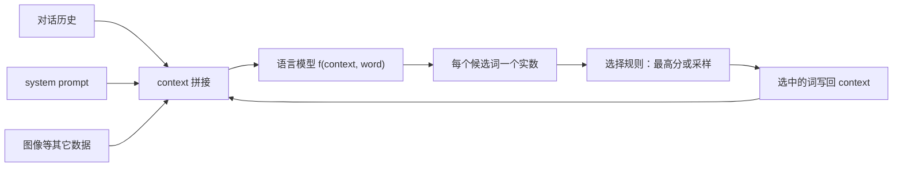
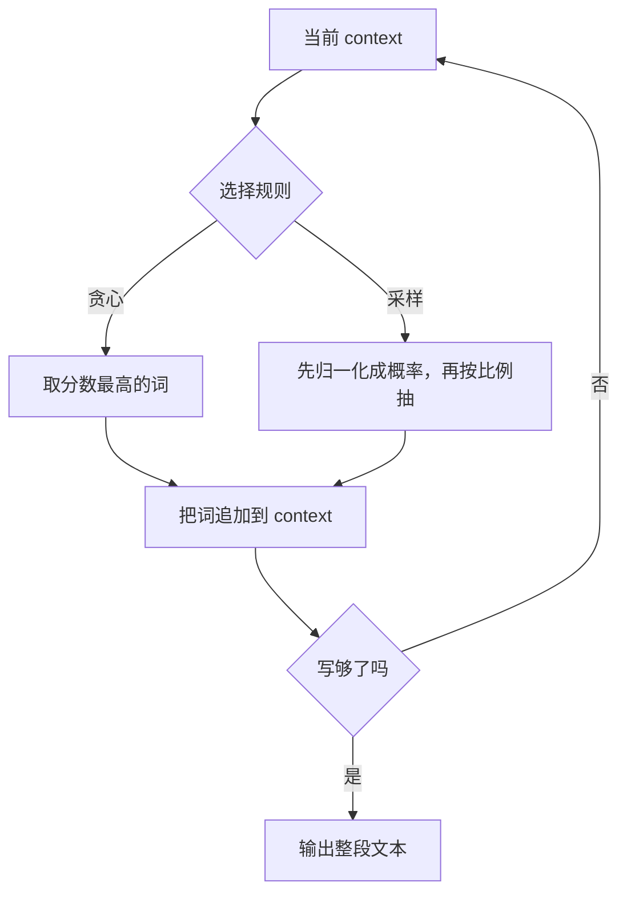

> **课程**：UC Berkeley CS61A · Structure and Interpretation of Computer Programs（Fall 2024）
> **讲次**：Lecture 26 ｜ 本讲无录像、无字幕 ｜ 无 B 站分 P
> **课件**：`25-Language_Models_1pp.pdf`（10 页，官方 PDF，逐页渲染图见正文插图）
> **说明**：无录像，故无时间锚点，内容依据官方课件整理；本文不复述讲师原话
> **版权**：课程与课件版权归 UC Berkeley CS61A 教学团队；本文为学习用途的二次整理

## 本讲速览

- **已掌握**：写过大量 Python 函数，分得清纯函数与非纯函数，习惯用 `doctest` 与断言做验收；也见过"用数据定义行为"的抽象手法——高阶函数把行为当值传递，数据抽象把表示藏在构造器与选择器之后。
- **本讲主线**：
    - 语言模型首先是一个**打分函数**：给定上下文（context）与候选词（word），返回一个实数；"会写文章"是反复调用它的副产物。
    - 神经网络之前最有效的做法是 **n-gram 计数**：分数就是"这一对词在语料里出现过几次"。它简单、可查表，但遇到没见过的组合就归零。
    - 从分数到文本有两条路：每次都挑最高分（贪心），或按概率比例**采样**。前者确定、呆板、易自我循环；后者多样，但也让"同一输入不同输出"成为正常现象。
    - 神经语言模型把"上下文该用什么表示"交给训练过程自己学，于是能**捕捉相似性**：后续词相似的上下文被视为相似；这正好补上 n-gram 的字面匹配短板。
    - 想让它像聊天助手，还得两步：用 prompt-response 对做**指令微调**，再用人类对成对回答的偏好做**对齐**（RLHF）。
- **关键结论**：语言模型的能力边界来自它的训练目标——它只被训练来"让下一个词看起来合理"，因此**它的输出必须由外部判据验收**，而不是由它自己的说法验收。


## 1. 十页课件里能复原什么

本讲的官方课件是 `25-Language_Models_1pp.pdf`，共 10 页。文件名里的编号比讲次号小 1，这是课件自己的排序编号，不是讲次编号——同门课的第 27 讲用 `26-Midterm_Examples_1pp.pdf`，第 25 讲用 `24-Data_Examples_1pp.pdf`，都遵循同一个约定。从这本 PDF 的排布看，后缀 `1pp` 指的就是"一页一屏"：10 页即 10 屏幻灯片。

十页的分工很干净。第 1 页是标题页；第 2 页是只有 `Announcements` 一行字的公告页；第 3 页是同样只有一行标题的分节页；第 4 到第 9 页是本讲的全部正文；第 10 页只剩一个标题加一个 `(Demo)`。画面右下角从第 4 页起才出现页码 4 到 9，前三页与最后一页都没有页码，这也从侧面说明前面几页是骨架页而不是内容页。

还有一处细节决定了我能写什么、不能写什么：第 4、5、6、7、10 页各有一个居中的 `(Demo)`。它标记的是"这里要现场演示"，而演示过程只存在于课堂上。本讲没有录像也没有字幕，所以演示里实际敲了什么、模型输出了什么，都无法复原。本文的处理原则是：**只在画面有字的地方下判断**，凡是超出画面一步的推理、术语和例子，一律标成编者说明，不冒充课件内容。

> **编者说明**：第 2 页的公告页只有一个标题，当周公告的具体条目（作业、考试、截止日期）无从得知，本文不做任何猜测；第 3 页的分节页同理，它只表示"下面进入 Large Language Models 这一主题"，没有任何提纲文字。

## 2. 语言模型是一个打分函数


分节页把主题定在 **Large Language Models**。课件正文的第一句就是全讲的骨架，值得逐字读：

> Language models (including large language models like ChatGPT, Gemini, Claude, etc.) are real-valued functions f(**context**, **word**) that return a real number (often from 0.0 to 1.0).


这句话把"语言模型"从"一个会写东西的程序"改写成"一个可以查的二元函数"：输入是 context 与 word，输出是一个实数。三个细节不能漏：

- **real-valued**：输出是**数字**，不是字符串，也不是句子。所有"生成文本"的行为，都是在这个数字之上再叠一层选择规则得到的（选择规则见 §4）。
- **f(context, word)**：两个输入。少了 word，函数不知道在给"哪个候选词"打分；少了 context，就无从判断合不合理。
- **often from 0.0 to 1.0**：课件用 `often` 而不是 `must`。取值落在 0 到 1 之间很好用，因为它容易被读成概率；但定义本身只承诺"是个实数"。

为什么要把上下文拆成"context 加一个词"？因为文本是序列，而生成只能一个词一个词地走：要写出下一段，就得反复回答"在这个上下文后面，下一个词该是谁"。这个"逐个位置打分"的骨架，n-gram 与神经模型共用——两者的差别不在接口，而在分数怎么算出来。

> **编者说明**：把一句话的概率拆成"每个位置给定前文的条件概率之积"，在概率论里称为链式法则。课件没有点名这条规则，这里只作提示，不作为课件内容。

课件的两个例子都在 Berkeley 自己的语境里。第一个：

```text
Oski the Bear (Oski) is the official ...
```

对这样的 context，`mascot` 应当是高分词。第二个是一句更长、带具体年份的上下文：

```text
Oski was suspended for two weeks in January 1990, for throwing a cake towards ...
```

这两句考的是两种不同的能力：第一句考"常识搭配"——熊是吉祥物；第二句考"具体事实"——1990 年 1 月那次停职是因为扔蛋糕。课件把它们并排放，说明同一个打分函数要同时覆盖"普通的词序规律"与"罕见的专有事实"。

> **编者说明**：Oski 是 UC Berkeley 的官方吉祥物；第二句对应校史上一则轶事。课件只给了这两句英文原文、没有交代背景，背景由编者补出，用于解释为什么选这两句举例。

第二句在课件里出现了两次，两次截断位置不同。第 4 页把它当作 context 的样例，写全了 `... throwing a cake towards ...`；第 8 页把它截短成 `... for throwing a`，并明确写出期望结果：模型应给 `cake` 打出接近 1 的分数。两页要合起来读——**待预测的词是 `cake`，不是 `towards`**。

第 4 页的最后一条把 context 这个概念推向了今天的样子：

> Recent language models have expanded the notion of context to include other data (e.g., images) as well as multiple text sources (e.g., system prompts).

这条有两层意思。第一，context 不再只是"文本"：图像也能进来，于是同一个打分函数要处理图文混排的输入，而输出仍然只是"下一个词的可能性"——这也解释了为什么图像模型与语言模型能共用一套接口。第二，context 可以是**多段来源**拼起来的，课件举的例子是 system prompt，也就是由系统（而不是用户）提供的那段指令文本。

| 判据 | 早期语境里的 context | 课件所说的现代 context |
| :--- | :--- | :--- |
| 内容类型 | 只有文本 | 文本 + 其他数据（如图像） |
| 来源数量 | 一段连续文本 | 多段来源拼接（如 system prompt） |
| 长度 | 通常是前文一小段 | 一次能看到的多轮对话与附件 |
| 谁来组织 | 使用者写下的前文 | 系统与用户共同构成的那一整份输入 |
| 对读者的含义 | "上文" | "模型这一次看到的全部东西" |

最后一行值得记住：**context 不是"用户说的那句话"，而是模型这一次能看到的全部输入**。这解释了为什么同一句话在不同系统里得到不同回答——变的不一定是模型，而是拼进 context 的那几段。



> **编者说明**：图中"拼接"这一步的具体格式（分隔符、模板、谁在前）因系统而异，课件没有给出任何格式，这里只表达"多段输入汇成一份 context"这一结构关系。

## 3. 神经网络之前：n-gram 计数模型


课件对历史的概括只有一句：神经网络兴起之前，最有效的语言模型建立在**文本中词序列的出现次数**之上，这类模型叫 n-grams。

页面中央那行字是莎士比亚《罗密欧与朱丽叶》的开篇，下面压着五条蓝色横线，也就是五组窗口：

```text
Two households , both alike in dignity ,
```

第一条线盖住 `Two households`，第二条盖住 `households ,`，第三条盖住 `, both`，第四条盖住 `both alike`——每一条都是**两个相邻词**的窗口，整体向右平移一格。第五条线最长，从行首一直拉到行尾附近，表示把整行当作一个窗口。

这一排窗口把 n-gram 的 `n` 讲清楚了：`n` 就是窗口长度。窗口一次盖住 `n` 个词，前 `n−1` 个词是"看得到的历史"，最后一个是"要预测的词"。窗口短，历史被压扁；窗口长，历史看得多，但能数到的样本迅速变少。

画面上还有一个容易滑过去的细节：**每个词与标点之间都有空格**，逗号是独立的一项，前后各带一个空格。这更像是"已经分过词"的证据而非排版失误——在这套计数里，标点与单词地位相同，都是序列里的一个位置，所以 `households ,` 与 `, both` 都是合法的窗口。

> **编者说明**：把文本切成这样的基本单位，通常叫分词（tokenization）。课件用了分词之后的画面，但没有引入这个术语，本文只在解释画面时使用它。

页面上那行公式是本讲唯一的具体算法：

> The simplest score for a **context** and a **word** is just the count of **(context[-1], word)**.

写成数学就是：


$$
\mathrm{score}(c, w) = \mathrm{count}\big((c[-1], w)\big)
$$


`context[-1]` 是 Python 里"取最后一个元素"的写法，这里指"上下文里紧挨着待预测位置的那一个词"。于是这个最简单的打分器只看一步历史，其余历史全部丢弃——它是**二元模型**（bigram）：所有判断都由词对的出现次数决定。

把这句话落成代码只要三行。课件没有给出代码，下面这段是按同一规则写的可运行示意：

```python
from collections import Counter

words = open("corpus.txt", encoding="utf-8").read().split()
bigrams = Counter(zip(words, words[1:]))     # 每一对相邻词的出现次数

def score(context, word):
    return bigrams[context[-1], word]        # 未出现过的组合计为 0
```

`Counter` 对不存在的键返回 0 而不抛异常，这一点恰好与"计数即分数"的语义对上：语料里没见过的词对，分数就是 0。

代价在这里显形。真实语言里合法的词对远远多于语料里出现过的词对，绝大多数组合的计数是 0；生成过程一旦走到"下一步全是 0 分"的位置，模型就无词可选。这就是数据稀疏（sparsity）。

> **编者说明**：工程上对付稀疏的标准手段是平滑（smoothing，把一部分概率匀给没见过的组合）与回退（backoff，长窗口查不到就退回短窗口）。这两个词都没出现在课件上；课件只把 n-gram 当作历史背景，紧接着就用下一页的神经模型来解决"没见过就归零"的问题。

第二个代价是组合爆炸：`n` 增大一格，可能的窗口数量按候选词规模的幂次增长，而语料是固定的，于是"见过的窗口"占比急剧下降。这正是"最简单的打分"与"更有用的打分"之间的张力——计数法靠**字面命中**取胜，也因字面命中而受限。

## 4. 从分数到文本：贪心与采样


有了打分函数，生成文本的最朴素办法只有两步，课件写得很直白：

> - Pick the word with the highest score for that context
> - Add that word to the context

第一步选词，第二步把选中的词接回上下文——于是同一段流程可以再跑一遍，文本就一个词一个词地长出来。这两步合起来是个循环，每一圈都问一次"下一个词是谁"，而"谁"永远由分数最高者回答。

这种"每步都取最高分"的做法，通常叫贪心解码（greedy decoding）。它的性质由规则本身决定：给定同一个模型与同一个起始 context，输出**完全确定**，跑两遍得到同一段文字。

贪心的失败方式也是机制性的，不需要模型"坏掉"：最高分的词往往是最常见、最泛的词，于是文本容易变得平淡；一旦某个短语被自己写进上下文，它就会抬高自己再次出现的分数，于是同一句反复出现，形成自我循环；句子还可能越写越短，因为收尾标点在统计上常常是"最安全"的选择。

> **编者说明**："贪心解码"这个术语与上面这段失败模式分析都没有出现在课件上。课件只写了那两步操作，然后用一个 `(Demo)` 让学员现场看到效果；这里的分析是按打分函数的性质推出来的。


下一页换掉第二步的规则：

> Sampling from a probability distribution over words means selecting each word **in proportion to its probability**.

关键在于 `in proportion to`——**按比例**。概率 0.5 的词被抽中的机会是一半，而不是"必定抽中"；概率 0.1 的词仍有十分之一的机会被抽中。于是同一个 context 每次走出的下一条路可能不同，输出从"一个确定结果"变成"一族可能结果"。

严格地说，"按概率比例抽"要求这些数先构成一个概率分布，也就是非负且总和为 1。而第 4 页写的是分数"常常"落在 0 到 1 之间——这只保证每个数在区间内，并不保证整张表的和为 1。所以采样之前必须先归一化：把所有候选词的分数按总和缩放，让它们加起来等于 1。

> **编者说明**：归一化的具体做法（以及"温度"这类调整分布陡峭程度的参数）课件没有涉及，这里只指出"分数不等于概率"这一步差别。实现上一次采样可以用累积分布加一个均匀随机数，或直接用 `random.choices(words, weights)`。



| 判据 | 贪心（argmax） | 采样（sampling） |
| :--- | :--- | :--- |
| 选词规则 | 取分数最高的那一个 | 按概率比例随机抽 |
| 同输入同输出 | 是，完全确定 | 否，每次可能不同 |
| 文本形态 | 平稳、保守，容易重复 | 多样，偶尔跑偏 |
| 主要失败 | 自我循环、句子越写越短 | 事实漂移、答非所问 |
| 适合的用途 | 需要可复现的结果 | 需要多样性、造候选 |
| 验证方式 | 一次结果即可复查 | 必须多次抽样看分布 |

最后一行是这一节真正的工程结论：**采样把"同一问题两次回答不同"从缺陷变成了规范行为**。既然输出本身不确定，那么"我试了一次，它对了"就不构成证据；验收必须在多次抽样下进行，或者改用与生成过程无关的外部判据（测试、断言、人工核对）。

课件在第 9 页又把采样用了一次，用途完全不同——不是生成给人看的文本，而是**造出两条可供比较的候选**。这一点留到 §6。

## 5. 神经语言模型：参数与"学出来的表示"


这一页的标题后面挂了个括号：`(No Math Version)`。也就是说，课件刻意只给结构，不给公式。三句话概括了这个结构：

- 神经网络定义了一个函数：从**很大的结构化输入**（比如 context）到**一组固定大小的数字**（比如每个词的分数），函数的行为由**参数**决定。
- 这些参数可以被**训练**，使这个函数逼近任意指定的"输入 context 与输出分数"之间的关系。
- 训练的第一步，是让它能"认出"一个大型文本集合里的文本——课件顺手加了一句括号：这类集合**总是倾向于包含 wikipedia**。

"固定大小"这个限定很要紧：不管 context 多长，输出永远是一列分数，长度等于候选词的个数。输入可以变长、变复杂，输出必须定长——这是为了让分数能逐个词比较。代价是候选词越多，每个位置要打的分越多，这一步的开销随候选规模线性增长。

接着课件把训练目标具体化成两个例子，用的还是前面那两句 Oski：

- 对于 context `Oski the Bear (Oski) is the official`，模型应给 `mascot` 打出接近 1 的分数。
- 对于 context `Oski was suspended for two weeks in January 1990, for throwing a`，模型应给 `cake` 打出接近 1 的分数。

"接近 1"就是监督信号：语料里真实出现的下一个词，模型要给它高分。训练的第一步因此可以一句话说完：**把大集合里的真实文本当作答案，调整参数让答案的分数变高**。课件不涉及优化算法本身（标题已写明 No Math Version），只承诺"参数可以调到让分数符合期望"。

真正让课件用上 `amazing` 这个词的是下一段：

> The amazing part: the people who build these systems don't choose how the text context is represented. It's up to the training process to invent a representation of the context that scores words correctly.

对比一下就看出这一步跳了多远。n-gram 的"表示"是**人选**的：取前一个词、前两个词，还是取整句，由建模者决定，`context[-1]` 这个写法就是人做的决定。神经模型反过来：接口不变（仍然是"给 context 和 word，返回分数"），但"context 内部怎么变成数字"这件事交给了训练过程。

> **编者说明**：这与本课程反复讲的数据抽象是同一个问题的两端。数据抽象说：表示可以随便换，只要构造器与选择器（接口）不变。这里换掉的正是表示，而接口 `f(context, word)` 一字未改。课件没有做这个类比，类比是编者加的。

代价紧随其后：表示既然不是人设计的，人也就读不懂它、改不动它，出了问题只能回到数据与训练目标上找原因。

最后一句话给了"相似"一个可操作的定义：

> An important property of neural networks is that they capture similarity: two contexts are similar if they are followed by similar words.

也就是说，"相似"不是看字面重叠，而是看**后续词的分布**。两个上下文哪怕没有一个词相同，只要它们后面常常跟着同一批词，在这个模型的表示里就是相近的。

这一条正好补上 §3 的短板。n-gram 遇到没见过的词对只能给 0 分；而"后续分布相近"的上下文能共享统计强度，于是没见过的组合也能拿到合理分数。

> **编者说明**：为了让这句话落地，可以设想两个上下文——一个是熊的官方身份，一个是"某所大学的官方吉祥物是什么"这类问法。它们字面并不相同，但后面都可能接 `mascot`，按课件的定义就是相似的。这个例子是编者举的，课件只给了定义。

| 判据 | n-gram 计数模型 | 神经语言模型 |
| :--- | :--- | :--- |
| 分数从哪来 | 数语料里的出现次数 | 用参数算出来的函数值 |
| 上下文表示 | 人选的窗口（如 `context[-1]`） | 训练过程自己学出来 |
| 没见过的组合 | 计数为 0，可能无词可选 | 仍能给出分数 |
| 相似性 | 只看字面是否相同 | 看后续词分布是否相近 |
| 上下文长度 | 窗口越长越稀疏 | 变长输入，输出定长 |
| 可解释性 | 高，能查到原始计数 | 低，表示不可读 |
| 需要的语料 | 中等，但极依赖覆盖度 | 很大（课件举例：常含 wikipedia） |

## 6. 指令微调与人类反馈：三步对齐


到这里模型已经能"把文本续得像那么回事"，但课件马上泼了一盆冷水，而且只用了半句话：

> The language model that results from matching a large text corpus is not a good chat bot.

为什么"续写得好"不等于"会聊天"？课件没有展开，但顺着 §5 的训练目标可以推出来：预训练只要求"下一个词像语料里的下一个词"。而语料里绝大多数文本**不是**对某个提问的回答——它们是小说、条目、说明、讨论。于是模型的默认行为是"接着往下写"，而不是"回答你"。你问它一个问题，它最自然的反应是把这个问题当成一段待续写的文本。

> **编者说明**：上面这段因果分析是编者按训练目标推出来的。课件在这一页只给了判断"不是好聊天机器人"，没有给理由。

课件的下一步很轻：用一批好的 prompt-response 对继续训练**有帮助**。这就是指令微调（instruction fine-tuning）。它不改架构，只改数据——把"问题 → 回答"这种格式也变成一种"文本延续"，让模型在见到提问时倾向于进入"回答"的模式。

再往后是课件称为**关键**的一步：把人类对回答的评分纳入训练，也就是对齐（alignment），课件同时给了它的另一个名字——reinforcement learning from human feedback，RLHF。流程只有三步：

- 用采样为同一个 context 生成两条回答。
- 让人来评，哪一条更好。
- 调整模型参数，使得给定 context 时，分数高的词倾向于是人类更偏好的那些词。

第一步里"采样"两个字是全讲的暗线：如果两条都用贪心生成，结果会一模一样，人根本无从比较。**采样在这里的作用不是产出好看的文本，而是制造差异**，让"偏好"这个信号有可能被表达出来。

> **编者说明**：这一步的推理用了 §4 的结论（贪心确定、采样多样）。课件在两条之间没有明写因果，但这个衔接是读得出来的。

第二步选"二选一"而不是"打绝对分"，也不是随意的：人对"哪个更好"的判断通常比"这条值 7 分还是 8 分"更稳定，成对比较省掉了校准的麻烦。

> **编者说明**：这一点课件没有解释。另外，这套流程的已知代价是：评分者的偏好会被固化进参数，模型可能学会迎合评分者而不是给出正确答案（通常称为 reward hacking），回答的多样性也可能下降。这些都不在课件上。


| 阶段 | 数据形态 | 优化的是什么 | 得到的能力 | 典型缺陷 |
| :--- | :--- | :--- | :--- | :--- |
| 预训练 | 大集合里的连续文本 | 真实下一个词的分数要高 | 续写、补全、词的搭配 | 只会接着写，不会回答 |
| 指令微调 | prompt-response 对 | 回答文本里各词的分数 | 按提问作答的格式 | 回答质量参差，会编 |
| 人类反馈对齐 | 同一 context 的两条回答 + 人的偏好 | 被偏好的那条里词的分数 | 更符合人类口味的回答 | 迎合评分者、多样性下降 |

表格的最后一行是这张表最有用的地方：三个阶段优化的是**三种不同的东西**，而它们共用一个接口。所以"模型说错了"要先判断错在哪一层——是压根不知道（预训练数据没覆盖），是不会按格式答（指令微调不足），还是答得不合口味（对齐偏了）。三者的修法完全不同。

## 7. 语言模型与代码：一页只有标题的课件


第 10 页只有两样东西：标题 `Large Language Models and Code`，和居中一个 `(Demo)`。没有任何文字要点，也没有代码。既然本讲没有录像，这一页的演示内容无从复原，所以本节只做两件站得住的事：说清这一页在课件里的位置，以及给出在 CS61A 语境下用语言模型写代码的纪律。

位置很清楚：它是全讲的最后一页，标题里多了一个 `and Code`，主题从"模型怎么工作"转向"模型与代码的关系"。前九页建立的所有性质——打分、贪心、采样、相似性、对齐——都在这里变成使用建议。

> **编者说明**：以下四条纪律是编者按本讲建立的性质整理的，不属于课件内容。课件这一页只有标题与演示标记。

- **规格由人写，代码可以由模型写**。函数名、参数、返回值、边界条件、错误行为，这些是 `def` 上方的契约；模型给的是满足契约的一个候选实现。把顺序倒过来（让模型先写、再回头总结它做了什么），就等于把验收权交出去了。
- **验收用可执行的东西，不用解释**。`doctest`、断言、自己写的测试用例都可以；模型对自己代码的自然语言解释常常与代码不符，而测试不会撒谎。
- **把它当作非纯函数对待**。同一个 prompt 两次调用可能不同（§4 的采样、§6 的对齐都在推动多样性），所以关键路径要固定输出，探索阶段要允许重试。测试要在"多次抽样"的意义上稳定，而不是"我跑通了一次"。
- **出错时先分层定位**。按 §6 的三阶段表判断是"不知道"、"不会答"还是"不合口味"，再决定是补上下文、改 prompt 格式，还是换模型。

```python
def count_partitions(n, m):
    """Count the ways to partition n using parts up to m.

    >>> count_partitions(6, 4)
    9
    >>> count_partitions(5, 5)
    7
    >>> count_partitions(0, 0)
    1
    """
```

这段 `docstring` 是人的工作：它把"这个函数该做什么"写成可执行的句子。模型交回来的应该是一个能让 `python -m doctest` 全绿的主体。三个用例分别钉住了三条边界——常规情形、`m` 与 `n` 相等，以及最容易被漏掉的 `n = 0`。

| 判据 | 人写的函数 | 模型"写"的函数 |
| :--- | :--- | :--- |
| 规格从哪来 | 人读题后写下 | 人写在 prompt 与 `docstring` 里 |
| 可复现性 | 完全可复现 | 依赖采样，未必可复现 |
| 验收方式 | 测试通过即可 | 同样要测试通过，且要多次复核 |
| 典型错误 | 逻辑疏漏、边界漏写 | 看似合理但边界错、编造不存在的 API |
| 适合交给模型的部分 | — | 样板代码、改名重构、补测试用例、解释报错 |
| 绝对不能交出的部分 | 规格与验收判据 | 规格与验收判据 |

最后一行是这张表的重点：无论代码是谁敲的，**规格与验收判据必须留在人手里**。这与本课程从头到尾的做法一致——先写契约，再写实现，最后用例子检验。

## 小结

- **先问"接口是什么"，再问"它有多聪明"**：语言模型的接口只有 `f(context, word) → 实数`。把它记住，前面所有现象（贪心循环、采样多样、需要对齐）都能从这个接口加上选择规则推出来。
- **分数不是概率**：0 到 1 之间的实数只是"方便读作概率"，采样前必须归一化。凡是把模型原始输出直接当概率用的地方，都值得停下来检查一次。
- **选择规则决定文本性格**：同一组分数，取最大值得到确定而呆板的文本，按比例抽得到多样而容易跑偏的文本。要可复现就取最大值，要候选就采样。
- **"没见过的组合"是计数法的死穴**：n-gram 靠字面命中，命中不了就给 0；"后续词分布相近即相似"是对症的解法，也是神经模型相对计数模型的根本优势。
- **表示可以换，接口不必换**：从人选窗口到训练学出的表示，`f(context, word)` 一字未改。这是数据抽象在机器学习里说的同一句话。
- **能力边界来自训练目标**：预训练只教"下一个词要像"，指令微调教"要按问答格式来"，人类反馈教"要合人口味"。判断一个错误属于哪一层，比笼统地说"模型不行"有用得多。
- **不确定的输出必须用外部判据验收**：一次成功不算证据，测试、断言、人工核对才算。规格与判据永远留在人手里。

## 附：本讲幻灯片索引

| 页 | 内容 | 出现位置 |
| :--- | :--- | :--- |
| 1 | 标题页 Large Language Models | 本讲速览 |
| 2 | 公告页 Announcements（仅一行标题） | 本讲速览 |
| 3 | 分节页 Large Language Models | §2 |
| 4 | 语言模型的定义：`f(context, word)`、两个 Oski 例子、context 的扩张 | §2 |
| 5 | 神经网络之前的 n-gram 计数模型与窗口示意 | §3 |
| 6 | 贪心生成：取最高分并追加到 context | §4 |
| 7 | 采样：按概率比例选词 | §4 |
| 8 | 神经语言模型：参数、训练语料、学出来的表示与相似性 | §5 |
| 9 | 指令微调与人类反馈：三步对齐 | §6 |
| 10 | Large Language Models and Code（仅标题与演示标记） | §7 |
