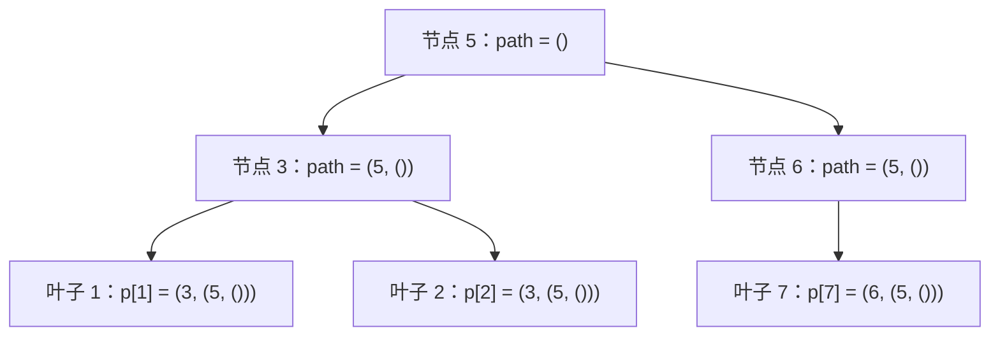
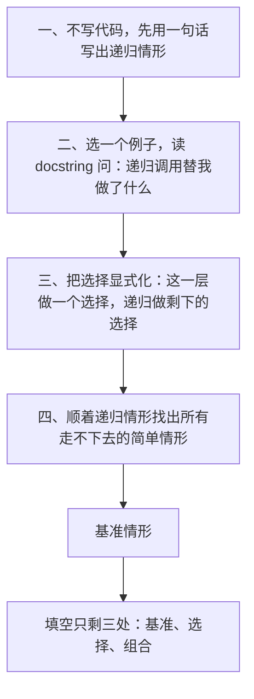
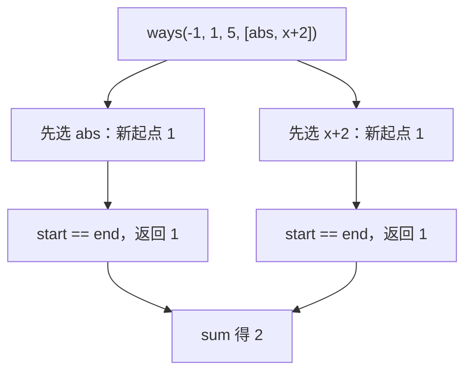
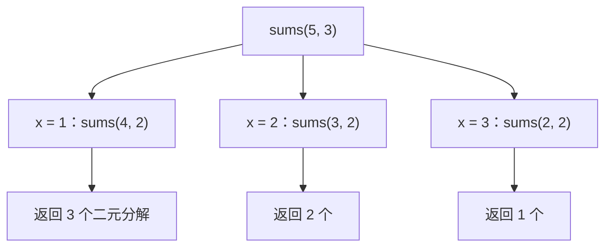

> **课程**：UC Berkeley CS61A · Structure and Interpretation of Computer Programs（Fall 2024）
> **本讲**：Lecture 27 · Midterm Examples ｜ **无录像**（官方未提供课堂视频，B 站无对应分 P）
> **课件**：`26-Midterm_Examples_1pp.pdf`（12 页，官方 PDF，逐页渲染图见正文插图）
> **内容依据**：无录像，故无时间锚点，内容依据官方课件整理；讲解逐页对应课件上的题目原文、填空与旁注
> **字幕**：无（本讲没有原声与字幕，文中不引用任何课堂口语）
> **版权**：课程与课件版权归 UC Berkeley CS61A 教学团队；本文为学习用途的二次整理

## 本讲速览

- **已掌握**：树（Tree）作为数据抽象（Data Abstraction）的接口、树递归（Tree Recursion）的写法、用字典与元组表示"路径"这类累积值、类与 `__str__`、以及用 `sum` 配合列表推导式做计数的基本套路。
- **本讲主线**：
    - 前半段（Trees）先用一页把 `Tree` 的接口重新钉死：能读什么、能改什么，以及哪些写法（`t[0]`、`x in t`、`list(t)`）根本不是树的语言；
    - 然后逐题拆两道 Fall 2017 期中题：`pile` 把每条叶到根的路径折进一张字典，`Path` 再把这张字典包装成一个可打印的对象；
    - `pile` 的第二版把路径表示从嵌套元组换成列表，顺手暴露"下行时共享同一个列表"的可变性陷阱，这是全讲最有价值的一处对照；
    - 后半段（Recursion）先给一页方法论：先写自然语言的递归情形，再让递归处理"剩下的选择"；
    - 最后三题把方法落到代码：`ways` 用 `sum` 数选择序列，`sums` 用一个循环构造 k 元分解，再用两个 lambda 把同一件事重写成"生成后筛选"。
- **关键结论**：这五道题的填空位置几乎都落在同一个地方——**递归调用要传递的"状态"是什么**。想清楚"我在哪一层、手上拿着什么、下一层该拿到什么"，空就填得出来；想不清楚，代码写多长都会在同一个位置断掉。

## 1. 十二页课件的骨架：两页概念、六页题

第 27 讲没有录像。官方课件 `26-Midterm_Examples_1pp.pdf` 只有 12 页，没有课堂原声，也没有字幕，因此本讲不设时间锚点：下文每一处讲解都以课件画面为唯一依据；凡是超出画面的补充，都会以"编者说明"的形式单独标出。

把这 12 页按功能分成四类，结构就一目了然：标题页与公告页各一页，是课程的起手式；`Trees` 与 `Recursion` 两个分节页把课件切成左右两半；第 4 页与第 9 页各是一页"接口/方法论回顾"；剩下六页是五道题外加一道重做。


标题页只有两个词，没有副标题、没有讲师名、没有日期。这两个词把本讲的性质说清了：不教新语法，不建新抽象，而是把往年期中卷上的题重新摊到投影上，一行一行地填空。


第二页是公告页，除标题外整页空白——公告正文没有进入 PDF，课件上不留痕迹。这一页在本文里只承担一个作用：标示"课程节奏"的位置，进入正题之前的那一小段时间。

五道题的页面上都挂着同一组统计：这一题平均拿到多少分，以及有多少比例的学生**完全**做对。

| 题目 | 出处 | 平均得分率 | 完全做对的学生比例 |
| :--- | :--- | :--- | :--- |
| Q5(a) `pile` | Fall 2017 CS 61A Midterm 2 | 49% | 26% |
| Q5(b) `Path` | Fall 2017 CS 61A Midterm 2 | 53% | 24% |
| Q4(c) `ways` | Fall 2017 CS 61A Midterm 2 | 71% | 41% |
| Q7(a) `sums` | Fall 2016 CS 61A Midterm 2 | 39% | 4% |
| Q7(b) `sums`（lambda 版） | Fall 2016 CS 61A Midterm 2 | 17% | 1% |

两列数字放在一起看，比单看任何一列都有信息。Q5(a) 平均拿到 49% 的分，却只有 26% 的人全对：平均分接近"半数"说明多数人拿到了前面几个空的分，而全对率只剩四分之一说明最后那个不经意的空（起点 `gather(t, ())`）足够把大部分人挡在门外。Q7(a) 平均 39%、全对率 4%，Q7(b) 平均 17%、全对率 1%——这两题几乎是"要么全对、要么全错"的形状，说明它们不是分段给分能救回来的题，必须整条递归链一次想通。

递归部分的三道题在页序上也是按难度排的：71%、39%、17%，一题比一题难，最后一题只剩百分之一的人做对。课件在这一页甚至专门加了一句按语：这题放在今天会被标成 A+ 题、值 0 分。

> **编者说明**：这些百分比是 Fall 2017 与 Fall 2016 期中二的原始数据，在 Fall 2024 的复习课上作为"难度标尺"重新展示，不是本学期的成绩。

## 2. Tree 的接口契约：能读什么，能改什么


分节页只有 `Trees` 一个词。它划定的范围很窄：接下来这一半课件只谈树，而且只谈"用 `Tree` 类写的树"。

### 2.1 六条只读约定


第 4 页的标题写着 "From Discussion 5 (Updated to be about the Tree class)"，这半句括注是理解整页的钥匙：这些约定原本出现在讨论课第 5 次，讲的是抽象数据类型（Abstract Data Type）版本的树——树就是一串"标签 + 分支列表"的嵌套结构；现在它们被改写成"类版本的树"，于是树不再是可以随便用下标拆开的列表，而是一个只暴露少量操作的实例。

页面先给出六条只读约定，逐条读下来，其实是在声明一个对象的"公民权"：

- 根标签可以是任意值，`t.label` 求值得到它。注意"任意值"这个措辞：树并不要求标签是数字，字符串、元组乃至列表都能当标签，判等只看 `==`。
- 分支本身也是树，`t.branches` 求值得到一个**列表**，列表里装的是这棵树的子树。
- 没有分支就是叶子，`t.is_leaf()` 返回 `True`。
- 一棵完全相同的树可以用 `Tree(t.label, t.branches)` 构造出来。
- 可以把树当参数传给函数，例如 `height(t)`。
- 这就是操作树的全部方式：没有 `t == x`，没有 `t[0]`，没有 `x in t`，也没有 `list(t)`。

最后一条是整页的重心，值得逐项展开：它并不是在罗列语法禁忌，而是在说"树不是序列"。一个 `Tree` 实例没有下标，所以 `t[0]` 直接报错；它不可迭代，所以 `list(t)` 与 `x in t` 都走不通；它也没有定义结构相等，所以 `t == x` 只能退回 Python 的默认语义——判断两边是不是同一个对象。

> **编者说明**：`t[0]`、`x in t`、`list(t)` 在 Python 里分别依赖下标协议（`__getitem__`）、成员检查（`__contains__` 或迭代协议）、迭代协议（`__iter__`）；`Tree` 一个都没有提供，所以三种写法都是 `TypeError`，而不是"结果不对"。另一处常见事故是 `t.is_leaf` 不带括号：拿到的是绑定方法对象，在 `if` 条件里恒为真，叶子与非叶子会被判成一样。

于是"想对树做什么"就该翻译成"用哪条接口做"，这张对照表可以直接背下来：

| 判据（想做的事） | 课件允许的写法 | 课件点名禁止的写法与失败原因 |
| :--- | :--- | :--- |
| 读根标签 | `t.label` | `t[0]`：树不是序列，没有下标 |
| 读所有分支 | `t.branches`，得到一个列表 | `list(t)`：树不可迭代 |
| 判断是不是叶子 | `t.is_leaf()` | `t.is_leaf`：方法对象恒为真 |
| 判断某标签是否出现 | 自己写递归，或调用现成函数 | `x in t`：树没有成员检查 |
| 判断两棵树内容相同 | 自己写递归比较 | `t == x`：默认只判"是不是同一个对象" |
| 算派生量（如深度） | 交给 `height(t)` 这类函数 | 在外部把树拆开、自己拼结构 |

`height(t)` 出现在这一页并非随手举例。它是"函数消费抽象"的样板：树只提供 `label`、`branches`、`is_leaf` 三样东西，而深度这个量并不在这三样里，于是它必须由外部函数递归算出来。理解了这一点，就能理解为什么题目里到处是 `Tree(...)` 构造、到处是 `t.branches` 遍历，却一次也不出现下标。

### 2.2 三条修改约定

只读之外，课件还给了三条**修改**约定，三条都围绕"点号左边的对象"：

- 改根标签：`t.label = ...`。
- 换掉整个分支列表：`t.branches = ...`；或者往列表里追加一条分支：`t.branches.append(...)`。
- 改某一条分支：`t.branches[0].label = ...`——先取 `t.branches`（列表），再取 `[0]`（一条子树），最后给它赋值 `label`。

前两条的区别要留意：`t.branches = ...` 是把 `t` 的 `branches` 属性换成一个新列表；`t.branches.append(...)` 是就地把分支塞进原来那个列表。后者会修改一个可能被别处共享的列表——如果另一棵树的分支列表恰好是同一个列表对象，它也一起变了。

> **编者说明**：`Tree(t.label, t.branches)` 复制的是顶层：新树是一个新实例，但它的分支仍是原来那几棵子树对象。所以"相同的树"指的是结构相同，两棵树并不共享同一个实例；改其中一棵的根标签，另一棵不会跟着变，但改某条分支的标签，两棵树都会看到。

### 2.3 为什么值得花一整页讲接口

因为后面每一道题都建立在"只用接口"这个前提上。`pile` 从头到尾没有一次下标操作，只有 `u.is_leaf()`、`u.label`、`u.branches` 三样东西；`Path` 类甚至不看树，它只处理 `pile` 交回来的字典。数据抽象的收益在这里体现得最直白：一旦代码只依赖接口，"树怎么实现"就与解题无关，考试时也就不必去猜 `Tree` 内部长什么样。

## 3. Q5(a) `pile`：把叶到根的路径折进字典


### 3.1 题面与那条递归定义

这是 Fall 2017 期中二的第 5 题 (a) 问，平均得分率 49%、全对率 26%。题面先给一条定义，这条定义本身就是递归的：

> 对一棵叶标签互不相同的树 `t`，它的 pile 是一个字典：`t` 的每个叶子标签是一个键，值是从那个叶子到根的路径。而"从某个节点到根的路径"要么是空元组（当该节点就是根），要么是一个二元组，第一个元素是父节点的标签，第二个元素是"从父节点到根的路径"。

把这条定义读两遍，会发现两处反直觉。第一，路径是**嵌套**的，`(3, (5, ()))` 要这样念："父节点 3，剩下的是从 3 到根的路径 (5, ())，其中 5 又是根"。第二，路径**不含起点自己**：叶 1 的值是 `(3, (5, ()))`，里面没有 1。1 只作为字典的键出现。

这两个性质合起来解释了 doctest 的三行结果：

```python
>>> pile(Tree(5, [Tree(3, [Tree(1), Tree(2)]), Tree(6, [Tree(7)])]))
{1: (3, (5, ())), 2: (3, (5, ())), 7: (6, (5, ()))}
```

叶 1 与叶 2 是兄弟，共享同一条"父 3、祖父 5"的路径，所以值一模一样；叶 7 的父是 6，祖父是 5，于是值是 `(6, (5, ()))`。三条路径的尾巴都是 `()`，因为根到根的路径按定义就是空元组。

### 3.2 四个空各在问什么

课件给了函数骨架，留了四个空，并在页面边缘用气泡写了旁注。把它们连同代码一起读：

```python
def pile(t):
    """Return a dict that contains every path from a leaf to the root of tree t.

    >>> pile(Tree(5, [Tree(3, [Tree(1), Tree(2)]), Tree(6, [Tree(7)])]))
    {1: (3, (5, ())), 2: (3, (5, ())), 7: (6, (5, ()))}
    """
    p = {}
    def gather(u, path):
        if u.is_leaf():
            p[u.label] = path
        for b in u.branches:
            gather(b, (u.label, path))
    gather(t, ())
    return p
```

第一个空在基准情形里：`p[u.label] = path`。气泡写着 "Base case: Put a leaf label in p"。之所以能直接存 `path`，是因为 `gather` 的第二个参数约定为"**从当前节点 u 到根的路径**"；走到叶子时，手上那条路径正好就是定义要的值，不必再拼。

第二个空在递归调用里：`gather(b, (u.label, path))`。气泡写着 "u has a label that can be added to the path"——要下到儿子 `b`，而"从 `b` 到根"的路径按定义是"父节点 `u` 的标签 + 从 `u` 到根的路径"，也就是把 `u.label` 压到 `path` 前面。元组拼接在这里是天然的"造新值"操作：`(u.label, path)` 得到一个新的二元组，兄弟分支之间互不影响。

第三个空在入口处：`gather(t, ())`。气泡写着 "all paths have ()"，意思是所有路径的尾巴都是空元组；而在根节点上，根到根的路径按定义就是 `()`。这次调用是整个递归的起点。

第四个空在末尾：`return p`。`p` 是外层函数的局部变量，内层 `gather` 通过闭包看到同一个字典，一路上把叶子逐个写进去；外层最后把它交出去。整道题因此是"**内层负责遍历，外层负责收集**"的结构。

把调用过程摊开，每个节点手上拿的 `path` 一眼可见：



顺便注意一个"省略了也没事"的细节：`if u.is_leaf(): ...` 后面直接跟 `for b in u.branches:`，没有 `else`。这并不是漏写——叶子的 `branches` 是空列表，循环一次也不执行，所以两个分支天然互斥。反过来，如果为了"保险"写成 `else:`，代码同样正确，只是多了一层缩进。

### 3.3 易错点

- 起点写成 `gather(t, [])`、`gather(t, 0)`、`gather(t, None)`：`path` 的类型必须是元组，因为整棵树的值都用元组表示，doctest 一个字都改不得。
- 基准情形写成 `p[u.label] = path + (u.label,)`：多存了叶子自己，值与定义冲突。定义里"从节点到根的路径"是从**父节点**开始记的。
- 递归调用的参数顺序写反成 `(path, u.label)`：类型立刻错位，下一层的 `path` 变成一个标签，`p` 里会出现 `(3, 5)` 这种既不是元组也不是路径的东西。
- `u.is_leaf` 少写括号：条件恒真，每个被访问到的节点（包括内部节点）都被当成叶子写进字典，最后 `p` 里有七个键，草稿纸上多出一倍的值。
- 忘了 `return p`：函数返回 `None`，doctest 直接失败。这类"最后一行忘了写"的失分最可惜，因为前面三行全对也救不回来。
- 把 `gather` 写成返回值风格（`return gather(...)`）：本题靠闭包里的 `p` 累积，没有返回值可传，两层结构不能混着改。

## 4. Q5(b) `Path`：把一张表包装成可打印的对象


### 4.1 为什么不重新找路径

第 6 页是同一道题的第 (b) 问，平均得分率 53%、全对率 24%。要求是：实现 `Path` 类，`__init__` 接收一棵树 `t` 与一个 `leaf_label`，假定所有叶标签唯一；打印一个 `Path` 时，把从根到该叶的标签用短横线连起来显示。

```python
>>> a = Tree(5, [Tree(3, [Tree(1), Tree(2)]), Tree(6, [Tree(7)])])
>>> print(Path(a, 7), Path(a, 2))
5-6-7 5-3-2
```

方向是关键：`pile` 的路径是"从叶往上"的（父在前），而打印要求"从根往下"。所以第 (b) 问并不是把第 (a) 问的字典直接印出来，而是要把它**反过来拼**。

课件的解法很干脆：`__init__` 里只做两件事——

```python
def __init__(self, t, leaf_label):
    self.pile, self.end = pile(t), leaf_label
```

调用一次 `pile(t)`，把整棵树的路径表存进 `self.pile`；把要找的那个叶标签存进 `self.end`（"这条路径的终点"）。于是一个 `Path` 对象实际上就是"一张表 + 一个键"，所有工作都推给了 `__str__`。

这个选择值得停一下：明明可以只记下 `t` 与 `leaf_label`，等到打印时再去树里找路径，为什么要在构造时算整张表？因为"找路径"是树的操作，而"拼字符串"是字符串的操作，两者混在一个方法里会让 `while` 循环同时处理树与字符串，正确率必然下降。把树的操作一次性做完，`__str__` 就退化成纯粹的"读表 + 拼接"。

> **编者说明**：代价是每个 `Path` 都要对整棵树做一次完整遍历，时间与空间都是 O(树的节点数)，而真正需要的信息只有一条路径。这是典型的"用空间与一次性的预处理换代码简单"；如果一棵树上要造很多 `Path`，更划算的做法是把 `pile(t)` 提到外面算一次再传进来。

### 4.2 `while` 循环的不变量

`__str__` 只有三行，但每一行都在跟"嵌套元组"打交道：

```python
def __str__(self):
    path, s = self.pile[self.end], str(self.end)
    while path:
        path, s = path[1], str(path[0]) + '-' + s
    return s
```

初值那一行有两个动作：`self.pile[self.end]` 取出这条路径（气泡标注 "path is a nested tuple"），`str(self.end)` 把叶标签变成字符串（气泡标注 "s is a string"）。两者都有讲究：`path` 是元组，所以后面能用 `path[0]`、`path[1]` 拆它；`s` 从一开始就是字符串，所以后面能直接拼。

循环体是一句并行赋值，右边两个表达式都是"取当前状态的一部分"：

- 新的 `path` 是 `path[1]`，也就是"从父节点到根"的剩余路径。课件用绿色小字把叶 7 那串嵌套摊成三层——`{..., 7: (6, (5, ()))}`、`(5, ())`、`()`——正好对应循环逐层剥掉外层的过程。
- 新的 `s` 是 `str(path[0]) + '-' + s`：`path[0]` 是父节点标签，把它转成字符串，加一个短横线，**接在已有字符串的左边**。气泡在这一列标着 "Build s from this"，因为字符串是从叶往根长出来的，而输出要求根在前，所以每次必须前插。

循环条件是 `while path:`，靠的是"空元组为假"：当 `path` 被剥到 `()`，条件为假，循环停下，此时 `s` 已经包含根。用 `Path(a, 2)` 走一遍：

| 轮次 | `path` | `s` | 说明 |
| :--- | :--- | :--- | :--- |
| 初值 | `(3, (5, ()))` | `'2'` | 叶子的父是 3 |
| 第 1 轮 | `(5, ())` | `'3-2'` | 把 3 前插 |
| 第 2 轮 | `()` | `'5-3-2'` | 把 5 前插，循环结束 |

`print(Path(a, 7), Path(a, 2))` 打印出 `5-6-7 5-3-2`：`print` 用空格分隔多个参数，每个参数各自调用自己的 `__str__`。doctest 里那行输出因此是"两个对象、一个空格"的结果，不是某个对象印出了空格。

### 4.3 易错点

- 两边写反：把并行赋值写成 `path, s = path[0], str(path[1]) + '-' + s`。`path[0]` 是标签、`path[1]` 是剩余路径，类型完全不同，下一轮就会拿字符串去拆下标，或者拿元组去和字符串拼接。
- 拼到右边：`s = s + '-' + str(path[0])` 得到 `2-3-5`，方向与题目相反。判断方向的办法很简单——输出第一个字符必须是根标签，而根标签是最后才被剥出来的，所以它必须被**最后**前插。
- 忘了 `str()`：`str(path[0]) + '-' + s` 里如果写成 `path[0] + '-' + s`，整数与字符串相加直接 `TypeError`。
- 在 `__str__` 里重新调用 `pile(self.t)`：每一轮循环都重算一次整棵树，既慢又说明没理解"`__init__` 已经把表算好了"。
- 属性名对不上：`self.pile[self.end]` 写成 `self.pile[self.leaf_label]`，而 `__init__` 里存的名字是 `self.end`。

> **编者说明**：`print` 走 `__str__`，而在交互式环境里直接求值 `Path(a, 7)` 走的是 `__repr__`。本题只定义了 `__str__`，所以直接求值会看到默认的 `<__main__.Path object at 0x...>`；doctest 用的是 `print`，正是为了绕开这一层。

## 5. Q5(a) 重做：路径改用列表表示


### 5.1 两种写法与同一张表

第 7 页把第 5 页的题重做了一遍。定义里那句关键的话被划掉、换成绿色的一句：**Represent the path as a list of labels.** 于是路径不再是嵌套元组，而是一个扁平列表，doctest 也跟着变了：

```python
>>> pile(Tree(5, [Tree(3, [Tree(1), Tree(2)]), Tree(6, [Tree(7)])]))
{1: [5, 3, 1], 2: [5, 3, 2], 7: [5, 6, 7]}
```

方向翻转了：元组版的值是"从叶往上"（父在前，尾巴是 `()`），列表版的值是"从根往下"（根在前，末元素是叶子）。这不是任意选择——列表版把整条路径一次性刻完，读起来就是一次从根到叶的下行。

课件给了两套能填出同一张表的写法。方案 A 保持"下行时把当前节点的标签压进路径"，到叶子才把叶子自己补上：

```python
def pile(t):
    """Return a dict that contains every path from a leaf to the root of tree t.

    >>> pile(Tree(5, [Tree(3, [Tree(1), Tree(2)]), Tree(6, [Tree(7)])]))
    {1: [5, 3, 1], 2: [5, 3, 2], 7: [5, 6, 7]}
    """
    p = {}
    def gather(u, path):
        if u.is_leaf():
            p[u.label] = path + [u.label]
        for b in u.branches:
            gather(b, path + [u.label])
    gather(t, [])
    return p
```

方案 B 反过来：起点就带上根标签，下行时把**儿子**的标签追加进去，到叶子直接存：

```python
def pile(t):
    """Return a dict that contains every path from a leaf to the root of tree t.

    >>> pile(Tree(5, [Tree(3, [Tree(1), Tree(2)]), Tree(6, [Tree(7)])]))
    {1: [5, 3, 1], 2: [5, 3, 2], 7: [5, 6, 7]}
    """
    p = {}
    def gather(u, path):
        if u.is_leaf():
            p[u.label] = path
        for b in u.branches:
            gather(b, path + [b.label])
    gather(t, [t.label])
    return p
```

两套写法的不变量不同，必须整题统一：

- 方案 A：`gather(u, path)` 里的 `path` 是"从根到 `u` 的**父节点**"的路径，**不含 `u`**；所以叶子处要补 `[u.label]`，起点是 `[]`。
- 方案 B：`gather(u, path)` 里的 `path` 是"从根到 `u`"的路径，**含 `u` 且以根开头**；所以叶子处直接存，起点是 `[t.label]`。

混用会立刻出错：A 的起点 `[]` 配 B 的追加方式（叶子处也按 B 的写法直接存），根标签会被漏掉，得到 `[3, 1]` 这种缺了根的路径；B 的起点 `[t.label]` 配 A 的叶子写法，叶子会重复出现，得到 `[5, 3, 1, 1]`。

### 5.2 为什么必须用 `path + [x]`

这一页真正想教的东西在加法号上。`path + [u.label]` 与 `path + [b.label]` 都是**造一个新列表**，旧列表不动；如果把加号改成就地追加，写成 `path.append(...)` 再传下去，代码会安静地错掉：

```python
# 错误示范：在 gather 的循环里就地追加共享的 path
for b in u.branches:
    path.append(b.label)
    gather(b, path)
```

这一改有两处伤口。其一，同一层的所有兄弟分支共用同一个 `path` 对象（它在外层只被创建一次），第一个兄弟追加之后，第二个兄弟看到的路径已经多了一节，第三个再多一节。其二，叶子处 `p[u.label] = path` 存下的是**同一个列表对象的引用**，于是等整棵树走完，字典里所有值都指向那条被反复追加的列表，打印出来每条路径都一模一样且长得离谱。程序不会报任何错，它只返回一张错的字典——这就是可变性（mutability）在递归里最典型的咬人方式。

元组版之所以没有这个问题，是因为元组不可变：`(u.label, path)` 必然产生一个新元组，共享是安全的。这也解释了课件为什么要把同一道题做两遍——表示的改变会改变"哪些操作是安全的"，而这是数据结构题的核心考点之一，不是风格问题。

| 判据 | 元组版（第 5 页） | 列表版（第 7 页） |
| :--- | :--- | :--- |
| 值的形状 | `(3, (5, ()))`，嵌套二元组 | `[5, 3, 1]`，扁平列表 |
| 方向 | 从叶往上，父在前，尾巴恒为 `()` | 从根往下，根在前，末元素是叶子 |
| 下行时怎么延长 | `(u.label, path)`，天然造新元组 | `path + [x]`，必须造新列表 |
| 叶子处怎么写 | `p[u.label] = path` | 方案 A 补 `[u.label]`；方案 B 直接存 |
| 起点 | `gather(t, ())` | 方案 A `[]`；方案 B `[t.label]` |
| 共享的风险 | 无，元组不可变 | 有，`append` 会污染兄弟分支 |
| 调试友好度 | 嵌套括号要数层数 | 直接看出路径 |

## 6. 递归的方法论：先把递归情形说出来


`Recursion` 分节页之后，课件没有立刻上题，而是插了一页方法。标题写着 "From Discussion 4 (With Some Extra Tips)"，同样是在说明这页内容来自讨论课。

### 6.1 把递归情形先说成一句话


页面第一句话就是最有用的一句：**不要一上来就写代码**，先把递归情形用文字描述出来。课件给了两个示范，都来自前面的课：

- `fib`：递归情形是"把前两个斐波那契数加起来"。
- `count_partitions`：递归情形是"用最大不超过 m 的部分去划分 n-m，**以及**用最大不超过 m-1 的部分去划分 n"。

这两个描述有共同的语法特征：一句话里出现了**两个**递归调用。`fib` 要两个前项，`count_partitions` 要"用掉一个 m"与"完全不用 m"两种情形。所以"递归情形"从来不是"调用自己一次"，而是"把这个问题拆成若干个更小的同类问题，并说清怎么把它们拼起来"。

接着是两个具体办法。

第一个叫**用抽象**（Use abstraction）：挑一个例子，然后问"递归调用在这个例子上会替我做完什么"；而这个答案要去 **docstring 里读**，不要去读代码。这一条把数据抽象的原则搬到了递归上：相信函数的契约，而不是相信它的实现。做 `pile` 时如果先相信 `gather(u, path)` 的契约——"给它一个节点和一条到根的路径，它会把以 `u` 为根的子树里所有叶子的路径都记进 `p`"——那么递归调用该怎么写就是一句话的事，根本不用展开整棵树。

第二个叫**实现一个选择**（Implement a choice）：大多数树递归问题都包含一串选择（比如"用不用一个大小为 m 的部分"）。递归情形只实现**其中一个**选择，剩下的选择交给递归去做。这条提示直接对应后面两道计数题：`ways` 的选择是"第一个动作选哪个 `f`"，`sums` 的选择是"最后一位放哪个数"。

至于基准情形，页面的说法很短：递归情形一旦确定，就去找它自然导向的所有简单情形。换句话说，基准情形不是"最小的例子"，而是"递归走不下去的样子"——`k == 1` 时无法再拆位，`start == end` 时已经到达终点，`u.is_leaf()` 时没有分支可下。



### 6.2 三道题各自的那句话

把方法论套到本讲的三道递归题上，"那句话"分别是：

| 题 | 递归情形的一句话 | 基准情形 |
| :--- | :--- | :--- |
| `ways` | 选一个动作 `f`，从 `f(start)` 出发再走 `k - 1` 步 | `start == end`（成功，算 1 种）；`k == 0`（走不通，算 0 种） |
| `sums`（Q7a） | 最后一位放 `x`，剩下 `k - 1` 位去凑 `n - x` | `k == 1`（只剩一位，只能是 `n`） |
| `sums`（Q7b） | 前缀取 `x`，其余位置继续用不超过 `x` 的数填 | `x == 0` 时无候选；`w == 0` 时只有空列表 |

三行写下来，能看出这道方法论的实用之处：**基准情形的个数由递归情形决定**。`ways` 的递归情形同时受"是否到达终点"与"是否还有步数"两个条件约束，所以它有两个基准；`sums` 的递归情形只受"还剩几位"约束，所以它只有一个基准。填空题里那些"看起来多余"的空，多半就是第二个基准。

## 7. Q4(c) `ways`：数选择序列


### 7.1 题面的那条约束

Fall 2017 期中二第 4 题 (c) 问，平均得分率 71%、全对率 41%，是本讲得分率最高的一题。要求是：实现 `ways(start, end, k, actions)`，从 `actions` 里挑一串函数 `f1, f2, ..., fj`（可重复挑同一个），使得 `f1(f2(...(fj(start))))` 等于 `end`，且 `j ≤ k`，返回这样的方式数。

题面最后一句是本题的灵魂：**如果一个动作序列到达了 `end`，就不能再往下施加动作**。这句话把"路径计数"变成了"序列计数"：一旦某个中间状态等于 `end`，序列就此结束，后面再叠几个函数也不构成新方式。

doctest 的第一个例子把这句话写在了注释里：

```python
>>> ways(-1, 1, 5, [abs, lambda x: x+2])   # abs(-1) or -1+2, but not abs(abs(-1))
2
```

`abs(-1)` 得到 1，到达终点，停；`-1+2` 得到 1，到达终点，停。而 `abs(abs(-1))` 虽然结果也是 1，但它在第一步 `abs(-1)` 时就已经到达终点——按题面，后面的 `abs` 不允许再施加，所以它不构成"另一种方式"。漏读这句约束，同一个起点的方案数会明显偏大，doctest 从 2 变成 2 以上。

### 7.2 三个空与两个基准

```python
def ways(start, end, k, actions):
    """Return the number of ways of reaching end from start by taking up to k actions.

    >>> ways(-1, 1, 5, [abs, lambda x: x+2])   # abs(-1) or -1+2, but not abs(abs(-1))
    2
    >>> ways(1, 10, 5, [lambda x: x+1, lambda x: x+4])  # 1+1+4+4, 1+4+4+1, or 1+4+1+4
    3
    >>> ways(1, 20, 5, [lambda x: x+1, lambda x: x+4])
    0
    >>> ways([3], [2, 3, 2, 3], 4, [lambda x: [2]+x, lambda x: 2*x, lambda x: x[:-1]])
    3
    """
    if start == end:
        return 1
    elif k == 0:
        return 0
    return sum([ways(f(start), end, k - 1, actions) for f in actions])
```

第一个空 `start == end`，返回 1。为什么是 1 而不是"1 加上后续的走法数"？因为按题目的约束，到达终点就意味着序列到此为止，这一件事本身构成**一种**方式；`j = 0` 也算一种（起点就是终点时不施加任何动作），所以这里返回 1 也顺带覆盖了"零步"的情形。

第二个空 `k == 0`，返回 0。步数用完而仍未到达终点，这条路走不通，贡献 0 种方式。

第三个空 `sum(...)` 加一段列表推导。气泡的标注把结构说得很清楚：`for f in actions` 旁边写着 "Choose an action"（这一层做的那**一个**选择），`ways(f(start), end, k - 1, actions)` 旁边写着 "# of ways starting with that action"（以这个动作为第一步的走法数）。把所有可能的第一步的走法数加起来，就是总数——这正是"递归情形实现一个选择，递归实现剩下的选择"。

两个基准的顺序不能交换。若先判 `k == 0`，那么"起点恰好等于终点、且 `k` 已经为 0"的调用会被判成 0 种，而"什么都不做"本该是一种合法方式（`j = 0 ≤ k`）。顺序本身承载了语义：**先判成功，再判失败**。

把第一个 doctest 的两次调用画出来，`sum` 在做什么就一目了然：



### 7.3 四个 doctest 的读法

第二个例子最能说明"数的是序列，不是和式"：

```python
>>> ways(1, 10, 5, [lambda x: x+1, lambda x: x+4])
3
```

从 1 到 10 要加 9，而每次只能加 1 或加 4。设加了 `x` 次 1、`y` 次 4，则 `x + 4y = 9` 且 `x + y ≤ 5`。`y = 1` 时 `x = 5`，总步数 6 超过 5；`y = 2` 时 `x = 1`，正好 3 步；`y = 0` 要 9 步。所以唯一可行的组合是"一次 +1、两次 +4"，而三种排列（144、414、441）各算一种方式，答案是 3——注释里的 `1+1+4+4`、`1+4+4+1`、`1+4+1+4` 之所以都写出来，正是要说明"顺序不同即不同方式"。

第三个例子 `ways(1, 20, 5, [lambda x: x+1, lambda x: x+4])` 返回 0：5 步最多把 1 推到 21，但 20 这个值无法用 5 步以内的 1 与 4 凑出来（`x + 4y = 19`、`x + y ≤ 5` 无解），所以一条路也没有。

第四个例子把 `start` 与 `end` 换成了**列表**，这是本题第二个考点：`ways` 不关心值的类型，只要求两个值之间能用 `==` 比较、并且能被 `actions` 里的函数变换。三个动作分别是在前面加一个 2、把列表重复两遍、去掉最后一个元素：

```python
>>> ways([3], [2, 3, 2, 3], 4, [lambda x: [2]+x, lambda x: 2*x, lambda x: x[:-1]])
3
```

> **编者说明**：下面三条路径是照着 doctest 与代码手工推出来的，课件只给了答案 3。`[2]+x` 往列表头部加一个 2，`2*x` 在列表上表示"重复两遍"（`2*[3]` 等于 `[3, 3]`），`x[:-1]` 砍掉最后一个元素。

| 方式 | 动作序列（从先到后） | 状态变化 |
| :--- | :--- | :--- |
| 一 | `[2]+x`，`2*x` | `[3] → [2, 3] → [2, 3, 2, 3]` |
| 二 | `2*x`，`[2]+x`，`x[:-1]`，`2*x` | `[3] → [3, 3] → [2, 3, 3] → [2, 3] → [2, 3, 2, 3]` |
| 三 | `2*x`，`x[:-1]`，`[2]+x`，`2*x` | `[3] → [3, 3] → [3] → [2, 3] → [2, 3, 2, 3]` |

第三条路径里 `x[:-1]` 把 `[3, 3]` 砍回 `[3]`，等于"浪费"了一步；但因为 `k = 4` 有余量，这种绕路仍然是合法方式。这再次印证了计数口径：只要序列在**第一次**命中 `end` 时停下，走了几步、有没有绕路都只影响"是不是同一种方式"，不影响"要不要数"。

易错点集中在这一题：

- 基准顺序写反，先判 `k == 0`：所有"起点即终点"的调用被错判成 0。
- 把"到终点即停"读漏，允许在 `start == end` 之后继续展开：`abs(abs(-1))`、`abs(abs(abs(-1)))` 这类"到过终点又继续走"的序列都会被当成新方式，第一个 doctest 的答案会明显偏大。
- 用 `len([...])` 代替 `sum([...])`：`len` 数的是"候选动作的个数"，不是"走法的总数"，结果永远等于 `len(actions)`。
- 忘记调用 `f`：写成 `ways(f, end, k - 1, actions)`，把函数对象当作起点，下一轮的 `start == end` 永远为假。
- 递归里少减 `k`：`k - 1` 写成 `k`，无限递归直到爆栈。
- 把 `actions` 的下标当元素用：`for f in actions` 写成 `for f in range(len(actions))`，然后对整数调用 `f(start)`。

## 8. Q7(a) `sums`：构造式枚举


### 8.1 题面与骨架

Fall 2016 期中二第 7 题 (a) 问，平均得分率 39%、全对率只有 4%——本讲第二难的题。要求：实现 `sums(n, k)`，接收两个正整数，返回一个列表，装着"把 n 拆成 k 个正整数之和"的**所有**方式（顺序不同算不同方式）。

```python
>>> sums(2, 2)
[[1, 1]]
>>> sums(2, 3)
[]
>>> sums(4, 2)
[[3, 1], [2, 2], [1, 3]]
>>> sums(5, 3)
[[3, 1, 1], [2, 2, 1], [1, 3, 1], [2, 1, 2], [1, 2, 2], [1, 1, 3]]
```

最后一行最能说明"顺序不同算不同方式"：(3,1,1)、(2,2,1)、(1,3,1)、(2,1,2)、(1,2,2)、(1,1,3) 六种排列全部列出。也注意输出的**顺序**：按最后一位从 1 到 3 分组，每组内部按递归返回的顺序排列。答案的顺序由代码结构决定，doctest 逐字比对，所以顺序也是考点。

```python
def sums(n, k):
    """Return the ways in which K positive integers can sum to N.

    >>> sums(2, 2)
    [[1, 1]]
    >>> sums(2, 3)
    []
    >>> sums(4, 2)
    [[3, 1], [2, 2], [1, 3]]
    >>> sums(5, 3)
    [[3, 1, 1], [2, 2, 1], [1, 3, 1], [2, 1, 2], [1, 2, 2], [1, 1, 3]]
    """
    if k == 1:
        return [[n]]
    y = []
    for x in range(1, n):
        y.extend([s + [x] for s in sums(n - x, k - 1)])
    return y
```

四个空分别是 `k == 1`、`[[n]]`、`range(1, n)`，以及 `s + [x]` 与 `sums(n - x, k - 1)`。页面下缘的三个气泡把这一行拆成三段来读：`s + [x]` 是"Build the list"（把手上的分解补上最后一位），`for s in ...` 是"Choose a way"（逐条选出一种补法），`sums(n - x, k - 1)` 是"Ways of completing the list"（前面那 k-1 位有多少种凑法）。

递归情形的那句话因此是：**最后一位放 `x`，前面 `k - 1` 位去凑 `n - x`**。注意 `x` 是被**接在末尾**的（`s + [x]`），所以整张表按"最后一位"分组——分组方式由写法决定，不由题面决定。

### 8.2 为什么 `range(1, n)`

`x` 的取值范围只需要两个理由就能定死：

- 下界是 1：题目要求正整数，最后一位最小就是 1。
- 上界取不到 `n`：前面还要留 `k - 1` 个正整数，每个至少 1，所以 `x ≤ n - 1`；`range(1, n)` 的右端不含，正好卡住。

`x` 是"这一层做出的那个选择"，所以循环遍历的是"最后一位所有可能的取值"；对每个取值，递归数出前 `k - 1` 位有多少种凑法，再把每种凑法 `s` 补成 `s + [x]`，用 `extend` 一次性并进 `y`。

`k == 1` 的基准情形同样只有一句话：只剩一位时，唯一的方式就是"这一位等于 `n`"，所以返回 `[[n]]`——注意返回值必须是一个**装着列表的列表**，因为函数的契约是"列表的列表"。

那么"无解"的情形（比如 `sums(2, 3)`）由谁处理？由空的 `range` 处理。`sums(2, 3)` 里 `n = 2`，`range(1, 2)` 只给出 `x = 1`，递归调用 `sums(1, 2)`；而 `sums(1, 2)` 的 `range(1, 1)` 是空的，循环一次也不进，`y` 保持 `[]` 直接返回。`extend([])` 什么也不加，外层的 `y` 于是也是 `[]`。**没有专门的"无解"基准情形**，因为"拆不动"在这套结构里自然表现为"没有任何候选"。

`sums(5, 3)` 的三轮循环摊开如下：

| `x`（最后一位） | 递归调用 | 递归返回 | 拼出的分解 |
| :--- | :--- | :--- | :--- |
| 1 | `sums(4, 2)` | `[[3, 1], [2, 2], [1, 3]]` | `[3, 1, 1]`、`[2, 2, 1]`、`[1, 3, 1]` |
| 2 | `sums(3, 2)` | `[[2, 1], [1, 2]]` | `[2, 1, 2]`、`[1, 2, 2]` |
| 3 | `sums(2, 2)` | `[[1, 1]]` | `[1, 1, 3]` |

三行拼起来正是 doctest 的六项，顺序也一致（先按 `x` 递增分组，组内保持递归返回的顺序）。这棵树画出来只有三层：



### 8.3 易错点

- `y.append(...)` 与 `y.extend(...)` 混用。`append` 会把"一整个列表"当作一个元素塞进去，`sums(4, 2)` 会变成 `[[[3, 1]], [[2, 2]], [[1, 3]]]`——多套一层，doctest 全错。要合并"若干条列表"，只能用 `extend`。
- `s + [x]` 写成 `s.append(x)`：`append` 就地改 `s` 且返回 `None`，推导式里得到一堆 `None`；即使改成"先 append 再返回 `s`"，也会因为多个分支共享同一个 `s` 而互相污染（与第 5 页的列表版 pile 是同一个坑）。
- `range(1, n)` 写成 `range(1, n + 1)`：`x = n` 时 `n - x = 0`，递归要去拆"0 个正整数之和"。`k - 1 > 1` 时那一路恰好返回空表，看起来没事；但 `k - 1 == 1` 时基准情形会返回 `[[0]]`，把 0 当成正整数混进答案，`sums(4, 2)` 于是多出 `[0, 4]` 这一条。
- 漏掉 `k == 1` 的基准：`sums(n, 1)` 会把那条唯一的 `[[n]]` 漏掉。递归不会因此爆栈（每层 `n - x` 都在变小，终究会遇到空 `range`），但 `k` 减到 1 及以下时结果恒为 `[]`，四个 doctest 全部落空。
- `sums(n - x, k - 1)` 的两个参数调换：`sums(k - 1, n - x)` 不会报错，只会安静地返回一批与题意无关的列表（有时是空表），属于"跑得通、答案不对"的那类错误。
- 忘记 `return y`，或把 `y = []` 写在循环里：前者返回 `None`，后者每轮清空。

## 9. Q7(b) `sums`：两个 lambda 的生成-筛选


### 9.1 `f` 与 `g` 各做什么

同一道题的第 (b) 问，平均得分率 17%、全对率 1%。课件在题目上方加了一句按语：这题放在今天会被标成 A+ 题、值 0 分。也就是说，它考察的不是"会不会写递归"，而是"能不能读懂别人用表达式写出来的递归"。

```python
f = lambda x, y: (x and [[x] + z for z in y] + f(x - 1, y)) or []

def sums(n, k):
    """Return the ways in which K positive integers can sum to N."""

    g = lambda w: (w and f(n, g(w-1))) or [[]]

    return [v for v in g(k) if sum(v) == n]
```

先看 `f(x, y)`。它接收一个"最大可用数" `x` 与"一批列表" `y`，做两件事然后相加：`[[x] + z for z in y]` 把 `x` 加到 `y` 里**每个**列表的前面；`f(x - 1, y)` 把"前缀取 `x-1`、`x-2`、…、1"的所有结果接在后面。于是 `f(x, y)` 返回的是"在 `y` 的每个列表前头加上 1 到 x 之间任意一个数"的全部结果。页面左侧的方框正是这么写的：`x` 是"最大数"，`y` 是一批列表，"Put each number up to x at the front of each list in y"。

再看 `g(w)`。`g(0)` 是 `[[]]`——一个空列表的列表，表示"长度为 0 的候选只有一个：空列表"。`g(w)` 等于 `f(n, g(w-1))`：把 `g(w-1)` 里每个长度为 `w-1` 的候选，前面接上 1 到 `n` 之间任意一个数。归纳下来，`g(w)` 就是"所有长度为 `w`、每个元素都在 1 到 `n` 之间的列表"。

最后一行 `[v for v in g(k) if sum(v) == n]` 做筛选：长度为 `k` 的候选里，和为 `n` 的那些就是答案。"k 个正整数之和为 n"与"长度为 k、元素不超过 n、和为 n 的列表"是同一件事——因为正整数之和恰为 `n` 时，每一项必然不超过 `n`。

### 9.2 `and/or` 惯用法

两个 lambda 都用 `(条件 and 结果) or 兜底` 这一个模式，把它读成"三行 if"就通了：

- `x and A or B`：`x` 为真时求 `A`，否则求 `B`。
- `f` 的兜底是 `[]`：`x == 0` 时"没有数可以放到前面了"，返回空表。
- `g` 的兜底是 `[[]]`：`w == 0` 时"长度为 0 的候选"恰好有一个（空列表），所以返回 `[[]]` 而不是 `[]`。

两处兜底的价值不对称，这是本题最容易读错的地方：`f` 的 `or []` 是真正的基准情形（`x` 减到 0 就停），而 `g` 的 `or [[]]` 既是 `w == 0` 的基准情形，又是"上一层算出来为空"时的安全网。`g` 的递归调用写作 `f(n, g(w-1))`——递归调用 `g(w-1)` 出现在**实参位置**，读代码时必须先算它，再进 `f`。

> **编者说明**：`or [[]]` 这个兜底能保证正确，前提是 `f(n, g(w-1))` 在 `w > 0` 时永远非空。这可以归纳证明：`g(0)` 非空；若 `g(w-1)` 非空，则 `f` 的第一项 `[[x] + z for z in y]` 在 `x ≥ 1` 时非空。所以 `or [[]]` 在 `w > 0` 的分支上不会被触发，只是把"空结果"这种情况顺手兜住。若把它删掉，`g(0)` 会返回 `0`（`w` 本身的假值），后面的推导式立刻报错。

顺便看一眼代价：`g(k)` 会先把 `n^k` 个候选全部造出来，再筛出和为 `n` 的那些。相比之下，Q7(a) 每走一步都在"凑得下去"的分支上，候选数量与答案数量同一量级。这就是"生成-筛选"（generate and test）与"构造式枚举"的差别——正确性都不难，代价却完全不同；课件那句"A+ 题、值 0 分"的按语，多半也在说这一层。

用 `n = 2, k = 2` 走一遍：

| 步骤 | 结果 | 说明 |
| :--- | :--- | :--- |
| `g(0)` | `[[]]` | 长度为 0 的候选只有空列表 |
| `g(1)` | `[[2], [1]]` | `f(2, [[]])`：前缀取 2、再取 1 |
| `g(2)` | `[[2, 2], [2, 1], [1, 2], [1, 1]]` | 每个长度 1 的候选前再接 2 或 1 |
| 筛选 `sum(v) == 2` | `[[1, 1]]` | 与 `sums(2, 2)` 的 doctest 一致 |

### 9.3 两版对照

| 判据 | Q7(a) 构造式 | Q7(b) 生成-筛选式 |
| :--- | :--- | :--- |
| 主要工具 | 循环、列表推导、`extend` | 两个 lambda 与 `and/or` |
| 中间结果 | 只保留"能凑成 `n`"的分解 | 先造出全部长度为 `k` 的整数列表 |
| 长度怎么控制 | 递归层数就是剩余位数 | `g` 的层数 `w` 决定位数 |
| 何时剪枝 | 由 `range(1, n)` 隐含剪枝，拆不动就变空 | 不剪枝，最后用 `sum(v) == n` 筛 |
| 候选规模 | 与答案数量同量级 | 每个位置 `n` 种可能，`n^k` 量级 |
| 结果顺序 | 按最后一位从 1 起分组 | 按第一位从大到小排列 |
| 可读性 | 一眼能懂 | 先认出 `and/or` 惯用法才读得动 |

两版都正确，答案集合相同；(b) 的顺序与 (a) 不同，因为它按第一位从大到小生成。区别只在于"什么时候排除不可能"：Q7(a) 一边构造一边排除，Q7(b) 先全部生成再排除；前者省时间，后者省代码。这种表达式写法在实际代码里几乎不会被主动选中，它的价值在于"读得懂"——期中、期末与面试里出现的怪代码，多半就是这一族的变体。

## 10. 五道题共用的一套判据

把五道题的填空位置排在一张表里，会发现它们的结构高度相似：

| 题 | 考点 | 递归时不变量（手上拿着什么） | 基准情形 | 高频失分点 |
| :--- | :--- | :--- | :--- | :--- |
| `pile`（元组版） | 树的递归遍历、累积参数 | `path` = 从 `u` 到根的路径 | `u.is_leaf()` | 起点写成 `[]`；路径里多存了叶子 |
| `Path` | 类、`__init__` 缓存中间表示、`__str__` 拼接 | `path` = 叶到根的嵌套元组；`s` = 已拼好的后半段 | `path` 为空元组 | `path[0]` 与 `path[1]` 用反；字符串拼到右边 |
| `pile`（列表版） | 可变性与共享引用 | `path` = 从根到 `u`（或到父）的列表 | 叶子处补上自己 | 用 `append` 就地改，污染兄弟分支 |
| `ways` | 高阶函数 + 计数递归 | 新起点 `f(start)`、剩余步数 `k - 1` | `start == end` / `k == 0` | 两个基准顺序反；漏读"到终点即停" |
| `sums`（a） | 组合枚举 + 循环 | 待凑的数 `n - x`、剩余位数 `k - 1` | `k == 1` | `append` 顶替 `extend`；`range(1, n)` 写成 `n + 1` |
| `sums`（b） | lambda、`and/or` 惯用法 | 前缀取值上界 `x`、候选长度 `w` | `x == 0` / `w == 0` | 认不出 `and/or`；以为 `or [[]]` 多余 |

由这张表可以抽出四条可以直接背下来的判据：

- **递归参数 = 下一层需要的全部状态。** 填空其实是在问"儿子需要知道什么"。`pile` 的儿子需要知道"父到根的路径"，`sums` 的儿子需要知道"还差多少、还差几位"，`ways` 的儿子需要知道"现在的起点、还剩几步"。参数写全了，函数体几乎是自动的。
- **基准情形 = 递归走不下去的样子。** 不是"最小的输入"，而是"递归情形在这里失效"的地方：没有分支可下、没有位数可拆、没有步数可走。反过来用这条判据检查，`ways` 为什么需要两个基准就很好解释了——它的递归情形同时依赖"值"与"步数"两个量。
- **累积值必须造新的，不能改旧的。** `(u.label, path)`、`path + [x]`、`s + '-' + ...` 全都在造新值；一旦换成 `append` 或就地赋值，同一层的兄弟分支就会互相看见对方的修改，而程序不会报错。递归里"共享"是默认状态，"隔离"需要主动做。
- **返回值 1 与 0 是有语义的。** 1 表示"这条路本身算一种方式"，0 表示"这条路走不通"。`ways` 里两个基准分别返回 1 与 0，恰好对应"到达终点"与"步数耗尽"；`sums` 里基准返回 `[[n]]`（一条列表）而不是 `[n]`，也是同一件事：返回值的形状必须与"若干种方式"这个契约对齐。

还有一条只在读题阶段成立的判据：**题面里那些看起来像补充说明的句子，往往就是难度所在**。`ways` 的"If a sequence of actions reaches end, then no further actions can be applied"、`sums` 的"in any order"、`pile` 的"no repeated leaf labels"，每一句都在悄悄改变答案的计数口径。49% 与 26% 之间的距离，很可能就有不小的一部分落在这种"读漏一句"上。

## 小结

- **先接口，后实现**：树只能通过 `label`、`branches`、`is_leaf` 触碰，`t[0]`、`x in t`、`list(t)`、`t == x` 都不是树的语言。判断一段树代码是否合格，先看它有没有偷偷用序列的方式拆树。
- **弄清路径的方向与端点**：元组版是"叶往上、父在前、尾巴是空元组"，列表版是"根往下、根在前、末尾是叶子"；同一个 `pile` 语义，换表示就换方向，doctest 逐字比对，不能混。
- **累积参数要么不可变，要么造新的**：元组天然安全，列表必须写 `path + [x]`。用 `append` 就地改，兄弟分支会互相污染，而且不报错——这是递归题里最难自己发现的一类错误。
- **递归情形先写成一句话**：一句话里通常包含两个递归调用或一个"选择"，写不出这句话就说明还没想清楚拆分方式。基准情形随后自然浮现，个数由递归情形的依赖量决定。
- **计数题的基准顺序承载语义**：`start == end` 必须先于 `k == 0`，否则"零步到达"会被判成失败；返回值 1/0 分别表示"算一种方式"与"走不通"。
- **构造与筛选是两种代价不同的策略**：Q7(a) 边构造边剪枝，候选与答案同量级；Q7(b) 先造 `n^k` 个候选再筛，代码短但慢。能读懂后者，也就读懂了 `and/or` 惯用法与"递归调用出现在实参位置"的求值顺序。
- **例题课的价值在填空位置**：五道题的难点全部集中在"递归调用传什么"与"基准怎么写"两处，而不是循环、字符串或类。把这两处练成条件反射，比刷更多题有效。

## 附：本讲幻灯片索引

| 页 | 内容 | 出现位置 |
| :--- | :--- | :--- |
| 1 | 标题页 Midterm Examples | §1 |
| 2 | 公告页 Announcements（空白） | §1 |
| 3 | 分节页 Trees | §2 |
| 4 | `Tree` 类的读约定与改约定 | §2 |
| 5 | Q5(a) `pile`：嵌套元组路径与四个空 | §3 |
| 6 | Q5(b) `Path`：`__init__` 与 `__str__` | §4 |
| 7 | Q5(a) 重做：列表表示的两种写法 | §5 |
| 8 | 分节页 Recursion | §6 |
| 9 | Discussion 4 的递归方法 | §6 |
| 10 | Q4(c) `ways`：选择序列计数 | §7 |
| 11 | Q7(a) `sums`：循环构造 k 元分解 | §8 |
| 12 | Q7(b) `sums`：两个 lambda 的版本 | §9 |
