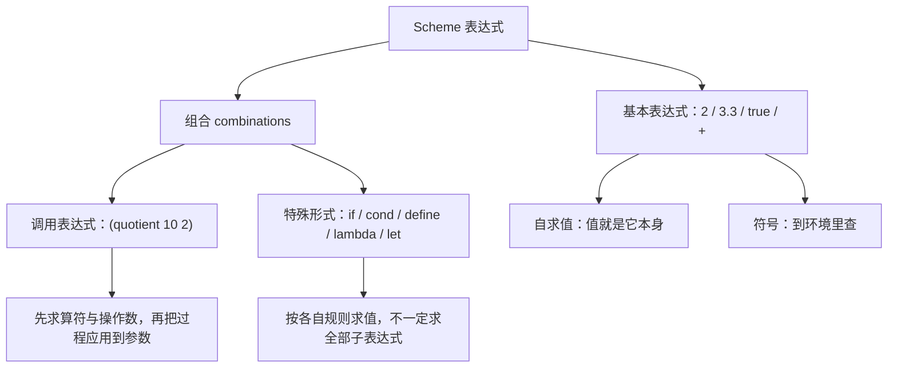
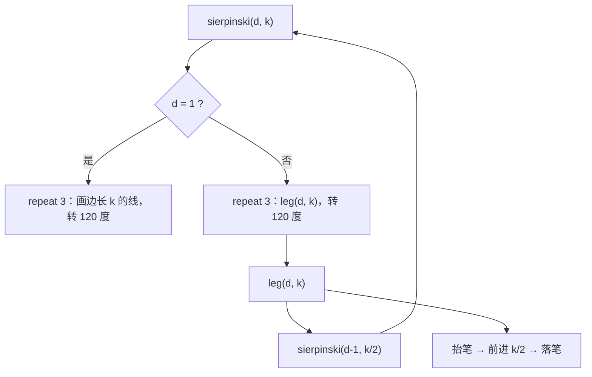

> **课程**：UC Berkeley CS61A · Structure and Interpretation of Computer Programs（Fall 2024）
> **本讲**：Lecture 28 ｜ 31:14 ｜ B 站分 P 26 ｜ [原视频](https://www.bilibili.com/video/BV1sy411z7nA?p=26)
> **课件**：`27-Scheme_1pp.pdf`（15 页，官方 PDF，逐页渲染图见正文插图）
> **字幕**：B 站英文原声字幕；本笔记是中文书面化重构，非逐句翻译
> **版权**：课程与课件版权归 UC Berkeley CS61A 教学团队；本文为学习用途的二次整理

## 本讲速览

- **已掌握**：用 `def` 定义函数、用环境模型解释名字查找、用递归代替循环、把函数当成可以传递和返回的值；能读懂盒针图里"名字—值—父环境"三者的关系。
- **本讲主线**：
    - Scheme 是 Lisp 的方言，比 Python 更老，却把"表达式求值"这件事做得更纯粹：程序就是一棵表达式树。
    - Scheme 表达式只有两类——基本表达式（自求值的数与符号）与组合；组合再分成调用表达式和特殊形式。
    - 前缀记法不是书写怪癖：算符、操作数、嵌套层级全部落在括号里，缩进只为读者服务，解释器一个空格都不看。
    - `define` 绑定名字，`if`/`cond`/`and`/`or`/`begin`/`let` 是特殊形式，`lambda` 造匿名过程；没有 `for`/`while`，迭代只能靠递归。
    - 课堂演示的 Scheme 由 Project 4 里学生亲手写的求值器执行——学一门语言，是为了下一步学会造这门语言。
- **关键结论**：语言换了，求值规则、环境模型、递归思维一样都没换；换掉的只是"括号放在哪里"和"哪种值可以直接写出来"。Scheme 的括号之所以看着密，是因为它把别的语言藏在语法里的结构（优先级、语句块、绑定范围）全部显式写了出来。

*(参考时间: 00:00:02 – 00:00:23｜Lecture 28)*


第 2 页是公告页，字幕里没有与之对应的口述内容，课堂公告也不属于知识内容，这里只作为课件顺序的一部分保留。

## 1. 为什么要学 Scheme：一门比 Python 更老的方言

*(参考时间: 00:00:24 – 00:01:53｜Lecture 28)*

到此为止，课程已经讲完了函数与数据这两件编程的本质，Python 的基本功算是过关了。接下来换语言，不是因为 Python 不够用，而是要验证一件更重要的事：**你在一种语言里学到的想法，有多少是可以搬走的**。讲师的判断很直接——可以搬走的部分非常多，而这正是值得花一讲去学 Scheme 的理由。

Scheme 是 Lisp 的方言（dialect）。Lisp 是今天仍在使用的最古老的两门编程语言之一，也是其中唯一还在快速生长的一门：不断有新一代的工程师把 Lisp 用在新的场景里。讲师引了三句评价给它作注脚：面向对象编程的发明者 Alan Kay 称它是"有史以来设计得最伟大的单门编程语言"；讲师最喜爱的一位科幻作家说它是"唯一一门称得上美的计算机语言"；Brian Harvey 则对它说了一句更不客气的恭维——"上帝写程序用的语言"。连网络漫画 xkcd 都画过它：Lisp 已经五十多岁，却仍有一种不受时间影响的完美气质；漫画里那句台词说，这是"你父亲的括号，属于更文明时代的优雅武器"。

> **编者说明**：Lisp 由 John McCarthy 在 1958 年前后设计，通常与 1957 年的 Fortran 并称"仍在使用的最古老语言"。Scheme 诞生于 1970 年代，是 Lisp 的一个极小化方言。"These are your father's parentheses" 是对《星球大战》里欧比旺那句"这是属于更文明时代的优雅武器"的戏仿，"括号"就是 Lisp 的标志性外观。

Lisp 的美在于简单：整门语言一天就能学完，但它能写出的程序，复杂度和课程里见过的任何程序相当，甚至更高。这句话听起来像推销，其实是这门语言的设计目标——**把语法压缩到几乎不存在，让所有的复杂性都留给问题本身**。后面会反复看到这个后果：没有 `for`、没有 `while`、没有 `return`、没有语句和表达式的分界，剩下的东西少到可以在一页纸上写完。

## 2. 表达式：自求值的、被绑定的、以及组合起来的

*(参考时间: 00:01:54 – 00:05:14｜Lecture 28)*


Scheme 程序由表达式（expression）组成。一个表达式在某个环境（environment）里求值，得到一个值；环境的作用是给符号赋予含义。课件用三行小字复习了这套模型，和 Python 完全一样：局部帧里，"这门课的讲师"有具体所指；全局帧里，"乘法"是所有人都懂的操作；查找时先局部后全局，所以在特定语境里"乘法"可以被重新定义成别的东西。

表达式按课件分两大类，四个小类：

- **基本表达式（primitive expressions）**：自求值表达式（self-evaluating），例如 `2`、`3.3`、`true`，写出来就是它的值；以及符号（symbols），例如 `+`、`-`、`quotient`、`not`，它们是名字，值要到环境里查。
- **组合（combinations）**：调用表达式（call expressions），例如 `(quotient 10 2)`、`(f x)`；以及特殊形式（special forms），例如 `(if a b c)`、`(let ((x 2)) (+ x 1))`。

这张分类图值得画出来，因为它是后文所有讨论的地图：



调用表达式的写法是本讲第一个必须改掉的习惯：**括号在外，算符在括号里的第一位**，后面跟零个或多个操作数。Python 写 `quotient(10, 2)`，算符在括号外；Scheme 写 `(quotient 10 2)`，算符也在括号里，只是排在第一个。`quotient` 是内置的整除过程——Python 里叫函数（function），Scheme 里叫过程（procedure），本质是同一个东西：接受参数、返回一个值。

于是 `(quotient 10 2)` 求值为 `5`，`(not true)` 求值为假。数字自求值，符号要被绑定到值上——这两句话就是 Scheme 求值规则的全部基础。

## 3. 求值与括号：前缀表达式的结构含义

*(参考时间: 00:05:15 – 00:06:42｜Lecture 28)*


课件第 4 页把刚才那棵树落到纸面上，并标了 `(Demo)`：这一页讲完就进入交互式演示。演示从最简单的开始，`2` 求值为 `2`；`(+ 1 2 3 4)` 求值为 `10`。接着讲师抛了一个问题：把什么都没有加起来，结果是多少？答案是 `0`。把什么都没有乘起来，结果是 `1`。这不是解释器的怪癖，而是**单位元**（identity element）的直接体现：加法的单位元是 0，乘法的单位元是 1，空组合只是把"什么都不做"写了出来。

`(* 2 2 2 2 2 3 3 3)` 求值为 `864`——演示时讲师手滑多敲了一个 `2`，先喊了一声"Oops"再确认结果，这个小插曲恰好说明前缀记法对操作数个数是零容忍的：多一个少一个，值就变了。嵌套也很自然：想要"把这一整坨减一"，只需要把它整个括起来，在最前面放一个新的算符：

```scheme
scm> (- (* 2 2 2 2 2 3 3 3) 1)
863
```

同样的位置放 `+`、`/`、`*` 都行，任何过程都能这样套上去。这正是前缀记法最省事的地方：**新的组合永远只在最前面加一个符号、在最后面加一个括号，不需要记住优先级，也不需要额外加括号去覆盖优先级**。

组合可以跨任意多行，怎么折行、怎么缩进，解释器完全不管；它只关心一件事——开过的括号都要关上。下面这个表达式是课程里经典的缩进示例，逐段读它的结构：

> **编者说明**：字幕口述了各子表达式的求值顺序（先算 `2 * 4 + (3 + 5)` 得 16，乘 3 得 48；再算 `10 - 7` 得 3，加 6 得 9；最后相加得 57），但没有念出完整表达式。下面的代码按口述的数值关系与"同层缩进对齐"的排版规则还原。

```scheme
(+ (* 3
      (+ (* 2 4)
         (+ 3 5)))
   (+ (- 10 7)
      6))
```

读法是自上而下看算符：最外层是加法，要加两个东西。第一个是被乘数 `3` 乘以一个子表达式，那个子表达式是 `(* 2 4)` 与 `(+ 3 5)` 的和，即 `8 + 8 = 16`，所以第一项是 `16 * 3 = 48`。第二项是 `(- 10 7)` 与 `6` 的和，即 `3 + 6 = 9`。两项相加得 `57`。之所以第二项的两个操作数缩进到同一层，是因为它们地位相同，都是这个加法的加数——**缩进是在给读者标注语法树的高度，不是给解释器看的东西**。换成一行写 `(+ (* 3 (+ (* 2 4) (+ 3 5))) (+ (- 10 7) 6))`，值一模一样，只是难读。

这也回答了"Scheme 的括号是不是噪音"这个问题：括号不是装饰，它是语法树的直接编码。Python 用缩进表达块结构、用优先级表达结合顺序、用逗号和圆括号表达调用，三种记号各管一件事；Scheme 把这些全部收进一对括号里，所以看起来密，但**没有任何隐含信息**——你看到的嵌套深度就是求值的嵌套深度。

求值规则本身和 Python 一字不差：先求算符，再求操作数，然后把过程应用到这些参数上。区别只在括号放在哪里。

## 4. 内置过程：问号是一种命名约定

*(参考时间: 00:06:43 – 00:07:48｜Lecture 28)*

除了 `+`、`-` 这类算术过程，Scheme 还自带一批判断用的过程。`(number? 3)` 为真，`(number? +)` 为假——后者说明"是数"这件事和"是个名字"无关，`+` 是一个过程对象，不是数。`(zero? 2)` 为假，`(zero? 0)` 为真，`(zero? (- 2 2))` 也为真，因为 `(- 2 2)` 先求值成 0 再判断。`(integer? 2.2)` 为假，`(integer? 2)` 为真。

名字末尾的问号不是语法符号，它是**名字的一部分**：这个名字就叫 `integer?`。这样命名的用意很朴素——让人一眼看出"这是个返回真或假的过程"。任何语言都鼓励用能提醒读者用途的名字，Scheme 只是把这条建议固化成了社区惯例：问号结尾表示谓词（predicate），即返回真或假的过程。

> **编者说明**：Scheme 社区还有一条同源惯例——以叹号结尾的名字（例如 `set!`）表示会修改状态的过程。这门课的分发版 Scheme 不强调这条区分，本讲也没有出现，这里只作背景提示，不属于课堂内容。

```scheme
scm> (number? 3)
#t
scm> (number? +)
#f
scm> (integer? 2.2)
#f
scm> (zero? (- 2 2))
#t
```

课件把自求值的真写作 `true`，解释器回显时用 `#t` 与 `#f`。两者是同一个意思，前者是可写的字面量，后者是打印形式。

## 5. 解释器从哪里来：Project 4

*(参考时间: 00:07:52 – 00:08:49｜Lecture 28)*

演示进行到这里，讲师自己提了一个问题：这些代码到底跑在什么上面？下载了什么东西吗？答案是"你可以下载一个解释器，也可以用一个嵌在网页里的在线版本，两种我们都会给你指路"——但课堂演示用的都不是这两者，而是**本课程 Project 4 的实现**。

Project 4 要求用 Python 写一个程序，它实现一个 Scheme 解释器；写完之后，你就能在它上面求值 Scheme 表达式。做到这件事的办法是：亲手写出执行各种过程所需的代码——读入表达式的代码、判断表达式属于哪一类的代码、按规则求值的代码。这样的程序有一个专门的名字，叫**求值器（evaluator）**。

这也点明了本模块的用意：学这门新语言，一部分原因是接下来要给它造解释器。先当用户，再当实现者——用户视角让你知道一门语言"应该"表现成什么样，实现者视角让你知道那些行为是从哪几行代码里长出来的。后面几讲会把这个求值器从"能算 `(+ 1 2)`"一路做到"能跑递归过程"。

## 6. 特殊形式：if 与 and/or

*(参考时间: 00:08:53 – 00:10:26｜Lecture 28)*

到这里只学了调用表达式，而 Scheme 还有别的表达式类型，叫**特殊形式（special form）**。定义很干脆：**特殊形式就是任何不是调用表达式的组合**。这个定义看起来是消极的（"不是"），其实很精确——它把"长得像组合、但不按调用表达式规则求值"的东西全部圈了进来。

第一个是 `if` 表达式。它的外形还是一个组合，只是第一个子表达式固定是关键字 `if`，后面依次是谓词（predicate）、consequent 与 alternative，三者都是表达式。求值顺序是：先求谓词，再根据它是真还是假，**只求其中一个分支**。

| `if` 的组成部分 | 位置 | 对应的 Python 结构 |
| :--- | :--- | :--- |
| 谓词 predicate | 第二个子表达式 | `if` 语句的条件表达式 |
| 结果 consequent | 第三个子表达式 | `if` 分支的语句块（suite） |
| 替代 alternative | 第四个子表达式 | `else` 分支的语句块 |

`and` 与 `or` 也是特殊形式，理由更微妙：它们要把一串表达式逻辑地组合起来，但**不一定全部求值**。一串条件的"与"是真是假，有时候看前几个就够了——后面那些根本不必算。这就是短路（short-circuit）：`(and a b)` 里若 `a` 为假，`b` 求值与否不影响结果，于是不求。调用表达式做不到这一点，因为调用表达式的规则是先求所有操作数；`and`/`or` 之所以必须被实现成特殊形式，就是为了绕开这条规则。具体细节会在 Project 4 里写求值器时展开。

## 7. define：把值绑到符号上

*(参考时间: 00:10:28 – 00:12:19｜Lecture 28)*


绑定新值靠 `define`。最简单的形式是"把一个符号定义成某个表达式的值"：先求值那个表达式，再把结果绑到符号上。`(define pi 3.14)` 之后，符号 `pi` 就能在后续表达式里使用；它被绑定在全局帧（global frame）里。讲师特意强调：**Scheme 用的是同一套环境模型**，和 Python 讲过的没有区别——名字、值、帧、父帧，一个都没变。

定义过程用的是稍微不同的一种语法，判断方法很简单：`define` 后面紧跟一对括号，就是在定义过程。这个组合不是调用表达式，括号里的第一个位置是新过程的名字，后面是形参（formal parameters），最后是过程体：

```scheme
(define (abs x)
  (if (< x 0)
      (- x)
      x))
```

`abs` 每次被调用，就求值一次它的过程体：如果 `x` 小于 0，返回 `x` 的相反数，否则返回 `x`。这里的谓词、consequent、alternative 正是上一节 `if` 的三个部分。求值 `(abs 3)` 得 `3`，求值 `(abs -3)` 也得 `3`。

这个 `define` 做两件事：造出一个过程对象，然后把符号 `abs` 绑定到它上面，绑定的位置是**当前环境的第一帧**；因为在全局环境里执行，所以它就落在全局帧。

课件第 5 页点出了 Scheme 与 Python 最本质的一处不同：**Scheme 里没有 `return`**。调用表达式的值，就是过程体最后一个表达式的值。没有"提前返回"，也没有"返回语句"这个概念——过程体就是表达式，表达式的值自然就是过程的值。于是 Python 里靠多个 `return` 分叉的写法，在 Scheme 里必须改写成嵌套的条件表达式：

```python
def sum_squares(x, y):
    return x * x + y * y
```

```scheme
(define (sum-squares x y)
  (+ (* x x) (* y y)))
```

```python
def fib(n):
    if n == 0 or n == 1:
        return n
    else:
        return fib(n - 2) + fib(n - 1)
```

```scheme
(define (fib n)
  (if (or (= n 0) (= n 1))
      n
      (+ (fib (- n 2)) (fib (- n 1)))))
```

注意 `fib` 这一对：Python 版有两个 `return`，Scheme 版只剩一个 `if`，两个分支各自是一个表达式，`if` 的值就是被选中那个分支的值。两个 `return` 变成了一个 `if`，这就是"语句→表达式"的翻译规则。

> **编者说明**：课件这一页在字幕中没有对应的口述段落，讲师在课堂上直接进入了交互式演示。`sum_squares`/`sum-squares` 与 `fib` 两组代码按课件原文逐字誊写。

## 8. 定义过程：从 square 到 average

*(参考时间: 00:12:22 – 00:13:21｜Lecture 28)*


自己动手定义几个过程。平方就是自己乘自己：

```scheme
(define (square x) (* x x))
(square 16)
```

求值 `(square 16)` 得 `256`。平均值是把 `x` 与 `y` 加起来再除以 2：

```scheme
(define (average x y)
  (/ (+ x y) 2))
(average 3 7)
```

得 `5`。写 `average` 时讲师提醒了两件事：第一，跨行完全可以，怎么缩进、怎么换行由写代码的人决定；第二，**括号一定要关好**，因为只有括号配对，组合才是良构的（well-formed）。Scheme 把缩进交给人类，把配对交给语法，两者分工明确，代价是括号数错一个就报错。

课件第 6 页把 Python 与 Scheme 的调用表达式并排放了一次，重点就在"括号在外还是在内"这一句上：

```python
def sum_squares(x, y):
    return x * x + y * y

sum_squares(3, 4)
# 25
```

```scheme
(define (sum-squares x y)
  (+ (* x x) (* y y)))
(sum-squares 3 4)
; 25
```

同一页下半部分演示了 `and` 的短路行为，这个例子值得逐行读：

```python
def f(x):
    print(x)
    return False

f(3) and f(4)
# 3
# False
```

```scheme
(define (f x) (print x) False)
(and (f 3) (f 4))
; 3
; #f
```

两边的输出都是只打印了 `3`。原因相同：`f(3)` 返回假，`and` 已经能确定整体为假，第二个操作数根本不会被调用；若 `and` 是普通调用表达式，规则要求先求所有操作数，那 `4` 就会被打印出来。**特殊形式存在的理由，就是有些组合不能按"先求全部操作数"的规则办事**。

> **编者说明**：这一页同样没有对应的口述段落，代码按课件原文誊写。`(define (f x) (print x) False)` 里过程体有两个表达式（`print` 与 `False`），Scheme 取最后一个的值作为过程的值，前一个只为副作用而求值——这一点与下一节 `begin` 的语义一致。

## 9. 递归：巴比伦方法求平方根

*(参考时间: 00:13:25 – 00:15:49｜Lecture 28)*

Scheme 里定义递归过程完全没有障碍，而且递归无处不在。课堂用"求平方根"把前面所有零件串了起来——这正是课程在 Python 部分讲过的同一个案例，只是换了语言。

思路是不断改进猜测值，用的方法叫**巴比伦方法**（Babylonian method），几千年前就有了：如果当前的猜测值 `guess` 已经满足 `guess² = x`，那就别改了，直接返回它；否则用"当前猜测值与 `x / guess` 的平均值"作为更好的猜测值。写成 Scheme 是：

```scheme
(define (sqrt x)
  (define (update guess)
    (if (= (square guess) x)
        guess
        (update (average guess (/ x guess)))))
  (update 1))

(sqrt 256)
; 16
```

从 `1` 起步，反复更新，直到猜测值的平方真的等于 `x`。求 `(sqrt 256)` 得 `16`。

这段代码里嵌套了三种结构，值得拆开看：

- `sqrt` 的过程体里又有一个 `define`，它定义的是**局部过程** `update`，只在这个过程体内可见。Scheme 允许在过程体里定义过程，写法和全局定义一模一样。
- `update` 的过程体是一个 `if`，而 `if` 的 alternative 又调用了 `update` 自己——递归在这里是"再猜一次"，不是"更小的问题"。停止条件是数值等式成立。
- 收尾的 `(update 1)` 才是 `sqrt` 真正的值：前一个 `define` 只是建立绑定，它的值没有意义，过程体的最后一个表达式才决定返回值。

讲师在这里让听众注意一个细节：`update` 的过程体里用到了 `x`，而 `x` 是外层过程 `sqrt` 的形参。这不是巧合：**Scheme 和 Python 一样是词法作用域（lexically scoped）的**，内层过程可以引用外层过程的形参，靠的是定义时所在的环境，而不是调用时所在的环境。这条规则在写求值器时会变成一个非常具体的实现细节：过程对象必须记住自己被创建时的环境。

括号在这个例子里也能练手。讲师一边写一边念"关掉除法、关掉平均值、关掉 update、关掉 if、关掉 define"——`(update (average guess (/ x guess)))` 里有三个右括号挨在一起，它们分别对应 `/`、`average`、`update` 三层组合的收尾。读 Scheme 代码的能力，很大程度上就是数这几层括号的能力。

> **编者说明**：`(= (square guess) x)` 用精确相等作停止条件，是课堂为简化而用的写法；对多数整数会很快命中，但对某些 `x`，浮点迭代可能永远差一点。工程上通常改成"两次猜测值之差小于某个容差"的判据。这一改写不属于本讲内容。

Scheme 没有 `for` 和 `while`，所以**循环也必须用递归写**。课件第 7 页用一个 Python 三种写法对一种 Scheme 写法的对照，把这件事讲透：


```python
def sum_first_n(n):
    return sum(range(1, n + 1))
```

```python
def sum_first_n(n):
    total = 0
    for k in range(1, n + 1):
        total += k
    return total
```

```python
def sum_first_n(n):
    k = 1
    total = 0
    while k <= n:
        k, total = k + 1, total + k
    return total
```

```scheme
(define (sum-first-n n)
  (define (f k total)
    (if (> k n)
        total
        (f (+ k 1) (+ total k))))
  (f 1 0))
```

Python 的三种写法是同一个意思的三种排版：`range` 求和、`for` 累加、`while` 累加。Scheme 只有一种——把状态（`k` 与 `total`）写成参数，把"下一轮"写成对 `f` 的递归调用，把终止条件写成 `if`。`(sum-first-n 5)` 得 `15`。**没有循环语句，并不等于不能循环；它意味着循环这件事必须自己用递归表达出来**，而这个表达和递归函数长得完全一样。

> **编者说明**：`(f (+ k 1) (+ total k))` 位于 `if` 的分支位置，是尾调用（tail call）。标准 Scheme 要求尾调用不增长调用栈，因此这种写法在真正的 Scheme 里是常数空间；CS61A 的求值器要到后续几讲才会引入尾调用优化，在那之前它仍然会消耗栈深度。这一差别不影响语义，只影响能算多大的 `n`。

## 10. 写 Scheme：a-plus-abs-b、lambda 与过程即值

*(参考时间: 00:15:49 – 00:17:11｜Lecture 28)*


课件从这里进入"Writing Scheme"一节；这一节只有一页内容，就是一道填空题，题目本身就说清了要求：`a-plus-abs-b` 接受两个数 `a` 和 `b`，返回 `a + |b|`，但**不许调用 `abs`**。


Python 版的答案是让 `f` 成为函数名，再调用 `f(a, b)`：

```python
def a_plus_abs_b(a, b):
    """Return a+abs(b), but without calling abs.

    >>> a_plus_abs_b(2, 3)
    5
    >>> a_plus_abs_b(2, -3)
    5
    >>> a_plus_abs_b(-1, 4)
    3
    >>> a_plus_abs_b(-1, -4)
    3
    """
    if b < 0:
        f = sub
    else:
        f = add
    return f(a, b)
```

Scheme 版的填空位置在算符位置上，答案是一整个 `if`：

```scheme
(define (a-plus-abs-b a b)
  ((if (< b 0) - +) a b))
```

理解这一行的关键在于认出最外层的组合：算符位置上的东西是 `(if (< b 0) - +)`，它先求值，得到要么是减法过程、要么是加法过程；然后这个刚得到的过程被应用到 `a` 与 `b` 上。**算符位置可以放任何表达式，只要它求值出一个过程**。Python 也能写 `(sub if b < 0 else add)(a, b)`，只是很少这样写；Scheme 里这是日常写法。

> **编者说明**：这一页与前一页的分节页在字幕中没有对应的口述段落，属于课堂练习/课后习题级别的材料，代码按课件原文誊写。


`lambda` 表达式用来造新过程：它求值出一个**匿名过程**。语法是关键字 `lambda`、一对括号里的形参列表、然后是过程体：

```scheme
(lambda (<formal-parameters>) <body>)
```

有了 `lambda`，"定义过程"这件事就有了两种写法，而它们是等价的：

```scheme
(define (plus4 x) (+ x 4))
(define plus4 (lambda (x) (+ x 4)))
```

前者是 `define` 的过程定义语法，后者是"用一个 `define` 把符号绑到一个 `lambda` 求值出的过程上"。两种写法得到同一个东西：名为 `plus4` 的过程。这层等价关系很重要，因为它说明**过程定义语法只是一层糖**——真正的机制是 `lambda` 造过程，`define` 绑名字。写求值器时，`define` 的过程形式会被翻译成 `lambda` 形式再处理，正是这个道理。

算符位置既然可以放任何求值为过程的表达式，把它放成 `lambda` 也就顺理成章：

```scheme
((lambda (x y z) (+ x y (square z))) 1 2 3)
; 12
```

这个组合的算符是 `(lambda (x y z) (+ x y (square z)))`，求值得到一个"接受 `x y z`、返回 `x + y + z²`"的过程；它被应用到 `1 2 3` 上，得 `1 + 2 + 9 = 12`。讲师的说法是"这些可以随意组合，Scheme 完全灵活"——灵活的来源就是"过程是值"这一条：过程能当参数、能当返回值、能当算符、能直接写出来。


课件最后一页是两道"猜猜 Scheme 会做什么"：

```scheme
((lambda (g y) (g (g y))) (lambda (x) (+ x 1)) 3)
```

```scheme
(define (f g)
  (lambda (y) (g (g y))))
((f (lambda (x) (* x x))) 3)
```

第一题：算符是 `(lambda (g y) (g (g y)))`，参数是 `(lambda (x) (+ x 1))` 与 `3`。于是 `g` 绑到"加一"过程，`y` 绑到 `3`，过程体 `(g (g y))` 先把 `3` 加一变 `4`，再加一变 `5`。第二题：`(f (lambda (x) (* x x)))` 把 `g` 绑到平方过程，返回 `(lambda (y) (g (g y)))`，即"平方两次"的过程；再应用到 `3` 上，`3² = 9`，`9² = 81`。

> **编者说明**：这两题的答案（`5` 与 `81`）由编者按词法作用域与求值规则推导，课件上只给出题目、没有给出答案。第二题的价值在于它同时考了两件事：过程可以作为参数传进去，过程可以作为返回值传出来；`g` 在返回的 `lambda` 里仍然可见，靠的仍是词法作用域。

## 11. cond 与 begin：条件分支与顺序执行

*(参考时间: 00:17:11 – 00:21:19｜Lecture 28)*


接下来三个特殊形式（`cond`、`begin`、`let`）会在 Lab、Discussion、作业和下一个项目里反复出现，课堂上只做预览。


`cond` 是 condition 的缩写，对应 Python 里的 `if`/`elif`/`elif`/`else`：一条语句里可以有多个分支，`elif` 想写几个写几个，但必须以 `if` 开头，末尾可以跟一个可选的 `else`。

用 `if` 也能表达同样的意思——让最后一个 consequent 里再嵌一个 `if`，它的 consequent 里再嵌一个。所以 `cond` 不是必需的；但当 `elif` 一多，这种嵌套 `if` 就变得难读，`cond` 的存在就是为了把这条阶梯摊平。

`cond` 的语法是：关键字 `cond` 后面跟一串**成对的东西**，每一对的第一个是条件，第二个是条件为真时要做的事。

```scheme
(cond ((> x 10) (print 'big))
      ((> x 5) (print 'medium))
      (else (print 'small)))
```

读法是：`x` 大于 10 就打印 `big`；否则若大于 5 就打印 `medium`；否则打印 `small`。和 Python 一样，`else` 分支是可选的，但只能有一个，且必须在最后。

两种写法的共同性质是：不管 `x` 是多少，**只有一件事会被打印**。若 `x` 是 12，它既大于 10 也大于 5，但只会打印 `big`，因为 `x > 5` 那一支排在前一支后面，前一支先命中；命中了就不再往下看。

`cond` 表达式**本身有值**。如果不是打印而是"要一个值为 `big`、`medium` 或 `small` 的表达式"，写法就变成：

```scheme
(cond ((> x 10) 'big)
      ((> x 5) 'medium)
      (else 'small))
```

然后可以对这个值做别的事，比如把它打印出来：

```scheme
(print (cond ((> x 10) 'big)
             ((> x 5) 'medium)
             (else 'small)))
```

这两种写法等价，都只打印 `big`、`medium`、`small` 之一；但后一种更短，因为它只有一个 `print` 而不是三个。这就是 `cond` 作为表达式（而不是语句）带来的直接好处：**分支的结果可以继续参与计算**。

实践中的选择很简单：只在两个选项之间挑，用 `if`；超过两个，用 `cond`。

`begin` 特殊形式把多个表达式合成一个表达式，它的值就是**最后一个子表达式的值**。之所以需要它，是因为很多位置（比如 `if` 的分支、`cond` 的每个分支）只放得下一个表达式，而实际工作往往要按顺序做几件事——先打印一会儿，或者先把几个符号定义成特定的值，然后再算出想要的结果。

Python 里，`if` 分支的语句块可以连写两条 `print`；Scheme 里那个位置只有一个表达式的空位，于是需要 `begin` 把多条塞进一个：

```python
if x > 10:
    print('big')
    print('guy')
else:
    print('small')
    print('fry')
```

```scheme
(cond ((> x 10) (begin (print 'big)   (print 'guy)))
      (else     (begin (print 'small) (print 'fry))))
```

`begin` 允许放任意多个子表达式，它们都会被求值，值取最后一个。讲师顺带提醒：这里只有两个分支，用 `if` 更自然；而且缩进、换行随你高兴：

```scheme
(if (> x 10) (begin (print 'big) (print 'guy))
             (begin (print 'small) (print 'fry)))
```

语义完全一样：`x` 大于 10 就打印 `big` 和 `guy`，否则打印 `small` 和 `fry`。

## 12. let：只活一个表达式的绑定

*(参考时间: 00:21:22 – 00:24:32｜Lecture 28)*


`let` 有点像 `define`，区别在于它绑定的符号是**临时的**：只在一个表达式里有效，那个表达式求值完毕，绑定就消失。

Python 里没有真正等价的东西，所以最好的讲法是把同一个计算用两种语言各写一遍，看它们的行为差在哪里。例子是直角三角形：两条直角边是 3 和 `2 + 2`，斜边长度是 5，这是一个 3-4-5 三角形。

```python
a = 3
b = 2 + 2
c = math.sqrt(a * a + b * b)
```

```scheme
(define c (let ((a 3)
                (b (+ 2 2)))
            (sqrt (+ (* a a) (* b b)))))
```

两边都能得到 `c` 为 5。差别在 `c` 算出来之后：Python 版的 `a` 和 `b` 在那之后**仍然是绑定的**——这可能正好，如果后面还要用；也可能糟糕，如果 `a` 原本已被用作别的用途、现在被你覆盖了，或者你只是希望名字尽量少。Scheme 版里，`c` 定义完之后，`a` 和 `b` 就不再绑定：它们只为了算 `c` 的值临时存在，算完就没了。

`let` 表达式的结构只有两部分：

- **绑定列表**：`((a 3) (b (+ 2 2)))`，每个绑定是一对，第一个必须是符号，第二个可以是任意表达式，先求值再绑。
- **值表达式**：`(sqrt (+ (* a a) (* b b)))`，绑定生效之后求值，它的值就是整个 `let` 的值。

讲师的说法很形象：这就像在这里放一堆小小的 `define`，只不过 `a` 和 `b` 的绑定在算完 `c` 的那一刻就消失了。

在有一定规模的 Scheme 代码里，`let` 用得非常多。`define` 通常只留给真正永久的东西：一个会被反复调用的新过程，或者一个像 `pi` 这样的常量。除此之外，Scheme 代码并不做很多定义；需要记住一点临时信息时，用 `let`。这主要是风格约定，但它有站得住的理由——**不必为以后用不到的东西担心命名**。你只要说清楚：`c` 要留下来，`a` 和 `b` 只是为了算 `c` 而临时在场，现在不需要了。

## 13. 阶段总览：Python 与 Scheme 的结构同构

*(参考时间: 00:23:43 – 00:24:32｜Lecture 28)*

`define` 与 `let` 的分工讲完，这门语言本讲要出现的零件就齐了。此时值得停下来做一次并排清点：把 Python 里已经熟悉的结构，逐条找到它的 Scheme 对应物。这样做不是为了记语法，而是为了看清**哪些差异是表达方式，哪些差异是世界观的差异**。

把本讲见到的结构并排放一张表。第一列是判据，用它去找对应关系，比背语法更省力。

| 判据 | Python | Scheme |
| :--- | :--- | :--- |
| 函数叫什么 | function | procedure |
| 调用的写法 | `f(3, 4)`，算符在括号外 | `(f 3 4)`，算符在括号内第一位 |
| 定义函数 | `def f(x, y):` 加 `return` | `(define (f x y) <body>)`，无 `return` |
| 返回值从哪来 | `return` 语句，可有多处 | 过程体最后一个表达式的值 |
| 多分支选择 | `if` / `elif` / `else` | `if` 或 `cond` |
| 顺序执行多条 | 语句块靠缩进 | `begin` 或过程体 |
| 循环 | `for`、`while` | 没有，用递归表达 |
| 匿名函数 | `lambda x: x + 1` | `(lambda (x) (+ x 1))` |
| 临时绑定 | 无真正等价物，赋值会留在作用域里 | `let`，只活一个表达式 |
| 真与假 | `True` / `False` | `#t` / `#f`（书写可用 `true`） |
| 除法 | `/` 真除，`//` 整除 | `/` 真除，`quotient` 整除 |
| 相等比较 | `==` | `=`（用于数） |
| 前缀还是中缀 | 中缀 `x * x + y * y` | 前缀 `(+ (* x x) (* y y))` |

表里最有信息量的是"返回值从哪来"和"循环"这两行：它们不是语法差异，而是**语言把哪件事当成基本构件**的差异。Python 的基本构件是语句，所以需要 `return` 和 `while` 来把语句串成流程；Scheme 的基本构件是表达式，所以"值"天然来自最后一个表达式，"重复"天然来自递归调用。一旦接受这个前提，就会发现 `cond`、`begin`、`let` 的存在都不是偶然：它们全都在解决同一个问题——**怎样把一个只能放表达式的空位，塞进需要多做几步才能算出的东西**。

反过来说，那些没有变的东西更应该被记住：表达式在环境里求值、名字先局部后全局地查找、过程可以当参数和返回值、递归的停止条件必须有人写。这些规律在两种语言里一字不差，说明它们描述的是**求值这件事本身**，而不是某种语法。本模块后面写求值器时，落到代码上的正是这几条。

## 14. 案例：用海龟画 Sierpinski 三角形

*(参考时间: 00:24:34 – 00:31:11｜Lecture 28)*

最后一个案例把本讲所有零件拼起来：用绘图过程画出谢尔宾斯基三角形（Sierpinski's triangle）。课程分发的 Scheme 版本自带绘图设施：启动之后除了能算加法，还能指挥一只小海龟（turtle）在画布上走。

`(forward 100)` 让海龟前进 100 个单位；`backward` 让它后退；`right` 与 `left` 让它转向。这些绘图过程和我们自己定义的过程没有区别，所以可以互相组合：定义一个"画一条 50 单位线段"的过程，然后连画两条、再右转；也可以定义一个"把某件事做两遍"的过程：

```scheme
(define (line) (forward 50))

(define (twice f)
  (f)
  (f))
```

`(twice line)` 就画出两条线段。既然"做两遍"能写成过程，那么"做 k 遍"也能——这就是 `repeat`：

```scheme
(define (repeat k f)
  (f)
  (if (> k 1)
      (repeat (- k 1) f)))
```

`repeat` 接受一个 k 和一个过程，至少把过程调用一次；如果 `k` 大于 1，就继续用同一个过程重复 `k - 1` 次。这个形状和上一节的 `sum-first-n` 一模一样：**把计数写成参数，把"下一轮"写成递归**。区别只是这里累积的不是和，而是画布上的线条。

有了 `repeat`，画图就成了积木。画三条等长线段、每次右转 120 度，就是一个等边三角形；画五条线段、每次右转 144 度，就是一个五角星：

```scheme
scm> (repeat 3 line)
scm> (repeat 5 (lambda () (forward 50) (right 144)))
```

第二个调用里，`repeat` 需要的是"零个参数的过程"，所以传进去的是一个 `lambda`：它不接受参数，每次被调用就前进 50，再右转 144 度。`repeat` 的第二个参数是过程，`lambda` 恰好能就地造出一个过程——本讲最后把这两个特性用在了同一个地方。

三角形本身也是这样拼出来的。讲师先把"三角形的边"抽象成一个参数，而不是写死一条线：三角形的画法永远是"重复三次：先画一条边，再转 120 度"，变的只是这条边怎么画。

```scheme
(define (triangle edge)
  (repeat 3 (lambda () (edge) (right 120))))
```

用 `line` 当边，得到普通的线三角；换一个更复杂的边，就得到更复杂的图形。这层抽象正是接下来画 Sierpinski 三角形要用的：它的每一条边，本身也是一个小一号的 Sierpinski 三角形。

Sierpinski 三角形有两个参数：递归深度 `d` 与边长 `k`。它本身是个三角形，但画它的**边**要做一次选择：如果 `d` 是 1，就画一条长 `k` 的线——这是递归的基（base case）；否则，这条边要由更小、更浅的 Sierpinski 三角形构成。于是"画三角形"与"画边"互相调用，形成一组互递归（mutually recursive）的过程。

> **编者说明**：课堂上这段代码是从文件里 `load` 进解释器执行的，课件上没有这页代码，字幕也只用口述描述了结构。下面这段按口述的结构重建：`sierpinski` 在 `d = 1` 时画出线三角，否则重复三次"画一条腿（leg）、右转 120 度"；`leg` 画出半尺寸、深度减一的子三角形，然后抬笔、前进、落笔，把海龟送到这条腿的终点。字幕说"前进 K"，按几何关系应前进剩余的半边（`k / 2`），这里按几何写；前面的 `line` 只画固定 50 单位，文件版改成接收边长参数，所以写成 `(define (line k) (forward k))`。

```scheme
(define (line k) (forward k))

(define (sierpinski d k)
  (if (= d 1)
      (repeat 3 (lambda () (line k) (right 120)))
      (repeat 3 (lambda () (leg d k) (right 120)))))

(define (leg d k)
  (sierpinski (- d 1) (/ k 2))
  (penup)
  (forward (/ k 2))
  (pendown))
```

递归的形状可以画出来：



先把画布清空，右转 90 度让图形朝下，把海龟速度设到 0（最快），然后画出深度 5、边长 200 的图形：

```scheme
scm> (sierpinski 5 200)
```

屏幕上出现的每一个小三角形都是基的情况：`d` 等于 1 时，它只是用线画出的一个三角形；否则，它由三个 Sierpinski 三角形搭起来。层层展开就是那句绕口令式的描述：一个 Sierpinski 三角形由三个 Sierpinski 三角形组成，其中每一个又由三个 Sierpinski 三角形组成，每一个又由三个 Sierpinski 三角形组成，每一个又由三个普通三角形组成——终于碰到基的情况。

绘制过程里两个细节值得记下来。第一，海龟会**重复劳动**：它会重新走过刚才画过的地方，因为它不记录自己画过什么，也就不知道自己正在做冗余的工作——一个过程只有"执行"没有"记忆"，这就是它的代价。第二，画完最后一个最小的三角形之后，海龟要沿着所有递归调用留下的"抬笔、前进、落笔"一步一步退回起点；屏幕上看起来像是在描边，其实是在**收尾**：每一层递归都要把最后那段不画线的移动走完，才能交还给上一层。

## 小结

- **表达式树就是程序**：Scheme 用括号把语法树显式写出来，算符在括号内第一位，嵌套深度等于求值深度；缩进只对读者有意义。看懂一门语言，先看它把结构藏在哪里、把结构露在哪里。
- **"特殊形式"是一条划分线**：任何不是调用表达式的组合都是特殊形式。它存在的根本理由是**求值顺序**——`if` 只求一个分支，`and`/`or` 可能不把操作数求完，`define`/`lambda`/`let` 根本不求某些子表达式，它们都不能套用"先求算符与操作数"的规则。
- **过程是值**：`lambda` 求值出过程，`define` 只是把名字绑上去；所以"定义过程"的两种写法等价，过程可以当参数、当返回值、当算符。这条性质在 Python 里已经学过一次，在 Scheme 里它变成了语法层面的事实。
- **没有 `return`，也没有 `while`**：值来自过程体最后一个表达式，重复来自递归。凡是"语句→表达式"的翻译，都是同一件事：把顺序执行交给 `begin` 或过程体，把分叉交给 `if`/`cond`。
- **绑定有寿命**：`define` 是永久的（全局或当前帧），`let` 只为一次计算存在。选择哪一个，等于在回答"这个临时信息应不应该留下名字"——本讲把它讲成风格，但风格背后是可读性与命名冲突的权衡。
- **递归是语言无关的**：`sqrt` 的巴比伦方法、`sum-first-n` 的参数化循环、Sierpinski 的互递归，在 Python 里都有同一个形状。换语言的收益不在于多背一套语法，而在于认出哪些想法属于问题、哪些只是某门语言的表达习惯。
- **下一步是造语言**：课堂演示的 Scheme 由 Project 4 的求值器执行。把这一讲的所有规则写成一个能跑的程序，就是接下来几讲要做的事。

*(参考时间: 00:30:56 – 00:31:11｜Lecture 28)*

## 附：本讲幻灯片索引

*(参考时间: 00:00:02 – 00:31:11｜Lecture 28)*

| 页 | 内容 | 出现位置 |
| :--- | :--- | :--- |
| 1 | 标题页 Scheme | 本讲速览 |
| 2 | 公告页 Announcements | 本讲速览 |
| 3 | 分节页：The Scheme Programming Language | §2 |
| 4 | 表达式分类：基本表达式与组合，标 `(Demo)` | §3 |
| 5 | 定义过程：无 `return`，`sum-squares` 与 `fib` 对照 | §7 |
| 6 | Python vs Scheme 调用表达式与 `and` 短路 | §8 |
| 7 | Python 三种迭代写法与 Scheme 的递归写法 | §9 |
| 8 | 分节页：Writing Scheme | §10 |
| 9 | 练习：`a-plus-abs-b` 的算符位置填空 | §10 |
| 10 | 分节页：Lambda Expressions | §10 |
| 11 | `lambda` 语法、两种等价定义、算符可为组合 | §10 |
| 12 | What Would Scheme Do：两道 `lambda` 应用题 | §10 |
| 13 | 分节页：More Special Forms | §11 |
| 14 | `cond` 与 `begin`：`if-elif-else` 的两种写法 | §11 |
| 15 | `let`：临时绑定与 Python 赋值的行为差异 | §12 |
