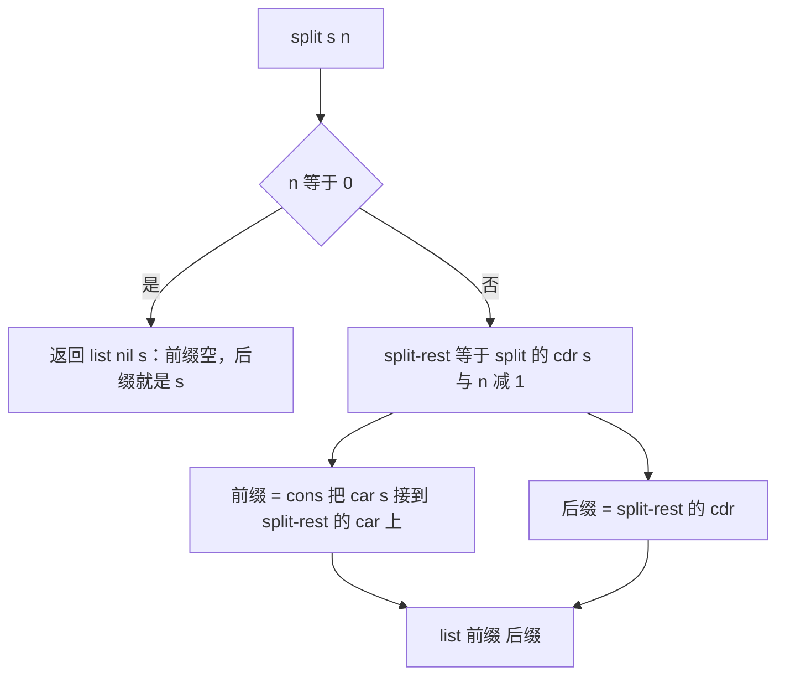
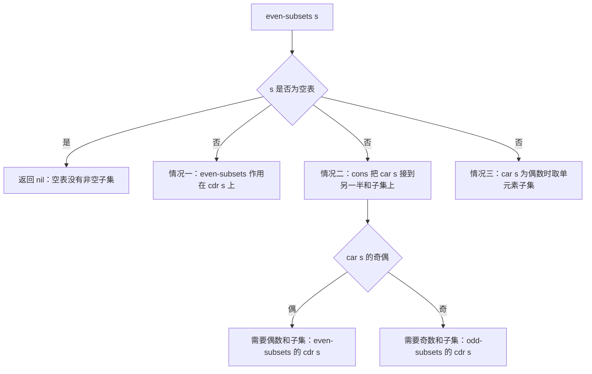

> **课程**：UC Berkeley CS61A · Structure and Interpretation of Computer Programs（Fall 2024）
> **本讲**：Lecture 29 ｜ 24:44 ｜ B 站分 P 27 ｜ [原视频](https://www.bilibili.com/video/BV1sy411z7nA?p=27)
> **课件**：`28-Scheme_Lists_1pp.pdf`（13 页，官方 PDF，逐页渲染图见正文插图）
> **字幕**：B 站英文原声字幕；本笔记是中文书面化重构，非逐句翻译
> **版权**：课程与课件版权归 UC Berkeley CS61A 教学团队；本文为学习用途的二次整理

## 本讲速览

- **已掌握**：Python 的 `list`、`tuple`、`dict`、`set` 这些内置容器；在 Python 里手写过的链表类（一个值加一个"下一节点"引用）；Scheme 的表达式求值、`define`、`if`、`let`、`lambda`（上一讲）。
- **本讲主线**：
    - Scheme 的列表就是链表：`cons` 造一个两格盒子，`car` 取第一格，`cdr` 取第二格，`nil` 是空表、也是链条的终点。
    - 屏幕上看到的 `(1 2)` 是列表的**印刷形式**，不是它的内部结构；内部结构要画盒针图才看得见，这两者的落差是本讲所有"看走眼"的根源。
    - `cons` 每次只加一个元素，并把第二个参数当作"剩余部分"，所以表只能从右往左搭，终止于 `nil`；`list` 与 `append` 是两条捷径，分别对应"已知元素"和"已知整张表"。
    - 符号（symbol）默认会被求值成它绑定的值，`quote`（`'`）让符号本身成为值——这是 Lisp 做符号计算、进而成为早期人工智能标准语言的那个开关。
    - `map`、`filter`、`apply` 把"对每个元素做同一件事""只留满足条件的元素""把整张表当参数表"三种模式固化下来，写递归时可以少写很多。
- **关键结论**：一张表只有两种形态——空表，或者"一个元素 + 一张表"。所有列表过程（`split`、`even-subsets`、`non-empty-subsets`）都是这两条的直接翻译；写出三行骨架，剩下的只是"这一步该用 `cons`、`list` 还是 `append`"。

*(参考时间: 00:00:00 – 00:00:09｜Lecture 29)*


## 1. 开场：课件前两页与本讲的位置

*(参考时间: 00:00:00 – 00:00:40｜Lecture 29)*

> **编者说明**：本讲课件最前面的两页是 Turtle Graphics（海龟绘图）的分节页与画星形的例子，属于 Scheme 绘图那一段的材料。本讲录像的字幕从 00:00:00 起就是"Python has many types of built-in data structures"，没有这两页的口述。下面按课件画面整理这段代码，评述为编者所加，不是课堂原话。


海龟绘图用一个"画笔"在平面上移动来作图：画笔有位置、有朝向。`(forward 100)`（简写 `(fd 100)`）让画笔沿当前朝向前进 100 个单位并留下一条线；`(right 90)`（简写 `(rt 90)`）让画笔顺时针转 90 度，转向本身不画线。有了这两个原语，"画一个正多边形""画一个星形"就变成"重复地走一步、转一个角度"。


课件上的 `star` 过程有两个参数：`n` 是边数（图上标注为 Number of sides），`m` 是每画一条边要跳几个顶点（标注为 Where to go next）。转角 `a` 由 `let` 算出来，等于 `360 * m / n`。调用 `(star 5 2)` 时 `a = 360 * 2 / 5 = 144` 度——从正五边形的一个顶点直接跳到"隔一个"的下一个顶点，正是这个角度；五条边各转 144 度，累计 720 度，恰好绕两圈，于是图形闭合，得到课件右侧那个五角星。

```scheme
(define (star n m)
  (let ((a (/ (* 360 m) n)))
    (define (side k)
      (if (< k n) (begin (fd 100) (rt a) (side (+ k 1)))))
    (side 0)))
```

这段代码把上一讲的三件工具叠在一起用：`let` 把算好的转角 `a` 绑成局部名字，避免在递归里反复算；内部 `define` 造出只在这个过程里可见的 `side`，它用计数器 `k` 数已经画了几条边；`begin` 把"走一步"和"转一下"两个副作用串成一个表达式。`if` 只写了成立分支，`k` 数到 `n` 时条件为假，递归自然停下。这也是 Scheme 的风格：没有 `for`、`while`，循环一律由"计数器 + 递归 + 终止条件"表达。

> **编者说明**：这两页与上一讲（Lecture 28）的 turtle 绘图片段同源，那里也出现过 144 度这个转角。本讲录像从 Lists 部分开始，所以这段代码在本讲里没有口述对应，读者可以把它当作"上一讲的收尾"。

回到本讲的正文。讲师的开场只有一句：Python 有许多内置的数据结构——列表、元组、字典、集合，还有更多；而 Scheme 有列表。紧接着是本讲最重要的一个类比：**Scheme 的列表就是链表**，和 Python 课里手写的那个链表类是同一个东西——每个节点存一个值，外加一个指向"剩下的表"的引用。抓住这一点，后面所有过程（`cons`、`car`、`cdr`、`append`、`map`）都只是在操作这条引用链。

讲师还顺手调侃了命名史：Lisp 诞生于 1950 年代末，那个年代的计算机科学家"真的很喜欢让人困惑的名字和缩写"，于是有了 `CONS` 这个双参数过程——它的作用就是造一个链表节点。

## 2. 链表的最小词汇表：`cons`、`car`、`cdr` 与 `nil`

*(参考时间: 00:00:41 – 00:02:11｜Lecture 29)*


讲师的说法很直接：造链表只有在"能取到第一个元素"和"能取到剩下的表"的前提下才有意义，所以除了 `cons`，还必须配两个访问过程。课件把四个名字并排列出：

- **`cons`**：双参数过程，造一个链表节点（第一格放值，第二格放"剩下的表"）。
- **`car`**：返回列表的第一个元素，也就是第一格里的值。
- **`cdr`**：返回除第一个元素之外的剩余部分，也就是第二格里那个指针所指的表。
- **`nil`**：空表，一张什么都没有的表。

> **编者说明**：`car` 与 `cdr` 的名字来自 1950 年代 IBM 704 机器上的两个寄存器字段——地址部分（address）与减量部分（decrement），即 "Contents of Address Register" 与 "Contents of Decrement Register"。讲师在课上只说"那个年代的人喜欢让人困惑的名字"，词源是编者补的。


`nil` 这个内置符号求值的结果就是空表。要造一张长度为 1、装着 2 的表，写 `(cons 2 nil)`：它建出一个 cons，第一格是 2，第二格指向 `nil`。盒针图里，第二格常常不画箭头，只画一条斜线 `/`——斜线不是"没有值"，而是"这里就是空表"，是链条到此为止的意思。

```text
  (cons 2 nil)

     +----+----+
     | 2  | /  |
     +----+----+
      car   cdr = nil
```

关键的区别在"显示"与"结构"之间。Scheme 显示列表的默认方式是用括号把元素括起来、元素之间用空格隔开：`(1 2)`。底层当然是链表结构，但**标准显示方式不显示这个结构，只显示元素**。所以 `(cons 1 (cons 2 nil))` 造出来的东西，求值之后屏幕上只有 `(1 2)`——结构被藏起来了。

```text
  (cons 1 (cons 2 nil))

     +----+----+        +----+----+
     | 1  |  *-+------->| 2  | /  |
     +----+----+        +----+----+
      car  cdr           car  cdr = nil
```

把这张表绑给名字再看就更清楚：`(define x (cons 1 (cons 2 nil)))` 之后，`x` 显示为 `(1 2)`；`(car x)` 是 `1`；`(cdr x)` 是 `(2)`。注意 `(cdr x)` 显示成 `(2)` 而不是 `2`：剩余部分仍然是一张表，只不过这张表只有一个元素。这是初学者最常混的一处，也正是递归能一路走下去的原因——`cdr` 每次交给下一步的仍然是一张表，形状不变，只是短了一个元素。

再长一点：`(cons 1 (cons 2 (cons 3 (cons 4 nil))))` 显示为 `(1 2 3 4)`，结构是四个 cons 串成一条链，最后一个 cons 的 `cdr` 是 `nil`。

```text
  +---+---+   +---+---+   +---+---+   +---+---+
  | 1 | *-+-->| 2 | *-+-->| 3 | *-+-->| 4 | / |
  +---+---+   +---+---+   +---+---+   +---+---+
```


### 2.1 为什么递归一定终止在 `nil`

递归处理列表的写法永远长一个样：先问"这张表空了吗"（`(null? s)`），空就返回基值；不空就"取第一个元素"（`(car s)`）做点什么，再把问题交给"剩下的表"（`(cdr s)`）。`cdr` 每一步都让表短一个元素，而表的长度是有限的，所以只要每次都朝 `cdr` 走，就一定在有限步之后落到 `nil`。

更重要的是：`nil` 是一个**必须显式检查**的终点。空表没有"第一格"，`(car nil)` 不是一次合法取值（在这门课的 Scheme 解释器里会报错），所以不能指望"取到的东西是空的"来收手，必须先问 `(null? s)`。这也是为什么列表过程里 `if` 的第一个条件几乎总是 `null?`，而不是别的判断。

```scheme
(define (list-length s)
  (if (null? s) 0 (+ 1 (list-length (cdr s)))))
```

> **编者说明**：上面这个 `list-length` 是编者补的最小骨架，用来把"基值 + 缩小问题 + 合并结果"三件事摆在一起；本讲课堂里同一套骨架出现在 `even-subsets` 与课件上的 `split` 里（见第 4、8、9 节）。

### 2.2 proper list 与点对：`cons` 到底造了什么

课件和字幕讨论的都是 proper list（真列表）：链条最后一个 `cdr` 是 `nil`。但 `cons` 本身并不检查第二个参数是不是表，它只是把两个指针装进一个格子对（pair）。如果第二个参数不是表，得到的值就叫点对（dotted pair），显示时会写成 `(1 . 2)`。

| 判据 | proper list（真列表） | 点对 dotted pair |
| :--- | :--- | :--- |
| 内部结构 | cons 链，最后一个 `cdr` 指向 `nil` | 两格都有值，最后一个 `cdr` 不是表 |
| 构造方式 | `(cons 1 (cons 2 nil))` | `(cons 1 2)` |
| 显示形式 | `(1 2)` | `(1 . 2)` |
| `list?` 的判断 | 真 | 假 |
| 能否用 `cdr` 走到底 | 能，走到 `nil` 停 | 不能，半路就撞上非表的值 |

> **编者说明**：上表关于点对的两行是编者补充，课件与字幕只讲 proper list。记住讲师在第 3 节强调的那条规矩就够了：`cons` 的第一个参数可以是任何东西，第二个参数应该是另一张表或 `nil`——否则链条末端不成表，后面靠 `car`/`cdr` 的递归就会在末端出事。

## 3. 在解释器里读盒针图：四个需要先猜的例子

*(参考时间: 00:02:57 – 00:05:44｜Lecture 29)*

接下来讲师切到课程用的网页版解释器，理由讲得很清楚：它会**画**出每一张表的链表结构（`draw` 这个操作）。讲师特意补了一句：`draw` 不是每个 Scheme 都内置的，只有这门课的这个解释器内置了它，目的是让人看见发生了什么。

这句话值得停一下。语言标准规定的是**行为**——`cons` 造表、`car` 取头、`cdr` 取尾；可视化只是学习工具。所以后续所有例子都要能自己在纸上画出盒针图，不能依赖 `draw`。

第一个例子：`(define s (cons 1 (cons 2 nil)))`。`s` 显示成 `(1 2)`，`draw` 出来是第 2 节那张两格的链。接下来是四个需要先想一想的例子，讲师每个都让观众暂停、自己推出答案，再"3、2、1"揭晓。

```scheme
scm> (define s (cons 1 (cons 2 nil)))
s
scm> (cons 3 s)
(3 1 2)
scm> (cons 4 (cons 3 s))
(4 3 1 2)
scm> (cons (cons 4 (cons 3 nil)) s)
((4 3) 1 2)
scm> (cons s (cons s nil))
((1 2) (1 2))
```

**例一：`(cons 3 s)` 得到 `(3 1 2)`。** 这是允许的，规则只有两条：`cons` 的第一个参数可以是任何东西；第二个参数要么是另一个 cons，要么是 `nil`（也就是必须是一张表）。为什么第二个参数这么挑？因为它会被直接当成"剩下的那串"挂在新节点后面；如果它不是表，链条末端就不是 `nil`，走 `cdr` 的递归会在半路撞墙（第 2.2 节的点对）。

**例二：`(cons 4 (cons 3 s))` 得到 `(4 3 1 2)`。** 每包一层 `cons`，就在最前面加一个元素；最外层的 `cons` 决定第一个元素是谁。这也是"表只能从右往左搭"的原因：`s` 必须先存在，才能被当成最里层的"剩余部分"。

**例三：`(cons (cons 4 (cons 3 nil)) s)`。** 讲师的原话是："如果我 cons 一个 `4`、一个 `3`、`nil` 到 `S` 上，结果会显示成什么？"他建议暂停，然后揭晓：`cons` 造出来的表，第一个元素是它的第一个参数，其余是第二个参数；`s` 的长度是 2，所以这张新表长度是 3，三个元素分别是"一张表、一个数、一个数"，即 `((4 3) 1 2)`。再取它的 `car` 得到 `(4 3)`，再取一次 `car` 得到 `4`。**括号的层数就是嵌套的层数**——`cons` 永远只加一层。

**例四：`(cons s (cons s nil))` 得到 `((1 2) (1 2))`。** 这是最容易看错的一个。讲师说：把它画出来会发现，那其实是"同一个元素出现了两次"。两张 `(1 2)` 不是两张各自独立的表，而是同一个表被两个 cons 单元引用；`cons` 不复制数据，它只是把指针指过去。共享在这里不会惹麻烦（关键在于没有原地修改），但它提醒一件事：**盒针图里的箭头可以汇合**，看到两个位置显示相同内容时，要分清是"复制出的两张等价的表"还是"同一张表被指了两次"。

| 表达式 | 显示结果 | 结构读法 |
| :--- | :--- | :--- |
| `(cons 3 s)` | `(3 1 2)` | 一层新 cons + 原来那张表 |
| `(cons 4 (cons 3 s))` | `(4 3 1 2)` | 两层新 cons，都在最前面 |
| `(cons (cons 4 (cons 3 nil)) s)` | `((4 3) 1 2)` | 第一个元素本身是一张表 |
| `(cons s (cons s nil))` | `((1 2) (1 2))` | 同一张表被引用两次 |

## 4. 判断与构造：`list?`、`null?`、`list` 与递归构造的 `split`

*(参考时间: 00:05:48 – 00:07:01｜Lecture 29)*

要判断一个值是不是表，用 `(list? s)`。`s` 是 `(1 2)`，所以是；`3` 不是表；`(car s)` 也不是表——`(car s)` 返回的是数字 1。而 `nil` 是表，因为它是空表。

这里埋着一个必须记牢的细节：**`nil` 也是表**，所以 `list?` 不能用来判断"该不该收手"。想知道一张表是空表还是非空表，要用 `(null? s)`。讲师的原话是："我怎么区分空表和非空表？可以用 null 这个问号谓词。"

`#t` 是 Scheme 表示"真"的方式（对应还有 `#f`）。这些谓词返回的都是 `#t` / `#f`，可以像数字一样放进表里、传给别的过程——第 7 节的 `filter` 就靠这个。

除了 `cons`，还可以用 `list` 过程直接列出元素：`(list 1 2 3 4)` 造出装着 `1 2 3 4` 的表。底层仍然是链表，所以照样能用 `car`/`cdr` 拆：`(cdr (list 1 2 3 4))` 是 `(2 3 4)`；再给这个 `cdr` 前面 `cons` 一个 `0`，就得到 `(0 2 3 4)`。


课件把三条构造路径的差别写成三句话，值得逐字记住：

- **`cons`** 永远只收两个参数：一个"值"，和一张"剩下的表"。
- **`list`** 收任意多个参数，每个参数都成为新表里的一个元素。
- **`append`** 收任意多个**表**参数，把它们首尾相接成一张表。

设 `s` 是 `(1 2)`，课件给出的六个例子排成一张对照表：

| 表达式 | 结果 | 读法 |
| :--- | :--- | :--- |
| `(cons 3 s)` | `(3 1 2)` | 3 作为一个元素，接在 `s` 的元素前面 |
| `(list 3 s)` | `(3 (1 2))` | 3 和 `s` 各算一个元素，所以 `s` 整张表成了一个元素 |
| `(append 3 s)` | Error | `append` 要的是表，`3` 不是表 |
| `(cons s s)` | `((1 2) 1 2)` | 第一格是整张 `s`，剩余部分还是 `s` 的元素 |
| `(list s s)` | `((1 2) (1 2))` | 两个元素，各是一张表 |
| `(append s s)` | `(1 2 1 2)` | 两张表首尾相接，元素被摊平 |

`(append 3 s)` 报错这一行是这张表的题眼：`cons` 把第一个参数当**元素**，`append` 把每个参数当**表**。想让 `3` 也变成"一张表"接上去，得先包装一层：`(append (list 3) s)` 就得到 `(3 1 2)`，和 `(cons 3 s)` 一样。

> **编者说明**：这一页右侧还并列了一串形状相近的候选结果（例如 `((3) 1 2)`、`(3 (1 (2)))` 之类），是把 `3` 换成 `(list 3)`、或把某个元素再包一层之后得到的干扰项，用途是逼人按定义数括号层数而不是按形状猜。本笔记只取其中语义确定的六个，干扰项不逐一对应表达式。

### 4.1 递归构造：`split` 的两版写法

> **编者说明**：接下来两页（Recursive Construction 与其第二版）是本讲课件里的内容，但本讲录像的字幕从头到尾没有讲到 `split`——讲师的口述线索一路是链表、`quote`、列表处理与 `even-subsets`。下面按课件画面整理两版代码与盒针图，旁注为编者所加。

课件先给两条口诀：**要一个一个元素地搭表，用 `cons`；要搭一张长度固定的表，用 `list`。** `split` 两件事都要做，所以两件工具都会用到。

题目是：写 `(split s n)`，返回一张装着两张表的表——`s` 的前 `n` 个元素，和剩下的元素。课件给的样例是 `(split (list 3 4 5 6 7 8) 3)` 得 `((3 4 5) (6 7 8))`。


第一版把它拆成两个内部过程：`prefix` 负责前 `n` 个，`suffix` 负责剩下的。课件把关键位置留成下划线，答案写在下方（`nil`、`cons (car s)`、`(cdr s)`、`s`、`(suffix (cdr s) (- n 1))`、`list`）。填好之后是：

```scheme
;;; Return a list of two lists; the first n elements of s and the rest
;;; scm> (split (list 3 4 5 6 7 8) 3)
;;; ((3 4 5) (6 7 8))
(define (split s n)
  ; The first n elements of s
  (define (prefix s n)
    (if (zero? n) nil (cons (car s) (prefix (cdr s) (- n 1)))))
  ; The elements after the first n
  (define (suffix s n)
    (if (zero? n) s (suffix (cdr s) (- n 1))))
  (list (prefix s n) (suffix s n)))
```

两个过程用的是同一套骨架，只是"合并结果"那一步不同：

1. 终止条件：`(zero? n)`，数到 0 就停。注意这里停的条件不是 `null? s`，而是**计数器归零**——因为题目只要求前 `n` 个，`s` 可能还剩很多。
2. 缩小问题：`(cdr s)` 缩短表，`(- n 1)` 缩短计数，两个参数一起往终止条件走。
3. 合并结果：`prefix` 用 `(cons (car s) ...)` 把当前元素留下；`suffix` 直接返回 `s`——剩下的部分就是答案本身，不需要再拼。

`suffix` 那一行是这一页最值得看的地方：它**不复制**任何节点，返回的 `s` 就是原链表的某一段。课件右侧的盒针图正好画出这件事——上面那条 3、4、5、6、7、8 的链是原表，下面的链是 `prefix` 新建出来的三个节点，而 `suffix` 只是把指针挪到第 4 个节点上。


第二版把两次递归合成一次：递归拿回一张装着两段的表，再用 `cons` 把当前元素拼到第一段前面。

```scheme
(define (split s n)
  (if (= n 0)
      (list nil s)
      (let ((split-rest (split (cdr s) (- n 1))))
        (cons (cons (car s) (car split-rest))
              (cdr split-rest)))))
```

这里的 `let` 是必需品：`split-rest` 这个名字要在一层递归的结果上被用两次（一次取 `car` 当前缀，一次取 `cdr` 当后缀），不绑定名字就得算两遍。终止条件 `(= n 0)` 返回 `(list nil s)`：前缀是空表，后缀就是整个 `s`。



| 判据 | 第一版（prefix + suffix） | 第二版（let + split-rest） |
| :--- | :--- | :--- |
| 每层递归调用几次自己 | 两次（`prefix` 一次、`suffix` 一次） | 一次（一次拿回两段） |
| 返回什么 | 两张表分别造好，最后用 `list` 装起来 | 每层返回"前缀 + 后缀"这一对，用 `cons` 拼 |
| 是否需要中间名字 | 不需要 | 需要 `let`，因为结果要用两次 |
| 终止条件 | 两个过程各写一次 `(zero? n)` | 一个 `(if (= n 0) ...)`，返回 `(list nil s)` |

> **编者说明**：两版都能得到同样答案；第一版把两个任务分开写、读起来更直白，第二版每层只走一遍链表、少一次遍历，代价是要理解"递归返回的是一对表"这种打包再拆包的手法。复杂度上的对比是编者的分析，课件只给了代码与盒针图。

## 5. 符号与引用：让名字本身成为值

*(参考时间: 00:07:04 – 00:10:13｜Lecture 29)*


讲师在这里把话题抬高一档：Lisp 以引入**符号编程**（symbolic programming）这一想法而闻名——操作"符号组成的表"，而这些表代表世界上的事物，作为结构化的对象。用 Lisp，能做的比"算一个数"多得多：可以操作整个方程。正因为如此，Lisp 许多年里是人工智能的标准语言，也是任何"自动操作数学方程"工作的标准语言——符号微分、自动验证证明，都属于这一类。

而让这一切成为可能，只有一个特性：**引用**（quotation）。


先把问题摆出来。符号的正常职责是"指向某个值"：`(define a 1)` 之后，`a` 是符号，`1` 是它的值；`(define b 2)` 之后，又有一个符号带着另一个值。此时 `(list a b)` 求值得到 `(1 2)`——表达式中确实出现了 `a` 和 `b`，但**结果里没有任何 `a`、`b` 的痕迹**，只有 `1` 和 `2`。也就是说，一旦求值，这个值就丢失了"它是由哪些符号拼出来的"这条信息。要做符号计算，就必须把这条信息保住。

引用就是干这件事的：它让**符号本身**成为值。`(list 'a 'b)` 得到 `(a b)`——一张装着两个符号的表；`(list 'a b)` 得到 `(a 2)`——第一个位置是符号，第二个位置是符号求值后的值。讲师强调写法：**永远只用开头一个单引号，不要一头一尾各写一个**。Scheme 的字符串用一对双引号，符号只有一个前导单引号，两者不是一回事。

`'` 其实是一个特殊形式 `(quote ...)` 的简写。所以 `(list 'a 'b)` 完全等价于 `(list (quote a) (quote b))`——单引号的唯一好处是省掉一层括号。特殊形式的含义是：**被引用的那个表达式本身就是值**，不需要再对它求值。

引用也能作用在组合上，用来造表：`'(a b c)` 得到装着三个符号的表 `(a b c)`；它的 `car` 是符号 `a`，`cdr` 是装着 `b`、`c` 的表 `(b c)`。讲师补了一句关键性质：引用一张表时，得到的是一张表，而且**表里的每个表达式也一起被引用了**——引用是递归的，它一直作用到最内层。

| 判据 | 符号 symbol | 字符串 string |
| :--- | :--- | :--- |
| 字面写法 | `'a`、`'apple`（一个前导单引号） | `"a"`、`"apple"`（一对双引号） |
| 求值结果 | 被引用时是符号本身；未引用时按环境查找它的值 | 字符串本身（自求值） |
| 是否必须先定义 | 不必；可以先出现、后定义 | 不必，字面量就是值 |
| 代表什么 | 一个名字，可以绑定到值，也可以只是名字 | 一段文本数据，没有名字这层含义 |
| 典型用途 | 符号计算：公式、代数式、程序本身 | 文本处理、输出 |

> **编者说明**：本讲没有专门讲字符串，上表"字符串"一列是编者为了对照补的。要点只有一句：单引号不是"成对的括号"，它引用的是紧跟其后的那一个表达式；写完一个符号不需要"收尾"。

## 6. 引用的三个易错点

*(参考时间: 00:10:13 – 00:12:01｜Lecture 29)*

**其一，`'a` 和 `(quote a)` 等价，两种写法随便挑。** 讲师现场演示时，先写 `'a` 再写 `(quote a)`，结果一样，都可以放进列表、传给别的过程。单引号只是更省事。

**其二，符号可以先引用、后定义。** 如果直接写 `(list 1 a)` 而 `a` 从未被定义，解释器会报错，大意是 "a is not a known symbol"——因为求值器按环境去找 `a` 的值，找不到就停。但 `(list 1 'a)` 完全没问题，得到 `(1 a)`。讲师把这句话说得很漂亮：**在定义它之前就可以引用它，因为它只是一个符号**；它将来可能表示什么，只是现在还没定义。

**其三，一个单引号只引用紧跟其后的那一个表达式。** `(list 'a b)` 得到 `(a 2)` 就是证据：`'` 只管住 `a`，`b` 照常求值。单引号不是"引号对"，不能写成 `'a'` 那种一头一尾的形式。

引用还能嵌套。讲师给了一个需要连取四层的题：把 `car`、`cdr` 交替作用在一个"内部还装着表"的引用列表上，问最后得到什么，答案是数字 `3`。他一步一步拆：

1. 先取整个引用列表的 `cdr`：得到一张表，它的**第一个元素本身是一张表**。
2. 取这个结果的 `car`：得到那张内层表。
3. 对内层表取 `cdr`：得到一张只有一个元素的表。
4. 再取 `car`：得到 `3`。

> **编者说明**：课堂现场用的那张引用列表没有出现在课件上，录像里只有取值链的描述（"cdr 的首元素是 `(2 3)`；它的 car 是 `(2 3)`；它的 cdr 是 `(3)`；它的 car 是 `3`"）。下面用 `'(1 (2 3))` 复现同一条链，属于编者按口述复原的等价例子。

```scheme
scm> (define x '(1 (2 3)))
x
scm> (cdr x)
((2 3))
scm> (car (cdr x))
(2 3)
scm> (cdr (car (cdr x)))
(3)
scm> (car (cdr (car (cdr x))))
3
```

讲师最后补了一句：如果这些位置上的不是数字而是符号，整个故事一模一样——`'(a (b c))` 用同一条取值链会得到符号 `c`。这正是符号计算能用同一套 `car`/`cdr` 处理"数据"和"表达式"的原因。

| 表达式 | 值 | 值的种类 |
| :--- | :--- | :--- |
| `(define a 1)` 之后的 `a` | `1` | 数字 |
| `'a` | 符号 `a` | 符号 |
| `'(a b)` | 两个符号组成的表 | 表 |
| `(list 'a 2)` | `(a 2)` | 表，元素分别是符号与数字 |
| `(car '(a b))` | 符号 `a` | 符号 |

## 7. 列表处理四件套：`append`、`map`、`filter`、`apply`

*(参考时间: 00:12:05 – 00:15:52｜Lecture 29)*


课件把这四个内置过程放在一页里，各自一句话定义：

- `(append s t)`：把 `s` 和 `t` 的元素依次列进一张表；`append` 可以接两个以上的表。
- `(map f s)`：对表 `s` 的每个元素调用 `f`，把结果收成一张表。
- `(filter f s)`：对表 `s` 的每个元素调用 `f`，把"`f` 返回真值"的那些元素收成一张表。
- `(apply f s)`：把表 `s` 的元素当作参数去调用 `f`，也就是只调用一次 `f`、一次把整张表的元素全交出去。

差别最好用"`f` 被调用几次、结果是表还是一个值、结果里的元素从哪来"来记：

| 判据 | `map` | `filter` | `apply` | `append` |
| :--- | :--- | :--- | :--- | :--- |
| `f` 被调用几次 | 每个元素一次 | 每个元素一次 | 整张表只调用一次 | 不涉及 `f` |
| 结果是什么 | 一张表，长度与输入相同 | 一张表，长度不超过输入 | 一个值（通常不是表） | 一张表 |
| 结果里的元素来自 | `f` 的返回值 | 输入表里原有的元素 | `f` 的返回值 | 各表原有的元素 |
| 典型用途 | 逐个变换 | 按条件挑选 | 把表摊成参数 | 拼表、摊平嵌套表 |

先用 `s` 是 `(1 2)` 试 `append`。`(append s s)` 得到 `(1 2 1 2)`——两张表首尾相接；多接几次：`(append s s s s)` 得到 `(1 2 1 2 1 2 1 2)`。这和 `(list s s s s)` 完全不是一回事：后者得到 `((1 2) (1 2) (1 2) (1 2))`，是一张装着四张表的表。**`append` 摊平一层，`list` 加一层**——这两个词后面会反复用到。

`map` 走的是"每个元素过一遍同一个过程"：

```scheme
scm> (map even? s)
(#f #t)
scm> (map (lambda (x) (* 2 x)) s)
(2 4)
```

`(map even? s)` 里，`1` 不偶、`2` 偶，于是得到 `(#f #t)`；`(map (lambda (x) (* 2 x)) s)` 里那个 `lambda` 是现场造出来的匿名过程，把每个元素乘 2。注意 Scheme 的前缀写法：`2 * x` 要写成 `(* 2 x)`。

`filter` 走的是"只留下让条件为真的那些元素"：

```scheme
scm> (filter even? s)
(2)
scm> (filter even? '(5 6 7 8 9))
(6 8)
scm> (filter list? '(5 (6 7) 8 (9)))
((6 7) (9))
```

第三个例子最能说明 `filter` 的价值：一张混着数字和表的表，`(filter list? ...)` 直接把"是表的那些元素"挑出来，得到 `((6 7) (9))`——这个过程没有任何递归，因为挑拣的模式被 `filter` 吸收了。接下来还能顺手加工：想给每张这样的表前面加个 `5`，就 `map` 一个 `(lambda (t) (cons 5 t))`，得到 `((5 6 7) (5 9))`。

`apply` 的用法和 `map` 容易混，讲师专门点出差别：`apply` 把整张表当成**一张参数表**，`f` 只被调用一次。

```scheme
scm> (apply quotient '(10 5))
2
scm> (map (lambda (x) (list '+ x)) '(1 2 3 4))
((+ 1) (+ 2) (+ 3) (+ 4))
scm> (apply + '(1 2 3 4))
10
```

第二、三行的对比是这一段的重点：`map` 把 `+` 和每个元素包进一张小表，得到四张"长得像表达式"的表 `((+ 1) (+ 2) (+ 3) (+ 4))`——**但这不会求和**，它只是四张一元素两格的小表。真正求和要用 `(apply + '(1 2 3 4))`，它的效果等于 `(+ 1 2 3 4)`，得到 `10`。讲师由此得出一句很实用的结论：Scheme 里不需要再单独写一个 `sum` 过程，因为 `+` 加 `apply` 已经够了。

课件底部用一个更漂亮的例子把 `map` 与 `apply` 串起来：

```scheme
(define count (list 1 2 3 4))
(define beats (map (lambda (x) (list 'and 'a x)) count))
(define rhythm (apply append beats))
```

`count` 是 `(1 2 3 4)`；`beats` 是 `((and a 1) (and a 2) (and a 3) (and a 4))`——每拍是一张三元素的小表，`'and` 和 `'a` 都被引用成符号；`rhythm` 是 `(and a 1 and a 2 and a 3 and a 4)`——**`(apply append ...)` 把一张"装着小表的表"摊平成一张表**。这个 "`map` 造结构、`apply append` 摊平" 的组合是 Scheme 里最常用的套路之一，后面写解释器时（把一段程序摊成 token 序列）还会见到它。

> **编者说明**：课件上这个例子的符号是 `'and 'a`，讲师口述时用的版本是把 `+` 和元素包成小表、再用 `apply +` 求和，两处讲的是同一个套路（`map` 只造结构、`apply` 才真正执行）。`rhythm` 里出现的那串符号加数字，正好是一段"程序即数据"的预演。

## 8. 案例：偶数和子集（`even-subsets`）的三情况分析

*(参考时间: 00:16:00 – 00:18:10｜Lecture 29)*

讲到这里，工具已经齐了，讲师用一个例题把它们串起来：写一个过程 `even-subsets`，输入一张整数表 `s`，返回 `s` 的**所有非空子集中和为偶数**的那些子集。

先把"子集"定义清楚，讲师的说法是：表 `s` 的一个非空子集，是一张装着 `s` 的某些元素的表；它可以是全部元素，也可以只是一部分，但不能一个都不取；并且**元素的相对顺序与在 `s` 中出现的顺序一致**。这个"顺序一致"的要求很关键——它让子集可以自然地用"取或不取某个元素"来描述，而不必考虑排列。

用 `(even-subsets (list 3 4 5 7))` 试：结果里会出现 `(4)`、`(3 5)`、`(5 7)`、`(4 5 7)` 这些和为偶数的子集；`(4 5 7)` 的和是 16，`(3 4 5)`、`(3 4 7)` 的和也都为偶。而 `(3 4)` 不会出现：它的和是 7，是奇数。讲师特意指出这一点，因为"看起来都是元素，为什么少了这个"正是检验自己有没有真的按"和"来判断的地方。

> **编者说明**：`(3 4 5 7)` 的 15 个非空子集中，和为偶数的正好 7 个：`(4)`、`(3 5)`、`(3 7)`、`(5 7)`、`(3 4 5)`、`(3 4 7)`、`(4 5 7)`。这份清单一例是编者核算的，用来核对程序输出，不是课堂板书。

接下来是最关键的一步：**把问题按"第一个元素取不取"拆成三种情况**。讲师把理由拆成三条：

1. **不取 `s` 的第一个元素**：那么符合条件的子集，就是"`s` 剩余部分的偶数和子集"，即 `even-subsets` 作用在 `(cdr s)` 上。
2. **取了第一个元素，并且还要再接一个子集**：把 `(car s)` 接到某张子集前面。这里的奇偶要求由 `(car s)` 决定——如果 `(car s)` 是偶数，要接的是"剩余部分的偶数和子集"（偶 + 偶 = 偶）；如果 `(car s)` 是奇数，要接的必须是"剩余部分的奇数和的子集"（奇 + 奇 = 偶）。
3. **只取第一个元素**：还有一族子集完全不涉及剩余部分，就是"只含 `(car s)` 一个元素"的那张表——但它和必须为偶，所以只在 `(car s)` 是偶数时成立。

这三种情况合起来不重不漏：任何一张非空子集，要么不取第一个元素，要么取第一个元素；取了的话，要么还取了别的元素（情况二），要么只取了它（情况三）。



注意图里出现了 `odd-subsets`：`even-subsets` 为了处理"奇 + 奇"，必须能拿到"奇数和子集"，于是它的兄弟过程 `odd-subsets` 也必须存在，两个过程互相调用。这不是巧合，也不是绕远路——它是"取或不取"这个二分结构在奇偶上的必然结果。

## 9. 把三情况写成代码

*(参考时间: 00:18:12 – 00:21:00｜Lecture 29)*

> **编者说明**：以下代码是讲师在解释器里现场写出来的，课件上没有这一页。版本按口述逐段还原（`append` 的三个参数、`map` 里的 `cons`、末尾的 `if` 都对应讲师的原话），括号与缩进按 Scheme 惯例整理。

先写终止条件。讲师说：如果 `s` 里没有元素，那么当然没有非空子集——返回 `nil`。

```scheme
(define (even-subsets s)
  (if (null? s)
      nil
```

然后是"把三张表接起来"：这三种情况各自产出一张**装着子集的表**，所以用 `append`（而不是 `cons`）把它们接成一张大表。讲师先给情况一和情况二：

```scheme
      (append (even-subsets (cdr s))
              (map (lambda (t) (cons (car s) t))
                   (if (even? (car s))
                       (even-subsets (cdr s))
                       (odd-subsets (cdr s))))
```

情况二用了 `map`：`(even-subsets (cdr s))` 是一张装子集的表，把 `(car s)` `cons` 到每一张子集前面，就得到"都以第一个元素开头"的那一族子集。这段代码把"取或不取"的第二种可能表达得非常干净——**不需要新写一个递归，只需要对已有结果整体加工**，这正是第 7 节 `map` 的用处。

情况三最需要琢磨。讲师的处理是：如果 `(car s)` 是偶数，就加上一张"只装一个元素的子集"的表；如果是奇数，什么都不加。

```scheme
              (if (even? (car s))
                  (list (list (car s)))
                  nil)))
```

为什么是两层 `list`？外层 `list` 是"把这一张子集装成一张只含一项的表"，因为 `append` 要接的是"表的表"；内层 `(list (car s))` 才是那张子集本身。而"什么都不加"就写 `nil`：**已经在 `append` 里面了，没必要再造一个空表去接空表**——直接给出空表，`append` 接上它等于什么都没加。讲师对这个写法很满意，说的就是"已经在 `append` 里面了，所以这里放 `nil` 表示没有东西可接"。

然后是 `odd-subsets`。讲师的做法是"把这段代码里所有的偶数改成奇数"，但他马上提醒有一个地方不能照抄：**往子集上接元素的时候，奇偶会翻转。** 把奇数接到一张子集上，要得到偶数和，那张子集必须是奇数和；把偶数接上去，那张子集必须是偶数和。

仔细看会发现，两个过程在情况二的同一位置写的是**同一对分支**（先 `even-subsets` 再 `odd-subsets`），差别只在判断条件：`even-subsets` 问"`(car s)` 是偶数吗"，`odd-subsets` 问"`(car s)` 是奇数吗"。条件成立时接的永远是 `even-subsets` 的结果，不成立时接的永远是 `odd-subsets` 的结果。这也解释了为什么下面这段代码看起来"几乎一样"却各自正确：

```scheme
(define (even-subsets s)
  (if (null? s)
      nil
      (append (even-subsets (cdr s))
              (map (lambda (t) (cons (car s) t))
                   (if (even? (car s))
                       (even-subsets (cdr s))
                       (odd-subsets (cdr s))))
              (if (even? (car s))
                  (list (list (car s)))
                  nil))))

(define (odd-subsets s)
  (if (null? s)
      nil
      (append (odd-subsets (cdr s))
              (map (lambda (t) (cons (car s) t))
                   (if (odd? (car s))
                       (even-subsets (cdr s))
                       (odd-subsets (cdr s))))
              (if (odd? (car s))
                  (list (list (car s)))
                  nil))))
```

`append` 的三个参数都是"装着子集的表"：情况一的递归结果、情况二的 `map` 结果、情况三的单元素子集（或 `nil`）。`append` 允许两个以上参数这件事（第 7 节课件的第一条）在这里被用足了——如果 `append` 只收两张表，这一段就得嵌套着写。

## 10. 验证与消重：把谓词参数化

*(参考时间: 00:21:02 – 00:22:56｜Lecture 29)*

写完先试 `(even-subsets (list 3 4 5 7))`，讲师逐个看结果，认为"看起来都像偶数"，也想不出漏了什么。于是他换了一张更长的表再试，发现一个可以肉眼检查的不变量：**每一张结果子集里，奇数的个数都是 0 或 2**，绝不会是 1 个——因为一个奇数的和是奇数，两个奇数的和是偶数。这条不变量比逐个算和快得多。

如果还想更严格，可以用第 7 节的 `apply` 把每张子集求和再看奇偶：

```scheme
(map (lambda (t) (apply + t)) (odd-subsets (list 3 4 5 7)))
```

讲师的说法就是"把 `+` 应用到每张表上，看看这些和真的是不是奇数"。这一步很值得学：把"不确定的输出"变成"可以批量检查的量"——`apply +` 把子集摊成参数，`map` 把检查铺到每张子集上，两个内置过程一拼，验证就只需要看一眼结果。

接着讲师指出代码的问题：他复制粘贴了太多。**这一整块和那一整块完全相同，只差一个 `even` 和一个 `odd`。** 他说："我觉得一个高阶函数可以解决这个问题。"

思路是把两个过程共有的部分抽成 `subset-helper`，把"判定用哪个谓词"作为参数 `f` 传进来：

```scheme
(define (subset-helper f s)
  (if (null? s)
      nil
      (append (subset-helper f (cdr s))
              (map (lambda (t) (cons (car s) t))
                   (if (f (car s))
                       (even-subsets (cdr s))
                       (odd-subsets (cdr s))))
              (if (f (car s))
                  (list (list (car s)))
                  nil))))

(define (even-subsets s) (subset-helper even? s))
(define (odd-subsets s) (subset-helper odd? s))
```

`subset-helper` 收两个参数：谓词 `f` 和表 `s`。它把原来两处 `even?` / `odd?` 的位置都换成 `(f (car s))`——正好是讲师说的"把 `odd` 换成 `f`"的两个地方。情况一和情况二的分支不需要改，因为按上一节的分析，两个过程在那两处的分支本来就相同。改完之后重跑一遍，结果和改之前一样。

> **编者说明**：课堂上的 `subset-helper` 是在解释器里现场改出来的，字幕只交代了"用参数 `f` 替掉谓词、两个过程各自传自己的谓词"这两件事，没有逐行念出改完的代码。上面的版本按这两条改写意图补全，并在 `(3 4 5 7)` 上与第 9 节的两段代码校对过输出；若与课堂原写法在细节上有出入，以"两个版本结果相同"这一结论为准。

这一段的方法论比代码本身重要：**当两段代码只差"用哪个谓词"时，这个谓词就是应该被抽象出来的参数。** 高阶函数在这里不是炫技，而是"消除复制粘贴"的直接手段——和第 5 节的 `quote` 一样，它让本来会丢信息的东西（这里是"差别在哪"）被明确写出来。

## 11. 另一种写法：先枚举全部非空子集，再 `filter`

*(参考时间: 00:22:57 – 00:24:42｜Lecture 29)*

讲师最后问：有没有更简单的写法，能列出整数表 `s` 的全部偶数和子集？

他的思路换了方向：与其在递归里同时操心奇偶，不如**先造出所有非空子集，再用 `filter` 把和为偶数的那些挑出来**。这也正是第 7 节 `filter` 存在的意义——"按条件挑选"这个模式不必手写。

```scheme
(define (non-empty-subsets s)
  (if (null? s)
      nil
      (append (non-empty-subsets (cdr s))
              (map (lambda (t) (cons (car s) t))
                   (non-empty-subsets (cdr s)))
              (list (list (car s))))))
```

结构和第 9 节几乎一样，还是"三种情况用 `append` 接起来"，但每一块都更简单：情况一是不取 `(car s)`；情况二是把 `(car s)` 接到剩余部分**每一张**非空子集前面（不挑奇偶了）；情况三是只取 `(car s)` 的那张单元素子集（不再加条件）。三种情况仍然不重不漏。

`filter` 那段才是新东西：

```scheme
(define (even-subsets s)
  (filter (lambda (t) (even? (apply + t)))
          (non-empty-subsets s)))
```

讲师解释得很直白：这里要检查"每个元素是不是偶数和"，而**每个元素本身是一张表**，所以得先把它加起来，再判奇偶——于是有了一个当场定义的过程：对 `t` 先 `apply +` 求和，再 `even?`。他最后说，这样代码"简单了一点"。

两条路线的差别值得摆出来比：

| 判据 | 第 9 节：奇偶一起递归 | 第 11 节：先枚举再 `filter` |
| :--- | :--- | :--- |
| 递归里要考虑的事 | 子集的奇偶，两个过程互相调用 | 只有"取或不取第一个元素" |
| 需要几个过程 | 至少两个（`even-subsets`、`odd-subsets`） | 两个，但各管一件事（枚举、筛选） |
| 每个子集被算几次 | 枚举时算一次 | 枚举一次、求和一次 |
| 可读性 | 分支多，容易在"接不上"上出错 | 每一步意图单一，容易验证 |

> **编者说明**：两个版本都要枚举 $2^n - 1$ 个非空子集（第 9 节为凑出奇偶两族子集也必须走遍所有子集），所以量级同阶；差别在写法与出错概率，不在复杂度。另外，空集的和是 0，而 0 是偶数——如果 `non-empty-subsets` 忘了排除"什么都不取"，结果里就会多出一张空表。这条陷阱是编者补的提醒，课堂没有展开。

## 小结

- **列表只有两种形态**：空表，或者"一个元素 + 一张表"。写任何列表过程之前，先把这两条写成 `if` 的两个分支，剩下的就是填空。
- **印刷形式不是结构**：`(1 2)` 是显示结果，盒针图才是真相。读代码卡住时，先画出 cons 链和箭头，再决定用 `cons` 还是 `append`；括号的层数就是嵌套的层数。
- **`cons` 只加一个元素，第二个参数必须是表**；`list` 把每个参数当一个元素；`append` 把每张表的元素摊平相接。这三个词选错，结果一定会多一层或少一层括号。
- **递归的终点是 `nil`，而且必须显式检查**：`cdr` 每步都让表变短，长度有限，所以必然落到空表；但空表没有 `car`，所以终止条件要写 `(null? s)`，不能用 `list?`（`nil` 也是表）。
- **`quote` 把名字从值里救出来**：`(list a b)` 得到 `(1 2)`，符号消失了；`(list 'a 'b)` 得到 `(a b)`，符号成为值。单引号只是一层语法糖，`(quote a)` 才是本尊；它引用紧跟其后的那一个表达式，且引用是递归的。
- **先认模式，再写 `lambda`**：`map` 是"逐个变换"，`filter` 是"按条件挑选"，`apply` 是"整表摊成参数"，`append` 是"拼接并摊平一层"；`map` 加 `apply append` 就是摊平嵌套表的标准写法。
- **两段代码只差一个谓词，就该把谓词抽成参数**：`subset-helper` 是这条原则的样板，也是本讲从"会写递归"走到"会设计接口"的那一步。
- **递归三问**：终止条件是什么（`null?` / `zero?`）、问题怎么缩小（`cdr s` / `(- n 1)`）、结果怎么合并（`cons` / `list` / `append`）。三问答完，代码基本就写完了。

*(参考时间: 00:00:00 – 00:24:42｜Lecture 29)*

## 附：本讲幻灯片索引

| 页 | 内容 | 出现位置 |
| :--- | :--- | :--- |
| 1 | 标题页 Scheme Lists | 本讲速览 |
| 2 | Announcements 公告页 | 本讲速览 |
| 3 | 分节页 Turtle Graphics | §1 |
| 4 | Drawing Stars：`star` 过程与五角星 | §1 |
| 5 | 分节页 Lists | §2 |
| 6 | Scheme Lists：`cons`/`car`/`cdr`/`nil` 与盒针图 | §2 |
| 7 | List Construction：`cons`/`list`/`append` 的六组例子 | §4 |
| 8 | Recursive Construction：`split` 第一版 | §4.1 |
| 9 | Recursive Construction Version 2：用 `let` 一次返回两段 | §4.1 |
| 10 | 分节页 Symbolic Programming | §5 |
| 11 | Symbolic Programming：`quote` 与组合上的引用 | §5 |
| 12 | 分节页 List Processing | §7 |
| 13 | Built-in List Processing Procedures：`append`/`map`/`filter`/`apply` | §7 |

*(参考时间: 00:00:00 – 00:24:42｜Lecture 29)*
