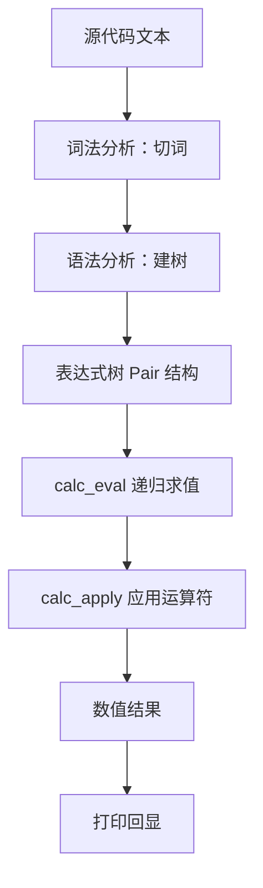
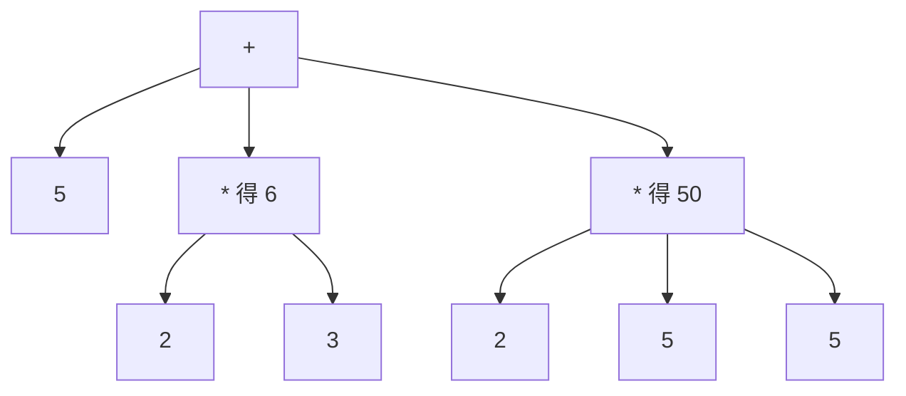
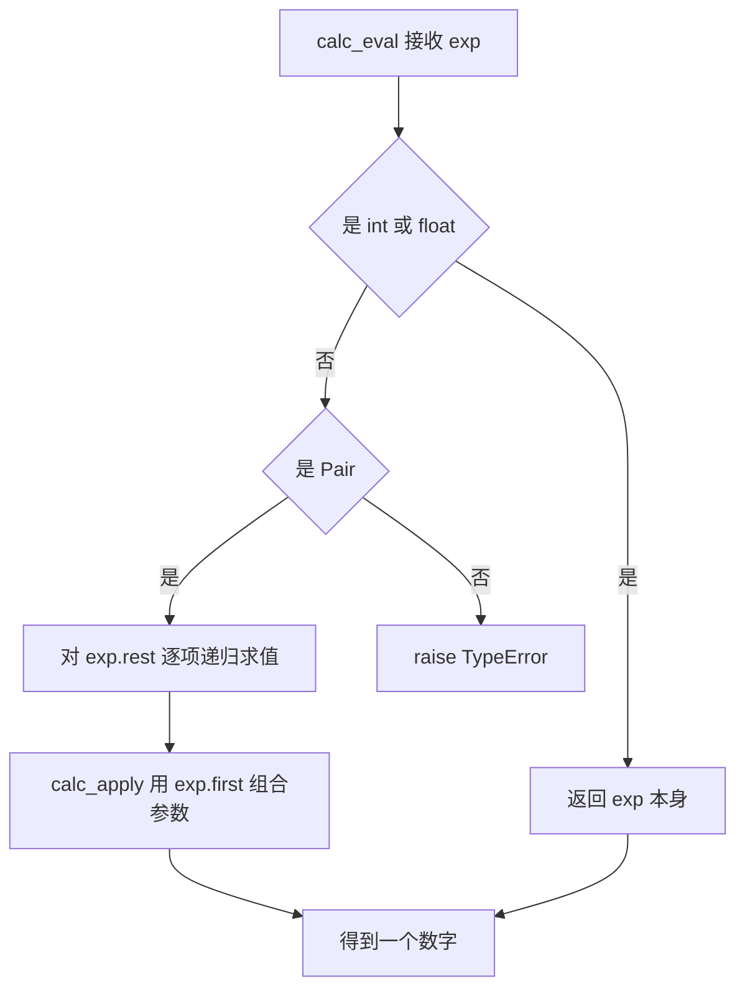
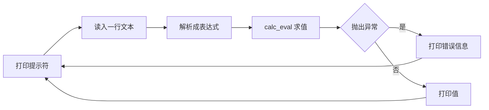
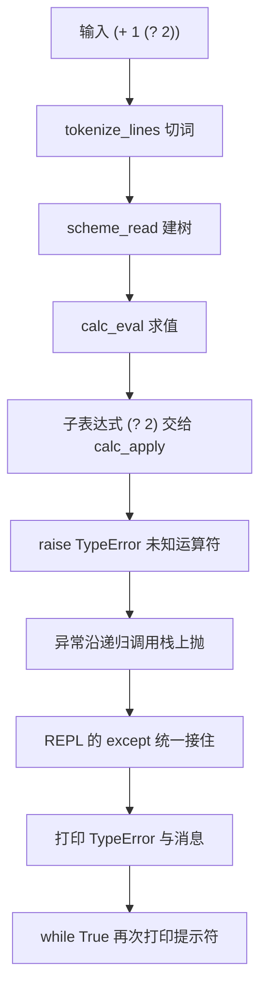

> **课程**：UC Berkeley CS61A · Structure and Interpretation of Computer Programs（Fall 2024）
> **本讲**：Lecture 30 ｜ 47:54 ｜ B 站分 P 28 ｜ [原视频](https://www.bilibili.com/video/BV1sy411z7nA?p=28)
> **课件**：`29-Calculator_1pp.pdf`（15 页，官方 PDF，逐页渲染图见正文插图）
> **字幕**：B 站英文原声字幕；本笔记是中文书面化重构，非逐句翻译
> **版权**：课程与课件版权归 UC Berkeley CS61A 教学团队；本文为学习用途的二次整理

## 本讲速览

*(参考时间: 00:00:01 – 00:00:10｜Lecture 30)*


- **已掌握**：Scheme 的列表由 `Pair` 链成，`first` 与 `rest` 是唯一的访问方式；高阶函数可以把「怎么组合」抽出来交给调用者；Python 里函数是一等值，可以像数字一样传递。
- **本讲主线**：
    - 程序出错时不该只有「停机 + traceback」一种结局：`raise` 通告异常，`try` / `except` 决定出错之后做什么。
    - 异常处理让「谁懂这件事，谁来负责」变成可以写进代码的分工：`reduce` 只管折叠，`divide_all` 只管除法，除零错误由后者就地消化。
    - 解释器（interpreter）是一个读入代码、执行它以产生程序所描述行为的程序；它的实现把本课程几乎所有主题串在一起：树、树递归、高阶函数、模块化。
    - 计算器语言只有两种表达式——数字与「以 `+ - * /` 开头的调用」。它的语法是 Pair 树，它的语义是一句递归定义，它的实现是两个函数 `calc_eval` 与 `calc_apply`。
    - 交互式解释器的外壳是读取-求值-打印循环（Read-Eval-Print Loop，REPL）：读一行、解析成树、求值、打印，出错就报告错误然后继续，永不主动停机。
- **关键结论**：一个语言的实现 = 一棵树的遍历 + 一张把符号映射到操作的表格 + 一个把所有错误收在一处的循环。

## 1. 课件前置：列表处理的四个内置过程与 cons 计数

*(参考时间: 00:00:01 – 00:00:29｜Lecture 30)*


本讲课件的第 3–5 页承接 Scheme 列表那一讲，把「怎样在列表上做批量运算」收束成四个内置过程。这四个过程之所以放在这里，是因为后面的解释器要用其中两个：`map` 负责把一个函数作用到一串子表达式上，`apply` 负责把一个函数作用到一串参数上。解释器的求值循环，本质上就是这两个动作的交替。

> **编者说明**：本讲录像第 1 秒就进入异常话题，`List Processing` 分节页、内置过程页与 `cons-count` 练习页（第 3–5 页）在字幕里没有对应段落，很可能是上一讲末尾的收尾内容。本章按课件文本与画面整理，评述与演算为编者所加，不代表课堂原话。锚点取录像起点作为时间参照。


| 过程 | 调用形式 | 作用 |
| :--- | :--- | :--- |
| `append` | `(append s t)` | 把 s 与 t 的元素接成一个列表；可以接多于两个列表 |
| `map` | `(map f s)` | 对 s 的每个元素调用 f，把结果收成一个列表 |
| `filter` | `(filter f s)` | 对 s 的每个元素调用 f，保留结果为真值的那些元素 |
| `apply` | `(apply f s)` | 以 s 的元素为参数调用 f |

课件用三行代码把 `map` 与 `append` 串起来：先造一个计数列表，用 `map` 把每个计数包成「and a 数字」的节拍，再用 `apply append` 把一串列表拆平成一个列表。

```scheme
(define count (list 1 2 3 4))
(define beats (map (lambda (x) (list 'and 'a x)) count))
(define rhythm (apply append beats))
```

三步的结果分别是：`count` 为 `(1 2 3 4)`；`beats` 为 `((and a 1) (and a 2) (and a 3) (and a 4))`；`rhythm` 为 `(and a 1 and a 2 and a 3 and a 4)`。第三行值得停一下：`apply` 把 `beats` 这个「列表的列表」摊成参数，`append` 再把这些参数接成一个平铺列表。如果写成 `(append beats)` 得到的是原样，因为 `append` 的参数是列表本身而不是它的元素；这两个过程的分工正是「收集结果」与「展开参数」。


第二道练习要求写一个过程，数出一个值在盒针图（box-and-pointer diagram）里占多少个 cons 格。盒针图是这门课描述列表结构的标准画法：一个格子的左半是 `first`，右半是 `rest`，右半的箭头指向下一个格子，最后一格的 `rest` 指向 `nil`。

```scheme
(define (cons-count s)
  (if (list? s)
      (+ (length s)
         (apply + (map cons-count s)))
      0))
```

读法是：如果 s 是一个列表，那么它自己这条链上占了 `(length s)` 个格子，此外每个元素本身还可能是列表，需要递归去数，最后用 `apply +` 把这些数目加起来；如果 s 不是列表（是一个数字、符号之类的原子），它不占任何 cons 格，返回 0。课件给出的例子是 `((c s) ((6)) 1 (a))`：外层链 4 格，`(c s)` 链 2 格，`((6))` 是 1 格外加里面 `(6)` 的 1 格，`1` 是原子不占格，`(a)` 1 格，合计 9 格。这个数字也验证了递归式的写法——`(length s)` 数的是**当前这一层**的格子，`map` 数的是**每个元素往下**的格子，两者相加才不重不漏。

## 2. 异常与 raise：给「出错」一个类型

*(参考时间: 00:00:01 – 00:03:45｜Lecture 30)*


编程语言通常都有一套「通告异常事件」的机制，也有一套「处置异常并说明接下来做什么」的机制。在 Python 和很多语言里，这两套机制合称**异常（exception）**：用 `raise` 通告一件不该发生的事，用 `try` 处置它。

`raise` 后面跟一个表达式，这个表达式必须求值成一个异常类或一个异常实例。类必须是内置基类 `BaseException` 的子类；实例必须是某个异常类的实例。异常对象和普通对象一样被构造：所谓「制造一个 `TypeError`」，不过是给这个类传一个描述发生了什么的字符串。字符串里通常写两件事——出了哪一类错，以及具体是哪一处。

内置异常类各有分工，而且它们在合适的场合会**自动**抛出：

| 异常类 | 什么时候自动抛出 | 本讲演示 |
| :--- | :--- | :--- |
| `TypeError` | 函数收到的参数个数或类型不对 | `abs('hello')` |
| `NameError` | 一个名字找不到绑定 | 未定义的名字 |
| `KeyError` | 字典里没有这个键 | 缺失的键 |
| `RecursionError` | 递归调用层数过多 | 一个只调用自己的 `f` |

课堂上的第一个演示是求绝对值：`abs(3)` 正常返回 3，而 `abs('hello')` 立刻抛出一个 `TypeError`，消息是 `bad operand type for abs(): 'str'`——类型对了才能算，这是内置函数替调用者做的检查。

但异常并不神秘，自己也能抛：`raise TypeError` 抛出一个没有描述的 `TypeError`；`raise TypeError('very bad idea')` 抛出的对象带着那句描述，屏幕上看到的就是这句话。既然如此，就可以给自己的函数加约束：

```python
def double(x):
    if isinstance(x, str):
        raise TypeError('double takes only numbers')
    return 2 * x
```

为什么要多写这三行？因为 `2 * 'hello'` 在 Python 里是合法的，结果是 `'hellohello'`。如果某个 `double` 的语义只允许数字，那么「静默地拼出字符串」就是最坏的失败方式：程序继续跑，错误被推迟到很远的地方才爆出来。主动 `raise` 把失败点提前到了错误的源头，消息就是给调用者看的诊断书。演示结果也印证了这一点：`double(4)` 得到 8，`double('hello')` 得到 `TypeError: double takes only numbers`。

这里的取舍值得记住：**抛出异常是把「我拒绝处理这种输入」写进接口**。代价是调用者必须知道可能有哪些异常；收益是失败不再被伪装成成功。

异常默认的结局是：程序中止，打印错误消息与 traceback，然后由程序员决定改什么、重新运行。一个只调用自己的 `f` 会在默认递归上限附近撞上 `RecursionError`，这正是「自动抛出」的另一种形态——语言在替运行环境报告它已经无法继续。

异常为什么要分类？讲师给了两个理由。第一，类型让错误消息能说明「发生了什么」，看 traceback 时能立刻分辨是名字错、类型错还是键不存在。第二，也是更重要的：**分类让语言有能力处理异常并继续运行**。只有错误带着类型标签，`try` 语句才有东西可以匹配；没有类型，程序只能一概停机。

## 3. try / except：让程序出错之后还能继续

*(参考时间: 00:03:48 – 00:09:00｜Lecture 30)*

如果希望程序在出错之后仍然活着，就要用 `try` 语句。它由两部分组成：`try` 后面跟一个代码块（套件，suite），以及一个或多个 `except` 行。每个 `except` 描述这一类异常由本语句负责处理，可以给异常对象起一个名字，后面再跟一个套件，说明「发生这种错时做什么」。

```python
try:
    x = 1 / 0
except ZeroDivisionError as e:
    print('handling a zero division error:', e)
    x = 0
```

执行规则可以拆成三条：

| 情形 | try 套件 | except 套件 | 程序 |
| :--- | :--- | :--- | :--- |
| 没有异常 | 全部执行完 | 跳过 | 继续 |
| 抛出的异常类匹配 | 执行到出错处即中断 | 执行 | 继续，不打印 traceback |
| 抛出的异常类不匹配 | 中断 | 跳过 | 中止并打印 traceback |

关键在于「匹配」二字：只有当异常对象的类继承自 `except` 上写的那个类时，才算被这个 `try` 接住。`as e` 里的名字是把异常对象绑到一个变量上，所以可以 `print` 出来——异常是对象，能被打印、被传递、被比较，这就是它有类型的好处。

上面这段代码跑完，屏幕上只有那一行 `handling a zero division error: division by zero`，没有多行 traceback，而且 `x` 被绑成了 0——尽管 `x = 0` 这一行写在引发异常的那一行之后。**被处理的异常不会中止程序，控制流从出错点跳到了 `except` 套件**。

第二个例子把这件事讲得更细。先写一个不受保护的版本：

```python
def invert(x):
    result = 1 / x
    print('Never printed if x is 0')
    return result
```

当 `x` 为 2，`invert(2)` 返回 0.5，并且那行提示会打印出来；当 `x` 为 0，`1 / x` 先抛出 `ZeroDivisionError`，函数体在那一行就地中断，`print` 与 `return` 都不会执行，异常一路上抛，直到程序停机。

> **编者说明**：`invert` 里那行 `print` 的原文台词没有给出完整句子，这里按「除零时这一行永远看不到」的讲述写成了一句自解释的提示；除号与返回结构依据讲师对代码的逐行描述。

这个差别在赋值语句上有一个极端的表现。写 `a = invert(2)`，`a` 被绑定到 0.5；写 `b = invert(0)`，`b` 不是被绑定成 `None`，而是**根本没有被绑定**——赋值语句整体作废了。很多人第一次遇到「名字未定义」的 `NameError`，根源就是之前那条赋值语句被异常打断了。

于是有了安全版本：

```python
def invert_safe(x):
    try:
        return invert(x)
    except ZeroDivisionError as e:
        return str(e)
```

它做的事只有两件：试着 `invert`；如果抛出的正是 `ZeroDivisionError`，就把这个异常对象转成字符串返回。于是 `invert_safe(2)` 得到 0.5，`invert_safe(0)` 得到字符串 `'division by zero'`，而屏幕上没有任何错误信息——错误被就地消化成了一种普通返回值。把 `return str(e)` 换成 `return 0`，行为随之改变：`b` 会被绑成数字 0。同一个 `try` 结构，`except` 套件返回什么，函数对失败的「态度」就是什么。

这类结构最有价值的场景，是程序在处理**不受自己控制的输入**时：用户可能敲错格式，网络另一端可能发来不合规的数据。这时既不想让程序停机，也不想假装一切正常，于是「打印一句错误，给一个默认值，继续跑」就成了正确的选择。

## 4. reduce：把序列折叠成一个值

*(参考时间: 00:09:02 – 00:12:35｜Lecture 30)*


在进入解释器之前，还有一个必须交代的高阶函数：`reduce`。它的职责是**把一个序列归约成一个值**——用一个两参数的函数，从初值开始，把序列元素一个个「吃」进去。

```python
def reduce(f, s, initial):
    """Combine elements of s pairwise using f, starting with initial.

    E.g., reduce(mul, [2, 4, 8], 1) is equivalent to mul(mul(mul(1, 2), 4), 8).

    >>> reduce(mul, [2, 4, 8], 1)
    64
    """
```

课件把三个参数各自的约束写得很清楚，这些约束不是风格建议，而是正确性的前提：

| 参数 | 约束 |
| :--- | :--- |
| `f` | 一个两参数函数，且它的返回值必须仍能作为它的第一个参数 |
| `s` | 一个序列，每个元素都能作为 `f` 的第二个参数 |
| `initial` | 一个能作为 `f` 第一个参数的值 |

第三条约束容易被忽略：`f` 的结果会被立刻送回 `f`，所以结果类型必须落回「第一个参数」的位置。`reduce(mul, [2, 4, 8], 1)` 于是等价于 `mul(mul(mul(1, 2), 4), 8)`，得到 64；同样 `reduce(add, [1, 2, 3, 4], 0)` 得到 10。

`pow` 的例子更能说明「从左往右折叠」的含义：`reduce(pow, [1, 2, 3, 4], 2)` 先算 2 的 1 次方得 2，再算 2 的 2 次方得 4，再算 4 的 3 次方得 64，最后算 64 的 4 次方，得到 16,777,216。注意这不是 2 的 1+2+3+4 次方，而是不断把**上一次的结果**当成底数——这就是为什么课件把它画成一串嵌套的 `pow`，最里面是 `pow(2, 1)`，往外每层多套一个。折叠方向一旦搞反（从右往左），结果会完全不同。

实现有两个版本，都是课堂上写出来的。迭代版只有三行：

```python
def reduce(f, s, initial):
    for x in s:
        initial = f(initial, x)
    return initial
```

递归版把「剩下的活」交给递归调用：

```python
def reduce(f, s, initial):
    if not s:
        return initial
    first, rest = s[0], s[1:]
    return reduce(f, rest, f(initial, first))
```

递归版值得对照着看：基例是序列空了、没有活可干，直接返回累计值；递归步是先把当前元素吃进累计值（`f(initial, first)`），再把「剩下的序列」和「新的累计值」一起交给下一次调用。两个版本都通过 doctest，也都体现同一个不变量：**`initial` 始终代表「已经处理过的那些元素折叠出来的值」**。

于是可以把 `reduce` 当成一个抽象：它只知道「两两组合」，完全不知道组合的具体含义。这正是它能在解释器里被复用的原因。

> **编者说明**：讲师提到标准库里有内置的 `reduce`，字幕记作「iter tools 模块」；这个函数实际位于 `functools`，写法是 `functools.reduce`。`itertools` 提供的是迭代器工具，与本函数无关。

## 5. divide_all：谁该知道「除以零」这回事

*(参考时间: 00:12:37 – 00:14:29｜Lecture 30)*

`reduce` 的第一个应用是一个除法器：拿一个分子，依次除以一串分母。

```python
def divide_all(n, ds):
    return reduce(truediv, ds, n)
```

`divide_all(1024, [2, 4, 8])` 得到 16：1024 除以 2 得 512，除以 4 得 128，除以 8 得 16。但如果是 `divide_all(1024, [2, 0, 8])`，中间的 0 会让 `truediv` 抛出 `ZeroDivisionError`，整个调用失败。

如果这不是想要的行为呢？假设业务上希望「除不动就当作无穷大」，那么在调用处加一层 `try`：

```python
def divide_all(n, ds):
    try:
        return reduce(truediv, ds, n)
    except ZeroDivisionError:
        return float('inf')
```

这样 `divide_all(1024, [2, 0, 8])` 得到 `inf`，而 `divide_all(1024, [2, 4, 8])` 依旧得到 16。

这段代码的设计价值在于**关注点分离（separation of concerns）**。`reduce` 的实现里没有一行与除零有关——它不知道调用者传进来的 `f` 是加法、乘法还是除法，也不知道那个 `f` 可能抛什么异常；`divide_all` 则反过来，它知道自己做的是除法，知道除零是可能的失败，于是就地决定失败的含义。两者各自只懂自己的事，中间靠「函数」这个值连接。

把这件事说成一句话：**错误应该在「知道这个错误意味着什么」的那一层被处理**。`reduce` 不知道除零意味着什么，所以它不处理；`divide_all` 知道「除不动就是无穷大」，所以它处理。后面写解释器时会反复用到这条判据：词法分析知道什么是不合法的数字，语法分析知道什么是不配对的括号，`calc_apply` 知道哪个运算符需要几个参数——每一层只负责自己认得出的错误。

## 6. 解释器与语言的层次

*(参考时间: 00:14:31 – 00:20:33｜Lecture 30)*

至此课程的重心转到编程语言与解释器。**解释器是一个程序：它把用某门语言写成的代码作为输入，执行这些代码，从而产生程序所描述的行为。** 这句话里没有玄机——解释器本身也是用某门语言写的普通程序，只不过它处理的数据恰好是「代码」。



这张图就是本讲接下来要逐段实现的东西：先把文本切成词，再把词组成树，然后用两个函数在树上求值，最后把结果打印出来。后面几章会依次走过这条流水线上的每一段。

为什么会话要先学 Scheme？讲师给了两个理由。第一，Scheme 是一门好用到今天还有新项目在用的语言，简洁、有效，而且它是 Lisp 的方言；Lisp 的用途更广，既可以作为独立的开发语言，也常作为嵌入式语言实现某个程序的一部分。第二个理由与课程直接相关：Scheme 强大到**可以用一个 Python 程序把它的全部解释规则写下来**，于是「实现一门语言」这件事在学期内是可行的。

解释器之所以被安排在课程末尾，是因为它把前面所有主题缝在了一起：程序是树，解释靠树递归；表达式里常有子表达式的列表，所以列表处理是基础设施；解释器本身像高阶函数，接收「代码」这个值并产生行为；而解释器可以做到模块化、可扩展——一部分代码描述「解释一般如何进行」，另一部分代码封装「这门语言的每个部件具体怎么执行」。

要看清层次，先看最底层。计算机执行很多种语言写成的程序，其中一类叫**机器语言（machine language）**：语句由硬件直接解释。中央处理器能执行一组固定的指令，自带容量有限的内存，以及访问更大内存的通道（缓存、主存、磁盘）。要扩展机器语言，就得改电路，而这很少发生。更要紧的是它难以编程：操作直接引用具体的硬件地址，几乎没有抽象机制，没法给东西起名字，也没法实现过程或函数。

高级语言补上了这些。它们的语句与表达式要么被另一个程序解释，要么被编译成另一门语言。**解释是读入程序并执行它的行为；编译是把程序翻译成另一门语言（例如机器语言），以便稍后执行。** 许多现代语言两者混用，把一部分代码即时编译（just in time），跑起来的感觉与交互式解释无异。高级语言提供抽象手段：给值、函数、对象、类起名字。至于哪门语言「更高层」，是另一门课的话题。

这里有一个容易被忽略的事实：**你的电脑里没有任何一块硬件是为 Scheme 或 Python 设计的**。机器语言代码负责执行全部行为；在这门高级语言与机器语言之间，必须有一个解释器或编译器来实现所有那些抽象手段。而且这种分层是常态：机器语言可以用来实现 C 的编译器，而 C 又是一门高级语言，用来实现 Python 的解释器。

| 层次 | 谁在执行 | 如何扩展 | 本讲提到的例子 |
| :--- | :--- | :--- | :--- |
| 机器语言 | CPU 硬件 | 改电路 | 固定指令集 |
| 编译型高级语言 | 编译产物直接在硬件上跑 | 改编译器 | C |
| 解释型高级语言 | 另一个程序逐条执行 | 改解释器 | Python、Scheme |
| 领域专用语言 | 专用解释器或编译器 | 改语言与解释器 | Erlang、MediaWiki 标记 |

高级语言好写的另一半理由是**可移植**：同一份程序能在不同厂商的硬件、不同组织的操作系统上运行，因为系统细节被抽象掉了。Python 的具体做法是：运行前先编译成 Python 3 的字节码（bytecode），再由一个解释器执行这份字节码；字节码比机器语言抽象，又比源码低级，可以用内置的 `dis` 模块查看。

于是「一段程序怎样被执行」这个故事可以相当复杂，但有一道界线始终清楚：**你的机器能执行什么，与你作为人愿意写什么，是两回事**。这门课学过的一切，都发生在用于构建今天软件的高级语言里。

## 7. 专用语言、语法与语义

*(参考时间: 00:20:40 – 00:23:46｜Lecture 30)*

有时人们会发明新语言。一种强有力的抽象，是**为一类特定应用或问题域量身定义一门语言**。Erlang 为并发程序而设计：世界各地的自动取款机都能访问同一个账户余额，而你在两座城市的两台机器上同时取款，也没法骗出两份钱——这正是并发通信问题，用一门为此设计的语言表达会容易得多；Erlang 也被用来实现同时承载大量连接的聊天服务器。另一个例子是 MediaWiki 标记语言，它为生成维基百科那样的静态网页而设计，内建了文本格式化、页面互链、把多个页面拼成一个页面的元素。它或许没有 Python 或 Scheme 那样完备，但仍然需要解释器或编译器，才能生成读者看到的页面。

一门编程语言由两部分构成。**语法（syntax）** 描述语言里所有合法的语句与表达式，回答「形式上怎么写才算数」；**语义（semantics）** 给出这些语句与表达式的执行或求值规则，回答「写出来是什么意思」。

要把一门语言钉死，只有两条路：写一份形式化的规格文档，精确描述语法与语义；或者实现一个解释器或编译器，用实现本身充当参照。后一条路之所以成立，是因为**规范实现（canonical implementation）就是标准**：任何输入只要不让它崩溃，就算合法语法；它的行为就定义了语义。

两条路的历史顺序可以相反。Scheme 是先有规格、后有解释器实现；Python 则是先有一个规范实现，形式化描述是后来照着这个实现补出来的。实际用于大型社区的语言，通常两者都有：规格说明保证多家实现能互通，参考实现负责把边界情况定死。

解释与编译的分工，也可以用一张表说清：

| 判据 | 解释 | 编译 |
| :--- | :--- | :--- |
| 时机 | 读入即执行 | 先翻译，后执行 |
| 产物 | 行为（值或副作用） | 另一门语言的程序 |
| 出错时 | 当场中断当前表达式 | 可能在翻译阶段就报错 |
| 典型场景 | 交互式会话 | 生成机器码或字节码 |

## 8. 从文本到树：parse 的两个阶段

*(参考时间: 00:23:46 – 00:30:34｜Lecture 30)*

要把一段文本当作程序来执行，第一步是把它解析（parse）成一种便于执行的结构。Scheme 代码本质上是树结构的：表达式里套表达式，一层套一层；但它被打字打出来时，只是一串排在一起的括号，说到底只是文本。

因为一个 Scheme 程序看起来就是由括号、符号、数字组成的 Scheme 列表，最自然的做法是写一个程序，把这些文本读成列表的表示——**第一个元素与其余元素**。这门课用 Python 来做这件事，而承载它的类就是 `Pair`：只有 `first` 与 `rest` 两个属性。

`Pair` 类简单得几乎没什么可讲，但它的字符串表现很有意思。构造一个嵌套的 Pair 并打印，你看到的是 Scheme 会怎么写它：

```text
>>> p = Pair(1, Pair(2, Pair(3, nil)))
>>> print(p)
(1 2 3)
>>> p
Pair(1, Pair(2, Pair(3, nil)))
```

`str` 给出 Scheme 的写法 `(1 2 3)`，`repr` 给出 Python 的构造式 `Pair(1, Pair(2, Pair(3, nil)))`。`nil` 也是一个对象，是 `nil` 类的实例，它的 `repr` 与 `str` 都是 `nil`，另外还定义了一些方法，留给项目里慢慢用。链的末端必须是 `nil` 而不是 `None`，因为列表的结束本身就是这个语言里的一个值。

Scheme reader 的职责是把括号与数字变成嵌套的 Pair，而且做得很宽容：它能跨行读，能忽略任意多的空格，也能把 `4.5` 这样的多字符数字当成一个整体。比如下面这段跨三行、空格凌乱的输入，只要括号配对，读出来的就是一个嵌套 Pair：

```scheme
(+ 1
   (* 2
      4.5)
   (- 6 7 8))
```

它的 `str` 会被规范化成 `(+ 1 (* 2 4.5) (- 6 7 8))`。所以「输入什么、打印什么」并不总是相同——`str` 是结构的一种规范写法，不是原始文本的复制品。这也说明 reader 必须分清两件事：`4.5` 是一个数字（即使它由四个字符组成），而相邻的两个括号是真的在构造两个不同的 Pair。

从文本到结构的过程叫**解析（parsing）**，它分两步走：先做**词法分析（lexical analysis）**，把文本变成一串词元（token）；再做**语法分析（syntactic analysis）**，把词元变成表达式。

词法分析的产物是原子的单位：符号、数字、括号。几行原始文本会被逐行扫描成 token 序列，其中值得注意的细节有三个：

- `2` 与 `3` 挨在一起会被合成数字 `23`，因为没有空格分隔时它们本来就是一个数；
- 紧邻的右括号是独立的 token，它不属于数字；
- 多余的空白被丢弃，因为它不影响含义。

此外词法分析还负责识别畸形 token（例如 `2.3.4` 这种不是合法数字的写法），判断每个 token 的类型，并且是逐行迭代处理的。讲师明确说这一步不需要学生自己写——课程已经提供；想试的话，可以直接调用 tokenizer，看它把 `12 34` 切成两个 token，或者把 `((1.2 3))` 里的每个括号单独切开，而把 `1.2` 保留成一个数字。

## 9. 语法分析：`scheme_read` 一次读一个表达式

*(参考时间: 00:30:36 – 00:32:39｜Lecture 30)*

第二步把 token 序列变成树。`scheme_read` 的约定是：**消费恰好一个表达式所需的 token，返回那棵树**。它是树递归的典型例子。

它只有一个基例和一处递归：遇到符号或数字，直接造出一个叶子（这就是基例）；遇到左括号，就对括号里的每一个子表达式递归调用 `scheme_read`，把结果依次串成 Pair（这就是递归步）。终止条件是读到与开头那个左括号配对的右括号——原来那次调用到此结束。

用一句话概括它为什么必须递归：**括号的嵌套深度就是树的深度，而读的过程必须跟着这个深度走**。第一次调用读到 `(+ 1 (* 2 3))` 时不会立刻返回，因为它必须先读完 `(* 2 3)` 这个子表达式；而读子表达式又会再发起一次调用。等最内层读到一个数字、外层读到配对的右括号，一层层才收束回来。

这也是为什么解析器能跨行工作：它把多行输入拼在一起，直到找到与开头那个左括号匹配的右括号为止。讲师说这部分要学生自己写出来，教材里有很长的描述，值得花时间学——因为「为一门语言写语法分析」是这门课少有的、能把递归思维完整用上一次的练习。

## 10. Scheme 语法的计算器：语法与语义

*(参考时间: 00:32:41 – 00:35:37｜Lecture 30)*


现在可以定义本讲要实现的这门语言了。**Scheme 语法的计算器（Scheme-syntax calculator）** 是一个不支持 Scheme 大多数特性的 Scheme 解释器，只保留算术运算符 `+`、`-`、`*`、`/` 和调用表达式，调用可以任意嵌套。它的实现在 `SchemeCalc.py` 里，运行后出现一个提示符，可以输入表达式，做嵌套的算术，也能处理浮点数。课堂上的两次输入是：

```text
scm> (+ 1 2 3)
6
scm> (+ 2 (* 4 6))
26
```

讲师也单独演示了应用函数这一侧：直接对 `+` 与参数 `1 2 3` 调用 `calc_apply`，得到 6。也就是说，「求值」与「应用」是可以分开测试的：前者沿树下降，后者只认运算符与数字。

它的语法小得可以用两行说完：**原始表达式（primitive expression）就是一个数字**，例如 `2`、`-4`、`5.6`；**调用表达式（call expression）是一个以运算符 `+`、`-`、`*`、`/` 开头、后面跟零个或多个表达式的组合**，例如 `(+ 1 2 3)`、`(/ 3 (+ 4 5))`。仅此而已，没有 `define`，没有 `lambda`，没有名字。

表达式在 Python 里用 Scheme 列表表示，也就是 `Pair` 实例，它编码了树形结构。以 `(* 3 (+ 4 5) (* 6 7 8))` 为例，三种视角是同一件事：

| 视角 | 形态 |
| :--- | :--- |
| 写下来的表达式 | `(* 3 (+ 4 5) (* 6 7 8))` |
| 表达式树 | 根是 `*`，三个孩子分别是 `3`、`(+ 4 5)`、`(* 6 7 8)` |
| Pair 表示 | 一条 `first` 为 `*` 的链，第二个元素指向 `(+ 4 5)` 的链，第三个元素指向 `(* 6 7 8)` 的链 |

这解释了一个乍看奇怪的事实：**代码在解释器眼里就是数据**。同一个 `Pair` 结构，既可以当成「待求值的程序」，也可以当成「一个列表」，区别只在于你拿它去做什么。后面所有的求值，都是在这个结构上走来走去。


语义也短得可以写完。计算器表达式的值按递归方式定义：**数字求值为它自身；调用表达式求值为「它的各参数值由运算符组合起来」的结果**。四个运算符的具体含义是：

| 运算符 | 语义 |
| :--- | :--- |
| `+` | 所有参数之和 |
| `*` | 所有参数之积 |
| `-` | 只有一个参数时取负；多于一个时从第一个里减去其余 |
| `/` | 只有一个参数时取倒数；多于一个时用第一个依次除以其余 |

`-` 与 `/` 的特殊规则不是装饰，而是 Scheme 的传统：`(- 5)` 是 -5，`(/ 3)` 是 1/3。它们也解释了为什么这两个运算符的实现在后面会比 `+` 与 `*` 多出两个分支——零个参数时既没法取负，也没法取倒数。

课件用 `(+ 5 (* 2 3) (* 2 5 5))` 把语义跑了一遍：`(* 2 3)` 求值为 6，`(* 2 5 5)` 求值为 50，`+` 把 5、6、50 加起来，整个表达式求值为 61。画成树，每个内部节点都对应一次 `calc_apply`，叶子对应「数字求值为自身」：



树上有两件事值得看。第一，内部节点的运算符各不相同，各自对应 `calc_apply` 的一个分支；根节点 `+` 拿到的是三个**已经算好的数字**，而不是三棵子树——这正是下一节 `calc_eval` 递归结构要保证的事。第二，求值的顺序是从叶子往根：先算出 6 与 50，再算 61；任何一次 `calc_apply` 的前提都是参数已经化简成数字。

## 11. `calc_eval`：按表达式类型分派

*(参考时间: 00:35:39 – 00:38:36｜Lecture 30)*


整个计算器只有两个函数：一个求值，一个应用。先看求值。`calc_eval` 计算一个表达式的值，而计算器里表达式的值**永远是数字**。它是一个**泛型函数（generic function）**：按表达式的类型分派，是数字还是调用。


```python
def calc_eval(exp):
    if isinstance(exp, (int, float)):
        return exp
    elif isinstance(exp, Pair):
        arguments = exp.rest.map(calc_eval)
        return calc_apply(exp.first, arguments)
    else:
        raise TypeError
```

三个分支与语言语义的对应关系，可以逐行读：

| 实现 | 语义 |
| :--- | :--- |
| `isinstance(exp, (int, float))` 时 `return exp` | 数字求值为它自身 |
| `isinstance(exp, Pair)` 时 `exp.rest.map(calc_eval)` | 调用表达式的值是它的各参数值 |
| `calc_apply(exp.first, arguments)` | 这些参数值由运算符组合 |
| `else: raise TypeError` | 既不是数字也不是调用的表达式不合法 |

`Pair` 分支是全部精巧之处，值得逐句读：

- `exp` 此时必须是一个以运算符开头、后面跟一串操作数子表达式的列表，例如 `(+ 1 (* 2 3))`。
- `exp.rest` 是「除运算符之外的全部」，也就是操作数列表；对它 `map` 上 `calc_eval`，就对每个子表达式递归求值一次。
- 递归调用保证「每个操作数都被约简成一个数字」——即使某个操作数本身是一个很复杂的调用表达式。
- `arguments` 于是是一个**数字的 Scheme 列表**，而不是表达式的列表。
- `exp.first` 是运算符那个符号（一个字符串），交给 `calc_apply` 去决定加还是乘。



这张图有两个值得注意的地方。第一，**除报错分支外，每个分支都返回数字**，所以递归调用的返回值可以直接拼成参数列表——这个不变量是整个递归成立的支点。第二，`else` 分支不是防御性编程的装饰，而是语义的一部分：`()`（空组合）与一个孤立的符号既不是数字，也不是「以运算符开头的列表」，它们在这门语言里没有值，只能报错。

> **编者说明**：`exp.rest.map(...)` 里的 `map` 不是 Python 内置的 `map`，而是课程项目给 `Pair` / `SchemeList` 定义的同名方法，它接收一个函数并把结果收成 Scheme 列表。这个方法本讲没有展开，课件直接使用它。

课堂上的版本与课件略有差别，讲师自己点明了：真实代码会调用 `simplify`，把 `8.0` 归一成 `8`，让浮点结果在显示上更干净；同时给 `TypeError` 写上一段消息字符串，而不是裸抛一个类。按讲述补齐后大致是这样：

```python
def calc_eval(exp):
    if isinstance(exp, (int, float)):
        return exp
    elif isinstance(exp, Pair):
        arguments = exp.rest.map(calc_eval)
        return simplify(calc_apply(exp.first, arguments))
    else:
        raise TypeError(f'Unknown expression {exp}')
```

> **编者说明**：上面这段是依据讲师口述补出的示意版，`simplify` 的行为与错误消息的原文都没有逐字给出，消息文本可能与项目源码不同；课件第 12 页的版本没有 `simplify`，也没有消息。

## 12. `calc_apply`：把运算符落到数字上

*(参考时间: 00:38:37 – 00:42:01｜Lecture 30)*


`calc_apply` 负责「应用」：拿到一个运算符和一个数字的 Scheme 列表，按照这个运算符的含义把参数组合起来。在计算器里所有操作都是内置的，只有四个；讲师特意对比说，在支持更多抽象的语言里，还要处理用户定义的操作与名字，那是后面几讲的事。

课件上只留了骨架，`-`、`*`、`/` 三个分支用省略号代替；课堂上放出了完整实现：

```python
def calc_apply(operator, args):
    if not isinstance(operator, str):
        raise TypeError(str(operator) + ' is not a symbol')
    if operator == '+':
        return reduce(add, args, 0)
    elif operator == '-':
        if len(args) == 0:
            raise TypeError(operator + ' requires at least 1 argument')
        elif len(args) == 1:
            return -args.first
        else:
            return reduce(sub, args.rest, args.first)
    elif operator == '*':
        return reduce(mul, args, 1)
    elif operator == '/':
        if len(args) == 0:
            raise TypeError(operator + ' requires at least 1 argument')
        elif len(args) == 1:
            return 1 / args.first
        else:
            return reduce(truediv, args.rest, args.first)
    else:
        raise TypeError(operator + ' is an unknown operator')
```

> **编者说明**：`calc_apply` 的完整源码没有出现在课件上，上面这版是按录制时的演示（看到的消息文本、逐分支讲解）与项目结构重建的，分支顺序与语义与课堂一致，变量名与消息文本可能与项目源码有个别出入。

四个分支里，加法与乘法各自一行，因为它们的语义就是一次 `reduce`：

| 运算符 | 实现要点 | 课堂演示 |
| :--- | :--- | :--- |
| `+` | `reduce(add, args, 0)`，初值 0 | `(+ 1 2 3)` 得到 6 |
| `-` | 零参数报错；一参数取负；否则从第一个里减去其余 | `(- 2)` 得到 -2；`(- 10 1 2 3)` 得到 4 |
| `*` | `reduce(mul, args, 1)`，初值 1 | 未单独演示，只说明它是一次 `reduce` |
| `/` | 零参数报错；一参数取倒数；否则用第一个依次除以其余 | `(/ 3)` 得到 1/3；`(/ 1024 2 2 2 2 2)` 得到 32 |

初值不是随手写的：加法从 0 开始，乘法从 1 开始，这样「零个参数」也有定义。`(+)` 按实现得到 0，因为 `reduce(add, args, 0)` 在没有元素可吃时直接返回初值；课堂上没有演示这一条，但它是代码的直接推论。

`-` 与 `/` 的两个分支才是语义里「复杂」的那部分：零个参数时无意义，一个参数时退化成单目运算，多个参数时才折叠。演示里 `(- 10 1 2 3)` 得到 4——先 10-1=9，再 9-2=7，再 7-3=4；`(/ 1024 2 2 2 2 2)` 连除五次 2，只剩 32。

运算符本身也可能不合法，所以第一个检查不是分支而是守卫：如果 `operator` 不是字符串，说明这个「调用表达式」的第一个元素根本不是一个符号，报 `TypeError`，消息形如 `2 is not a symbol`。最后一行的 `else` 兜住「是字符串但不是四个运算符之一」的情况，演示 `(? 2)` 得到 `? is an unknown operator`。

到这里语言的核心就齐了：`calc_eval` 负责沿树下降，`calc_apply` 负责在叶子把符号变成运算。两者加起来不到二十行，却已经是一个完整语言的语义。

## 13. REPL：解释器的人机接口

*(参考时间: 00:42:06 – 00:43:47｜Lecture 30)*


还剩最后一件事：用户界面。解释器通常有一个**读取-求值-打印循环（Read-Eval-Print Loop）**：用户输入一个表达式，它被求值，结果被打印，然后提示符再次出现。


课件把循环拆成六步：

1. 打印一个提示符，告诉用户计算机准备好接收输入了。
2. 从用户那里读入文本。
3. 把文本解析成一个表达式。
4. 求值这个表达式。
5. 如果发生错误，报告这些错误；否则
6. 打印表达式的值，然后重复——再次打印提示符。

对应到代码，循环长这样：

```python
@main
def read_eval_print_loop():
    """Run a read-eval-print loop for calculator."""
    while True:
        try:
            src = buffer_input()
            while src.more_on_line:
                expression = scheme_read(src)
                print(calc_eval(expression))
        except (SyntaxError, TypeError, ValueError, ZeroDivisionError) as err:
            print(type(err).__name__ + ':', err)
        except (KeyboardInterrupt, EOFError):
            print('Calculation complete.')
            return
```

> **编者说明**：这段循环的源码同样没有出现在课件上，是依据讲师对 `while True` + `try` + `scheme_read` + `calc_eval` + `print` 的逐句描述重建的；`buffer_input`、`more_on_line` 等辅助接口来自课程项目，名字可能与源码略有出入。

有两行值得停下来看。第一行是 `print(calc_eval(expression))`：**打印只会在 `calc_eval` 正常返回时发生**。如果求值过程中抛了异常，这个 `print` 调用的参数根本算不出来，于是什么也不会被打印——错误信息由下面那个 `except` 负责，两者不会同时出现在屏幕上。第二行是 `except (KeyboardInterrupt, EOFError)`：`while True` 需要一个出口，出口是文件结束（在终端里按 `<Control>-D`，表示「没有更多输入了」）或键盘中断；这时它打印 `Calculation complete.` 并 `return`，循环才真正停下。

`@main` 是一个装饰器，作用是把「读取命令行参数、决定是跑测试还是跑交互」这类杂事包起来，让 `read_eval_print_loop` 本身只关心循环。这也是一种关注点分离：交互逻辑不掺启动逻辑。

> **编者说明**：`@main` 的来龙去脉不在本讲字幕里，它属于课程项目提供的脚手架；这里只说明它在源码里承担的角色。



这个循环之所以叫「交互式」，关键就在最后那个回到提示符的箭头：**一次失败不清空环境，也不结束会话**。用户可以在同一个环境里继续试下一个表达式，而不是重新启动程序。

## 14. 错误的完整处理链：谁来 raise，谁来回显

*(参考时间: 00:43:48 – 00:47:51｜Lecture 30)*

计算器虽小，异常却散布在整个程序里：词法分析、语法分析、求值、应用，每一层都可能抛。讲师的概括很准确：**抛出散落在各处，捕获集中在一处**。



以输入 `(? 2)` 为例，完整链条是八步：

1. `buffer_input` 读入这一行文本。
2. 词法分析把它切成 `(`、`?`、`2`、`)` 四个 token，没有畸形 token，不报错。
3. 语法分析把 token 组装成一个 Pair 树：`first` 是符号 `?`，`rest` 是数字 2。
4. `calc_eval` 判断它不是数字，是 Pair，于是进入调用分支。
5. 先对 `exp.rest` 逐项递归求值，得到数字列表 `(2)`；这一步若某个操作数非法，异常会先从这里冒出来。
6. `calc_apply` 拿到运算符 `?` 与参数列表 `(2)`，走完四个运算符的分支都不匹配，落到最后的 `else`，抛出 `TypeError('? is an unknown operator')`。
7. 异常沿 `calc_apply → calc_eval → read_eval_print_loop` 一路向上，中途没有任何 `try` 拦截，所以 `print(calc_eval(...))` 里的 `print` 从未执行。
8. 循环顶层的 `except` 捕获它，打印 `TypeError: ? is an unknown operator`，然后 `while True` 进入下一轮，提示符再次出现——程序没有停机。

同一套链条也适用于更早一层的失败。如果输入是一个孤立的符号 `abc` 或空组合 `()`，异常在第 4 步的 `else` 分支就抛出来了，第 5、6 步被整个跳过，异常沿调用栈直接上抛；如果运算符的位置上是个数字，例如 `(2 3)`，则要等到第 6 步才被 `calc_apply` 的第一个守卫挡下。也就是说，**报错的位置取决于哪一层先认出「这不是我能处理的东西」，而回显的位置始终是 REPL 那一个 `except`**。这正是把所有 `raise` 都放在实现层、把所有 `except` 都放在循环层的意义：错误从哪里冒出来可以各不相同，用户看到的样子必须一致。

不同层负责不同的错误类型，这条分工线可以列成表：

| 错误类 | 由谁抛出 | 触发方式 | 课堂所见 |
| :--- | :--- | :--- | :--- |
| `ValueError` | 词法分析 | 畸形数字，如 `2.3.4` | 值不合法 |
| `SyntaxError` | 语法分析 | 多余的右括号等结构错误 | 消息含 `unexpected token` |
| `TypeError` | `calc_eval` | 空组合 `()`、孤立符号 | 不是数字也不是调用 |
| `TypeError` | `calc_apply` | `(-)` 零参数、`(? 2)` 未知运算符、`(2 3)` 运算符不是符号 | `minus requires at least one argument`、`? is an unknown operator`、`2 is not a symbol` |
| `ZeroDivisionError` | Python 内建除法 | `(/ 1 0)` | 由 `truediv` 自己抛出 |

表里最后一行值得单独说：`ZeroDivisionError` 不是计算器的代码抛的，而是 Python 的除法运算符抛的。`/` 的实现里直接用了内置的除法，于是内置除法的失败模式原封不动地变成了这门语言的失败模式。**这说明解释器的错误语义，往往是从宿主语言「继承」来的**：你用什么实现一门语言，就会连带继承它的一部分行为。

理解了这条链，就能回答一个设计问题：为什么 `except` 要把 `SyntaxError`、`TypeError`、`ValueError`、`ZeroDivisionError` 四种都列上？因为这四类恰好覆盖了从文本到数值的整条路径，而这条路径上任何一处失败，对用户而言都是同一件事——**你刚才那句话我没法算**。对用户来说，重要的是知道错在哪、能改，而不是看一段指向解释器内部源码的 traceback。

这也正是讲师最后强调的设计原则：**一个设计良好的交互式解释器不应该停机**。它应当停止求值当前表达式、打印错误信息，然后让程序员有机会修改，在**当前环境**里再试一次，而不是让整个程序崩溃。唯一的退出方式是文件结束或键盘中断。

## 小结

- **异常是接口的一部分**：`raise` 把「我拒绝处理这种输入」写进函数契约，异常类负责让调用者能分辨失败的种类。分类的两个用途——诊断与处置——缺一不可。
- **错误在懂它的那一层处理**：`reduce` 不知道除零意味着什么，所以不处理；`divide_all` 知道，所以就地把它变成 `inf`。把 `try` 放在错误源头附近，比放在程序顶层更有信息量。
- **一份代码、两种视角**：计算器的表达式既是「待求值的程序」，又是「一个 Pair 列表」。解释器的全部工作，就是在这棵树上区分「这是数字」与「这是一个调用」。
- **语义写成递归，实现就写成递归**：`calc_eval` 的三个分支与三句语义一一对应；除报错分支外每个分支都返回数字，这个不变量让 `exp.rest.map(calc_eval)` 可以直接拼出参数列表。
- **分派与执行分开**：`calc_eval` 只判断「这是什么形状」，`calc_apply` 只判断「这个符号该做什么」。两者各自单一职责，于是新增一个运算符只需要改 `calc_apply` 的一个分支。
- **REPL 的鲁棒性来自一个 `try`**：把解析与求值整体包住，捕获四类已知异常，打印后继续循环；只有 EOF 与键盘中断才退出。交互式工具的第一品质是「不要因为用户的一句话而死掉」。

*(参考时间: 00:47:18 – 00:47:51｜Lecture 30)*

## 附：本讲幻灯片索引

*(参考时间: 00:00:01 – 00:47:51｜Lecture 30)*

| 页 | 内容 | 出现位置 |
| :--- | :--- | :--- |
| 1 | 标题页 Calculator | 本讲速览 |
| 2 | Announcements 公告页 | 本讲速览 |
| 3 | 分节页：List Processing | §1 |
| 4 | 四个内置列表过程与 count / beats / rhythm 演示 | §1 |
| 5 | cons-count 练习与盒针图 | §1 |
| 6 | 分节页：Exceptions | §2 |
| 7 | reduce 的文档字符串与嵌套 pow 求值图 | §4 |
| 8 | 分节页：Scheme-Syntax Calculator | §10 |
| 9 | Calculator 语法：数字、调用表达式与 Pair 表示 | §10 |
| 10 | Calculator 语义：四个运算符与 61 的求值树 | §10 |
| 11 | 分节页：Evaluation | §11 |
| 12 | calc_eval 实现与语言语义对照 | §11 |
| 13 | calc_apply 实现与四个运算符的语义 | §12 |
| 14 | 分节页：Interactive Interpreters | §13 |
| 15 | Read-Eval-Print Loop 的六个步骤 | §13 |
