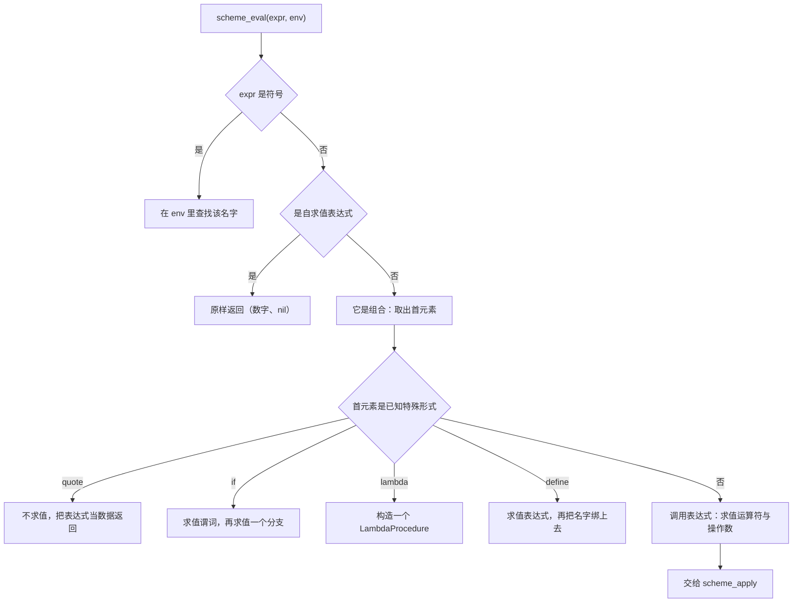
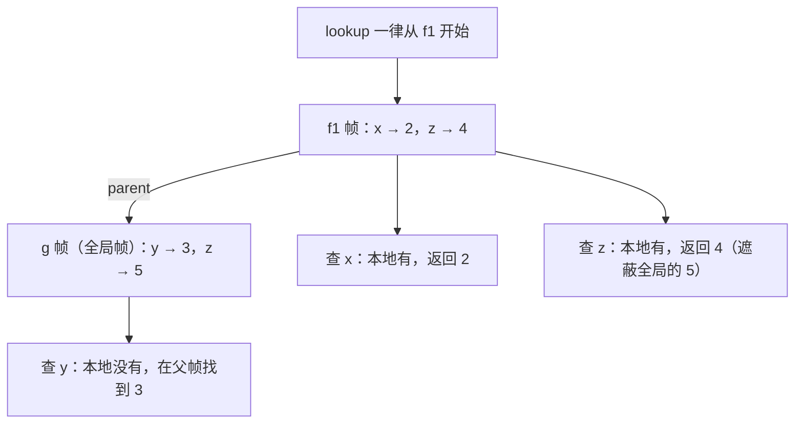
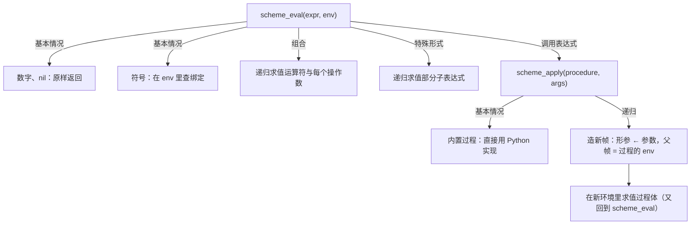

> **课程**：UC Berkeley CS61A · Structure and Interpretation of Computer Programs（Fall 2024）
> **本讲**：Lecture 31 ｜ 29:48 ｜ B 站分 P 29 ｜ [原视频](https://www.bilibili.com/video/BV1sy411z7nA?p=29)
> **课件**：`30-Interpreters_1pp.pdf`（14 页，官方 PDF，逐页渲染图见正文插图）
> **字幕**：B 站英文原声字幕；本笔记是中文书面化重构，非逐句翻译
> **版权**：课程与课件版权归 UC Berkeley CS61A 教学团队；本文为学习用途的二次整理

## 本讲速览

*(参考时间: 00:00:02 – 00:00:12｜Lecture 31)*


> **编者说明**：录像从 00:00:02 的「Let's talk about special forms」直接切入一个小节，结尾停在总结句上，成片只有 29:48；从这两点看，它应是课堂录像的一个片段，第 1–3 页（标题页、公告页、Lab 10 复习分节页）也就落在录音开始之前，没有对应的字幕段落。这三页按课件页序放在速览处。另外，课件第 10–11 页（Special Forms 分节页与 Scheme Evaluation 页）正是这一段讲述所对应的页面，而第 4 页（操作数求值）反而在这之后才讲到，所以**正文的插图顺序不等于课件的页序**；每一页都放在字幕里真正讲到它的位置。

- **已掌握**：Scheme 的代码在 Python 里就是 `Pair` 链——`first` 与 `rest` 是唯一的访问方式；`scheme_read` 把文本读成这样的链，而读入不等于求值；计算器解释器用 `calc_eval` 与 `calc_apply` 两个函数就跑完了一门语言的全部语义。
- **本讲主线**：
    - 解释器的求值函数按表达式的**形状**分派：符号去环境里查，自求值表达式原样返回，其余一切都是「组合」，再按首元素分成特殊形式与调用表达式。
    - 特殊形式各有自己的求值规则：`quote` 不求值、`if` 只求值一个分支、`define` 先求值再绑定、`lambda` 造出一个过程值。
    - 过程值必须记住它**出生时**的环境，于是引入带父帧的帧（frame）与「帧链」；这条链决定了名字去哪里找，也决定了词法作用域与动态作用域的分野。
    - `scheme_eval` 与 `scheme_apply` 相互递归：`eval` 靠 `apply` 应用过程，`apply` 靠 `eval` 求值过程体；`apply` 每应用一次用户定义过程就造一个新帧。
    - 这套骨架不是新发明，Lisp 1.5 的文档里已经有它的雏形，六十多年过去仍然可用。
- **关键结论**：一门语言的语义 = 一个按形状分派的求值函数 + 一个按过程类型分派的应用函数 + 一条把名字映射到值的帧链。理解解释器，就是理解这三样东西怎样互相调用。

## 1. 表达式的形状：scheme_eval 的第一层分派

*(参考时间: 00:00:02 – 00:01:28｜Lecture 31)*


第 30 讲的计算器只认识两样东西：数字，以及以 `+ - * /` 开头的调用表达式。这种二分法在计算器里够用，因为那门语言没有名字、没有过程、没有条件，也就不需要别的形状。Scheme 不是这样。要判断一个 Scheme 表达式怎么求值，第一步不是看它写了什么，而是先问「它属于哪一类」，然后按类别分派（dispatch）。讲师把这种做法说得很直白：`scheme_eval` 对表达式的形式分派，意思是它内部摆着一堆选项，拿到哪种表达式就走哪条路。

三个类别可以完整地覆盖所有合法表达式：

- **符号（symbol）**：它是被绑定到当前环境里某个值的名字，求值的动作就是查环境。
- **自求值表达式（self-evaluating expression）**：求值结果就是它自己，只有两个代表——数字与空列表 `nil`。
- **组合（combination）**：其余一切合法的表达式，在 Python 里都表现为一条 Scheme 列表。讲师特意解释了这个名字的来历：叫它组合，只是想说它是一条良构的（well-formed）Scheme 列表，并且是某段 Scheme 源码的一部分，并不是随口造的词。

组合再往下分两类，判据是**列表的第一个元素**。首元素是 `if`，那就是一个 if 表达式；是 `lambda`，就是 lambda 表达式；是 `define`，就是 define 表达式。特殊形式（special form）就这样靠首元素认出来。如果一个组合的首元素不在已知的特殊形式之列，那它就是一个普通的调用表达式：首元素是运算符，其余是操作数。


这一页把上面的分类摆成了一幅图：中间是四行绿色的模板——`(if <predicate> <consequent> <alternative>)`、`(lambda (<formal-parameters>) <body>)`、`(define <name> <expression>)`、`(<operator> <operand 0> ... <operand k>)`；左边灰色气泡对着被虚线框住的 `if`、`lambda`、`define` 三个首元素，写着「特殊形式由第一个列表元素识别」；右边灰色气泡指向最后那行调用模板，写着「任何不是已知特殊形式的组合，都是调用表达式」。两种判据其实是同一件事的两面：先看首元素认不认识，认识就是特殊形式，不认识就是调用。页面底部已经给出本讲反复使用的那段 `demo` 定义，留到下一节再拆。

把它画成流程图，就是下面这样一棵分派树。注意每个叶子都对应一种求值动作，而不是一个值：



与第 30 讲对照，差别就落在这张图上：

| 判据 | 计算器的 `calc_eval` | Scheme 的 `scheme_eval` |
| :--- | :--- | :--- |
| 分支数 | 2：数字、`Pair` | 4 大类，其中「组合」再按首元素细分 |
| 符号 | 不存在这种表达式 | 一个基本情况：查环境 |
| 自求值 | 数字 | 数字与空列表 `nil` |
| 特殊形式 | 没有 | `quote`、`if`、`lambda`、`define`、`and`、`or`、`cond` 各一条路 |
| 出现分支的原因 | 语法有两种 | 语法有几种，分支就有几条 |

这张表值得记住一句话：**语言的语法有多少种表达式，求值函数就有多少个分支**。计算器只有两种表达式，所以它的求值函数短得可以背下来；Scheme 多出符号与特殊形式，`scheme_eval` 的分派表随之变长——而每一项新增都只是为了实现一条已经写进语言规范的规则。

## 2. 求值操作数：从表达式树到参数列表

*(参考时间: 00:01:28 – 00:03:05｜Lecture 31)*


分派到「调用表达式」之后，还剩三件事要做：求值运算符、求值每一个操作数、把两者交给 `apply`。运算符求值的结果可能是一个内置名字（`+`、`null?`）绑定的原始过程，也可能是一个自己定义的名字绑定的过程；操作数求值的结果就是这次调用要用的参数。讲师在这里点了一句承上启下的话：既然能对操作数求值，就终于能做计算器做不到的事了——定义一个过程，然后调用它。

课件这一页把「第 2 讲的老规矩」重新搬回解释器的语境里，页面下方只写了一句提示：`... evaluate the operands to get the arguments ...`。左图把 `(+ 2 (* 3 3) 5)` 的三个操作数分别求值：`2` 得 2，`(* 3 3)` 得 9，`5` 得 5，于是 `+` 拿到的参数是 `( 2 9 5 )`。右图是「表示即 Pair」：整条表达式在 Python 里是一条 `Pair` 链，`first` 依次是 `+`、`2`、`(* 3 3)`、`5`，最后一格的 `rest` 是 `nil`；第三个元素并不指向一个数值，它自己又指向一条以 `*` 开头的链。求值完成之后，那条链变成 `2 → 9 → 5 → nil`：形状没变，每个位置从「一个表达式」换成了「一个值」。

这一步在实现上就是一次 `map`：对操作数列表逐项递归求值，收集成一个新列表。计算器里写作 `exp.rest.map(calc_eval)`，Scheme 里是同一个动作，只是被递归调用的求值函数多了几个分支。

有了操作数求值，`demo` 就可以登场了。课件页底那两行是：

```scheme
(define (demo s) (if (null? s) '(3) (cons (car s) (demo (cdr s))) ))
(demo (list 1 2))
```

讲师没有直接给答案，而是让课堂想一分钟（Think about it for a minute）。答案分两层：粗看，`demo` 在传进来的列表末尾加了一个 3；准确地说，它**构造出一条全新的列表**。基例 `(null? s)` 为真时返回 `'(3)`——注意这是一个「含一个元素 3 的列表」，不是数字 3；其余情况下，它把 `(car s)` 与「在 `(cdr s)` 上递归调用 `demo` 的结果」用 `cons` 挂起来。递归一路走到末尾，基例交回 `(3)`，再一层层往前挂：先挂上 2 得到 `(2 3)`，再挂上 1 得到 `(1 2 3)`。所以结果以传进来的元素开头，以 3 结尾。

> **编者说明**：为什么非得递归不可？因为 Pair 链只能从前面挂东西——`cons` 的第二个参数是「剩下的链」，它没有「往末尾追加」这种便宜操作。要往末尾放一个 3，只能先递归到链尾造出 `(3)`，再回来逐层 `cons`。这一点是对 `cons` 语义的直接推论，讲师只说了「它构造一条全新的列表」，没有展开原因。

## 3. Interpreting Scheme：在 scheme.py 里跟踪一次调用

*(参考时间: 00:03:05 – 00:07:27｜Lecture 31)*


演示之前先交代要打开的东西。右边窗口里是 Project 4 的主文件 `scheme.py`，它的核心只有两个函数：`scheme_eval` 与 `scheme_apply`（讲师口头简称为 eval 与 apply）。`scheme_eval` 求值一个 Scheme 表达式，而表达式可能是好几种类型：可能只是一个数字，也可能是一个组合。整个演示就是反复地用这两句话解释屏幕上发生的事。

第一个跟踪是 `2`。屏幕上写着「The number two involves a call to the scheme_eval function」：以 2 作为表达式，在全局帧（global frame）里求值，结果是 2。这是一个自求值表达式，解释了为什么「什么都不用做」也是一种求值。

第二个跟踪是 `(- 2)`。讲师在屏幕上用尖括号把 Scheme 表达式与 Python 表达式区分开：`<(- 2)>` 表示这不是一个 Python 表达式，而是一个 Scheme 表达式。求值分三步，正好对应前两节讲的骨架：

1. 求值运算符 `-`，查到它绑定的是取负。
2. 求值操作数 `2`，得到 2。
3. 把「取负」应用到 2 上，得到 -2。

第三个跟踪才是重点：把 `demo` 的定义敲进去。讲师一边敲一边报数，把右括号一层层关掉——关 lambda、关 demo、关 cons、关 if、关 define，然后回车。回车之后发生的事很少：`scheme_eval` 并没有求值这个过程的过程体，它做的全部工作只是造出一个 `demo` 过程。过程体的求值被推迟到了过程**被应用**的那一刻。这个「只造对象、不执行代码」的性质，是后面理解 lambda 与环境关系的前提。

接着输入 `(demo (list 1 2))`。讲师的原话是「很多工作发生了」，然后开始跟踪：

- 整个 `(demo (list 1 2))` 是一个调用表达式。
- 求值运算符 `demo`，它绑定的是刚才造出的那个过程，带着写好的过程体。
- 求值操作数 `(list 1 2)`，经过一番工作之后确定它就是列表 `(1 2)`。
- 于是把过程应用到参数上：在一个**新环境**里求值过程体，新环境把形参 `s` 绑定到参数 `(1 2)`，而这一帧的父帧是全局帧。

中间的查名字步骤不必逐条跟踪——`null` 查到的是判空过程，`s` 查到的是 `(1 2)`，模式都一样。真正值得看的是递归时环境怎么变：

| 跟踪位置 | 环境里 `s` 的绑定 | 这一层交回什么 |
| :--- | :--- | :--- |
| 第一次调用 | `(1 2)` | `(1 2 3)` |
| 第一次递归 | `(2)` | `(2 3)` |
| 第二次递归（基例） | `nil` | `(3)` |

讲师用一句话总结这件事：每次递归调用调用的都是**同一个过程**，只是环境不同。三行输入、一个过程，跑出了三个环境——这正是为什么 `scheme_eval` 必须把环境当作参数一路带着走。离开环境，`s` 就只是字符串 `'s'`，什么也查不到。

## 4. quote：让表达式成为数据

*(参考时间: 00:07:27 – 00:10:24｜Lecture 31)*

`quote` 特殊形式的规则一句话说完：它求值为被引用的那个表达式，而那个表达式**不被求值**。所以 `'(+ 1 2)` 求值出的是一条 Scheme 列表，里面依次是符号 `+`、数字 1、数字 2；它不求出 3，因为它被引用了。引用的全部意义就在这里：它把「一段看起来要执行的代码」变成「一个可以传来传去的数据」——任何表达式，只要在前面加一个引用，就变成了数据。

单引号 `'` 只是 `(quote ...)` 的简写。写成 `'(1 2)` 和写成 `(quote (1 2))` 完全一样，只是前者少一对括号。讲师说这叫「省括号」，而且这个等价关系是双向的，两种写法可以随便换。

> **编者说明**：本讲课件没有 quote 的页面。讲师口述时反复用的是 `'(+ 1 2)` 这一个例子，以及「单引号只是 `(quote ...)` 的简写、能省一对括号」这条等价关系；正文里 `'(1 2)` 与 `(quote (1 2))` 这一组对照是本文为了把「归一」看得见而补的同构例子，只用到口述已给的等价关系，没有引入课件之外的语法。

省括号这件事有一个副作用：`'` 是一种**语法糖**，它属于读入阶段的书写便利，不属于语言的核心语义。讲师的说法是，这是「一小片句法信息」，希望在求值器不得不处理 quote 之前就把它消灭掉。消灭它的是 Scheme Reader 那个文件。

Scheme Reader 的职责只有一个：读表达式。它不做任何求值，内部同时跑着语法分析器（syntactic analyzer）与词法分析器（lexical analyzer）。它能干一些漂亮的事——把一段跨了多行、还带着小数点的文本读成一个嵌套表达式，并且明白 `2.3` 是一个完整的数，而列表的第三个元素本身又是一条列表。对引用，它把两种写法归一：

| 输入的写法 | Reader 产出的结构 | 求值器看到的 |
| :--- | :--- | :--- |
| `'(1 2)` | `(quote (1 2))` | 只有 `quote` 一种形状 |
| `(quote (1 2))` | `(quote (1 2))` | 同上 |

所以当 Scheme 求值器真正处理引用时，它从来见不到单引号那一种——它只见得到展开后的形式。这条分工线很值得记住：**语法糖在读入阶段被消掉，核心语义只需要认识一种形状**。这与第 30 讲把 tokenize、parse、eval 分成三段是同一个思路，只不过这里消掉的不是字符，而是一种写法。

## 5. 逻辑特殊形式：只求值该求值的那部分

*(参考时间: 00:10:22 – 00:13:20｜Lecture 31)*

逻辑特殊形式（logical special forms）的共同点是两件事：它们都与条件有关；它们**只求值一部分子表达式**。`if` 是最典型的一个，它的求值过程只有两步——求值谓词，然后在真分支（consequent）与假分支（alternative）里挑一个。`and` 与 `or` 则是从左到右逐个求值，直到能确定整个表达式的真假为止。还有一个 `cond`，它不只有 `if` 与 `else` 子句，还带着一串 `elif` 子句，读起来更像 Python 里的条件语句。

三者共同的后果是：**有些子表达式永远不会被求值**。这不是实现上的优化，而是语义本身。

求值可以按讲师的说法拆开：先求值谓词；再决定下一个该求值哪个子表达式，真分支还是假分支；最后「在那个子表达式的位置上」求值它，得到的值就是整个 if 表达式的值。实现上这件事被分成两块：一块是 Python 函数 `do_if_form`——解释器每遇到一个 if 表达式就调用它，它只负责求值谓词、挑出接下来要求值的那个子表达式；另一块是现成的 `scheme_eval`，负责把那个子表达式真的求出来。讲师的说法是「剩下的活交给 `scheme_eval`」。

> **编者说明**：讲师口头把这个函数读作「doIfForm」，项目 4 骨架里的写法是 `do_if_form`（蛇形命名），本文用后者。下面这段 Python 是按讲师口述（求值谓词 → 挑一个分支 → 把剩下的活交给 `scheme_eval`）重写的示意版，**不是课件内容**；骨架里的函数名、真值判断与边界检查可能与项目源码不同。

```python
def do_if_form(exp, env):
    """两件事：求值谓词，挑出下一步要求值的那个子表达式。"""
    predicate = scheme_eval(exp.rest.first, env)
    if scheme_truep(predicate):
        return scheme_eval(exp.rest.rest.first, env)          # consequent
    return scheme_eval(exp.rest.rest.rest.first, env)         # alternative
```

课堂上的演示把「只求值一个分支」这件事做成了可以直接观察的现象。输入 `(if #t 1 2)`，解释器先求值谓词，再求值真分支，屏幕上出现 1——而那个 2 从头到尾没有被求值。讲师于是把假分支换成一个会出错的表达式：谓词为真时仍然一切正常，因为 `1 / 0` 所在的子表达式根本没被碰过；可一旦谓词为假，同样的表达式立刻报除零错误，因为这一次轮到假分支被求值了。

> **编者说明**：三条演示（谓词为真、假分支放一个会出错的表达式、谓词为假）是按讲师口述重建的；课件没有 if 的页面，讲师口述时用的是「if this is true, then 1, otherwise 2」与「把会出错的东西放在 alternative」这样的说法，本文把它们写成 `(if #t 1 2)` 与 `(if #t 1 (/ 1 0))` 的具体形式。

为什么分支不能都求值？因为求值是有代价的：`(/ 1 0)` 会抛异常，有副作用的调用会真的产生副作用，递归会吃掉栈空间。若 if 把两个分支都求值，`demo` 里那句 `(if (null? s) '(3) (cons ...))` 就会在每次调用时都往深处再递归一次，永远停不下来。**惰性求值在这里不是性能技巧，而是可终止性的前提。**

这里还藏着一个本讲没有点破、但后面要用到的设计选择。`do_if_form` 求值完选中的那个分支后不做任何后处理：不求值别的分支、不组合结果、不再包一层。用讲师的话说，就是「在那个子表达式的位置上求值」，然后直接把它的值当作整个 if 的值。这意味着当分支本身又是一个 if、或又是一次递归调用时，解释器不必为外层 if 保留任何未完成的工作。

> **编者说明**：上面这段把它与尾调用（tail call）联系起来，是编者的补充；本讲只说了「in the place of the whole expression」以及 `do_if_form` 把剩下的活交给 `scheme_eval`。尾调用的完整处理（包括 `scheme_eval` 怎么在不增长栈的前提下迭代）在第 32 讲。

## 6. lambda：过程是被造出来的值

*(参考时间: 00:13:16 – 00:14:34｜Lecture 31)*


讲师把 lambda 称作「所有特殊形式里最重要的一个」。规则很干净：lambda 表达式求值为一个**用户定义过程（user-defined procedure）**。一个以 lambda 开头的整表达式，求值时得到的是一个之前并不存在的新过程；它有形参（formal parameters），也有过程体（body）。`(lambda (x) (* x x))` 求值出的过程把 x 平方。


问题在这里变得具体：在 Python 里，这个东西怎么表示？答案是引入一个类 `LambdaProcedure`，它有形参表、过程体和环境三样东西，各自对应一个字段：

| 字段 | 装着什么 | 应用过程时用来干什么 |
| :--- | :--- | :--- |
| `formals` | 一串符号：参数的名字 | 决定新帧里要绑哪些名字 |
| `body` | 一串表达式：过程体 | 就是应用时要求值的东西 |
| `env` | 一个 `Frame` 实例 | 决定自由的名字去哪里找——它是过程**最初被定义时**的第一帧 |

课件把这三个字段的注释摆在右侧：`A scheme list of symbols`、`A scheme list of expressions`、`A Frame instance`。第三个字段是本讲的枢纽。过程不只是一段代码，它是**一段代码加上它出生时所在的环境**。两个 lambda 的形参表和过程体可以一模一样，但只要 `env` 不同，同名变量查出来的值就不同，行为也就不同。这也解释了为什么过程定义之后还能用到定义处的名字：那些名字不在过程体里，而在它记着的那个环境里。

## 7. 帧与环境：父帧决定名字去哪儿找

*(参考时间: 00:14:34 – 00:20:02｜Lecture 31)*


帧（frame）通过拥有一个**父帧（parent frame）**来表示一个环境。所以一个帧总是某个环境的第一帧；它有父帧，父帧还有父帧，一直追下去最后到全局帧（global frame），这一整条链才是「环境」。帧是 Python 实例，有两个重要的方法：`lookup` 与 `define`。在 Project 4 里，帧**不保存返回值**——它只保存用于查找的「名字-值」绑定。

课堂上的演示在 Python 里手工造出两个帧。先造 `g`，它没有父帧，所以它就是全局帧。在 `g` 里把 `y` 绑到 3、`z` 绑到 5。再造 `f1`，以 `g` 为父帧；`f1` 出生时里面空无一物，它自己是一个环境的第一帧，后面跟着全局帧。然后在 `f1` 里把 `x` 绑到 2、`z` 绑到 4。

```python
g = Frame()          # 全局帧：没有父帧
g.define('y', 3)
g.define('z', 5)
f1 = Frame(g)        # f1 的父帧是 g
f1.define('x', 2)
f1.define('z', 4)
```

> **编者说明**：演示里这些语句是逐条在 Python 交互环境里敲的，讲师一边敲一边报「现在 F1 里有 x 绑 2、z 绑 4，后面跟着全局帧」。上面的写法按讲述顺序整理，构造函数名 `Frame` 与 `g = Frame()` / `f1 = Frame(g)` 的形状来自讲师口述；参数位置（父帧作为唯一参数）与项目 4 骨架一致，但本文没有逐字核对源码。

三个查找的结果，正好把规则说全：



- `f1.lookup('x')` 得到 2：本地就有，直接返回。
- `f1.lookup('z')` 得到 4：本地有 4，于是**不会**再去全局找那个 5。讲师特意强调了这个「有意思」的地方——同样的名字在全局也有绑定，但查名字是先从本地开始，与 Python 一样。
- `f1.lookup('y')` 得到 3：本地没有 `y`，于是顺着父帧去全局帧找，找到了。

这就是**词法作用域（lexical scope，也叫静态作用域 static scope）**的全部规则，一句话概括：**一个帧的父帧，是过程被定义时所在的环境**。实现上很机械——为应用一个过程而造新帧时，去看那个过程对象，弄清它出生时的环境是什么，就把那个环境当作新帧的父帧。

但讲师紧接着提醒：把环境造成「扩展定义处环境」的样子，并不是唯一做法，Lisp 与 Python 都这么干，可还有另一种选择叫**动态作用域（dynamic scope）**。它的规则是：**一个帧的父帧，是过程被调用时所在的环境**。两者差在哪里，用一个例子就看清了：

```scheme
(define (f x) (+ x y))
(define (g x y) (f (+ x x)))
(g 3 7)
```

> **编者说明**：这两段 Scheme 定义按讲师口述重建——`f` 是「取一个 x，把 x 与 y 加起来」的函数，`g` 是「取 x 与 y，用 x 加 x 去调用 f」，而且 `g` 自己**没有用到** y。课件没有这一页。

`(g 3 7)` 调用之后，`g` 的帧里 `x` 是 3、`y` 是 7。它在过程体里调用 `f`，实参是 `(+ x x)`，也就是 6。

- 词法作用域：`f` 的帧，其父帧是 `f` **被定义**时所在的环境，也就是全局帧。`x` 是形参，在本地帧里查得到，值是 6；`y` 在本地没有，去全局帧找也没有，于是报错——`unknown identifier y`。
- 动态作用域：`f` 的帧，其父帧是 `f` **被调用**时所在的环境，也就是 `g` 的帧——因为调用发生时，解释器正在求值 `g` 的过程体。于是 `f` 的帧扩展的是 `g` 的帧；`y` 一查就查到 7；`6 + 7` 得 13。

| 判据 | 词法作用域（lexical / static scope） | 动态作用域（dynamic scope） |
| :--- | :--- | :--- |
| 新帧的父帧是谁 | 过程**定义**时所在的环境 | 过程**调用**时所在的环境 |
| 一句话记法 | 名字写在哪儿，就在哪儿找 | 谁调用你，就在谁的环境里找 |
| `(g 3 7)` 中 `f` 里的 `y` | 查不到，报 `unknown identifier y` | 查到 `g` 的 7，结果为 13 |
| 谁在用 | Scheme、Python、Lisp | 本讲作为对照方案提出，未点名具体语言 |

讲师用一句很像口号的话点出区别：**在动态作用域里，重要的是「谁调用了你」，而不是「你在哪里被定义」**。`f` 明明定义在全局，却被一个局部函数的过程体调用，于是它的 `y` 就跟着调用者的环境走了。

> **编者说明**：动态作用域并非纸上方案。早期的 Lisp（Lisp 1.5 一代的实现）与今天的 Emacs Lisp（默认设置）都用动态绑定；Common Lisp 则同时提供两种绑定——`let` 是词法的，`defvar` 声明的特殊变量是动态的。词法作用域后来成为主流，理由很直接：一个名字指什么，只看源码就够；而动态作用域下，同名形参很容易被调用链上更近的绑定意外捕获，一个函数的行为会随「谁调用它」而变。这些背景不在本讲字幕内，属于编者的补充。

## 8. 解释器的骨架：eval 与 apply 的相互递归

*(参考时间: 00:20:07 – 00:24:10｜Lecture 31)*


到这里，可以做一次收束了。Project 4 要写的就是一个 Scheme 语言的解释器，而本讲讲的正是这个解释器的结构——那些重要的部件怎样拼在一起，才能得到一个能理解其他程序的程序。它与第 30 讲的计算器共享很多东西，因为两者的骨架是同一个。


课件把结构画成上下两个盒子，中间用两条弧线连起来。上面的盒子是 `Eval`：

- 基本情况（base cases）：原始值，也就是数字；以及**查一个符号绑定的值**。
- 递归调用：求值调用表达式的运算符与操作数；调用 `Apply` 应用过程与参数；求值特殊形式的子表达式。

下面的盒子是 `Apply`：

- 基本情况：内置的原始过程。
- 递归调用：**求值用户定义过程的过程体**。

两条弧线一上一下：`Eval` 调用 `Apply`，`Apply` 又调用 `Eval`，于是两个函数互为递归。除此之外，`eval` 还在好几处直接调用自己——求值运算符、求值每个操作数、求值特殊形式的子表达式，都是 `eval` 调 `eval`。两边都有自己的基本情况，所以递归不会无休止下去。

把「今天的扩展」与「计算器里已有的部分」叠在一起看，这张对照表就是本讲最核心的知识：

| 判据 | 计算器解释器（第 30 讲） | Scheme 解释器（本讲） |
| :--- | :--- | :--- |
| `eval` 的基本情况 | 数字：原样返回 | 数字与 `nil` 原样返回；**符号：去环境里查** |
| `eval` 的递归情形 | 组合：求值操作数 | 组合：求值运算符与操作数；**特殊形式：只求值部分子表达式** |
| `apply` 的基本情况 | `+ - * /` 四个内置过程 | 内置的原始过程 |
| `apply` 的递归情形 | 没有，全是基本情况 | **用户定义过程：求值它的过程体** |
| 是否需要环境 | 不需要 | **必须**：查名字要用它，造新帧也要用它 |
| 相互递归 | `calc_eval` 与 `calc_apply` 互调 | `scheme_eval` 与 `scheme_apply` 互调，且 `eval` 还直接调用自己 |

讲师把这两个新增要件说得非常具体。第一，`eval` 为了处理新的基本情况（查符号），必须拿到一个环境：**环境记住了每个名字意味着什么**。第二，`apply` 的一部分职责就是造环境：每当应用一个用户定义过程，它都造一个新环境。这在 Python 里也一样——每调用一次函数，就造一个新环境。造出来的环境会被传给 `eval`，这样查名字时就能拿到正确的值。



这张图里唯一一条指回 `scheme_eval` 的边是 `R3`——图上把它画成了叶子，但那次调用会重新进入求值函数。它就是两个函数互为递归的那条边，也正是解释器能吃下任意深度的程序的原因：一段程序里套着表达式，表达式求值又触发应用，应用又要对过程体求值，而过程体里还有表达式。

## 9. define：把一个名字绑到一个值上

*(参考时间: 00:24:13 – 00:26:02｜Lecture 31)*

要让一门语言支持抽象，就必须能把符号绑定到值上。Scheme 用 `define` 表达式做这件事。规则很短：`define` 把一个符号绑定到当前环境的**第一帧**里。刚讲过帧像字典，但可以链接——查一个名字时，可能是在父帧里找到的；而绑定永远落在当前这一帧，不会往父帧里塞。

`define` 语法上只给两样东西：一个名字、一个表达式。求值过程是：先求值那个表达式，再把名字绑到求出来的值上，绑在当前帧里。所以 `(define x (+ 1 2))` 会先算出 3，再把 `x` 绑到数字 3——它把「造出 3 的那个表达式」忘掉了，它只记得值是 3。

过程定义是 `define` 与 `lambda` 的简写关系。当写下「定义一个过程，它有名字、有形参、有过程体」时，真正在说的其实是两件事：定义一个名字；这个名字的值是一个带形参与过程体的 lambda 表达式求值出的过程。这两个表达式在 Scheme 里**完全等价**：

```scheme
(define (f x) (+ x 3))            ; 简写
(define f (lambda (x) (+ x 3)))   ; 展开后的等价形式
```

既然完全等价，解释器就该用同一种方式处理它们：遇到左边那种写法时，先把它**转换**成右边那种写法，然后套用处理 lambda 表达式的那套常规流程——求值 lambda 得到过程，再把过程值绑到名字上。这样，解释器只需要认识一种 define。

课件在这个位置安排了一道讨论题，问的正是「怎样从一个 define 表达式里取出被定义的那个符号」。难点在于 define 有两种格式：`(define x (+ 2 3))` 里符号在第二格，而 `(define (f x) (+ x 3))` 里第二格本身是一条列表，符号在它的第一格。


```python
def symbol(exp):
    """Given a define expression exp, return the symbol defined.
    >>> def_x = read_line("(define x (+ 2 3))")
    >>> def_f = read_line("(define (f x) (+ x 3))")
    >>> symbol(def_x)
    'x'
    >>> symbol(def_f)
    'f'
    """
    assert exp.first == 'define' and exp.rest is not nil and exp.rest.rest is not nil
    signature = exp.rest.first
    if scheme_symbolp(signature):
        return signature
    else:
        return signature.first
```

`assert` 那一行先确认三件事：首元素真的是 `define`、后面至少有一项、再后面至少还有一项。然后取第二格 `exp.rest.first`，叫它 `signature`——这个名字取得很准，因为它要么就是被定义的那个符号本身，要么是 `(f x)` 这种「名字 + 形参表」的签名列表。分派只有两个分支：`signature` 本身是符号，那就是第一种写法，返回它；否则它是一条列表，返回它的 `first`。课件上两个空分别填的就是 `exp.rest.first` 与 `signature.first`。

这段代码虽短，却把本讲的一个主题演示得很清楚：**同一层语义的两种语法，先归一到一个公共形状，再写一份处理逻辑**。define 的两种写法归一成 `define` + `lambda`，quote 的两种写法归一成 `(quote ...)`，都是同一种手艺。

## 10. 应用用户定义过程：造新帧，求值过程体

*(参考时间: 00:26:05 – 00:28:44｜Lecture 31)*

`apply` 对用户定义过程的处理，可以用一句话讲完：造一个新帧，把形参绑到参数值上，父帧是**这个过程的环境**；然后在这个新帧起头的环境里求值过程体。这里的「过程的环境」，就是 `LambdaProcedure` 的 `env` 属性——它记着这个过程最初被定义时的环境。所以上一章那句「一个帧的父帧是过程被定义时的环境」，在代码里就落在 `procedure.env` 这一个属性上。

讲师随后回到开头那个 `demo`，用帧的眼光重看一遍整个过程：

- 定义 `demo` 时，名字 `demo` 绑到了一个 `LambdaProcedure` 实例上，这个实例的 `env` 是全局帧。
- 调用 `(demo (list 1 2))` 时，先造出参数值 `(1 2)`，它在 Python 里就是几个嵌套的 `Pair`；然后再造一个新帧，把形参 `s` 绑到这个值上。
- 有了这个新帧，`demo` 的父帧是不是全局帧？是的——因为 `LambdaProcedure` 的 `env` 就是全局帧。这一步讲师用了反问句来点出「新帧的父帧由过程对象决定，而不是由调用点决定」。
- 求值过程体时发现 `s` 不是 `nil`，于是要在 `(cdr s)` 上再调一次 `demo`；这又引入一个帧，把 `s` 绑到 `(cdr s)`，也就是 `s` 除第一个元素之外的全部。
- 再往下一次，`s` 绑到这条链的 `cdr`，也就是空列表 `nil`。在这个环境里求值过程体，直接返回 `(3)`。
- 于是逐层回来：这一层交回 `(2 3)`，再上一层交回 `(1 2 3)`。

这里有一句必须记住的话：**在这些帧里，解释器并不记录返回值**。返回值发生在程序别的地方。


课件里那张 Project 4 的项目页正好把这句话讲全了。它先交代数据表示：数字就是数字，符号是字符串，列表是 `Pair` 类的实例。再交代求值：`scheme_eval(expr, env)` 返回一个表达式在某个环境里的值；`scheme_apply(procedure, args)` 把一个过程应用到它的参数上；而 **Python 函数 `scheme_apply` 返回它应用的那个过程的返回值**。所以帧只管名字与值的绑定（用来查名字），返回值是宿主语言 Python 的 `return` 负责的事——两层职责分得很干净。这也解释了为什么 `apply` 的递归分支必须把 `scheme_eval` 的结果原样交回去：那个值就是 `scheme_apply` 的返回值。

## 11. 这套结构有多老：Lisp 1.5 的 eval 与 apply

*(参考时间: 00:28:48 – 00:29:45｜Lecture 31)*

讲到这里，讲师放出一张老得有点意外的幻灯片：Lisp 1.5 文档里 `apply` 与 `eval` 的原始定义。Lisp 1.5 是 Scheme 的前身，那份文档的年代远早于这门课，但这段代码已经具备今天看到的绝大部分结构，只是语法完全不同。

那段代码只依赖很少几样东西：`car`、`cdr`、`cons`；一个判断「是不是原子」的检查（原子就是数字）；一个内建的相等判断；以及引用（quotation）与条件式（conditionals）。除此之外的一切，都得从这几样东西里搭出来——除了那个著名的 `lambda`。换句话说，一门完整的语言，可以只用「取头、取尾、造对、原子判断、相等、引用、条件、lambda」这八样东西定义出来。

而它的骨架，与本讲画的那两个盒子一模一样：**`eval` 按东西的类型分派，然后调用 `apply`；`apply` 又调用 `eval`**。讲师用这句话收尾，也是本讲最后一句话。

> **编者说明**：Lisp 1.5 文档里那个函数通常被称为「普适函数」（universal function）或 `eval`，它用 `atom` 判断原子、用 `eq` 判断相等，配合 `cond`、`quote`、`lambda` 与 `cons`、`car`、`cdr` 完成求值。这门手艺在 SICP 第 4 章被正式命名为**元循环求值器（metacircular evaluator）**——「元循环」的意思是：用来写解释器的语言，正好就是被解释的那门语言（或用它与它同构的一个子集）。本讲没有使用「元循环」这个词，这个术语与它的含义属于编者的补充；Project 4 恰好就是一次元循环实践：用 Python 写一个 Scheme 解释器，而 Python 里那套「按形状分派 + 环境查名字 + 相互递归」的结构，与 Scheme 自身的求值规则同构。

## 小结

*(参考时间: 00:29:41 – 00:29:45｜Lecture 31)*

- **先分形状，再谈求值**：任何解释器的第一个动作都是分派。计算器只有数字与调用两种形状，Scheme 多出符号与特殊形式，于是 `scheme_eval` 的分支表就变长——语法有几种表达式，求值函数就有几条路，这条对应关系可以拿来检查自己写的解释器有没有漏掉某种语法。
- **特殊形式的「特殊」体现在求值顺序上**：`quote` 完全不求值，`if` 与 `and`/`or`/`cond` 只求值一部分子表达式，`define` 先求值再绑定，`lambda` 一个子表达式都不求值。这些不是实现细节，而是语义；写成「全部子表达式都先求值」的解释器，连 `(if (null? s) '(3) ...)` 都会停不下来。
- **过程 = 代码 + 出生环境**：`LambdaProcedure` 的 `env` 字段是本讲最重要的一行代码。它把「过程」从一个纯语法对象变成一个有记忆的对象，也把作用域规则钉死在一句话上——新帧的父帧是过程被定义时的环境。
- **两种作用域是两条不同的规则，不是两种实现风格**：词法作用域问「这个名字写在哪儿」，动态作用域问「谁调用了你」。同一个程序在两种规则下可以一个报错、一个得 13，这个差别在调试时需要能一眼分辨。
- **相互递归是解释器的引擎**：`eval` 靠 `apply` 应用过程，`apply` 靠 `eval` 求值过程体；两边各自都有基本情况，递归才会终止。写解释器时先画出这两条边，再往盒子里填分支，比一头扎进代码要快得多。
- **能省的语法在读入阶段省掉**：`'` 展开成 `(quote ...)`，`(define (f x) ...)` 展开成 `(define f (lambda (x) ...))`。归一到一种形状，核心求值器就只需要认识一种，这是解释器保持小巧的通用手法。
- **老代码值得读**：Lisp 1.5 的 eval/apply 与今天屏幕上的 `scheme_eval`/`scheme_apply` 骨架相同。一个能自我解释的求值器，是这门课从「会写程序」走到「理解语言」的那一步。

## 附：本讲幻灯片索引

*(参考时间: 00:00:02 – 00:29:45｜Lecture 31)*

| 页 | 内容 | 出现位置 |
| :--- | :--- | :--- |
| 1 | 标题页：Interpreters | 本讲速览 |
| 2 | Announcements 公告页 | 本讲速览 |
| 3 | 分节页：Lab 10 Review（录音前） | 本讲速览 |
| 4 | 操作数求值与 Pair 表示：`(+ 2 (* 3 3) 5)` 变成 `(2 9 5)` | §2 |
| 5 | 分节页：Interpreting Scheme | §3 |
| 6 | 解释器结构：Eval 与 Apply 的基本情况、递归调用与两个灰色注解框 | §8 |
| 7 | 分节页：Project 4 | §8 |
| 8 | Project 4 的 Pair 表示与 `scheme_eval` / `scheme_apply` | §10 |
| 9 | 讨论题：define 表达式的符号，两种格式与填空 | §9 |
| 10 | 分节页：Special Forms | §1 |
| 11 | Scheme 求值：三类表达式、四种组合模板与 `demo` | §1 |
| 12 | 分节页：Lambda Expressions | §6 |
| 13 | lambda 求值为用户定义过程与 `LambdaProcedure` 三个字段 | §6 |
| 14 | 帧与环境：父帧、`lookup` / `define`、g 与 f1 的绑定 | §7 |
