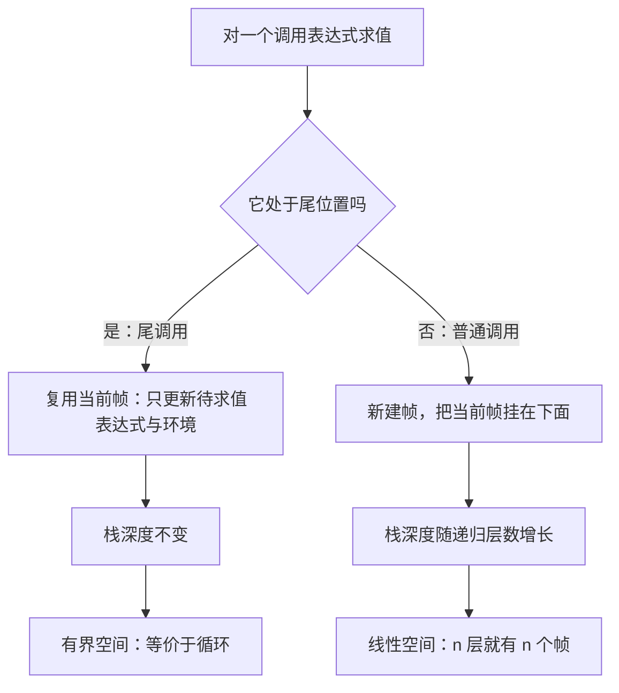
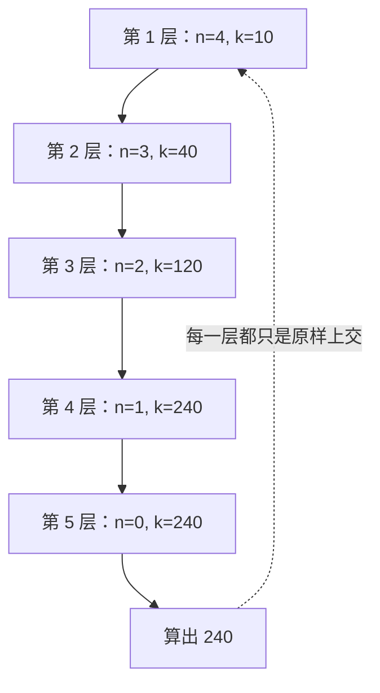
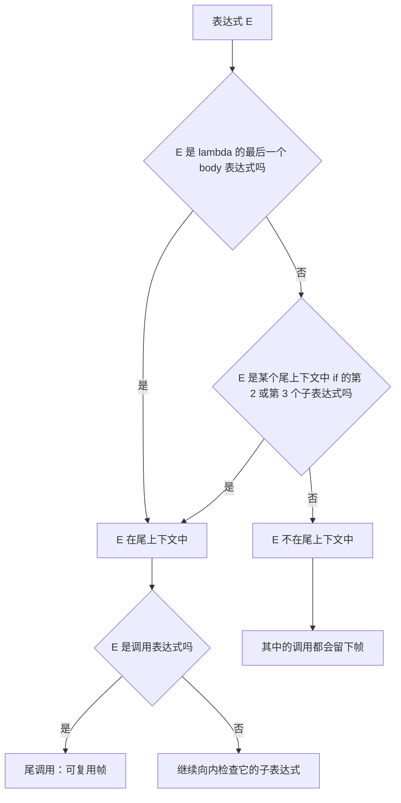
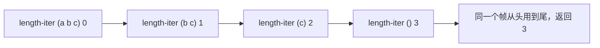
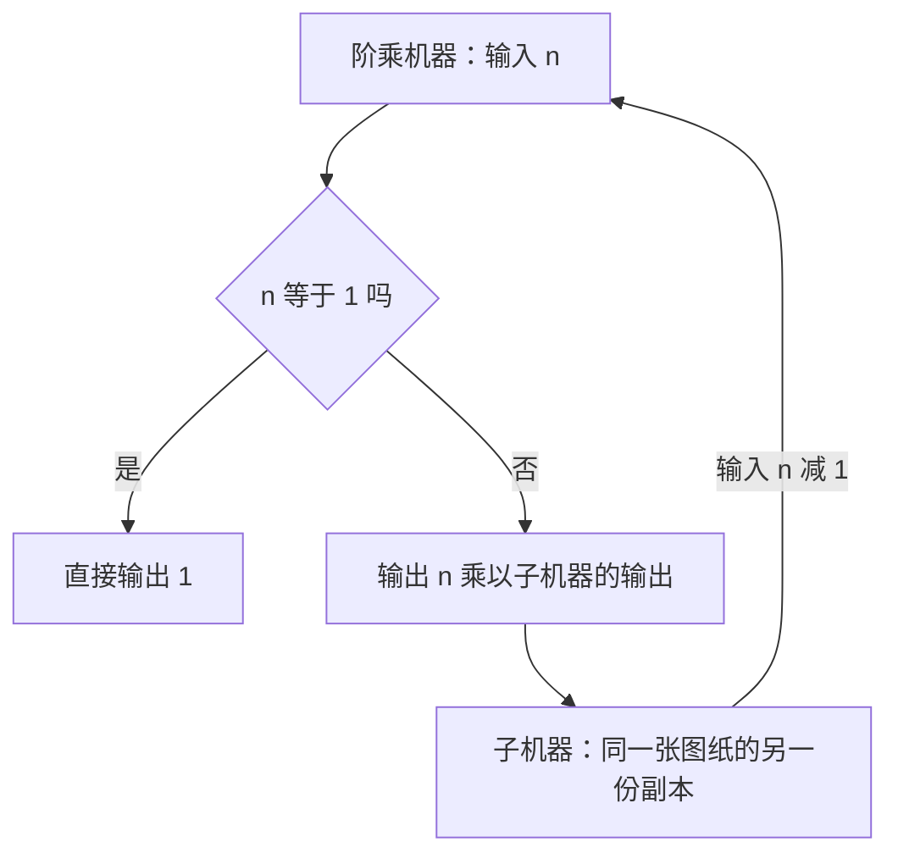
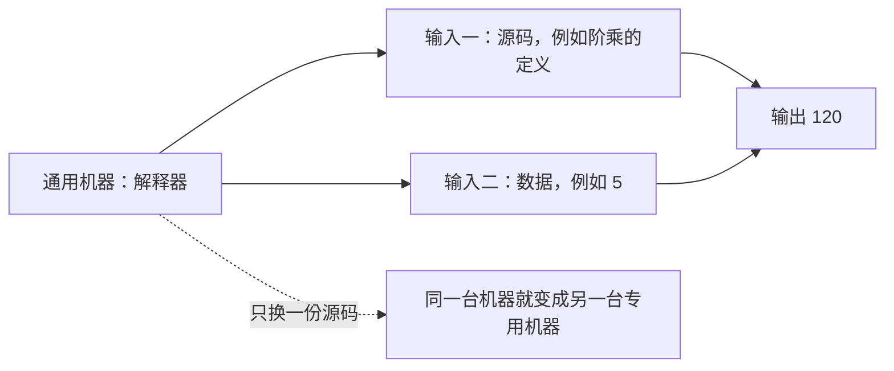

> **课程**：UC Berkeley CS61A · Structure and Interpretation of Computer Programs（Fall 2024）
> **本讲**：Lecture 32 ｜ 32:50 ｜ B 站分 P 30 ｜ [原视频](https://www.bilibili.com/video/BV1sy411z7nA?p=30)
> **课件**：无官方课件（选修讲，`pdf_pages = 0`，共 0 页）；正文用代码块、栈帧图与对照表承接原本属于课件的图示
> **字幕**：B 站英文原声字幕（32:50，351 段）；本笔记是中文书面化重构，非逐句翻译
> **版权**：课程与课件版权归 UC Berkeley CS61A 教学团队；本文为学习用途的二次整理

## 本讲速览

*(参考时间: 00:00:00 – 00:00:17｜Lecture 32)*

- **已掌握**：
    - 环境模型：一次过程调用产生一个帧，帧里记录形参与局部名字的绑定，帧的父环境由定义处决定；
    - Scheme 的基本形式：`define`、`lambda`、`if`、`cond`、`null?`、`car`、`cdr`、`cons`；
    - 线性递归与树递归的形状差别，以及"递归深度乘上每层帧"这条粗略的空间直觉；
    - 解释器的两层结构：求值表达式的一层，把过程作用到实参上的一层。
- **本讲主线**：
    - 纯函数式语言禁掉重绑定，迭代就只能写成递归；朴素递归为每层调用留一个帧，`n` 层递归就是 `n` 个同时活着的帧；
    - 若调用者要返回的**就是**被调用者返回的那个值，调用者的帧在调用发出之后不再携带任何信息，可以被复用；
    - 处于尾位置（tail context）的调用表达式称为尾调用（tail call）；Scheme 规范强制要求实现支持任意多个尾调用而只占常数空间；
    - "尾位置"是一条可以机械判定的语法规则，只沿少数几个上下文向内传递；
    - 把递归改写成尾递归的标准手柄是**累积参数（accumulating parameter）**；`map` 需要先用 `map-reverse` 反着建表，再用尾递归的 `reverse` 正过来。
- **关键结论**：尾调用优化买到的是空间，不是时间。它把"迭代"从语法概念（`while` 语句）变成语义概念（在常数空间里反复进入同一个过程），于是函数式语言不必用纯粹性去换性能。

## 1. 问题的来处：禁掉重绑定之后，循环靠什么

*(参考时间: 00:00:17 – 00:02:37｜Lecture 32)*

函数式编程（functional programming）是个很宽泛的词，本讲只取它最窄的一组性质：所有函数都是纯函数（pure function），不产生副作用（side effect）；没有可变数据类型（mutable data type）；创建出来的东西就一直在那里，不会被就地改动；建立起来的名字—值绑定（name-value binding）同样是永久的。

这组性质不是道德要求，而是一笔交易。讲师列出的第一项好处是：一个表达式的值，与它的子表达式**按什么顺序**求值无关。既然顺序无关，就可以任选一种顺序（Python 就固定挑了一种），可以在有多个处理单元时把子表达式并行求值，也可以一直拖着不算，等到真正需要这个值的时候再动手。

这些好处都来自引用透明性（referential transparency）：把一个子表达式替换成它的值，整个表达式的值不变。这条性质顺带解决了一件在命令式语言里很棘手的事——记忆化（memoization）。记住某个子表达式算过的结果、下次直接取用，永远不必担心"读缓存"这件事本身会改变程序行为。

讲师在这里插了一句带推销口吻的话：这些性质在当下格外值钱，因为机器的处理单元越来越多，"能不能把工作自动并行化"从一个学术问题变成了工程问题。而正是这些性质让并行化不必逐个函数做证明。

于是问题就来了。没有 `for` 也没有 `while`，又不允许把名字重新绑定到新值，基本的迭代过程（iterative procedure）还能高效吗？还是说只能靠递归，而递归很慢，这类语言注定快不起来？

讲师的答案是明确的一个"可以"：通过尾递归（tail recursion），一个函数式语言可以和不函数式的语言一样高效。这句话的分量在于它否认了一个默认假设——纯粹性不必用性能来付账。先把收益和价格摆在一起：

| 判据 | 命令式：`while` 循环 | 纯函数式：递归调用 |
|---|---|---|
| 改变状态的手段 | 把名字重新绑定到新值 | 只能把新值作为实参传给下一次调用 |
| 迭代的写法 | `while` / `for` 语句 | 递归调用 |
| 子表达式的求值顺序 | 有副作用时会影响结果 | 不影响结果 |
| 并行求值 | 需人工证明无依赖 | 由引用透明性保证 |
| 记忆化 | 可能改变程序行为 | 安全 |
| 一次迭代的空间开销 | 常数 | 朴素递归下线性（本讲要解决的点） |

表格最后一行是全部问题的所在。命令式语言里"循环"之所以省空间，是因为它复用同一个作用域反复执行同一段语句；函数式语言里"循环"是一次又一次的调用，而每次调用按朴素语义都要新开一个帧。也就是说，纯粹性丢掉的不是"循环的表达能力"，而是"循环的空间开销"。尾调用要还回来的，正是后者。

## 2. 递归与迭代的空间账

*(参考时间: 00:02:39 – 00:04:10｜Lecture 32)*

讲师把账算在一个尽量小的例子上：计算 `k` 乘以 `n` 的阶乘，即 `k` 乘 `n!`。多出来的那个 `k` 不是冗余参数，而是累积器——它把"已经乘过的那些项"随身带着走。递归写法如下：

```python
def factorial(n, k):
    if n == 0:
        return k
    else:
        return factorial(n - 1, k * n)
```

边界条件用的是 `0! = 1`：`n` 归零时直接返回累积器 `k`，此时 `k` 里装的正好是从 `n` 到 1 的全部因子。否则把 `n` 乘进累积器（`k * n`），把 `n` 减一，交给下一次调用。

同一套逻辑的迭代写法：

```python
def factorial(n, k):
    while n > 0:
        n, k = n - 1, k * n
    return k
```

`while` 的条件是 `n > 0`，循环体一次把 `n`、`k` 重新绑定为 `n - 1` 与 `k * n`，退出时返回 `k`。两段代码在时间上只差一个常数因子：递归版是线性时间，但线性时间的递归还要占用**线性空间**；迭代版同样线性时间（循环体要走 `n` 遍），却只占常数空间。

为什么迭代版只占常数空间？因为它需要记住的名字只有三个——`n`、`k`、`factorial`——与 `n` 有多大无关。递归版则每深一层就多一个帧，帧里存着那一层自己的 `n` 与 `k`。

| 判据 | 递归版 | 迭代版 |
|---|---|---|
| 时间 | 线性，`n` 次调用 | 线性，`n` 轮循环 |
| 空间 | 线性，`n` 个帧同时活着 | 常数，三个名字 |
| 状态存在哪里 | 分散在每层帧的局部绑定里 | 集中在 `n`、`k` 两个变量里 |
| 失败模式 | 递归太深就栈溢出 | 只受数值规模限制 |
| 与数学定义的距离 | 几乎逐字对应 | 需要额外想到循环不变式 |
| 需要语言提供什么 | 只要支持函数调用即可 | 必须允许重绑定 |

请注意一个容易被忽略的细节：**这个 Python 递归函数在逻辑上已经处在尾位置了**——`return` 后面直接就是递归调用，拿到它的值之后没有任何运算要做，`n` 与 `k` 都不再被读。可 CPython 仍然为每一层开一个新帧，因为 Python 语言本身不承诺尾调用优化。这正是下一节要跨过的那道缝：**逻辑上的尾调用**与**实现上的帧复用**是两件事。

## 3. Scheme 的承诺：properly tail recursive

*(参考时间: 00:04:13 – 00:05:24｜Lecture 32)*

这道缝在 Scheme 里被规范明文堵上了。讲师引用了 Scheme 规范里的一句话（大意）：

> 实现 Scheme 的系统**必须**是正确尾递归的（properly tail recursive）。这使得一个迭代计算可以在常数空间内执行——即使这个迭代计算是由一个**语法上递归**的过程描述的。

这句话值得逐字拆开。前半句是义务：不是"建议优化"，而是"必须"。后半句是效果：**语法上递归**（syntactically recursive）与**语义上迭代**（iterative computation）可以并存。一个过程可以在源码里调用自己，跑起来却像 `while` 循环，因为它在物理上并不累积帧。

同一段逻辑写成 Scheme：

```scheme
(define (factorial n k)
  (if (= n 0)
      k
      (factorial (- n 1) (* k n))))
```

与 Python 版本逐行对应：`n` 为零时返回累积器 `k`，否则用 `n - 1` 与 `k * n` 递归。区别只在求值规则——这段代码按规范**应当**只占常数空间，而同样形状的 Python 代码要占线性空间。

| 判据 | CPython 里的递归版 | Scheme 里的递归版 |
|---|---|---|
| 语言是否承诺尾调用优化 | 否 | 是，规范强制 |
| `n` 取 1000 时 | 栈溢出 | 正常运行 |
| 空间随 `n` 增长 | 线性 | 常数 |
| 写法与迭代版的关系 | 与 `while` 版不同形 | 与迭代版同形，都是递归 |
| 属于"语法递归"还是"语义迭代" | 两者都是递归 | 语法递归，语义迭代 |

语言凭什么敢做这个承诺？因为在没有可变状态的前提下，一次调用对调用者的全部价值就是"那个返回值"。如果调用者拿到值之后无事可做，它与被调用者之间的边界就不再携带任何信息，整块帧于是可以丢掉。

> **编者说明**：CPython 不做尾调用优化，是语言设计上的取舍，常见解释有两条。其一是可调试性：一旦复用帧，调用栈里就看不到中间层，报错时只剩最深的几个名字。其二是语义耦合：`try` / `finally`、`with` 以及跟踪钩子都假设帧在调用期间一直存活，复用会与它们冲突。这与"技术上做不到"无关——把求值器写成显式循环而不是递归调用，就能拿到同样的效果，第 7 节的演示正是这么做的。

把这条规则画成求值器的决策图：



## 4. 消除中间人：哪些帧可以扔

*(参考时间: 00:05:32 – 00:06:42｜Lecture 32)*

只说"复用帧"太抽象，讲师回到 Python 的环境图里一步步走：调用 `factorial(4, 10)`，每调用一次就多一个帧，`n` 依次绑到 4、3、2、1、0。把每一步的绑定与"这个帧收到子调用的返回值之后还要做什么"列出来，问题就一目了然：

| 帧 | `n` | `k` | 拿到子调用返回值后还要做什么 | 最终上交的值 |
|---|---|---|---|---|
| 第 1 层 | 4 | 10 | 什么都不做，原样上交 | 240 |
| 第 2 层 | 3 | 40 | 什么都不做 | 240 |
| 第 3 层 | 2 | 120 | 什么都不做 | 240 |
| 第 4 层 | 1 | 240 | 什么都不做 | 240 |
| 第 5 层 | 0 | 240 | 直接返回 `k` | 240 |

讲师在这个例子上说的意思很干脆：既然每一层要返回的就是下一层返回的那个值，那就没有任何理由把这一层的 `n` 和 `k` 留着。`240` 从最深的帧一路上交，每一层都只是转手。

中间那些帧并非完全没用。它们**短暂地**有用：用来算出下一次调用的实参，即 `n - 1` 与 `k * n`。但实参一旦算完、调用一旦发出，这些帧就再也不会被读到。于是"要不要留帧"这个问题可以改写成一句判据：**这一层在调用之后还有没有话要说。**

把这件事拆成三步看：

1. 算实参需要帧——这一步在调用**发出之前**就结束了；
2. 收返回值需要帧——这一步只在调用**返回之后**才发生；
3. 尾调用恰好是"第二步为空"的调用，于是帧的寿命可以在第一步结束时终止。



讲师补了一句很关键的坦白：这些帧"一直留着，只是因为 Python 就是这样工作的"（we kept them around anyway because that's how Python works）。留着它们不是因为需要，而是因为默认的求值规则从来没问过"还需不需要"。停顿之后他只说了半句过渡："这次不会这么做"（we'll not do that）——下一节起，求值器开始主动扔掉这些帧。

## 5. 尾调用的定义：尾位置（tail context）

*(参考时间: 00:06:48 – 00:11:01｜Lecture 32)*

先厘清两个术语。一次**尚未返回**的过程调用称为**活跃的（active）**——它总有一天要交出一个值。有些活跃调用是**尾调用（tail call）**：被调用者交出的那个值，就是调用者要交出的值，中间没有任何加工。

讲师把定义拆成三句：一次过程调用如果还没返回，它就是活跃的；有些活跃调用是尾调用；Scheme 解释器应当支持**任意多个**尾调用，并且只使用**常数空间**——办法是跳过那些"其实不需要"的帧。

严格的说法只有一句：**尾调用是处于尾位置（tail context）的调用表达式**。于是全部工作量都落在"什么算尾位置"上。尾位置是一条递归的语法规则，本讲只用其中两条：

- 一个 `lambda` 表达式（包括 `define` 出来的过程，二者等价）的**最后一个 body 子表达式**；
- 如果一个 `if` 表达式本身在尾位置，那么它的**第 2、第 3 个子表达式**（consequent 与 alternative）也在尾位置，第 1 个（条件）不在。

第一条为什么要限定"最后一个"？因为 `lambda` 的 body 可以有多个表达式，只有最后一个决定返回值；前面那些只为副作用而求值（在纯函数式语言里本就罕见），它们的结果会被丢弃，谈不上"尾"。讲师在后文又强调了一遍 `define` 与 `lambda` 的等价：`(define (f x) ...)` 就是 `(define f (lambda (x) ...))` 的语法糖，所以"lambda 的最后一个 body 表达式"这句话，对 `define` 出来的过程同样成立。

拿阶乘逐层判定：

```scheme
(define (factorial n k)
  (if (= n 0)
      k
      (factorial (- n 1) (* k n))))
```

- `define` 的 body 只有一个表达式，就是这个 `if`，所以这个 `if` 在尾位置；
- `if` 在尾位置，于是它的第 2 个子表达式 `k` 与第 3 个子表达式 `(factorial (- n 1) (* k n))` 都在尾位置，条件是 `(= n 0)` 不在；
- 第 3 个子表达式是一个调用表达式，它又在尾位置，因此它是**尾调用**。

这一步的直觉值得单独说：一旦 `(factorial (- n 1) (* k n))` 的值算出来，`factorial` 这一层要做的全部工作就是把它交出去。此时 `n` 与 `k` 已经没有任何用处，它们只用来算出那次调用的实参。所以这个调用"只需要常数空间，不管被调用多少次"。

规范里还列了别的尾位置，讲师只是点名，说明它们对写程序的人有用、但对本讲的原理不重要：

| 上下文 | 哪些子表达式在尾位置 | 理由 |
|---|---|---|
| `lambda` / `define` 的 body | 最后一个表达式 | 它决定返回值 |
| `if` | 第 2、第 3 个 | 条件只决定走哪条路，其值被丢弃 |
| `cond` | 每个子句的最后一个表达式（不含条件） | 条件只需一个布尔值，其值被丢弃 |
| `and` / `or` | 最后一个 | 前面几个的结果可能被短路丢弃 |
| `begin` | 最后一个 | 前面几个只为副作用而求值 |

讲师的话外音：这些细则值得背，因为写 Scheme 程序时**空间开销由它们决定**。有经验的人会把递归调用尽量放进尾位置，放不进去就改写成累积参数的形式——这正是下一节要做的事。为了把判定过程固化下来，可以把它画成一棵判定树：



> **编者说明**：本讲是选修讲，官方没有配套课件，屏幕上代码的逐字原文无法从现有材料核对。正文中的 Scheme 代码依据讲师口述的语义、参数顺序与标识符逐条重写，保证可运行、且每一行都能对应到字幕里的一句话；逻辑与结构以讲述为准。

## 6. 例一：`length` 与累积参数

*(参考时间: 00:11:04 – 00:14:50｜Lecture 32)*

判据的另一半在这里登场：**如果调用者拿到返回值之后还要接着算，这个调用就不是尾调用**。讲师的说法是"more computation is required in the calling procedure"——递归调用算出了值，但如果还要拿这个值去和别的东西组合，尾位置就断了。

最自然的 `length` 如下：

```scheme
(define (length s)
  (if (null? s)
      0
      (+ 1 (length (cdr s)))))
```

照样从外往里判定：body 是 `if`，在尾位置，于是第 2、第 3 个子表达式都在尾位置；第 3 个子表达式是 `(+ 1 (length (cdr s)))`，它是一个**调用表达式**（调用 `+`），所以它是尾调用——讲师特意说"这个加法是尾调用"；但 `(length (cdr s))` 是 `+` 的**参数**，不是 `+` 本身，它不在尾位置。

用一句话记住这个形状：**调用表达式套调用表达式，里面那个一定不在尾位置**。因为外面那个（这里是 `+`）还要用里面那个的值。

为什么这会强制线性空间？`length` 的帧里存着 `s`。等子调用返回之后，这一层还要把 1 加上去，这个动作发生在"调用返回之后"，所以帧必须活到加法算完；而当帧还活着时，它的环境里那个 `s` 也就一直占着。`n` 个元素就有 `n` 个帧同时活着。

改写的方法是引入第二个过程 `length-iter`，多带一个参数 `n` 表示"到目前为止数了多少个"：

```scheme
(define (length-tail s)
  (define (length-iter s n)
    (if (null? s)
        n
        (length-iter (cdr s) (+ n 1))))
  (length-iter s 0))
```

逻辑是：表空时累积器就是答案；否则丢掉首元素，把计数加一，继续。起点是 0，因为一个元素都还没数过。

判定也顺手：`length-iter` 的 body 是 `if`，在尾位置；第 3 个子表达式 `(length-iter (cdr s) (+ n 1))` 是调用表达式且在尾位置，所以是尾调用。于是整个过程只在常数空间里跑。

讲师强调这不是同一个程序的换皮写法——"this is a very different program in terms of its behavior"。行为上的差别就在栈的形状：朴素版从外往里叠帧、再从里往外算；尾递归版从不叠帧，累积器 `n` 就是原来那些帧要记住的全部信息。

| 判据 | 朴素 `length` | `length-tail` |
|---|---|---|
| 递归调用在哪 | `+` 的参数里 | `if` 的第 3 个子表达式 |
| 是否尾调用 | 否 | 是 |
| 是否需要额外参数 | 不需要 | 需要，累积器 `n` |
| 额外空间 | 线性 | 常数（链表本身仍是线性） |
| 返回值从哪来 | 从最内层逐层加一冒上来 | 最内层直接给出，逐层原样上交 |
| 直觉图像 | 叠一摞待办的加法 | 一个计数器从 0 数到 `n` |

最后一句限定不能省：**表本身占的空间没法省**。尾调用省掉的是"为了算长度而额外开的那一摞帧"，不是数据。讲师的说法是：额外用到的空间里"没有一堆帧，只有一个"。



## 7. 演示：`scheme.py` 里的那个开关

*(参考时间: 00:14:52 – 00:18:46｜Lecture 32)*

原理可以压成一句：**尾调用的返回值就是当前这次调用的返回值**，所以中间那些帧可以全部跳过，最内层的返回值能"直接上交"给最初的调用者。讲师认为光讲原理不够，于是跑了一个演示。

演示用的解释器就是课程项目里的 `scheme.py`。文件靠下的加分题部分有一行注释，写着 `uncomment the following line to apply tail call optimization`——取消注释就会启用尾调用优化。默认它是注释掉的，走的是普通的求值路径，一个不为尾调用做任何特殊处理的解释器。

先在没有优化的解释器里定义尾递归的 `factorial`：

```scheme
(define (factorial n k)
  (if (= n 0)
      k
      (factorial (- n 1) (* k n))))
```

这个函数在前面已经判定过：`if` 在尾位置，递归调用在尾位置，是尾调用。但解释器没优化，于是每调用一次就开一个帧，帧一直留到调用返回，空间是线性的。

| 调用 | 未启用尾调用优化 | 启用之后 |
|---|---|---|
| `(factorial 10 1)` | 正常 | 正常 |
| `(factorial 100 1)` | 正常 | 正常 |
| `(factorial 673 1)` | 推进到 673 就到顶，随即放弃 | 正常 |
| `(factorial 1000 1)` | `maximum recursion depth exceeded while calling a Python object` | 正常 |
| `(factorial 10000 1)` | 不可达 | 正常；耗时明显，最终受数字本身大小的限制 |

报错出现在 `1000` 那一次，而且求值器一直撑到"大约 673 的阶乘"才放弃。讲师把原因讲得很直白：调用了太多次，于是占掉太多内存，Python 说"到极限了"。这个"极限"不是 Scheme 的极限，而是宿主 Python 的递归深度——解释器用 Python 的递归来实现 Scheme 的递归，于是 Scheme 的空间开销直接映射成了 Python 调用栈的深度。

> **编者说明**：为什么是 673 而不是 1000 左右，值得补一句解释。每求值一次 Scheme 调用，在宿主 Python 里要压好几层帧（求值表达式、应用过程、再求值 body），因此 CPython 默认约 1000 层的递归上限被提前撞到，能推进到的深度就远小于 1000。这也说明一件事：meta-circular 解释器里"解释对象的复杂度"会继承"解释器宿主语言"的资源限制。

然后换上实现了加分题的版本——按讲师的说法，它"只是用了一个不同的求值函数，一个在不需要的时候不新建帧的求值器"。同样的定义、同样的调用，10、100、1000 全部通过，`10000` 也算出来了。讲师对速度的评价必须原样保留：**"I'm not making anything faster, but I am saving the extra space."** 尾调用优化不加速，它省空间。`10000!` 之所以慢，是因为结果是个几万位的整数，乘法本身就贵。

这个程序最终还是会耗尽空间，但原因变了：不再是帧太多，而是**表示这个数本身**太大（位数太多）。换言之，优化把失败点从"控制流的开销"推到了"数据的开销"——这往往才是问题真正的边界。讲师对这次运行的总结是：用尾递归确实算出了 `10000!`，而且没有用到任何不必要的空间。

> **编者说明**：本讲只讲到"跳过不需要的帧"这一层，没有展开实现手段。真实实现通常走两条路。其一是**帧复用**：求值循环在发现待求值表达式处于尾位置时，不递归调用自己，而是把"待求值表达式"和"当前环境"更新为被调用过程的 body 与其新环境，然后 `continue` 同一个循环——物理上只有一个帧。其二是 **trampoline（蹦床）**：应用过程时不直接进入它的 body，而是返回一个"待办"（闭包或无参 thunk），由最外层的驱动循环反复取出来执行，直到拿到真正的值；这样调用栈的深度始终是常数。CS61A 项目的加分题走的是第一条路——换掉那个会为尾调用新建帧的求值函数。

## 8. 判别练习：四个过程的空间诊断

*(参考时间: 00:18:49 – 00:23:19｜Lecture 32)*

题目是：下面几个过程，哪些是**尾递归的（tail recursive）**？讲师给的定义是——**所有**递归调用都是尾调用，于是整个过程能在常数空间里执行。第一题仍是 `length`，代码与第 6 节相同，答案是**不是**尾递归，求值它需要与表长成正比的空间。

第二题 `contains`：判断元素 `x` 是否在表 `s` 里。

```scheme
(define (contains s x)
  (if (null? s)
      #f
      (if (equal? (car s) x)
          #t
          (contains (cdr s) x))))
```

判定链是这样走的：外层 `if` 是 body 的最后一个表达式，在尾位置；于是它的第 3 个子表达式——那个内层 `if`——也在尾位置；内层 `if` 的第 3 个子表达式 `(contains (cdr s) x)` 也就在尾位置；它又恰好是调用表达式，所以是尾调用。结论：`contains` 是尾递归的。它处理的东西是一张线性大小的表，但**为调用它而额外需要的空间是常数**。

第三题 `has-repeat`：判断表里有没有重复元素，做法是对每个元素问一句"后面的表里还有没有它"，也就是调用 `contains`。

```scheme
(define (has-repeat s)
  (if (null? s)
      #f
      (if (contains (cdr s) (car s))
          #t
          (has-repeat (cdr s)))))
```

结构与 `contains` 完全相同：body 的 `if` 在尾位置，内层 `if` 在尾位置，`(has-repeat (cdr s))` 在尾位置，所以它也是尾递归的，整体常数空间。

这里有个讲师特意指出的细节：`(contains (cdr s) (car s))` 这次调用**不在**尾位置（它是内层 `if` 的条件），按理要有代价；但 `contains` 自己已经是常数空间的，所以这次非尾调用不会拖来一堆帧。这是一个漂亮的组合性质——**只要被调用的过程自己是有界的，调用它的人就不必为它预留额外空间**。

> **编者说明**：`contains` 用 `equal?` 而不是 `=`，是为了对任意值（数字、符号、表）都能比较；`=` 只对数字成立，在 Scheme 里对非数值参数会报错。项目与练习里对通用性要求更高，所以常用 `equal?`。

第四题是求第 `n` 个斐波那契数，用的是两个互相递归的过程：

```scheme
(define (fib n)
  (if (= n 1)
      0
      (fib-iter n 2 1)))

(define (fib-iter n k current)
  (if (= n k)
      current
      (fib-iter n (+ k 1) (+ current (fib (- k 1))))))
```

`fib-iter` 里带了三个参数：目标下标 `n`、当前下标 `k`、以及第 `k` 个斐波那契数 `current`。函数体先看"是不是已经走到要的那一个"，是就直接返回 `current`；否则用 `current` 加上第 `k - 1` 个斐波那契数，作为下一轮的新 `current`，同时把 `k` 加一。

判定结果是**不成立**。`fib-iter` 的递归调用 `(fib-iter n (+ k 1) ...)` 本身确实是尾调用，但它第 3 个实参 `(+ current (fib (- k 1)))` 里含有一次对 `fib` 的递归调用，而这次调用是 `+` 的参数——不在尾位置。于是每一轮都必须先把更小的那个 `fib` 算出来，再把它加进去，帧无法丢弃。

讲师由此给出一条关于**互递归**（mutually recursive）的判据：两个过程要能一起跑在常数空间里，**双方**都必须对彼此做尾调用。这里 `fib` 调用 `fib-iter` 是尾调用（在 `if` 的第 3 个子表达式），但 `fib-iter` 调用 `fib` 不是，链条断在后者，于是整体退回线性空间；断点的实质是那句话——"第 `k - 1` 个斐波那契数一算出来，还得先和 `current` 合并，才能去调 `fib-iter`"。

| 过程 | 递归调用的位置 | 是否全为尾调用 | 额外空间 | 断在哪 |
|---|---|---|---|---|
| `length` | `+` 的参数里 | 否 | 线性 | 第 3 个 body 表达式是 `+` 调用，`length` 在其中作参数 |
| `contains` | 内层 `if` 的第 3 个 | 是 | 常数 | 无 |
| `has-repeat` | 内层 `if` 的第 3 个 | 是 | 常数 | 无；`contains` 调用非尾，但它自己常数空间 |
| `fib` / `fib-iter` | `fib-iter` 的实参里 | 否 | 线性 | `(+ current (fib (- k 1)))` 中 `fib` 是 `+` 的参数 |

这一组题的方法可以固化成一个四步流程：

1. 找到过程的最后一个 body 表达式，它是尾位置的起点；
2. 若它是 `if`，把尾位置传给第 2、第 3 个子表达式，条件不传；
3. 若遇到调用表达式，检查递归调用是**这个**调用本身，还是它的某个实参/加数——只有前者是尾调用；
4. 一旦某次递归调用不在尾位置，这条链就断了，整个过程的空间就是线性的（数据本身另计）。

## 9. `reduce`：空间复杂度变成参数

*(参考时间: 00:23:22 – 00:25:58｜Lecture 32)*

高阶函数会把"空间占用"这件事也变成参数。`reduce` 收三样东西：一个用来组合的过程 `f`、一张要遍历的表 `s`、一个起始值 `start`。

```scheme
(define (reduce f s start)
  (if (null? s)
      start
      (reduce f (cdr s) (f start (car s)))))
```

语义是：把起始值与表的第一个元素用 `f` 组合，把结果当作新的起始值，再与第二个元素组合……直到表空，此时把当前的起始值交出去。

两个例子把两种用法摆在一起：

```scheme
(reduce * '(3 4 5) 2)
; 2 * 3 * 4 * 5 = 120

(reduce (lambda (x y) (cons y x)) '(3 4 5) '(2))
; (5 4 3 2)
```

第一个：起始值依次变化为 `2`、`6`、`24`、`120`。第二个：起始值从单元素表 `(2)` 出发，依次变成 `(3 2)`、`(4 3 2)`、`(5 4 3 2)`——用 `cons` 把元素一个个贴到表头，于是结果顺序正好相反。

判定：body 的 `if` 在尾位置，第 3 个子表达式 `(reduce f (cdr s) (f start (car s)))` 在尾位置，所以对 `reduce` 的**递归调用是尾调用**。但同一个表达式里，`(f start (car s))` 是 `reduce` 的**实参**，不在尾位置。

于是 `reduce` 的空间取决于 `f`：如果 `f` 只占常数空间（例如 `*`、`cons`），整个 `reduce` 就只占常数空间；如果 `f` 自己要占线性空间，`reduce` 就跟着线性。讲师的说法是"希望它只需要常数空间"——这是对调用者的期望，不是 `reduce` 能自己决定的事。

| 判据 | `reduce` 自己的递归 | 传入的 `f` |
|---|---|---|
| 是否尾调用 | 是 | 与 `reduce` 无关的另一次调用 |
| 空间由谁决定 | 由 `f` 决定 | 由 `f` 的定义决定 |
| 结论 | `reduce` 的总空间 = `f` 的空间 | 若 `f` 是常数空间，整体就是常数空间 |

这正是高阶函数的一个常见形态：**被调用者的复杂度里出现了参数**。好消息是 `reduce` 只写一次就能服务所有组合方式；坏消息是"`reduce` 是常数空间"这句话没有无条件成立的可能——它的空间账要连同传进来的过程一起算。

## 10. 例二：把 `map` 写成尾递归

*(参考时间: 00:26:04 – 00:30:42｜Lecture 32)*

`map` 是最自然不过的高阶函数：把过程作用到表里每个元素上，把结果收集成一张新表。最自然的写法是：

```scheme
(define (map f s)
  (if (null? s)
      nil
      (cons (f (car s)) (map f (cdr s)))))
```

它**不是**尾递归的。判定：body 的 `if` 在尾位置，第 3 个子表达式 `(cons ...)` 在尾位置——但 `cons` 是尾上下文里的调用，它的第 2 个实参 `(map f (cdr s))` 不在尾位置。讲师的说法很精确："在 `cons` 里——`cons` 本身在尾上下文——有一个不在尾上下文里的子表达式，它调用了 `map`。"

用真实数据走一遍，`f` 取"用 5 减去它"，输入 `(1 2)`：

- 第一次调用，`s` 是 `(1 2)`，要 `cons` 进去的是 `5 - 1 = 4`，右边是 `map` 作用在 `(2)` 上；
- 第二次调用，`s` 是 `(2)`，要 `cons` 的是 `5 - 2 = 3`，右边是 `map` 作用在 `()` 上；
- 第三次调用，`s` 是 `()`，直接返回 `nil`。

返回时倒着拼：`nil` 先变成 `(3)`，再变成 `(4 3)`。三个帧同时活着，因为每个帧都在等右边那半张表。

尾递归版的思路不直观，讲师自己说"不是你期待的那种写法"：**先把映射的结果反着建出来，最后整体反转**。

```scheme
(define (map-reverse f s m)
  (if (null? s)
      m
      (map-reverse f (cdr s) (cons (f (car s)) m))))

(define (map f s)
  (reverse (map-reverse f s nil)))
```

`map-reverse` 多带一个累积表 `m`，表示"已经处理过的那部分的逆序结果"。表非空时，把 `(f (car s))` cons 到 `m` 的**前面**，带着新的 `m` 去处理剩下的表；表空时 `m` 就是全部结果，只是顺序反了。

| 阶段 | `s` | `m` | 说明 |
|---|---|---|---|
| 入口 | `(1 2)` | `()` | 还没处理任何元素 |
| 第 2 次调用 | `(2)` | `(4)` | `5 - 1 = 4` 贴在表头 |
| 第 3 次调用 | `()` | `(4 3)` | `5 - 2 = 3` 贴在表头 |
| 返回 | — | `(4 3)` | `map-reverse` 的答案 |
| 反转之后 | — | `(3 4)` | `map` 的答案 |

顺序为什么会反？因为**输入是从前往后走，累积表是从后往前建**：先被处理的元素最后才被 cons 到表头，于是它跑到了最前面。讲师把这个因果关系点得很清楚——正因为"从后往前搭、从前往后读"，才必须补一个 `reverse`。

现在的判定分三处：

- `(reverse (map-reverse f s nil))` 里，`reverse` 占据整个 body 的返回值位置，是尾调用；
- `(map-reverse f s nil)` 是 `reverse` 的实参，不在尾位置——但它不是对 `map` 的递归调用，而是对 `map-reverse` 的调用，而 `map-reverse` 自己是尾递归的、只占常数空间；
- 于是只剩一件事要核对：`reverse` 本身必须也是尾递归的。

`reverse` 的尾递归写法：

```scheme
(define (reverse s)
  (reverse-iter s nil))

(define (reverse-iter s r)
  (if (null? s)
      r
      (reverse-iter (cdr s) (cons (car s) r))))
```

`reverse-iter` 的递归调用在 `if` 的第 3 个子表达式，是尾调用。它把 `s` 的第一个元素 cons 到"已反转部分" `r` 的前面，然后前进一个元素。轨迹是 `()`、`(4)`、`(3 4)`，正好是想要的顺序。


讲师对这个例子的评价是"把过程改成尾递归的比较复杂的例子之一"，因为它要两步：先想清楚"边遍历边建表"会自然得到逆序，再想清楚逆序之后还得有一个尾递归的 `reverse` 把顺序掰回来。两步都到位，`map` 才真正是常数空间的——当然，和 `reduce` 一样，`(f (car s))` 也是 `cons` 的实参，`f` 自己的空间同样会记进总账。

## 11. 收束：解释器是一台通用机器

*(参考时间: 00:30:43 – 00:32:37｜Lecture 32)*

讲完尾调用，讲师把镜头拉到最后一层：写解释器这件事本身究竟在造什么？答案是**一台通用的计算机器（general computing machine）**。

先看类比。程序在定义**小机器**：一段程序把"如何把某个输入变成某个输出"的步骤铺开，于是它就指定了某台计算设备的逻辑。阶乘那台机器长得像这样——输入是 1 就输出 1；否则输出"输入乘以子机器的输出"，而子机器的输入是"输入减一"。讲师特意强调：机器图纸里出现的 `factorial`，**只是同一张图纸的又一份副本**。递归在这个隐喻里就是"机器里装着它自己的一个副本"，`5` 进去，`120` 出来。



解释器则是**通用**的那种：它接受任意一份代码，按那份代码去模拟任意一台特定机器。Scheme 解释器一次接收两样东西——`5` 这样的数据，以及"如何计算阶乘"的源码——把两者合起来，输出 `120`。



讲师的说法是：这个正在项目里搭起来的 Scheme 解释器是一台**通用机器（universal machine）**，能完成任何想要的计算，具体算什么取决于它被输入源码**参数化**成什么样。它也常被理解成一座桥：一边是程序语言里被操作的数据对象，另一边是语言本身，解释器把两边接在一起。

但在内部，别忘了它到底是什么——**一组求值规则，一个程序而已**。讲师最后一句是："an interpreter is nothing more than a program." 这句话既是本讲的收尾，也是整个模块的收尾：求值器不是魔法，它和阶乘、和 `map` 一样是可以按帧数清开销的普通代码。也正因为如此，"数帧"这种看似琐碎的技巧才会同时出现在两个地方——语言规范里的一条强制要求，与解释器实现里的一个开关。

## 小结

*(参考时间: 00:32:41 – 00:32:48｜Lecture 32)*

- **尾调用的判据是"调用之后还有没有话要说"**。算实参需要帧，收返回值也需要帧；尾调用恰好是后者为空的调用，于是帧的寿命可以在调用发出时结束。这句话能替代一整页定义。
- **尾位置是一条可以机械走一遍的语法规则**。从 `lambda` 的最后一个 body 表达式出发，沿 `if` 的第 2、3 个子表达式传递；调用表达式套调用表达式时，里面那个必然不在尾位置。
- **累积参数是尾递归化的标准手柄**。`length` 加一个计数、`map` 加一张逆序累积表、`reverse` 加一个已反转表，共同点是把"还没做完的事"从栈上搬进实参里。
- **空间账要分开算**：数据结构本身的开销 + 控制流的开销。尾调用优化只动后者；`map` 依然是线性表，`10000!` 依然是个几万位的整数。
- **高阶函数会把自己的复杂度交给参数**。`reduce` 的递归是尾调用，但总空间取决于传进来的 `f`；判断这类过程时，需要把实参过程的空间一起算进来。
- **优化买的是空间，不是时间**。讲师的原话是"I'm not making anything faster, but I am saving the extra space"；指望尾调用提速会失望，指望它把深度无限的递归变成可行，才是正确用法。
- **解释器只是一个程序**。它没有特权，只是把"数据"和"如何计算"这两样输入放在一起跑的一段代码——所以关于帧的一切推理，对解释器自身同样成立。

## 附：本讲幻灯片索引

本讲是选修专题，官方没有配套课件（`pdf_pages = 0`），因此没有幻灯片页可供索引，正文中也没有任何 `slide_*.png` 引用。这一节是自检附录，不对应录像里的任何时段，故不设时间锚点。原本会印在课件上的内容——尾调用的定义、尾位置的清单、栈帧的对照图、`map` 与 `reverse` 的两段改写——已分别用定义列表、对照表、缩进代码块与 Mermaid 图承接：第 3 节的决策图对应"求值器如何决定是否复用帧"，第 4 节的调用链图对应"`factorial` 的五个帧如何原样上交"，第 5 节的判定树对应"尾位置的语法规则"，第 6、10 节的流程图对应"累积参数如何把状态搬进实参"，第 11 节的两张图对应"阶乘机器与通用机器"的类比。
