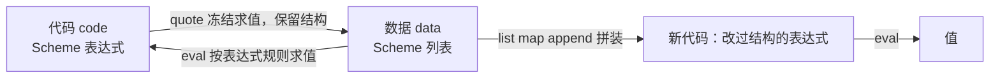
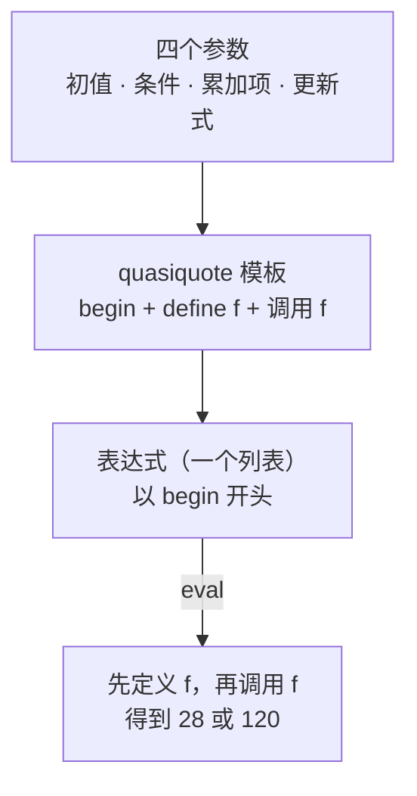

> **课程**：UC Berkeley CS61A · Structure and Interpretation of Computer Programs（Fall 2024）
> **本讲**：Lecture 33 ｜ 18:06 ｜ B 站分 P 31 ｜ [原视频](https://www.bilibili.com/video/BV1sy411z7nA?p=31)
> **课件**：`31-Programs_as_Data_1pp.pdf`（9 页，官方 PDF，逐页渲染图见正文插图）
> **字幕**：B 站英文原声字幕；本笔记是中文书面化重构，非逐句翻译
> **版权**：课程与课件版权归 UC Berkeley CS61A 教学团队；本文为学习用途的二次整理

## 本讲速览

- **已掌握**：Scheme 的表达式求值与特殊形式、用 `list`／`car`／`cdr` 操作链表、用递归代替循环；以及本模块前几讲里"解释器就是一个读表达式、按规则求值的程序"这件事。
- **本讲主线**：
    - Scheme 的程序文本与它的列表数据结构是同一套东西：组合就是列表，列表就是组合。
    - `quote` 把代码冻结成数据，`eval` 把数据当代码执行，两者构成本讲的核心通道。
    - 把递归步从"调用乘法"改成"构造一个乘法组合"，就得到返回表达式而不是返回数字的过程。
    - 准引用（反引号）在模板里留插槽，逗号把插槽用当前环境的值填上，于是能批量生成结构相同、参数不同的程序。
    - 课堂最后写成一个生成器：传入初值、条件、累加项与更新式，它吐出一整段 `begin` 表达式，`eval` 之后直接得到答案。
- **关键结论**：程序即数据的价值不在炫技，而在于把"写程序"这件重复劳动变成程序可以处理的对象；一旦代码是列表，模板、宏、DSL 与代码生成器都只是列表操作。

*(参考时间: 00:00:00 – 00:00:30｜Lecture 33)*


第 2 页是公告页，只有标题，没有与知识内容对应的口述段落。课堂公告本身不属于这一讲的技术内容，这里只作为课件顺序的一部分保留。

## 1. 表达式即列表：程序作为数据的第一层含义

*(参考时间: 00:00:00 – 00:01:11｜Lecture 33)*


Scheme 程序由表达式（expression）组成，而表达式只有两类。第一类是**基本表达式（primitive expressions）**：数 `2`、`3.3`，布尔值 `true`，符号 `+`、`quotient`、`not`——它们写出来就代表自己，或者是需要到环境里查名字的符号。第二类是**组合（combinations）**：把算符与操作数括在一起的形式，例如 `(quotient 10 2)` 与 `(not true)`。

课件标题给出的判断是：**一个 Scheme 表达式就是一个 Scheme 列表**。这句判断对组合成立，对基本表达式也成立——单个原子也是一种平凡的列表结构。以 `(quotient 10 2)` 为例，把它当列表看，它有三个元素：符号 `quotient`、数 `10`、数 `2`。前面讲 Scheme 列表时已经交代过，Scheme 的列表是 cons 对串起来的链表，`car` 取第一段，`cdr` 取剩下的一段；这套结构原本是给数据用的，此刻它同时承担了"程序"的角色。

这并非把两种功能硬拼在一起，而是同一套结构的两种读法：同一个列表，既可以读成"三个东西排成一队"，也可以读成"对 10 和 2 做除法"。读法由谁来定？由**求值**来定。


### 1.1 用 list 造出"一小段程序"

课件用两行交互演示把同构关系钉死。第一行用 `list` 构造列表，`'quotient` 前面的引号阻止求值，留下的符号成为列表的第一个元素；第二行把这个列表交给 `eval`：

```scheme
scm> (list 'quotient 10 2)
(quotient 10 2)
scm> (eval (list 'quotient 10 2))
5
```

第一行打印出 `(quotient 10 2)`，和手写的代码文本一模一样，但它是一个**列表值**：求值 `(list 'quotient 10 2)` 的整个过程中，除法一次都没有发生。讲师的说法是，得到的是"一小段 Scheme 程序"，一个表示"取 10 与 2 的商"的组合。第二行才真正执行：`eval` 接受一个用 Scheme 列表（或基本表达式）表示的表达式，返回它的值，于是得到 `5`。

这里最容易出错的地方是打印形式。列表与代码在屏幕上长得一样，读 REPL 输出时必须分清两行各自的角色：`scm>` 后面是要被求值的表达式，下一行是它的值。`(list 'quotient 10 2)` 的值恰好是一段看起来像代码的列表，它没有副作用，也没有做除法。

### 1.2 为什么这件事值得单独讲一讲

在多数语言里，"程序"与"数据"住在两个互不相通的世界：源码是文本，程序运行时只能处理内存里的值，想生成代码就得拼字符串、再交给解析器。Scheme 把这两个世界合并了——表达式本身就是链表，链表操作就是代码生成操作。这个选择带来一个直接后果：**语言的解析器与语言的列表库，在处理代码这件事上是同一套工具**。

代价也存在：既然代码与数据同形，读代码时就必须靠上下文判断"这一段是在被求值，还是只被当作结构"。`quote` 与下一节的 `eval`，就是用来显式标注方向的两个开关。

## 2. eval：把数据当作代码执行

*(参考时间: 00:01:11 – 00:02:25｜Lecture 33)*

把 1.1 的两行连起来读，就得到本讲的第一条工程结论：**想让程序生成 Scheme 代码，只需要构造列表；想知道生成出来的代码会算出什么，就调用 `eval`。** 前者是数据操作，后者是求值，中间不需要字符串拼接，也不需要额外的解析步骤。

Python 也有一个内置的 `eval`，但它接受的是字符串：把源码文本交给它，它先解析再求值。Scheme 的 `eval` 直接接受列表，因为列表本来就是这门语言里表达式的表示形式——不必先把文本 parse 成数据结构，数据结构就在手边。

这正是 Scheme（以及整个 Lisp 家族）在这一讲反复被称赞的地方：语言自带的列表操作——`list`、`car`、`cdr`、`map`、`append`——全部可以直接用来拼装代码。写 `(list 'quotient 10 2)` 比拼接字符串 `"quotient(10, 2)"` 更不容易出错，因为括号、空格与嵌套层级都由 `list` 负责，不需要手写序列化。

### 2.1 代码与数据的双向通道

本讲后面所有技巧，都可以看成下面两条边上的往返：



向下的一条边是 `quote`：让一段代码停止求值，原样变成数据，于是可以拆开、替换、拼接、存进变量。向上的一条边是 `eval`：把一段数据按 Scheme 的求值规则跑一遍，得到值。剩下的内容只是在演示这两条边能组合出什么：先手工拼代码，再用模板批量拼代码，最后把模板本身也写成过程。

### 2.2 eval 与解释器

> **编者说明**：`eval` 是 Scheme 里少数几个"输入是表达式、输出是值"的通用过程。把它拆开看，就是解释器的全部工作：判断表达式的类型、按类型求值、在环境里查名字、把过程应用到参数；课程要求用 Python 把这套工作写出来，那时会看到 `eval` 并不神秘，它是一组互相调用的小函数。所谓"元循环求值器"（metacircular evaluator），指的是用 Scheme 自己写一个 `eval`，让 Scheme 解释 Scheme，那是 SICP 的经典练习，本讲没有展开。换句话说，解释器本身也只是一个程序：它把程序当作数据读进来，再按规则执行——"解释器就是程序"与"程序即数据"是同一句话的两面。另外，Python 的 `eval` 会在当前作用域里执行任意表达式，工程上通常被视为危险接口；Scheme 的 `eval` 同样强大，区别只在于它拿到的是现成的列表而不是待解析的字符串。

## 3. quote 与半成品表达式

*(参考时间: 00:02:25 – 00:03:47｜Lecture 33)*

先看最普通的情况：写一个表达式，它求值出一个值。

```scheme
scm> (+ 1 2)
3
```

如果把同样的零件"列"出来，结果就不同了：

```scheme
scm> (list '+ 1 2)
(+ 1 2)
```

打印结果与刚才的表达式文本完全相同，但它仍然是列表。区别在 `'+`：`+` 出现在算符位置会被求值成加法过程，`'+` 则被 `quote` 拦住，原样留下符号。讲师强调，这里的引号是在说"我暂时还不想求值这个加号"，先把它当作符号留着；等到有人求值整个组合时，这个符号才会在算符位置上被求值成过程，再应用到 1 和 2 上。

这段话点明了 `quote` 的语义：它不是打印用的装饰，而是**控制求值发生的时间**。被引用的部分冻结，未被引用的部分照常求值。

### 3.1 提前求值的边界

下面的对比把这条规则展示得很清楚：

```scheme
scm> (list '+ 1 (+ 2 3))
(+ 1 5)
```

内层的 `(+ 2 3)` 没有被引用，所以按普通表达式的规则算出 5；外层的加法没有执行，因为整个外层只是 `list` 的三个参数拼成的列表。于是结果里的 5 已经算好，而 1 与 5 相加得到的 6 还没有发生。讲师用"已经算了 5、还没算 6"来描述这个半成品状态。

半成品这个说法值得记住。用 `list` 拼代码时，**哪些子表达式会被提前求值，取决于它出现在引用位置还是普通位置**：想保留结构就加引号，想先算出某个参数就让它裸露在外。这条规则是后面所有代码生成技巧的基础，也暴露出一个麻烦——手工给每个符号加引号太啰嗦，模板一长就没法读。准引用（第 5 节）正是为解决这个麻烦而存在的。

> **编者说明**：第 3、4、6、7、8 节的交互演示与程序文件来自课堂屏幕，课件没有收录；这里按字幕口述的表达式、结构与输出重建，变量名与求值顺序与口述一致，课件若保留同名过程，写法可能略有差异。

## 4. 会返回表达式的过程：fact-exp 与 fib-exp

*(参考时间: 00:03:50 – 00:07:14｜Lecture 33)*

课堂先载入一个小程序，用阶乘做对照。`fact` 是标准的递归定义：

```scheme
(define (fact n)
  (if (= n 0)
      1
      (* n (fact (- n 1)))))
```

`(fact 3)` 得 6，`(fact 5)` 得 120。这个过程返回一个数。

### 4.1 从 fact 到 fact-exp

接着写一个变体 `fact-exp`。它的目标不是算出 n 的阶乘，而是**返回一个能算出 n 的阶乘的表达式**。基线仍然是 1——1 本身就是一个完全合法的表达式，用来表示数字 1。递归步则要用 `list` 拼出一个组合：算符是乘号，第一个操作数是当前的 n，第二个操作数是"算剩下部分"的表达式。

```scheme
(define (fact-exp n)
  (if (= n 0)
      1
      (list '* n (fact-exp (- n 1)))))
```

`(fact-exp 5)` 返回：

```scheme
(* 5 (* 4 (* 3 (* 2 (* 1 1)))))
```

这串东西把 5! 的计算过程整个摊开了：最外层是 5 乘以"4 的阶乘表达式"，往里一层是 4 乘以"3 的阶乘表达式"，一直到 `(* 1 1)`。它仍然是一段可以求值的代码，`(eval (fact-exp 5))` 得 120；作为数据，它让读者看见了 5 是怎么一路乘到 1 的——也就是 1×2×3×4×5 这个乘积。

两个过程的形状几乎一样，差别只在递归步是"调用乘法"还是"构造一个乘法组合"：

| 判据 | `fact` | `fact-exp` |
| :--- | :--- | :--- |
| 返回什么 | 一个数 | 一个 Scheme 列表（表达式） |
| 基线 `n = 0` | `1` | `1`（数字本身也是表达式） |
| 递归步 | `(* n (fact (- n 1)))` | `(list '* n (fact-exp (- n 1)))` |
| 乘法何时发生 | 构造过程中立刻发生 | 交给 `eval` 时才发生 |
| 典型用途 | 得到结果 | 生成代码、观察计算过程 |

这张表里最值得记的是"乘法何时发生"一行。它把"求值"从"构造"里剥了出来：返回数字的过程在构造过程中就把乘法做掉了，返回表达式的过程只负责搭结构，把乘法留给未来的 `eval`。**延迟求值**（delayed evaluation）这个想法，在这里第一次露出形状。

### 4.2 从 fib 到 fib-exp

同样的改造可以套在斐波那契上。原来的 `fib` 用树递归：`n` 小于等于 1 时返回 `n`，否则返回前两项之和。

```scheme
(define (fib n)
  (if (<= n 1)
      n
      (+ (fib (- n 2)) (fib (- n 1)))))
```

`(fib 2)` 得 1，`(fib 6)` 得 8。它是树递归：算 `fib 6` 要展开成一棵调用树，左枝算 `fib 4`，右枝算 `fib 5`。把同样的结构改成返回表达式，就得到 `fib-exp`：

```scheme
(define (fib-exp n)
  (if (<= n 1)
      n
      (list '+ (fib-exp (- n 2)) (fib-exp (- n 1)))))
```

`(fib-exp 6)` 返回的顶层表达式是"把 `fib 4` 的表达式与 `fib 5` 的表达式加起来"；再往里展开，`fib 4` 又是"`fib 2` 加 `fib 3`"……一路到底，得到的是一棵只由 `+`、`0`、`1` 组成的加法树。求值这棵树，就得到 8。

这棵表达式树与 `fib` 的调用树同构，只是节点换了一种身份：一个是"还没算的调用"，一个是"已经写好的表达式"。讲师用一句话把两者的区别收束起来——`fib-exp` 是"给我一个表达式"的过程，`fib` 是"给我一个数"的过程。

```text
(fib-exp 6)  ⇒  (+ (fib-exp 4) (fib-exp 5))
展开到底     ⇒  一棵只由 +、0、1 组成的加法树
eval 之后    ⇒  8
```

这正是"程序即数据"的第二层含义：**过程的返回值可以是一段程序，而不只是一个结果**。返回结果的过程把计算藏起来，返回表达式的过程把计算摊开；后者可以被检查、被改写、被保存，再在需要的时候求值。

### 4.3 课件上的两道讨论题

课件在 `(Demo)` 之后插入了两页讨论题。课堂录像没有展开它们——讲师演示完阶乘与斐波那契的表达式版本，就直接转去讲"为什么人们愿意用 Lisp"了。这两页属于课件配套的讨论与练习材料，题目本身却是"程序即数据"的直接应用，所以按课件顺序保留在这里，并给出思路说明。


第一题的动机很实际：机器生成的代码常常带着多余的嵌套结构，比如 `(* 1 2 (* 3 (* 4)) ...)`。能不能写一个程序，在**不求值**的前提下把嵌套的乘法摊平，得到一个等价但更短、更好读的表达式？题目给的样例：

```scheme
scm> (* 1 2 (* 3 (* 4)) (+ 5 (* 6 (* 7 8))))
8184
scm> (flatten-nested-* '(* 1 2 (* 3 (* 4)) (+ 5 (* 6 (* 7 8)))))
(* 1 2 3 4 (+ 5 (* 6 7 8)))
scm> (* 1 2 3 4 (+ 5 (* 6 7 8)))
8184
scm> (eval (flatten-nested-* '(* 1 2 (* 3 (* 4)) (+ 5 (* 6 (* 7 8))))))
8184
```

注意 `(+ 5 ...)` 的内部不动：它不是乘法调用，题目只要求消掉嵌套的 `*`。答案的骨架是两个过程：`is-*-call` 判断一个表达式是不是以 `*` 开头的乘法调用；`flatten-nested-*` 先用 `map` 递归处理每个子表达式，再判断当前这层是不是乘法调用。

```scheme
(define (is-*-call expr)
  (and (list? expr) (equal? '* (car expr))))   ; E.g., (* 3 4)

(define (flatten-nested-* expr) ; Return an equivalent expression with no nested calls to *
  (if (not (list? expr))
      expr
      (let ((expr (map flatten-nested-* expr))) ; Now expr is (* 1 2 (* 3 4) (+ 5 (* 6 7 8)))
        (if (is-*-call expr)
            (apply append
                   (map (lambda (e)
                          (if (is-*-call e)
                              (cdr e)
                              (list e)))
                        expr))
            expr))))
```

关键在 `apply append` 那一行。`map` 把每个子元素变成"一个列表片段"：符号 `*` 不是乘法调用，被包成 `(*)`；`1` 变成 `(1)`；`(* 3 4)` 本身是乘法调用，取 `cdr` 得到 `(3 4)`；`(+ 5 (* 6 7 8))` 不是乘法调用，被包成 `((+ 5 (* 6 7 8)))`。这些片段再被 `append` 连成一串，`(*)` 里的那个 `*` 正好成为结果列表的算符，于是得到 `(* 1 2 3 4 (+ 5 (* 6 7 8)))`。

`let` 那一行只是给中间结果一个名字，避免把 `(map flatten-nested-* expr)` 写许多遍；`map` 对符号 `*` 也调用 `flatten-nested-*`，而 `*` 不是列表，直接返回自身。


第二题要求写 `print-evals`：它接受一个只含数字、`+`、`*`、`>`、`if` 与括号的表达式，把求值过程中被求值的每个子表达式及其值按**求值完成的顺序**打印出来。样例是：

```scheme
scm> (define expr '(* 2 (if (> 2 (+ 1 1)) (+ 3 4) (* 5 6))))
expr
scm> (eval expr)
60
scm> (print-evals expr)
* => #[*]
2 => 2
> => #[>]
2 => 2
+ => #[+]
1 => 1
1 => 1
(+ 1 1) => 2
(> 2 (+ 1 1)) => #f
* => #[*]
5 => 5
6 => 6
(* 5 6) => 30
(if (> 2 (+ 1 1)) (+ 3 4) (* 5 6)) => 30
(* 2 (if (> 2 (+ 1 1)) (+ 3 4) (* 5 6))) => 60
```

输出顺序暴露了求值规则：先算子表达式的各个部分，再算组合本身；`if` 只走被选中的那一支——谓词算出 `#f` 之后，打印的是 `(* 5 6)`，而 `(+ 3 4)` 从头到尾没有出现。过程值打印成 `#[*]`、`#[>]`、`#[+]`，这是 Scheme 对内置过程的打印形式。

答案是：

```scheme
(define (print-evals expr)
  (if (list? expr)
      (if (equal? (car expr) 'if)
          (begin
            (print-evals (car (cdr expr)))
            (if (eval (car (cdr expr)))
                (print-evals (car (cdr (cdr expr))))
                (print-evals (car (cdr (cdr (cdr expr)))))))
          (map print-evals expr)))
  (print expr '=> (eval expr)))
```

结构值得细看。`(print expr '=> (eval expr))` 写在 `if` **外面**，是过程体的最后一个表达式，所以它总会执行：无论 `expr` 是原子还是组合，都会在子表达式处理完之后打印自己。里面的 `if` 只负责"往下走"：非列表的原子什么也不做；普通组合用 `map` 把所有子表达式各处理一遍；`if` 表达式则特殊对待——先处理谓词，再求值谓词，然后**只**处理被选中的分支。由于 `if` 只求值一个分支，另一支永远不会被打印，输出的顺序因此精确等于求值完成的顺序。

> **编者说明**：上面两页的代码与输出按课件原文誊写，绿下划线处是课件留空的答案；讲解部分按代码语义补写，课堂录像中没有对应口述。

## 5. 准引用：引号里的插槽

*(参考时间: 00:07:16 – 00:11:22｜Lecture 33)*

讲师先回答了"为什么真的有人用 Lisp 系语言"：代码看起来就是一堆符号和括号，所以写一个生成程序的程序是自然的事。这个回答把前面几节的演示串了起来——`fact-exp` 与 `fib-exp` 已经证明"会返回表达式的过程"存在，接下来要让这种过程写起来不费劲。


在动手写更长的例子之前，需要先补一个语言特性——**准引用（quasiquotation）**。它和已经学过的 `quote` 很像，区别在于准引用表达式里可以**反引用（unquote）**某些部分。


### 5.1 三种记号

```scheme
Quote:       '(a b)   =>   (a b)
Quasiquote:  `(a b)   =>   (a b)
(define b 4)
Quasiquote:  `(a ,(+ b 1))  =>   (a 5)
```

引用的写法有两种：`quote`（或单引号 `'`）与准引用（反引号，键盘左上角那个键）。在很多情况下两者结果一样：`'(a b)` 与 `` `(a b) `` 都得到 `(a b)`。差别出在反引用：准引用表达式内部，逗号 `,` 标出的子表达式会被求值，值直接填进结构里；没有标逗号的部分照旧保持原样。

对比如下：

| 记号 | 名称 | 作用范围 | `b` 为 4 时的结果 |
| :--- | :--- | :--- | :--- |
| 单引号 `'` 或 `quote` | 引用 | 整个表达式冻结 | `'(a ,(+ b 1))` 得 `(a (unquote (+ b 1)))` |
| 反引号或 `quasiquote` | 准引用 | 整体冻结，但逗号处解冻 | `` `(a ,(+ b 1)) `` 得 `(a 5)` |
| 逗号 `,` 或 `unquote` | 反引用 | 只在准引用内部有效 | 单独写 `,(+ b 1)` 是语法错误 |

第三行值得强调：逗号不是独立运算符，它只在准引用的语境里有意义。把 `,` 写在普通表达式里，解释器会报错，因为它期待自己出现在一个模板内部。

### 5.2 嵌套例子与读法

同一个表达式，引用与准引用给出两种结果：

```scheme
scm> '(a ,(+ b 1))
(a (unquote (+ b 1)))
scm> `(a ,(+ b 1))
(a 5)
```

前者的结果是三层嵌套的列表：外层是 `(a ...)`，第二层是 `(unquote (+ b 1))`，第三层是 `(+ b 1)`。因为 `quote` 把整个表达式原样冻结，逗号在这里只是一个普通符号，不触发任何求值。后者的结果是 `(a 5)`：`a` 保持符号，`(+ b 1)` 在当前环境里算出 5 被填了进去。

为什么 `(+ b 1)` 被求值而 `a` 没有？答案就是那个逗号。读法是：**准引用先按照"构造列表"的方式搭出整体结构；遇到逗号标记的子表达式时，把它按 Scheme 的普通求值规则算出一个值，再把这个值放进对应位置**。这套规则用的是已经见过的求值规则，所以它可以依赖当前环境——`b` 是 4，`b + 1` 就是 5；`b` 若换成别的值，结果随之改变。

于是准引用做的事情可以一句话概括：**把"引用"与"求值"混合在同一个模板里**，模板的骨架是数据，插槽里是活代码。

### 5.3 用模板造过程：make-add-lambda

课件给出第一个实用例子：

```scheme
(define (make-add-lambda n) `(lambda (d) (+ d ,n)))
(make-add-lambda 2)  => (lambda (d) (+ d 2))
```

`make-add-lambda` 接受一个数 `n`，返回一个 lambda 表达式，它的参数 `d` 是固定的，加上的数由 `n` 决定。调用 `(make-add-lambda 2)` 得到：

```scheme
(lambda (d) (+ d 2))
```

这是一个列表，元素依次是符号 `lambda`、只含 `d` 的列表 `(d)`、以及 `(+ d 2)`——正是第 1 节所说"组合就是列表"的又一次体现。它同时是一段**代码**：把它交给 `eval`，就得到一个只接受一个参数、返回"参数加 2"的过程。

如果不用准引用，这个模板要写成 `(list 'lambda (list 'd) (list '+ 'd n))`：每个符号都要单独加引号，每个子列表都要单独 `list`，一旦模板有两三层嵌套，写法就迅速变得不可读。准引用把"哪些部分是死的、哪些部分是活的"用两种记号直接标在代码上，模板的结构与生成结果的形状一一对应。这就是它"特别适合生成 Scheme 表达式"的原因。

## 6. 没有 while 的 Scheme：把循环写成递归

*(参考时间: 00:11:23 – 00:13:13｜Lecture 33)*

接下来是一个更长的例子。讲师先说了一句大实话：**Scheme 里没有 while 语句**，但 while 语句确实方便。为了说明"没有循环"到底有多不方便，先看一个具体的计算：求 10 以下所有偶数的平方和，从 2 开始，即 $2^2 + 4^2 + 6^2 + 8^2$。

在 Python 里，这件事有现成的写法：

```python
x, total = 2, 0
while x < 10:
    total = total + x * x
    x = x + 2
```

循环结束时 `total` 是 4 + 16 + 36 + 64 = 120。

在 Scheme 里，没有 while 可用，只能递归。思路是把循环变量变成过程参数：`x` 是当前的 x，`total` 是当前的累加和；仍然满足继续条件就带着更新后的值递归，不满足就返回 `total`。

```scheme
(define (sum-while x total)
  (if (< x 10)
      (sum-while (+ x 2) (+ total (* x x)))
      total))

(sum-while 2 0)
; 120
```

定义完这个过程，还需要用正确的初值调用它：`total` 从 0 开始，`x` 从 2 开始。于是写成两个表达式而不是一个。若想把它们并成一个表达式，就要借助 `begin`：

```scheme
(begin
  (define (sum-while x total)
    (if (< x 10)
        (sum-while (+ x 2) (+ total (* x x)))
        total))
  (sum-while 2 0))
```

`begin` 把多个表达式串成一个，值取最后一个——这正是前面讲特殊形式时交代过的语义，也是第 8 节生成代码时要用到的形状。

讲师对这段代码给了一个诚实的评价：Python 版本更好读。**这段计算本身没有任何递归性**，它只是"一步一步往前走"的迭代；Scheme 之所以写成递归，是因为这门语言只提供了这一种表达重复的方式。理解这一点，才能理解下一节为什么要让程序来写这段代码：重复的不是计算，而是"把 while 翻译成递归"这个机械动作。

## 7. 参数化：把"哪一部分会变"抽出来

*(参考时间: 00:13:15 – 00:14:55｜Lecture 33)*

换一道题，形状完全一样：求"平方小于 50 的数"的和，从 1 开始，即 $1 + 2 + \cdots + 7 = 28$（7 的平方是 49，8 的平方是 64，不再满足条件）。

```python
x, total = 1, 0
while x * x < 50:
    total = total + x
    x = x + 1
```

与上一节相比，Python 版本只动了四个地方：初值、while 条件、累加的东西、x 的更新方式。Scheme 版本对应地也只动这四个地方。问题是：如果这样的题有一堆，每道都要手写一遍"定义递归过程 + 用初值调用"这套模板，工作就变成了抄写。

讲师的提议是：**让 Scheme 来写这段代码**。写一个过程，输入是"初值、条件、往 total 里加什么、x 怎么更新"，输出是一整段可求值的 Scheme 表达式。先想清楚调用方式：

```scheme
(sum-while-expr 1 '(< (* x x) 50) 'x '(+ x 1))
```

四个参数分别是：初值 `1`；继续条件 `(< (* x x) 50)`；累加项 `x`；更新式 `(+ x 1)`。后三个用引号包住，因为它们是**表达式**，要在模板里原样嵌入，而不是现在就求值——若不加引号，`(< (* x x) 50)` 会立刻被求值，而此刻 `x` 还没有值。

这个调用应该生成什么样的代码？按第 6 节的结构，答案是：

```scheme
(begin
  (define (f x total)
    (if (< (* x x) 50)
        (f (+ x 1) (+ total x))
        total))
  (f 0 1))
```

也就是说，模板的骨架固定为"`begin` 里先 `define` 一个递归过程 `f`，再用初值调用 `f`"，变化的部分只有四处：条件、更新式、累加项、初值。模板里还有两处固定不变：条件不成立时返回 `total`，以及调用 `f` 时 `total` 从 0 开始。这正是把"哪一部分会变"抽出来之后剩下的东西。

## 8. 生成代码：模板、插槽与 eval 的闭环

*(参考时间: 00:14:57 – 00:18:04｜Lecture 33)*

### 8.1 模板与四处插槽

把上一节的骨架写成准引用，就得到生成器：

```scheme
(define (sum-while-expr initial-x condition add-to-total update-x)
  `(begin
     (define (f x total)
       (if ,condition
           (f ,update-x (+ total ,add-to-total))
           total))
     (f 0 ,initial-x)))
```

四处逗号对应四个参数：`,condition`、`,update-x`、`,add-to-total`、`,initial-x`。讲师逐处解释了为什么要反引用：如果写成 `condition` 而不加逗号，生成结果里留下的是**符号** `condition`，而不是调用者传进来的那个表达式；`update-x` 与 `add-to-total` 同理；`initial-x` 若不反引用，`(f 0 initial-x)` 就会在求值时去找一个叫 `initial-x` 的变量，而它并不存在。

这个"先写模板、再逐个补逗号"的过程，本身就是一个值得记住的调试方法：生成结果里出现不该出现的符号名，通常意味着模板里漏了一个逗号。

### 8.2 运行生成出来的代码

把这段定义装进文件、载入解释器，然后调用：

```scheme
scm> (define result (sum-while-expr 1 '(< (* x x) 50) 'x '(+ x 1)))
result
```

`(sum-while-expr ...)` 的值是一个列表，打印出来以 `begin` 开头，结构与第 7 节手写的那段代码一致。讲师特意让听众注意：**它现在只是数据**。但数据也是代码，对它求值就得到答案：

```scheme
scm> (eval result)
28
```

结果是 28，即 1 到 7 的和。换一组参数，同一台生成器吐出另一段代码：

```scheme
scm> (eval (sum-while-expr 2 '(< x 10) '(* x x) '(+ x 2)))
120
```

这次的条件是 `(< x 10)`，累加项是 `(* x x)`，更新式是 `(+ x 2)`，初值是 2，于是得到偶数平方和 120——正是第 6 节手写的那道题。

整个过程的闭环可以画成一条流水线：



值得注意的是 `eval` 在这条链上做了两件事：它先执行 `define`，把递归过程 `f` 装进环境；再执行 `(f 0 1)`，真正跑那个循环。讲师的原话大意是：这段代码"确实产生了一段能算出 120 的代码，其中包含定义一个新的递归函数并调用它，而 `eval` 真的定义了这个函数、调用了它，最后拿到了数字"。

本讲最后一句总结是：**能够写出"为其他过程写代码"的过程，是编程语言的一种额外表达力**，也正是 Lisp 与 Scheme 让人兴奋的地方之一。这句话之所以成立，靠的正是前面几节攒下的三件东西：代码就是列表、`quote` 能冻结结构、`eval` 能执行结构。

> **编者说明**：代码生成在工程上并不罕见：编译器把语法树翻译成目标代码、测试框架按数据表批量生成用例、Web 框架把模板编译成函数、Lisp 的宏在编译期展开成代码，本质都是"构造一段程序再交给求值器"。本讲演示的是这套机制的最小版本；宏（macro）会在下一讲展开。

### 8.3 课件留作练习的 fact-expr


课件最后一页把第 4 节的 `fact-exp` 换了一种写法，要求用准引用重写同一个过程，并给出预期输出：

```scheme
scm> (fact-expr 5)
(* 5 (* 4 (* 3 (* 2 (* 1 1)))))
```

模板是：

```scheme
(define (fact-expr n)
  (if (= n 0) 1 `(* ,n ,(fact-expr (- n 1)))))
```

两处逗号分别把当前的 `n` 与递归得到的表达式填进乘法模板。与第 4 节用 `list` 写的版本相比，这段代码把"构造列表"的细节全部藏进了反引号：`(* ,n ,(fact-expr (- n 1)))` 直接写出了结果表达式的形状，读起来几乎和它生成出来的代码一样。基线仍是 `1`，所以展开到底会出现 `(* 1 1)`，与样例输出一致。

> **编者说明**：这一页在课堂录像中没有被讲解，属于课件留给讨论课或课后完成的练习；代码按课件给出的填空答案誊写，说明文字为编者补写。

## 小结

- **代码与数据的同构是本讲的地基**：Scheme 组合就是链表，`car`／`cdr`／`map`／`append` 既能处理数据也能处理程序。判断一段结构是"数据"还是"代码"，只看它是否被送进求值器。
- **`quote` 与 `eval` 是方向相反的两个开关**：前者冻结求值、保留结构，后者按规则执行结构、得到值。所有代码生成技巧都是这两个开关的组合。
- **返回值可以是表达式**：`fact` 与 `fact-exp`、`fib` 与 `fib-exp` 的对照说明，把递归步从"调用"改成"构造"，就把计算延迟到了未来；延迟让中间结果可检查、可改写。
- **准引用把模板与插槽分开写**：反引号标记骨架，逗号标记活代码；模板的结构就是生成结果的结构。模板里漏写逗号，生成结果里就会出现不该出现的符号名——这是最实用的排错线索。
- **没有循环不等于不能重复**：把循环变量变成参数、把"下一轮"变成递归调用，是 Scheme 表达迭代的唯一方式；这件事机械、重复、容易出错，所以适合交给程序去做。
- **元编程的门槛比想象中低**：一个接受四个参数、用准引用吐出 `begin` 表达式的过程，就已经是"写程序的程序"。编译器的代码生成、测试生成、DSL 与宏，都是这条路上的放大版本。

*(参考时间: 00:17:51 – 00:18:04｜Lecture 33)*

## 附：本讲幻灯片索引

*(参考时间: 00:00:00 – 00:18:04｜Lecture 33)*

| 页 | 内容 | 出现位置 |
| :--- | :--- | :--- |
| 1 | 标题页 Programs as Data | 本讲速览 |
| 2 | 公告页 Announcements | 本讲速览 |
| 3 | 分节页：Programs as Data | §1 |
| 4 | 表达式即列表：`list` 构造组合、`eval` 求值，标 `(Demo)` | §1 |
| 5 | 讨论题：摊平嵌套的 `*` 调用 | §4.3 |
| 6 | 讨论题：按求值完成顺序打印子表达式 | §4.3 |
| 7 | 分节页：Quasiquotation | §5 |
| 8 | `quote`／`quasiquote`／`unquote` 与 `make-add-lambda` | §5 |
| 9 | 讨论题：用准引用写 `fact-expr` | §8.3 |
