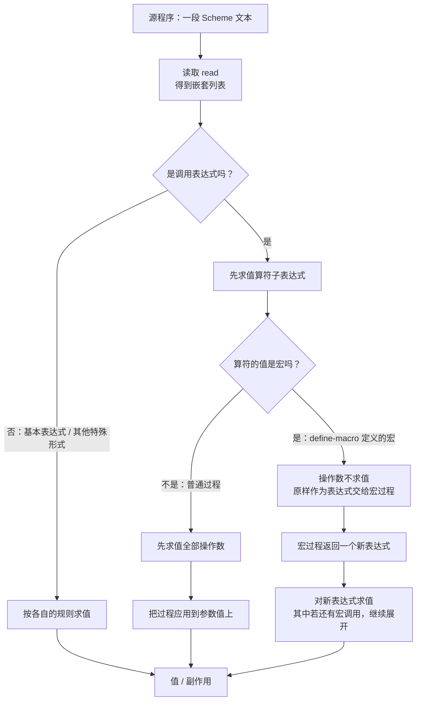
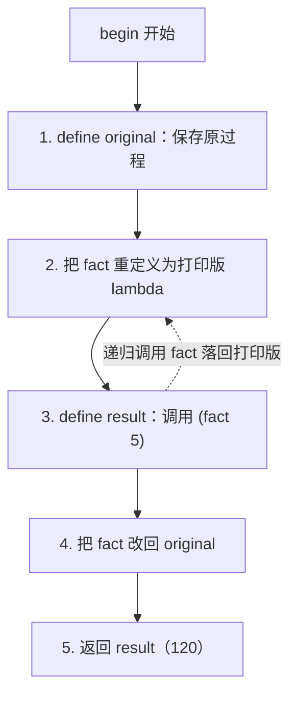

> **课程**：UC Berkeley CS61A · Structure and Interpretation of Computer Programs（Fall 2024）
> **本讲**：Lecture 34 ｜ 28:53 ｜ B 站分 P 32 ｜ [原视频](https://www.bilibili.com/video/BV1sy411z7nA?p=32)
> **课件**：`32-Macros_1pp.pdf`（11 页，官方 PDF，逐页渲染图见正文插图）
> **字幕**：B 站英文原声字幕；本笔记是中文书面化重构，非逐句翻译
> **版权**：课程与课件版权归 UC Berkeley CS61A 教学团队；本文为学习用途的二次整理

## 本讲速览

*(参考时间: 00:00:01 – 00:00:11｜Lecture 34)*

- **已掌握**：Scheme 的前缀表达式与特殊形式、`define`/`lambda`/`if`/`begin`、列表的 `car`/`cdr`/`cons`/`list`，以及上一讲的结论——程序读进来就是一个嵌套列表，代码与数据没有形状上的差别。
- **本讲主线**：
    - 准引用（quasiquote）与反引用（unquote）是"带洞的模板"：骨架原样保留，洞里填入求值的结果，用来生成"以后要被求值的一段代码"。
    - 宏（macro）是对**源码**做的操作：`define-macro` 定义的是"表达式进、表达式出"的变换，而不是"值进、值出"的过程。
    - 宏调用表达式的求值分三步：求算符 → 把**未求值**的操作数交给宏过程 → 求值宏过程返回的表达式。
    - 因为操作数不求值，宏能做到过程做不到的事：把一个表达式在被求值之前复制、包装、甚至丢弃；`twice`、`check`、`for`、`trace` 是四种不同的用法。
    - 代价是宏在源码层面工作：它引入的名字会真正进入程序（卫生性问题），它的错误信息指向展开出来的代码而不是原来的调用。
- **关键结论**：过程控制"值怎么流动"，宏控制"代码怎么生成"。给语言加一种新特殊形式，本质上就是写一个把新语法翻译成旧语法的过程，再让解释器在求值之前调用它。


第 2 页是公告页，录像与字幕里没有与之对应的口述内容，课堂公告也不属于知识内容，这里只作为课件顺序的一部分保留。


## 1. 准引用复习：给代码模板留洞

*(参考时间: 00:00:11 – 00:00:44｜Lecture 34)*


准引用与反引用是上一讲留下的两件工具，本讲要拿它们当主力。单引号（quote）最简单：它把后面的表达式原样当成数据，一个子表达式都不求值。反引号（quasiquote）做的几乎一样——`'(a b)` 与用反引号写出的同名表达式，求值结果都是列表 `(a b)`。唯一的差别是反引号允许在模板里"开洞"：逗号（unquote）标记的子表达式先求值，求出来的值填进洞里。


课件第 4 页用一个两行的小例子把这件事钉住。先把 `b` 绑成 4，再把 `(+ b 1)` 放进洞里：

```scheme
scm> '(a b)
(a b)
scm> (define b 4)
scm> `(a ,(+ b 1))
(a 5)
```

模板产出的是两个元素的列表：符号 `a` 与数 `5`。注意 `b` 在结果里消失了——它不是被"替换"成 4，而是洞里的表达式 `(+ b 1)` 被求值成 5 之后，整个洞被 5 填上。这一区别在宏里会反复出现：洞的位置可以是任何表达式，宏作者要对"这里放进去的是谁的值"负全责。

| 符号 | 名称 | 作用 | 例子 | 求值结果 |
| :--- | :--- | :--- | :--- | :--- |
| `'` | quote 引用 | 完全阻止求值，把表达式当作数据 | `'(a b)` | `(a b)` |
| 反引号 | quasiquote 准引用 | 同样阻止求值，但允许内部用逗号开洞 | 反引号 `(a b)` | `(a b)` |
| `,` | unquote 反引用 | 只在准引用内部生效：这个子表达式要先求值 | 反引号 `(a ,(+ b 1))`，`b` 为 4 | `(a 5)` |

表里第三列与第四列是同一条规则的两种说法：**引用的层数决定求值的深度**。没有洞时两种引用可以互换；一旦有洞，只有反引号能表达"这里要算一下"。讲师在讨论题里反复回到这条性质，它也是后面每一个宏体的骨架。

课件接着给出准引用最典型的用途——生成一段以后要执行的代码：

```scheme
(define (make-add-lambda n)
  `(lambda (d) (+ d ,n)))

scm> (make-add-lambda 2)
(lambda (d) (+ d 2))
```

`make-add-lambda` 返回的是一个**列表**，不是过程；要得到一个真的过程，还得把这个返回值再求值一次（`(eval (make-add-lambda 2))`）。模板里的分工一目了然：`lambda`、`d`、`+` 是骨架，原样进入结果；`n` 是洞，换成调用时给的值。整套宏的写法就是这套分工的放大版：骨架是语法，洞是调用者写的东西。

## 2. 讨论题：用准引用生成平方和表达式

*(参考时间: 00:00:46 – 00:03:27｜Lecture 34)*

讲师把一道填空题放上屏幕，并把规则说得极窄：下面这段程序只差几处准引用与反引用符号，每个空位要么留空，要么填一个反引号或一个逗号；填完之后，第二个表达式应当求值为"a 的平方加 b 的平方"，也就是 Scheme 写法的 `(+ (* a a) (* b b))`。

> **编者说明**：这道题的画面不在官方 11 页课件里（课件第 5 页是另一道 `fact-expr` 填空题），下面的代码骨架按字幕里逐句念出的答案还原，空位与答案的选择则完全依照讲师的顺序说明。

还原后的答案是这样两段：

```scheme
(define (square-expr term)
  `(* ,term ,term))

`(+ ,(square-expr 'a) ,(square-expr 'b))
```

逐句读，可以看清三层嵌套：最外层是反引号（整段是"要生成的一段代码"），中间是逗号（这些位置要先求值），最里面又出现了引用（`a` 与 `b` 是不求值的符号）。讲师的原话正是这个结构：一个完整的准引用表达式里，可以有一个被反引用的子表达式，而那个子表达式内部又可以有一个被引用的表达式。

每一步的空位这样定：

1. `(define (square-expr term) ...)` 之外留空。这一句的任务是定义过程，定义表达式本身要被求值，引用它反而会得到一段数据，过程根本没有被绑定。
2. `(* ...)` 之前填反引号。要返回的是"列表 `(* term term)`"这个数据，而不是真的去做乘法。
3. 两个 `term` 之前填逗号。`term` 是形参，调用方给的是符号 `a` 或 `b`，必须在返回前求值成那个符号，否则生成的代码里会留下形参名 `term`。
4. 外层 `(+ ...)` 之前填反引号。整个结果是一个以 `+` 开头的列表，必须挡住求值。
5. `+` 之前留空。已经处在准引用里了，再引用一次会把 `+` 变成数据里的一层引用形式。
6. 两个 `(square-expr ...)` 之前填逗号。这两个位置要**调用过程**，把生成的子表达式填进来。
7. `a` 与 `b` 之前各填一个引用。这两个符号处在"会被求值"的上下文里（它们在外层逗号的管辖范围内），必须挡住求值。

第 7 步讲师特意说明了一句：这里填单引号还是反引号都可以，因为那段子表达式内部没有逗号，两者的行为完全一致；他在答案里用反引号，只是为了让整段代码看起来整齐。这条"没有洞时两种引用等价"的判断，正是第 1 章那张表的直接应用。

| 空位 | 该填什么 | 理由 |
| :--- | :--- | :--- |
| `define` 整句之外 | 留空 | 这是定义表达式，要被求值；引用它只会造出一段数据 |
| `(* ...)` 之前 | 反引号 | 返回值必须是列表，不能真的做乘法 |
| 两个 `term` 之前 | 逗号 | 形参的值要换进来，否则留下的是形参名 |
| `(+ ...)` 之前 | 反引号 | 整个结果是一段以 `+` 开头的代码 |
| `+` 之前 | 留空 | 已经在准引用里，多引用一层会改变列表头 |
| 两个 `(square-expr ...)` 之前 | 逗号 | 这里要调用过程，不是保留这棵树 |
| `a`、`b` 之前 | 引用（`'` 或反引号） | 它们处在求值上下文里，必须挡住求值 |

把这张表竖着看一遍，会发现"空位"与"功能"是一一对应的：每填一个符号，就等于关掉或打开某一层的求值开关。这就是准引用比 `list` 更好用的地方——`list` 只能一层一层显式地拼，准引用让你"先写出结果的形状，再标出哪几个位置要求值"。

## 3. 写错会怎样：五种错误答案的诊断

*(参考时间: 00:03:28 – 00:05:24｜Lecture 34)*

讲师接着把几种常见的错填一个个跑给课堂看。每一种错填都对应前面某一步，产生的现象也各不相同——这一点比错误信息本身更有教学价值。

| 错填 | 屏幕上看到什么 | 原因 |
| :--- | :--- | :--- |
| `square-expr` 里 `term` 前少了逗号 | `(+ (* term term) (* term term))` | 两次调用都把形参名原样留下，模板里那个洞没有开 |
| `(* ...)` 之外少了反引号 | 报错：符号不是数 | 这段代码真的被求值了，符号被当成操作数拿去乘 |
| 外层 `(+ ...)` 之外多了一层引用 | 列表头不是符号 `+`，而是一个准引用形式 | 多引了一层，`+` 连同反引号一起变成了数据 |
| `(square-expr ...)` 前少了逗号 | 结果里留着 `(square-expr ...)` 这棵子树 | 该调用过程的位置被当成了数据，生成器根本没跑 |
| `a`、`b` 前少了引用 | 报错：未知标识符 `a` | 那个位置在求值的上下文里，符号无处可查 |

第一种错填最容易被忽略，因为它不报错。讲师的说法是：每次调用 `square-expr`，都会把符号 `term` 留在生成的表达式里，于是"两次调用得到的是 `term` 的平方加 `term` 的平方"，而不是 `a` 与 `b` 的平方。程序跑得通，结果是错的——这类错误在宏里比报错更危险。

第二种错填报错时的解释值得抄下来：解释器试图把符号 `a` 与符号 `a` 相乘，于是抱怨第 0 个操作数是符号而不是数。它的意义在于说明**反引号挡住的正是求值**：去掉它，`(* a a)` 就成了一个真的乘法调用。

第三种错填是"过度引用"：外层再引一层，生成的列表里第一个元素不再是符号 `+`，而是一个带准引用记号的复合结构。这个结果既不能当表达式求值（它的头不是可调用的东西），也不是想要的那份数据。第四种与第一种是镜像：一个该开洞没开（留下了形参名），一个该调用没调用（留下了一棵子树）。

第五种错填最常见。它提醒的是上下文的层级：`(square-expr 'a)` 整个处在两个逗号的管辖范围内，所以它的参数位也在求值上下文中；`a` 单独出现在那里时会被当作变量去查环境，而它在全局帧里什么都不是。

五种错误、两次报错、三种"值错了但程序在跑"。讲师逐个演示它们，落点是一句话：**每个引号或逗号控制的都是"这一层要不要算"，错一位，得到的是一段看起来很像代码、但不是想要代码的列表。**

## 4. 宏：给语言增加新的特殊形式

*(参考时间: 00:05:26 – 00:07:09｜Lecture 34)*


讲师从这里开始换话题。他先给出一个划分：每一门语言都有一份"表达式类型"的清单——Scheme 里是 `define`、`lambda`、`if`、`cond`、`and`、`or` 等等；清单之外的组合都按过程调用处理。宏的作用，就是让你**往这份清单里加条目**：发明新的特殊形式。

这件事的分量不在于"多了几个语法糖"。特殊形式决定求值怎么走：`if` 只求一个分支，`define` 不求它的第一个参数，`and`/`or` 可能不把操作数求完。发明一种特殊形式，就是发明一条新的求值规则——讲师用的说法是"改变程序里求值流经过的方式"。他还补了一句评价：这是让人爱上 Lisp 编程的那类特性，"听起来很花哨，确实也很花哨"。

为什么偏偏在 Lisp 系语言里容易做对？理由很朴素：**在 Lisp 里代码就是数据**，程序本身就是列表，而列表是这门语言最核心的数据结构。别的语言也有宏，要"正确定义"它们，语言本身得先让代码与数据长得一样。

课件第 7 页给的定义只有一句：宏是对程序的**源码**做的操作，发生在源码被求值之前。实现的办法也只有一句：描述如何把新特殊形式的各个部分拼成一段普通的 Scheme 代码，然后求值这段代码。把这两句话画成流水线，就是本讲的全局地图：



图中两条分叉的差别只有一处，就是"操作数求不求值"。普通过程走左边：所有操作数先算成值，过程只看得见值。宏走右边：宏过程看到的是调用者写下的表达式本身，于是它可以在这些表达式被求值之前对它们做任何事——复制、拼接、包一层、或者干脆扔掉。

> **编者说明**：图中"求值到宏调用时才展开"这一条对应 61A Scheme 的求值器实现，也是课件"宏调用的求值程序"三条所列的顺序。真正的 Lisp 编译器通常在编译期就把整个程序展开完，展开与求值是两个分离的阶段；两者结果相同，但"什么时候展开"会影响副作用发生的时机。

## 5. twice：第一个宏与宏调用的求值程序

*(参考时间: 00:07:09 – 00:11:51｜Lecture 34)*


第一个例子只有三行，演示也只有两行输出，但它同时展示了宏的两面：

```scheme
(define-macro (twice expr)
  (list 'begin expr expr))

scm> (twice (print 2))
2
2
```

外形上它与过程定义几乎一样：`define-macro` 后面是名字与形参，接着是函数体。区别在于求值方式——宏体是在 `(print 2)` **被求值之前**执行的。宏体拿到的 `expr` 是表达式 `(print 2)` 本身，于是 `(list 'begin expr expr)` 拼出一个新表达式：

```scheme
(begin (print 2) (print 2))
```

这个新表达式随后被求值，`print` 执行两次。

### 5.1 为什么需要 begin

想把两件事放进一个表达式里，Scheme 的工具是 `begin`：它把若干个表达式按顺序求值，值取最后一个。`(print 2)` 与 `(print 2)` 各自只能做一件事，要用一个表达式表达"做两次"，就得把它们装进 `begin`。`twice` 宏生成的东西正是这个形状，所以它生成的必须是列表 `(begin ... ...)`，而不是简单的拼接。

### 5.2 宏调用表达式的求值程序

课件把宏调用的求值程序写成三条，顺序不能换：

- 求值算符子表达式——它的值应当是一个由 `define-macro` 定义的宏；
- 把这个宏过程应用到**操作数表达式**上，但不先求值它们（课件用斜体强调 "without evaluating them first"）；
- 求值宏过程返回的那个表达式。

第一条与普通调用一致，是为了判断"这次调用该走哪条规则"；第二条是与普通调用的分界线；第三条把控制权交回普通求值器。讲师用一句话概括这三分法的后果：宏拿进来的是表达式、还回去的也是表达式，而过程拿进来的是值、还回去的也是值。

### 5.3 如果没有宏：把 twice 写成过程

为了说明宏到底省掉了什么，讲师当场把同一个函数体写成了过程：

```scheme
(define (twice expr)
  (list 'begin expr expr))
```

它不再好用。原因在参数求值那一关：`(twice (print 2))` 会先把 `(print 2)` 求值，屏幕上出现一个 `2`，而 `print` 的返回值是"什么都没有"——打印这个动作把值用掉了，收不回来。讲师用另一段演示强调这一点：写 `(print 2)` 看得到 `2`，写 `(define x (print 2))` 再看 `x`，`x` 是空的。于是过程版拼出来的 `begin` 里，两个位置放的不是 `(print 2)`，而是它的返回值，什么也不会再打印。

要用过程达到同样效果，调用者得自己补上两步：

```scheme
scm> (twice '(print 2))
(begin (print 2) (print 2))
scm> (eval (twice '(print 2)))
2
2
```

第一行用引号把表达式保护住，第二行用 `eval` 把生成的表达式放到求值器里跑。这正是宏在背后做的事：**引用、变换、求值**，三步都由语言代劳。

| 判据 | 过程 | 宏 |
| :--- | :--- | :--- |
| 收到什么 | 参数的**值** | 操作数的**表达式** |
| 参数何时求值 | 调用前，全部求完 | 不自动求值，时机由宏体决定 |
| 返回什么 | 一个值 | 一个表达式，再由求值器处理 |
| 调用者要写引号吗 | 要写，否则参数先被求值 | 不写，这正是宏的便利 |
| 什么时候执行 | 每次调用执行一次 | 每次出现都先展开、再求值 |
| 能否改变语言 | 不能，只影响值 | 能，等于新增一种特殊形式 |
| 变换结果看得见吗 | —— | 能，把 `define-macro` 改回 `define` 即可 |

### 5.4 一件简单的事，一件深刻的事

讲师把 `twice` 的收获拆成两层。简单的一层：它替调用者做了"先引用、再求值"这套手续，所以 `(twice (print 2))` 能直接写出来，不必写 `(eval (twice '(print 2)))`。

深刻的一层：`twice` 已经不再是过程，而是一种新的特殊形式——它不先求值参数。这意味着**宏的函数体对"什么时候求值、求值几次"有完全的控制权**：`twice` 把同一个表达式求值两次，`for` 把它交给 `map`、对每个元素各求值一次，`trace` 把它推迟到打印层装好之后才求值。同一个表达式，三种时机，全部由宏作者决定。

## 6. check：让失败的断言说出自己

*(参考时间: 00:11:51 – 00:13:29｜Lecture 34)*

第二个例子从一个朴素的需求开始：程序里想加一些自检，判断某个条件成不成立。用过程写很直接：

```scheme
(define (check value)
  (if value 'passed 'failed))

scm> (define x -2)
scm> (check (> x 0))
failed
```

能跑，而且写法合理——给 Scheme 程序加一些就地的小测试，这就是最省事的办法。但它有个缺陷：**它只知道自己失败了，不知道自己为什么失败**。屏幕上一个 `failed`，读者还得回头去数第几个测试。

问题的根源在于信息已经被丢掉了：过程收到的参数是 `#f`，那个曾经写着 `(> x 0)` 的表达式早就求值完、消失了。要说出"是哪条断言失败"，就必须在求值**之前**拿到那个表达式。这正是宏的入口——所以讲师把它改写成一个宏，并且强调：它接收的不是值，是表达式。

```scheme
(define-macro (check expr)
  (list 'if expr ''passed ''failed))
```

宏体在拼一段新代码：`if` 的判断部分是原封不动的 `expr`，两个分支是两个被"双重引用"的符号。为什么是两个引号？因为生成出来的代码还要再被求值一次：`''passed` 展开成引用形式，求值时得到符号 `passed` 本身，而不是去查一个名叫 `passed` 的变量。

> **编者说明**：`check` 的宏体没有出现在课件页上（录像里是现场敲的），这里是按字幕的描述还原的：讲师说宏体构造的是一个以 `if` 开头、带上要判断的表达式、后面跟 `passed` 或 `failed` 的列表，并明确提到用了双重引号（"double quoted"）来让结果求值成引用形式。

到这一步，它和过程版的表现一模一样，只是写起来麻烦了一点。讲师自己也承认：花了这么多力气定义一个宏，它比过程还要复杂稍许，而且还没有做任何新事情。转机在失败分支：既然宏看见了表达式，就可以把它一起打印出来。

## 7. 加强版 check 与拆掉 define-macro

*(参考时间: 00:13:35 – 00:15:53｜Lecture 34)*

把失败分支从"一个符号"换成"一个列表：符号 `failed` 加那个表达式"，宏就开始做过程做不到的事了：

```scheme
(define-macro (check expr)
  (list 'if expr ''passed (list 'quote (list 'failed expr))))

scm> (define x -2)
scm> (check (> x 0))
(failed (> x 0))
```

失败时屏幕上出现的不再是孤零零的 `failed`，而是 `(failed (> x 0))`——失败值与导致失败的那条表达式一起交出来。同一段代码在 `x` 为 2 时只回一个 `passed`，因为通过的情况下没人关心表达式长什么样。

为什么过程做不到？因为"表达式"这个材料只有在求值之前存在。过程拿到的永远是值，值里没有留下一行源码。讲师在上一节把 `twice` 的引号与 `eval` 手动做过一遍，这一节又做了一次更直接的手工剥壳：**把 `define-macro` 换成 `define`**，同一个函数体立刻变回普通过程：

```scheme
(define (check expr)
  (list 'if expr ''passed (list 'quote (list 'failed expr))))

scm> (eval (check '(> x 0)))
(failed (> x 0))
```

从此它只是一个"造表达式的函数"，要真正运行，调用者得自己写引号挡住求值、再写 `eval` 求值结果。展开出来的那段代码是可以逐字读的：

```scheme
(if (> x 0) 'passed '(failed (> x 0)))
```

一条 `if`，判断部分就是调用者写的那条，两个分支分别是要返回的符号和要返回的列表。看得见展开结果这件事本身很有价值：它把"宏"从魔法降级成"一次自动完成的代码生成 + 一次自动完成的求值"。讲师在这一节的收尾给出结论：一个叫 `check` 的新特殊形式就这样从零造出来了——它检查一个表达式是否求值为真，并在为假时告诉你表达式是什么。

## 8. for 宏：把 map 包成新语法

*(参考时间: 00:15:55 – 00:19:04｜Lecture 34)*


第三个例子是"造语法"。讲师的开场只有两句："Scheme 没有 `for` 语句。现在它有了。"这一节的目标是定义一个宏，让一个表达式对序列里的每个值各求值一次：

```scheme
scm> (for x '(2 3 4 5) (* x x))
(4 9 16 25)
```


先看"用已有工具怎么办"。`map` 加上一个 `lambda` 就能得到同样的结果：

```scheme
scm> (map (lambda (x) (* x x)) '(2 3 4 5))
(4 9 16 25)
```

两行输出一模一样。讲师强调：`for` 的存在**不让你做到新事情**，它改变的是陈述方式——不必显式写出 `lambda`，也不必记住 `map` 要两个参数、第一个是过程。宏在这里的收益是可读性，不是能力。

第一版用 `list` 一层层拼：

```scheme
(define-macro (for sym vals expr)
  (list 'map (list 'lambda (list sym) expr) vals))
```

读它的办法是数括号：`map` 是列表头；第二个元素又是一个列表，头是 `lambda`，它的参数表是 `(list sym)`（一个只含占位符的列表），函数体是 `expr`；第三个元素是 `vals`。讲师随后要求用准引用重写，答案几乎是把生成的代码原样抄一遍，只是在三个位置插上逗号：

```scheme
(define-macro (for sym vals expr)
  `(map (lambda (,sym) ,expr) ,vals))
```

两段代码展开出的表达式完全相同。差别在可读性：准引用版里，生成结果的括号数量与嵌套形状**直接写在源码里**；`list` 版要求读者在脑子里把每一层 `list` 翻译成一对括号。这也是讲师要求重写的唯一理由。

真正值得注意的是同一个模板里三个洞的"求值时机"完全不同：

| 洞 | 填进去的是什么 | 展开后由谁处理 | 求值次数 |
| :--- | :--- | :--- | :--- |
| `,sym` | 调用者写的占位符号 `x` | 落在 `lambda` 的参数位，只接受符号，不会求值 | 0 |
| `,expr` | 表达式 `(* x x)` | 落在 `lambda` 的函数体，每个元素求值一次 | 列表长度次 |
| `,vals` | 表达式 `'(2 3 4 5)` | 落在 `map` 的第二个参数，求值一次得到列表 | 1 |

一张表把讲师那句总结说清楚了：宏里可以混着三种成分——**会求值的**、**永远不会被求值、只是一个占位符号的**、以及**对每个元素各求值一次的**。第三种成分是宏带来的新东西：写过程时，"参数在什么时候被求值"根本不是一个可以讨论的问题，现在它成了宏作者的设计选择。

课件最后留了一个问题：为什么不把它定义成"值不需要加引号"的版本？讲师没有在课上展开。

> **编者说明**：答案是"可以，但代价很大"。把模板里 `,vals` 那个洞改成"先引号、再逗号"的写法（展开时等价于 `(list 'quote vals)`），`(for x (2 3 4 5) (* x x))` 就真的能跑了，因为生成的代码里 `(2 3 4 5)` 变成了字面列表。但这样一来，values 只能是"能直接写成列表数据的字面量"：`(for x lst (* x x))`（值来自变量）与 `(for x (list 1 2) (* x x))`（值由表达式算出）都会失效，因为被引住的是那几个符号本身。标准写法要求调用者写引号，正是因为引号在**调用点**就把"这是数据"标清楚了，values 位置于是可以接受任意表达式；而"数据从哪来"与"代码长什么样"这两件事，是宏作者在写模板时一次性决定的。

## 9. Python 的 trace 装饰器：一种"事后包装"

*(参考时间: 00:19:06 – 00:21:04｜Lecture 34)*

第四个例子换了问题：想看一个递归过程执行时每一层调用了什么。这个问题在课程前面用 Python 做过，工具是装饰器（decorator）。

```python
def trace(fn):
    def traced(n):
        print(f'{fn.__name__}({n})')
        return fn(n)
    return traced

@trace
def fact(n):
    if n == 0:
        return 1
    return n * fact(n - 1)
```

`trace` 接收一个函数，造出一个新函数：新函数先打印"谁被调用、参数是什么"，再把它转发给原函数，并把原函数的返回值原样返回。打印那一行里有两个成分：`fn.__name__` 取出函数对象的**固有名字**（intrinsic name），`n` 是它被调用时收到的参数值。

> **编者说明**：字幕只口述了这个装饰器的工作方式（"定义一个同返回值的新版本、打印函数名与参数、再调用原函数"，并提到打印用的是 f-string），课件没有这一页。上面的代码按口述还原，输出格式（`fact(5)` 这样带括号的写法）也是按课程惯例补的，字幕里只说了"打印 fact 和参数"。

装饰之后，`fact(5)` 的输出是这样的：

```python
>>> fact(5)
fact(5)
fact(4)
fact(3)
fact(2)
fact(1)
fact(0)
120
```

六行打印，最后一个 `120` 是返回值。这里有两个容易被忽略的机制。第一，装饰之后名字 `fact` 绑定的**不是**原来的阶乘函数，而是 `trace(fact)` 的返回值——那个包了一层的新函数。第二，正因为如此，函数体里的递归调用 `fact(n - 1)` 查到的也是被包过的版本，追踪才能一层层走下去；如果递归调用的是"原函数"，就只会打印第一层。

这套写法的好处是**分离关注点**：写 `fact` 的人不需要知道追踪这回事，写 `trace` 的人不需要知道阶乘这回事，唯一把它们连起来的是 `@trace` 那一行。

## 10. Scheme 没有装饰器：改名、重定义、还原

*(参考时间: 00:21:05 – 00:22:47｜Lecture 34)*

Scheme 里没有装饰器语法，也没有"给函数对象包一层"的现成写法。讲师先演示了一个不用宏的笨办法：

```scheme
(define (fact n)
  (if (= n 0) 1 (* n (fact (- n 1)))))

(define original fact)

(define (fact n)
  (print (list 'fact n))
  (original n))

scm> (fact 5)
(fact 5)
(fact 4)
(fact 3)
(fact 2)
(fact 1)
(fact 0)
120
```

三步：先把原来的 `fact` 存到另一个名字 `original` 上；再把 `fact` 重定义成一个"先打印、再转给 `original`"的过程；然后调用新的 `fact`。给 `original` 一个名字是必须的，否则重定义之后原过程就再也找不回来了。

输出和 Python 版几乎一样。讲师指出唯一的不同：**分离关注点没了**。在 Python 里，`fact` 的定义里一个字都不提追踪，`trace` 的定义里一个字都不提阶乘。在这里，"被追踪的 fact"是手写的，写它的人必须知道递归要落回 `fact` 这个名字，才能保证 `(fact 5)` 打印之后还有 `(fact 4)`、`(fact 3)`，一路到 `(fact 0)`——这正是第 9 节那个"名字被重新绑定"的机制，只是这次得靠人手安排。

恢复的方式同样直白：`(define fact original)` 把名字换回原过程，再调用就不打印了。讲师把这段来回演示了一遍：追踪之前 `(fact 5)` 只给 120；重定义之后给六行打印加 120；换回 `original` 之后又只给 120。

能不能像 Python 那样，写一次、到处用？顺着这个念头，本讲最后一个宏就出来了。

## 11. 把四步压成一个 begin：trace 宏

*(参考时间: 00:22:50 – 00:25:12｜Lecture 34)*

要做成通用的，第一件事是把"存名字、重定义、调用、还原"四件事**装进一个表达式**。Scheme 的容器是 `begin`：

```scheme
(begin
  (define original fact)
  (define (fact n)
    (print (list 'fact n))
    (original n))
  (define result (fact 5))
  (define fact original)
  result)
```

五条语句，顺序不能乱：第一条保存原过程；第二条装上打印层；第三条把这次调用**结果存下来**（直接写 `(fact 5)` 会把返回值丢掉，因为 `begin` 的值是最后一条语句的值）；第四条把 `fact` 改回原过程，保证之后的调用不受影响；第五条返回存下的结果。讲师的说法是：得先把这个调用的结果接住，再把 `fact` 换回原样，最后把结果作为 `begin` 的值返回。

为什么这件事必须由宏来做？因为整个过程要在 `(fact 5)` 被求值**之前**动手：装上打印层、调用、再拆掉。如果写成一个过程，参数 `(fact 5)` 在进入过程体之前就已经求值完了，打印层根本没机会存在。讲师对此的判断很直接：它里面有一堆 `define` 在改变 `fact` 的工作方式，这写不成一个标准过程——它必须是个宏。



接下来把它写成宏，接受一个"调用表达式"，再按这个表达式拆出需要的东西。第一件要拆的是算符：

```scheme
(define operator (car expr))
```

`expr` 是 `(fact 5)` 这样的列表，`car` 取出的就是符号 `fact`。讲师强调这一步的意义：宏不能写死 `fact`，它要处理的是一堆名字不同的递归过程，所以名字必须从调用表达式里取出来。

## 12. 通用化：operator 与少写的那个引号

*(参考时间: 00:25:13 – 00:28:51｜Lecture 34)*

把 `begin` 里的每一处 `fact` 换成"从调用表达式取出的算符"，得到的就是通用的 `trace` 宏：

```scheme
(define-macro (trace expr)
  (define operator (car expr))
  `(begin
     (define original ,operator)
     (define ,operator (lambda (n)
                         (print (list ',operator n))
                         (original n)))
     (define result ,expr)
     (define ,operator original)
     result))
```

逐句读这个模板，恰好能复现第 11 节手工写的五条语句：

- `(define original ,operator)`：保存原过程。`operator` 是要替换的位置（原来写死的是 `fact`），所以用逗号。
- `(define ,operator (lambda (n) ...))`：重定义。被定义的名字同样是替换位，`define` 的第一个参数必须是符号，所以直接插入 `fact`，不能再引一层。
- `(print (list ',operator n))`：打印"谁被调用了"。注意这里是"引号 + 逗号"的组合——先求值取出符号 `fact`，再把它引住，使它作为**符号**进入生成的代码。
- `(define result ,expr)`：把整条调用表达式插进来，例如 `(fact 5)`。
- `(define ,operator original)` 与 `result`：还原、返回。

以 `(trace (fact 5))` 为例，展开过程可以一层层看清楚：

1. 读入 `(trace (fact 5))`：算符是 `trace`，操作数是表达式 `(fact 5)`。
2. 求值算符，得到宏；于是操作数不求值，直接作为表达式绑定给形参：`expr` 是 `(fact 5)`。
3. 执行宏体第一条：`operator` 是 `(car expr)`，即符号 `fact`。
4. 准引用模板填洞：骨架里的 `begin`、`define`、`original`、`lambda`、`n`、`print`、`list` 原样保留；四处 `operator` 位置填上符号 `fact`（其中打印那一处前面还带着引号），`expr` 位置填入 `(fact 5)`，得到一段新代码。
5. 求值这段新代码：打印六行、算出 120、把 `fact` 还原、返回 120。

展开结果里值得逐字对照的是这一行：

```scheme
(define fact (lambda (n) (print (list 'fact n)) (original n)))
```

它与第 10 节手写的 `(define (fact n) (print (list 'fact n)) (original n))` 是同一样东西，只是把语法糖摊平了。

### 12.1 那个少写的引号

讲师在这里插了一段"先跑一遍错的"的演示。宏写完第一次运行，打印确实发生了，但屏幕上出现的不是 `(fact 5)`，而是 `fact` 这个**过程对象**——把过程的打印形式和一个数放在一起，看起来莫名其妙。

病灶在 `(print (list ',operator n))` 里那个 `'`。如果写成 `(list ,operator n)`，展开结果是 `(list fact 5)`：位置上的 `fact` 是一个会被求值的符号，求值得到的是过程，于是打印出过程对象。加上引号之后，展开结果变成 `(list 'fact 5)`，位置上的 `fact` 被引住，打印出来就是符号本身，配合 `5` 得到 `(fact 5)`。

讲师的说法正好这一层意思：要打印的是 `fact` 这个**符号**，而不是 `fact` 这个**过程对象**；办法就是把那个符号引住，而它在宏里的一般形式就叫 `operator`。这也是准引用讨论里那句"没有洞时两种引用等价"的反面用法：在这个位置上，引号是**必须**的，否则洞里的东西会在生成代码里继续被求值。

改好之后，行为就完全对上需求了：`(fact 5)` 只给 120；`(trace (fact 5))` 给出六行打印加 120；之后再 `(fact 5)`，一切恢复安静。宏里没有出现 `fact` 这个词——它假设 `expr` 是"任意一个可能递归、且只接收一个参数的调用表达式"。只能收一个参数，是因为生成的 `lambda (n)` 只写了一个形参；讲师提了一句，可以写更一般的版本，那是留给读者的练习。

### 12.2 比 Python 版更好的一点

讲师最后把 Scheme 版与 Python 版放在一起比较，结论是前者更强。差别在于**追踪的对象**：Python 的装饰器决定的是"这个函数从此以后是否被追踪"，答案在 `def` 那一刻就固定了；Scheme 的 `trace` 宏决定的是"这一次调用是否被追踪"，同一段程序里可以这一次追踪、下一次不追踪，还可以追踪完自动恢复。

```scheme
scm> (fact 5)
120
scm> (trace (fact 5))
(fact 5)
(fact 4)
(fact 3)
(fact 2)
(fact 1)
(fact 0)
120
scm> (fact 5)
120
```

这也是分离关注点的另一种实现：宏不知道 `fact` 存在，它只知道"给这条调用表达式套一层打印"。第 9 节 Python 版靠语法（`@`）把两件事接起来，这里靠"宏在调用点展开"把两件事接起来，而且接完就拆掉。

| 判据 | Python 装饰器 | Scheme 的 trace 宏 |
| :--- | :--- | :--- |
| 作用对象 | 函数对象 | 一条调用表达式的源码 |
| 生效范围 | 整个函数，永久 | 这一次调用 |
| 何时决定 | `def` 时（写代码时） | 每次调用时 |
| 能否中途切换 | 不能，除非重写函数 | 能，随时可以切回未追踪 |
| 引入的新名字 | 局部函数 `traced`，不外泄 | 全局 `original`、`result`，会留在全局帧 |
| 出错时指向哪里 | 原函数体 | 展开后的代码 |

### 12.3 代价：宏在源码层面工作

> **编者说明**：课堂上没有专门讨论宏的代价，这一小节是编者依据本讲几个例子（尤其是 `trace`）的展开结果整理的。

表格最后两行正是宏的两种代价。第一种来自"宏生成的是真正的代码"：展开后的代码里写着 `(define original ...)`，而 `define` 在全局帧生效——所以每次展开都会在全局环境里留下 `original` 与 `result` 两个名字。如果调用者的程序里本来就有同名的变量，它会被悄悄覆盖；反过来，如果传进来的表达式里恰好用到 `original`，那个符号也会被宏引入的绑定撞上。

> **编者说明**：这类"宏引入的名字与调用者的名字相互干扰"的问题，术语叫卫生性（hygiene）。真正的 Lisp 实现给宏提供 `gensym` 一类的工具：每次展开生成一个绝不会与用户名字冲突的新符号，把 `original` 换成 `original-1`、`original-2` 这样的名字。61A 的 Scheme 没有 `gensym`，所以课上这个 `trace` 宏严格来说是不卫生的——它只是恰好在一个只用到 `fact` 的环境里工作。第 12.2 节那张表里"引入的新名字"一行，说的就是这件事。

第二种代价是错误信息的位置。宏展开出的代码与原代码形状不同（`(define (fact n) ...)` 被摊平成 `(define fact (lambda (n) ...))`，调用被包进五条语句），解释器报错时指向的是展开后的那一份，读者需要自己在心里把它翻译回原来的调用。这就是第 7 节"把 `define-macro` 换回 `define`、亲眼看展开结果"那个技巧的实际用途：它不只是教学演示，也是调试宏的常规手法。

## 小结

*(参考时间: 00:28:18 – 00:28:51｜Lecture 34)*

- **准引用是"带洞的模板"**：骨架原样进入结果，洞里的表达式先求值再填入。判断某个位置的引号与逗号该不该写，只需问一句"这一层要不要算"。
- **宏改变的是求值顺序，不是值的计算**：`define-macro` 定义的变换发生在源码层面——表达式进、表达式出；过程则是值进、值出。所有"宏能做到而过程做不到"的事，根源都在"操作数不求值"这一条。
- **宏调用的求值程序只有三步**：求算符 → 把未求值的操作数交给宏过程 → 求值返回值。第三步意味着展开可以一层层继续发生，所以嵌套的宏调用会在求值过程中逐层化开。
- **同一个模板里的洞，求值时机可以完全不同**：`for` 宏的三个洞分别是"永不求值的占位符号""每个元素求值一次的函数体""只求值一次的列表"，这种分层在过程里无法表达。
- **`list` 拼装与准引用等价，但可读性不同**：准引用让生成代码的形状与生成结果的形状对得上；`list` 版要在心里做一层括号翻译。选准引用的理由是维护成本，不是能力。
- **宏的调试手法是"让它变回过程"**：把 `define-macro` 换成 `define`，展开结果就变成一个可以被打印、被阅读的普通列表；配合 `eval` 手动补上求值，还能验证展开是否正确。
- **宏有卫生性代价**：它引入的名字会真正进入程序，可能覆盖调用者的变量，也可能被调用者的表达式撞上。安全的做法是让展开引入的名字唯一（`gensym`），而 61A 的 Scheme 没有这个工具，只能自己小心。
- **宏的收益是语法**：`for`、`check`、`trace` 都不能让程序算出以前算不出的值，它们让意图写得更直接。判断该不该用宏，问的是"这里缺的是一种语法，还是一个函数"。

## 附录：课堂未展示的幻灯片

*(参考时间: 00:00:01 – 00:28:51｜Lecture 34)*

官方课件共 11 页，其中有三页在录像里没有对应的讲解：第 5 页的 `fact-expr` 讨论题、第 8 页与第 9 页的 `repeat` 讨论题。录像是从"准引用复习"开始的，讲师随后直接进入 `twice` 宏，这三页讨论题没有在课堂上展开。按写作规范，它们统一收在这里，按课件顺序排列；下面的解答均由编者依据课件留白与相邻内容补出，不属于课堂原话。本节的锚点按整讲范围给出，只说明这些页面属于本讲课件，不对应任何讲解时段。


第 5 页要求写一个过程 `fact-expr`：它接收整数 `n`，返回一个嵌套乘法**表达式**，这个表达式求值后得到 `n` 的阶乘。课件给了目标输出 `(fact-expr 5)` 得到 `(* 5 (* 4 (* 3 (* 2 1))))`，并把模板挖了两个空：

```scheme
(define (fact-expr n)
  (if (<= n 1) 1 `(* ,n ,(fact-expr (- n 1)))))
```

两个空分别填 `,n` 与 `,(fact-expr (- n 1))`。第一个洞用逗号，是因为 `n` 是形参，要换成调用时的那个数；第二个洞用逗号，是因为要**递归调用** `fact-expr` 拿到下一层表达式，而不是把 `(fact-expr (- n 1))` 这棵树原样留在结果里。基的情况返回的是数 `1` 而不是表达式，被填进洞里时自然变成 `(* 2 1)` 的第二项——第 3 章那张"值错了但程序在跑"的表，说的正是这类多一层或少一层引用的问题。


第 8 页要求定义 `repeat` 宏：它接收一个数 `n` 与一个表达式 `expr`，把 `expr` 求值 `n` 次，最后返回最后一次的值；课件说明 `(repeat (+ 2 2) (print 3))` 等价于 `(begin (print 3) (print 3) (print 3) (print 3))`。答案是先写一个辅助过程把表达式复制 `n` 份，再由宏在前面补上 `begin`：

```scheme
(define (repeated-expr n expr)
  (if (zero? n) nil (cons expr (repeated-expr (- n 1) expr))))

(define-macro (repeat n expr)
  (cons 'begin (repeated-expr (eval n) expr)))
```

关键在 `(eval n)`。`n` 在这里不是数，而是调用者写的表达式——`(+ 2 2)`。宏体自己也在求值，所以宏体里可以再求值一次：`(eval n)` 把 `(+ 2 2)` 算成 4，`repeated-expr` 才拼得出四个元素的列表。这是宏体内部唯一需要显式 `eval` 的地方——前面 `twice` 与 `check` 的宏体都没有用到它。课件给出的两个演示正好验证这一点：`(repeat (+ 1 2) (print 5))` 打印三次 `5`；`(repeat 3 (+ 2 3))` 的注释写着"被求值三次，只返回最后一次"，结果为 5。


第 9 页要求换一种展开方式：不再把 `expr` 复制 `n` 份，而是生成一个递归过程。`(repeat (+ 2 2) (print 3))` 此时等价于：

```scheme
(begin
  (define (repeater k)
    (if (= k 1) (print 3) (begin (print 3) (repeater (- k 1)))))
  (repeater 4))
```

对应的函数体用准引用写成两个元素的列表，宏再用 `cons` 在前面补 `begin`：

```scheme
(define (repeated-expr n expr)
  `((define (repeater k)
      (if (= k 1) ,expr (begin ,expr (repeater (- k 1)))))
    (repeater ,n)))

(define-macro (repeat n expr)
  (cons 'begin (repeated-expr (eval n) expr)))
```

（课件的留白位置在这一页上不易对齐，上面按"准引用返回两元素列表、`repeat` 补 `begin`"的语义还原；用 `list` 显式拼装得到的表达式相同。）

两种写法的差别不在结果，在**代码体积**。第 8 页的方法让展开结果随 `n` 线性增长：`n` 是 1000 就要生成 1000 份 `expr`；第 9 页的方法无论如何只生成一个 `define` 加一个调用，重复发生在运行时。这也解释了为什么第二种写法必须用 `(eval n)`：`n` 在展开期就要变成数，才能写进 `(repeater ,n)` 里；而 `expr` 只保留一份，交给递归去重复求值。

## 附：本讲幻灯片索引

*(参考时间: 00:00:01 – 00:28:51｜Lecture 34)*

| 页 | 内容 | 出现位置 |
| :--- | :--- | :--- |
| 1 | 标题页 Macros | 本讲速览 |
| 2 | 公告页 Announcements（录像无对应口述） | 本讲速览 |
| 3 | 分节页 Quasiquotation | §1 |
| 4 | 准引用定义、开洞例子与 `make-add-lambda` | §1 |
| 5 | 讨论题 `fact-expr`（课堂未展开） | 附录 |
| 6 | 分节页 Macros | §4 |
| 7 | `define-macro` 定义 `twice`、三条求值规则、`(Demo)` | §5 |
| 8 | 讨论题 `repeat` 与 `repeated-expr` 填空（课堂未展开） | 附录 |
| 9 | 讨论题 `repeat` 的递归写法（课堂未展开） | 附录 |
| 10 | 分节页 For Macro | §8 |
| 11 | `for` 宏的 `list` 版、准引用改写与引号之问 | §8 |
