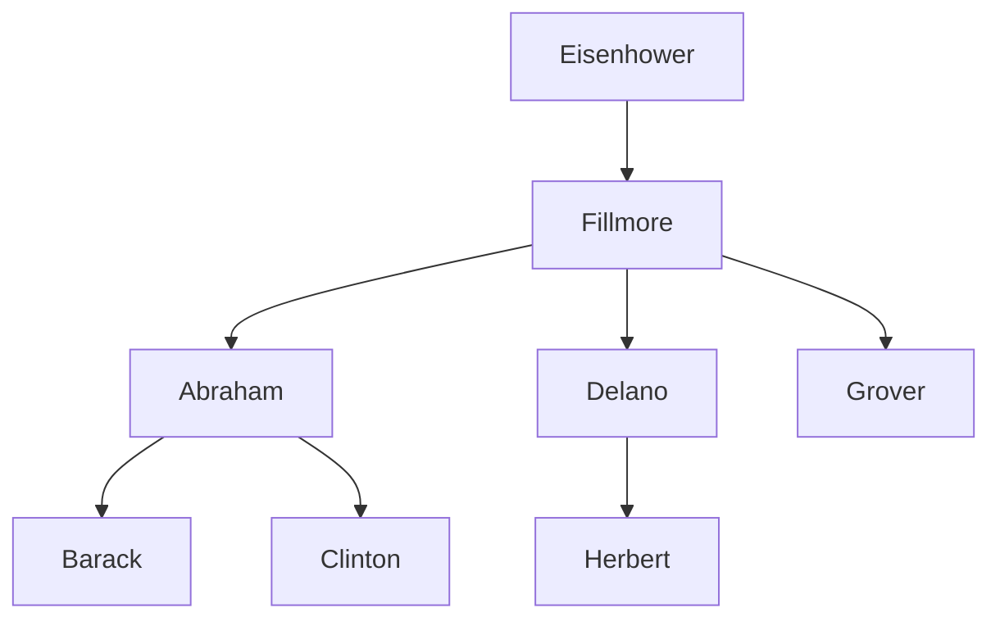
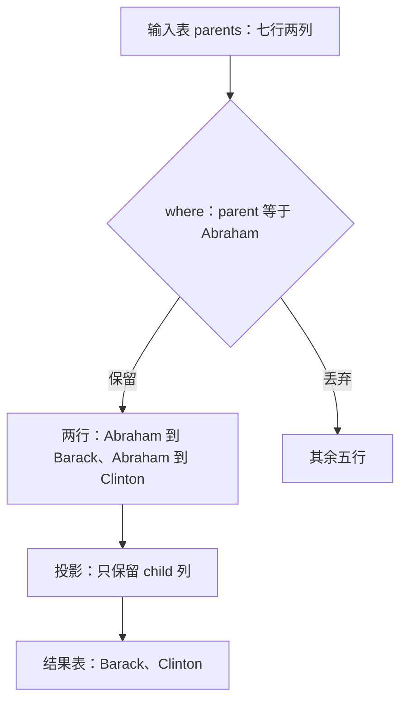

> **课程**：UC Berkeley CS61A · Structure and Interpretation of Computer Programs（Fall 2024）
> **本讲**：Lecture 35 ｜ 25:43 ｜ B 站分 P 33 ｜ [原视频](https://www.bilibili.com/video/BV1sy411z7nA?p=33)
> **课件**：`33-SQL_1pp.pdf`（17 页，官方 PDF，逐页渲染图见正文插图）
> **字幕**：B 站英文原声字幕；本笔记是中文书面化重构，非逐句翻译
> **版权**：课程与课件版权归 UC Berkeley CS61A 教学团队；本文为学习用途的二次整理

## 本讲速览

*(参考时间: 00:00:01 – 00:00:16｜Lecture 35)*

- **已掌握**：Python 里用列表、字典、元组组织数据；树与递归；函数是一等值，程序文本可以被当作数据读入。前面的解释器讲次已经把「读入表达式树、按规则求值」完整走过一遍。
- **本讲主线**：
    - 数据库把数据放在表里：行是记录，列是属性，每一列有名字，通常还有类型。
    - SQL 是声明式语言：程序只描述想要的结果，由数据库管理系统决定怎么算；同一条查询可能有多种执行计划。
    - `select` 从字面量或已有的表生成新表；`union` 把多段查询的行纵向接起来；`create table ... as` 给结果一个可复用的名字。
    - `from` 指定输入表，`where` 过滤行，`order by` 声明顺序，列描述把每个输入行投影成一个输出行。
    - 表达式逐行求值；投影保留重复行，`union` 去重，结果的顺序不作保证。
- **关键结论**：一条查询 = 一张输入表经过过滤、排序、投影后得到的新表。声明式把「怎么做」外包给系统，代价是执行顺序与计划不再由程序员掌握。

## 1. 开场：数据、数据库与一门查询语言

*(参考时间: 00:00:01 – 00:00:24｜Lecture 35)*


数据库把数据放在结构化的表里。这是整讲的起点：在 Python 里，数据是列表、字典、对象；在数据库里，数据是行与列，被一个独立的系统长期保存，供许多程序同时查询。

数据库管理系统（Database Management System，DBMS）是最大、最常被使用、也最值得研究的一类软件。机构愿意为它支付高昂的费用，这个领域同时也有很好的开源实现。它要解决的问题不是「算出一个数」，而是「数据很多、使用者很多、时间很长时，怎样仍然能可靠地取出想要的那一部分」。

课件用一页说明数据为什么值钱：AI 由数据训练出来，数字图像由像素数值组成，而世界上最大的几家公司最看重的资源，是关于用户的数据。数据本身不是答案；能被结构化地存放、被准确地查询，数据才产生价值。表就是最常见的那种结构。

> **编者说明**：课件第 3–7 页是五帧历史标题页，分别标注 Fall 2012/2013、Fall 2015、Fall 2015、Fall 2018、Fall 2023 Featherweight。它们是课程历年沿用的标题素材，不承载本讲知识；此处按页序一并列出，便于与课件对照。


分节页之后，课件把「数据很值钱」展开成三条论据：AI 由数据构成；数字图像由像素数值构成；大公司把关于人的数据当作最值钱的资产。这三条指向同一个结论——数据的价值取决于它能否被组织、被查询，而表是最常见、最通用的组织方式。


## 2. 一张表的解剖：行、列与类型

*(参考时间: 00:00:30 – 00:01:35｜Lecture 35)*

一张表（table）是记录的集合。记录（record）就是表里的行（row），每一行对表中的每一列都有一个值。列（column）有名字，名字说明这一列装的是记录的哪个属性；列通常还带类型，类型决定这一列能放什么、能怎样比较。


课件用一张城市表做例子。三列分别是 Latitude、Longitude、Name，三行是 Berkeley、Cambridge、Minneapolis。表头那一行不是记录，它只是列名：38 是 Berkeley 的纬度，122 是经度，Berkeley 是名字。

| Latitude | Longitude | Name |
| :--- | :--- | :--- |
| 38 | 122 | Berkeley |
| 42 | 71 | Cambridge |
| 45 | 93 | Minneapolis |

行与列的分工可以用一句话记住：**行描述「一个东西」，列描述「所有东西的同一个属性」**。增加一座城市是加一行；增加「人口」是加一列，而且这一列必须对已有的每一行都有值。这个约束看起来死板，正是它让查询变得可预测：任何一行的任何一列都可以被引用。

| 判据 | 行（row / record） | 列（column） |
| :--- | :--- | :--- |
| 表示什么 | 一个完整的对象 | 所有对象共有的一个属性 |
| 增长方式 | 增加记录 | 增加属性，旧行必须补值 |
| 例子 | Berkeley 这一整条记录 | 所有城市的经度 |
| 查询时的作用 | 被过滤、被投影的单位 | 被引用、被比较的单位 |

SQL，全称 Structured Query Language，可能是世界上使用最广的编程语言。它确实是一门编程语言：用它可以由已有的表生成新的表，也可以改动表的内容，增加或删除行。它的特别之处在于「程序」长得像英语句子，读起来几乎就是一句需求。

不妨把一张表想成「键相同的字典组成的列表」：每个字典是一行，键是列名。这个类比只在小表上成立；数据库真正的价值在于它能把几百万行放在磁盘上，还能借助索引跳过其中绝大多数。

## 3. 声明式与命令式：要什么，而不是怎么算

*(参考时间: 00:01:36 – 00:02:49｜Lecture 35)*

SQL 是一门**声明式（declarative）**语言。在声明式语言里，程序是对期望结果的描述，解释器自己想办法生成这个结果；Prolog 是另一个例子。**命令式（imperative）**语言相反：程序描述的是一个计算过程，解释器按写好的执行与求值规则把过程走一遍。

| 判据 | 命令式（imperative） | 声明式（declarative） |
| :--- | :--- | :--- |
| 程序描述的对象 | 计算过程：先做什么、再做什么 | 期望的结果：要什么 |
| 谁决定执行步骤 | 程序员写下的规则，解释器照做 | 解释器或 DBMS 自行选择 |
| 课程中的代表 | Python、Scheme | SQL、Prolog |
| 可预测性 | 求值顺序基本可预期 | 取决于数据与执行计划的选择 |
| 写程序的成本 | 高：步骤要写全 | 低：只写结果 |
| 调试方式 | 顺着求值链找 | 看执行计划、看数据分布 |

这门课大部分时间在训练一件事：写下一行程序时，能在脑子里预演解释器会做什么。声明式语言把这件事变难了。同一条 SQL 查询往往有多种执行方式，数据库管理系统会挑它认为最快的那一种，而「最快」取决于数据有多少、怎么分布。程序员与程序求值之间的关系因此变得不那么确定。

代价换来的是省力：写查询时不必描述执行与求值怎样进行，那交给 DBMS。写程序的工作量下降，理解程序的难度上升——这是一笔明确的交换。


课件用做饭打这个比方。命令式的食谱把每一步写死：加两茶匙盐、两茶匙酵母，加三杯面粉，加两大勺橄榄油，加四分之一杯水，开始搅拌，把面团放到案板上……声明式的点单只有一句：「给我做一个披萨。」面团怎么揉、烤箱多少度、先放芝士还是先放酱，是店里的自由。


SQL Server 的执行计划把这份「自由」画了出来：一条查询被拆成一棵算子树，Hash Match、Index Scan、Compute Scalar 各自带着代价估计与行数估计。同样一条查询换一种计划，快慢可能差很多；选哪一种，取决于表有多大、有没有索引、数据怎么分布。声明式的「一句话」背后，是系统替程序员做的一串决定。

## 4. 第一张表：用 select 与 union 拼出 cities

*(参考时间: 00:02:50 – 00:06:14｜Lecture 35)*

表通常不是凭空造出来的：它由别的应用写入，日志、表单、传感器，一行一行积累起来。SQL 也允许从零建表，本讲先用这个办法造几张很小的表，好让后面的查询有东西可查。造表本身不是主戏；真正有意思的是已经有表之后，怎样算出新的结果。

```sql
create table cities as
  select 38 as latitude, 122 as longitude, "Berkeley" as name union
  select 42, 71, "Cambridge" union
  select 45, 93, "Minneapolis";
```

这段语句做了三件事。`create table cities as` 声明「把后面的查询结果存成 `cities`」；`select 38 as latitude, 122 as longitude, "Berkeley" as name` 描述一行三列；两条 `union` 把另外两行接上。

引号区分了值与名字。`"Berkeley"` 带引号，因为它是值；`latitude` 与 `longitude` 不带引号，因为它们是列名。缺了引号，Berkeley 会被当成一个列名去找，找不到就报错。

> **编者说明**：SQLite 允许用双引号写字符串；标准 SQL 更严格，字符串用单引号，双引号留给标识符。课件统一用双引号，正文照此转写；§11 里带双引号的 `1`、`2`、`4`、`8` 是列名，因为表里确实有这些列。

一段只含字面量的 `select` 生成一行。想要更多行，就用 `union`：它把两段 `select` 的行接在一起，接两次就是三行。这显然不是建表的常规方式，只有在真的一无所有时才会这样写。

有了表，就可以问问题了。下面这条查询给西海岸的城市打上标签，再与其余城市合并：

```sql
select "west coast" as region, name from cities where longitude >= 115
union
select "other", name from cities where longitude < 115;
```

第一段从 `cities` 里取出经度大于等于 115 的行，给它们加上 `region` 列，值是 `west coast`；第二段取出剩下的行，`region` 是 `other`。两段 `union` 起来，得到一张带地区标签的新表。

| region | name |
| :--- | :--- |
| west coast | Berkeley |
| other | Cambridge |
| other | Minneapolis |

结果有三行，而查询里只写了两段 `select`。第二段描述的不是一行，而是所有经度小于 115 的行——它筛出了两座城市。输出的名字来自原表，`region` 的值来自对经度的检查。查询的输出由数据决定，这正是它有用的地方。

顺带一个细节：Cambridge 是马萨诸塞州的 Cambridge，不是英国的 Cambridge；纬度 42、经度 71 说明它在北美。表中的坐标不只是装饰，它们是判断的依据。

## 5. 标准、方言与 SELECT 的中心地位

*(参考时间: 00:06:16 – 00:09:23｜Lecture 35)*


SQL 有标准。它由一套美国与国际都接受的规范定义；唯一不完全接受这套规范的人，是那些真正实现数据库管理系统的人——每家厂商都想让自己的产品多几个别人没有的功能。

于是 SQL 有很多方言：基本语法一致，边缘功能各说各话。本讲只取交集，也就是所有 DBMS 都同意的那一部分。

两条语句撑起整讲。`select` 创建一张新表，可以从零创建，也可以从已有的表投影；`create table` 给一张表一个全局的名字，让它可以被后来的语句引用。`select` 单独使用时，结果只显示、不保存；要反复使用，就必须 `create table ... as`。

| 语句 | 作用 | 本讲的处理 |
| :--- | :--- | :--- |
| `select` | 从字面量或已有表生成一张新表 | 核心，几乎全程 |
| `create table ... as` | 给 `select` 的结果起名并保存 | 展开 |
| `insert` / `update` / `delete` | 改动表的内容 | 不展开 |
| `analyze` / `explain` | 诊断与维护 | 不展开 |

其余语句在工业系统里很重要，但对理解 SQL 的核心不重要。核心在 `select` 里。执行 `select` 的代码一页纸就写得下，用 Python 写一个解释器并不难——下一讲做这件事。当前先学会用这门语言。

> **编者说明**：`insert` / `update` / `delete` 改动表中的行，`explain` 显示执行计划，`analyze` 收集统计信息；这些分工来自通用 SQL，本讲只点名，没有展开。

想动手，有三条路：安装 SQLite，它是最简单、也免费的数据库管理系统；使用在线版的 SQLite；或者用教材附带的 SQL Example Python 程序。最后一个不是完整的 DBMS，它只用来演示如何解释 `select` 的本质，但本讲与下一讲的例子它都能跑。

> **编者说明**：本讲没有演示 Python 的 `sqlite3` 模块，但它的接口足够小，可以直接嵌进下一讲的解释器练习。下面的片段在内存里建一张表并查询，输出两行元组。

```python
import sqlite3

db = sqlite3.connect(":memory:")
db.execute("""create table parents as
  select "Abraham" as parent, "Barack" as child union
  select "Abraham", "Clinton";""")

for row in db.execute('select child from parents where parent = "Abraham"'):
    print(row)
```

运行结果是 `('Barack',)` 与 `('Clinton',)`。`execute` 接受一条 SQL 语句，返回可迭代的游标；`fetchall()` 会把剩余的行一次取完。

## 6. 字面量与 union：一张七行的家谱表

*(参考时间: 00:09:25 – 00:13:00｜Lecture 35)*

`select` 语句的骨架是一串用逗号分隔的列描述。一个列描述是一个表达式，后面可选地跟 `as` 和一个名字；`as` 与名字都可以省略。只选字面量，得到一行；想要多行，就 `union`。

`union` 有三条规则：两边的列数必须相同；对应列的类型必须相容；列名可以不同，最终结果的列名取第一段 `select` 的写法。前两条是硬约束，第三条只是命名习惯。

接下来把主题换成狗。讲师喜欢狗，也喜欢美国总统，于是他的狗按字母顺序取名：Abraham、Barack、Clinton、Delano、Eisenhower、Fillmore、Grover、Herbert。名字从 A 排到 H，不是为了讲历史，而是为了让后面的字符串比较一眼能看懂。

这些狗构成一棵家谱：Eisenhower 是 Fillmore 的父亲，Fillmore 是 Abraham、Delano、Grover 的父亲，Delano 是 Herbert 的父亲，Abraham 是 Barack 与 Clinton 的父亲。用一张两列的表就能表示这棵树：每一行是一条父子边。

```sql
select "Abraham" as parent, "Barack" as child union
select "Abraham", "Clinton" union
select "Delano", "Herbert" union
select "Fillmore", "Abraham" union
select "Fillmore", "Delano" union
select "Fillmore", "Grover" union
select "Eisenhower", "Fillmore";
```

七行两列。第一段的 `as parent`、`as child` 给结果定了列名，后面六段只写值。相邻两段之间用 `union` 连接，最后一段以分号结束——所有 SQL 语句都以分号结束。

| parent | child |
| :--- | :--- |
| Abraham | Barack |
| Abraham | Clinton |
| Delano | Herbert |
| Eisenhower | Fillmore |
| Fillmore | Abraham |
| Fillmore | Delano |
| Fillmore | Grover |

把这张表按父子关系画出来，就是课件右侧手绘的那棵树：



表与树是两种视角：表是扁平的行集合，树是这些行按 parent-child 关系连起来的样子。同一份数据既能当表查，也能当图看——存储格式只有一种，解读方式可以有很多种。

## 7. 给表命名：create table 与一张歌单

*(参考时间: 00:13:01 – 00:14:19｜Lecture 35)*

`select` 的结果默认不保存。它显示在屏幕上，供人看一眼；想在后面的语句里再用，就得给它起名字。

```sql
create table [name] as [select statement];
```

`create table` 把一次查询的结果变成可以积累的数据：结果有了名字，下一句就能引用它。


课件用一张歌单演示。`spotify` 表记录讲师最常听的几首歌，每行一首，两列分别是曲名与歌手：

```sql
create table spotify as
  select "wildflower" as track, "billie eilish" as artist union
  select "birds of a feather" , "billie eilish"          union
  select "360"                , "charli xcx"              union
  select "pasilyo"            , "sunkissed lola"          union
  select "cinderella"         , "remi wolf"               union
  select "good luck babe!"    , "chappell roan"           union
  select "meow"               , "anamanaguchi";
```

| track | artist |
| :--- | :--- |
| wildflower | billie eilish |
| birds of a feather | billie eilish |
| 360 | charli xcx |
| pasilyo | sunkissed lola |
| cinderella | remi wolf |
| good luck babe! | chappell roan |
| meow | anamanaguchi |

缩进与对齐只是给人看的。SQL 对空格不敏感，整条语句写在一行也完全正确；课件把 `union` 与逗号对齐，是为了让「哪一列对哪一列」一眼可见。

`spotify` 在后面会被反复查询：按歌手筛、按字符串比较筛。它同时也是「第一段决定列名」的例子：第一段写了 `as track`、`as artist`，后面六段省略，结果仍然有两列正确的名字。

同样的办法可以把 §6 的七条 `select` 变成一张永久的表：在最前面加 `create table parents as`，末尾保留分号。表建好之后，`parents` 这个名字就可以在 `from` 里使用。

## 8. 投影：from、where、order by 三件套

*(参考时间: 00:14:22 – 00:17:17｜Lecture 35)*


投影（projection）的意思很直接：对输入表的每一行，按列描述算出一个输出行。`select` 的完整骨架是：

```sql
select [columns] from [table] where [condition] order by [order];
```

四个部分各管一件事。`from` 说从哪张表取行；`where` 说哪些行留下；`order by` 说留下的行按什么排；列描述说每个留下的行怎样变成输出行。课件用三句话分别概括前三个子句——`from` 指定输入表，`where` 选出行的子集，`order by` 声明剩余行的顺序——第四句话留给列描述。

课件里的两个查询都很短。第一个：

```sql
select child from parents where parent = "Abraham";
```

先在 `parents` 里找 `parent` 等于 `Abraham` 的行，有两行；再把每行的 `child` 投出来，得到 Barack 与 Clinton。

| child |
| :--- |
| Barack |
| Clinton |

第二个：

```sql
select parent from parents where parent > child;
```

字符串比较按字母序：F 在 A、D 之后，所以 Fillmore 作父亲的三行里，Abraham 与 Delano 两行满足，Grover 那行不满足（G 在 F 之后）；Eisenhower 在 F 之前，它那一行也不满足；其余行同样不满足。结果是 Fillmore 出现两次。

| parent |
| :--- |
| Fillmore |
| Fillmore |

课件在这一页还给了两个针对 `spotify` 的查询，用来演示 `where` 的两种条件：`select track from spotify where artist = "billie eilish";` 留下两行；`select track from spotify where track < artist;` 用字符串比较曲名与歌手，留下 `360`、`cinderella`、`pasilyo` 三行。

两行完全相同的值可以同时存在于一张表里。表不是集合，而是多重集（multiset）：投影只负责算值，不负责去重。这一点与 `union` 正好相反，后面还会再遇到。



> **编者说明**：`order by` 在课件中只出现了语法，没有演示。它的写法是 `order by 列名`，默认升序，加 `desc` 降序；`limit N` 只取前 N 行。真实查询里两者常常成对出现：先排序，再取前几名。这段补充不在本讲字幕中。

## 9. 亲手执行：星号、重复行与输出格式

*(参考时间: 00:17:19 – 00:18:59｜Lecture 35)*

把语句真的跑一遍，能看到一些纸面上看不出的东西。

在线解释器里，先执行 `create table parents as ...`，`parents` 就被定义；再执行 `select * from parents;`，星号展开成所有列，屏幕给出两列七行的网格。星号是所有列的简写，列的顺序就是建表时的顺序。

接着执行 `select child from parents where parent = "Abraham";`，得到 Barack 与 Clinton；执行 `select parent from parents where parent > child;`，得到两行 Fillmore。重复的行照样显示两次，投影没有替人去重。

换到命令行的 SQLite，输出格式变了：值之间用竖线分隔，一行一条记录。格式不同，语义相同——同一条查询，在线工具画成网格，命令行打成文本。

| 环境 | 输出形式 | 观察 |
| :--- | :--- | :--- |
| 在线解释器 | 表格网格 | 列名与行对齐，适合演示 |
| SQLite 命令行 | 竖线分隔的文本 | 一行记录里的字段之间用竖线隔开 |

星号方便，但写进正式查询时最好把列名写全：表的列会随需求变化，`*` 会把新增的列也带进结果，调用方未必想要。

还有一点容易忽略：这些语句执行完，结果只显示。`select` 不修改 `parents`；它读表、算表、显示表。要保存，仍然得靠 `create table`。

## 10. 逐行算术：一把滑雪缆车能坐几个人

*(参考时间: 00:19:00 – 00:20:52｜Lecture 35)*

`select` 的表达式里可以做算术。列名在表达式里代表当前行的值；算术表达式把行值与常量组合成新值。

课件用滑雪场的缆车做例子。每把椅子有一个编号，还记录单独乘客的人数与情侣的对数；一对情侣占两个座位。101 号有两个单独乘客和两对情侣，102 号是三对情侣，103 号几乎都是单独乘客，三把椅子都正好坐满六个人。

> **编者说明**：缆车表没有出现在课件里，列名与 102、103 两行的具体数字按讲师口述复原（「101 号有两个单独乘客和两对情侣」「102 号是三对情侣」「103 号几乎都是单独乘客」，且每行合计 6 人）。

| chair | single | couple |
| :--- | :--- | :--- |
| 101 | 2 | 2 |
| 102 | 0 | 3 |
| 103 | 6 | 0 |

```sql
select chair, single + 2 * couple as total from chairs;
```

每一行算一次：101 是 2 + 2×2 = 6，102 是 0 + 2×3 = 6，103 是 6 + 2×0 = 6。三行都坐满六个人，只是配置不同。结果表保留 `chair` 列，再附上一列 `total`。

| chair | total |
| :--- | :--- |
| 101 | 6 |
| 102 | 6 |
| 103 | 6 |

关键在「没有跨行」：算 101 的 `total` 时，表达式只读 101 这一行的 `single` 与 `couple`；102、103 各算各的。讲师特意强调这一点，因为它是后面聚合的分界线——一旦表达式里出现「把多行合起来」的函数，行的边界就被打破了。

列名在这里的作用像局部变量：它的作用域是当前这一行。同一个列名在每一行取不同的值，表达式却只写一次。这也是为什么 `select` 的表达式可以写得很短，却能对整张表逐行生效。

## 11. 讨论题：ints 表、2 的幂与 union 的排序

*(参考时间: 00:20:53 – 00:25:41｜Lecture 35)*

讨论题的素材是一张 `ints` 表。它描述每个整数怎样写成 2 的幂之和。每个正整数都有且只有一种写法，所以这张表其实是在枚举二进制；四个幂分别是 1、2、4、8。

| word | 1 | 2 | 4 | 8 |
| :--- | :--- | :--- | :--- | :--- |
| one | 1 | 0 | 0 | 0 |
| two | 0 | 2 | 0 | 0 |
| three | 1 | 2 | 0 | 0 |
| four | 0 | 0 | 4 | 0 |
| five | 1 | 0 | 4 | 0 |
| six | 0 | 2 | 4 | 0 |
| seven | 1 | 2 | 4 | 0 |
| eight | 0 | 0 | 0 | 8 |

列名就是 1、2、4、8，值要么是 0，要么是那个幂本身。例如 5 = 1 + 4，所以 `five` 这一行是 1、0、4、0；7 = 1 + 2 + 4，所以 `seven` 是 1、2、4、0。把每一行读成一个二进制数，101 就是 five，111 就是 seven。

> **编者说明**：课件没有给出 `ints` 的建表语句，正文的表结构与查询按讲师口述复原。他把四列称作「the 4 column」「these 1, 2, 4, and 8 up here」，因此列名取 `1`、`2`、`4`、`8`，并用双引号括起来——标识符不能以数字开头，加引号才能被当作列名。

第一问：给每个整数两列，`word` 与 `value`，`value` 是四个幂的和。写法是把四个列名相加，再 `as value`：

```sql
select word, "1" + "2" + "4" + "8" as value from ints;
```

| word | value |
| :--- | :--- |
| one | 1 |
| two | 2 |
| three | 3 |
| four | 4 |
| five | 5 |
| six | 6 |
| seven | 7 |
| eight | 8 |

数值恰好是 1 到 8。表里的行序只为阅读方便，SQL 并不保证它；实际的输出顺序在本节末尾会成为一个话题。

`"1"` 看起来像数字，但它在表达式里是列名。讲师强调：`select` 的表达式里出现的名字，永远先按列名解释。这也是为什么建表时要把这些列名用双引号括起来——不加引号，`1` 就只是数字字面量，四个常量相加对每一行都等于 15。

第二问：只留下 2 的幂。判断方法是「恰好一个二进制位是 1」。把每一列除以它自己的幂，四个列就都变成 0 或 1；四个 0/1 相加等于 1，说明恰好一个位是 1。

```sql
select word from ints where "1" + "2"/2 + "4"/4 + "8"/8 = 1;
```

| word |
| :--- |
| one |
| two |
| four |
| eight |

这段 `where` 里的除法看起来奇怪，其实是在把「这一列有没有被选中」归一化成 0/1：`"2"/2` 在值为 2 时得 1、在值为 0 时得 0；`"4"/4`、`"8"/8` 同理。`"1"` 本身已经是 0/1，不用再除。结果正好是一、二、四、八。

然后是在 SQLite 里加载这张表，执行 `select * from ints;`——行的顺序和建表时写的不一样，变成了按 `word` 的字母序。

原因是 `union`。`union` 要去掉重复行，而去重的一种实现是先把所有行排序、再扫描相邻行；顺序是去重的副产品。SQL 只保证结果的内容，不保证行的顺序；想要顺序，必须写 `order by`。

这是声明式语言的一个真实代价：同一条查询，系统可以按它认为最快的方式执行，输出的顺序可能随数据、版本、计划而变。把「顺序」当成查询的一部分写下来，结果才是可复现的。

| 操作 | 是否去重 | 顺序是否有保证 |
| :--- | :--- | :--- |
| `select` 投影 | 不去重 | 不保证 |
| `union` | 去重 | 不保证，可能被排序打乱 |
| `order by` | 不去重 | 按声明的键排序 |

## 小结

*(参考时间: 00:25:29 – 00:25:41｜Lecture 35)*

- 表是「记录的集合 + 每列一个属性」；查询的输出仍然是一张表，所以查询可以嵌套，也可以用 `union` 拼接。
- 声明式语言把「怎么做」交给系统：写起来省事，代价是执行计划与输出顺序不可预期。
- 读一条 `select` 的顺序：`from` 找表，`where` 留行，列描述投影；`order by` 只在需要顺序时出现。
- `union` 竖着拼表，要求列数与类型相容；它去重，并且不保证顺序。
- 表达式默认逐行求值；一旦要跨行汇总，就进入聚合的领域。
- 想要稳定的顺序，就明确写 `order by`，不要依赖「碰巧」——这是从演示走向生产的第一条纪律。

## 附录：课堂未展示的幻灯片

*(参考时间: 00:25:39 – 00:25:41｜Lecture 35)*

录像在 25:41 以「2 的幂」收尾，课件最后两页没有对应的字幕段落，属于课堂未讲到的内容。


第 16 页是一个分节页：Example: UC Salary Data, Passwords。页脚给出两个数据来源——Transparent California 的 UC 薪资数据，以及 Kaggle 上的泄漏密码数据集。从标题与来源看，它是后续用真实数据练习查询的入口，本讲没有展开。


第 17 页是一张柱状图，标题为 State Educational Appropriations，横轴从 FY01 到 FY21，纵轴是百万美元。图上标出 2001 年与 2008 年两次衰退以及 COVID-19；两条注释给出换算：2001 年的 1 美元相当于 2021 年的 1.53 美元；按通胀调整，州政府对 UC 的支持自 2001 年以来下降 46%。图上还写着：2001 年秋季 32,128 名学生，生均 23,811 美元（2021 年美元）；2021 年秋季 45,057 名学生，生均 7,857 美元。

这两页本身不教 SQL 语法，却说明了 SQL 的用武之地：真实的表往往又大又杂，查询的价值在于把「拨款、学生数、年份」这些列组合成能回答问题的结果。

> **编者说明**：这两页在录像中没有出现，以上内容按课件画面记录，不代表课堂讲解。

## 附：本讲幻灯片索引

*(参考时间: 00:00:01 – 00:25:41｜Lecture 35)*

| 页 | 内容 | 出现位置 |
| :--- | :--- | :--- |
| 1 | 标题页 SQL | §1 |
| 2 | Announcements | §1 |
| 3 | Fall 2012–2013 标题页 | §1 |
| 4 | Fall 2015 标题页（球体） | §1 |
| 5 | Fall 2015 标题页（人像） | §1 |
| 6 | Fall 2018 标题页 | §1 |
| 7 | Fall 2023 Featherweight 标题页 | §1 |
| 8 | 分节页 Databases | §1 |
| 9 | 数据的力量 | §1 |
| 10 | 数据库管理系统与表的解剖 | §2 |
| 11 | 声明式编程与披萨比喻 | §3 |
| 12 | SQL Server 执行计划 | §3 |
| 13 | 分节页 Structured Query Language | §5 |
| 14 | Naming Tables | §7 |
| 15 | Select 投影与 where | §8 |
| 16 | Example: UC Salary Data, Passwords | 附录 |
| 17 | 加州拨款柱状图 | 附录 |
