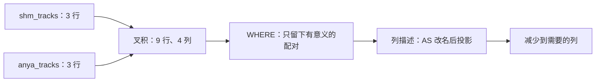
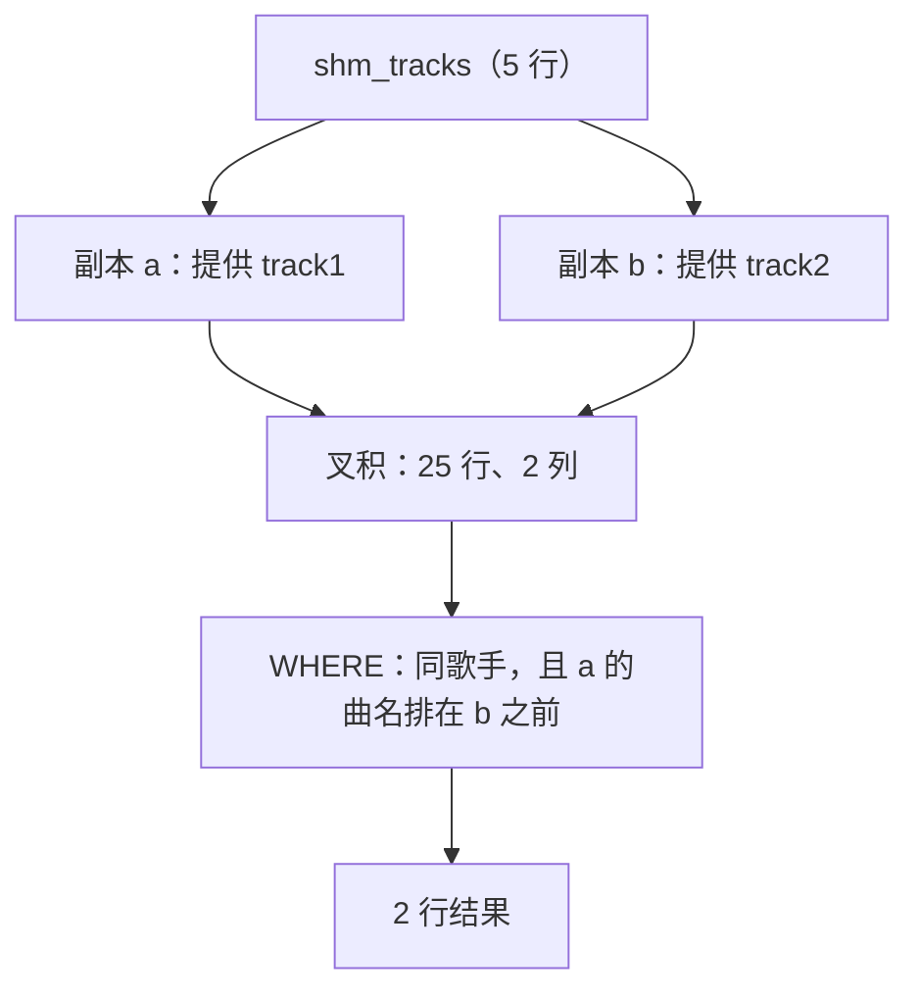
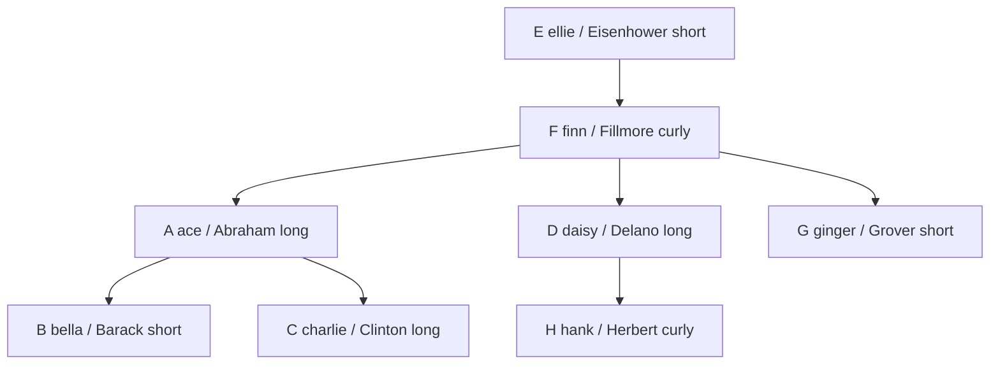

> **课程**：UC Berkeley CS61A · Structure and Interpretation of Computer Programs（Fall 2024）
> **本讲**：Lecture 36 ｜ 24:54 ｜ B 站分 P 34 ｜ [原视频](https://www.bilibili.com/video/BV1sy411z7nA?p=34)
> **课件**：`34-Tables_1pp.pdf`（22 页，官方 PDF，逐页渲染图见正文插图）
> **字幕**：B 站英文原声字幕；本笔记是中文书面化重构，非逐句翻译
> **版权**：课程与课件版权归 UC Berkeley CS61A 教学团队；本文为学习用途的二次整理

## 本讲速览

*(参考时间: 00:00:01 – 00:00:04｜Lecture 36)*


- **已掌握**：`SELECT` 的四个部件——列描述、`FROM`、`WHERE`、`ORDER BY`；`CREATE TABLE … AS` 能把一次查询的结果存成新表；SQL 对大小写与缩进不敏感，分号标记语句结束。
- **本讲主线**：
    - `FROM a, b` 不是「同时查两张表」，而是「把两张表的行两两配对」；配完之后由 `WHERE` 说清哪些配对是有意义的。
    - 两张表出现同名列会产生歧义，解析器直接拒绝执行；点表达式 `表名.列名` 与别名 `AS` 是消歧的唯一手段。
    - 一张表可以和自己连接：把它看成两份副本、各起一个别名，才能在同一行里同时拿到「两行」做比较。
    - 三张表连接就是三维叉积；`grandparents` 与 `dogs AS c, dogs AS d` 的写法，是用三次表引用换回两次查毛色。
    - 表达式可以出现在列描述、`WHERE`、`ORDER BY` 三个位置：数值用 `+ - * / %` 与 `abs`、`round`，字符串用 `||`、`substr`、`instr`。
- **关键结论**：多表查询几乎所有的错，都能拆成两问——叉积有没有穷举对，以及 `WHERE` 里的条件有没有把「连接条件」与「过滤条件」分清。

> **编者说明**：本讲有两套示例数据。录像（B 站这一版）用 `dogs`、`parents` 两张狗的血统表开场，狗名是 Abraham、Barack、Clinton、Delano、Eisenhower、Fillmore、Grover、Herbert；Fall 2024 的课件换成了「朋友圈歌单」`shm_tracks`、`anya_tracks`，并把这套狗表改名为 ace、bella、charlie、daisy、ellie、finn、ginger、hank，在课件里标注为「from the videos」。两套狗表是**同一棵树**，只是名字不同（§5 给出逐行对照）。本文按课件的顺序组织章节、代码一律以课件画面逐字为准；录像里讲师的推理、类比与验算则保留在相应位置。个别课件没有、录像口述也没有给出完整语句的地方，会明确标注为编者重建。

## 1. 复习：一条 SELECT 语句只是在投影一张表

*(参考时间: 00:00:01 – 00:00:10｜Lecture 36)*


上一讲的工具可以用一行语法概括：

```sql
SELECT [columns] FROM [table] WHERE [condition] ORDER BY [order];
```

这行语法里的每个方括号都是一个可以替换的部件。`FROM [table]` 指定输入表；`[columns]` 是逗号分隔的列描述，决定每一行输入怎么投影成一行输出；`WHERE [condition]` 从输入行里挑出子集；`ORDER BY [order]` 声明输出顺序。在列描述里，`[column] AS [name]` 把输入列在新表里改名——这个名字只影响输出的表头，不影响原来的表。

投影的规则值得单独强调一次：**列描述是「逐行」作用的**。一行输入进来，按列描述算出若干个值，组成一行输出；输入有多少行，输出就有多少行（除非 `WHERE` 先筛掉了一些）。这条「行数不变」的性质，是后面理解连接的基础——连接之所以特殊，正是因为它会先改变行数。

课件最后给的是一条保存语句：`CREATE TABLE [name] AS [SELECT statement goes here];`。它把一次查询的结果存进数据库，之后可以像普通表一样反复查询。注意它是「用查询的结果建表」，而不是「建一张空表再填」——这一点在 §2 造小表时会反复用到。

页面底部还有三条工程约定：SQL 对大小写与缩进不敏感（所以 `select`、`SELECT`、`SeLeCt` 等价，换行与缩进只影响人眼）；分号标记一条语句的结束；一条语句可以写在很多行里。这些约定在交互式解释器里尤其重要——分号没打，解释器就还在等你把话说完。

## 2. 连接的第一种视角：两张表的叉积

*(参考时间: 00:00:12 – 00:00:59｜Lecture 36)*


录像开头，讲师先给这件事打了个预防针：如果随便找个人问「什么是 join」，对方多半会先反问「你说的是哪种 join」。数据库领域琢磨这个问题的时间太长，发明出来的连接方式多到连专业人士也嫌复杂，名字还互相重叠。本讲只聚焦其中一种最基本的形式，因为其余种类都可以看成在它之上加条件或补行。

定义只有一句话：**表 A 与表 B 用逗号（或关键字 `JOIN`）连接，得到「A 的一行」与「B 的一行」组成的全部组合。** 这句话的重点不在「组合」，而在「全部」——连接的第一步是穷举，不是匹配。讲师的原话是：这就是把两张表连起来的根本含义，把所有配对列出来。

### 2.1 先造两张小表


课件用两张「朋友圈歌单」当例子。第一张是 Shm 的歌单，三首歌：

```sql
CREATE TABLE shm_tracks AS
SELECT "360" AS track, "charli" AS artist UNION
SELECT "cinderella"     , "remi"             UNION
SELECT "wildflower"     , "billie";
```

`CREATE TABLE … AS` 后面跟的不是字面数据，而是三条 `SELECT`，用 `UNION` 串起来。`UNION` 的作用是把多个查询的结果上下拼成一张表（默认去掉完全重复的行）。每条 `SELECT` 都不带 `FROM`——它没有输入表，只凭空造一行。第一条 `SELECT` 用 `AS` 给两列起了名字 `track`、`artist`，后面两条只写值，列名沿用第一条的。

这样写出来的「表」没有索引、没有约束，但它足以演示语义。课件页脚提醒：任何 SQL 解释器都能跑，例如 `code.cs61a.org` 上那个。


第二张是 Anya 的歌单，同样是三行：

```sql
CREATE TABLE anya_tracks AS
SELECT "apple" AS track, "charli" AS artist UNION
SELECT "taste"         , "sabrina"          UNION
SELECT "wildflower"    , "billie";
```

两张表结构完全一样：两列，`track` 与 `artist`。这类「同构的两张表」是连接最常见也最容易出错的场景。

### 2.2 问题：两个歌单有什么共同点


课件抛出的挑战是：写一条 `SELECT`，找出并显示两个朋友**共同拥有**的曲目；而且最好是一条「歌多到几百首时还能用」的语句。

讲师先让人用人的方式想一遍：如果手工做，会怎么系统地做？他的答案是——**拿第一张表的每一行，去和第二张表的每一行比一遍**。这不是算法课的技巧，而是连接的定义本身。接着他问：这个例子里要比多少次？三行乘三行，九次。

九次听起来不算多，但这个问题正是「要写出通用的语句」的动机：行数是 $3 \times 3 = 9$，如果两张表各有 $N$ 行和 $M$ 行，比较次数就是 $N \times M$。手写这九行不可能推广，所以要让 SQL 去穷举。

### 2.3 叉积长什么样


把两张表并排写在 `FROM` 里，就得到了那句话的可执行版本：

```sql
SELECT * FROM shm_tracks, anya_tracks;
```

结果是九行、四列。列的顺序是「先 A 的全部列，再 B 的全部列」，行的顺序是「A 的第一行配 B 的三行，然后 A 的第二行配 B 的三行……」——外层循环走 A，内层循环走 B。数一下：`shm_tracks` 的三行各出现三次，`anya_tracks` 的三行各出现三次，交叉处就是那九个配对。

讲师在录像里对这个结果有一句关键的点评：这里很多行彼此毫无关系，比如「360」那一行被配给了「taste」那一行。**它们之所以出现在结果里，不是因为它们有任何联系，而是因为穷举。**把两个毫不相干的东西放在同一行里，正是叉积的诚实之处：它不假装懂业务，它只负责把所有可能性摆上桌。至于哪一种配对才算数，是 `WHERE` 的工作。

`SELECT *` 在这里还能跑，是因为星号只是「所有列都照抄」。一旦想挑一列，问题立刻暴露：

```sql
SELECT track FROM shm_tracks, anya_tracks;
```

```text
Parse error: ambiguous column name: track
```

两张表都有一列叫 `track`，解析器无法判断你说的是哪一个。课件在这里停下，说了一句：把这个连接表里的列重新命名，工作会清楚得多。这就是下一章的事。



这张图把一条多表查询拆成了三步，值得记住的是第一步：**行数在 `FROM` 里就已经确定**，后面的 `WHERE` 只会减少、不会增加。如果一条查询的结果行数比预期多，问题多半出在 `FROM` 的叉积上，而不是 `WHERE` 漏写了什么。

> **编者说明**：下表是数据库教材里常见的连接分类，用来解释讲师开头那句「join 有很多种」。本讲只讲第一、二行；外连接（outer join）与自然连接（natural join）都不在 CS61A 的范围内，列在这里只是为了让你读到别处的 SQL 时知道它们属于同一个家族。

| 名称 | 语义 | 本讲是否涉及 |
| :--- | :--- | :--- |
| 叉积（cross join） | 所有行对，不加任何条件 | 是，`FROM a, b` 就是它 |
| 内连接（inner join） | 叉积之后按条件筛选 | 是，`FROM a JOIN b ON …` 与它等价 |
| 左/右外连接 | 内连接再补上没配上对的行 | 否 |
| 全外连接 | 两侧都补 | 否 |

## 3. 别名与点表达式：把重名列说清楚

*(参考时间: 00:05:44 – 00:06:29｜Lecture 36)*


在解释怎么消歧之前，讲师先做了一个临时约定：先假装「每一列的名字在所有表里都不一样」，把叉积和 `WHERE` 用熟；等撞上重名，再回来处理。这个顺序是有教学考虑的——消歧语法本身很轻，难的是先想清楚「连接之后，一行里混着两张表的列」这件事。

两张表可能共享一个列名（`track`、`artist` 都撞上了）。更极端也更常见的情况是：**一张表和自己必然共享全部列名**。所以解法必须同时覆盖这两种情况。

解法有两半，合起来才算完整：

- **点表达式（dot expression）**：`表名.列名`，指明这一列来自哪张表。
- **别名（alias）**：`FROM shm_tracks AS s` 给表起一个短名，之后用 `s.track` 指代它。


把两者合起来，重命名后的叉积就是：

```sql
SELECT shm_tracks.track AS s_track, shm_tracks.artist AS s_artist,
       anya_tracks.track AS a_track, anya_tracks.artist AS a_artist
FROM shm_tracks, anya_tracks;
```

结果仍然是九行，列数还是四列，但四个表头现在互不相同：`s_track`、`s_artist`、`a_track`、`a_artist`。这是这一章最重要的产出——**给列改名不是美化，而是让后续的 `WHERE` 有名字可用**。原来那两个 `track` 是同一个字符串，SQL 无法区分；改名之后，`s_track` 与 `a_track` 是两个不同的标识符，条件才写得出来。

课件在这里还留了一个小提示：终端里按上箭头可以调出上一条命令。写这种四列长语句时，改一行比重打一遍省事得多。

### 3.1 用 WHERE 把叉积筛成答案


现在可以把「共同歌曲」写出来了：

```sql
SELECT shm_tracks.track AS s_track, shm_tracks.artist AS s_artist,
       anya_tracks.track AS a_track, anya_tracks.artist AS a_artist
FROM shm_tracks, anya_tracks
WHERE s_track = a_track;
```

九行里只有一行满足条件：

| `s_track` | `s_artist` | `a_track` | `a_artist` | 为什么留下 |
| :--- | :--- | :--- | :--- | :--- |
| wildflower | billie | wildflower | billie | 同一首曲子 |

注意「共同歌曲」这个说法本身有歧义：是曲名相同就算，还是曲名与歌手都相同才算？在这个数据集里两种定义给出同一行，因为 wildflower 在两边都是 billie 唱的。真实数据里这两种定义会分道扬镳，写查询时必须先决定用哪一种。

课件接着把问题变难：怎样扩充 `WHERE`，让结果里还包括「歌手相同、但曲子不同」的配对？答案是加一个 `OR`：

```sql
WHERE s_track = a_track OR s_artist = a_artist
```

于是九行里有两行被留下：

| `s_track` | `s_artist` | `a_track` | `a_artist` | 为什么留下 |
| :--- | :--- | :--- | :--- | :--- |
| 360 | charli | apple | charli | 歌手相同 |
| wildflower | billie | wildflower | billie | 曲子相同 |

这一改动虽小，却暴露了连接的本质：`WHERE` 里的条件是对**每一个配对**独立求值的布尔表达式，`AND`、`OR` 只是把这些判据组合起来。写成 `OR` 就是「两种关系任一成立都算」，写成 `AND` 就是「必须同时成立」。同一个叉积，换一个布尔表达式就换了一个问题。

## 4. 向表里加行，再把一张表和自己连接

*(参考时间: 00:06:30 – 00:09:59｜Lecture 36)*


新的问题需要更多数据：同一歌手的「成对曲目」。原来的歌单里每位歌手只出现一次，成对无从谈起，所以先往表里插两行，让 charli 与 billie 各有两首歌：

```sql
INSERT INTO <table> VALUES (<column1>, <column2>);
```

```sql
INSERT INTO shm_tracks VALUES ("bad guy", "billie");
INSERT INTO shm_tracks VALUES ("apple", "charli");
```

`INSERT INTO` 的模板里没有列名，只有值。这意味着**值的个数与顺序必须与表的列一一对应**——课件用一行斜体提醒了这一点。写反了不会报错，只会静默地把歌手写进曲名那一列，这是 SQL 里最容易被忽略的一类错误。

插完之后 `shm_tracks` 变成五行：`360`（charli）、`apple`（charli）、`bad guy`（billie）、`cinderella`（remi）、`wildflower`（billie）。


目标是造出这样一张表：两列曲名、一列歌手，每行是一对同歌手的歌。想法很直接——需要两行数据同时在场，而表里每行只有一个曲名。**唯一的办法是让这张表出现两次**：

```sql
SELECT a.track AS track1, b.track AS track2
FROM shm_tracks AS a, shm_tracks AS b;
```

课件在这里停住，问：这条语句会显示多少行、多少列？答案是 25 行、2 列。五行的表与自身叉积，得到 $5 \times 5 = 25$ 个配对；列描述只取两列，所以是 2 列。这个练习的意义在于让人亲手算一次叉积的规模：**自连接不会因为「是同一张表」而变小，它照样是完整的笛卡尔积**。

为什么必须给两份副本起别名？因为 `shm_tracks.track` 现在指向哪一份都说不清——两份副本的列名一模一样。别名 `a`、`b` 就是把「同一张表的两个角色」变成两个可区分的名字。录像里讲师用兄弟关系解释过同一个道理：一张 `parents` 表里只有「Abraham–Barack」和「Abraham–Clinton」两行，要说出「Barack 和 Clinton 是兄弟」，必须在同一时刻看着这两行；一行里放不下两行，只能让表出现两次。


把条件补上就得到最终查询：

```sql
SELECT a.track AS track1, b.track AS track2
FROM shm_tracks AS a, shm_tracks AS b
WHERE a.artist = b.artist AND a.track < b.track;
```

结果是两行：

| `track1` | `track2` | `artist` |
| :--- | :--- | :--- |
| 360 | apple | charli |
| bad guy | wildflower | billie |

`a.artist = b.artist` 是**连接条件**：它把两张副本里「同一位歌手」的行缝在一起。`a.track < b.track` 是**去重条件**：它决定一对歌只保留一个方向。

### 4.1 为什么用小于号而不是不等号

这是全讲最值得停下来想的一处。把 `a.track < b.track` 换成 `a.track <> b.track`，功能上「也能出结果」，但结果会变丑，原因有三层：

1. **对称重复**。「360 与 apple」和「apple 与 360」是同一对歌，`<>` 两条都给。25 个配对里 `<>` 留下 20 行（五个「自己配自己」因曲名相同被排除），而这 20 行两两互为反向写法，真正的歌对只有 10 组；再叠上「同歌手」，`<>` 给出 4 行，`<` 只给 2 行。
2. **对称谓词给不出唯一代表**。`<>` 是不区分左右的关系：只要 $(x, y)$ 成立，$(y, x)$ 必然也成立，结果天生成对出现。`<` 是反对称的：一对里恰好一条满足，于是每一对正好留一个代表。
3. **规定可以任意，但必须一致**。用字典序决定谁当 `track1`，这个规定与业务无关——换成 `>` 只改方向、不改对数。它的价值不在「对」，而在「一致」：每次都挑同一边，结果才不会重复。

录像里的原话是：如果两个孩子相等，那就不是兄弟，只是 Barack 出现了两次；而如果用「不等」，就会既说「Barack 是 Clinton 的兄弟」又说「Clinton 是 Barack 的兄弟」，同一件事说了两遍。用单向的不等号，结果里每一对就只出现一次，字典序靠前的那首歌永远排在 `track1`。

这条经验可以推广成一句判据：**当答案是无序对（集合）时，用 `<` 或 `>` 挑代表；当答案是有序对（有方向的句子、有先后的事件）时，用 `<>` 保留两个方向。** §9 会看到后一种情况。



最后讲师补了一句概括：**只要连接一张表自身，就一定要用别名与点表达式**，因为连接后的一行里混着来自副本 `a` 和副本 `b` 的子行，你必须说清要比较的是哪一个 `track`、哪一个 `artist`。

## 5. 狗的血统表：把两张表拼回一棵树

*(参考时间: 00:00:57 – 00:05:40｜Lecture 36)*

> **编者说明**：课件把这一节标为「Dog Breeder (from the videos)」，位置在歌单例子之后；而录像里它出现在最前面。本章按课件的顺序插入（幻灯片必须按讲述顺序出现），因此章首的时间锚点指向录像开头那一整段。两处讲的是同一批查询，只是数据换过名字。


这套数据是 CS61A 的经典例子：一群狗，每只狗有名字与毛色，另有一张表记录亲子关系。两张表分开存：

```sql
CREATE TABLE dogs AS
  SELECT "ace" AS name, "long" AS fur UNION
  SELECT "bella"      , "short"       UNION
  ...;

CREATE TABLE parents AS
  SELECT "ace" AS parent, "bella" AS child UNION
  SELECT "ace"          , "charlie"         UNION
  ...;
```

两张表描述的是同一棵树的两半：`parents` 给出谁生了谁，`dogs` 给出每只狗的毛色。课件右侧画了两次这棵树——左边用具体名字，右边用代号 E、F、A、D、G、B、C、H。这八个代号不是装饰，它们同时是课件名字与录像名字的首字母（ellie／Eisenhower 都是 E，finn／Fillmore 都是 F），所以两套名字能一一对上，见下表。

| 代号 | 课件里的名字 | 录像里的名字 | 毛色 | 在树里的位置 |
| :--- | :--- | :--- | :--- | :--- |
| E | ellie | Eisenhower | short | 最上一代 |
| F | finn | Fillmore | curly | E 的孩子 |
| A | ace | Abraham | long | F 的孩子 |
| D | daisy | Delano | long | F 的孩子 |
| G | ginger | Grover | short | F 的孩子 |
| B | bella | Barack | short | A 的孩子 |
| C | charlie | Clinton | long | A 的孩子 |
| H | hank | Herbert | curly | D 的孩子 |

> **编者说明**：这张对照表由课件树的代号与录像口述的推理逐条核对得出。录像里的亲子关系（Abraham 是 Barack 与 Clinton 的父亲、Fillmore 是 Abraham／Delano／Grover 的父亲、Delano 是 Herbert 的父亲）与课件 `parents` 表的结构完全一致，毛色也一一对应（Eisenhower 短毛、Fillmore 卷毛、Herbert 卷毛、Grover 短毛……）。因此后文的验算对两套名字都成立。

### 5.1 卷毛狗的父母

课件的问题：写一条 `SELECT`，显示卷毛狗的父母。

```sql
SELECT parent FROM parents, dogs WHERE child = name AND fur = "curly";
```

这条语句只有一行，却包含本讲的全部要点。把它拆开看：

- `FROM parents, dogs`：两张表的叉积。`parents` 有七行，`dogs` 有八行，叉积五十六行——每一行都是「一条亲子关系 + 一只狗的全部信息」的胡乱配对。
- `child = name`：**连接条件**。它跨两张表，说的是「`parents` 里那个孩子，就是 `dogs` 里那只狗」。
- `fur = "curly"`：**过滤条件**。它只涉及 `dogs` 一张表的列，说的是「我只要卷毛的」。
- `SELECT parent`：投影。五十六行筛到两行之后，只留一列。

结果就是 `ellie` 与 `daisy`（录像里是 Eisenhower 与 Delano）。验算：卷毛狗是 `finn` 与 `hank`；`finn` 的父母是 `ellie`，`hank` 的父母是 `daisy`。

| 判据 | 连接条件（join condition） | 过滤条件（filter condition） |
| :--- | :--- | :--- |
| 涉及几张表 | 两张（或多张）表的列 | 通常只有一张表 |
| 本例 | `child = name` | `fur = "curly"` |
| 若删掉它 | 叉积照旧，但配对全是错配 | 行数变多，留下的仍然是正确的配对 |
| 回答的问题 | 这两行说的是不是同一件事 | 这些行我要不要 |
| 写错的后果 | 结果出现「狗配错了父母」这种语义错误 | 只是多几行或少几行 |

这张表解释了为什么「连接条件写错」比「过滤条件写错」危险得多：过滤条件写错，你看到的是数量不对；连接条件写错，你看到的是数量对、内容错的答案，而且这种错误在数据集小的时候往往分辨不出来。

### 5.2 录像里的另一种执行顺序

录像里讲师没有一步写出整条语句，而是分两步逼近，这个顺序对理解很有帮助：

1. 先写 `SELECT * FROM parents, dogs WHERE child = name`。得到七行（每条亲子关系恰好配上一只狗）。此时四列都在，且 `child` 与 `name` 两列的值永远相同。
2. 再追加 `AND fur = "curly"`，行数从七降到二。
3. 最后把列描述改成 `SELECT parent`，从两行四列收成一列。

这三步正好是「叉积 → 过滤 → 投影」的执行顺序。讲师在演示时说了一句很朴素的话：先看看我们进行到哪一步了。这句话值得学——多表查询不要一次写完，先把连接跑出来看看行数对不对，再加条件、再收列。

### 5.3 为什么要分成两张表

把毛色直接写进 `parents` 表（每条亲子关系后面跟两串毛色）也能用，代价是同一只狗的毛色会被反复存储：`finn` 有三个孩子，它的「curly」就要写三遍。任何一处写错，同一只狗就有了两种毛色。

拆成两张表之后，每只狗的毛色只存一次，亲子关系也只存一次；代价是每次要把两者对上，都得多写一次连接。这正是关系数据库的基本取舍——**用连接的开销换数据的一致**。录像里讲师的表述更直接：整份数据描述的是一棵树，树的形状在 `parents` 里，毛色在 `dogs` 里，因为分成了两张表，所以必须把信息连起来。

演示时还有一个实用细节值得记下：建表语句集中放在 `dogs.sql` 里，启动 SQLite 时用 `-init` 旗标让它先把文件里的语句执行一遍，之后就能直接查询。把「建数据」和「查数据」分开，是让示例可重复的第一步。

## 6. 多表连接：祖父母、同毛色与三只狗

*(参考时间: 00:10:01 – 00:14:30｜Lecture 36)*


多张表可以连接，语义完全一样：**每张表各取一行，所有组合。**两表是平面上的配对，三表就是立体的三元组，四表再往上，行数是各表行数之积。

课件先给了一道选择题，用一张表连接自身来找祖父母。五个候选，只有第 3 个正确：

```sql
SELECT a.parent, b.child FROM parents AS a, parents AS b
WHERE b.parent = a.child;
```

逐个看错在哪，比直接看答案更有收获：

| 选项 | 写的是什么 | 错在哪 |
| :--- | :--- | :--- |
| 1 | `SELECT a.grandparent, …` | `parents` 表里没有 `grandparent` 列 |
| 2 | `WHERE a.parent = b.child` | 条件方向反了，得到「自身配自身」一类的行（如 `finn` 与 `finn`），不是祖孙 |
| 3 | `SELECT a.parent, b.child … WHERE b.parent = a.child` | 正确 |
| 4 | `SELECT a.grandparent, … WHERE a.parent = b.child` | 列名不存在，条件也反了 |
| 5 | 以上都不是 | 3 是对的 |

第 3 个选项读起来像一句绕口令：`b.parent = a.child`。含义是——`a` 这一行里有个孩子，`b` 这一行里有个父母，如果这两个名字是同一个人，那么 `a` 的父母就是 `b` 的孩子的祖父母。行内人把这叫「中间人」：一个祖父与一个孙子，要通过中间那一代才连得起来，而 `parents` 表里没有「祖父」这一列，只有「父—子」的关系，所以必须把表用两次，让中间那一代在两份副本里各出现一次。

选项 2 与 3 只差一个等号的方向，却完全不是一回事：`a.parent = b.child` 找的是「`a` 的父母等于 `b` 的孩子」，这是一个「往回走」的关系，得到的配对毫无意义。**连接条件的左右两侧都不是随便放的**，虽然等号本身对称，但两张表的角色不对称。


把这条查询存成表，就有了一个可复用的视图：

```sql
CREATE TABLE grandparents AS
  SELECT a.parent AS grandog, b.child AS granpup
  FROM parents AS a, parents AS b
  WHERE b.parent = a.child;
```

注意列名 `grandog`（祖狗）与 `granpup`（孙狗）——课件在这里自造了两个词，读起来别扭，但命名是有意义的：列名应当说明这一列在**结果里的角色**，而不是它原来在哪张表里叫什么。

按课件的数据算一遍，`grandparents` 六行：

| `grandog` | `granpup` |
| :--- | :--- |
| ellie | ace |
| ellie | daisy |
| ellie | ginger |
| finn | bella |
| finn | charlie |
| finn | hank |

验算的方法就是录像里的做法：先只看一只祖狗。查 `grandog = "ellie"` 的行，得到 `ace`、`daisy`、`ginger`——正好是 `finn` 的三个孩子（录像里对应 Abraham、Delano、Grover，即 Fillmore 的三个孩子）。这一步之所以值得做，是因为**三张表的查询出错时，很少是语法错，多半是中间表算错了**。先把中间表验对，再往上叠。



### 6.1 三张表：祖孙同毛色

下一个问题是：找出所有「祖孙同毛色」的祖父母。

这里出现了全讲唯一的三表连接。为什么需要三张？因为 `grandparents` 表里只有名字，没有毛色；要把两端的毛色比出来，必须回到 `dogs` 查两次——一次查祖狗的毛色，一次查孙狗的毛色。同一张 `dogs` 用两次，就必须起两个别名：

```sql
SELECT grandog FROM grandparents, dogs AS c, dogs AS d
WHERE grandog = c.name AND
      granpup = d.name AND
      c.fur = d.fur;
```

四个条件、三个 `AND`，可以读成三句话：

- `grandog = c.name`：`c` 这份 `dogs` 副本负责祖狗，把毛色带进来。
- `granpup = d.name`：`d` 这份副本负责孙狗。
- `c.fur = d.fur`：两端的毛色要相同。

行数也值得算一次：`grandparents` 六行 × `dogs` 八行 × `dogs` 八行 = 384 行叉积被筛成两行（`ellie`、`finn`；录像里是 Eisenhower、Fillmore）。三次表引用不是浪费，而是**每一次引用都在为一次「查毛色」付费**。

验算：`ellie`（short）的孙子是 `ace`（long）、`daisy`（long）、`ginger`（short）——只有 `ginger` 同毛色；`finn`（curly）的孙子是 `bella`（short）、`charlie`（long）、`hank`（curly）——只有 `hank` 同毛色。两个答案与查询结果一致。

投影只选了 `grandog` 一列，所以结果里 `ellie`、`finn` 各出现一次。如果换成 `SELECT grandog, granpup`，就能看到具体是哪一对祖孙匹配——这也是调试这类查询的常用手法：**先多选几列看清楚，再收到最终答案**。

### 6.2 综合练习：三只同毛色的狗


课件最后一页是一道 2014 年秋季小测的改编题：写一条查询，选出**三只互不相同、毛色相同**的狗的所有组合，每组按逆字母序排列。期望输出是两行：

```text
daisy|charlie|ace
ginger|ellie|bella
```

其中竖线是 SQLite 命令行默认的列分隔符。

题目本身不难，难在**它要求三只互不相同**，而叉积会给出大量含重复的组合：三只都是同一只狗的三元组有 8 个，「甲乙甲」这种有一只重复的更多。期望输出给了提示：每一组都按逆字母序书写（`daisy` 大于 `charlie` 大于 `ace`；`ginger` 大于 `ellie` 大于 `bella`）。这正好可以用 §4 那个技巧的推广：

> **编者说明**：课件只给了题目与期望输出，没有给答案，录像这一段也是纯演示（没有讲解）。下面的语句是编者按题意重建的，用三次表引用加三个不等式来同时表达「同毛色」与「互不相同、且只出现一个方向」。

```sql
SELECT a.name, b.name, c.name
FROM dogs AS a, dogs AS b, dogs AS c
WHERE a.fur = b.fur AND b.fur = c.fur
      AND a.name > b.name AND b.name > c.name;
```

三个不等式连起来，等于要求 $a > b > c$：既排除了任意两只相同，也保证每组三只狗只按一种顺序出现。行数的变化很能说明问题——完全不筛是 $8^3 = 512$ 行；只保留三个毛色条件剩 $3^3 + 3^3 + 2^3 = 62$ 行；再补上三个不等式，只剩两行。

再核对毛色：`long` 有 ace、charlie、daisy 三只，`short` 有 bella、ellie、ginger 三只，`curly` 只有 finn、hank 两只——凑不满三个。于是 `long` 组给出 `daisy|charlie|ace`，`short` 组给出 `ginger|ellie|bella`，与期望输出一致。`curly` 组一行也没有，这不是错误，是数据本身就没有三个卷毛。

题目要求的「逆字母序」指的是每组三只狗内部的排列，不是结果行的先后；上面这条语句没有 `ORDER BY`，两行的先后由数据库自己决定。要严格复现期望输出的顺序，还得再加一个排序键。

## 7. 数值表达式：SQL 与 Python 的共同语法

*(参考时间: 00:14:34 – 00:19:20｜Lecture 36)*


连接把列凑到一起，表达式则决定这些列能做什么。SQL 的数值表达式与 Python 的几乎是同一套东西，难点不在语法，而在**它能出现在哪里**。


一条 `SELECT` 里有三个位置可以写表达式：列描述里的 `[expression] AS [name]`、`WHERE [expression]`、`ORDER BY [expression]`。讲师的说法是：这三处的表达式规则相同，`+`、`-`、`*`、`/`、`%`、`and`、`or` 都能用，`abs`、`round`、`not` 与一元负号也能用。

课件把算子分了三类，这个分法比逐个背更有用：

| 类别 | 算子 | 作用 |
| :--- | :--- | :--- |
| 合并（combine） | `+` `-` `*` `/` `%` `and` `or` | 把多个值算成一个 |
| 变换（transform） | `abs` `round` `not` 一元 `-` | 换掉一个值的形状或符号 |
| 比较（compare） | `<` `<=` `>` `>=` `<>` `!=` `=` | 把值变成一个布尔判据 |

比较类里有两处与 Python 不同，课件特意点出。第一，**不等于有两种写法**：`<>` 与 `!=`，两者完全等价，课程里两种都用。第二，**等号只有一个 `=`**。这一点初学者常写错成 `==`。讲师给的理由很干脆：这里没有「赋值」这回事，所以单个等号没有别的用途，可以直接用来表示相等。

### 7.1 演示：城市、纬度与航程

录像里的演示从一张城市表开始：`cities` 有 `name`、`latitude`、`longitude` 三列，装的是 Berkeley、Cambridge、Minneapolis、San Diego、Miami，以及一只「其实不算城市但先放着吧」的 North Pole。

第一个演示是 `UNION`：

```sql
SELECT name FROM cold;
```

得到 Minneapolis 与 North Pole。但「冷的地方」不止这些，Chicago 也冷。要把它并进来，就用 `UNION` 把两条查询上下拼成一张表：

```sql
SELECT name FROM cold
UNION
SELECT "Chicago";
```

> **编者说明**：录像里讲师只说「可以用一个 UNION 把 Chicago 也弄进同一张表」，没有念出第二条 `SELECT` 的完整写法。这里用 `SELECT "Chicago"` 是因为 SQLite 允许不带 `FROM` 的查询——课件的歌单表正是用这个写法造出来的，与课堂风格一致。

第二个演示是算术表达式。目标是算两座城市之间的南北向距离：

```sql
CREATE TABLE distances AS
  SELECT a.name AS first, b.name AS second,
         60 * (b.latitude - a.latitude) AS distance
  FROM cities AS a, cities AS b;
```

这里又是自连接：`a` 与 `b` 是两个版本的 `cities`，所以能在同一行里放下两座城市的纬度。`b.latitude - a.latitude` 是「从第一座城到第二座城要往北走多少度」，乘 60 是因为一度纬度约合 60 海里。表达式的值被 `AS distance` 命名，于是整张 `distances` 表有了一个可排序的列。

> **编者说明**：录像字幕在这里写的是「一度纬度有 16 海里」，但紧接着写出的表达式是 `60 * …`。按定义，一度纬度约 60 海里（1 海里 = 1 分纬度），表达式与定义一致，字幕那个 16 应是口误或识别错误。本文以表达式为准。

南北距离之所以重要，讲师给了理由：**气候主要由纬度决定，东西向的经度差别远没有南北向重要**。这是一句业务判断，却决定了查询该算哪个表达式——先想清楚「什么量对问题有意义」，再写 SQL。

有了 `distances`，站在 Minneapolis 上找「离我远的地方」就很自然：

```sql
SELECT second FROM distances WHERE first = "Minneapolis" ORDER BY distance;
```

`ORDER BY distance` 默认升序，于是负得最多的排最前——也就是**往南走得最远的**。结果最前面是 Miami 与 San Diego，最后是 North Pole。讲师对此的评论带着点玩笑：明尼阿波利斯人喜欢去 Miami 和 San Diego，不太喜欢去北极。

这个例子还有一个隐含的教学点：`ORDER BY` 里可以用一个表达式，甚至可以用一个在列描述里刚起名的别名。排序依据不必是输入的某一列，可以是算出来的量。

## 8. 字符串表达式：拼接、子串与「别用字符串存结构」

*(参考时间: 00:19:27 – 00:22:25｜Lecture 36)*


字符串值的组合方式是拼接（concatenation），算子是两条竖线 `||`：

```sql
SELECT "hello," || " world";
```

```text
hello, world
```

讲师的语气在这里明显轻松了：这是一件非常常见的事，所以他「给它开了绿灯」。


但接下来的语气就变了。SQL 里内置了一些基础的字符串处理函数，它们与 Python 的同名功能不同，而且讲师直说：**这门语言对字符串处理的支持并不算好**。

```sql
CREATE TABLE phrase AS SELECT "hello, world" AS s;
SELECT substr(s, 4, 2) || substr(s, instr(s, " ")+1, 1) FROM phrase;
```

```text
low
```

结果是 `low`，可以逐段验算：`substr(s, 4, 2)` 从第 4 个字符开始取 2 个，得到 `lo`；`instr(s, " ")` 找空格的位置，`hello, world` 里空格是第 7 个字符，加 1 得 8，`substr(s, 8, 1)` 取一个字符，得到 `w`；两段拼起来就是 `low`。讲师的原话是：前半段取了 L 和 O，后半段取了 W。

这两个函数最容易踩的坑是**下标从 1 开始**。Python 里写 `s[3:5]` 拿到第 4、5 两个字符，SQL 里要写 `substr(s, 4, 2)`：起始位置加一（SQL 从 1 数起），长度则直接给出。习惯 0-based 的人写 SQL 字符串函数，第一个 bug 几乎总是这里。

真正让讲师摇头的是下一个演示——用字符串表示结构化数据：

```sql
CREATE TABLE lists AS SELECT "one" AS car, "two,three,four" AS cdr;
SELECT substr(cdr, 1, instr(cdr, ",")-1) AS cadr FROM lists;
```

```text
two
```

这张表的每一行被当成一个链表：`car` 是第一个元素，`cdr` 是剩下元素用逗号拼起来的一串。取 `cadr`（第二个元素）的办法是：找到第一个逗号的位置，把它前面那段切出来——`instr(cdr, ",")` 得 4，减 1 得 3，取前 3 个字符就是 `two`。

讲师对这个技巧的评价是：这样做当然可以，但**通常不是好主意**，而且有远为更好的方式来表达数据结构。理由是清楚的：逗号分隔的约定没有任何约束力——元素里本身含逗号怎么办？空列表怎么表示？嵌套列表怎么表示？每多一个边界情况，就要多一层手写的 `instr` 判断；而真正的关系数据库提供了「另开一张表」这个更直接的选项。**在表里塞字符串，等于把结构信息藏进文本，让数据库再也帮不上忙。**

| 运算 | SQL 写法 | Python 对照 | 差异 |
| :--- | :--- | :--- | :--- |
| 拼接 | `a \|\| b` | `a + b` | 运算符不同 |
| 取子串 | `substr(s, 4, 2)` | `s[3:5]` | SQL 是 1-based，且第二位是长度 |
| 找位置 | `instr(s, " ")` | `s.find(" ")` | SQL 返回 1-based，找不到返回 0 |
| 相等 / 不等 | `=` / `<>` 或 `!=` | `==` / `!=` | SQL 用单个等号 |
| 布尔值 | 没有独立类型，用 0/1 与 `and` `or` | `True` / `False` | 表达习惯不同 |

## 9. 用字符串拼句子：连接出来的语言

*(参考时间: 00:22:28 – 00:24:53｜Lecture 36)*

最后一个演示把本讲的两条线接在一起：**自连接提供组合，拼接把组合说成句子。**

先造一张名词表：

```sql
CREATE TABLE nouns AS
  SELECT "dog" AS phrase UNION
  SELECT "cat"          UNION
  SELECT "bird";
```

一行一个名词。然后要造句，句子需要主语和宾语两个位置——而表里只有一行。于是又把 `nouns` 用了两次：

```sql
SELECT "the " || a.phrase || " chased the " || b.phrase AS sentence
FROM nouns AS a, nouns AS b
WHERE a.phrase <> b.phrase;
```

九个配对里筛掉三个「自己追自己」，剩下六句：

```text
the bird chased the cat
the bird chased the dog
the cat chased the bird
the cat chased the dog
the dog chased the bird
the dog chased the cat
```

请注意这里用的是 `<>` 而不是 `<`：**「狗追猫」与「猫追狗」是两个不同的事实**，都要保留。这与 §4 的成对曲目恰好相反——那里一对歌没有方向，所以要用 `<` 挑代表。同一个去重问题，答案取决于「这一对是有序还是无序」。

还能更复杂。造一张 `ands` 表，把两个名词用 `and` 连成一个短语：

```sql
CREATE TABLE ands AS
  SELECT a.phrase || " and the " || b.phrase AS phrase
  FROM nouns AS a, nouns AS b
  WHERE a.phrase <> b.phrase;
```

六个短语（`dog and the cat`、`dog and the bird`、……）。然后**不再从 `nouns` 取主语，而是从 `ands` 取**，语句的形状一点没变：

```sql
SELECT "the " || a.phrase || " chased the " || b.phrase AS sentence
FROM ands AS a, ands AS b
WHERE a.phrase <> b.phrase;
```

于是就有了这样的句子：the dog and the bird chased the cat and the dog；the dog and the bird chased the dog and the cat。三十句，全是合法组合。

> **编者说明**：课件没有这一段的 SQL，录像里讲师是一边敲一边讲，字幕没有记录完整语句。上面的建表与拼接写法按口述重建：`nouns` 存裸名词（dog、cat、bird），句子的模板里补上冠词 `the`，这样输出正好与录像念出的「the dog and the bird chased the cat and the dog」一致。`ands` 的短语里用 `and the` 而不是 `and`，也是为了让冠词只出现一次。

这一段的用意超出了字符串处理本身。讲师最后说的是：这就是语言组合的所有方式。名词表是一个集合，自连接产生**组合**，拼接把组合**渲染成字符串**——一个语法上无穷的句子集合，就这样从一张三行的表里长出来。用数据库的术语说，语言的最小单位是关系，句子的生成是关系的连接；用 CS61A 的术语说，这又是一次「用小的、可组合的部件造出大的行为」。

## 小结

*(参考时间: 00:24:49 – 00:24:53｜Lecture 36)*

- **连接 = 穷举 + 筛选**。`FROM a, b` 先给出全部配对，`WHERE` 再决定哪些配对有意义。任何时候觉得多表查询「想不清」，都回到这两步：叉积的行数是多少？留下的那一行凭哪条条件成立？
- **`WHERE` 里住着两种条件**。连接条件跨表，回答「这两行说的是不是同一件事」；过滤条件通常在单表内，回答「这行我要不要」。前者写错得到的是数量正确、语义错误的答案，最难发现。
- **别名与点表达式不是可选的装饰**。一旦两张表共享列名（自连接必然如此），`表名.列名` 是唯一能指明来源的语法，而 `AS` 是让「同一张表的两个角色」可区分的唯一手段。
- **无序的对用 `<`，有序的对用 `<>`**。成对曲目、成对的狗、三只狗的组，都只要一个方向，用 `<` 挑代表；「谁追谁」「谁是谁的兄弟」这类有方向的事实，两个方向都要，用 `<>`。
- **表引用次数 = 需要查几次**。求祖父母要把 `parents` 用两次，比祖孙毛色要把 `dogs` 用两次。多一次引用不是啰嗦，而是一次真实的再查询；行数是各表行数之积，三表 384、四表更夸张，所以能先算中间表就先算。
- **表达式可以出现在三个位置**：列描述（造新列）、`WHERE`（造判据）、`ORDER BY`（造排序键）。SQL 的等号只有一个 `=`，不等于有 `<>` 与 `!=` 两种；`substr` 的下标从 1 开始。
- **不要用字符串存结构**。拆成表加连接，虽然多写几个字，但结构从此可查、可校验；把结构塞进逗号分隔的字符串，等于把数据库降级成文本文件。

## 附：本讲幻灯片索引

*(参考时间: 00:00:01 – 00:24:53｜Lecture 36)*

| 页 | 内容 | 出现位置 |
| :--- | :--- | :--- |
| 1 | 标题页 Tables | 本讲速览 |
| 2 | Announcements 公告页 | 本讲速览 |
| 3 | 复习：SELECT 的四部件与 CREATE TABLE AS | §1 |
| 4 | 分节页：Joining Tables | §2 |
| 5 | 用 UNION 建 shm_tracks 歌单表 | §2.1 |
| 6 | 用 UNION 建 anya_tracks 歌单表 | §2.1 |
| 7 | 挑战：两个歌单的共同曲目与比较次数 | §2.2 |
| 8 | 叉积九行四列与 ambiguous column 解析错误 | §2.3 |
| 9 | 分节页：Aliases and Dot Expressions | §3 |
| 10 | 点表达式与 AS 改名后的九行四列 | §3 |
| 11 | WHERE 筛选：共同歌曲，以及扩充为共同歌手 | §3.1 |
| 12 | INSERT INTO 加行与「同歌手成对曲目」目标 | §4 |
| 13 | 自连接：一份表两个别名与 25 行 2 列 | §4 |
| 14 | 同歌手配对：`artist =` 加 `track <` | §4 |
| 15 | 狗场数据：parents 与 dogs 两表与树形图 | §5 |
| 16 | 祖父母选择题（五个候选） | §6 |
| 17 | 多表连接：grandparents 表与三表同毛色查询 | §6.1 |
| 18 | 狗三元组：2014 秋季小测改编题 | §6.2 |
| 19 | 分节页：Numerical Expressions | §7 |
| 20 | 数值表达式：三类算子与两个不等号 | §7 |
| 21 | 分节页：String Expressions | §8 |
| 22 | 字符串拼接、substr 与用字符串存列表 | §8 |
